# Chapter 01 — Frame

<!-- style: plain -->

You build the frame: an open box of aluminium bars that every other part of the printer bolts to. Once it is square, Ch 02 (Z drives) and Ch 03 (build plate) can start.

**What you're building in this chapter:** The bars are 2020 extrusion: aluminium, 20 × 20 mm, with a slot down each face that nuts and screw heads slide into. Four long ones stand upright in the corners (the **verticals**). Four shorter ones join them at the bottom (the **bottom square**) and four more at the top (the **top square**). Two more run front to back across the base to carry the heated bed (the **bed extrusions**). Every corner is a *blind joint*: a screw goes into the end of a horizontal, its head hides inside the vertical's slot, and you tighten it through a small hole in the vertical. You put everything together loosely, measure and nudge until the frame is square, and only then tighten it. That order matters. A screw tightened on a crooked frame locks the crookedness in, and everything built later copies it.

```mascot
pose: hexkey
caption: Square the frame once, properly. Everything above copies this frame, including its mistakes, forever.
```

**Time:** 2.5–4.0 h hands-on, first build, two people ([survey §5.1 P01 / §7.2](../voron-build-instructions-survey.md)).

**Sessions:** 4 × ~40 min (35 to 65 min each). Each session ends at a safe place to stop. The second, Steps 01.6 to 01.15, takes about 65 min and cannot be stopped halfway.

**Prerequisites:**

- **Ch 00** is done: kit checked, extrusions counted, tools out.
- **No printed parts are needed.** You can build the frame the day the kit arrives, while the printer works on later batches. Ch 02 needs B00, B01 and B02 plates P1 to P3, so start it once those are off the bed and sorted ([print plan §2](../voron-print-plan.md)).

**Tools**

- 3 mm hex key with a straight end, long arm: the kit's 3 mm hex key, which LDO's kit list includes. Whether its long arm ends straight or in a ball is a bench check (verify on bench). The Fabreeko set is ball-end, which is fine for the first loose pass but slips out under final tightening
- Machinist square, 150 mm: a precise L-shaped ruler for checking right angles
- Steel rule, 300 mm, and a steel tape measure of 1 m or more (the longest measurement is about 735 mm)
- Straightedge and feeler gauges, 0.02–0.10 mm: thin metal leaves for measuring small gaps
- The flat surface you chose in Step 00.10: the kitchen stone counter
- Rubber or nylon mallet
- Small flat file, for a rough edge on a cut end (it is on the Chapter 00 tool list)
- Masking tape and a marker
- Optional: torque screwdriver, 0.5–3 N·m

**Read first**

- **Loose first, square second, tight last.** Do not fully tighten any screw until a step tells you to.
- **Never force a T-nut into a slot.** The fit is tight in this kit. If one sticks, try another slot or another nut.
- **"M5 shim" in the Voron manual means the brass M5 precision spacer** in this kit, here and in every later chapter.
- **The 20 black rubber plugs** in the *Electronics 2* box are blind joint seals. They go in at Step 01.23.
- **Leave the titanium strips (the backers) in their bag.** They belong to Ch 05, and fitting them now means taking things apart later.

<!-- reference -->

**Printed parts**


| STL | Qty | Colour |
|---|---|---|
| *none — this chapter needs no printed parts* | — | — |

**Hardware** (chapter totals)

| Fastener / part | Qty | Where |
|---|---|---|
| A extrusion | 10 | 4 bottom + 4 top frame (p.15–17), 2 bed (p.18–20) |
| B extrusion | 4 | verticals (p.15–16) |
| M5×16 BHCS | 20 | 16 frame blind joints + 4 corner brackets |
| Corner bracket, 2020 cast — from the kit, no LDO BOM row | 4 | one per bed-extrusion end (p.18); `(verify on bench)` which box carries them |
| M5×10 BHCS | 4 | bed extrusions down to the frame (p.19) |
| **M5 precision spacer, brass** | 4 | under each M5×10 head — replaces the manual's "M5 shim" |
| M5 T-nut, roll-in | 4 | bottom rails, under the bed extrusions (p.19) |
| Extrusion Blind Joint Seal | 16 | one per blind joint, in the vertical's slot against the horizontal (01.23); LDO ships 20, 4 are spares |

C, D and E extrusions are sorted here but **not used** in this chapter — they are the gantry (manual p.85, p.88, p.101 → Ch 05).

**Notes behind "Read first"**

- **Frame squaring is the one irreversible quality decision in this build.** Re-check after every tightening pass. Gantry racking, quad-gantry-level and bed mesh all inherit what you set here (survey §4.4 #1).
- Extrusion and roll-in T-nut tolerances are tight in this kit. LDO: *"Due to the tight tolerances of the extrusions and roll-in t-nuts it is advisable to either test fit before assembly to identify the sides of the extrusions that fits the best or to pre-load the t-nuts into the extrusions."* [src](https://docs.ldomotors.com/en/voron/voron2/build-faq)
- Every **"M5 shim"** in the official manual is a **brass M5 precision spacer** in this kit — here and for the rest of the build.
- **Rev D+ / LDO: 20 Extrusion Blind Joint Seals** (*Electronics 2*) are black rubber plugs that stop chamber air leaking along the extrusion slots. One goes in each blind joint, in the vertical's slot hard against the horizontal, at Step 01.23 once the frame is square and before the Z rails cover four of those slots. [src](https://docs.ldomotors.com/en/voron/voron2/350_BOM/Rev_D+) · [listing](https://west3d.com/products/extrusion-blind-joint-seals-20-pieces-by-ldo-motors)
- **Titanium extrusion backers are NOT installed in this chapter.** They go onto the gantry's X and Y extrusions during **Ch 05**, on the face opposite the rail. Leave them bagged; fitting them to frame extrusions now would be wrong and fitting them after the gantry is assembled costs a teardown (survey §4.4 #3, §5.2 W2). This is the only place this note appears.
- Nothing here is printed. Build it the day the kit lands; the printer may be busy with later batches, and this chapter needs none of them.

**Sources for this chapter:**

- [Voron 2.4r2 assembly manual (pinned `de7e89d`)](https://github.com/VoronDesign/Voron-2/blob/de7e89d/Manual/Assembly_Manual_2.4r2.pdf) pages 12–21 — extrusion sort, blind joints, bottom and top squares, bed extrusions, squareness check
- [LDO Build Notes (Rev D)](https://docs.ldomotors.com/voron/voron2/build-faq) — roll-in T-nut tolerance, and the brass M5 precision spacer substituted for every "M5 shim"
- [blind-joint video](https://voron.link/onjwmcd) and [frame squaring video](https://voron.link/kdtpzam) — the two videos the manual links from p.10 and p.21
- [whopping_Voron_mods — `extrusion_backers`](https://github.com/tanaes/whopping_Voron_mods/tree/main/extrusion_backers) — why the titanium backers are Ch 05 parts, not frame parts
- [survey](../voron-build-instructions-survey.md) §4.2, §4.4, §5.2

**Video coverage (Steve Builds, pre-release LDO kit — differs from Rev D+):** [Part 1 @0:54:42](https://www.youtube.com/watch?v=feTxcc0LIWM&list=PL0fUJbigELQPqpeGOgHYisG4KaSXVtnNY&t=3282s) (+2m), [Part 1 @0:55:46](https://www.youtube.com/watch?v=feTxcc0LIWM&list=PL0fUJbigELQPqpeGOgHYisG4KaSXVtnNY&t=3346s) (+19m), [Part 1 @1:14:12](https://www.youtube.com/watch?v=feTxcc0LIWM&list=PL0fUJbigELQPqpeGOgHYisG4KaSXVtnNY&t=4452s) (+14m), [Part 1 @1:29:00](https://www.youtube.com/watch?v=feTxcc0LIWM&list=PL0fUJbigELQPqpeGOgHYisG4KaSXVtnNY&t=5340s) (+19m), [Part 5 @3:14:50](https://www.youtube.com/watch?v=hTKCBrk36R0&list=PL0fUJbigELQPqpeGOgHYisG4KaSXVtnNY&t=11690s) (+2m)

---

### Step 01.1 — Verify the flat reference surface

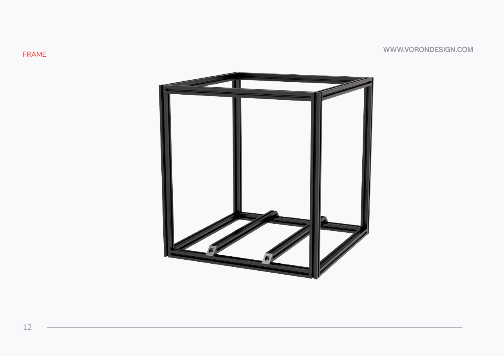{ crop="0.30 0.18 0.76 0.80" }

**What you're looking at:** The frame takes its shape from whatever it is built on. A counter with one corner slightly high gives a twisted frame, and that cannot be fixed later. So check it once more.

**Parts:** none.

**Do:**

1. Clean the patch you marked with tape in Step 00.10.
2. Lay the straightedge across it five ways: left to right, front to back, both diagonals, through the centre. Each time, try to slide a feeler gauge under.
3. Make sure both of you can reach all four corners. Put no mat or cloth on the stone.

**Check:** The thickest feeler leaf that slides under is 0.1 mm or thinner, no worse than in Ch 00, and the straightedge does not rock. Log the number.

**Helper:** Reads the thickest feeler leaf that slides under and writes it in the log.

Source: [Voron manual p.12](https://github.com/VoronDesign/Voron-2/blob/de7e89d/Manual/Assembly_Manual_2.4r2.pdf#page=12) · [Voron manual p.15](https://github.com/VoronDesign/Voron-2/blob/de7e89d/Manual/Assembly_Manual_2.4r2.pdf#page=15) · [Video: Part 1 @0:53:46](https://www.youtube.com/watch?v=feTxcc0LIWM&list=PL0fUJbigELQPqpeGOgHYisG4KaSXVtnNY&t=3226s)

---

### Step 01.2 — Sort the extrusions by length

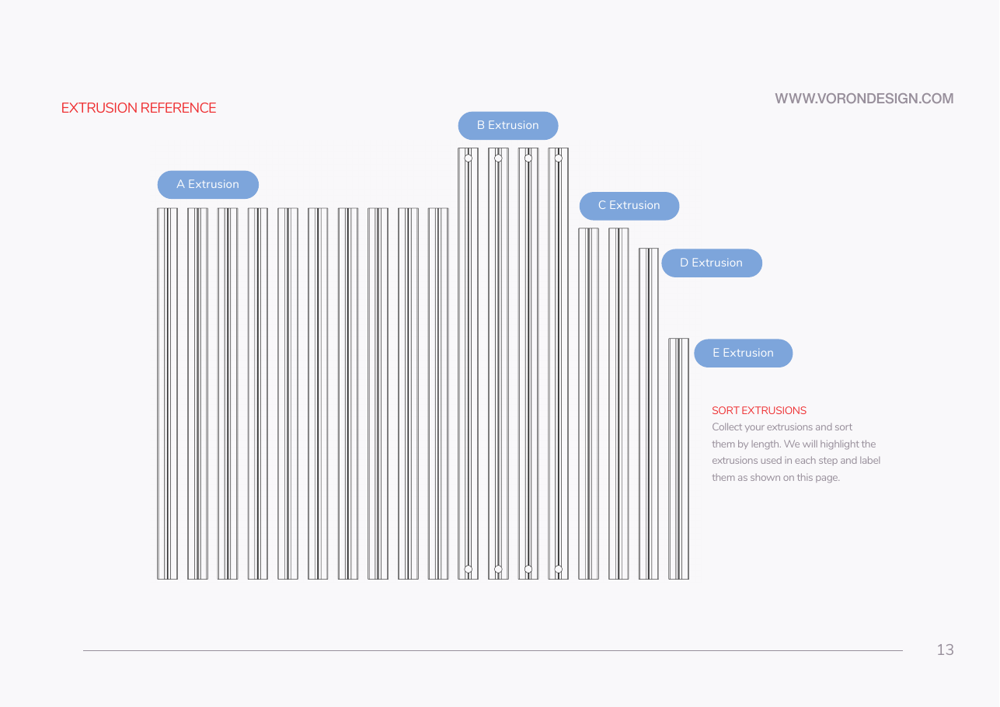{ crop="0.14 0.19 0.84 0.84" }

**What you're looking at:** The kit has 18 extrusions in five lengths, named A to E. This chapter uses only A (the horizontals) and B (the verticals). C, D and E belong to the gantry in Ch 05.

**Parts:**

- staged: A extrusion ×10
- staged: B extrusion ×4
- staged: C extrusion ×2
- staged: D extrusion ×1
- staged: E extrusion ×1
- consumable: masking tape
- tool: marker

**Do:**

1. Lay all the extrusions out and sort them by length.
2. Label each pile A, B, C, D or E with masking tape.
3. Bag C, D and E apart from the rest and label the bag "Ch 05".

**Check:** You count 10 A, 4 B, 2 C, 1 D and 1 E. The four B extrusions are the only ones with a small round **access hole** near each end.

**Helper:** Sorts the extrusions into piles by length and counts each pile aloud.

Source: [Voron manual p.13](https://github.com/VoronDesign/Voron-2/blob/de7e89d/Manual/Assembly_Manual_2.4r2.pdf#page=13)

---

### Step 01.3 — Inspect the ends and test-fit a T-nut

{ crop="0.14 0.19 0.84 0.84" }

**What you're looking at:** Two things spoil a joint: a rough edge (a burr) on a cut end, and a tight slot. A roll-in T-nut drops into a slot and turns to lock.

**Parts:**

- tool: M5 roll-in T-nut, fit test, back in its tray
- tool: M3 roll-in T-nut, fit test, back in its tray
- tool: machinist square
- tool: small flat file

**Do:**

1. Check both ends of every A and B extrusion. File off only a burr, never the flat face.
2. Roll the M5 T-nut into all four slots of each A. Tape the slot it fits best; mark any slot where it sticks with an X.
3. Roll the M3 T-nut into each B slot without an access hole, or all four if all have one.

**Check:** Every end sits flat against the square, each A has a taped slot, and the M3 T-nut turns by finger in every tested B slot.

The Voron CAD drills the access holes through all four faces of each vertical, while the manual draws only two. Count the faces with holes on one of your B extrusions (verify on bench).

⚠ Never force a T-nut. LDO warns that the fit is tight in this kit. If one will not turn, try another slot or another extrusion. [src](https://docs.ldomotors.com/en/voron/voron2/build-faq)

Source: [Voron manual p.13](https://github.com/VoronDesign/Voron-2/blob/de7e89d/Manual/Assembly_Manual_2.4r2.pdf#page=13) · [LDO Build Notes (Rev D)](https://docs.ldomotors.com/voron/voron2/build-faq)

---

### Step 01.4 — Start an M5×16 BHCS in each end of eight A extrusions

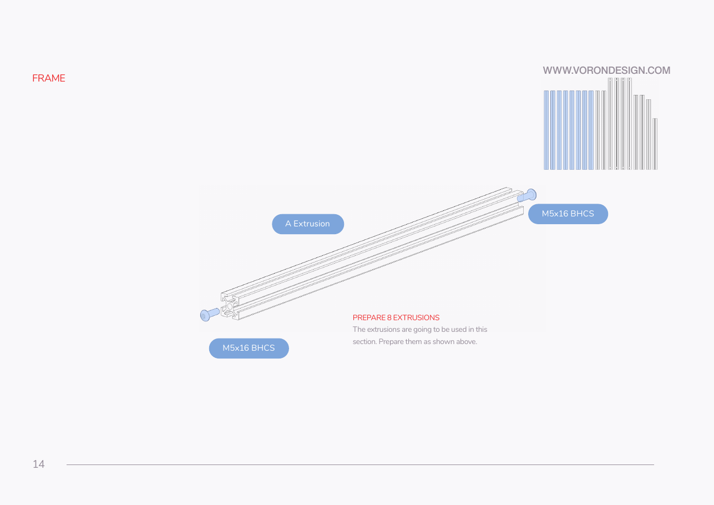{ crop="0.27 0.15 0.94 0.72" }
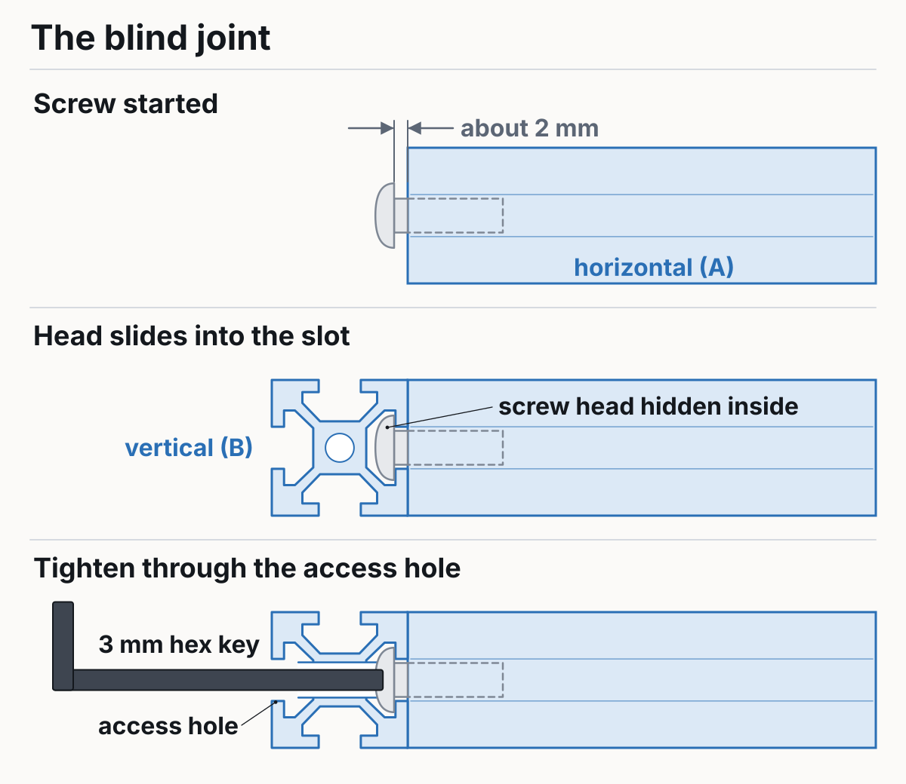

**What you're looking at:** Each joint's screw goes into a horizontal's end first, because later its head hides inside the vertical. BHCS means button head cap screw: a screw with a low, domed head.

**Parts:**

- A extrusion ×8
- M5×16 BHCS ×16

**Do:**

1. Take 8 of the 10 A extrusions. Set the other 2 aside for the bed.
2. Thread an M5×16 BHCS into the hole in each end, 16 screws in all. Stop when 2 to 3 mm of the screw still shows under its head.
3. Leave them finger-loose. If a screw is hard to turn, try a fresh one. If that is stiff too, the extrusion's thread is damaged: stop and ask your kit vendor.

**Check:** All 16 screws went in smoothly and stick out by the same amount.

No Voron page gives this gap. The 2 to 3 mm comes from the Voron CAD model: the vertical's slot has a 2 mm lip, and the head slides past it only with a gap of 2 to about 3.25 mm. Aim for the middle, about 2.5 mm.

Source: [Voron manual p.14](https://github.com/VoronDesign/Voron-2/blob/de7e89d/Manual/Assembly_Manual_2.4r2.pdf#page=14)

---

### Step 01.5 — Understand the blind joint before you make one


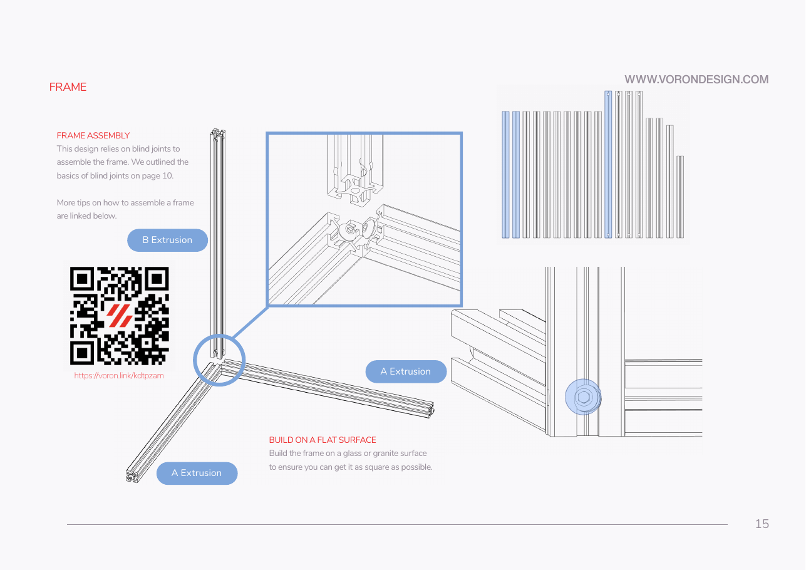{ crop="0.32 0.22 0.90 0.80" }

**What you're looking at:** This is a practice run of the joint that holds the whole frame together: the blind joint. The screw head slides into a slot in the vertical, and you tighten it through the access hole on the opposite side. Nothing is tightened for real yet.

**Parts:** none.

**Do:**

1. Take one A and one B extrusion. From the B's open end, slide the A's screw head into the slot on the face opposite an access hole. [src](https://voron.link/onjwmcd)
2. Push the 3 mm hex key through that access hole until it sits in the screw head.
3. Take the two apart again.

**Check:** You can see the screw's hex socket through the access hole, and the key goes straight into it.

Source: [Voron manual p.15](https://github.com/VoronDesign/Voron-2/blob/de7e89d/Manual/Assembly_Manual_2.4r2.pdf#page=15) · [Voron manual p.10](https://github.com/VoronDesign/Voron-2/blob/de7e89d/Manual/Assembly_Manual_2.4r2.pdf#page=10) · [blind-joint video](https://voron.link/onjwmcd) · [Video: Part 1 @0:54:58](https://www.youtube.com/watch?v=feTxcc0LIWM&list=PL0fUJbigELQPqpeGOgHYisG4KaSXVtnNY&t=3298s)

Pause: ~40 min since the last pause — extrusions sorted and labelled, ends checked, 16 screws started in eight A extrusions, one practice joint tried and taken apart. Nothing is assembled. The next session takes about 65 min and cannot be stopped halfway, so start it when you have the time.

---

### Step 01.6 — Lay out the bottom square on the reference surface

{ crop="0.06 0.20 0.60 0.86" }

**What you're looking at:** Now the real build starts, flat on the counter. Lay out the bottom square first, leaving a gap at each corner where a vertical will stand.

**Parts:**

- reused: A extrusion ×4, prepared

**Do:**

1. Lay four of the prepared A extrusions on the stone in a square, taped slot facing up. They do not touch each other.
2. Point each end into a corner gap of about 20 × 20 mm, the size of a vertical.
3. Stick tape marked **FRONT** on the side facing you. Any side will do.

**Check:** All four lie flat on the stone with nothing lifting, and each corner has a square gap of roughly 20 × 20 mm.

Source: [Voron manual p.15](https://github.com/VoronDesign/Voron-2/blob/de7e89d/Manual/Assembly_Manual_2.4r2.pdf#page=15) · [Video: Part 1 @0:53:47](https://www.youtube.com/watch?v=feTxcc0LIWM&list=PL0fUJbigELQPqpeGOgHYisG4KaSXVtnNY&t=3227s)

---

### Step 01.7 — Join the first vertical to the first corner

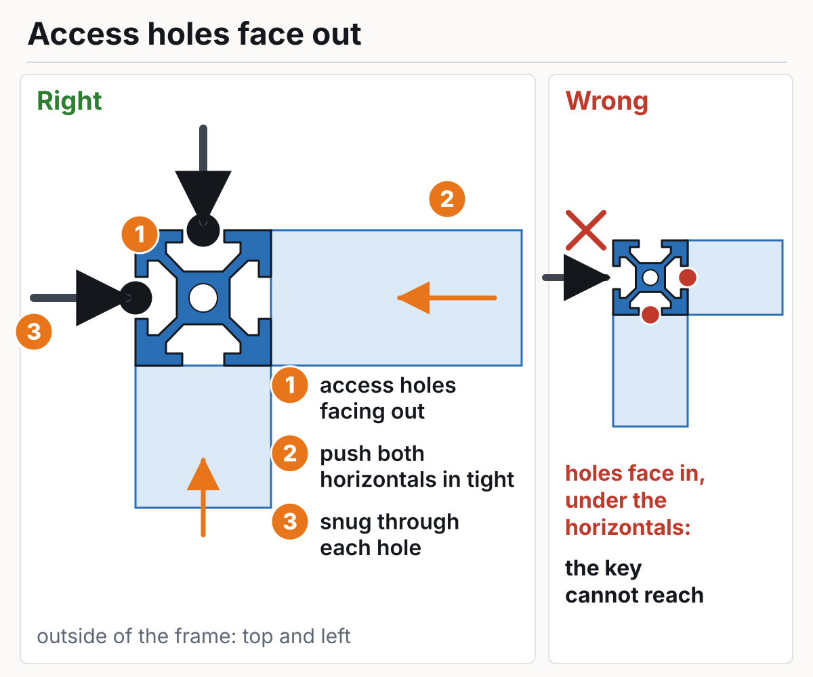
{ crop="0.06 0.20 0.60 0.86" }

**What you're looking at:** The first corner sets the pattern for the other three. Get one thing right: the vertical's two access holes point out of the frame, because the two horizontals cover its inner faces.

**Parts:**

- B extrusion ×1
- reused: M5×16 BHCS ×2, already in the two A extrusions
- tool: 3 mm hex key, straight

**Do:**

1. Stand a B extrusion in the first corner with its **access holes facing outward**.
2. Lower it so each screw head slides into a slot, then push both A extrusions tight against it.
3. Snug each screw through its access hole with the 3 mm key. Snug means just closed, **not tight**.

**Check:** Both access holes face out of the frame, both A ends touch the vertical with no gap, the vertical's bottom end is level with them, and the corner sits flat on the stone.

**Helper:** Holds the two A extrusions together at the corner while you snug the bolts.

Source: [Voron manual p.15](https://github.com/VoronDesign/Voron-2/blob/de7e89d/Manual/Assembly_Manual_2.4r2.pdf#page=15)

---

### Step 01.8 — Add the remaining three verticals and close the bottom square

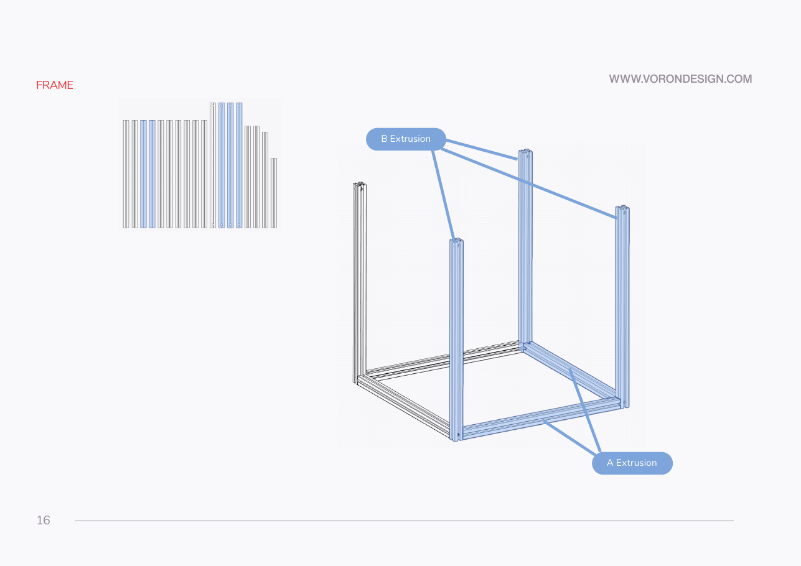{ crop="0.42 0.20 0.86 0.84" }


**What you're looking at:** Do the same at the other three corners. Keep every screw only snug, so the frame can still be nudged square later.

**Parts:**

- B extrusion ×3
- reused: A extrusion ×2, prepared
- reused: M5×16 BHCS ×6, already in the A extrusions

**Do:** Repeat Step 01.7 at each remaining corner in turn, adding the last two bottom A extrusions as you go. Access holes face outward every time.

**Check:** The bottom square is closed and four verticals stand in it, so 8 of the 16 blind joints are made. It still sits flat on the stone without rocking.

**Helper:** Holds each vertical upright while you slide it over the bolt heads.

Source: [Voron manual p.16](https://github.com/VoronDesign/Voron-2/blob/de7e89d/Manual/Assembly_Manual_2.4r2.pdf#page=16)

---

### Step 01.9 — Snug and check the bottom square

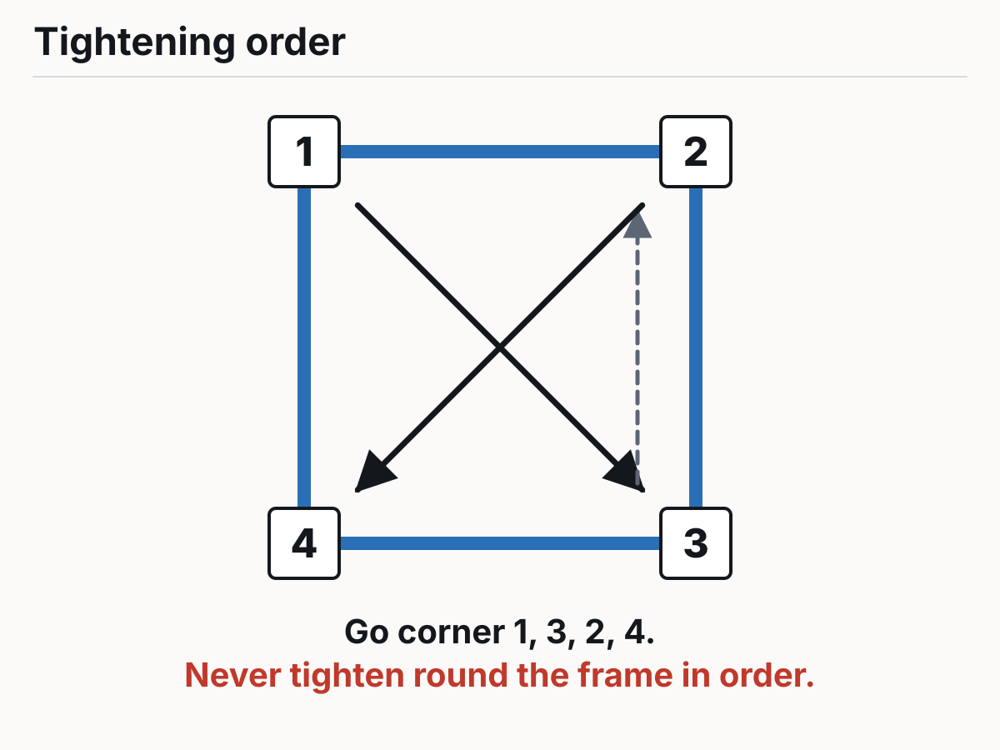
{ crop="0.42 0.20 0.86 0.84" }

**What you're looking at:** A first check with the machinist square. It is a precise right angle: hold it into a corner, and any light between its blade and the extrusion means that corner is not 90° yet.

**Parts:** none.

**Do:**

1. Press each corner down onto the stone.
2. Snug all 8 bottom screws, jumping to the opposite corner each time: corner 1, then 3, then 2, then 4.
3. Hold the machinist square into each of the four inside corners. If a corner shows light, carry on: Step 01.12 squares the frame before anything is tightened.

**Check:** All 8 bottom screws are snug, you have looked into all four corners, and all four extrusions still touch the stone along their whole length.

**Helper:** Holds the square in each inside corner and calls out any light under the blade.

No Voron or LDO page gives a tightening order. Going across to the opposite corner is our own habit: it spreads the pull, so one corner cannot drag the square round.

Source: [Voron manual p.16](https://github.com/VoronDesign/Voron-2/blob/de7e89d/Manual/Assembly_Manual_2.4r2.pdf#page=16)

---

### Step 01.10 — Fit the four top A extrusions

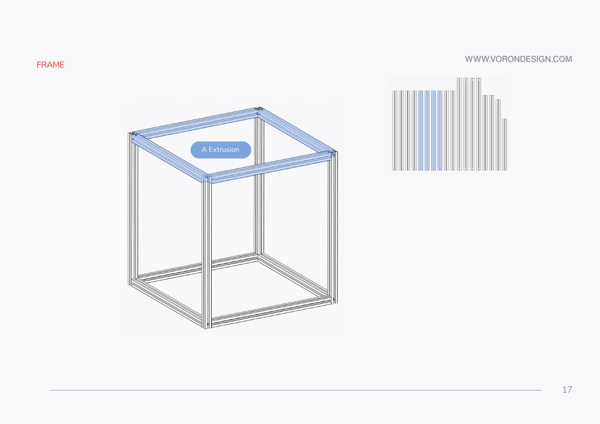{ crop="0.20 0.22 0.58 0.80" }

**What you're looking at:** The top square is the same joint the other way up: each screw head drops into a vertical's slot from its open top end. The verticals wobble, so this takes two people.

**Parts:**

- reused: A extrusion ×4, prepared
- reused: M5×16 BHCS ×8, already in the A extrusions

**Do:**

1. With one person at each end, lower each of the four remaining A extrusions between two verticals so both screw heads enter the slots from the top.
2. If one will not go in, check its screws: 2 to 3 mm should show under each head. Back out one that shows less, turn in one that shows more. Never pull the verticals apart.
3. Snug only.

**Check:** The top square is closed, so all 16 blind joints are made, and no end has a visible gap.

**Helper:** Holds the far end of each top extrusion level while you guide its bolt heads in.

Source: [Voron manual p.17](https://github.com/VoronDesign/Voron-2/blob/de7e89d/Manual/Assembly_Manual_2.4r2.pdf#page=17)

---

### Step 01.11 — Snug the top square

{ crop="0.20 0.22 0.58 0.80" }

**What you're looking at:** As more parts go on, the frame settles, and the screws you snugged first are no longer snug. So go round once more.

**Parts:** none.

**Do:**

1. Snug the 8 top screws through their access holes, again jumping to the opposite corner each time.
2. Then go over all 16 joints once more, still only snug.

**Check:** All 16 joints are snug. The frame stands on its own and does not lean when you push a top corner lightly.

Source: [Voron manual p.17](https://github.com/VoronDesign/Voron-2/blob/de7e89d/Manual/Assembly_Manual_2.4r2.pdf#page=17)

---

### Step 01.12 — Square the bottom square and lock it

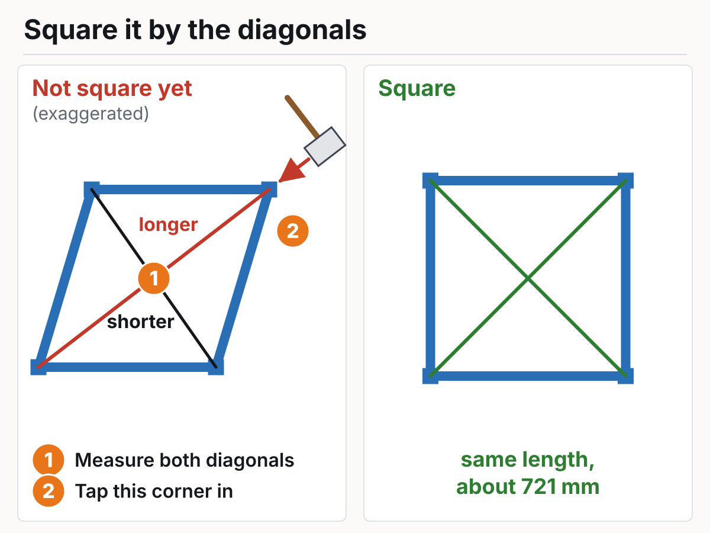


**What you're looking at:** A four-sided frame is square when its two diagonals are the same length. So measure both, nudge the frame until they match, and only then tighten for good.

**Parts:** none.

**Do:**

1. Measure corner to corner across the bottom square, both ways. Hook the tape on the outside of the corner the same way each time.
2. If one diagonal is longer, tap one of its corners inward with the mallet. Measure again, and repeat until the two match.
3. Fully tighten the 8 bottom screws in the order 1, 3, 2, 4, then measure once more.

How tight: the manual gives no torque number for these screws. Tighten firmly with the straight 3 mm key, not a ball end, which slips out under force. If you use the torque screwdriver, pick one setting and use it on all 16 joints. Even matters more than exact. `(not specified — snug, then even)`

**Check:** Both diagonals read the same, about **721 mm** on this frame, and all four corners are 90°. Write both numbers in the log. [src](https://voron.link/kdtpzam)

**Helper:** Holds the tape's far end on the corner and reads each diagonal aloud.

Source: [Voron manual p.21](https://github.com/VoronDesign/Voron-2/blob/de7e89d/Manual/Assembly_Manual_2.4r2.pdf#page=21) · [Voron manual p.17](https://github.com/VoronDesign/Voron-2/blob/de7e89d/Manual/Assembly_Manual_2.4r2.pdf#page=17) · [frame squaring video](https://voron.link/kdtpzam)

---

### Step 01.13 — Square the top square and lock it


**What you're looking at:** The top gets the same treatment, with one extra risk: top and bottom can each be square yet turned slightly against each other. That twisted frame would leave the gantry out of parallel with the bed.

**Parts:** none.

**Do:**

1. Measure both top diagonals.
2. Tap a corner of the longer one inward with the mallet. Measure again, and repeat until they match.
3. Look down each vertical to see that none leans, and check the top inside corners with the machinist square. Then fully tighten the 8 top screws in the order 1, 3, 2, 4, and measure again.

**Check:** The two top diagonals match each other and are within about a millimetre of the bottom pair.

**Helper:** Reads both top diagonals aloud and says which one is longer.

The one-millimetre limit is our own working figure; no Voron page gives one.

Source: [Voron manual p.21](https://github.com/VoronDesign/Voron-2/blob/de7e89d/Manual/Assembly_Manual_2.4r2.pdf#page=21) · [Voron manual p.17](https://github.com/VoronDesign/Voron-2/blob/de7e89d/Manual/Assembly_Manual_2.4r2.pdf#page=17)

---

### Step 01.14 — Check the four vertical faces

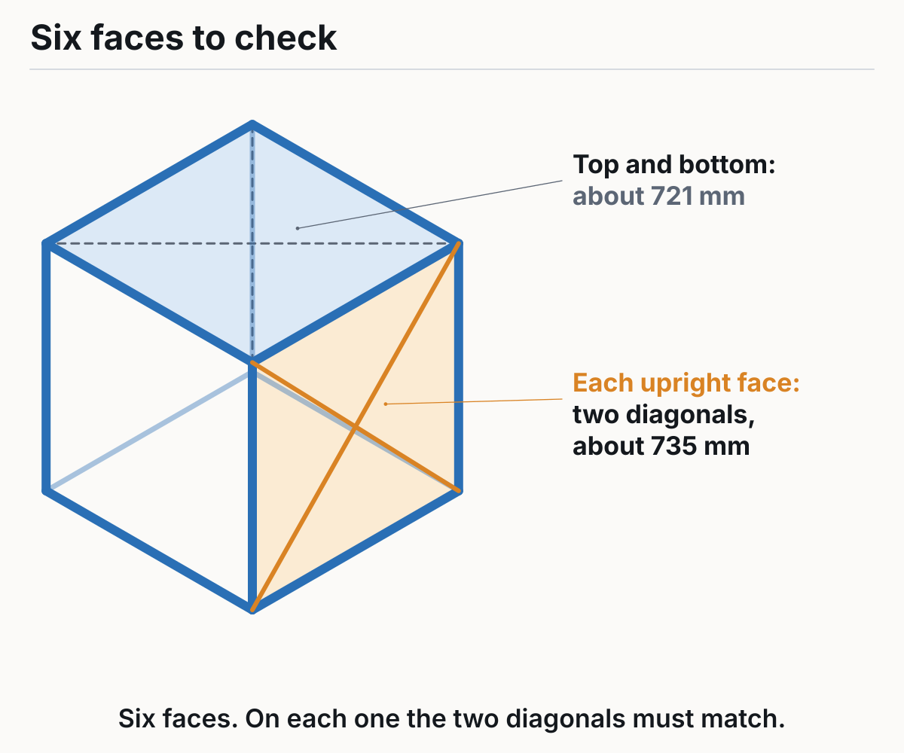

**What you're looking at:** Top and bottom are square, but the whole box could still lean to one side, like a stack of cards pushed over. Measuring the diagonals of each upright side catches that.

**Parts:** none.

**Do:**

1. On each of the four upright sides, measure both diagonals and check the inside corners, top and bottom, with the machinist square.
2. If a side will not come square, one of its joints is not fully pushed together. Loosen that joint, push it together and tighten it again.

**Check:** On every side the two diagonals match, at about **735 mm** (each side is 510 × 530 mm outside), and every corner is 90°.

**Helper:** Holds the square flat against each upright and calls out any gap.

Source: [Voron manual p.21](https://github.com/VoronDesign/Voron-2/blob/de7e89d/Manual/Assembly_Manual_2.4r2.pdf#page=21) · [Voron manual p.17](https://github.com/VoronDesign/Voron-2/blob/de7e89d/Manual/Assembly_Manual_2.4r2.pdf#page=17) · [Video: Part 1 @1:13:15](https://www.youtube.com/watch?v=feTxcc0LIWM&list=PL0fUJbigELQPqpeGOgHYisG4KaSXVtnNY&t=4395s)

---

### Step 01.15 — Check the frame sits without rock

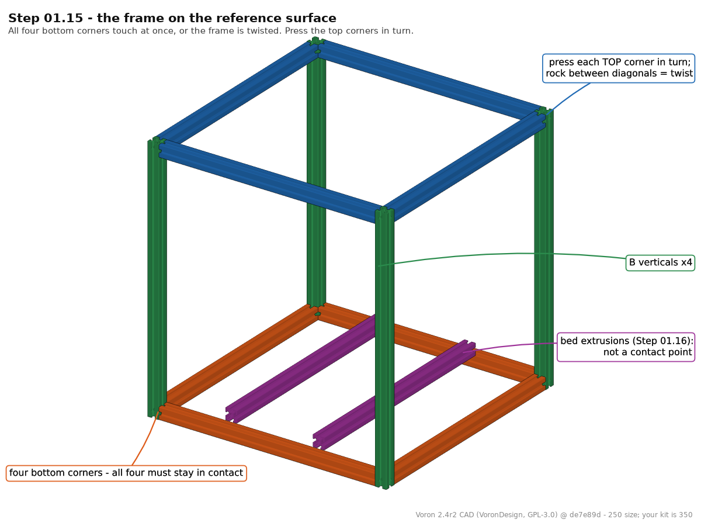

**What you're looking at:** The last test of this session. A square frame touches the counter with all four corners at once. A twisted one rocks, like a table with one short leg. The picture is the smaller 250 mm model and already shows the bed extrusions: ignore both.

**Parts:** none.

**Do:** Stand the frame on the stone and press down on each top corner in turn.

**Check:** Nothing rocks or rattles, and all four bottom corners stay down. If it rocks, the frame is twisted: go back to Step 01.13.

**Helper:** Watches the bottom corners and calls out any that lifts as you press.

Source: [Voron manual p.21](https://github.com/VoronDesign/Voron-2/blob/de7e89d/Manual/Assembly_Manual_2.4r2.pdf#page=21) · [Voron manual p.15](https://github.com/VoronDesign/Voron-2/blob/de7e89d/Manual/Assembly_Manual_2.4r2.pdf#page=15) · CAD: Voron 2.4r2 STEP @ de7e89d

Pause: ~65 min since the last pause — the frame is assembled, square on all six sides, fully tightened, and sits on the stone without rocking. This is the first safe place to stop: never walk away between squaring and tightening. Leave the frame on the stone, covered.

---

### Step 01.16 — Fit corner brackets to the two bed extrusions

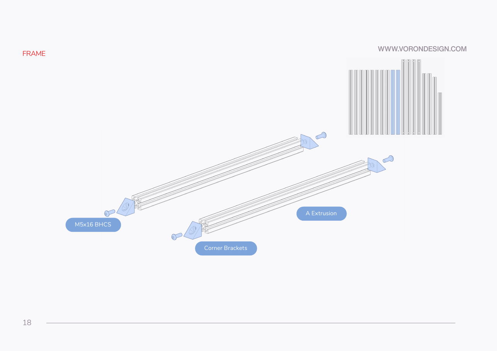{ crop="0.12 0.34 0.80 0.74" }

**What you're looking at:** The last two A extrusions carry the heated bed. Each end gets a corner bracket, a small metal angle that later sits on a bottom extrusion.

**Parts:**

- A extrusion ×2
- Corner bracket ×4 — from the kit, no LDO BOM row
- M5×16 BHCS ×4

**Do:**

1. Turn each bed extrusion so the slot you taped in Step 01.3 faces up. Ch 03 rolls M3 T-nuts into it, and once the brackets are on it cannot turn.
2. Fix a bracket to each end with an M5×16 BHCS into the end hole, its free leg level with the bottom face and pointing away from the end.
3. Snug only for now.

**Check:** 4 brackets are on with 4 screws, every taped slot faces up, and every free leg lies level with the bottom face, pointing away from its end.

Source: [Voron manual p.18](https://github.com/VoronDesign/Voron-2/blob/de7e89d/Manual/Assembly_Manual_2.4r2.pdf#page=18) · [Voron manual p.20](https://github.com/VoronDesign/Voron-2/blob/de7e89d/Manual/Assembly_Manual_2.4r2.pdf#page=20) · CAD: Voron 2.4r2 STEP @ de7e89d · [Video: Part 1 @1:29:21](https://www.youtube.com/watch?v=feTxcc0LIWM&list=PL0fUJbigELQPqpeGOgHYisG4KaSXVtnNY&t=5361s)

---

### Step 01.17 — Load four M5 T-nuts into the bottom rails

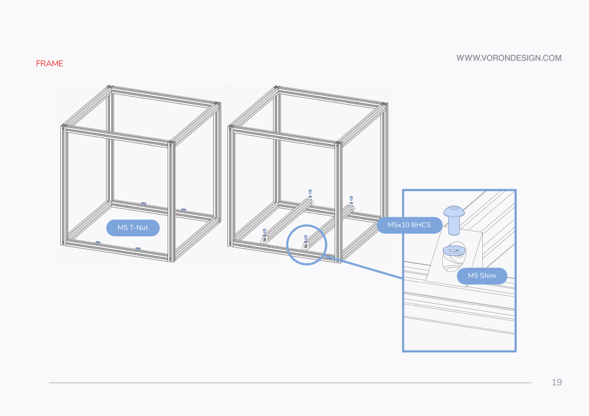{ crop="0.09 0.19 0.39 0.64" }

**What you're looking at:** Each bracket gets screwed down into a T-nut in the slot beneath it. Put the nuts in now and slide them into place later.

**Parts:**

- M5 roll-in T-nut ×4

**Do:** Roll two M5 T-nuts into the top slot of the front bottom extrusion and two into the rear one, one for each bed-extrusion end. Leave them loose, roughly where the brackets will sit.

**Check:** All four T-nuts turn freely and lie flat in the slot. If one is tight, swap it for another.

Source: [Voron manual p.19](https://github.com/VoronDesign/Voron-2/blob/de7e89d/Manual/Assembly_Manual_2.4r2.pdf#page=19) · [LDO Build Notes (Rev D)](https://docs.ldomotors.com/voron/voron2/build-faq) · [Video: Part 1 @1:28:12](https://www.youtube.com/watch?v=feTxcc0LIWM&list=PL0fUJbigELQPqpeGOgHYisG4KaSXVtnNY&t=5292s)

---

### Step 01.18 — Set the bed extrusions and start the fasteners

{ crop="0.38 0.19 0.89 0.86" }

**What you're looking at:** Set the bed extrusions in place and start their four screws. Under each head goes a brass precision spacer, not a washer: it replaces the Voron manual's "M5 shim".

**Parts:**

- reused: the two bracketed bed extrusions
- M5×10 BHCS ×4
- M5 precision spacer ×4

**Do:**

1. Set both bed extrusions in front to back, each bracket leg on a bottom extrusion over a T-nut.
2. Ch 03 rolls T-nuts into the two side slots that face each other: if one carries an X, turn that extrusion end for end.
3. Start an M5×10 BHCS through a spacer and each bracket hole into its T-nut, finger-loose.

**Check:** 4 screws and 4 spacers are in. Each bed extrusion ends flush with the inner faces of the front and rear extrusions, its underside level with their tops.

Source: [Voron manual p.19](https://github.com/VoronDesign/Voron-2/blob/de7e89d/Manual/Assembly_Manual_2.4r2.pdf#page=19) · [LDO Build Notes (Rev D)](https://docs.ldomotors.com/voron/voron2/build-faq)

---

### Step 01.19 — Position the bed extrusions on the centreline

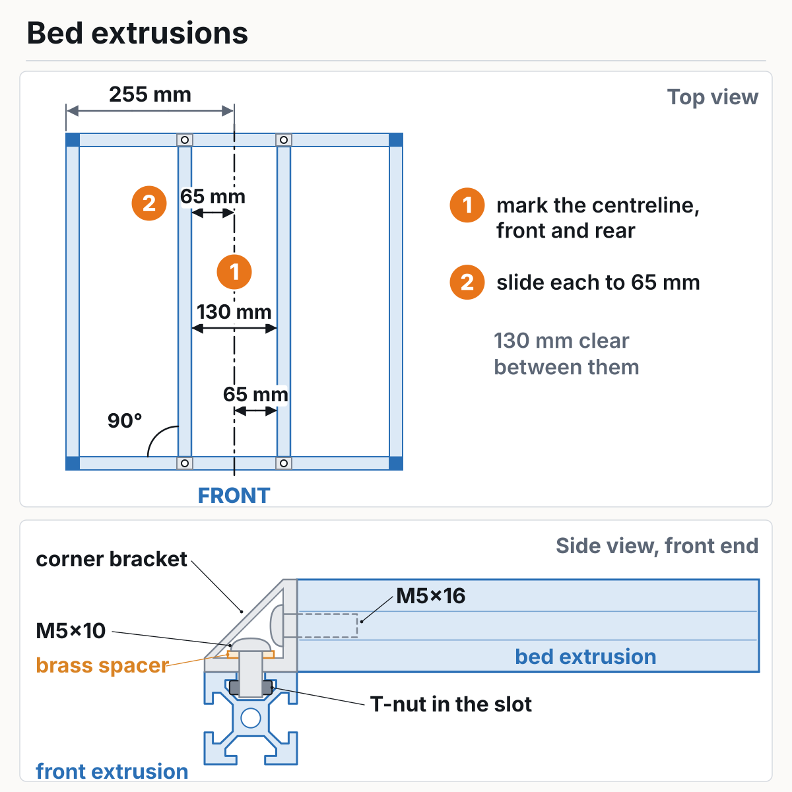
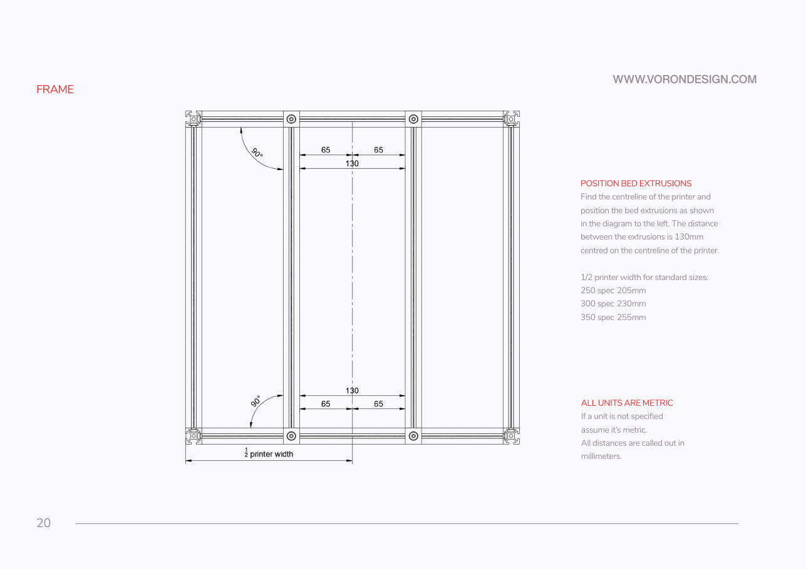{ crop="0.22 0.18 0.92 0.83" }

**What you're looking at:** The bed bolts to these two extrusions, so they have to sit exactly where its mounting holes are: the same distance either side of the printer's centreline, and square to the front.

**Parts:** none.

**Do:**

1. Mark the centreline on the front and rear bottom extrusions, **255 mm** from the outer face of the left side.
2. Slide each bed extrusion until its inner face is **65 mm** from that line, at both ends.
3. Tighten the M5×10 screws, then the M5×16, keeping each bracket flush against its extrusion.

**Check:** All four measurements read **65 mm**, which leaves 130 mm between the two, and both bed extrusions sit at **90°** to the front.

**Helper:** Holds the tape on the centreline mark and reads each 65 mm aloud.

If the bed's own holes disagree with these numbers later, trust the bed.

Source: [Voron manual p.20](https://github.com/VoronDesign/Voron-2/blob/de7e89d/Manual/Assembly_Manual_2.4r2.pdf#page=20) · [Voron manual p.58](https://github.com/VoronDesign/Voron-2/blob/de7e89d/Manual/Assembly_Manual_2.4r2.pdf#page=58) · [Video: Part 1 @1:46:36](https://www.youtube.com/watch?v=feTxcc0LIWM&list=PL0fUJbigELQPqpeGOgHYisG4KaSXVtnNY&t=6396s)

Pause: ~35 min since the last pause — both bed extrusions are in, 65 mm either side of the centreline, all eight bracket screws tight. Do not move the frame off the stone yet: Step 01.20 checks it there once more.

---

### Step 01.20 — Final squareness verification


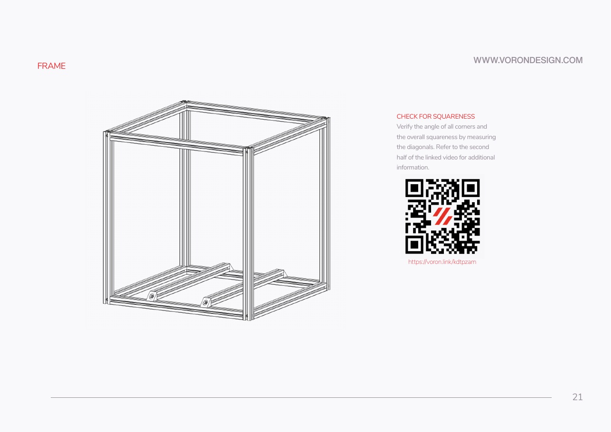{ crop="0.15 0.22 0.84 0.76" }

**What you're looking at:** Bolting in the bed extrusions can pull a square frame slightly out of square, so run every check one more time. These are the numbers that go in the log. Whatever is still off after this stays off for good.

**Parts:** none.

**Do:**

1. Measure the two diagonals of the bottom, the top and each of the four upright sides.
2. Check every inside corner with the machinist square.
3. Check that the frame sits on the stone without rocking.

**Check:** Every pair of diagonals matches, every corner is 90°, and nothing rocks. [src](https://voron.link/kdtpzam)

**Helper:** Reads each diagonal pair aloud and ticks it off as you go.

Source: [Voron manual p.21](https://github.com/VoronDesign/Voron-2/blob/de7e89d/Manual/Assembly_Manual_2.4r2.pdf#page=21) · [frame squaring video](https://voron.link/kdtpzam) · [Video: Part 5 @3:15:10](https://www.youtube.com/watch?v=hTKCBrk36R0&list=PL0fUJbigELQPqpeGOgHYisG4KaSXVtnNY&t=11710s)

---

### Step 01.21 — Titanium backers: not now

(no image — see text)

**What you're looking at:** Thin titanium strips called backers came with the kit order, though they are not on LDO's kit list. In Ch 05 they bolt to the gantry, on the face opposite a steel rail, to stop the aluminium bowing as the two metals warm up. They look like frame parts. They are not.

**Parts:** none.

**Do:** Check that the backers are still in their sealed bag, label it "Ch 05", and store it with the C, D and E extrusions.

**Check:** The backers are bagged, labelled and put away. [src](https://github.com/tanaes/whopping_Voron_mods/tree/main/extrusion_backers)

Source: [whopping_Voron_mods — `extrusion_backers`](https://github.com/tanaes/whopping_Voron_mods/tree/main/extrusion_backers) · [survey](../voron-build-instructions-survey.md)

---

### Step 01.22 — Record the frame log

(no image — see text)

**What you're looking at:** Write the numbers down before the frame leaves the counter. Much later, if the gantry will not square up in Ch 06, these numbers tell you whether the frame is to blame. "It looked fine" cannot do that.

**Parts:** none.

**Do:** One of you measures and calls out each number. The other writes it in the table.

| Measurement | Target | Measured (mm) | By / date |
|---|---|---|---|
| Reference surface — worst feeler gap under the straightedge (Steps 00.10 / 01.1) | ≤ 0.1, no larger than the 00.10 figure | | |
| Bottom square, diagonal 1 | ≈721 (350) | | |
| Bottom square, diagonal 2 | = diagonal 1 | | |
| Top square, diagonal 1 | = bottom pair | | |
| Top square, diagonal 2 | = diagonal 1 | | |
| Front face, diagonals 1 / 2 | equal (≈735) | | |
| Rear face, diagonals 1 / 2 | equal (≈735) | | |
| Left face, diagonals 1 / 2 | equal (≈735) | | |
| Right face, diagonals 1 / 2 | equal (≈735) | | |
| Centreline to bed extrusion inner face — 4 places | 65 each | | |
| Clear gap between bed extrusions | 130 | | |
| Torque setting used, if any | one value, all 16 | | |

**Check:** Every row has a number in it, and both diagonal pairs are written as numbers.

**Helper:** Writes the four diagonals and the final torque into the frame log.

Source: [Voron manual p.21](https://github.com/VoronDesign/Voron-2/blob/de7e89d/Manual/Assembly_Manual_2.4r2.pdf#page=21) · [survey](../voron-build-instructions-survey.md)

---

### Step 01.23 — Seal the blind joints

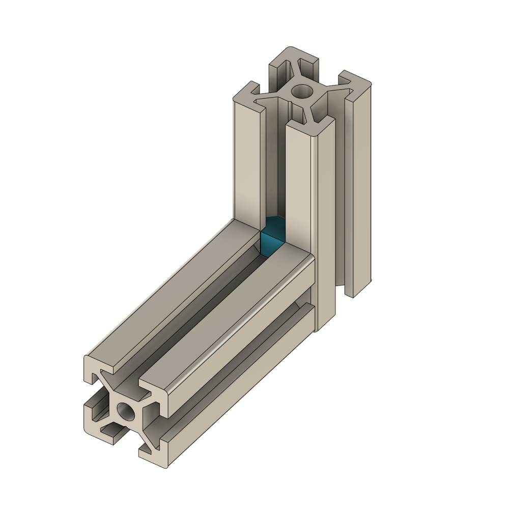
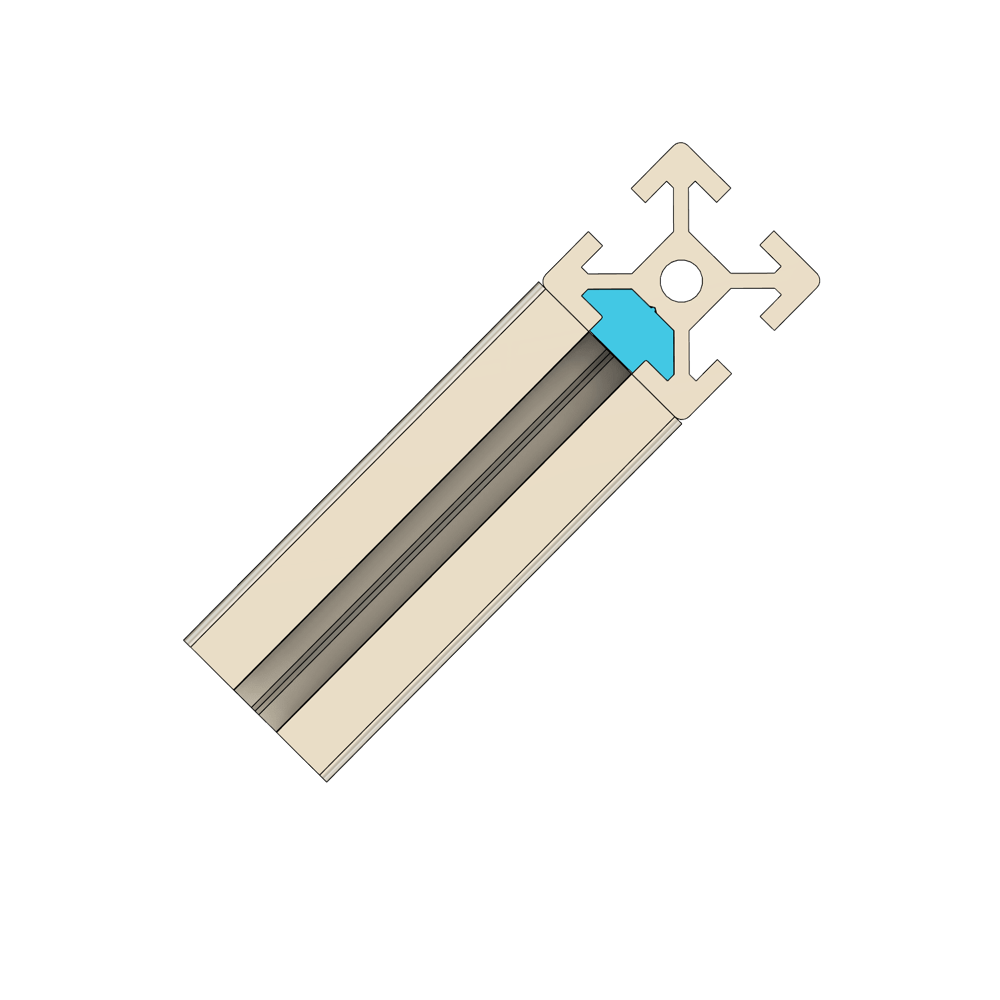

**What you're looking at:** At every joint, the vertical's slot carries on past the horizontal to the open end, so warm air can leak out of the printer there. A rubber blind joint seal plugs it. LDO's guides do not mention the seals yet, so follow LDO's drawing.

**Parts:**

- Extrusion Blind Joint Seal ×16

**Do:**

1. Find the inside of each joint: just above a bottom horizontal, just below a top one.
2. Roll a seal into the vertical's slot there, with its raised boss pointing at the horizontal.
3. Slide it until it stops against the horizontal. Do all 16.

**Check:** 16 seals are in, each pushed up against its horizontal and none sticking out past the vertical's face. 4 spares are bagged.

**Helper:** Hands over seals one at a time and ticks off each joint.

Do not skip the four bottom joints on the left and right sides. From Step 02.06 the Z rails cover those slots, and no seal can go in afterwards.

LDO gives no dimensions for the seals. In Ch 02, check that the T-nuts for the Z rails and the Z belt covers clear them `(verify on bench)`. [src](https://store.dremc.com.au/products/ldo-motion-extrusion-blind-joint-seal)

Source: [LDO 350 Rev D+ BOM](https://docs.ldomotors.com/en/voron/voron2/350_BOM/Rev_D+) · [LDO seal listing (DREMC)](https://store.dremc.com.au/products/ldo-motion-extrusion-blind-joint-seal) · [LDO seal listing (West3D)](https://west3d.com/products/extrusion-blind-joint-seals-20-pieces-by-ldo-motors)

Pause: ~35 min since the last pause — final checks done, log filled in, every joint sealed. Go through Checkpoint 01, then the frame can come off the counter.

---

## Checkpoint 01

**Built:** a square frame with both bed extrusions on the centreline

- [ ] The counter was re-checked with straightedge and feelers in five positions, and is no worse than the Step 00.10 number
- [ ] 10 A and 4 B extrusions are used; 2 C, 1 D and 1 E are bagged for Ch 05
- [ ] Every extrusion end is smooth and sits flat against the square
- [ ] All 16 blind joints are made and fully tightened, evenly
- [ ] Bottom diagonals match; top diagonals match each other and the bottom pair
- [ ] On all four upright sides the diagonals match and the corners are 90°
- [ ] The frame sits on all four corners without rocking
- [ ] Every vertical's access holes face outward, and the straight 3 mm key goes straight in
- [ ] Both bed extrusions run front to back on their corner brackets, with brass **M5 precision spacers** under the screws, at 90° to the front
- [ ] Bed extrusions are 65 mm either side of the centreline at both ends, 130 mm apart; all four M5×10 and four M5×16 bracket screws are tight
- [ ] The FRONT tape is on a side the bed extrusions point at
- [ ] Titanium backers are still bagged and labelled for Ch 05
- [ ] The frame log table is filled in
- [ ] 16 blind joint seals are in, each against its horizontal on the inside of the frame; 4 spares are bagged

## Common mistakes

- **Tightening as you go.** Assemble snug, square the frame, then tighten. A screw tightened fully too early locks in whatever error was there, and the mallet cannot fix it afterwards.
- **A vertical with its access holes facing inward.** The two horizontals cover the vertical's inner faces, so the holes must face out. Found late, this means taking a whole corner apart. Check it on the first corner at Step 01.7.
- **Building on a table that is "flat enough".** A surface with one corner a few tenths of a millimetre high gives a twisted frame whose diagonals all match. Check the surface at Step 01.1 or do not use it.
- **Using an ordinary M5 washer instead of the brass precision spacer.** The spacer has an exact thickness. A washer changes the height of everything stacked on it.
- **Forcing a roll-in T-nut.** A forced nut scores the slot, and the next one will not go in at all. Try another slot or another nut.
- **Fitting the titanium backers to the frame.** They are gantry parts for Ch 05 and go on the face opposite a rail. On the same face as the rail they make the bowing worse.

## Next

Ch 02 — Z drives, Z idlers, Z rails and deck panel (manual p.22–51); gated on batches **B00 + B01 + B02**, B02 plates P1 to P3, sorted into bins 02-Z0 … 02-deck (print plan §2).
