# Chapter 02 — Z drives, Z idlers, Z rails, deck panel

<!-- style: plain -->

You build the machinery that lifts the gantry: four Z drives, four Z idlers, four Z rails, and the deck panel. When this chapter is done, the frame has a floor, feet, and every part of the Z motion except the belts and the Z joints, so the gantry has something to hang from.

**What you're building in this chapter:** The gantry is the frame that carries the print head, and it moves up and down on all four corners at once. A **Z drive** is the gearbox in each bottom corner. Inside a printed housing, three bearings carry a steel shaft with two pulleys on it: a big 80-tooth pulley that the motor turns through a short closed belt, and a 20-tooth pulley that the long Z belt runs over. The motor's own pulley has 16 teeth, so the gearing is 80:16, and that slowing-down is what makes Z fine enough to print with. The housing is two printed halves: a shallow **retainer** tray that the shaft and its bearings drop into, and the deeper **main** body that closes over them on six long screws and carries the two M5×40 that fasten the drive to the frame. A blue **baseplate** screws across the drive's foot face and holds the nut the rubber foot screws into, and a blue **belt tensioner** cam pushes the motor along its extrusion to pull the short belt tight. Straight above each drive, at the top corner, a **Z idler** carries a free-spinning pulley that turns the long belt back down. Its blue slider is the adjuster you tighten that belt with in Ch 06; the final tension is set in Ch 14. Between them run the four **Z rails** on the verticals, the tracks the gantry's corners ride on. Last comes the **deck panel**, the acrylic floor that divides the electronics bay underneath from the print chamber above. It goes in now because once the gantry and the wiring are in, it cannot be lifted out again. The four corners all do the same job, built from mirror-image `_a` and `_b` printed parts. Diagonal corners share a hand, and the map is at Step 02.02.

```mascot
pose: point
caption: The mirrored pair will happily go on the wrong sides. Check the letter you wrote on each.
```

**Time:** 4.25–6.25 h hands-on, first build (survey §7.2, less the ~45 min of rail cleaning and greasing, which is done once for all seven rails in Ch 00 Steps 00.18–00.21).

**Sessions:** 11 × ~30 min (20 to 55 min each). Each one ends at a safe place to stop, and every minute figure is a first-build estimate.

**Prerequisites:**

- **Ch 01** is done: the frame is square, re-checked after the final tightening, and the bed extrusions sit **65 mm either side of the printer's centreline** (130 mm clear between their inner faces, 150 mm centre to centre), as set in Step 01.19.
- **Ch 00** is done: all seven rails are cleaned, packed with grease, wiped and labelled (Steps 00.18–00.21). This chapter uses the four marked Z0–Z3.
- **Printed parts:** batch **B00** for the rail guides (`MGN9_rail_guide_x2`). Batch **B01** for the drive bodies, retainers, motor mounts, Z-tensioner brackets and deck supports. Batch **B02**, plates P1 to P3, for the blue baseplates, belt tensioners and Z tensioners, which are spread across those three plates; P4 carries nothing for this chapter.
- **Optional:** batch **B05** for the rail stops (`z_rail_stop_x4`, Step 02.10). You can skip them and keep the tape.
- **Kit boxes open:** Motion, Linear Rail Kit and Motor Kit, with hardware trays A to C out.
- **You can work ahead.** Steps 02.17–02.28 and 02.39–02.40 are bench work that needs only B01, B02 and the Motion and Motor kits. If you can, build all four drives, motor units and idler cages straight after Step 02.04, so the frame goes upside down only for the deck and the corner work (02.11–02.16, 02.29–02.38).
- **Earliest of all:** Steps 02.27–02.28 (16T pulleys, motors onto their mounts) need only B01-P2 and the Motor Kit, and B01-P2 is on the shelf as soon as B01 is printed. Do them the moment the Motor Kit box is open, and mark each motor cable a or b then.

**Tools**

- Hex drivers 1.5, 2, 2.5, 3 and 4 mm, good quality. For set screws use straight ones, *not* ball-end (p.32).
- Nutopress Pro insert press with its M3 tip, the same one Gate B used. Use the X-Tronic iron with the LDO brass tip only for a part that will not fit under the press.
- Digital caliper: for the deck panel thickness, the 33 mm pulley position and the 10.7 mm cross-check.
- Printed jigs: the two `MGN9_rail_guide_x2` rail guides, and the `pulley_jig` for the 16T height (Step 02.27).
- Masking tape (to hold carriages, mark rail holes and make the FRONT label) and a marker. The 3 mm hex key doubles as the gauge for the gap under each rail (Step 02.06).
- Loctite 243 threadlocker, only for a set screw that did *not* arrive with threadlocker already on it. IPA, grease, soak tray, syringe and cloth were Ch 00's rail-prep kit: nothing here needs them unless a rail was missed.

**Read first**

- **The rails were greased in Ch 00, not here.** That job needs the back of the rail, which you cannot reach once it is on an extrusion. If any of Z0–Z3 was missed, fix it before Step 02.06.
- **The Z motors are the only place in the printer with 16-tooth pulleys**, and they look almost the same as the 20-tooth ones. Count the teeth, and get the spare 16T pulleys off the bench when the chapter is done.
- **Every set screw gets threadlocker and must press on the flat side of its shaft.** Loose set screws are the most reported failure on this machine.
- **Two corners take `_a` parts and two take `_b`:** `_a` at Z0 (front-left) and Z2 (rear-right), `_b` at Z1 (rear-left) and Z3 (front-right). A wrong-hand drive screws on fine, and you only find out in Ch 06.
- **Two jobs come earlier than you might expect.** All the heat-set inserts go in before any drive is put together, and the deck panel goes in now, not later with the other panels.

<!-- reference -->

**Printed parts** — all ASA. Black = main colour, Blue = accent (`[a]_` prefix).

Parts arrive in the bins named below (see the bin map in print/README.md#bins); check the bin label's list before you start.

| Looks like | STL (Voron-2 `STLs/`, branch `Voron2.4`) | Bin | Qty | Colour |
|---|---|---|---:|---|
| 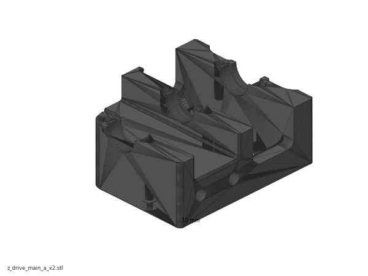{ width=96 } | `Z_Drive/z_drive_main_a_x2.stl` | 02-Z0 · 02-Z2 | 2 | Black |
| 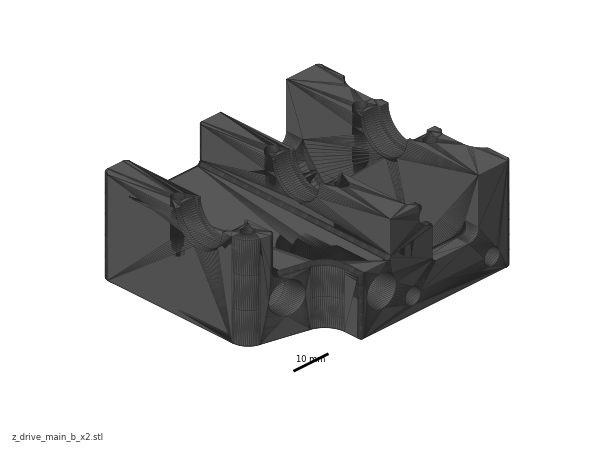{ width=96 } | `Z_Drive/z_drive_main_b_x2.stl` | 02-Z1 · 02-Z3 | 2 | Black |
| 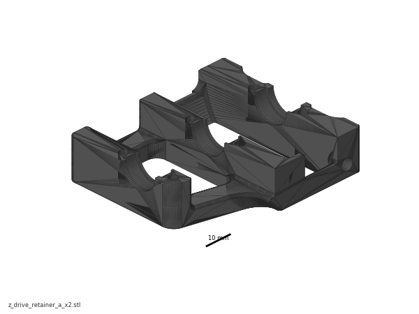{ width=96 } | `Z_Drive/z_drive_retainer_a_x2.stl` | 02-Z0 · 02-Z2 | 2 | Black |
| 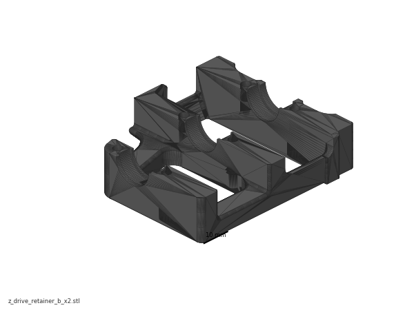{ width=96 } | `Z_Drive/z_drive_retainer_b_x2.stl` | 02-Z1 · 02-Z3 | 2 | Black |
| 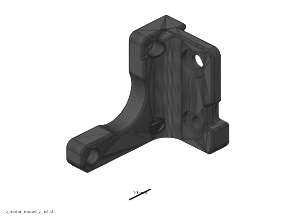{ width=96 } | `Z_Drive/z_motor_mount_a_x2.stl` | 02-Z0 · 02-Z2 | 2 | Black |
| 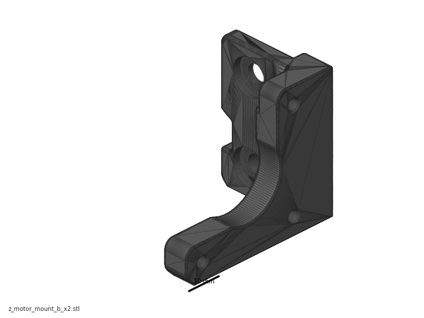{ width=96 } | `Z_Drive/z_motor_mount_b_x2.stl` | 02-Z1 · 02-Z3 | 2 | Black |
| 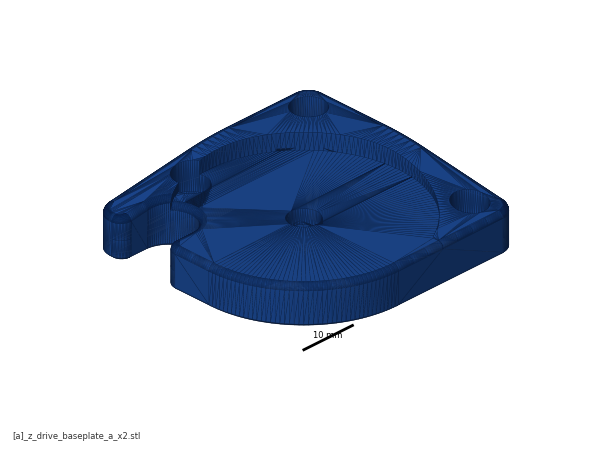{ width=96 } | `Z_Drive/[a]_z_drive_baseplate_a_x2.stl` | 02-Z0 · 02-Z2 | 2 | Blue |
| 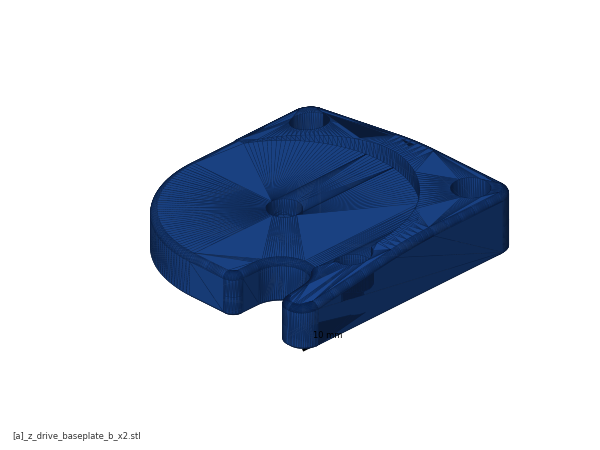{ width=96 } | `Z_Drive/[a]_z_drive_baseplate_b_x2.stl` | 02-Z1 · 02-Z3 | 2 | Blue |
| 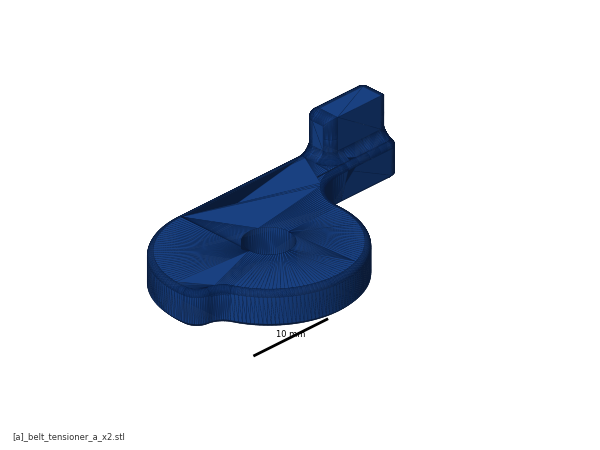{ width=96 } | `Z_Drive/[a]_belt_tensioner_a_x2.stl` | 02-Z0 · 02-Z2 | 2 | Blue |
| 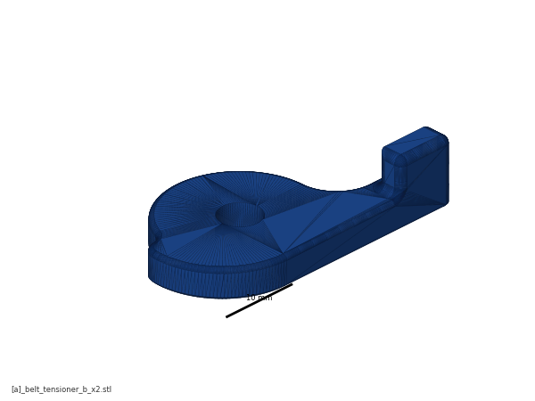{ width=96 } | `Z_Drive/[a]_belt_tensioner_b_x2.stl` | 02-Z1 · 02-Z3 | 2 | Blue |
| 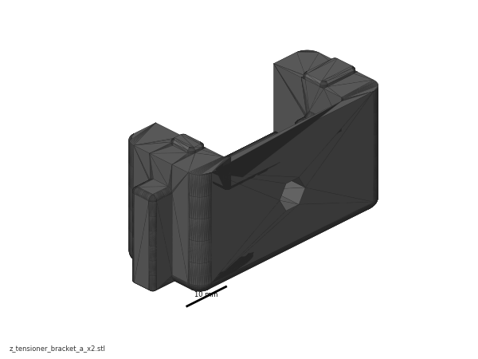{ width=96 } | `Z_Idlers/z_tensioner_bracket_a_x2.stl` | 02-Z0 · 02-Z2 | 2 | Black |
| 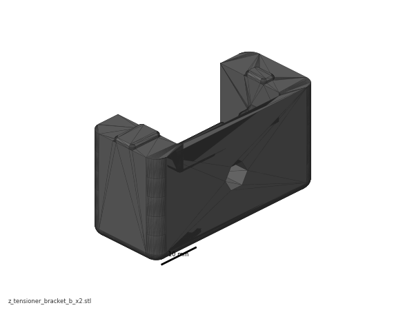{ width=96 } | `Z_Idlers/z_tensioner_bracket_b_x2.stl` | 02-Z1 · 02-Z3 | 2 | Black |
| 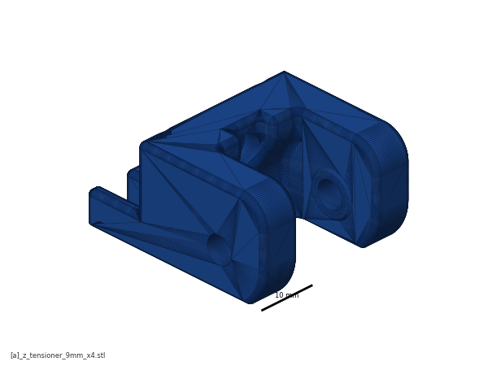{ width=96 } | `Z_Idlers/[a]_z_tensioner_9mm_x4.stl` | 02-Z0 · 02-Z1 · 02-Z2 · 02-Z3 | 4 | Blue |
| 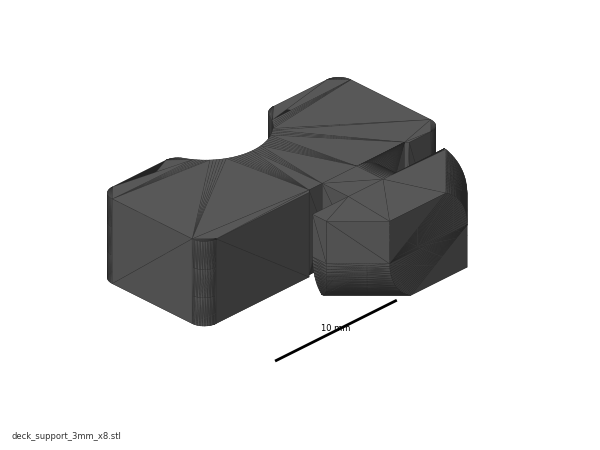{ width=96 } | `Panel_Mounting/deck_support_3mm_x8.stl` | 02-deck | 8 | Black — for a 3 mm panel (LDO's web BOM says 3 mm); Step 02.12 picks the set |
| 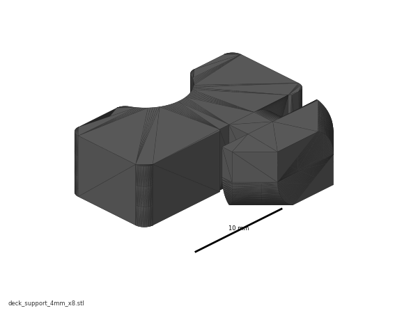{ width=96 } | `Panel_Mounting/deck_support_4mm_x8.stl` | 02-deck | 8 | Black — for a 4 mm panel (LDO's build notes and the kit's paper sheet say 4 mm); both sets are printed, the other is a spare |
| 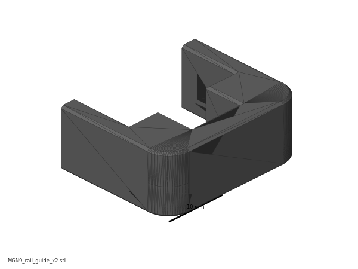{ width=96 } | `Tools/MGN9_rail_guide_x2.stl` (jig, not consumed) | 00-jigs | 2 | Black |
| 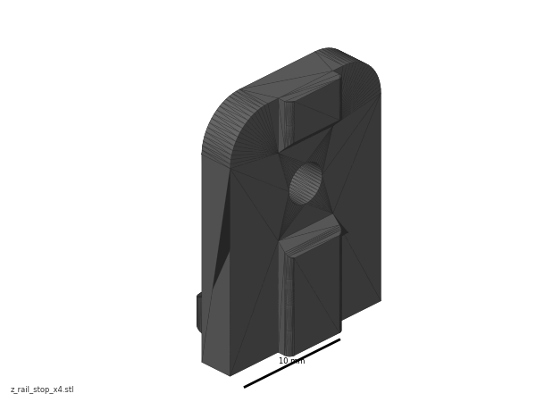{ width=96 } | LDO `STLs/z_rail_stop_x4.stl` (optional) | 02-Z0 · 02-Z1 · 02-Z2 · 02-Z3 | 4 | Black — batch **B05**, fitted at Step 02.10 |

The `_xN` suffix is the quantity you need, not the number of copies in the file — each STL contains one part. `_a` and `_b` are mirrored: two drives use the `a` set, two use the `b` set.

**Hardware** — chapter totals.

| Fastener / part | Qty |
|---|---:|
| M3×8 SHCS | 60: 24 drives, 3 per baseplate and 3 per motor mount; 36 Z rails, 9 per rail |
| M3×16 SHCS | 4 |
| M3×40 SHCS | 24 |
| M3 hexnut | 4 |
| M3 roll-in T-nut, 2020 | 36 (one per Z-rail screw) |
| M3×5×4 brass heat-set insert | 36 (Steps 02.03–02.04: the first one is Step 02.03's re-check) |
| M5×10 BHCS | 8 (drives) |
| M5×16 BHCS | 4 |
| M5×30 BHCS | 12 (idlers: 2 mounting + 1 axle each) |
| M5×40 SHCS | 8 |
| M5 hexnut | 4 |
| M5 roll-in T-nut, 2020 | 28 (16 drives + 8 idlers + 4 deck) |
| M5 precision spacer, 1 mm (kit substitute for "M5 Shim") | 16 |
| M4×4 set screw, pre-applied threadlocker | 24 (2 each on 4× 20T, 4× 80T, 4× 16T) |
| 625-2RS bearing | 12 |
| GT2 80T pulley, 5 mm ID | 4 |
| GT2 20T 9 mm pulley, 5 mm ID | 4 |
| GT2 16T pulley, 5 mm ID 6 mm W | 4 |
| GT2 20T 9 mm idler, 5 mm ID | 4 |
| 5×60 mm shaft | 4 |
| Gates 2GT closed loop, 6 mm × 188 mm | 4 |
| NEMA17 Z motor, `LDO-42STH48-2004AC(VRN)` | 4 |
| MGN9H 400 mm rail, `LDO-SLR9H-400Z0` | 4 |
| Rubber foot, 38×19 mm | 4 |
| Deck panel, acrylic black 469×469 | 1 |

Quantities cross-checked against the LDO Rev D+ 350 BOM ([350_BOM/Rev_D+](https://docs.ldomotors.com/en/voron/voron2/350_BOM/Rev_D+)); the LDO kit ships 6× MGN9H-400 and 1× MGN12H-400 — four of the MGN9s are yours here, the other two are the gantry Y rails in Chapter 05.

**Notes behind "Read first"**

- **The rails were cleaned and greased in Ch 00, not here.** Flip-and-pack needs access to the back of the rail, which you lose the moment it is bolted to an extrusion — so if any of Z0–Z3 was missed, fix it before Step 02.06, not after ([rail grease guide](https://docs.ldomotors.com/guides/rail_grease_guide); survey §4.4 #5, §5.2 W9).
- **The Z motors are the only place in the whole printer that uses 16T pulleys.** They look almost identical to the 20T. Get them off the bench when this chapter is done (p.38; survey §4.4 #7).
- **Every set screw gets threadlocker and must land on the flat/D-cut of the shaft.** Loose set screws are the single most reported failure on this machine (p.32; §5.2 W12).
- **Two corners take `_a` parts, two take `_b`, and diagonal corners share a hand** — `_a` at Z0 (front-left) and Z2 (rear-right), `_b` at Z1 (rear-left) and Z3 (front-right); map at Step 02.02, dry-fit at Step 02.29. A wrong-hand drive bolts on fine and is only found in Ch 06 when the Z belt goes on and the 20T is not under its idler.
- **Heat-set inserts go into the drive parts before the drive is assembled.** A missed insert means taking a finished drive back apart (§4.4 #4, §5.2 W3).
- **The deck panel and its supports go in now, at p.28–30 — not later with the panels.** LDO places them here, and once Ch 09 bolts the DIN rails through it the panel stays in. The clips twist in, so a wrong set can be swapped later with the printer inverted (LDO note p.29–30; §5.2 W4).
- Nothing in this chapter touches a probe or an endstop. The Rev D+ nozzle probe and the Omron inductive probe belong to Chapters 08–09; leave both bagged.

**Sources for this chapter:**

- [Voron 2.4r2 assembly manual (pinned `de7e89d`)](https://github.com/VoronDesign/Voron-2/blob/de7e89d/Manual/Assembly_Manual_2.4r2.pdf) pages 22–51 — Z rails, deck panel, drive assemblies, motor mounts, corner installs, Z idlers
- [LDO Build Notes (Rev D)](https://docs.ldomotors.com/voron/voron2/build-faq) — deck supports at p.29–30, the second-hole rail rule, precision spacers, tight T-nuts
- [LDO 350 Rev D+ BOM](https://docs.ldomotors.com/en/voron/voron2/350_BOM/Rev_D+) — quantities, motor and rail part numbers, the deck panel line (3 mm on the web page, 4 mm on the kit's paper sheet)
- [LDO rail grease guide](https://docs.ldomotors.com/guides/rail_grease_guide) — the flip-and-pack method the four Z rails were prepped with in Ch 00
- [LDO heat-set insert tool guide](https://docs.ldomotors.com/guides/heatset_insert_tool_guide) — the 36-insert pass
- [LDO wiring guide § Connecting Steppers](https://docs.ldomotors.com/en/voron/voron2/wiring_guide_rev_d#connecting-steppers) — Z0–Z3 → `STEPPER-0`…`STEPPER-3`
- [LDO wiring guide § Installing the DIN Rails and Wire Ducts](https://docs.ldomotors.com/en/voron/voron2/wiring_guide_rev_d#installing-the-din-rails-and-wire-ducts) — why the four deck bolts wait for Ch 09
- [LDO Klipper config `leviathan-printer-rev-d-sbv2.cfg`](https://raw.githubusercontent.com/MotorDynamicsLab/LDOVoron2/667521d/Firmware/leviathan-printer-rev-d-sbv2.cfg) — `gear_ratio: 80:16`, `rotation_distance: 40`
- [LDO printed parts guide (Rev D)](https://docs.ldomotors.com/en/voron/voron2/printed_part_guide_rev_d) — the optional `z_rail_stop_x4`
- [Voron-2 `STLs/Z_Drive`](https://github.com/VoronDesign/Voron-2/tree/de7e89d/STLs/Z_Drive), [Voron-2 `STLs/Z_Idlers`](https://github.com/VoronDesign/Voron-2/tree/de7e89d/STLs/Z_Idlers), [Voron-2 `STLs/Panel_Mounting`](https://github.com/VoronDesign/Voron-2/tree/de7e89d/STLs/Panel_Mounting), [Voron-2 `STLs/Tools`](https://github.com/VoronDesign/Voron-2/tree/de7e89d/STLs/Tools)
- [survey](../voron-build-instructions-survey.md) §4.3, §4.4, §5.2 · [print plan](../voron-print-plan.md) batches B00/B01/B02

**Video coverage (Steve Builds, pre-release LDO kit — differs from Rev D+):** [Part 1 @3:08:34](https://www.youtube.com/watch?v=feTxcc0LIWM&list=PL0fUJbigELQPqpeGOgHYisG4KaSXVtnNY&t=11314s) (+4m), [Part 1 @3:20:00](https://www.youtube.com/watch?v=feTxcc0LIWM&list=PL0fUJbigELQPqpeGOgHYisG4KaSXVtnNY&t=12000s) (+9m), [Part 1 @3:28:20](https://www.youtube.com/watch?v=feTxcc0LIWM&list=PL0fUJbigELQPqpeGOgHYisG4KaSXVtnNY&t=12500s) (+7m), [Part 1 @3:34:50](https://www.youtube.com/watch?v=feTxcc0LIWM&list=PL0fUJbigELQPqpeGOgHYisG4KaSXVtnNY&t=12890s) (+9m), [Part 2 @0:55:00](https://www.youtube.com/watch?v=2U0YahE8w_0&list=PL0fUJbigELQPqpeGOgHYisG4KaSXVtnNY&t=3300s) (+7m), [Part 2 @1:18:20](https://www.youtube.com/watch?v=2U0YahE8w_0&list=PL0fUJbigELQPqpeGOgHYisG4KaSXVtnNY&t=4700s) (+14m), [Part 2 @1:36:40](https://www.youtube.com/watch?v=2U0YahE8w_0&list=PL0fUJbigELQPqpeGOgHYisG4KaSXVtnNY&t=5800s) (+8m)

---

## Steps

### Step 02.01 — Lay out and label the chapter's printed parts

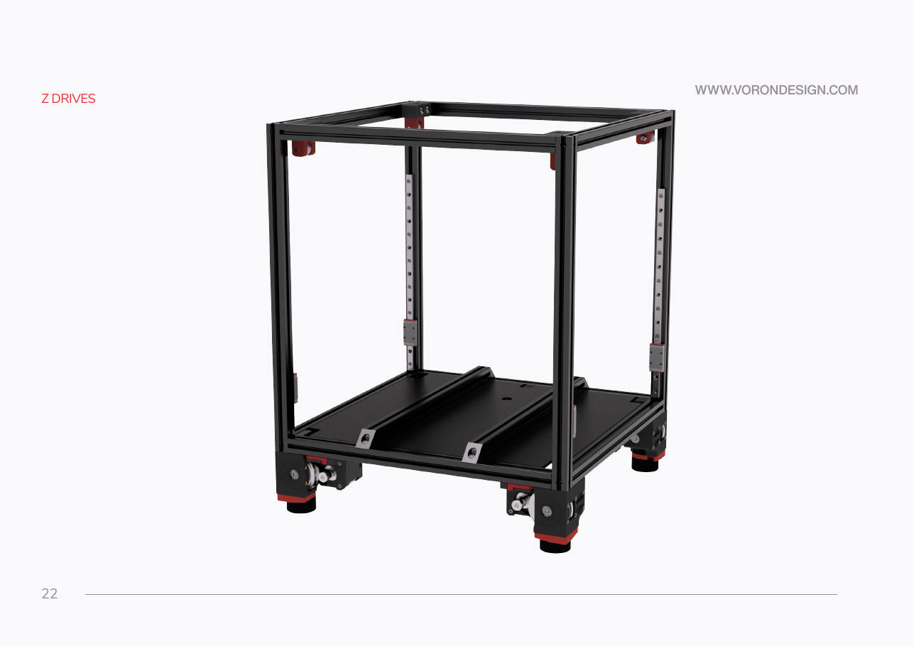


**What you're looking at:** Parts from three batches: drive bodies (`z_drive_main`) and shallow trays (`z_drive_retainer`) clamping the bearings, L-shaped motor mounts, blue baseplates and belt tensioners, and Z idler brackets. Most come in mirror-image pairs, `_a` and `_b`, like gloves.

**Parts:**

- staged: all Chapter 02 printed parts from batches B00, B01 and B02, plus B05's optional rail stops

**Do:**

1. Sort the drive parts into `_a` and `_b` piles, two drives each, using the pair pictures.
2. Write `a` or `b` on the inside face of every part.
3. Reject any part with a lifted corner, or a screw boss (the ring around a screw hole) splitting into layers.

**Check:** You count 12 black drive parts (4 main, 4 retainer, 4 motor mount), 8 blue accents, 4 idler brackets, 4 sliders, 16 deck clips of two thicknesses, 2 rail guides and any rail stops you printed.

**Helper:** Sorts the printed parts into the a and b piles and counts them.

To tell the hands apart, lay the parts with their cradles (the half-round bearing seats) facing up. The `z_drive_main` cut corner and its two 9 mm screw wells sit far from you on `_a` and near you on `_b`. The retainer's cut corner is near-left on `_a`.

Reprint a warped `z_drive_main` rather than forcing it: it holds the shaft in line for the whole Z axis. [src](https://docs.ldomotors.com/en/voron/voron2/printed_part_guide_rev_d)

Source: [Voron manual p.22](https://github.com/VoronDesign/Voron-2/blob/de7e89d/Manual/Assembly_Manual_2.4r2.pdf#page=22) · [LDO printed parts guide (Rev D)](https://docs.ldomotors.com/en/voron/voron2/printed_part_guide_rev_d) · [print plan](../voron-print-plan.md) · [Video: Part 1 @3:08:47](https://www.youtube.com/watch?v=feTxcc0LIWM&list=PL0fUJbigELQPqpeGOgHYisG4KaSXVtnNY&t=11327s)

### Step 02.02 — Learn the four Z positions before you build anything

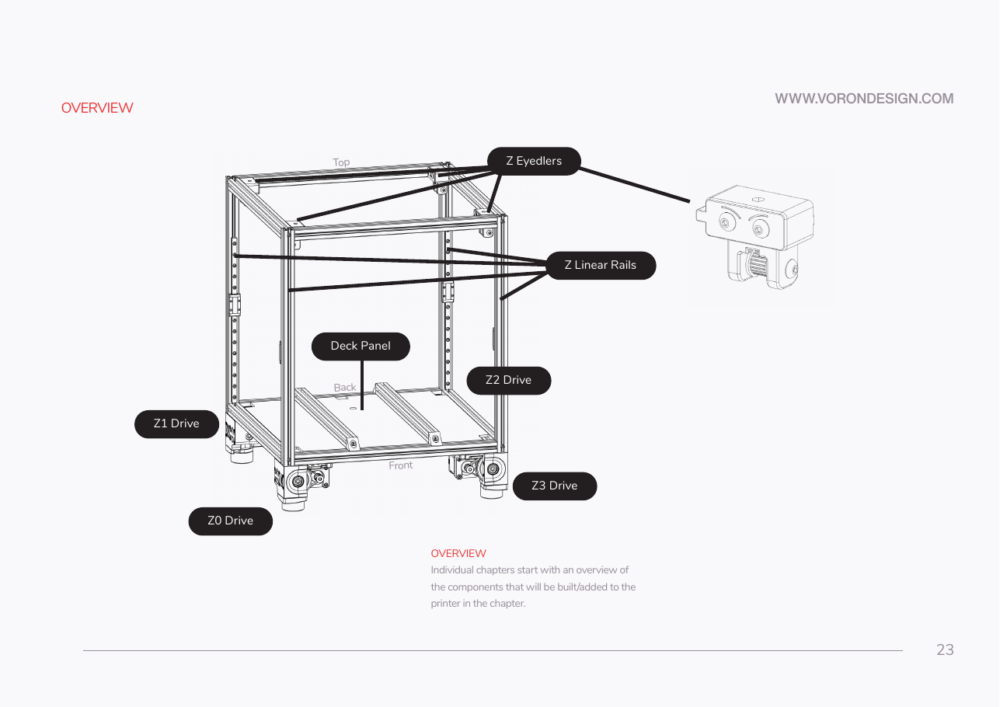

**What you're looking at:** The Z system: a drive in each bottom corner, an idler straight above it, a rail on each vertical, and the deck panel. The corners are **Z0–Z3**, names the manual, the wiring and Klipper share.

**Parts:** none.

**Do:**

1. Learn the corners, seen from the front of the upright printer: **Z0 front-left, Z1 rear-left, Z2 rear-right, Z3 front-right**.
2. Learn the hands: **`_a` builds Z0 and Z2, `_b` builds Z1 and Z3**. Each idler takes the hand of the drive below it.
3. Tag each motor cable with its corner name once the motor is in that corner: that saves an hour in Ch 10.

**Check:** You can point at each corner and say its Z number and hand without looking.

**Helper:** Writes Z0 to Z3 on four tape flags and sticks one per corner.

The kit's wiring and Klipper settings assume these names: on the Leviathan board, Z0 plugs into `STEPPER-0`, Z1 into `STEPPER-1`, Z2 into `STEPPER-2` and Z3 into `STEPPER-3`. [src](https://docs.ldomotors.com/en/voron/voron2/wiring_guide_rev_d#connecting-steppers)

The hand map comes from the official CAD model, not from a manual page. Step 02.29 confirms it by dry-fitting the first drive at Z0 before any screw goes in.

Source: [Voron manual p.23](https://github.com/VoronDesign/Voron-2/blob/de7e89d/Manual/Assembly_Manual_2.4r2.pdf#page=23) · [Voron manual p.40](https://github.com/VoronDesign/Voron-2/blob/de7e89d/Manual/Assembly_Manual_2.4r2.pdf#page=40) · [LDO wiring guide § Connecting Steppers](https://docs.ldomotors.com/en/voron/voron2/wiring_guide_rev_d#connecting-steppers) · [Voron-2 CAD `Voron_2.4r2_Assembly_STEP.zip` @ `de7e89d`](https://github.com/VoronDesign/Voron-2/blob/de7e89d/CAD/Voron_2.4r2_Assembly_STEP.zip) (corner map)

### Step 02.03 — Confirm the Gate B press temperature on the first real insert

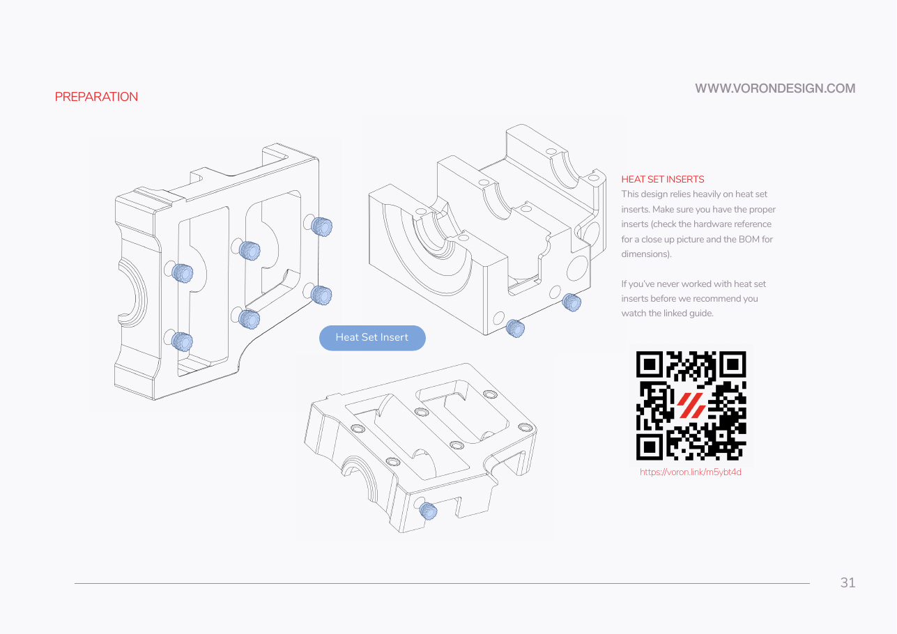{ crop="0.11 0.20 0.36 0.64" }

**What you're looking at:** A heat-set insert is a brass sleeve with a thread inside, pressed in hot so the plastic melts around it. Gate B set the press temperature on a practice coupon; a real retainer has more mass, so the first real insert confirms it.

**Parts:**

- M3×5×4 brass heat-set insert ×1
- `z_drive_retainer_a` ×1
- tool: Nutopress Pro insert press, its M3 tip

**Do:**

1. Set the press to its taped Gate B temperature; leave the stop as it is.
2. Pick one `_a` retainer, the Gate B retainer from now on. Lower one insert to the stop, hold 2–3 s, and lift the tip straight out at once: a resting tip keeps melting the plastic.

**Check:** The cooled insert sits flush or up to 0.2 mm high, went in straight in under 5 seconds, and has not bulged the plastic.

⚠ The press tip and a freshly set insert both burn. Raise and park the head between inserts, keep the bench ventilated, hold parts by the far edge until they cool, and switch the press off between sessions.

A bulge means the next insert needs the press 10 °C cooler and a slower push, and the retainer gets reprinted. The kit supplies 153 inserts for the whole build. This one is the first of the 36 in the drive parts, and none go into a coupon. [src](https://docs.ldomotors.com/guides/heatset_insert_tool_guide)

Source: [Voron manual p.31](https://github.com/VoronDesign/Voron-2/blob/de7e89d/Manual/Assembly_Manual_2.4r2.pdf#page=31) · [LDO heat-set insert tool guide](https://docs.ldomotors.com/guides/heatset_insert_tool_guide) · [LDO 350 Rev D+ BOM](https://docs.ldomotors.com/en/voron/voron2/350_BOM/Rev_D+)

### Step 02.04 — Seat the heat-set inserts in the Z drive parts

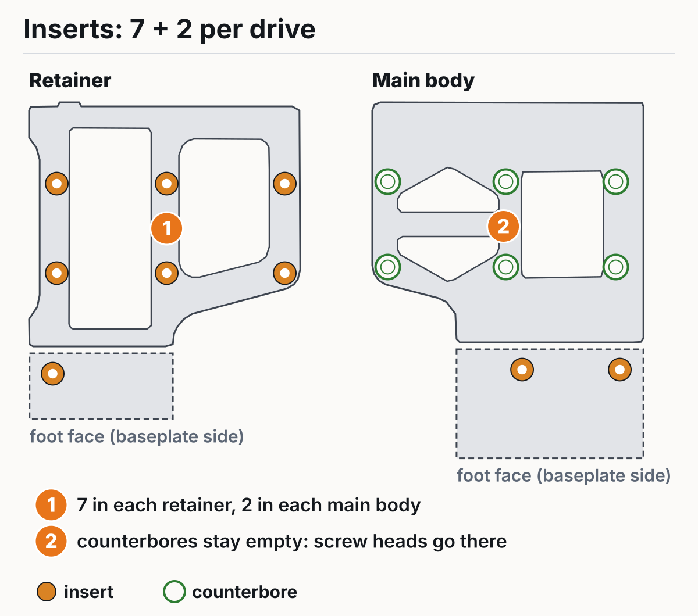
{ crop="0.10 0.18 0.68 0.86" }

**What you're looking at:** All the inserts go in now, before any drive is put together: six in each retainer's flat face for the long M3×40 screws, a seventh in its foot face, and two in the main body's foot face, where the baseplate screws on.

**Parts:**

- M3×5×4 brass heat-set insert ×35
- `z_drive_retainer_a` ×1
- `z_drive_retainer_b` ×2
- `z_drive_main_a` ×2
- `z_drive_main_b` ×2
- reused: the Gate B retainer with its first insert

**Do:**

1. Seat 7 inserts in each `z_drive_retainer` and 2 in each `z_drive_main`, flush. The Gate B retainer needs 6 more. Let each part cool.
2. Leave the Ø6 counterbores on the main body's flat face empty: a counterbore is a wider recess for a screw head.

**Check:** All 36 inserts are in, each flush or at most 0.2 mm high, none tilted, no melted bulge, and nothing in a counterbore.

⚠ The press tip and a freshly set insert both burn. Raise and park the head between inserts, keep the bench ventilated, and hold parts by the far edge until they cool.

Before you start, count the insert pockets on your own parts. A pocket is **Ø4.7 mm wide and 5 mm deep**; a plain M3 screw hole is Ø3.4 mm. If a part shows a different number of pockets than this step says, trust the part.

Source: [Voron manual p.31](https://github.com/VoronDesign/Voron-2/blob/de7e89d/Manual/Assembly_Manual_2.4r2.pdf#page=31) · [LDO heat-set insert tool guide](https://docs.ldomotors.com/guides/heatset_insert_tool_guide)

Pause: ~40 min since the last pause — the printed parts are sorted into `a` and `b` piles and checked, the press temperature is confirmed on the first retainer insert, and all 36 heat-set inserts are in the four retainers and four main bodies. Park the press head and switch the press off. Nothing is assembled yet.

### Step 02.05 — Confirm the four Z rails are already cleaned and greased

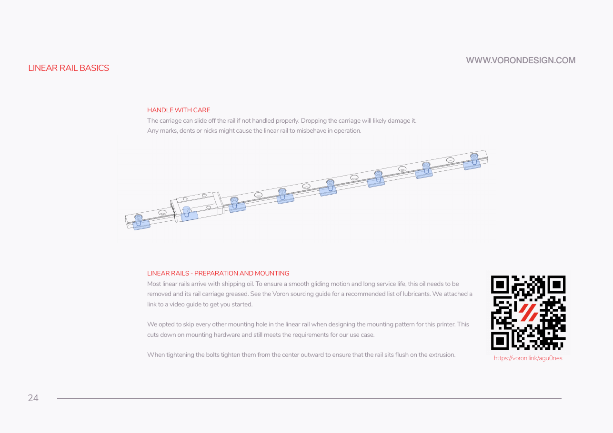

**What you're looking at:** A linear rail is a steel track with a small block, the carriage, that rolls on tiny steel balls. These four MGN9H rails are the upright tracks the gantry's corners ride on. Ch 00 cleaned and greased them, because that needs the rail's back; here you only check them.

**Parts:**

- staged: MGN9H 400 mm rail ×4, labelled Z0–Z3

**Do:**

1. Unbag the four rails marked **Z0–Z3** and check their labels and carriage tape.
2. Run each carriage end to end: it should be smooth and silent, not dry or notchy.
3. Work over the bench, never over the floor: a dropped carriage is scrap.

**Check:** Four labelled rails lie on the bench, carriages taped or stoppered, each smooth and silent end to end, with no grease on any rail's outside.

**Helper:** Runs each carriage end to end over the bench and says smooth or notchy.

If a rail was missed, do Ch 00 Steps 00.18–00.20 on it now and let it dry completely before it goes near the frame. The kit includes **no** grease, and the rails ship with a shipping oil, not a lubricant. If you have to prep a rail here, use NLGI 0 or NLGI 1 grease: Super Lube 21030, Mobilux EP1/EP2, or white lithium. Never use a thin oil or a PTFE dry lube. [src](https://docs.ldomotors.com/guides/rail_grease_guide)

Source: [Voron manual p.24](https://github.com/VoronDesign/Voron-2/blob/de7e89d/Manual/Assembly_Manual_2.4r2.pdf#page=24) · [LDO rail grease guide](https://docs.ldomotors.com/guides/rail_grease_guide) · [LDO Build Notes (Rev D)](https://docs.ldomotors.com/voron/voron2/build-faq)

### Step 02.06 — Fit the first Z rail, centred, with the MGN9 guides

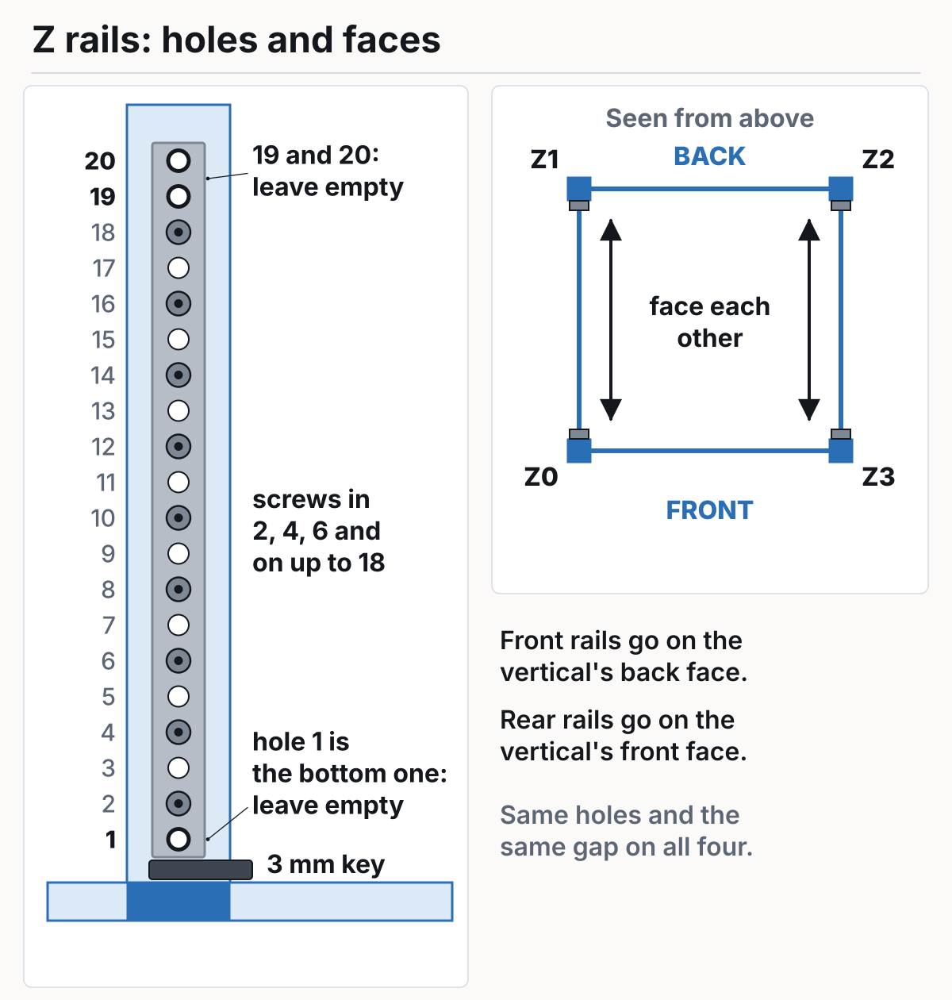
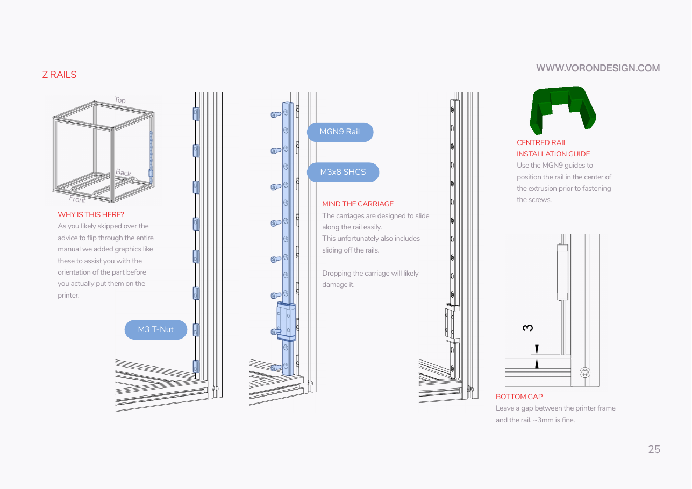

**What you're looking at:** The first rail goes on the front-left vertical's rear-facing side. Printed rail guides centre it, and a 3 mm hex key under its lower end sets the gap.

**Parts:**

- MGN9H 400 mm rail ×1
- M3×8 SHCS ×9
- M3 roll-in T-nut ×9
- `MGN9_rail_guide_x2` jigs ×2
- tool: 3 mm hex key as the gap feeler

**Do:**

1. With the rail flat on the bench, peel off the end-stop bands from Step 00.17 and tape the carriage at mid-rail.
2. Choose the bottom end. Tape-mark holes 2, 4 and on up to 18 from that end, and slip a `MGN9_rail_guide` over each end.
3. Roll nine M3 T-nuts into that slot, swapping any that jams. Stand the rail on the hex key and start the nine screws finger-tight.

**Check:** The rail is centred, standing on the key, carriage taped, nine screws started, and holes 1, 19 and 20 empty.

Why holes 2 to 18: manual p.25 draws the smaller printer's 15-hole rail with a screw in every other hole, both end holes included. LDO's note for manual p.88 says not to use the holes on the ends of the rails but the second ones in, and this manual applies it to every rail (survey §4.4 #6). Your 400 mm rail has 20 holes, an even number, so one end keeps two empty holes. No source says which end, and it makes no difference to the rail: count from the bottom so all four rails match. [src](https://docs.ldomotors.com/voron/voron2/build-faq)

On the two rear verticals the rail goes on the vertical's front-facing side instead.

Source: [Voron manual p.25](https://github.com/VoronDesign/Voron-2/blob/de7e89d/Manual/Assembly_Manual_2.4r2.pdf#page=25) · [LDO Build Notes (Rev D)](https://docs.ldomotors.com/voron/voron2/build-faq)

### Step 02.07 — Tighten from the centre outward

{ crop="0.34 0.18 0.62 0.84" }

**What you're looking at:** Tightening from the middle outward presses the rail flat. Starting at one end pushes a slight bend along it, the tight spot you would feel later.

**Parts:**

- reused: the first Z rail and its nine started screws

**Do:**

1. Tighten from the middle of the rail outward, one above, then one below. Make each one snug, just tight with no force: an M3 screw in a T-nut strips easily.
2. Take the two guides off, peel the tape off the carriage and, keeping a hand on it, run it along the rail.
3. If you feel a tight spot, loosen the screws and tighten again from the centre.

**Check:** The carriage feels the same at every point over the rail's whole length. Any tight spot means the rail is not lying flat.

Source: [Voron manual p.25](https://github.com/VoronDesign/Voron-2/blob/de7e89d/Manual/Assembly_Manual_2.4r2.pdf#page=25) · [Voron manual p.24](https://github.com/VoronDesign/Voron-2/blob/de7e89d/Manual/Assembly_Manual_2.4r2.pdf#page=24)

### Step 02.08 — Secure the carriage before the printer is turned over

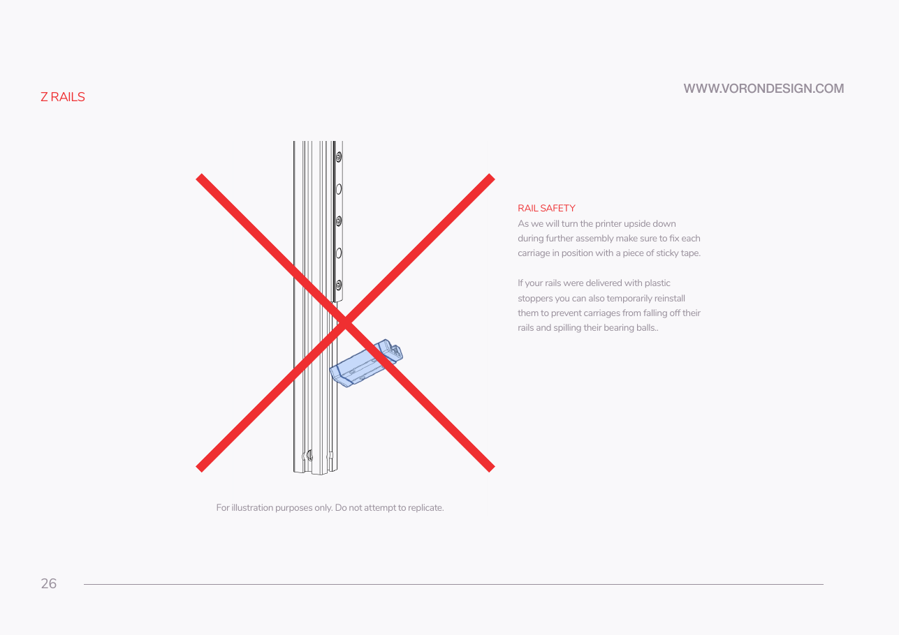

**What you're looking at:** The carriage's steel balls are held in only by the rail. If a carriage runs off the end, they spill out and the carriage is scrap. The printer goes upside down at Step 02.11, and a loose carriage would slide off the bottom end, so tie each one down first.

**Parts:**

- consumable: masking tape, or the rail's plastic shipping stoppers

**Do:** Tape the carriage to the rail, or put back the plastic shipping stopper, so gravity cannot walk it off the end.

**Check:** The carriage cannot move to the end of the rail under its own weight.

Source: [Voron manual p.26](https://github.com/VoronDesign/Voron-2/blob/de7e89d/Manual/Assembly_Manual_2.4r2.pdf#page=26)

Pause: ~25 min since the last pause — the first Z rail is centred, tightened from the centre outward, smooth over its whole length, and its carriage is taped. A rail is a complete unit: stop only with one finished, never with half its screws started.

### Step 02.09 — Install the remaining three Z rails

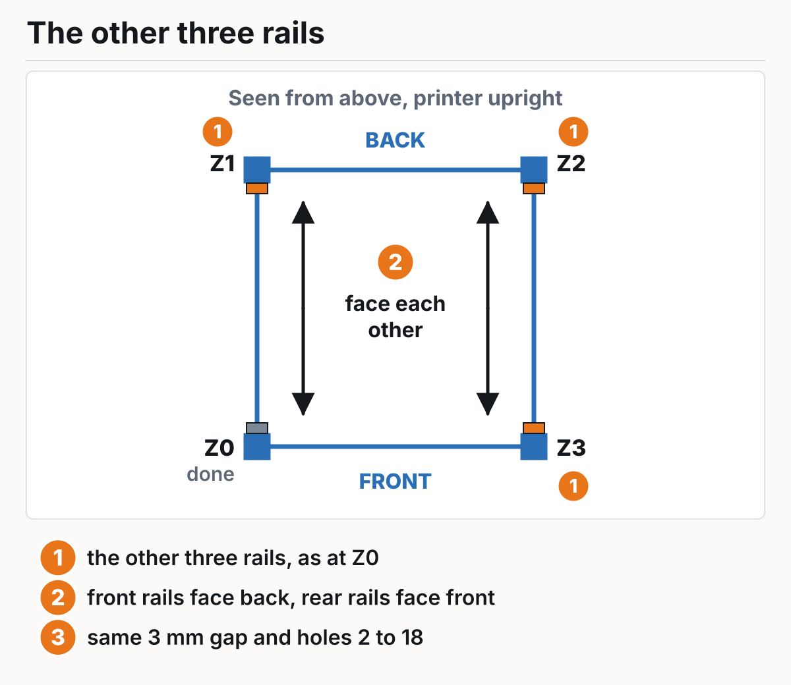
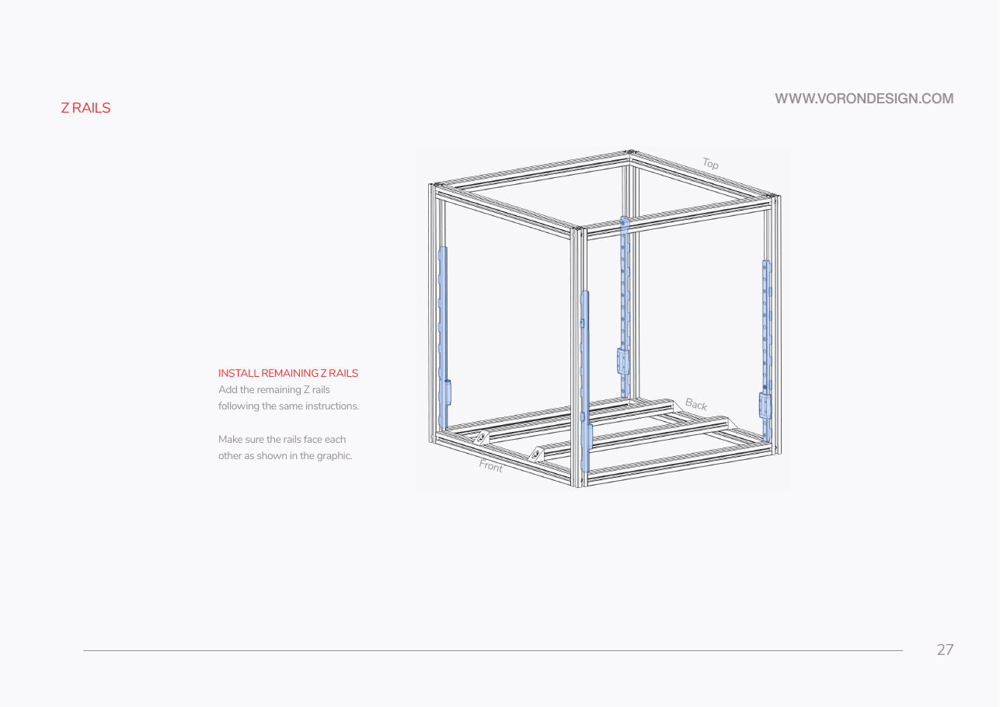
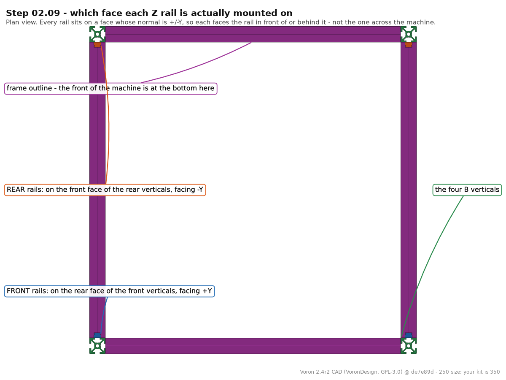
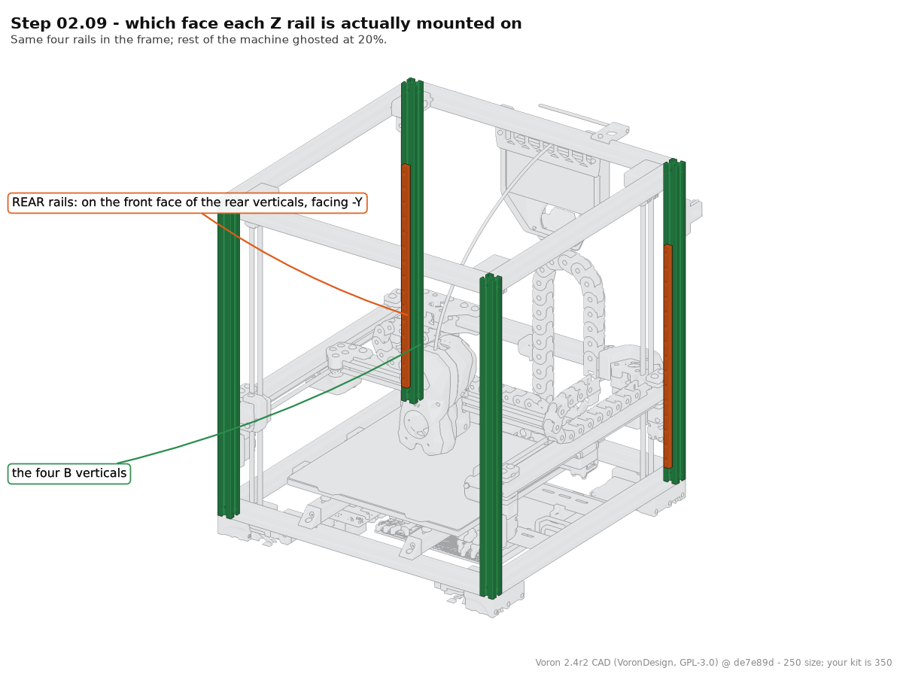

**What you're looking at:** The other three rails go on the same way. What matters is which face of each vertical they go on: the two rails on the left side face each other across the printer, front to back, and the two on the right do the same.

**Parts:**

- MGN9H 400 mm rails ×3
- M3×8 SHCS ×27
- M3 roll-in T-nut ×27

**Do:**

1. Repeat Steps 02.06–02.08 on the other three verticals.
2. Turn **each rail to face the other rail on its own side**: front-left faces rear-left, front-right faces rear-right.
3. Keep the same 3 mm bottom gap and holes 2 to 18 on all four.

**Check:** Four rails are on, the two on each side face each other, all four bottom gaps match, and every carriage is taped and runs smoothly.

**Helper:** Tape-marks holes 2, 4 and on to 18 on each rail before its screws go in.

Manual p.27 only says *"make sure the rails face each other as shown in the graphic"* and leaves the pairing to the drawing. The official CAD model at the pinned commit `de7e89d` settles it: every Z rail is mounted on a face that looks front or back, the two rear rails facing forward and the two front rails facing backward. Corrected 2026-09-05. [src](assets/cad/PILOT.md)

The CAD is the smaller 250 machine: MGN9 300 mm rails on 430 mm verticals. Yours are MGN9H 400 mm rails on the 350 verticals, and the mounting face is the same.

Source: [Voron manual p.27](https://github.com/VoronDesign/Voron-2/blob/de7e89d/Manual/Assembly_Manual_2.4r2.pdf#page=27) · [CAD-render pilot §8 — Z rail orientation](assets/cad/PILOT.md) · [Voron-2 CAD `Voron_2.4r2_Assembly_STEP.zip` @ `de7e89d`](https://github.com/VoronDesign/Voron-2/blob/de7e89d/CAD/Voron_2.4r2_Assembly_STEP.zip) · CAD: Voron 2.4r2 STEP @ de7e89d

### Step 02.10 — Optional: fit the LDO rail stops at the top of each Z rail

{ width=240 }
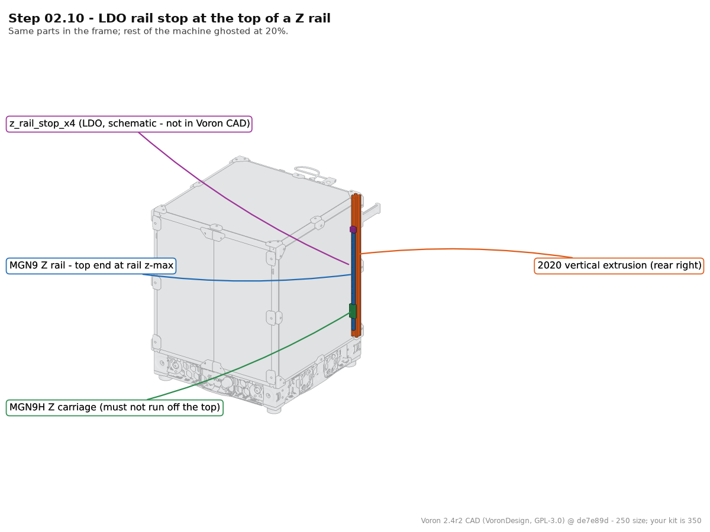

**What you're looking at:** This step is optional. LDO's rail stop is a small printed clip that caps the top end of a rail, so a carriage cannot run off while the gantry goes in during Ch 06. It clips onto the bare top end of the rail, above the carriage.

**Parts:**

- `z_rail_stop_x4` ×4

**Do:** Fit a stop to the top of each Z rail now, while you can still reach them. If you skip them, the tape from Step 02.08 protects the carriages until Ch 06.

**Check:** Each of the four rails has a stop, or you have decided to skip them and left the tape in place.

Do not confuse these with the rubber rail stopper LDO also uses under the Z joints, as a rest for the gantry, at manual p.114–116. That one belongs to Ch 06. [src](https://docs.ldomotors.com/voron/voron2/build-faq)

The CAD picture shows the 250 machine: an MGN9 300 mm rail on a 430 mm vertical, with about 107 mm bare above it. The stop clips to the rail's end, not at a measured height.

Source: [LDO printed parts guide (Rev D)](https://docs.ldomotors.com/en/voron/voron2/printed_part_guide_rev_d) · [LDO Build Notes (Rev D)](https://docs.ldomotors.com/voron/voron2/build-faq) · [CAD render — assets/cad/PILOT.md](assets/cad/PILOT.md) · [Video: Part 4 @1:27:15](https://www.youtube.com/watch?v=ViB5Ulc9zDI&list=PL0fUJbigELQPqpeGOgHYisG4KaSXVtnNY&t=5235s) · CAD: Voron 2.4r2 STEP @ de7e89d

Pause: ~35 min since the last pause — all four Z rails are on, facing each other, with the same ~3 mm bottom gap and hole pattern, and every carriage is taped or stoppered. The frame is still the right way up. Do not turn it over until the carriages are secured.

### Step 02.11 — Turn the printer upside down and pre-load the deck T-nuts

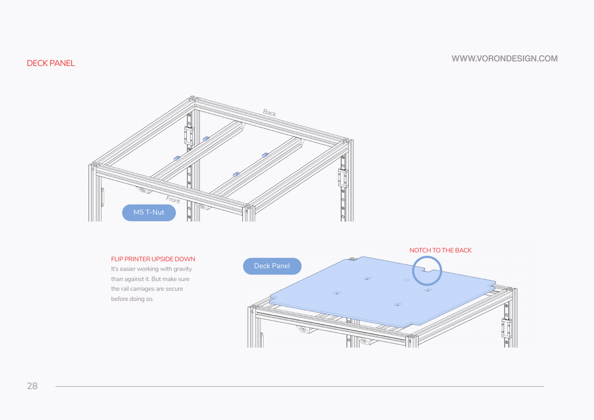{ crop="0.14 0.20 0.60 0.54" }

**What you're looking at:** The printer now spends a while upside down, because every Z drive screws to the underside of the bottom frame. The first job is four M5 T-nuts for the deck panel.

**Parts:**

- M5 roll-in T-nut ×4

**Do:**

1. Check that every carriage is taped. Then turn the frame upside down onto the flat reference surface.
2. Slide **four M5 T-nuts** into the upward-facing slots of the two bed extrusions, two in each, where the deck panel's holes will land.

**Check:** The frame sits flat upside down without rocking, and four T-nuts are in, free to slide, none dropped inside an extrusion.

**Helper:** Takes the other side of the frame as it turns over, then counts the four T-nuts in.

You can load the 16 T-nuts for the drive corners now too: four per bottom corner, two in each extrusion that meets there. Test each slot, because LDO warns the T-nuts fit tightly. [src](https://docs.ldomotors.com/voron/voron2/build-faq)

Source: [Voron manual p.28](https://github.com/VoronDesign/Voron-2/blob/de7e89d/Manual/Assembly_Manual_2.4r2.pdf#page=28)

### Step 02.12 — Caliper the deck panel and choose the support thickness

{ crop="0.40 0.57 0.90 0.84" }
{ width=240 }

**What you're looking at:** The deck panel is the acrylic floor between the electronics bay below and the print chamber above. Its clips must match its thickness, and the sources disagree: LDO's note for p.29–30 and this kit's paper parts sheet say **4 mm**, so `deck_support_4mm`; LDO's web parts list says **3 mm**. Your caliper decides. [src](https://docs.ldomotors.com/voron/voron2/build-faq) · [BOM](https://docs.ldomotors.com/en/voron/voron2/350_BOM/Rev_D+)

**Parts:**

- staged: deck panel ×1
- staged: `deck_support_3mm_x8` ×8
- staged: `deck_support_4mm_x8` ×8
- tool: caliper

**Do:**

1. Read the kit-day thickness taped on the panel's film (Step 00.4) and confirm it on one edge with the caliper.
2. Lay out the eight clips of that thickness. B01-P2 printed **both** sets: bag the other set as spares.

**Check:** The caliper agrees with the taped number within 0.1 mm, the number is logged, and eight matching clips are on the bench.

**Helper:** Reads the caliper display aloud so you can check it against the tape.

Source: [Voron manual p.28](https://github.com/VoronDesign/Voron-2/blob/de7e89d/Manual/Assembly_Manual_2.4r2.pdf#page=28) · [LDO Build Notes (Rev D)](https://docs.ldomotors.com/voron/voron2/build-faq) · [LDO 350 Rev D+ BOM](https://docs.ldomotors.com/en/voron/voron2/350_BOM/Rev_D+) · [Video: Part 2 @0:56:54](https://www.youtube.com/watch?v=2U0YahE8w_0&list=PL0fUJbigELQPqpeGOgHYisG4KaSXVtnNY&t=3414s)

### Step 02.13 — Drop the deck panel in, notch to the back

{ crop="0.40 0.57 0.90 0.84" }

**What you're looking at:** The panel is cut to 469 mm, 1 mm smaller than the frame's opening, so it drops inside the frame and rests on the two bed extrusions. Its round hole passes the bed cables, and its notch passes the Z-chain cable bundle.

**Parts:**

- deck panel ×1

**Do:**

1. Peel off any protective film.
2. Lower the panel into the bottom frame's opening, **notch toward the back**, flat on both bed extrusions.
3. Line its four screw holes up over the four T-nuts.

**Check:** The notch is at the back, and the panel sits inside the frame opening, flat on both bed extrusions, 16–17 mm below the upward faces of the frame extrusions around it, without rocking.

**Helper:** Holds the far edge of the deck panel level as it lowers into the frame.

Source: [Voron manual p.28](https://github.com/VoronDesign/Voron-2/blob/de7e89d/Manual/Assembly_Manual_2.4r2.pdf#page=28) · [LDO 350 Rev D+ BOM](https://docs.ldomotors.com/en/voron/voron2/350_BOM/Rev_D+)

### Step 02.14 — Fit the deck support clips

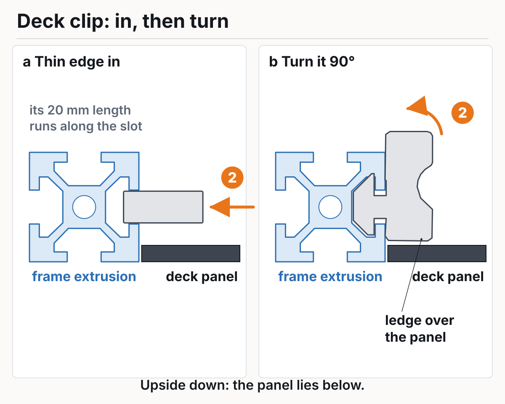
{ width=240 }

**What you're looking at:** The Voron manual never shows these clips; LDO adds them here. [src](https://docs.ldomotors.com/voron/voron2/build-faq) Each `deck_support` is a small T-shaped tab, about 20 × 14.5 × 5.8 mm, with a ledge. Upright, the panel hangs on the eight ledges until Ch 09 screws it down.

**Parts:**

- `deck_support_3mm_x8` ×8

**Do:**

1. Take the eight clips that match your caliper reading.
2. Push one into the **inward-facing slot of a bottom frame extrusion** above the panel's edge, thin edge first, long side along the slot. Turn it 90° so its ledge lies over the panel.
3. Fit two per side, evenly spaced (verify on bench).

**Check:** Eight ledges of the same thickness set lie over the panel's edge, and the panel cannot be lifted out.

The clips twist in, so a wrong set can still be swapped later with the printer upside down, as Ch 09 allows.

Source: [Voron manual p.29](https://github.com/VoronDesign/Voron-2/blob/de7e89d/Manual/Assembly_Manual_2.4r2.pdf#page=29) · [LDO Build Notes (Rev D)](https://docs.ldomotors.com/voron/voron2/build-faq) · [Video: Part 2 @0:56:54](https://www.youtube.com/watch?v=2U0YahE8w_0&list=PL0fUJbigELQPqpeGOgHYisG4KaSXVtnNY&t=3414s)

### Step 02.15 — Line the four M5 T-nuts up under the deck holes and stop there

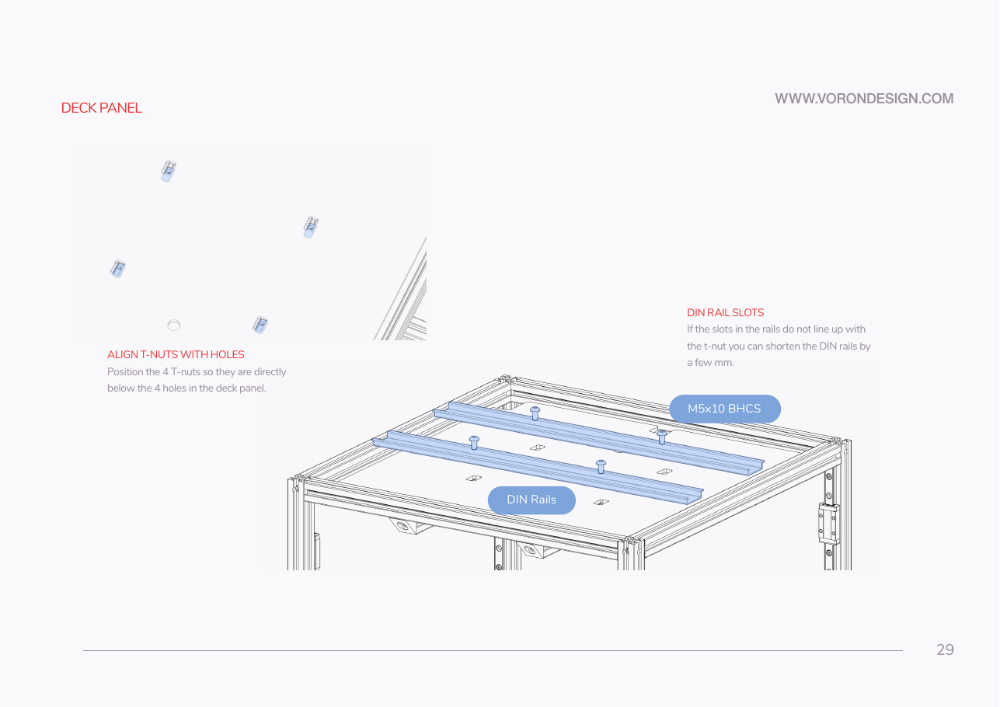{ crop="0.06 0.18 0.45 0.57" }

**What you're looking at:** The screws that go through the deck's four holes also clamp the two DIN rails, the metal strips the electronics clip onto. So those screws belong to one step in Ch 09. For now only the T-nuts get lined up.

**Parts:**

- reused: the four deck T-nuts

**Do:**

1. Slide each T-nut directly under one of the four holes in the deck panel, and leave it there.
2. Fit **no screws and no DIN rails yet**: both go on in **Ch 09 Step 09.5**.

**Check:** You can see the four T-nuts through the four deck holes, free to nudge but not lost inside an extrusion, and the panel lies flat, unscrewed, notch at the back.

If a DIN rail's own slots will not line up when you get there, Ch 09 shortens the DIN rail rather than moving the panel. [src](https://docs.ldomotors.com/en/voron/voron2/wiring_guide_rev_d#installing-the-din-rails-and-wire-ducts)

Source: [Voron manual p.29](https://github.com/VoronDesign/Voron-2/blob/de7e89d/Manual/Assembly_Manual_2.4r2.pdf#page=29) · [LDO wiring guide § Installing the DIN Rails and Wire Ducts](https://docs.ldomotors.com/en/voron/voron2/wiring_guide_rev_d#installing-the-din-rails-and-wire-ducts)

### Step 02.16 — Fix the printer's orientation in your head

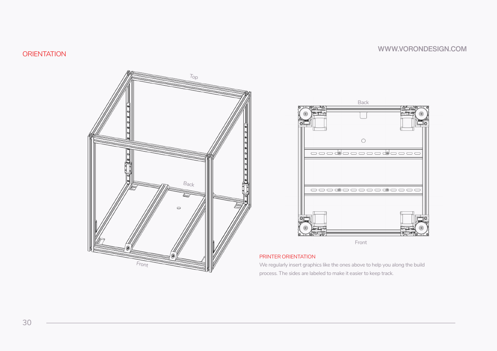

**What you're looking at:** Upside down, front and back stop being obvious. From here on the manual adds a small labelled view of the frame (Front, Back, Top), and every "which corner" is read against it.

**Parts:** none.

**Do:**

1. Stick a strip of masking tape on the **front bottom frame extrusion**, the one the front ends of the two bed extrusions run into, and write FRONT on it.
2. Stand facing the FRONT tape and learn the corners upside down: Z0 is near you on your right, Z3 near you on your left, Z1 far right and Z2 far left.

**Check:** The front is marked, and with the printer upside down you can point at Z0, Z1, Z2 and Z3 without looking them up.

**Helper:** Writes FRONT on the tape strip and sticks it on the front bottom extrusion.

Source: [Voron manual p.30](https://github.com/VoronDesign/Voron-2/blob/de7e89d/Manual/Assembly_Manual_2.4r2.pdf#page=30)

Pause: ~30 min since the last pause — the printer is upside down and steady, the deck panel is in with its notch at the back and held by eight clips of the measured thickness, the four M5 T-nuts sit under the deck holes, and the FRONT tape is on. Leave the deck unscrewed: its four screws belong to Ch 09 Step 09.5.

### Step 02.17 — Fit the 20T pulley to the 5×60 shaft, 33 mm out

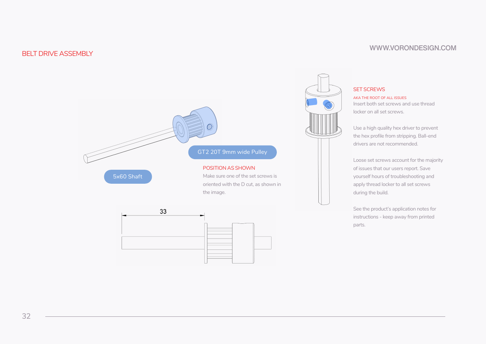{ crop="0.15 0.27 0.60 0.80" }

**What you're looking at:** The drive's axle is a 5 × 60 mm steel shaft. The 20-tooth pulley (20T) carries the long Z belt. A set screw is a small headless screw that clamps a pulley to a shaft, pressing on its one flat side, the D-cut.

**Parts:**

- 5×60 mm shaft ×1
- GT2 20T 9 mm pulley ×1
- M4×4 set screws ×2 (pre-threadlocked)

**Do:**

1. Slide the 20T pulley on so that **33 mm of shaft sticks out** on the long side.
2. Turn the pulley until you **see the flat through a set-screw hole**.
3. Fit both set screws with a straight hex driver, **not** a ball-end.

**Check:** One set-screw hole showed the flat before the screws went in, and it is 33 mm from the long shaft end to the pulley's near flange (the rim beside the teeth).

**Helper:** Reads the caliper aloud: 33 mm from the long shaft end to the pulley.

The kit's M4×4 set screws arrive with threadlocker already on them, a thread glue that stops screws shaking loose, so add no more. If a screw has clearly been used before or shows no compound, add Loctite 243, and keep it off the printed parts. [src](https://docs.ldomotors.com/en/voron/voron2/350_BOM/Rev_D+)

Source: [Voron manual p.32](https://github.com/VoronDesign/Voron-2/blob/de7e89d/Manual/Assembly_Manual_2.4r2.pdf#page=32) · [LDO 350 Rev D+ BOM](https://docs.ldomotors.com/en/voron/voron2/350_BOM/Rev_D+)

### Step 02.18 — Verify the pulley at 33 mm, then repeat ×4

{ crop="0.60 0.20 0.93 0.68" }

**What you're looking at:** The same 33 mm on all four shafts puts the four 20T pulleys in one plane, so the four corners lift evenly.

**Parts:**

- 5×60 mm shaft ×3
- GT2 20T 9 mm pulley ×3
- M4×4 set screws ×6
- tool: caliper

**Do:**

1. Measure the first pulley with the caliper: 33 mm from the long end of the shaft to its near flange.
2. Build the other three shafts and pulleys the same way.

**Check:** Four shafts carry four 20T pulleys, all at the same distance, each with a set screw on the flat, and all eight set screws tight.

**Helper:** Reads the caliper aloud on each of the four shafts: 33 mm.

Source: [Voron manual p.32](https://github.com/VoronDesign/Voron-2/blob/de7e89d/Manual/Assembly_Manual_2.4r2.pdf#page=32) · [Voron-2 `STLs/Tools`](https://github.com/VoronDesign/Voron-2/tree/de7e89d/STLs/Tools)

### Step 02.19 — Build the bearing/pulley stack on each shaft

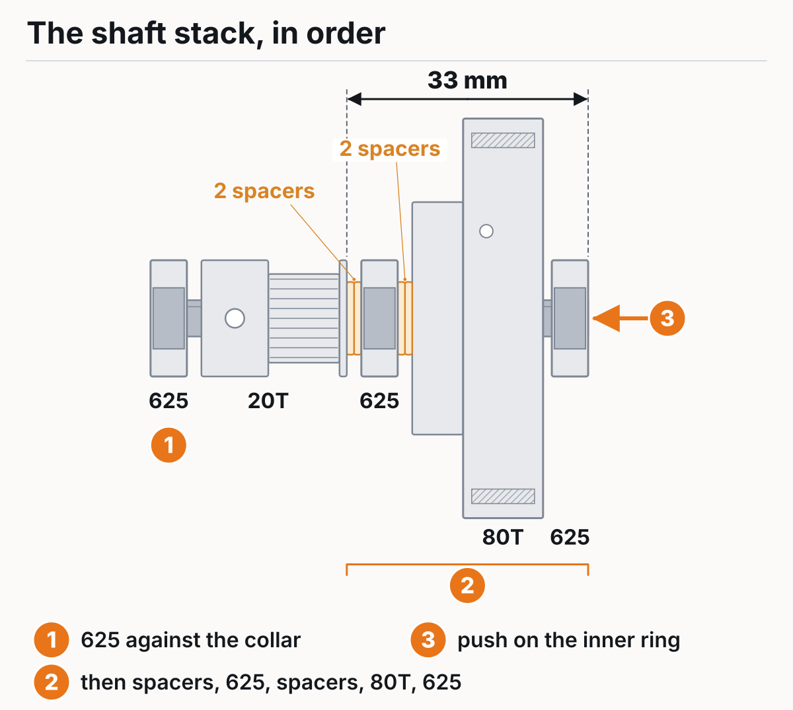
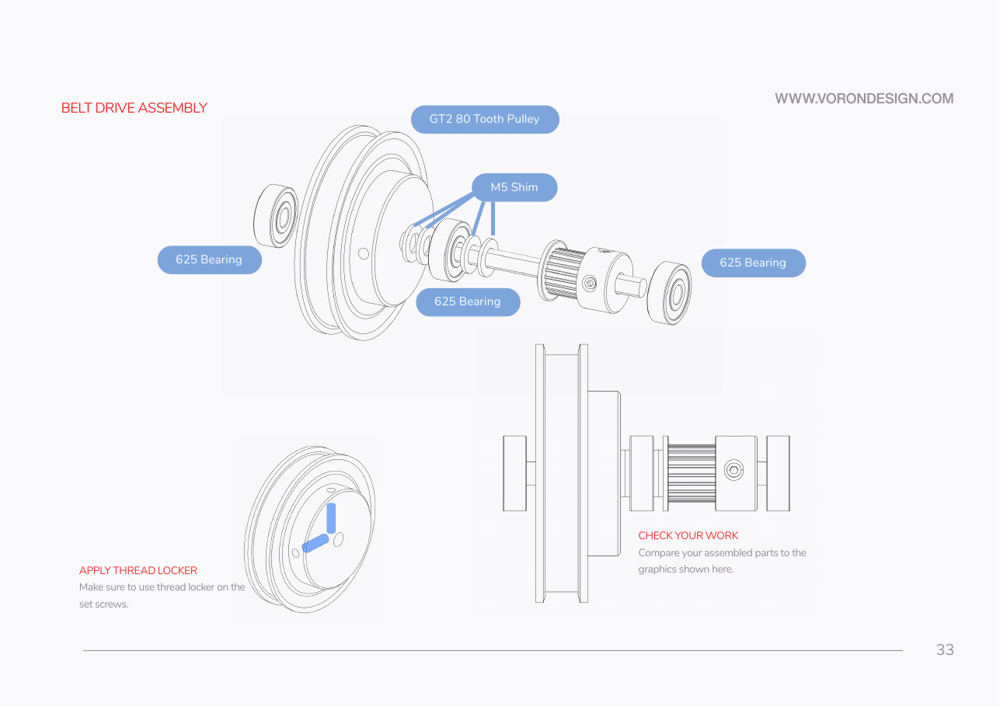{ crop="0.14 0.14 0.84 0.50" }
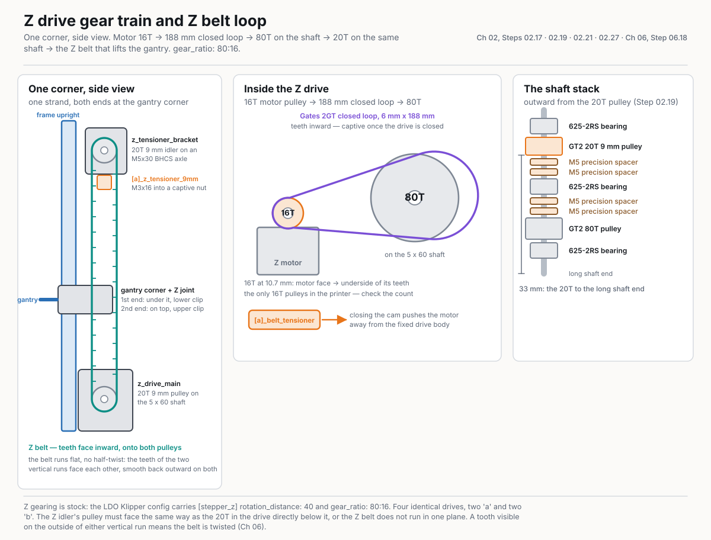

**What you're looking at:** Now the rest of the shaft: three 625-2RS ball bearings (5 × 16 × 5 mm) that carry it, the big 80-tooth pulley (80T) driven by the short 188 mm belt, and brass precision spacers (the manual's "M5 Shim") that set the spacing.

**Parts:**

- 625-2RS bearings ×12
- GT2 80T pulley ×4
- M5 precision spacer 1 mm ×16
- reused: the four shafts with their 20T pulleys

**Do:**

1. On each shaft, slide a 625 against the 20T's collar, the plain sleeve with the set screws.
2. On the 20T's other side, in order: **two spacers, a 625, two spacers, the 80T, and the last 625 at the end.**
3. Press each on by hand, pushing only on a bearing's inner ring.

**Check:** The stack matches the p.33 drawing, both outer bearings spin freely, no spacer sits crooked, and the 80T runs true without rim wobble.

The kit supplies brass M5 precision spacers instead of the manual's "M5 Shim": use them everywhere in the manual from p.19 on, unless a note says otherwise. That is four per drive, 16 for this chapter. [src](https://docs.ldomotors.com/voron/voron2/build-faq)

Source: [Voron manual p.33](https://github.com/VoronDesign/Voron-2/blob/de7e89d/Manual/Assembly_Manual_2.4r2.pdf#page=33) · [LDO Build Notes (Rev D)](https://docs.ldomotors.com/voron/voron2/build-faq) · [Video: Part 2 @0:06:45](https://www.youtube.com/watch?v=2U0YahE8w_0&list=PL0fUJbigELQPqpeGOgHYisG4KaSXVtnNY&t=405s)

### Step 02.20 — Threadlock the 80T pulley set screws and check your work

{ crop="0.06 0.47 0.84 0.88" }

**What you're looking at:** The whole weight of the gantry hangs on this joint through the belt, and loose set screws are the most reported failure on this machine. So both of the 80T's set screws carry threadlocker, and one presses on the flat.

**Parts:**

- M4×4 set screws ×8

**Do:**

1. Turn the 80T pulley so one of its two set-screw holes meets the shaft's flat.
2. Fit both set screws, threadlocker already on them, and tighten.
3. Build all four stacks.

**Check:** Four finished shaft assemblies match the drawing, and on none of them can the 80T slip when you twist it against the shaft by hand.

Source: [Voron manual p.33](https://github.com/VoronDesign/Voron-2/blob/de7e89d/Manual/Assembly_Manual_2.4r2.pdf#page=33) · [Video: Part 1 @3:46:04](https://www.youtube.com/watch?v=feTxcc0LIWM&list=PL0fUJbigELQPqpeGOgHYisG4KaSXVtnNY&t=13564s)

### Step 02.21 — Fit the 188 mm closed belt loop over the 80T pulley

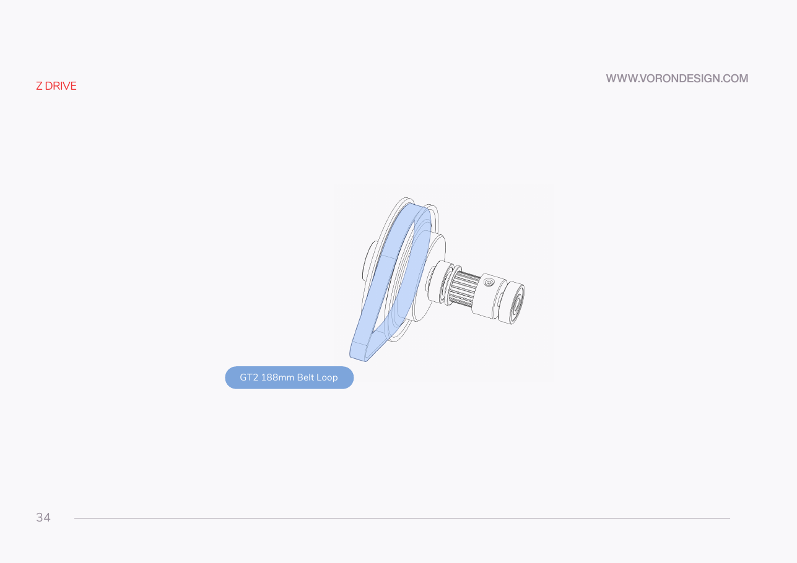


**What you're looking at:** The short belt is a closed loop, 188 mm round, with no join. Once the drive is closed around the shaft there is no way to get it on, so this is the only moment it can go on.

**Parts:**

- Gates 2GT closed loop 6 mm × 188 mm ×4

**Do:** Drop one closed belt loop over each 80T pulley, teeth facing in, before the shaft goes into its housing.

**Check:** Four loops sit in their 80T pulleys' teeth, hanging free and not twisted.

Use the 188 mm loops as supplied. LDO publishes **no** change from the manual for this belt loop, the 16T and 80T pulleys or the Z gear ratio: its build notes for manual p.22–51 cover only p.29–30 (deck supports) and p.39 (motor wiring). The kit's Klipper settings confirm the standard setup: `[stepper_z] rotation_distance: 40`, `gear_ratio: 80:16`. [src](https://github.com/MotorDynamicsLab/LDOVoron2/blob/main/Firmware/leviathan-printer-rev-d-sbv2.cfg)

Source: [Voron manual p.34](https://github.com/VoronDesign/Voron-2/blob/de7e89d/Manual/Assembly_Manual_2.4r2.pdf#page=34) · [LDO Build Notes (Rev D)](https://docs.ldomotors.com/voron/voron2/build-faq) · [LDO Klipper config `leviathan-printer-rev-d-sbv2.cfg`](https://raw.githubusercontent.com/MotorDynamicsLab/LDOVoron2/667521d/Firmware/leviathan-printer-rev-d-sbv2.cfg) · [Video: Part 1 @3:29:28](https://www.youtube.com/watch?v=feTxcc0LIWM&list=PL0fUJbigELQPqpeGOgHYisG4KaSXVtnNY&t=12568s)

Pause: ~35 min since the last pause — four complete shaft assemblies: 20T pulleys at 33 mm, bearings and precision spacers stacked, 80T pulleys threadlocked, and the 188 mm belt loops hung on. The bearings are only slid onto the shaft, so nothing is half-done. Do not start Step 02.22 until you can close a drive in one sitting.

### Step 02.22 — Seat the shaft assembly into `z_drive_retainer` (the shallow half)

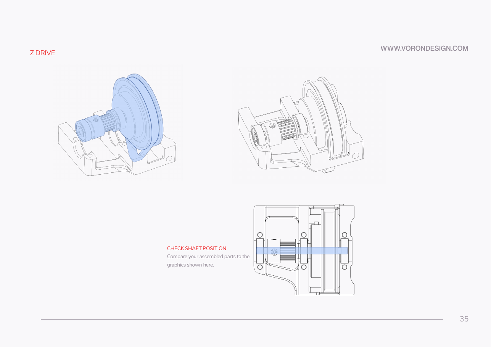{ crop="0.10 0.19 0.76 0.52" }

**What you're looking at:** The housing closes around the shaft in two halves. The retainer is the shallow 16 mm tray, with six inserts in its flat outer face and three half-round cradles for the 625 bearings; the deeper main body clamps them.

**Parts:**

- reused: one `z_drive_retainer_a` with its inserts
- reused: one belted shaft assembly

**Do:**

1. Start with an `_a` retainer, inserts facing down and cradles facing up.
2. Lower the shaft in so each 625 drops into a cradle, belt loop in the pocket.
3. If a bearing will not seat by hand, lift the shaft and look for a crooked spacer or a plastic blob in the cradle. Never heat or hammer it.

**Check:** All three bearings sit in their cradles, the shaft lies parallel to the flat face, and the loop lies in its pocket.

Source: [Voron manual p.35](https://github.com/VoronDesign/Voron-2/blob/de7e89d/Manual/Assembly_Manual_2.4r2.pdf#page=35)

### Step 02.23 — Check the shaft position against the section view

{ crop="0.32 0.57 0.74 0.86" }

**What you're looking at:** Compare the shaft with the manual's drawings now, while it is easy to fix. The lower drawing on manual p.35, marked CHECK SHAFT POSITION, shows the shaft from above, lying in the retainer.

**Parts:** none.

**Do:** Hold your part next to the views on manual p.35. Check that the 20T pulley is on the same side, the spacer stack sits between the same two bearings, and the shaft ends sit flush the same way.

**Check:** Your assembly and the drawings match in every detail. Fix any difference now: after the main body goes on, six M3×40 have to come back out.

**Helper:** Holds the drive beside the page and names any difference from the section view.

Source: [Voron manual p.35](https://github.com/VoronDesign/Voron-2/blob/de7e89d/Manual/Assembly_Manual_2.4r2.pdf#page=35)

### Step 02.24 — Close the drive with `z_drive_main` and six M3×40

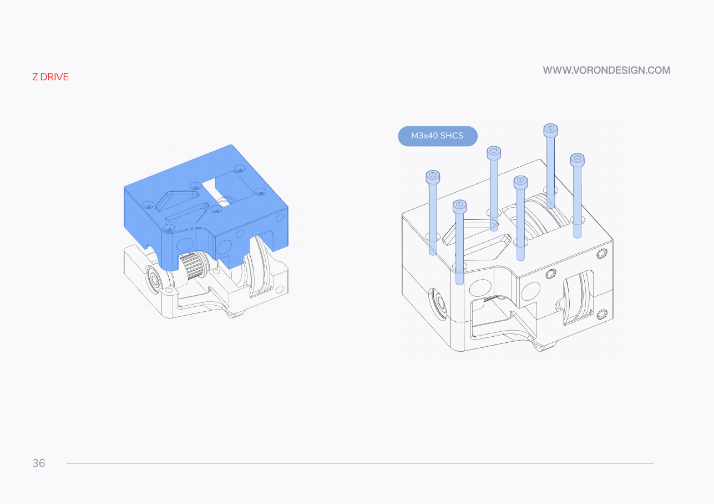

**What you're looking at:** The main body is the deeper half. Its flat face has six counterbored holes and no inserts, plus a rectangular window that clears only the 80T's rim. Six long M3×40 screws run through both halves and bite into the inserts in the retainer's outer face.

**Parts:**

- M3×40 SHCS ×6
- reused: one `z_drive_main_a` with its side inserts

**Do:**

1. Lower the main body over the shaft, counterbores up, until the two halves meet with no gap.
2. Drive the six M3×40 SHCS through the counterbores into the retainer's inserts, in a criss-cross order. Make them snug, then stop.
3. **Every head must sink into a counterbore.**

**Check:** All six heads sit down in their counterbores, the joint line shows no gap, and the shaft still turns freely by hand with the belt on.

If the shaft binds, a bearing is trapped crooked: loosen the screws and seat it again.

Source: [Voron manual p.36](https://github.com/VoronDesign/Voron-2/blob/de7e89d/Manual/Assembly_Manual_2.4r2.pdf#page=36) · [Video: Part 1 @3:29:31](https://www.youtube.com/watch?v=feTxcc0LIWM&list=PL0fUJbigELQPqpeGOgHYisG4KaSXVtnNY&t=12571s)

### Step 02.25 — Fit the blue baseplate and its captive M5 nut

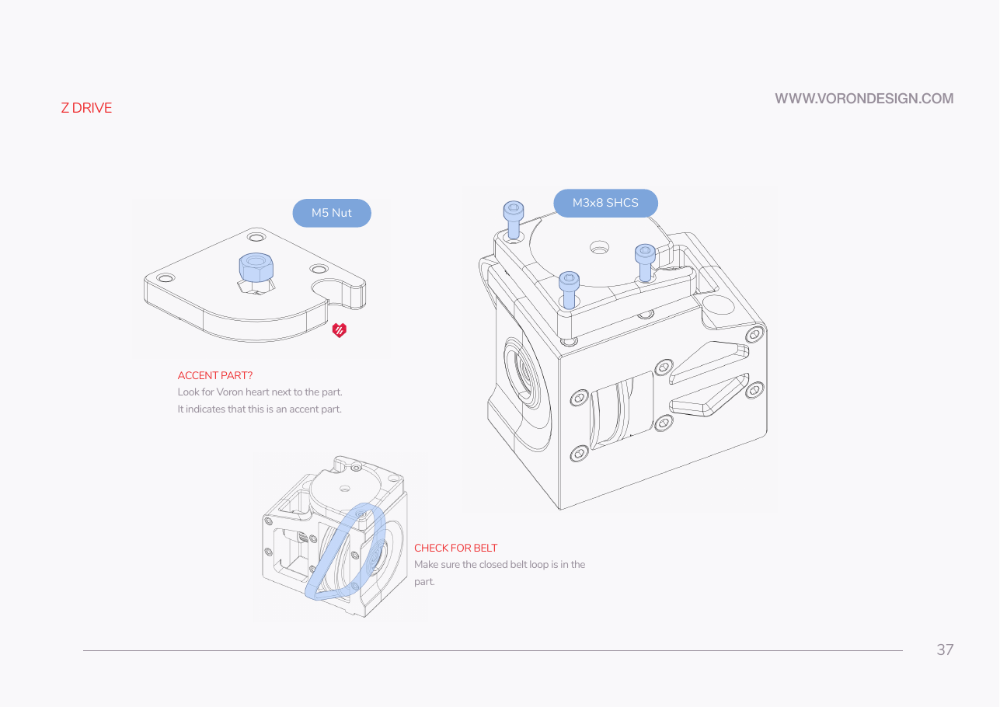{ crop="0.13 0.25 0.80 0.70" }
![`[a]_z_drive_baseplate_a` (left) vs `_b` (right) — plan view, counterbored face up](assets/parts/pair-z_drive_baseplate_x2-top.png)

**What you're looking at:** The blue baseplate screws onto the drive's foot face, trapping an M5 nut in a pocket on its **plain** face, against the drive, for the rubber foot's screw.

**Parts:**

- `[a]_z_drive_baseplate_a` ×1
- M5 hexnut ×1
- M3×8 SHCS ×3

**Do:**

1. Match the baseplate to its drive's letter: counterbored face up, C-notch opening to your left, the notch is far-left on `_a` and near-left on `_b`.
2. Turn the baseplate plain face up and drop the M5 nut into its pocket.
3. Flip it onto the drive's foot face, pocket down, its C-notch over one M5 screw well. Fix it with three M3×8 SHCS from the counterbored face.

**Check:** The nut is trapped and cannot spin, the plate sits flat without rocking, and all three M3×8 heads sit in their counterbores.

Source: [Voron manual p.37](https://github.com/VoronDesign/Voron-2/blob/de7e89d/Manual/Assembly_Manual_2.4r2.pdf#page=37)

### Step 02.26 — Confirm the belt loop is captured

{ crop="0.25 0.62 0.60 0.88" }

**What you're looking at:** The belt loop leaves the housing through the **retainer's** rectangular window, on the face with the six inserts. It must hang out far enough to hook over the motor's 16-tooth pulley later.

**Parts:**

- M3×40 SHCS ×18
- M3×8 SHCS ×9
- M5 hexnut ×3
- `[a]_z_drive_baseplate_a` ×1
- `[a]_z_drive_baseplate_b` ×2
- reused: the other three retainers and mains
- reused: the other three belted shaft assemblies

**Do:**

1. Look through the retainer's window. The closed loop should circle the 80T inside, with slack hanging out to reach the motor's pulley.
2. Repeat Steps 02.22–02.26 until all four drives are closed, two `a` and two `b`.

**Check:** All four drives are closed, and in each one the belt shows inside and is free to move.

Source: [Voron manual p.37](https://github.com/VoronDesign/Voron-2/blob/de7e89d/Manual/Assembly_Manual_2.4r2.pdf#page=37)

Pause: ~35 min since the last pause — all four drives are closed: shafts seated, each closed on six M3×40, blue baseplates on with their trapped M5 nuts, belt loops inside and free. Each drive takes about 9 minutes, so if you stop earlier, stop with a drive fully closed and its baseplate on, never with a drive half-closed.

### Step 02.27 — Fit the 16T pulley to a Z motor at 10.7 mm

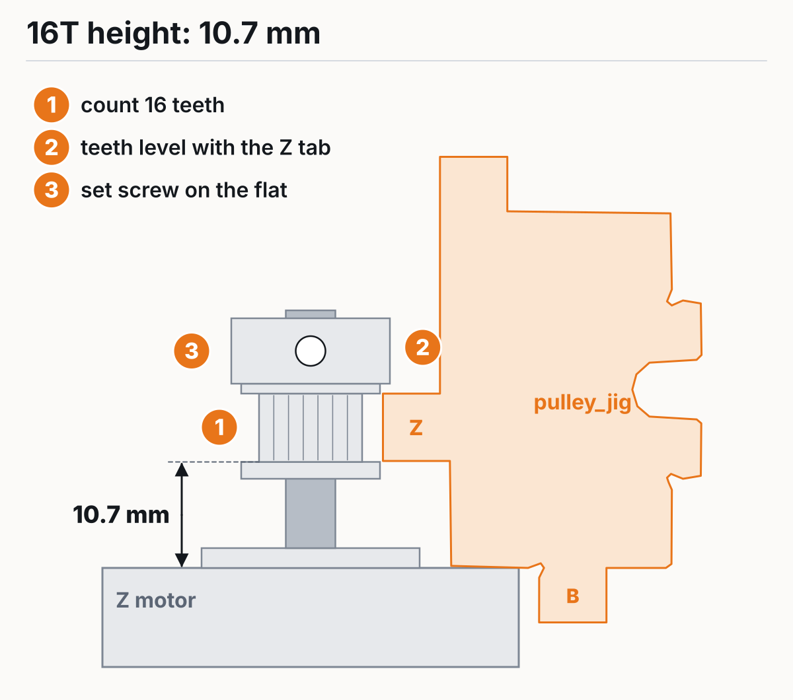
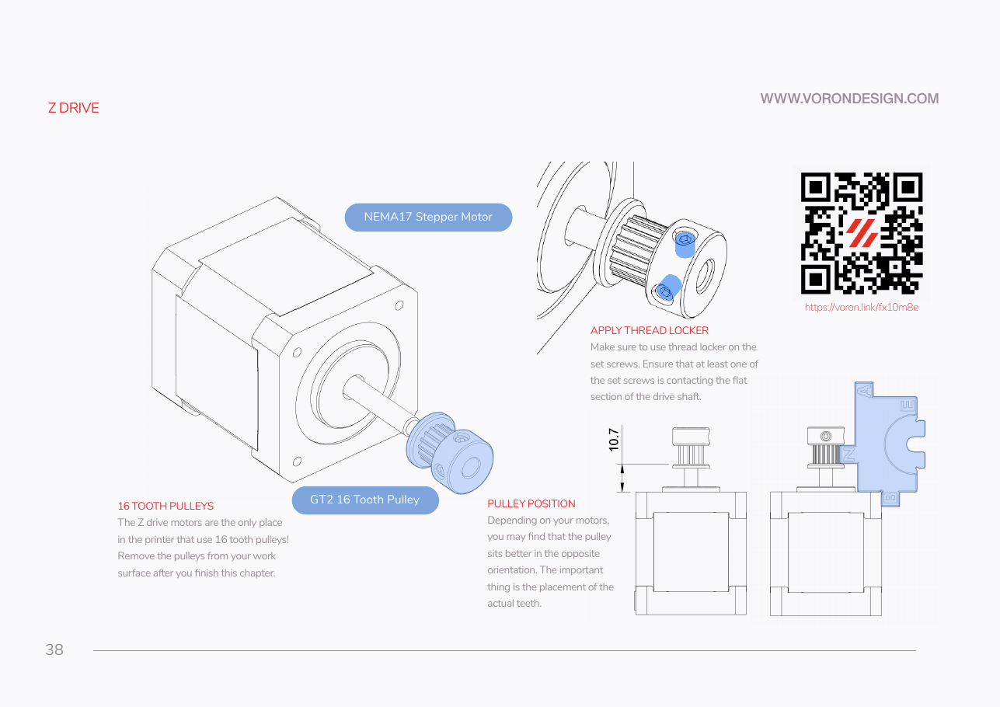

**What you're looking at:** Each Z motor gets a 16-tooth pulley (16T), the only ones in the printer. They look like the 20T, and a 20T here quietly changes the gear ratio the software expects. The printed `pulley_jig` sets the height.

**Parts:**

- NEMA17 Z motor `LDO-42STH48-2004AC` ×4
- GT2 **16T** pulley ×4
- M4×4 set screws ×8
- tool: printed `pulley_jig`
- tool: caliper

**Do:**

1. Count the teeth: these are **the only 16T pulleys**.
2. Stand `pulley_jig` on the motor face, **B** tab over its edge, **Z** tab toward the pulley. Set the pulley so the underside of its teeth is level with the tab's: **10.7 mm**.
3. Turn one set screw onto the flat and tighten both; threadlocker is already on.

**Check:** All four read 10.7 mm on a caliper, and none slips under hand force.

**Helper:** Counts each pulley's teeth to 16 and reads the 10.7 mm cross-check aloud.

The jig's **Z** tab is its short tab; the letter is printed sideways, so it can look like an N.

The pulley may sit better flipped, depending on the motor. What matters is where the teeth end up, not which way its collar faces.

When all four are done, take every remaining 16T pulley off the bench, so one cannot end up on an A or B motor in Ch 04. [src](https://docs.ldomotors.com/voron/voron2/build-faq)

Source: [Voron manual p.38](https://github.com/VoronDesign/Voron-2/blob/de7e89d/Manual/Assembly_Manual_2.4r2.pdf#page=38) · [LDO Build Notes (Rev D)](https://docs.ldomotors.com/voron/voron2/build-faq) · [Video: Part 2 @1:15:06](https://www.youtube.com/watch?v=2U0YahE8w_0&list=PL0fUJbigELQPqpeGOgHYisG4KaSXVtnNY&t=4506s)

### Step 02.28 — Bolt the motor to `z_motor_mount`, watching the cable exit

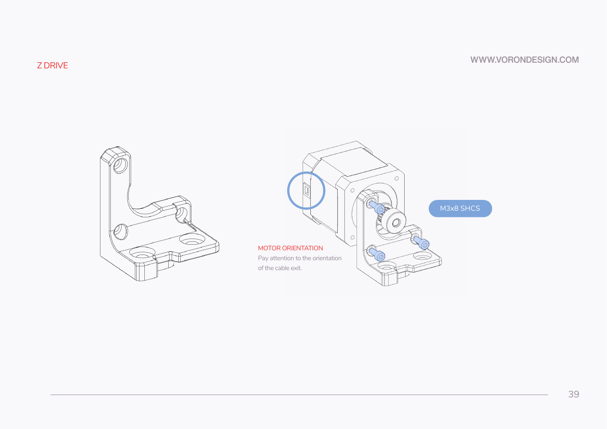


**What you're looking at:** The motor mount is an L-shaped bracket holding the motor off the frame; its `_a` and `_b` hands put the cable exit on opposite sides. Its open fourth screw corner is on purpose.

**Parts:**

- `z_motor_mount_a` ×2
- `z_motor_mount_b` ×2
- M3×8 SHCS ×12
- reused: the four Z motors with their 16T pulleys

**Do:**

1. Sit the motor's round boss, the raised ring around its shaft, in the plate's half-round notch, with the **cable exit turned as in the drawing on manual p.39**.
2. Fit three M3×8 SHCS through the plate's counterbored holes into the motor.
3. Build all four, two on `a` mounts and two on `b`, and mark each cable a or b to match.

**Check:** All four cable exits point the same way on their mounts, the 16T and the foot's two M5 holes are clear, and each cable carries its letter.

To tell the mounts apart, stand one on its print face with the thick foot arm on your right, running toward you: the thin motor plate is the far edge on `_a` and the near edge on `_b`.

In Ch 10 the four motor cables look the same; each gets its corner name at Step 02.38. The Voron manual's own motor wiring does **not** apply to this kit. Wire the Z motors by LDO's Rev D wiring guide: Z0 front-left to `STEPPER-0`, Z1 rear-left to `STEPPER-1`, Z2 rear-right to `STEPPER-2`, Z3 front-right to `STEPPER-3`. [src](https://docs.ldomotors.com/voron/voron2/build-faq) · [wiring guide](https://docs.ldomotors.com/en/voron/voron2/wiring_guide_rev_d#connecting-steppers)

Source: [Voron manual p.39](https://github.com/VoronDesign/Voron-2/blob/de7e89d/Manual/Assembly_Manual_2.4r2.pdf#page=39) · [LDO Build Notes (Rev D)](https://docs.ldomotors.com/voron/voron2/build-faq) · [LDO wiring guide § Connecting Steppers](https://docs.ldomotors.com/en/voron/voron2/wiring_guide_rev_d#connecting-steppers) · [Video: Part 2 @1:19:26](https://www.youtube.com/watch?v=2U0YahE8w_0&list=PL0fUJbigELQPqpeGOgHYisG4KaSXVtnNY&t=4766s)

Pause: ~25 min since the last pause — four Z motors carry their 16T pulleys at 10.7 mm and are screwed to their `a` and `b` mounts with the cable exits matched. Get every leftover 16T pulley off the bench before you walk away, and leave each motor cable marked a or b.

### Step 02.29 — Identify Z0 and start there

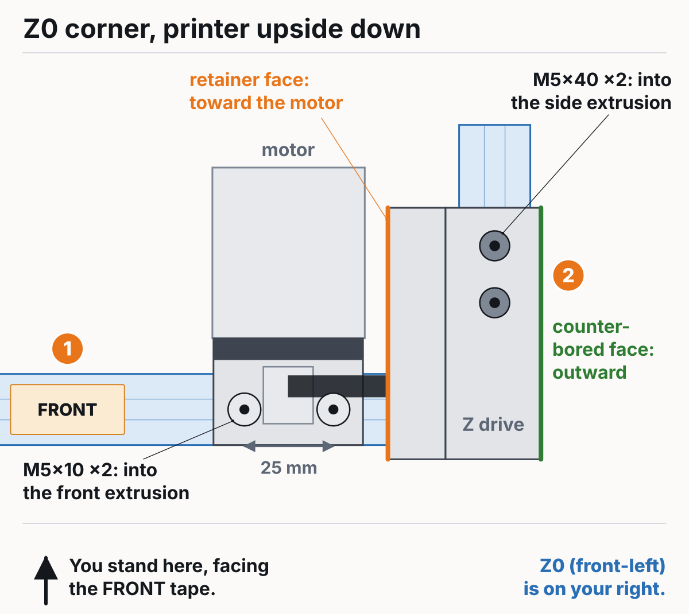
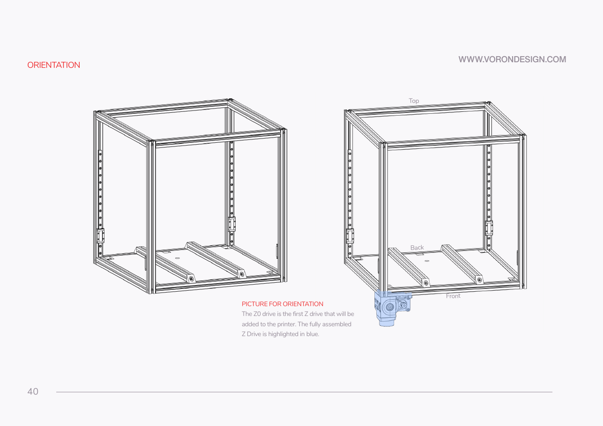

**What you're looking at:** The first drive goes in at Z0, the front-left corner. The mirror-image parts decide which corner an assembly fits, so match the drive and motor mount to the corner before any screw goes in.

**Parts:**

- reused: one complete `_a` drive
- reused: one `_a` motor and mount assembly

**Do:**

1. Find the front-left corner from the FRONT tape. With the printer upside down, it is on your right as you face the tape. Lay an `_a` drive and an `_a` motor assembly beside it.
2. Dry-fit them, holding them in place without screws: retainer face toward the motor, counterbored face outward over the side extrusion, 16T in line with the 80T.

**Check:** An `_a` drive and motor sit dry-fitted at front-left, retainer face toward the motor, counterbored face outward over the side extrusion, baseplate up.

If the dry-fit only works with the `_b` parts, the map is reversed. Swap every `_a` for `_b` for the rest of the chapter and write that in the build log.

Source: [Voron manual p.40](https://github.com/VoronDesign/Voron-2/blob/de7e89d/Manual/Assembly_Manual_2.4r2.pdf#page=40) · [Voron manual p.41](https://github.com/VoronDesign/Voron-2/blob/de7e89d/Manual/Assembly_Manual_2.4r2.pdf#page=41) · [Voron-2 CAD `Voron_2.4r2_Assembly_STEP.zip` @ `de7e89d`](https://github.com/VoronDesign/Voron-2/blob/de7e89d/CAD/Voron_2.4r2_Assembly_STEP.zip) (corner map)

### Step 02.30 — Pre-load four M5 T-nuts at the Z0 corner

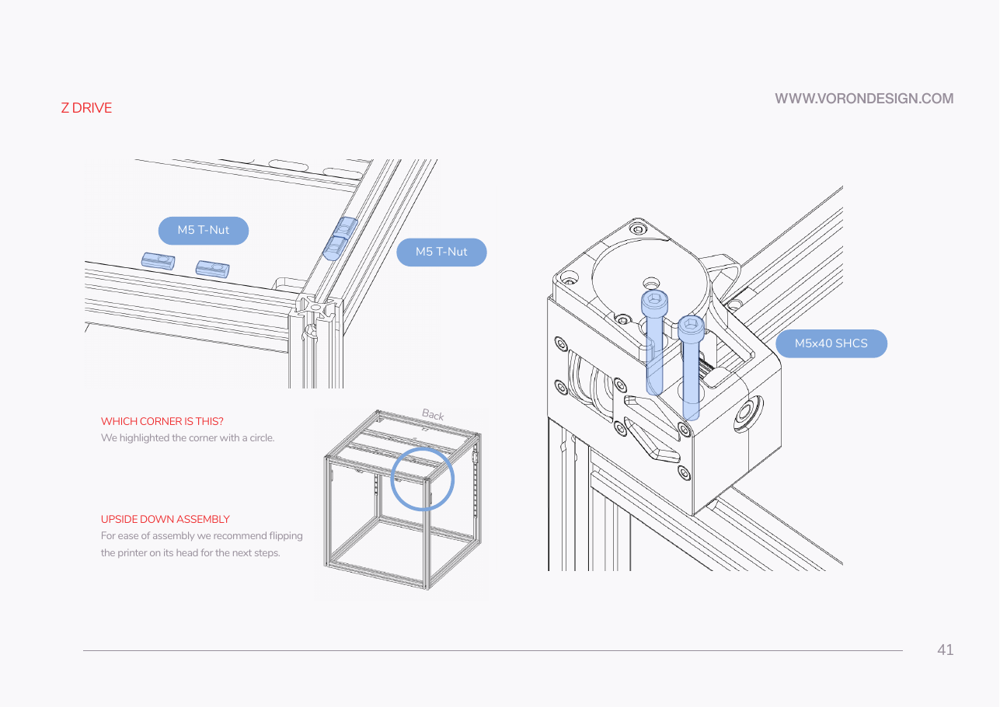{ crop="0.07 0.21 0.50 0.84" }

**What you're looking at:** Everything at this corner screws into T-nuts in the two bottom extrusions that meet here: two for the drive body's M5×40 and two for the motor foot's M5×10. The drive-end one also pins the cam.

**Parts:**

- M5 roll-in T-nut ×4

**Do:**

1. Slide four M5 T-nuts into the two extrusions at this corner, two in each. Skip this if you loaded this corner's T-nuts at Step 02.11.
2. Put the two for the drive's M5×40 in the **side** extrusion, the one running front to back. Put the two for the motor foot's M5×10 in the **front** extrusion, 25 mm apart; at Z1 and Z2 they go in the rear extrusion.

**Check:** Four T-nuts are in, two per extrusion, all free to slide, none jammed or dropped inside.

Source: [Voron manual p.41](https://github.com/VoronDesign/Voron-2/blob/de7e89d/Manual/Assembly_Manual_2.4r2.pdf#page=41) · [LDO Build Notes (Rev D)](https://docs.ldomotors.com/voron/voron2/build-faq) · [Voron-2 CAD `Voron_2.4r2_Assembly_STEP.zip` @ `de7e89d`](https://github.com/VoronDesign/Voron-2/blob/de7e89d/CAD/Voron_2.4r2_Assembly_STEP.zip) (which rail takes which bolts)

### Step 02.31 — Bolt the drive body down with two M5×40

{ crop="0.53 0.24 0.90 0.82" }

**What you're looking at:** The drive is the half that never moves, so its two screws go fully tight now. They are long M5×40, and they run down two 35 mm deep wells in the body into the T-nuts in the side extrusion.

**Parts:**

- M5×40 SHCS ×2
- reused: the completed `_a` drive

**Do:**

1. Set the drive in the corner baseplate up, retainer face toward the motor, counterbored face outward.
2. Drop both M5×40 down the deep wells into the T-nuts in the side extrusion.
3. Pull the body hard into the corner and **tighten both fully now**.

**Check:** The body sits hard against both extrusions, both M5×40 are tight, and the 188 mm loop hangs out of the retainer's window over the motor's extrusion.

The DON'T TIGHTEN on manual p.42–43 is about the two M5×10 in the motor foot. They are the only screws at this corner that stay loose for now.

Source: [Voron manual p.41](https://github.com/VoronDesign/Voron-2/blob/de7e89d/Manual/Assembly_Manual_2.4r2.pdf#page=41)

### Step 02.32 — Slide the motor assembly in at an angle

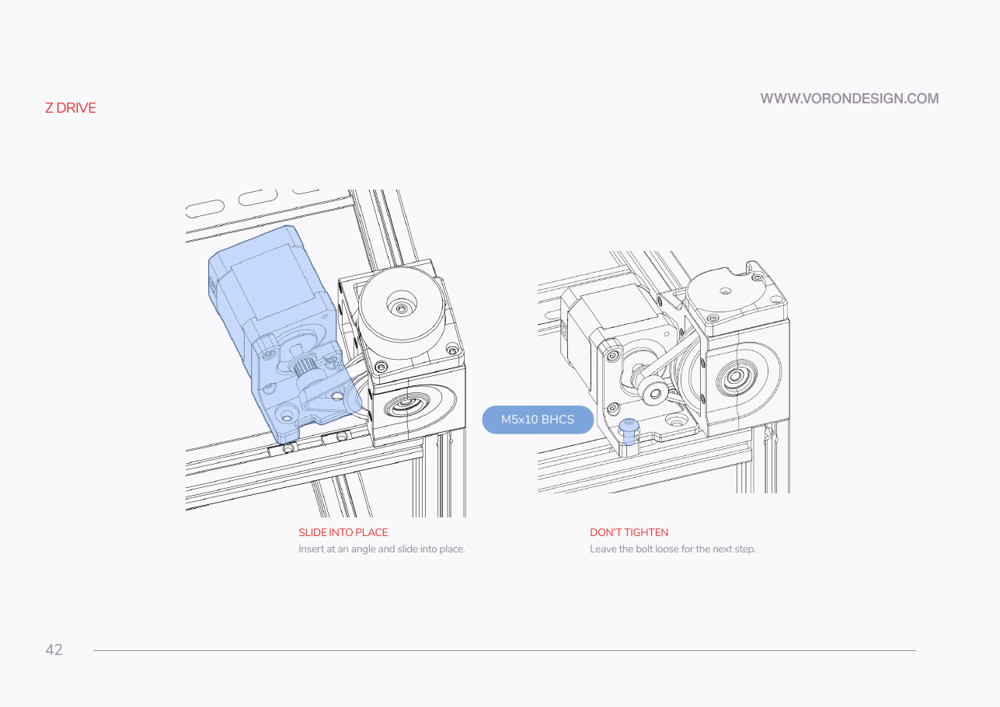

**What you're looking at:** The motor slides in beside the drive at an angle, hooking the hanging belt loop over its 16T on the way in. That angle is the only way to get the loop onto both pulleys.

**Parts:**

- M5×10 BHCS ×1
- reused: the `_a` motor and mount assembly

**Do:**

1. Hold the motor and mount at an angle, hook the loop over the 16T, and slide the foot onto the extrusion beside the drive.
2. Fit one M5×10 BHCS, a screw with a low domed head, through the foot hole farthest from the drive, and **leave it loose**.

**Check:** The loop sits squarely in the teeth of both the 16T and the 80T, the motor foot lies flat on the extrusion, the motor-end screw is loose, and the drive-end foot hole is still empty.

Source: [Voron manual p.42](https://github.com/VoronDesign/Voron-2/blob/de7e89d/Manual/Assembly_Manual_2.4r2.pdf#page=42)

### Step 02.33 — Fit the blue belt tensioner, still loose

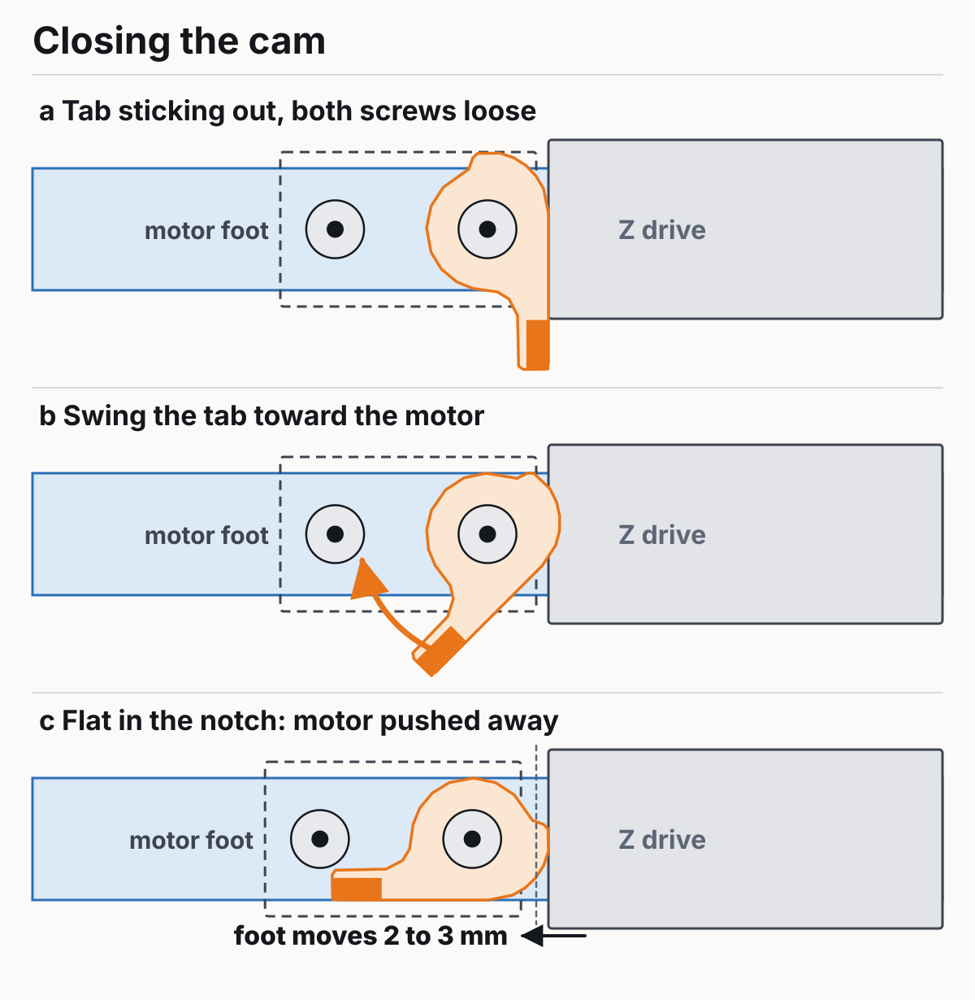

![`[a]_belt_tensioner_a` (left) vs `_b` (right) — plan view, flat face down](assets/parts/pair-belt_tensioner_x2-top.png)

**What you're looking at:** The blue belt tensioner is a cam: an arm whose off-centre round end, the lobe, sits under the motor foot's drive end. Swinging the arm flat makes the lobe push the foot away, tightening the belt.

**Parts:**

- `[a]_belt_tensioner_a` ×1
- M5×10 BHCS ×1

**Do:**

1. Check the hand: flat face down, lobe on your left, the tab is far-right on `_a` and near-right on `_b`. The wrong hand swings away from the motor.
2. Slide the lobe into the 4 mm pocket under the foot's drive end, hole over the foot's empty hole.
3. Fit the second M5×10 BHCS through both and **leave it loose**: a pivot, not a fastener.

**Check:** The tab swings freely, the motor still slides, and both M5×10 in the foot are loose.

Source: [Voron manual p.43](https://github.com/VoronDesign/Voron-2/blob/de7e89d/Manual/Assembly_Manual_2.4r2.pdf#page=43) · [Video: Part 2 @1:18:50](https://www.youtube.com/watch?v=2U0YahE8w_0&list=PL0fUJbigELQPqpeGOgHYisG4KaSXVtnNY&t=4730s)

### Step 02.34 — Flip the tensioner latch closed


**What you're looking at:** Closing the cam is what tightens the belt. The arrow on manual p.44 is the direction that pushes the motor foot away from the drive body. The tab ends up in the notch in the foot's outer edge.

**Parts:** none.

**Do:**

1. Swing the tab toward the motor, the way the p.44 arrow points, until it lies along the extrusion, tab in the notch.
2. Watch the drive body as you do it. The lobe moves the motor foot about 2–3 mm away from the body, and the body itself must not move.

**Check:** The tab lies flat in the notch and the loop is tight: turning the motor shaft by hand spins the 80T with no slipping and no skipped teeth.

Source: [Voron manual p.44](https://github.com/VoronDesign/Voron-2/blob/de7e89d/Manual/Assembly_Manual_2.4r2.pdf#page=44) · [Voron-2 CAD `Voron_2.4r2_Assembly_STEP.zip` @ `de7e89d`](https://github.com/VoronDesign/Voron-2/blob/de7e89d/CAD/Voron_2.4r2_Assembly_STEP.zip) (cam throw)

### Step 02.35 — Tighten the M5 bolts

{ crop="0.12 0.26 0.42 0.70" }

**What you're looking at:** With the cam closed, the motor sits where the cam pushed it. Tightening the two M5×10 in the motor foot only now locks that position in.

**Parts:** none.

**Do:**

1. Tighten both M5×10 in the motor foot: the one at the motor end, and the one at the drive end, which clamps the cam as well.
2. Check that the drive body's two M5×40 have not moved.

**Check:** All four screws are tight, nothing has moved, and the belt still sits properly in both pulleys.

Source: [Voron manual p.45](https://github.com/VoronDesign/Voron-2/blob/de7e89d/Manual/Assembly_Manual_2.4r2.pdf#page=45) · [Video: Part 2 @1:18:48](https://www.youtube.com/watch?v=2U0YahE8w_0&list=PL0fUJbigELQPqpeGOgHYisG4KaSXVtnNY&t=4728s)

### Step 02.36 — Fit the rubber foot

{ crop="0.52 0.26 0.86 0.76" }

**What you're looking at:** The printer's four rubber feet go on while it is still upside down and the underside is easy to reach. Each foot's M5×16 screw threads into the nut trapped in that corner's blue baseplate.

**Parts:**

- Rubber foot 38×19 mm ×1
- M5×16 BHCS ×1

**Do:** Set a rubber foot on the baseplate at this corner. Fix it with one M5×16 BHCS through the foot into the M5 nut you dropped into the baseplate at Step 02.25.

**Check:** The foot sits square to the corner and is firmly attached.

**Helper:** Holds the rubber foot square on the baseplate while you drive its screw.

Source: [Voron manual p.45](https://github.com/VoronDesign/Voron-2/blob/de7e89d/Manual/Assembly_Manual_2.4r2.pdf#page=45) · [Video: Part 1 @3:34:45](https://www.youtube.com/watch?v=feTxcc0LIWM&list=PL0fUJbigELQPqpeGOgHYisG4KaSXVtnNY&t=12885s)

### Step 02.37 — Check the drive did not shift when the tensioner closed


**What you're looking at:** Closing the cam pushes the motor away from the drive body, and the body back the other way. If the body was not seated square when its M5×40 went tight, it moves; manual p.46 shows how to tell.

**Parts:** none.

**Do:**

1. Compare the corner with the drawing on manual p.46. The drive body must still sit hard against the corner and square to both extrusions, its outer corner flush with the frame's outer corner, as circled there.
2. If the drive moved, take the rubber foot off, undo the screws, line the drive up again, and redo Steps 02.31 and 02.34–02.36.

**Check:** Nothing is skewed, there is no gap at the corner, and the belt is still fully on both pulleys.

Source: [Voron manual p.46](https://github.com/VoronDesign/Voron-2/blob/de7e89d/Manual/Assembly_Manual_2.4r2.pdf#page=46)

Pause: ~30 min since the last pause — the Z0 corner is complete: drive body on its two M5×40, motor slid in, cam closed, both M5×10 tight, rubber foot on, and the p.46 check passed. One corner is a complete unit, and this is the natural place to stop.

### Step 02.38 — Build and fit the other three Z drives


**What you're looking at:** Three more corners, each built like Z0. Z0 and Z2 take the `_a` hand of every printed part, Z1 and Z3 take `_b`. The cable labels go on now, because in Ch 10 four identical black motor cables reach the main board together.

**Parts:**

- M5 roll-in T-nut ×12
- M5×40 SHCS ×6
- M5×10 BHCS ×6
- M5×16 BHCS ×3
- Rubber foot 38×19 mm ×3
- `[a]_belt_tensioner_a` ×1
- `[a]_belt_tensioner_b` ×2
- reused: the other three closed drives
- reused: the other three motor and mount assemblies

**Do:**

1. Repeat Steps 02.29–02.37 at Z2 with the other `_a` set, then at Z1 and Z3 with the `_b` parts.
2. Label each motor's cable Z0, Z1, Z2 or Z3 by the corner it is actually in.
3. With a helper, turn the printer upright onto its feet.

**Check:** Every corner has a drive, a foot, a tight belt, a closed cam and a labelled cable, the deck is held by its eight clips, and the frame stands upright without rocking.

**Helper:** Writes Z0 to Z3 on the motor cable labels by physical corner.

Source: [Voron manual p.47](https://github.com/VoronDesign/Voron-2/blob/de7e89d/Manual/Assembly_Manual_2.4r2.pdf#page=47) · [LDO wiring guide § Connecting Steppers](https://docs.ldomotors.com/en/voron/voron2/wiring_guide_rev_d#connecting-steppers) · [Video: Part 2 @0:02:14](https://www.youtube.com/watch?v=2U0YahE8w_0&list=PL0fUJbigELQPqpeGOgHYisG4KaSXVtnNY&t=134s)

Pause: ~55 min since the last pause, in three ~18-min corners — Z1, Z2 and Z3 are built and fitted the same way. Stop after any corner whose four M5 screws are tight, cam closed and foot fitted, never with a cam open and the motor free to slide. All four cables are labelled Z0–Z3 by the corner they are in, and the printer is back upright on its feet.

### Step 02.39 — Assemble a Z idler cage

{ crop="0.12 0.56 0.56 0.88" }


**What you're looking at:** The Z idler at each top corner turns the Z belt back down. Its cage, `z_tensioner_bracket`, screws to the frame; the blue slider, `[a]_z_tensioner_9mm`, moves in it on a screw that tightens the belt in Ch 06.

**Parts:**

- `z_tensioner_bracket_a` ×2
- `z_tensioner_bracket_b` ×2
- `[a]_z_tensioner_9mm` ×4
- M3×16 SHCS ×4
- M3 hexnut ×4

**Do:**

1. Sort the brackets: print face down, slider channel open toward you, two oval slots left to right: tab on the left is `_a`, right is `_b`. You need two of each.
2. Drop an M3 nut into the bracket's pocket.
3. Slide the blue slider in and run an M3×16 SHCS up through it into the nut, a couple of turns short of tight.

**Check:** In all four, the nut is trapped, the screw has caught, and the slider slides smoothly without play.

Source: [Voron manual p.48](https://github.com/VoronDesign/Voron-2/blob/de7e89d/Manual/Assembly_Manual_2.4r2.pdf#page=48) · [Video: Part 2 @1:37:11](https://www.youtube.com/watch?v=2U0YahE8w_0&list=PL0fUJbigELQPqpeGOgHYisG4KaSXVtnNY&t=5831s)

### Step 02.40 — Fit the 20T idler on its M5×30 axle

{ crop="0.59 0.60 0.95 0.88" }

**What you're looking at:** An idler is a pulley that guides a belt without driving it. Here a 20-tooth idler sits in the fork of the blue slider, on an M5×30 screw used as its axle. It has to spin freely and stay in line.

**Parts:**

- GT2 20T 9 mm idler ×4
- M5×30 BHCS ×4
- reused: the four idler cages

**Do:**

1. Hold a 20T 9 mm idler between the arms of a slider's fork.
2. Drive an M5×30 BHCS through the fork and the idler. It cuts its own thread in the Ø5 holes, so keep it square.
3. Build all four, two in `a` brackets and two in `b`.

**Check:** Each idler spins freely on its axle without sliding along it, with its teeth centred in the fork, and all four are built.

Source: [Voron manual p.48](https://github.com/VoronDesign/Voron-2/blob/de7e89d/Manual/Assembly_Manual_2.4r2.pdf#page=48)

Pause: ~20 min since the last pause — four idler cages are built, with their trapped M3 nuts and 20T idlers on M5×30 axles, and the slider screws are left a couple of turns short of tight on purpose. Nothing is on the frame yet.

### Step 02.41 — Pre-load two M5 T-nuts at a top corner

{ crop="0.06 0.51 0.33 0.87" }

**What you're looking at:** Each idler screws to the top side extrusion, the top horizontal running front to back, right beside the corner. Two T-nuts in that extrusion's inner slot lie along it, where the bracket's two screw holes land.

**Parts:**

- M5 roll-in T-nut ×2

**Do:** Roll two M5 T-nuts into the **inner slot of the top side extrusion** above a Z drive, right against the corner. They go in that horizontal, not in the vertical.

**Check:** Two T-nuts sit in the top side extrusion's inner slot, right against the corner, free to slide.

Source: [Voron manual p.49](https://github.com/VoronDesign/Voron-2/blob/de7e89d/Manual/Assembly_Manual_2.4r2.pdf#page=49)

### Step 02.42 — Mount the idler, matching the drive below it

{ crop="0.33 0.47 0.90 0.87" }

**What you're looking at:** The idler's pulley and the 20T pulley in the drive below it must lie in one upright plane, so the belt between them runs straight. A bracket not pressed hard into its corner leaves a twist in that plane.

**Parts:**

- M5×30 BHCS ×2
- reused: one idler of the drive's hand

**Do:**

1. Hold the idler to the corner. **Its pulley must face the same way as the pulley in the drive below it.**
2. Fit two M5×30 BHCS through it into the T-nuts in the top side extrusion.
3. Press the bracket **firmly into the corner**, then tighten.

**Check:** The idler pulley and the drive's 20T below it lie in one upright plane, and the bracket sits hard in the corner with its top flush with the top extrusions.

**Helper:** Sights down both pulleys and says if the belt line twists.

To check the line, look down past both pulleys, or hang a length of 2GT belt between them and look for a twist.

Source: [Voron manual p.49](https://github.com/VoronDesign/Voron-2/blob/de7e89d/Manual/Assembly_Manual_2.4r2.pdf#page=49)

### Step 02.43 — Fit the remaining three Z idlers


**What you're looking at:** The other three idlers go on the same way, each lined up with the drive underneath it, so all four Z belts will run true.

**Parts:**

- M5×30 BHCS ×6
- M5 roll-in T-nut ×6
- reused: the remaining three idlers

**Do:**

1. Repeat Steps 02.41–02.42 at Z2 with the other `_a` bracket, then at Z1 and Z3 with the `_b` brackets.
2. Screw each idler into the top side extrusion's inner slot, above its drive.

**Check:** Four idlers are on, each lined up with the drive beneath it and pressed into its corner, and all eight M5×30 are tight.

Source: [Voron manual p.50](https://github.com/VoronDesign/Voron-2/blob/de7e89d/Manual/Assembly_Manual_2.4r2.pdf#page=50)

### Step 02.44 — Close the chapter


**What you're looking at:** The Z chapter is done. Look the work over now, because the gantry and the electronics bay are about to cover most of what you just built. Manual p.51 is only a divider page, with nothing to assemble.

**Parts:** none.

**Do:**

1. The printer has stood upright since Step 02.38. Work through Checkpoint 02.
2. Make sure the measured deck thickness is in your build log.

**Check:** Every box in Checkpoint 02 is ticked.

**Helper:** Ticks the checkpoint list while you point at each item on the machine.

Source: [Voron manual p.51](https://github.com/VoronDesign/Voron-2/blob/de7e89d/Manual/Assembly_Manual_2.4r2.pdf#page=51)

Pause: ~25 min since the last pause — all four Z idlers are on, each lined up with the drive below it, all eight M5×30 tight, and the printer is upright on its feet. Work through Checkpoint 02 before the gantry starts hiding this.

---

## Checkpoint 02

**Built:** four Z drives, four idlers, four rails and a clipped-in deck

- [ ] All four Z rails run their full length with no notch, tight spot or grinding, and every carriage is taped or stoppered.
- [ ] The rails are clean and dry on the outside, with grease inside the carriages only: done in Ch 00 Steps 00.18–00.21 and checked again at Step 02.05.
- [ ] All four rails are centred on their extrusions, each facing the rail on its own side of the machine (front-left and rear-left, front-right and rear-right), with the same 3 mm gap at the bottom and the same nine holes used: 2 to 18 counted from the bottom, no end holes.
- [ ] The deck panel's notch is at the **back**. The panel sits inside the frame opening under the bed extrusions, held up by eight clip ledges, without rocking. Four M5 T-nuts sit under its four holes, left unscrewed for Ch 09 Step 09.5.
- [ ] `_a` parts are at Z0 and Z2 and `_b` at Z1 and Z3, or the reverse if the Step 02.29 dry-fit said so and you wrote it in the build log. Each idler has the same hand as the drive below it.
- [ ] The measured deck panel thickness is written down, and the eight fitted deck supports match it.
- [ ] Every 20T drive pulley sits 33 mm along its shaft, and every 16T motor pulley sits 10.7 mm off the motor face.
- [ ] All 24 M4×4 set screws are tight and threadlocked, and at least one per pulley presses on the shaft's flat.
- [ ] Each drive has four M5 precision spacers, 16 in all: **spacers, not shims**.
- [ ] Each Z drive shaft turns freely by hand through the belt, with no skipped teeth and no rumble from a bearing.
- [ ] All four tensioner cams are closed, and no drive shifted when its cam closed (the p.46 check).
- [ ] Four rubber feet are on, and the printer stands on all four without rocking on the reference surface.
- [ ] Each Z idler faces the same way as the pulley in the drive below it and is pressed hard into its corner.
- [ ] The four motor cables are labelled Z0, Z1, Z2 and Z3 by the corner each one is in.

## Common mistakes

- **Putting a rail on dry.** Once a rail is on an extrusion you cannot use the flip-and-pack method, and a dry MGN9 wears out. Then it is either the rails off again or a worse axis, so check at Step 02.05 that Ch 00 really did all four (§5.2 W9).
- **Missing a heat-set insert before the drive is closed.** Six M3×40 have to come out and the shaft assembly has to be lifted to reach it. Do all the inserts as one batch, count the pockets, and only then start assembling (§5.2 W3).
- **A 20T pulley on a Z motor.** The 16T and 20T look nearly the same. The printer will home, meaning find its start position, and move, and be quietly wrong on every Z measurement, because `gear_ratio: 80:16` is fixed in its settings. Count teeth, then clear the 16T pulleys off the bench (p.38).
- **Leaving the deck panel "until the panels chapter".** Once Ch 09 screws the DIN rails through it, the panel stays in. Fit it and its clips now, where LDO puts them, at p.29–30 (§5.2 W4).
- **Tightening rail screws from one end.** The rail bends, and the carriage gets a tight spot that no amount of grease fixes. Always work from the centre outward (p.24).
- **Set screws only finger-tight, or off the flat.** They work loose under the Z load, the belt slips, and the gantry drops out of level. Threadlocker on all of them, one on the flat, tightened with a proper hex driver (p.32, §5.2 W12).
- **Closing a drive with the halves upside down.** Screws started from above into the retainer's visible brass inserts thread into only that insert, clamp nothing, and pull the insert out of the plastic. The M3×40 heads sink into the main body's counterbores, and the retainer's inserts are at the bottom of the stack (Step 02.24).
- **The wrong hand at a corner.** It screws on fine and shows up in Ch 06, when the 20T is not under its idler. Diagonal corners share a hand (Step 02.02); dry-fit the first one (Step 02.29).
- **An M5×40 through the motor foot.** The foot's holes are 9 mm deep, made for M5×10. A 40 mm screw reaches the bottom of the slot long before its head reaches the foot, so it pushes the T-nut away from the slot's lips instead of clamping. The long screws go down the drive body's wells (Step 02.31); the motor foot takes the two M5×10, both left loose until the cam is closed (Steps 02.32–02.33).
- **The cam at the wrong end of the foot.** The tensioner goes under the drive end of the motor foot, on the drive-end screw. At the motor end it has nothing to push against, and the loop never gets tight (p.43, Step 02.33).
- **Screwing the deck down here.** The four M5×10 go in with the DIN rails in Ch 09 Step 09.5. Fitting them now means undoing them again, and it counts the same four screws in two chapters' hardware totals.

## Next

Chapter 03 — Build plate: bed, magnet sheet, spacers and the M3×20 mounting screws (manual p.52–61, with LDO's p.55/56 skips).
