# Chapter 03 — Build plate

<!-- style: plain -->

You prepare the heated build plate, 355 × 355 × 10 mm, and fasten it to the bed extrusions. That gives the frame its datum, the flat surface everything else is measured from, and leaves the plate's three leads loose above the deck, ready for the bed WAGO mount in Ch 09.

**What you're building in this chapter:** The heated bed, a stack of four parts. The **build plate** is a cast aluminium slab, ground flat, 355 × 355 × 10 mm. Bonded to its underside are a silicone **heater pad** that runs on mains power and a 125 °C **thermal fuse**. Both come fitted at the factory on this kit, so two pages of the Voron manual become inspections. On top goes the **magnetic pad**, a magnetised sheet with an adhesive back, which you stick down here unless it arrives already on. The **flex plate** drops onto the magnet: a removable sheet of spring steel that prints stick to, and that you flex to pop a finished part off. The stack rests on four **thumb nuts**, used as spacers, on the two bed extrusions from Ch 01, and four screws hold it. Only one of them is ever tightened: the other three let a 355 mm aluminium plate grow as it heats instead of buckling. Nothing is wired here. The plate's three short leads stay loose **above** the deck, ready for the bed WAGO mount that Ch 09 fits on the left bed extrusion.

```mascot
pose: check
caption: The bed is your datum. A wave you ignore today will introduce itself in every print.
```

**Time:** 1.5–2.5 h hands-on, first build (survey §7.2).

**Sessions:** 4 × ~30 min (20 to 40 min each). Each one ends at a safe place to stop, and every minute figure is a first-build estimate.

**Prerequisites:**

- **Ch 01** is done: the frame is square, and the bed extrusions sit **65 mm from the printer's centreline to each inner face**, which is a 130 mm clear gap and 150 mm centre to centre (manual p.20; Step 01.19).
- **Ch 02** is done: the deck panel and its supports are fitted (manual p.28–29), and the wire opening in the deck is clear.
- **No printed parts.** No print batch gates this chapter. The 2.4r2 mounts the plate straight onto the bed extrusions with metal hardware: there are no printed feet, bed mounts or spacers anywhere in p.52–61. The bed WAGO mount comes printed from LDO and is fitted in Ch 09, not here.

**Tools**

- Hex key, 2.5 mm
- Plastic scraper, squeegee or an old credit card, to press the magnet down
- Sharp craft knife with a fresh blade, to cut the magnet clear of the screw holes and to cut the liner at Step 03.9
- Masking tape, to mark the back edge at Step 03.2 and to make the hinge for the magnet at Step 03.9
- Steel rule or straightedge at least 360 mm long, for the flatness check and the 38 mm offset
- Digital caliper

**Consumables:** IPA (isopropyl alcohol) of 90 % or stronger, a lint-free cloth and nitrile gloves. The plate's protective film goes in the bin.

**Read first**

- **The heater pad and the thermal fuse are already on your plate.** Manual p.55 and p.56 become inspections: do not peel, re-seat or re-screw anything.
- **You get one try at the magnet.** Read all of Step 03.9 before you peel anything, and cut it clear of the four screw holes straight after you press it down, before any screw goes in.
- **Use M3×20 SHCS, not the manual's M3×16.** This plate and its spacers are thicker.
- **Tighten only one of the four screws.** A plate clamped hard at all four corners while cold, then heated fast, bends into a curve for good.
- **Wire nothing, and feed no lead through the deck.** The plate's three leads stay loose above the deck for Ch 09 and Ch 10. If a part is missing, damaged or wrong, stop and ask (see the notes below).

<!-- reference -->

**Printed parts**


| STL | Qty | Colour |
|---|---|---|
| — none — | 0 | — |

**Hardware** (chapter totals)

| Fastener / part | Qty | Note |
|---|---|---|
| Build plate, cast 5083, 355×355×10 mm, heatpad and 125 °C fuse pre-applied | 1 | [LDO 350 Rev D+ BOM](https://docs.ldomotors.com/en/voron/voron2/350_BOM/Rev_D+) |
| Magnetic Pad 2.4-350 | 1 | laminated in this chapter, unless it arrives pre-installed |
| Spring Steel Flex Plate 2.4-350 | 1 | drops on, no fasteners |
| M3×20 SHCS | 4 | **not** the manual's M3×16 |
| M4 knurled thumb nut | 4 | used as the spacer, not as a nut |
| M3 roll-in T-nut, 2020 | 6: 4 top slots + 2 parked | 4 in the bed extrusion top slots; 2 parked in the right bed extrusion's inner slot for the Ch 09 nozzle probe |
| M5 roll-in T-nut, 2020 | 2: parked | in the left bed extrusion's inner slot for the Ch 09 bed WAGO mount (LDO wiring guide: two M5×10 BHCS) |
| M4×6 BHCS (bed PE) | 0: pre-fitted to the plate | verify only, do not remove; serrated washer under it |

**Notes behind "Read first"**

- The heater pad (p.55) and the thermal fuse (p.56) are already on your plate. Both pages are **verify-only**. Do not peel, re-seat or re-bolt anything. [src](https://docs.ldomotors.com/voron/voron2/build-faq)
- Trim the magnet at the four bolt holes **immediately after** you roll it down and **before** you bolt anything. Discovering it at p.59 means peeling the magnet or drilling through it (survey §5.2 W6).
- Use **M3×20 SHCS**, not the manual's M3×16 — this plate and these spacers are thicker. [src](https://docs.ldomotors.com/voron/voron2/build-faq)
- The magnet goes on with the hinge method at Step 03.9 — one shot; read the whole step before you peel anything.
- Only one of the four bolts gets tightened (p.59). A bed clamped hard at all four corners while cold, then heated fast, tacos.
- A part missing, damaged or wrong: stop, photograph it and ask Fabreeko. Questions about LDO's own parts go to [`#ldo_motors`](https://discord.com/channels/460117602945990666/710952853514223617). Both are set up at [Step 00.31](00-before-you-start.md#step-0031-join-the-three-lifelines-now).
- No wiring happens here, and **no bed lead goes through the deck**. Manual p.60 feeds the bed wires through the opening; this kit's plate leads end at the bed WAGO breakout above the deck (Ch 09), and only the kit's extension leads go below, in Ch 10. Leave the three leads loose above the deck. [src](https://docs.ldomotors.com/en/voron/voron2/wiring_guide_rev_d#wiring-the-bed-heater)

**Sources for this chapter:**

- [Voron 2.4r2 assembly manual (pinned `de7e89d`)](https://github.com/VoronDesign/Voron-2/blob/de7e89d/Manual/Assembly_Manual_2.4r2.pdf) pages 52–61 — plate orientation, magnet, bed-extrusion verification, spacers, the DON'T TIGHTEN rule
- [LDO Build Notes (Rev D)](https://docs.ldomotors.com/voron/voron2/build-faq) — p.55 and p.56 skipped (heater and fuse pre-applied), M4×6 PE screw, M3×20 instead of M3×16, trim the magnet now
- [LDO 350 Rev D+ BOM](https://docs.ldomotors.com/en/voron/voron2/350_BOM/Rev_D+) — plate, magnetic pad, flex plate and thermal-fuse line items
- [LDO wiring guide § Wiring the Bed Heater](https://docs.ldomotors.com/en/voron/voron2/wiring_guide_rev_d#wiring-the-bed-heater) — where the three bed cables actually terminate (Ch 10)
- [magnet lamination demo](https://voron.link/rm6tpld) — the lamination demo the manual links from p.54
- [survey](../voron-build-instructions-survey.md) §5.2 W6
- The two mirrored images in this chapter, the plate's underside at Step 03.4 and the build-plate mapping at Steps 03.12, 03.14 and 03.19, are LDO Motors', used with attribution; see `assets/remote/03-build-plate/SOURCES.txt` and `assets/remote/10-wiring/SOURCES.txt`. Each original URL stays on its step's `Source:` line.

**Video coverage (Steve Builds, pre-release LDO kit — differs from Rev D+):** [Part 1 @0:45:02](https://www.youtube.com/watch?v=feTxcc0LIWM&list=PL0fUJbigELQPqpeGOgHYisG4KaSXVtnNY&t=2702s) (+5m)

---

### Step 03.1 — Unpack the plate and read the end state

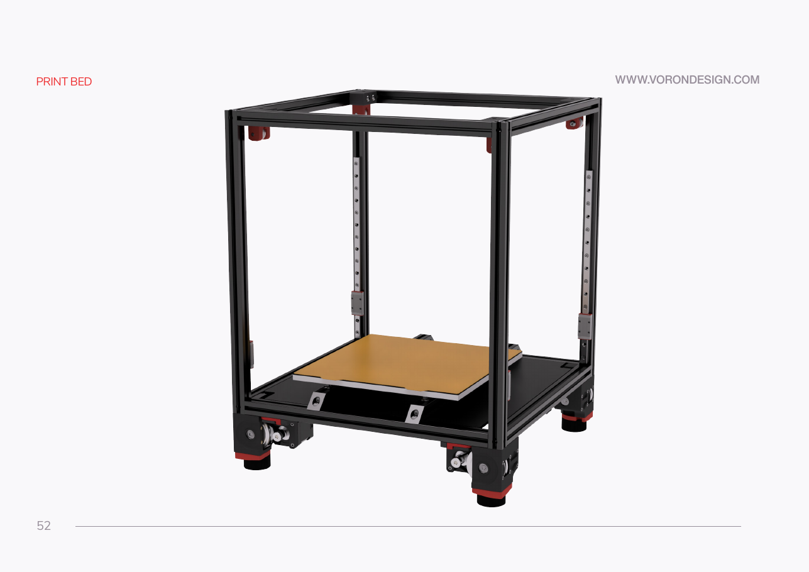

**What you're looking at:** The picture shows the finished bed in three layers. The **build plate** is a cast aluminium slab, 355 × 355 × 10 mm, with a mains (AC) heater pad bonded underneath. The **magnetic pad** is stuck on top, and the **flex plate**, a removable spring-steel sheet, is what you print on.

**Parts:**

- staged: build plate ×1
- staged: magnetic pad ×1
- staged: spring steel flex plate ×1

**Do:**

1. Lift the plate out flat, never on its edge: a dropped corner dents a 10 mm cast slab.
2. Lay it on a clean towel. It ends up on the two bed extrusions, cables above the deck.

**Check:** Three cables leave the middle of the back edge, with the M4×6 earth screw and its serrated washer beside them, and you have noted whether the magnet is already on top.

Source: [Voron manual p.52](https://github.com/VoronDesign/Voron-2/blob/de7e89d/Manual/Assembly_Manual_2.4r2.pdf#page=52) · [LDO 350 Rev D+ BOM](https://docs.ldomotors.com/en/voron/voron2/350_BOM/Rev_D+) · [Video: Part 1 @0:44:56](https://www.youtube.com/watch?v=feTxcc0LIWM&list=PL0fUJbigELQPqpeGOgHYisG4KaSXVtnNY&t=2696s)

---

### Step 03.2 — Work out which side is which

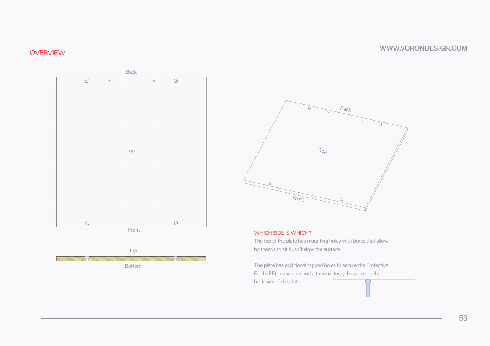{ crop="0.48 0.26 0.87 0.89" }

**What you're looking at:** The top is the face where the four mounting holes are **counterbored**: widened at the surface so a screw head sits level with it or below. The bottom carries the heater, the thermal fuse and the earth screw.

**Parts:**

- staged: build plate
- consumable: masking tape
- staged: M3×20 SHCS ×1, fit test, back in its tray

**Do:**

1. Find the four mounting holes near the corners. The face where they are counterbored is the top.
2. The face with the heater, thermal fuse and earth screw holes is the bottom.
3. Mark the back edge, where the cables leave, with masking tape.

**Check:** An M3×20 SHCS (socket head cap screw) dropped into a mounting hole from the top sinks its head into the counterbore, and from the other side its head sits above the surface.

**Helper:** Points to the magnet side and the heater side and names each one.

Source: [Voron manual p.53](https://github.com/VoronDesign/Voron-2/blob/de7e89d/Manual/Assembly_Manual_2.4r2.pdf#page=53)

---

### Step 03.3 — Strip the protective film

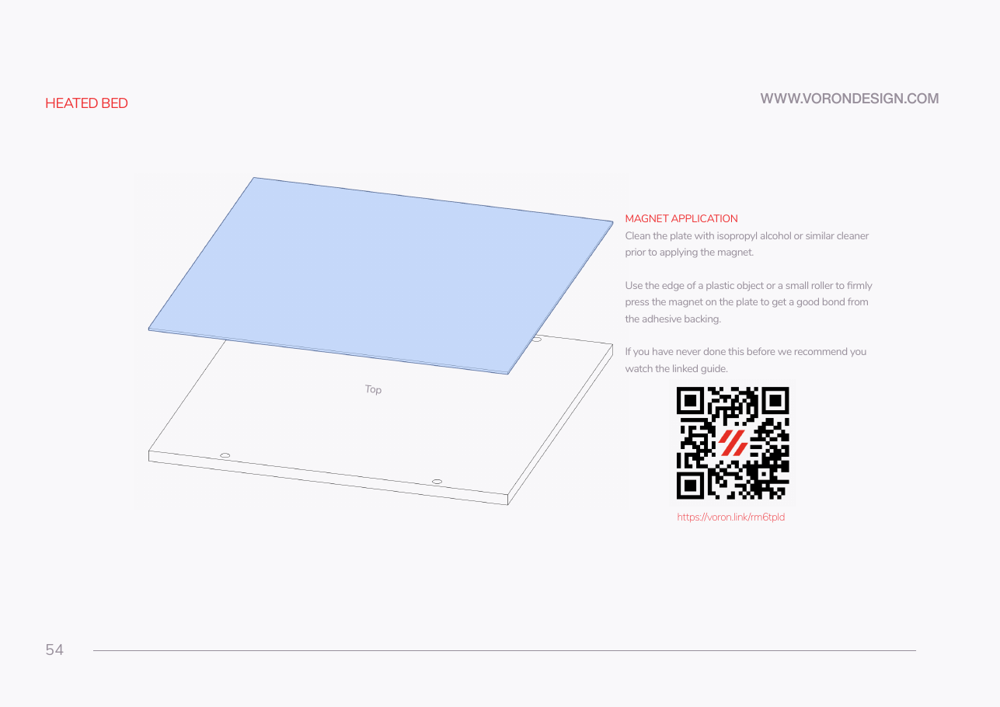

**What you're looking at:** The top face comes under a protective film. The Voron manual never mentions it; LDO adds this step [src](https://docs.ldomotors.com/voron/voron2/build-faq). It has to come off now, because the magnet's adhesive will not bond through it. Underneath, the aluminium is Blanchard-ground: machined flat by a spinning grinder, which leaves a swirl pattern.

**Parts:**

- staged: build plate

**Do:**

1. Peel the blue or clear film off the top face, starting at one corner, and throw it away.
2. Do not use a metal tool on the ground surface.

**Check:** The surface is bare, matte metal with the swirl showing, and no film is left in the counterbores or under the edges.

Source: [Voron manual p.54](https://github.com/VoronDesign/Voron-2/blob/de7e89d/Manual/Assembly_Manual_2.4r2.pdf#page=54) · [LDO Build Notes (Rev D)](https://docs.ldomotors.com/voron/voron2/build-faq)

---

### Step 03.4 — Verify the heater pad (do not apply one)

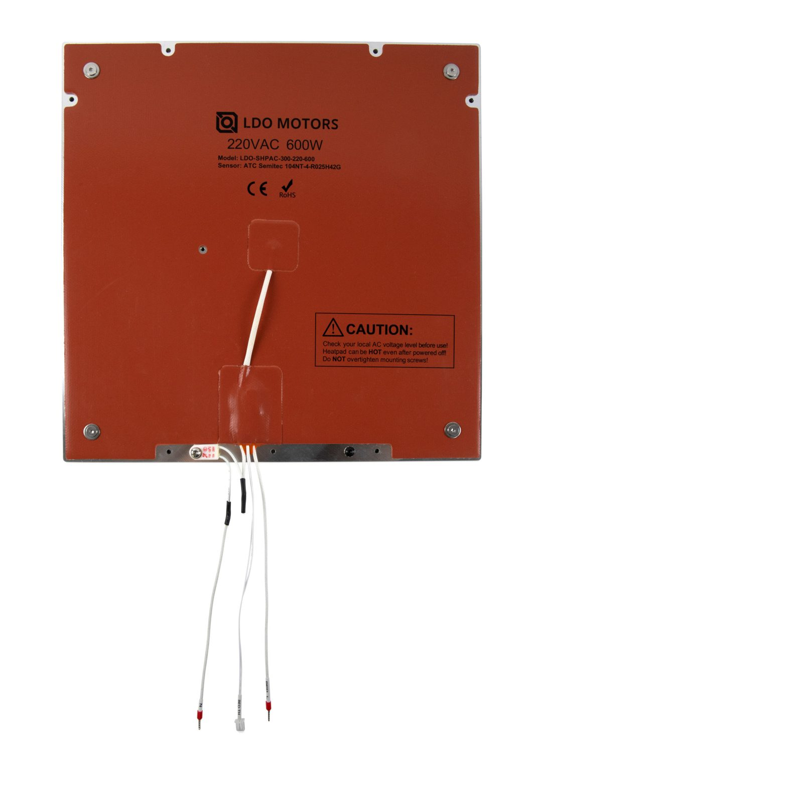
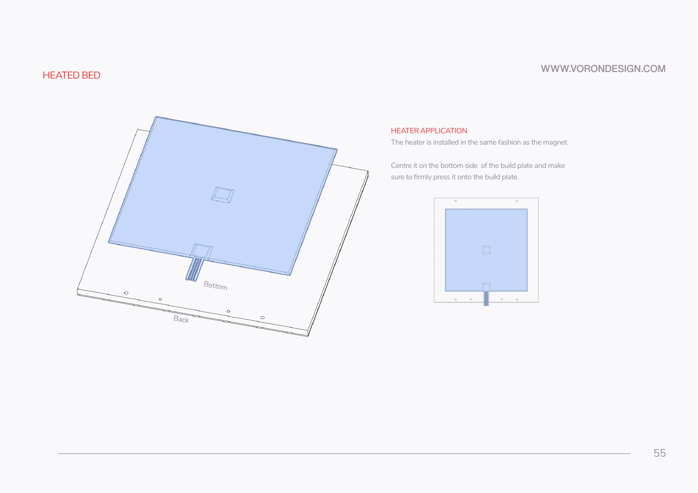

**What you're looking at:** On this kit the heater pad comes bonded on, as on every kit since Rev C, so skip manual p.55 and only inspect it [src](https://docs.ldomotors.com/voron/voron2/build-faq). The photo is LDO's plate from below: pad screwed down, fuse patch, cable exit. It is a 300 mm plate, so compare layout, not ratings.

**Parts:** none.

**Do:**

1. Turn the plate bottom-up.
2. Check the pad is flat and centred, with no lifted corner, wrinkle or trapped air, and every pad screw there.
3. Do not tighten the screws, add adhesive or press down a lifted edge.

**Check:** The pad is flat and centred, every pad screw, head type (verify on bench), is present and untouched, and nothing is peeling at the cable exit.

**Helper:** Counts the pad screws aloud and points out any lifted corner.

If the pad really is lifting, stop and ask in `#ldo_motors` before you fasten the plate down. [wiring guide § Wiring the Bed Heater](https://docs.ldomotors.com/en/voron/voron2/wiring_guide_rev_d#wiring-the-bed-heater)

Source: [Voron manual p.55](https://github.com/VoronDesign/Voron-2/blob/de7e89d/Manual/Assembly_Manual_2.4r2.pdf#page=55) · [LDO Build Notes (Rev D)](https://docs.ldomotors.com/voron/voron2/build-faq) · [LDO wiring guide § Wiring the Bed Heater](https://docs.ldomotors.com/en/voron/voron2/wiring_guide_rev_d#wiring-the-bed-heater) · [image: LDO `build_plate_bottom_view.jpg`](https://raw.githubusercontent.com/MotorDynamicsLab/LDOVoron2/main/Images/WiringGuide/RevC/build_plate_bottom_view.jpg)

---

### Step 03.5 — Verify the thermal fuse (do not fit one)

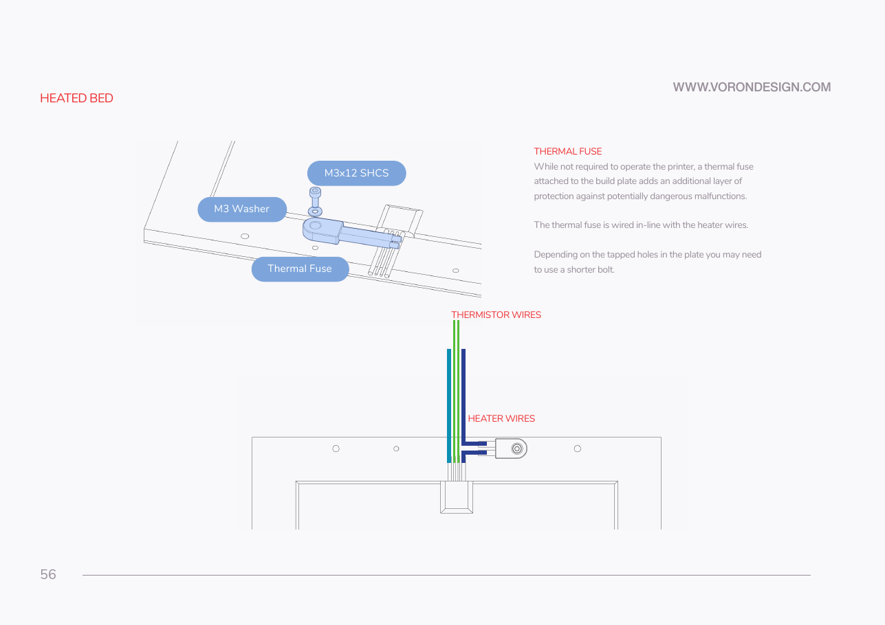

**What you're looking at:** The **thermal fuse** is a one-time safety cut-out: wired in series with one heater lead, it opens for good at 125 °C, so a runaway heater loses its power. It works only pressed flat against the aluminium. It comes fitted, so skip manual p.56, its M3×12 SHCS and M3 washer [src](https://docs.ldomotors.com/voron/voron2/build-faq).

**Parts:** none.

**Do:**

1. Find the fuse on the bottom face, by the cable exit.
2. Check its body is pressed flat to the aluminium and its single screw and washer are tight.
3. It is wired in line with one heater lead: leave it alone.

**Check:** The fuse sits flat on the plate, its screw is tight, and neither of its legs is strained where it joins the heater wire.

Source: [Voron manual p.56](https://github.com/VoronDesign/Voron-2/blob/de7e89d/Manual/Assembly_Manual_2.4r2.pdf#page=56) · [LDO Build Notes (Rev D)](https://docs.ldomotors.com/voron/voron2/build-faq)

---

### Step 03.6 — Verify the PE screw and identify the three cables

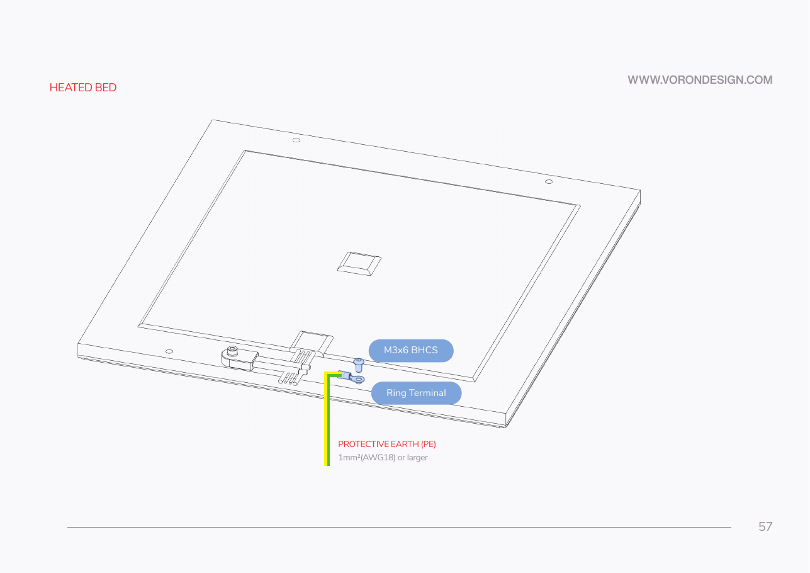

**What you're looking at:** Three cables leave the plate here: two thick braided mains leads, **N** and **Bed L**, and a thin two-pin **BED TH** lead from the thermistor, the plate's temperature sensor. Beside them an M4×6 BHCS and serrated washer are the **PE** (protective earth) point that bonds the plate to earth.

**Parts:** none.

**Do:**

1. Identify the three cables: **N**, **Bed L**, and **BED TH**, from an ATC Semitec 104NT thermistor.
2. Find the M4×6 BHCS beside them and leave it in place until Ch 10.
3. Wire nothing here: not the earth, the heater leads or the thermistor.

**Check:** The three cables are labelled, with no chafe or cut in the braid and no bare wire showing, and the earth screw is present and snug.

The manual asks for an M3×6 BHCS you supply. Your plate ships with the M4×6 BHCS already fitted: use that one. [src](https://docs.ldomotors.com/voron/voron2/build-faq)

The bed wiring is a breakout design. The plate's L and N land on the bed WAGO mount above the deck and its thermistor on the 2×2 XH splicer PCB, both in Ch 10, and extension leads carry on below. [src](https://docs.ldomotors.com/en/voron/voron2/wiring_guide_rev_d#wiring-the-bed-heater)

Source: [Voron manual p.57](https://github.com/VoronDesign/Voron-2/blob/de7e89d/Manual/Assembly_Manual_2.4r2.pdf#page=57) · [LDO Build Notes (Rev D)](https://docs.ldomotors.com/voron/voron2/build-faq) · [LDO wiring guide § Wiring the Bed Heater](https://docs.ldomotors.com/en/voron/voron2/wiring_guide_rev_d#wiring-the-bed-heater)

Pause: ~30 min since the last pause — the plate is unpacked, you know its top from its bottom, the film is off, and the factory-fitted heater, thermal fuse and earth screw are inspected and left alone. The magnet is still in its liner. Do not start Step 03.9 until you can do 03.8 to 03.10 in one go: you get only one try at sticking the magnet down.

---

### Step 03.7 — Check the plate for flatness before the magnet goes on


**What you're looking at:** This is the last time you see the bare aluminium. Once the magnet is on, a dip in the middle (a dish) or a hump (a crown) shows up only in the **bed mesh**, the map of bed heights the printer measures, and neither the mesh nor **QGL**, which levels the gantry, corrects it.

**Parts:**

- staged: build plate
- tool: steel rule or straightedge

**Do:**

1. Stand the straightedge on its edge on the bare face and look along it toward a light.
2. Check one diagonal and one centreline. It takes two minutes, and once the magnet is on you cannot look at this surface again.

**Check:** No daylight shows under the straightedge. No flatness tolerance is specified: ask in `#ldo_motors` only if a sheet of paper slides under.

**Helper:** Holds a torch behind the straightedge and says if any light shows under it.

The plate is cast 5083 aluminium, Blanchard-ground, and deliberately thick and stress-relieved. A dish you can see here does not get corrected by mesh or QGL later. [src](https://docs.ldomotors.com/en/voron/voron2/350_BOM/Rev_D+)

Source: [Voron manual p.53](https://github.com/VoronDesign/Voron-2/blob/de7e89d/Manual/Assembly_Manual_2.4r2.pdf#page=53) · [LDO 350 Rev D+ BOM](https://docs.ldomotors.com/en/voron/voron2/350_BOM/Rev_D+)

---

### Step 03.8 — Clean the top face


**What you're looking at:** Oil, dust or a fingerprint left on the top face becomes a permanent bump under the magnet, an adhesive sheet you cannot lift again. Clean it with IPA (isopropyl alcohol) and a lint-free cloth.

**Parts:**

- staged: build plate
- consumable: IPA
- consumable: lint-free cloth
- consumable: nitrile gloves

**Do:**

1. Wipe the whole top face with IPA.
2. Let it dry off completely, so no solvent is trapped under the adhesive.
3. Wear nitrile gloves from here on.

**Check:** The surface is dry, with no lint and no residue in the counterbores.

**Helper:** Holds the plate flat on the towel and checks afterwards for missed patches.

Source: [Voron manual p.54](https://github.com/VoronDesign/Voron-2/blob/de7e89d/Manual/Assembly_Manual_2.4r2.pdf#page=54)

---

### Step 03.9 — Apply the magnet sheet


**What you're looking at:** The **magnetic pad** is magnetised rubber with an adhesive back under a liner; it holds the flex plate down. LDO lists it separately; Fabreeko says it ships fitted [src](https://docs.ldomotors.com/en/voron/voron2/350_BOM/Rev_D+) · [Fabreeko](https://www.fabreeko.com/products/ldo-voron-v2-4-kit). If it is on, skip to 03.10; check its holes are cut.

**Parts:**

- Magnetic Pad 2.4-350 ×1
- consumable: masking tape
- tool: plastic squeegee or card
- tool: knife or scissors for the liner

**Do:**

1. Measure it (verify on bench). At 355 mm, align it with the back edge and one side; if smaller, centre it, noting the border.
2. Lay it liner down and tape the **back** edge as a hinge.
3. Fold it back, peel and cut 40–50 mm of liner, squeegee that strip, then draw the liner out, pressing the rest down.

**Check:** The pad lies square with an even border all round, with no bubbles or wrinkles.

The liner side is the adhesive and the plain rubber face is the magnet. Keep the rest of the pad lifted so the adhesive never touches ahead of the squeegee. If the first strip lands crooked, lift it at once: past a few centimetres it will not move.

Bubbles worked out to an edge come out; ones in the middle do not.

Source: [Voron manual p.54](https://github.com/VoronDesign/Voron-2/blob/de7e89d/Manual/Assembly_Manual_2.4r2.pdf#page=54) · [LDO 350 Rev D+ BOM](https://docs.ldomotors.com/en/voron/voron2/350_BOM/Rev_D+) · [magnet lamination demo](https://voron.link/rm6tpld)

---

### Step 03.10 — Trim the magnet at the four bolt holes


**What you're looking at:** The four screws go down through the plate's counterbored holes, and the hex key has to reach their heads, so the magnet is cut away over each hole. Do it now: the screws go in only at manual p.59, and finding the holes covered then costs the magnet [src](https://docs.ldomotors.com/voron/voron2/build-faq).

**Parts:**

- reused: the applied magnetic pad
- tool: sharp craft knife
- staged: M3×20 SHCS ×1, fit test
- tool: 2.5 mm hex key

**Do:**

1. Press on the magnet to find the four holes: they show as dimples.
2. Cut the magnet away over each one, following the counterbore, in light repeated passes.
3. Do not gouge the aluminium: a rough raised edge (a **burr**) stops the screw head sitting flush.

**Check:** All four counterbores are fully open, each tested with an M3×20 SHCS and the hex key before you go anywhere near the frame.

Source: [Voron manual p.54](https://github.com/VoronDesign/Voron-2/blob/de7e89d/Manual/Assembly_Manual_2.4r2.pdf#page=54) · [LDO Build Notes (Rev D)](https://docs.ldomotors.com/voron/voron2/build-faq)

Pause: ~30 min since the last pause — the top face is clean, the magnet is stuck down with no bubbles, and all four screw holes are cut clear through it and tested with an M3×20 and the hex key. The magnet is fully stuck, so nothing is half done. Lay the plate flat, magnet up, and cover it.

---

### Step 03.11 — Verify the bed extrusion position

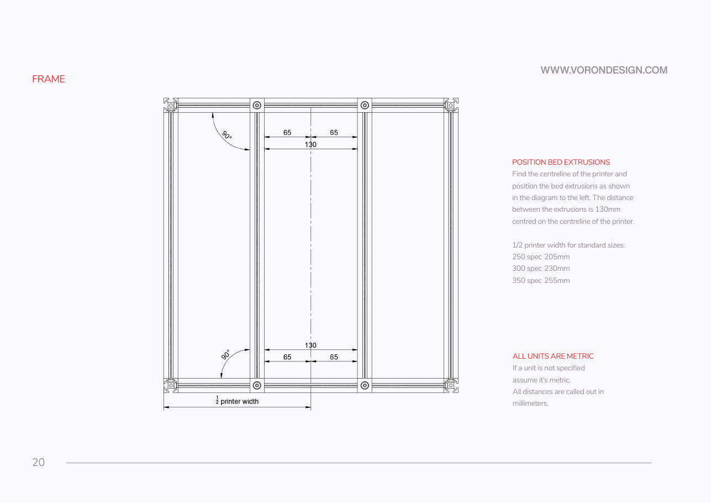{ crop="0.22 0.18 0.92 0.83" }

**What you're looking at:** The two bed extrusions carry the plate's four mounting points, so check that they are still where Ch 01 put them: 65 mm either side of the printer's centreline, measured to each inner face.

**Parts:** none.

**Do:**

1. With the printer upright, measure the clear gap between the two inner faces: it should be **130 mm**.
2. Make sure the gap is centred, 65 mm from the centreline to each inner face.
3. Measure at both ends; both must match.

**Check:** The clear gap between the inner faces is 130 mm, so 150 mm centre to centre, with 65 mm from the centreline to each, the same at both ends.

**Helper:** Holds the rule on one inner face and reads the gap at each end.

Source: [Voron manual p.58](https://github.com/VoronDesign/Voron-2/blob/de7e89d/Manual/Assembly_Manual_2.4r2.pdf#page=58) · [Voron manual p.20](https://github.com/VoronDesign/Voron-2/blob/de7e89d/Manual/Assembly_Manual_2.4r2.pdf#page=20)

---

### Step 03.12 — Load the eight bed extrusion T-nuts

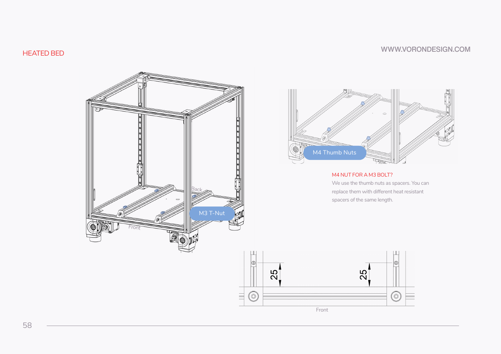{ crop="0.15 0.18 0.51 0.71" }
{ crop="0.46 0.68 0.84 0.90" }
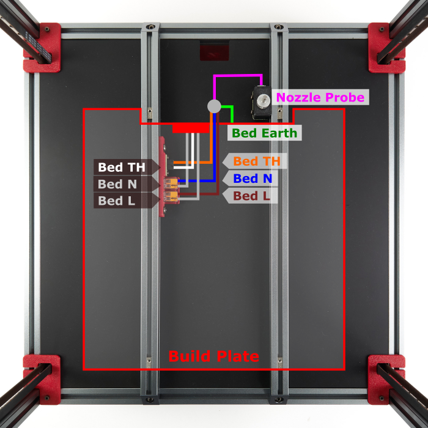

**What you're looking at:** A **roll-in T-nut** drops into an extrusion's slot and turns to lock. Four M3 ones go in the top slots, one per plate screw. Four more go in the inner side slots while no plate covers them, for the Ch 09 nozzle probe and bed WAGO mount.

**Parts:**

- M3 roll-in T-nut, 2020 ×6
- M5 roll-in T-nut ×2

**Do:**

1. Top slots, two M3 per extrusion: front pair 25 mm behind the front extrusion's inner face, rear pair under the plate's rear holes.
2. Inner side slots, rear half: two M3 on the right extrusion, two M5 on the left.
3. Leave all eight loose.

**Check:** Four T-nuts sit in the top slots, two M3 in the right extrusion's inner slot and two M5 in the left's, and none can fall out.

⚠ Never force a T-nut. Extrusions and roll-in T-nuts fit tightly in this kit, and a forced nut galls the slot, tearing up its metal. Test-fit each nut, and if a slot is stiff, use the extrusion face that takes it best. [src](https://docs.ldomotors.com/voron/voron2/build-faq)

Source: [Voron manual p.58](https://github.com/VoronDesign/Voron-2/blob/de7e89d/Manual/Assembly_Manual_2.4r2.pdf#page=58) · [LDO Build Notes (Rev D)](https://docs.ldomotors.com/voron/voron2/build-faq) · [Voron manual p.161: probe T-nuts](https://github.com/VoronDesign/Voron-2/blob/de7e89d/Manual/Assembly_Manual_2.4r2.pdf#page=161) · [LDO wiring guide § Wiring the bed heater: two M5×10 BHCS](https://docs.ldomotors.com/en/voron/voron2/wiring_guide_rev_d#wiring-the-bed-heater) · [LDO wiki build-plate mapping](https://docs.ldomotors.com/v2_wire_guide/build_plate_mapping.png)

---

### Step 03.13 — Fit the four thumb nuts as spacers

{ crop="0.56 0.22 0.96 0.59" }

**What you're looking at:** A **thumb nut** has a ridged (knurled) rim you turn by hand. These four M4 ones are spacers, not nuts: they hold the plate a fixed height above the extrusions, and the M3 screw passes through each one's hole into the T-nut below. A substitute must be the same length and heat-resistant.

**Parts:**

- M4 knurled thumb nut ×4

**Do:**

1. Stand one M4 thumb nut over each top-slot T-nut, knurled end up, its hole centred on the T-nut's thread.
2. Do not screw anything into the thumb nut: the M3 screw passes straight through it.

**Check:** Four thumb nuts stand on the extrusions, none tipped, each lined up with the T-nut under it, and all four are the same height.

Source: [Voron manual p.58](https://github.com/VoronDesign/Voron-2/blob/de7e89d/Manual/Assembly_Manual_2.4r2.pdf#page=58)

---

### Step 03.14 — Lower the plate on, cables above the deck

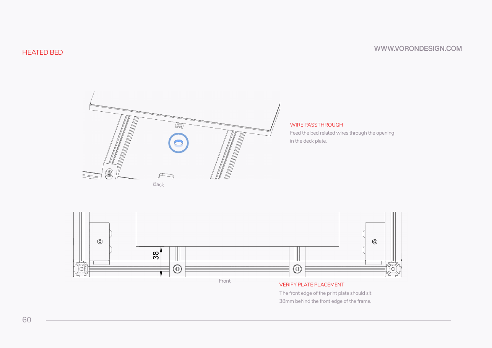{ crop="0.16 0.26 0.58 0.55" }


**What you're looking at:** The Voron manual feeds the bed wires through the deck here; this kit does not. The plate's three short leads stay above the deck and end at LDO's bed WAGO mount, a holder for lever connectors on the left bed extrusion, so the plate can lift off [src](https://docs.ldomotors.com/en/voron/voron2/wiring_guide_rev_d#wiring-the-bed-heater).

**Parts:**

- build plate, magnet applied ×1

**Do:**

1. Hold the plate flat with two hands, magnet up, cables at the **back**.
2. Lay the three leads toward the left bed extrusion, none through the deck.
3. Lower the plate onto the four thumb nuts, keeping the cables clear.

**Check:** The plate rests on all four thumb nuts with none knocked over, and all three leads lie loose above the deck, none through it and none trapped.

**Helper:** Holds the three leads toward the left extrusion while you lower the plate.

Only the extension leads fitted in Ch 10 go below the deck. With **Layout v3**, L, N and PE go through the round hole and TH through the notch; with the **LDO layout**, all four go through the hole.

Source: [Voron manual p.60](https://github.com/VoronDesign/Voron-2/blob/de7e89d/Manual/Assembly_Manual_2.4r2.pdf#page=60) · [LDO wiki build-plate mapping](https://docs.ldomotors.com/v2_wire_guide/build_plate_mapping.png) · `review/2026-09-23-bay-mods/layout-v2/layout-v2.md` § How each requirement is met · [Video: Part 2 @1:36:04](https://www.youtube.com/watch?v=2U0YahE8w_0&list=PL0fUJbigELQPqpeGOgHYisG4KaSXVtnNY&t=5764s)

---

### Step 03.15 — Start the four bolts

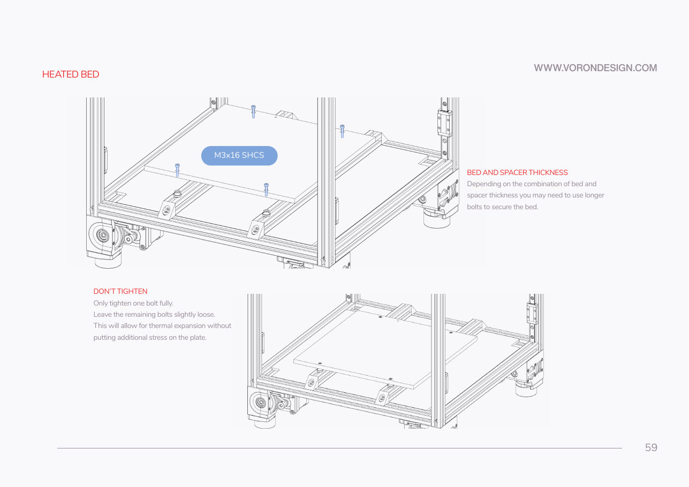{ crop="0.11 0.18 0.64 0.56" }

**What you're looking at:** Four M3×20 SHCS hold the plate. The Voron manual uses M3×16, but this plate is 10 mm thick and the spacer stack is taller, so an M3×16 will not reach enough thread [src](https://docs.ldomotors.com/voron/voron2/build-faq). Start them by hand, so the T-nuts can still slide to meet each hole.

**Parts:**

- M3×20 SHCS ×4

**Do:**

1. Start an M3×20 by hand through each trimmed hole and thumb nut into the T-nut below.
2. If a screw misses the thread, nudge the T-nut along its slot.
3. Turn all four down only until they just take up the slack.

**Check:** All four screws are engaged and turn freely, the plate still sits flat on its spacers, and none is cross-threaded, started at an angle so the threads bind.

Source: [Voron manual p.59](https://github.com/VoronDesign/Voron-2/blob/de7e89d/Manual/Assembly_Manual_2.4r2.pdf#page=59) · [LDO Build Notes (Rev D)](https://docs.ldomotors.com/voron/voron2/build-faq)

---

### Step 03.16 — Set the 38 mm front offset and centre the plate

{ crop="0.14 0.59 0.84 0.89" }

**What you're looking at:** Now set where the plate sits. A front edge 38 mm behind the front of the frame puts the plate where the print head can reach it. Equal gaps left and right keep it clear of the verticals and the Z rails, which is tight for a 355 mm plate in a 350 mm machine.

**Parts:**

- tool: steel rule
- tool: caliper

**Do:**

1. With the screws loose, slide the plate until its front edge is **38 mm behind the frame's front edge**.
2. Make the left and right gaps equal, then check the 38 mm again.
3. Run a finger all the way round the plate's edge.

**Check:** The plate is 38 mm back at both front corners, with equal side gaps, touching no vertical or Z rail.

**Helper:** Reads the rule at each corner and calls the number back to you.

Source: [Voron manual p.60](https://github.com/VoronDesign/Voron-2/blob/de7e89d/Manual/Assembly_Manual_2.4r2.pdf#page=60)

---

### Step 03.17 — Tighten one bolt only

{ crop="0.12 0.57 0.83 0.89" }

**What you're looking at:** The manual's DON'T TIGHTEN rule holds for this kit. One screw fixes the plate's position; the other three stay slightly loose so the aluminium can grow as it heats against the steel-screwed frame. Clamped at all four corners and taken to 110 °C, a plate this size buckles for good.

**Parts:**

- reused: the four M3×20 SHCS
- tool: 2.5 mm hex key

**Do:**

1. Tighten any one screw fully; use the front-left, so you remember which.
2. **Leave the other three slightly loose.** They locate the plate; they do not clamp it.
3. No torque is specified: tighten it snug by hand feel, with no torque driver.

**Check:** One screw is tight and the other three turn with a fingertip on the hex key. A free corner gives slightly when pressed and comes back.

Source: [Voron manual p.59](https://github.com/VoronDesign/Voron-2/blob/de7e89d/Manual/Assembly_Manual_2.4r2.pdf#page=59)

Pause: ~40 min since the last pause — the plate sits on its four thumb-nut spacers, 38 mm behind the frame's front edge and centred, with one screw tight and three loose on purpose and its cables loose above the deck. Four T-nuts wait in the inner slots for Ch 09. The plate is fastened and stable, so this is the natural place to stop. Do not tighten the other three screws.

---

### Step 03.18 — Verify the plate floats level

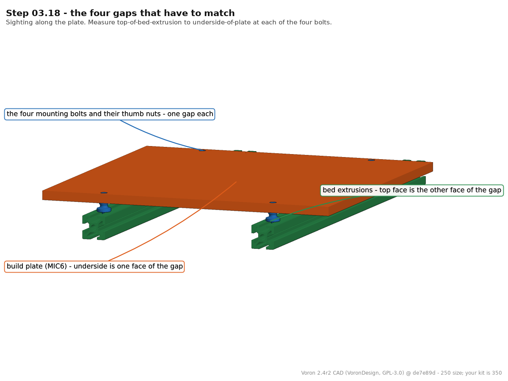
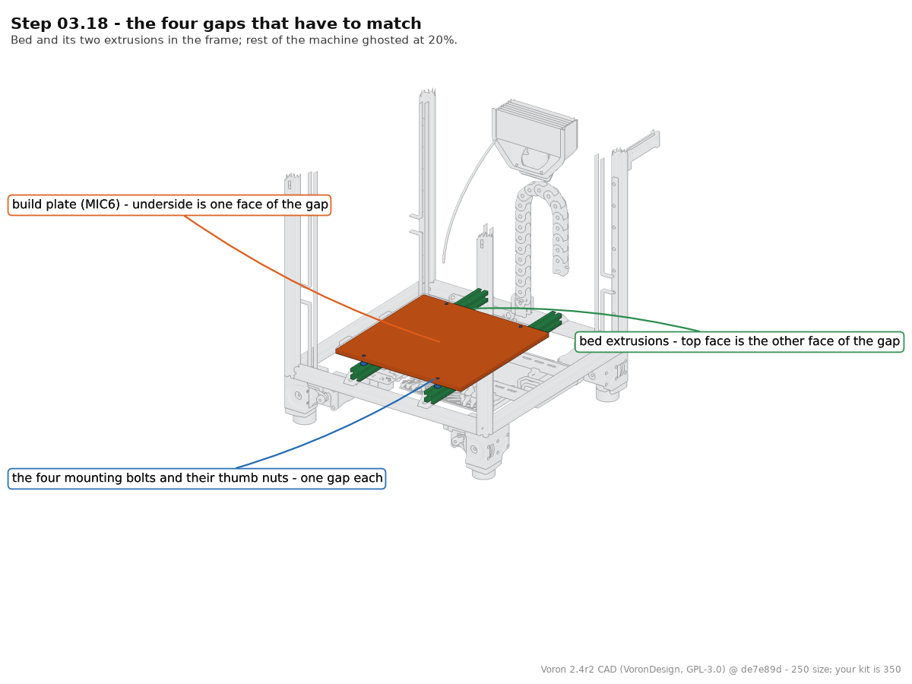

**What you're looking at:** The plate rides on four screws above the two bed extrusions. The gap under each screw is what you measure, and all four should match: a short corner is a permanent tilt that every bed mesh has to fight.

**Parts:**

- tool: caliper

**Do:**

1. With the caliper, measure the gap between the top of the extrusion and the underside of the plate at each screw.
2. Look along the plate at eye level, from the front and from the side.
3. A short corner means a T-nut that has not rolled into place, a tipped thumb nut or a tight screw.

**Check:** All four gaps equal the thumb-nut height and each other, and pressing each corner in turn gives no rock and no click.

**Helper:** Reads the caliper at each corner and writes the four gaps down.

Do not level the plate to the gantry by hand. QGL does that in software in Ch 13; this step only proves the plate floats evenly.

The CAD bed in the pictures is the 10 in (254 mm) MIC6 plate on 370 mm bed extrusions (250). Yours is the 350 plate on the 350 frame: four screws, four gaps.

Source: [Voron manual p.59](https://github.com/VoronDesign/Voron-2/blob/de7e89d/Manual/Assembly_Manual_2.4r2.pdf#page=59) · [Voron manual p.58](https://github.com/VoronDesign/Voron-2/blob/de7e89d/Manual/Assembly_Manual_2.4r2.pdf#page=58) · CAD: Voron 2.4r2 STEP @ de7e89d

---

### Step 03.19 — Dress the bed leads above the deck


**What you're looking at:** To dress a cable is to lay it along its route. The plate's three leads stay loose above the deck, and nothing is connected in this chapter: they end at the bed WAGO mount Ch 09 fits on the left bed extrusion; Ch 10 connects them.

**Parts:** none.

**Do:**

1. Lay the three leads toward the rear half of the left bed extrusion, generous slack at the plate end.
2. Keep them out of the deck's round hole and notch, and off every thumb nut.
3. Do not zip-tie or connect anything yet.

**Check:** The leads loop slack at the plate, none is under tension, through the deck or touching a cut edge, the thermal fuse's legs are undisturbed, and nothing is tied down.

The bed wiring is a breakout design so that the plate can be lifted off the top of the deck panel later. The bed WAGO mount is Ch 09; the connections, the extension leads and the Omron SSR (solid-state relay) are Ch 10. [src](https://docs.ldomotors.com/en/voron/voron2/wiring_guide_rev_d#wiring-the-bed-heater)

Source: [Voron manual p.60](https://github.com/VoronDesign/Voron-2/blob/de7e89d/Manual/Assembly_Manual_2.4r2.pdf#page=60) · [LDO wiki build-plate mapping](https://docs.ldomotors.com/v2_wire_guide/build_plate_mapping.png) · [LDO wiring guide § Wiring the Bed Heater](https://docs.ldomotors.com/en/voron/voron2/wiring_guide_rev_d#wiring-the-bed-heater)

---

### Step 03.20 — Fit the flex plate, then cover the bed


**What you're looking at:** The **flex plate** is the removable spring-steel sheet you print on; it clicks onto the magnet. The Voron manual's print-bed section ends at p.60 without fitting it, but it is in the LDO kit [src](https://docs.ldomotors.com/en/voron/voron2/350_BOM/Rev_D+). It goes on once to prove it sits flat, then back in its sleeve: the magnet is not something you can resurface.

**Parts:**

- Spring Steel Flex Plate 2.4-350 ×1
- consumable: a sheet of cardboard

**Do:**

1. Drop the flex plate onto the magnet, coated side up, square to the edges. No screws.
2. Take it straight back off and put it in its sleeve.
3. Lay cardboard over the magnet for the next six chapters.

**Check:** The flex plate sits flat with no rocking and does not overhang the magnet on any side, and the bed is covered.

Source: [Voron manual p.52](https://github.com/VoronDesign/Voron-2/blob/de7e89d/Manual/Assembly_Manual_2.4r2.pdf#page=52) · [LDO 350 Rev D+ BOM](https://docs.ldomotors.com/en/voron/voron2/350_BOM/Rev_D+)

Pause: ~20 min since the last pause — the four corner gaps are checked, the plate's leads lie loose above the deck with nothing tied or connected, and the flex plate has been tried, taken off, and the bed covered with cardboard. Work through Checkpoint 03; the cover stays on for the next six chapters.

---

## Checkpoint 03

**Built:** the heated bed, floating level on four spacers

- [ ] The protective film is off, the top face is clean, and the magnet is on, stuck down here or fitted at the factory, with no bubbles or wrinkles.
- [ ] All four screw holes are cut clear through the magnet, and a 2.5 mm hex key reaches each screw head.
- [ ] The heater pad is flat and centred, with its pad screws present and untouched: inspected, not re-applied.
- [ ] The thermal fuse is flat against the plate, its screw tight, in line with a heater lead: inspected, not re-fitted.
- [ ] The M4×6 BHCS and serrated washer are on the plate as the PE (earth) point, with nothing wired to it.
- [ ] Four M3 roll-in T-nuts are in the bed extrusions' top slots with four M4 thumb nuts standing over them as spacers, and two M3 T-nuts wait in the right extrusion's inner slot and two M5 in the left's, for Ch 09.
- [ ] Four **M3×20** SHCS are fitted, not M3×16: **one** tight, three loose on purpose.
- [ ] The plate's front edge is 38 mm behind the front edge of the frame at both corners.
- [ ] The gap is equal under all four corners, the plate does not rock, and it clears every vertical and Z rail.
- [ ] The straightedge check was done before the magnet went on, with no gap you could slide paper under.
- [ ] The three bed leads lie loose **above** the deck with slack, none through it, nothing connected, pinched or tied.
- [ ] The flex plate was tried and taken off, and the bed is covered for the rest of the build.

## Common mistakes

- **Sticking the magnet over the screw holes and noticing only at p.59.** Then the fix is peeling the magnet off for a new one or drilling through it, and both are bad. Cut the holes clear at Step 03.10.
- **Using the M3×16 the manual calls for.** Through a 10 mm plate plus a spacer it catches barely any thread, and it strips the T-nut the first time you tighten it. Use M3×20.
- **Tightening all four screws because three loose ones feel wrong.** The plate bends into a curve the first time it heats fast to 110 °C, and it never comes flat again.
- **Trying to "fix" the factory-fitted heater or fuse.** Peeling a bonded heater pad to re-seat it ruins it. Inspect only, and ask in `#ldo_motors` if something looks wrong.
- **Wiring the bed here, or feeding its leads through the deck.** The plate's leads end at the bed WAGO mount above the deck (Ch 09) and are connected in Ch 10. Connecting or threading them now means undoing them later.
- **Building on the bare magnet, or leaving it uncovered.** The magnet sheet is not a print surface, and everything you drop over the next six chapters lands on it.

## Next

Ch 04 — A/B drives and idlers (manual p.62–81): the two gantry drive units and the front idlers, built on the bench with the bed covered.
