# Chapter 04 — A/B drive units and front idlers

<!-- style: plain -->

You build the four corner pieces that carry the A and B belts: two drive units with their motors, and two front idlers with their tension arms. Ch 05 (gantry) then screws all four onto the Y extrusions.

**What you're building in this chapter:** This printer is a **CoreXY** machine: two motors fixed at the back pull two long, crossed belts that move the print head, so nothing heavy rides along with it ([glossary](16-glossary.md#c)). The belts are called **A** and **B**, and they run around four corners, which you build here. A is the rear-right corner, B the rear-left. Each **drive unit** is a printed frame in two halves. Inside, stacks of small bearings, each with a rim (a **flange**) on one face, sit on two standing screws, and a stepper motor hangs underneath to drive the belt. Each **front idler** is the same bearing sandwich without a motor, plus a blue **tension arm** that is later pulled forward to tighten the belt. The two belts run at two different heights, and most of this chapter is about setting those heights exactly. Many parts come as mirror-image pairs, like gloves, so you build one corner at a time. Everything is built on the bench and bagged.

```mascot
pose: point
caption: Two drive units, two idlers, all handed. Lay them out left and right. Chapter seven notices.
```

**Time:** 3.5–5.0 h hands-on, first build ([survey §5.1 P04](../voron-build-instructions-survey.md)).

**Sessions:** 7 × ~30 min (15 to 45 min each). Each one ends at a safe place to stop, and every minute figure is a first-build estimate.

**Prerequisites:**

- **Ch 01 (frame)** is done. Nothing from Ch 02 or Ch 03 is needed: this is bench work, and it can run alongside them (survey §5.1: P04 ← P01).
- **Print batch B03**, *A/B drive units + front idlers*: 2 plates, B03-P1 for the A side and B03-P2 for the B side, 8.6 h and 120 g of black ([print plan](../voron-print-plan.md)). The `front_idler_right_*` parts go with the A drive and the `front_idler_left_*` parts with B (Step 04.2).
- **Print batch B02**, *the accent day*: plates **B02-P2** (`[a]_tensioner_left`) and **B02-P4** (`[a]_tensioner_right`).
- **Print batch B00**, for `pulley_jig.stl`. Without it you set two different pulley heights with a caliper alone.

**Tools**

- Hex drivers 2, 2.5, 3 and 4 mm. A 2.5 mm ball-end driver helps with the M3×40.
- 1.5 mm hex key for the pulley set screws (verify on bench against the kit's pulleys).
- Nutopress Pro insert press with its M3 tip, for the four heat-set inserts (Steps 04.3–04.4). Use the X-Tronic iron with the LDO brass tip only if a part will not fit under the press.
- The printed `pulley_jig.stl` (Voron-2 `STLs/Tools/`).
- Digital caliper: the fallback for pulley height, and to confirm that both drives match.
- The free end of the kit's 6 mm A/B belt reel, **uncut**, to check that each belt runs level through its drive. Cutting belt waits for Ch 07, where both belts are cut to match.
- Tweezers or a small screwdriver, to place spacers in the stacks without dropping them.
- Masking tape and a marker, to label every assembly **A** or **B** as it is finished.

**Consumables:** Loctite 243 (blue threadlocker), for the pulley set screws if they do not already carry threadlocker.

**Read first**

- **A and B parts are mirror images and swap without you noticing.** The A drive frames have a **cutout** the B frames do not, and only `a_drive_frame_upper` has insert holes. Build one assembly at a time, and never have both sets of frames loose on the bench together.
- **A is rear right, B is rear left**, as seen standing in front of the printer. So the A idler is the front-right one and the B idler the front-left one.
- **The bearing stacks are the mistake everyone makes.** Each pair of F695 bearings goes flanges outward, plain faces touching, with one brass spacer above the pair and one below. The far post of each drive takes two pairs; the near post and each idler take one. The Voron manual calls the spacer an "M5 shim"; in this kit it is a brass M5 precision spacer.
- **The A and B pulleys sit at different heights and face opposite ways:** A hub-down at 16.5 mm, B hub-up at 6.5 mm. That difference keeps the two belts on separate levels, and no belt tension in Ch 07 can make up for it.
- **Count before you start:** exactly 16 F695 bearings, 16 spacers and the two 6 mm pulleys. If one is short, recount against your Ch 00 inventory sheet, then contact Fabreeko support. Never borrow a 9 mm Z pulley.

<!-- reference -->

**Printed parts**

Parts arrive in the bins named below (see the bin map in print/README.md#bins); check the bin label's list before you start.


| Looks like | STL | Bin | Qty | Colour |
|---|---|---|---|---|
| 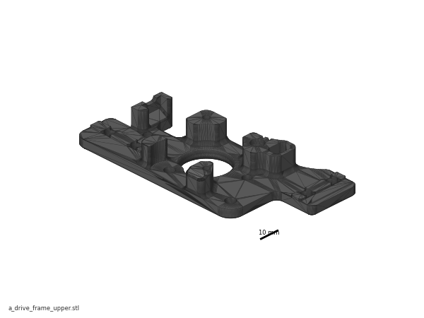{ width=96 } | `a_drive_frame_upper.stl` | 04-A | 1 | Black |
| 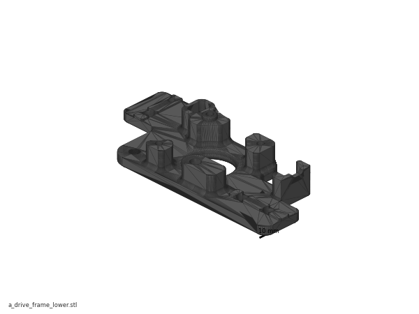{ width=96 } | `a_drive_frame_lower.stl` | 04-A | 1 | Black |
| 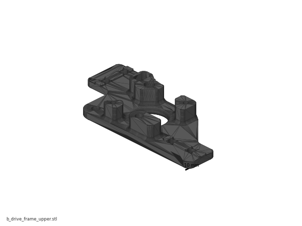{ width=96 } | `b_drive_frame_upper.stl` | 04-B | 1 | Black |
| 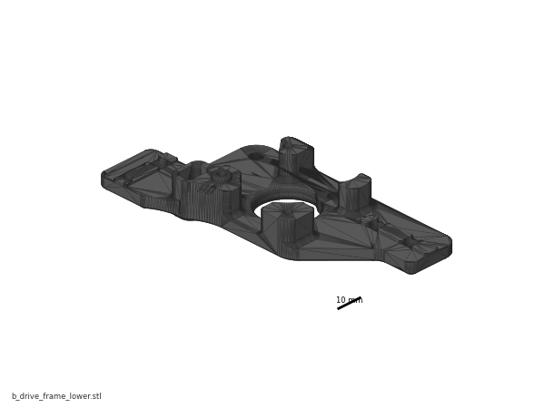{ width=96 } | `b_drive_frame_lower.stl` | 04-B | 1 | Black |
| 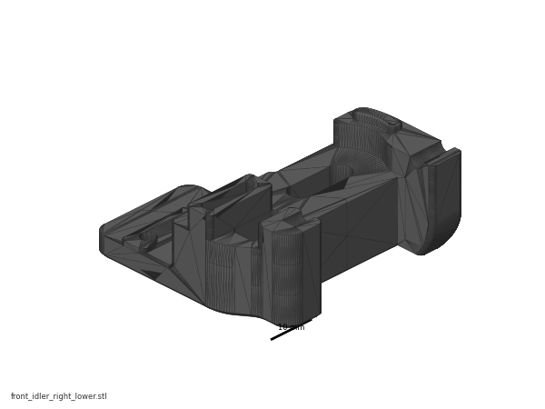{ width=96 } | `front_idler_right_lower.stl` | 04-A | 1 | Black |
| 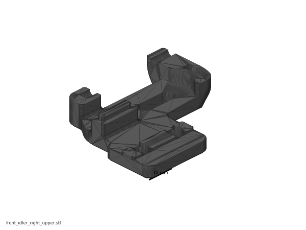{ width=96 } | `front_idler_right_upper.stl` | 04-A | 1 | Black |
| 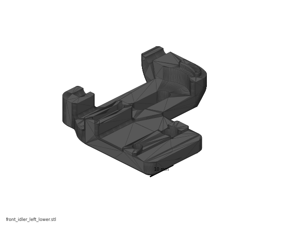{ width=96 } | `front_idler_left_lower.stl` | 04-B | 1 | Black |
| 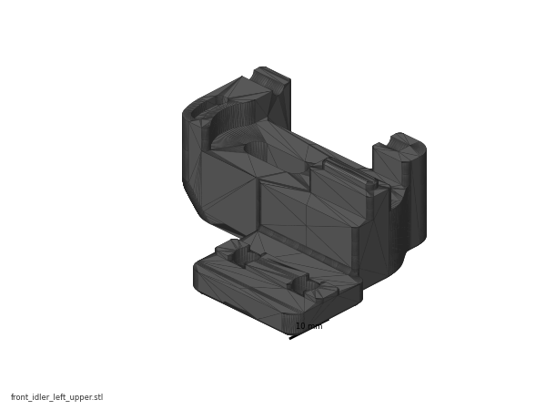{ width=96 } | `front_idler_left_upper.stl` | 04-B | 1 | Black |
| 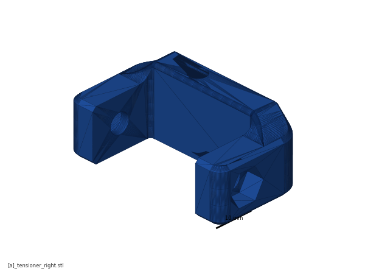{ width=96 } | `[a]_tensioner_right.stl` | 04-A | 1 | Blue |
| 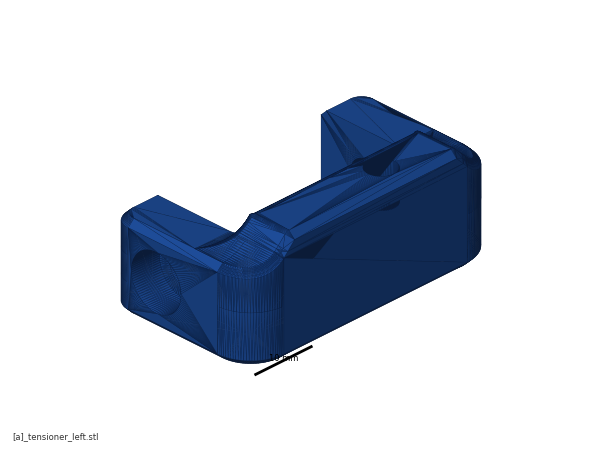{ width=96 } | `[a]_tensioner_left.stl` | 04-B | 1 | Blue |

All ten are in Voron-2 `STLs/Gantry/AB_Drive_Units/` and `STLs/Gantry/Front_Idlers/`. Two more parts sit in those same folders and are **not** used here: `[a]_cable_cover` (bin 07-X) and `[a]_z_chain_retainer_bracket_x2` (bin 10-chains, fitted in Ch 10). Keep them bagged.

**Hardware** (chapter totals)

| Fastener / part | Qty | Where |
|---|---|---|
| Stepper motor, **0.9°**, `LDO-42STH48-2004MAH(VRN)` | 2 | one per drive (p.75, p.79) |
| GT2 pulley, 20 T, 5 mm bore, **6 mm wide** (`Pulley, 2GT, 20T, 5mm ID 6mm W`) | 2 | one per motor shaft (p.75, p.79). The kit has exactly two; the four **9 mm** 20T pulleys are the Z-drive pulleys used in Ch 02 |
| F695 flanged bearing (5×13×4 mm) | 16 | 6 per drive (p.74, p.78) + 2 per front idler (p.65, p.69). The A/B side uses **F695 only** — 625-2RS is the Z-drive bearing (Ch 02) |
| **M5 precision spacer, brass** — the manual's "M5 shim" | 16 | one above and one below every bearing pair |
| M5×30 BHCS | 4 | 2 per drive, upper frame → lower frame (p.73, p.77) |
| M5×40 SHCS | 2 | 1 per front idler — the idler **axle**: first the stack-building aid, then refitted from the top through the tension arm into its M5 nut until the head seats, not clamped hard (p.65–66, p.69–70) |
| M3×30 SHCS | 6 | 3 per motor (p.76, p.80) |
| M3×40 SHCS | 2 | 1 per front idler — the belt **tensioner** screw, through the frame's front wall into the arm's heat-set insert (p.67, p.71); set with the belt on in Ch 07 Step 07.5 |
| M3 washer | 2 | under each M3×40 head (p.67, p.71) |
| Heat-set insert, brass, M3×5×4 | 4 | 2 in `a_drive_frame_upper`, 1 in each tension arm (p.64) |
| M5 hex nut | 2 | 1 in each tension arm foot (p.64) |

**Notes behind "Read first"**

- **A and B parts are mirrored and swap silently.** The A drive's printed frames carry a **cutout** the B frames do not have (p.73, circled). Only `a_drive_frame_upper` has the two heat-set insert bosses — `b_drive_frame_upper` has none. Build one complete assembly at a time; never have both sets of frames loose on the bench together.
- **Where each assembly ends up, standing in front of the printer: A = rear right, B = rear left.** The official manual shows it (p.63, p.83 — A on the right, B on the left, seen from the front) but never writes it; the LDO wiring guide does, and the LDO Klipper config repeats it (`## B Stepper - Left`, `## A Stepper - Right`). It follows that the A idler is the **front right** pair and the B idler the **front left** pair. [src](https://docs.ldomotors.com/en/voron/voron2/wiring_guide_rev_d)
- **The bearing stacks are the mistake everyone makes.** Every F695 pair goes **flange-out** — the two plain faces touch, the two flanges face away from each other — with one spacer above the pair and one below. The drive's far post takes **two** such pairs (4 bearings, 4 spacers); the near post and each front idler take **one** (2 bearings, 2 spacers).
- **The A and B pulleys sit at different heights and face opposite ways**: A is hub-down at 16.5 mm (p.75), B is hub-up at 6.5 mm (p.79). That difference is what stacks the two belt planes. No amount of belt tension in Ch 07 will fix it if you set them the same.
- **Short a bearing, spacer or pulley?** This chapter needs exactly 16 F695, 16 spacers and the two 6 mm pulleys. Recount against your Ch 00 inventory sheet, then contact Fabreeko support. Never borrow a 9 mm Z pulley.
- **LDO's Build Notes have no entry for p.62–81.** The only kit deviation in this whole chapter is the standing substitution from their p.19 note: brass M5 precision spacer everywhere the manual writes "M5 shim". [src](https://docs.ldomotors.com/en/voron/voron2/build-faq)

**Sources for this chapter:**

- [Voron 2.4r2 assembly manual (pinned `de7e89d`)](https://github.com/VoronDesign/Voron-2/blob/de7e89d/Manual/Assembly_Manual_2.4r2.pdf) pages 62–81 — idler stacks, tension arms, drive frames, bearing stack-ups, pulley heights, motor orientation
- [LDO wiring guide (Rev D)](https://docs.ldomotors.com/en/voron/voron2/wiring_guide_rev_d) — A = rear right, B = rear left; the manual draws it (p.63, p.83) but never writes it
- [LDO Klipper config `leviathan-printer-rev-d-sbv2.cfg`](https://raw.githubusercontent.com/MotorDynamicsLab/LDOVoron2/667521d/Firmware/leviathan-printer-rev-d-sbv2.cfg) — `## A Stepper - Right` / `## B Stepper - Left`, and `full_steps_per_rotation: 400` for the 0.9° A/B motors
- [LDO Build Notes (Rev D)](https://docs.ldomotors.com/voron/voron2/build-faq) — no entry exists for p.62–81; the only deviation is the standing brass M5 precision spacer substitution from their p.19 note
- [LDO 350 Rev D+ BOM](https://docs.ldomotors.com/en/voron/voron2/350_BOM/Rev_D+) — the two 6 mm 20T pulleys vs the four 9 mm Z pulleys, and the 0.9° motor part number
- [LDO heat-set insert tool guide](https://docs.ldomotors.com/guides/heatset_insert_tool_guide) — the four-insert pass
- [Voron-2 `STLs/Gantry/AB_Drive_Units`](https://github.com/VoronDesign/Voron-2/tree/de7e89d/STLs/Gantry/AB_Drive_Units), [Voron-2 `STLs/Gantry/Front_Idlers`](https://github.com/VoronDesign/Voron-2/tree/de7e89d/STLs/Gantry/Front_Idlers), [Voron-2 `STLs/Tools`](https://github.com/VoronDesign/Voron-2/tree/de7e89d/STLs/Tools)
- [survey](../voron-build-instructions-survey.md) §4.4 · [print plan](../voron-print-plan.md) batches B00/B02/B03

**Video coverage (Steve Builds, pre-release LDO kit — differs from Rev D+):** [Part 3 @0:58:20](https://www.youtube.com/watch?v=ii14-2COjuA&list=PL0fUJbigELQPqpeGOgHYisG4KaSXVtnNY&t=3500s) (+3m), [Part 3 @1:04:20](https://www.youtube.com/watch?v=ii14-2COjuA&list=PL0fUJbigELQPqpeGOgHYisG4KaSXVtnNY&t=3860s) (+14m), [Part 3 @1:07:20](https://www.youtube.com/watch?v=ii14-2COjuA&list=PL0fUJbigELQPqpeGOgHYisG4KaSXVtnNY&t=4040s) (+10m), [Part 3 @1:18:03](https://www.youtube.com/watch?v=ii14-2COjuA&list=PL0fUJbigELQPqpeGOgHYisG4KaSXVtnNY&t=4683s) (+2m), [Part 3 @1:23:20](https://www.youtube.com/watch?v=ii14-2COjuA&list=PL0fUJbigELQPqpeGOgHYisG4KaSXVtnNY&t=5000s) (+9m), [Part 5 @1:12:20](https://www.youtube.com/watch?v=hTKCBrk36R0&list=PL0fUJbigELQPqpeGOgHYisG4KaSXVtnNY&t=4340s) (+8m)

---

### Step 04.1 — Lay the chapter out as four separate kits

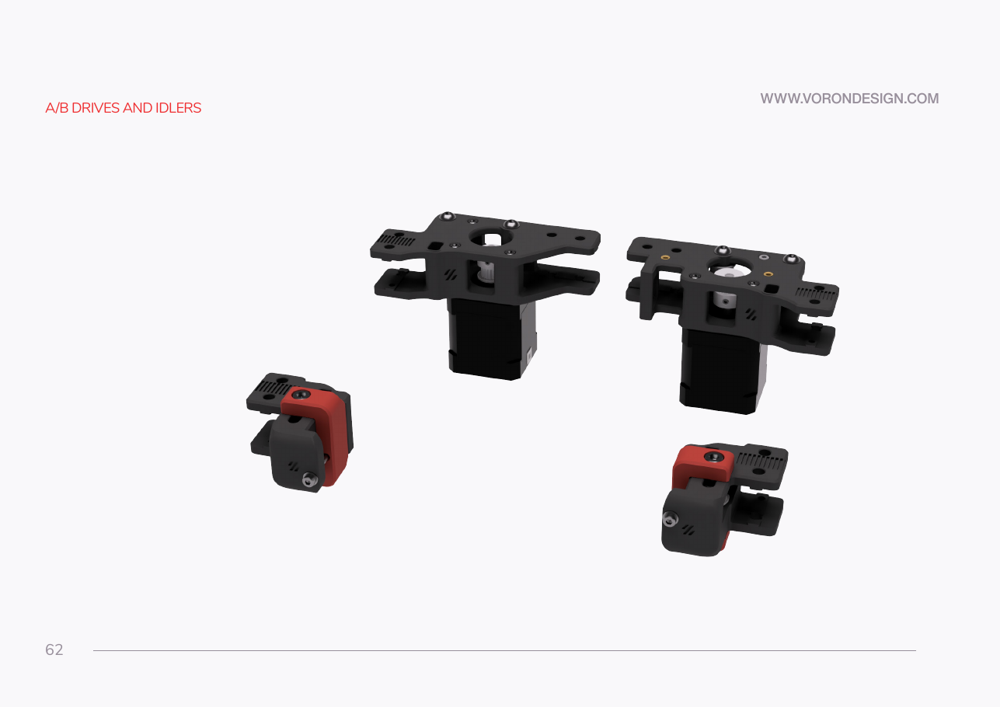

**What you're looking at:** This chapter builds four corner pieces from ten printed parts. Two are **drive units**: a printed frame in two halves holding bearing stacks, with a stepper motor underneath. Two are **front idlers**, the same without a motor. They are the four corners the CoreXY belts loop around.

**Parts:**

- staged: the ten printed drive and idler parts
- staged: F695 bearing ×16
- staged: M5 precision spacer ×16
- tool: four trays or bags

**Do:**

1. Label four areas of the bench **A DRIVE**, **B DRIVE**, **A IDLER** and **B IDLER**.
2. Put `a_drive_frame_upper` and `a_drive_frame_lower` in the first, the `b_drive_frame_*` pair in the second, `front_idler_right_*` and `[a]_tensioner_right` in the third, and `front_idler_left_*` and `[a]_tensioner_left` in the fourth.
3. Open one area at a time, so mirror-image parts never mix.

**Check:** all ten printed parts are in their areas, none left over. An eleventh part is `[a]_cable_cover` or `[a]_z_chain_retainer_bracket`; those belong in bins 07-X and 10-chains.

**Helper:** Counts the bearings and spacers into four labelled trays, one per assembly.

Source: [Voron manual p.62](https://github.com/VoronDesign/Voron-2/blob/de7e89d/Manual/Assembly_Manual_2.4r2.pdf#page=62) · [Voron-2 `STLs/Gantry/AB_Drive_Units`](https://github.com/VoronDesign/Voron-2/tree/de7e89d/STLs/Gantry/AB_Drive_Units) · [Voron-2 `STLs/Gantry/Front_Idlers`](https://github.com/VoronDesign/Voron-2/tree/de7e89d/STLs/Gantry/Front_Idlers)

---

### Step 04.2 — Fix which assembly is A and which is B

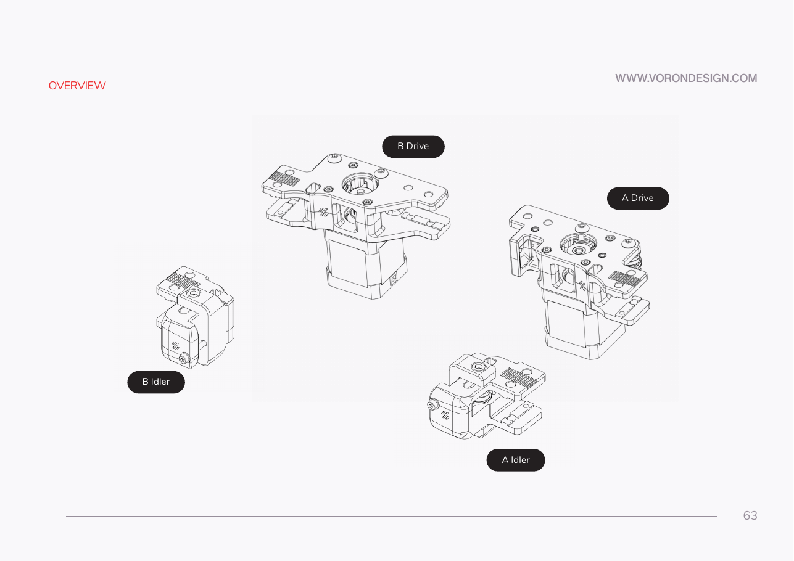


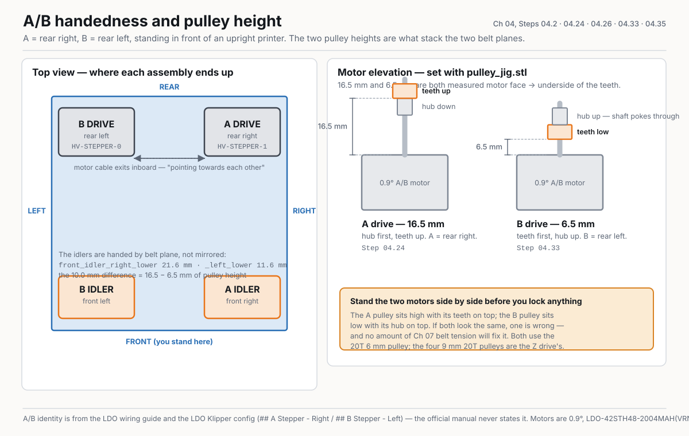

**What you're looking at:** Each assembly fits only one corner, so mark them now. Standing in front of the printer, **A** is the rear-right drive and **B** the rear-left one, so the A idler goes front right and the B idler front left. On the idlers, height is the give-away, not mirror shape.

**Parts:**

- consumable: masking tape
- tool: marker
- tool: caliper

**Do:**

1. Write the corner on every part in marker, as seen standing in front of the upright printer: `a_drive_*` **rear right**, `b_drive_*` **rear left**, `front_idler_right_*` and `[a]_tensioner_right` **front right**, `front_idler_left_*` and `[a]_tensioner_left` **front left**.
2. Measure the lower idler frames with the caliper: `front_idler_right_lower` is **21.6 mm** tall, `front_idler_left_lower` **11.6 mm**.

**Check:** every part has its corner written on it in marker, and the taller of the two lower idler frames is the one labelled front right.

**Helper:** Writes each destination in marker as you call it out, then reads the caliper on both lower frames.

The upper idler frames are the other way round: `front_idler_right_upper` is 12.0 mm tall and `front_idler_left_upper` 21.6 mm. Measure those if the lower pair is unclear. The 10 mm difference between the lower frames is what splits the two belts onto two levels.

Which motor is A comes from LDO's wiring guide, not the Voron manual: **A = rear right → HV-STEPPER-1**, **B = rear left → HV-STEPPER-0**. [src](https://docs.ldomotors.com/en/voron/voron2/wiring_guide_rev_d) Get this backwards and a jog along Y runs the wrong way, or X and Y trade places; the motor chart at Step 13.23 catches it. [src](https://raw.githubusercontent.com/VoronDesign/Voron-Documentation/main/build/startup/images/V2-motor-configuration-guide.png)

Source: [Voron manual p.63](https://github.com/VoronDesign/Voron-2/blob/de7e89d/Manual/Assembly_Manual_2.4r2.pdf#page=63) · [LDO wiring guide (Rev D)](https://docs.ldomotors.com/en/voron/voron2/wiring_guide_rev_d) · [LDO Klipper config `leviathan-printer-rev-d-sbv2.cfg`](https://raw.githubusercontent.com/MotorDynamicsLab/LDOVoron2/667521d/Firmware/leviathan-printer-rev-d-sbv2.cfg) · [Video: Part 3 @1:18:02](https://www.youtube.com/watch?v=ii14-2COjuA&list=PL0fUJbigELQPqpeGOgHYisG4KaSXVtnNY&t=4682s)

---

### Step 04.3 — Heat-set the two inserts in `a_drive_frame_upper`

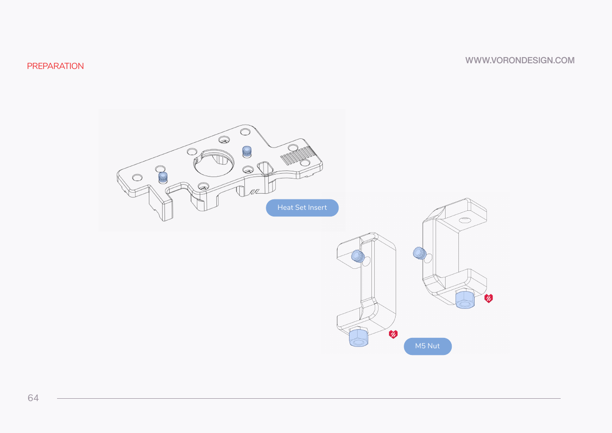{ crop="0.11 0.24 0.56 0.56" }

**What you're looking at:** A **heat-set insert** is a brass sleeve with a thread inside, pressed in hot so the plastic melts around it. This chapter needs four: two in `a_drive_frame_upper`, one in each tension arm. Only that drive frame has insert holes, so two blind 4.7 mm holes beside the motor bore (the big round hole) mark the A part.

**Parts:**

- M3×5×4 brass heat-set insert ×2
- `a_drive_frame_upper` ×1
- tool: Nutopress Pro insert press, its M3 tip

**Do:**

1. Find the two blind 4.7 mm bosses either side of the motor bore on `a_drive_frame_upper`, about 56 mm apart.
2. With the press at the temperature on its tape label and the part flat, lower each insert to the stop. Let the part cool.

**Check:** both inserts sit flush and square. `b_drive_frame_upper` takes **no** inserts: a frame with bosses is the A frame.

⚠ The press tip and a freshly set insert both burn. Raise and park the head between inserts, keep the bench ventilated, and hold parts by the far edge until they cool.

If you ran the B03 insert pass that Step 00.16 plans, just confirm the two inserts are there and move on.

Source: [Voron manual p.64](https://github.com/VoronDesign/Voron-2/blob/de7e89d/Manual/Assembly_Manual_2.4r2.pdf#page=64) · [LDO heat-set insert tool guide](https://docs.ldomotors.com/guides/heatset_insert_tool_guide)

---

### Step 04.4 — Heat-set one insert into each tension arm

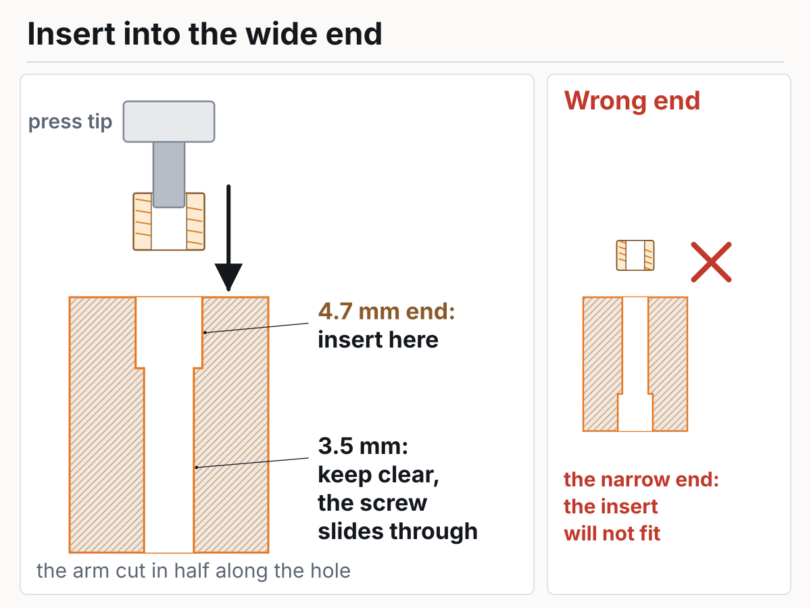
{ crop="0.43 0.445 0.81 0.83" }

**What you're looking at:** The blue **tension arms** are C-shaped levers that carry each front idler's bearing stack; pulling one forward tightens a belt. Each has a top boss with a **counterbore**, a wider recess for the M5×40 head, a foot with a pocket for the M5 nut, and a back wall with one stepped hole.

**Parts:**

- M3×5×4 brass heat-set insert ×2
- `[a]_tensioner_left` ×1
- `[a]_tensioner_right` ×1
- tool: Nutopress Pro insert press, its M3 tip

**Do:** Each arm has one hole straight through, stepping from 3.5 mm to 4.7 mm. Press the insert into the **4.7 mm end**, the wider opening. The 3.5 mm part is the M3×40's clearance hole and must stay clear.

**Check:** an M3×40 SHCS, pushed in by hand from the plain 3.5 mm end, slides through freely and catches a thread only at the insert.

⚠ The press tip and a freshly set insert both burn. Raise and park the head between inserts, keep the bench ventilated, hold parts by the far edge until they cool, and switch the press off between sessions.

Source: [Voron manual p.64](https://github.com/VoronDesign/Voron-2/blob/de7e89d/Manual/Assembly_Manual_2.4r2.pdf#page=64) · [LDO heat-set insert tool guide](https://docs.ldomotors.com/guides/heatset_insert_tool_guide)

---

### Step 04.5 — Press an M5 nut into each tension arm foot

{ crop="0.53 0.58 0.81 0.83" }

**What you're looking at:** An M5 hex nut drops into a pocket in the foot of each tension arm. The upright M5×40 axle later threads into that trapped nut, so the bearing stack rides on it inside the arm and moves with it.

**Parts:**

- M5 hex nut ×2
- reused: both tension arms
- tool: small flat screwdriver

**Do:** Drop an M5 nut into the hex pocket on the underside of each arm's foot. Seat it fully with a flat screwdriver. It must sit flush with the surface or below it, never sticking out, or the arm will not lie flat.

**Check:** each nut sits without rocking and does not stand above the foot. Nothing holds it in yet, so keep the arms lying flat.

Source: [Voron manual p.64](https://github.com/VoronDesign/Voron-2/blob/de7e89d/Manual/Assembly_Manual_2.4r2.pdf#page=64)

Pause: ~30 min since the last pause — the bench is split into four labelled kits and every part has its corner written on it in marker. The two inserts are in `a_drive_frame_upper`, one is in each tension arm, and both M5 nuts are seated. Switch off and unplug the insert press, and the iron if you used it. Nothing is stacked yet.

---

### Step 04.6 — A idler: stand the assembly-aid bolt in the lower frame

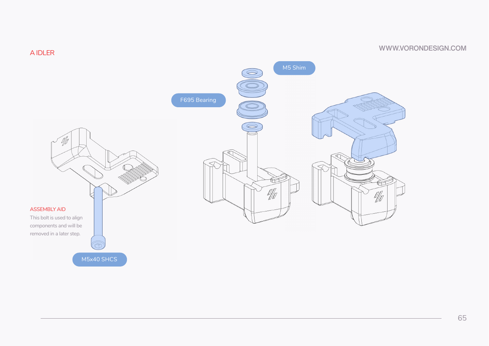{ crop="0.05 0.33 0.34 0.78" }
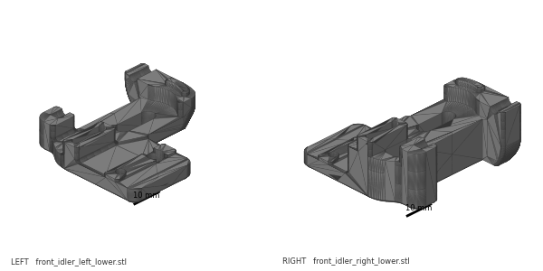

**What you're looking at:** The A idler, front right, starts with `front_idler_right_lower`, the taller of the two lower frames: 21.6 mm against 11.6 mm. The M5×40 you stand in its boss is not holding anything yet. It is a temporary spindle that keeps the bearing stack lined up while you build it.

**Parts:**

- `front_idler_right_lower` ×1
- M5×40 SHCS ×1

**Do:** Lay `front_idler_right_lower` flat with its idler boss facing up. Push the M5×40 SHCS up through the boss from underneath so the thread stands straight up. It is only an alignment aid and comes out again at Step 04.9.

**Check:** the screw stands square to the frame with its head fully seated underneath. If it leans, the stack will not seat.

Source: [Voron manual p.65](https://github.com/VoronDesign/Voron-2/blob/de7e89d/Manual/Assembly_Manual_2.4r2.pdf#page=65)

---

### Step 04.7 — A idler: build the bearing stack

{ crop="0.34 0.16 0.64 0.74" }
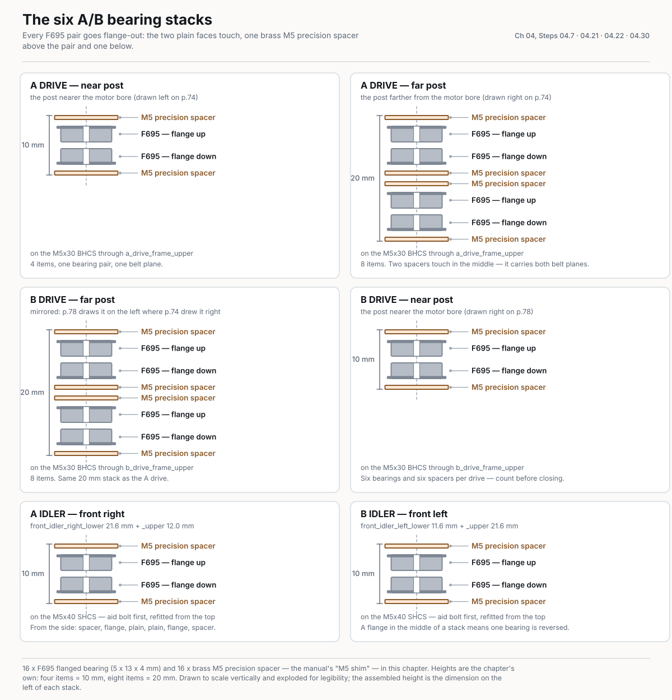

**What you're looking at:** An **F695** is a small ball bearing, 5 × 13 × 4 mm, with a rim, the **flange**, on one face. Two of them fitted plain face to plain face point their flanges outward and make a groove one belt wide. A brass **precision spacer** at each end sets the height of the stack.

**Parts:**

- 2× M5 precision spacer
- 2× F695 bearing

**Do:** Thread these onto the standing screw, **bottom to top**: an M5 precision spacer, an F695 **flange down**, an F695 **flange up**, and another M5 precision spacer. The two bearings meet plain face to plain face, with their flanges pointing outward.

**Check:** the stack, seen from the side, reads spacer, flange, plain, plain, flange, spacer, and each bearing spins freely on its own.

The Voron manual calls this part an "M5 Shim". In this kit it is the brass **M5 precision spacer**: one wherever the manual draws a shim, never two stacked to make up height. [src](https://docs.ldomotors.com/en/voron/voron2/build-faq)

Source: [Voron manual p.65](https://github.com/VoronDesign/Voron-2/blob/de7e89d/Manual/Assembly_Manual_2.4r2.pdf#page=65) · [LDO Build Notes (Rev D)](https://docs.ldomotors.com/voron/voron2/build-faq) · [Video: Part 3 @0:59:21](https://www.youtube.com/watch?v=ii14-2COjuA&list=PL0fUJbigELQPqpeGOgHYisG4KaSXVtnNY&t=3561s)

---

### Step 04.8 — A idler: cap the stack with the upper frame

{ crop="0.62 0.21 0.88 0.76" }

**What you're looking at:** `front_idler_right_upper`, the 12.0 mm-tall cap, holds the top spacer and closes the frame around the bearing pair. If the two halves meet with no gap, nothing inside is out of place.

**Parts:**

- `front_idler_right_upper` ×1

**Do:** Lower `front_idler_right_upper` over the stack so its nose holds the top spacer and the two frames meet along their matching faces.

**Check:** the two frames sit tight together, with no gap and no rocking. A gap means a spacer or bearing is out of place.

Source: [Voron manual p.65](https://github.com/VoronDesign/Voron-2/blob/de7e89d/Manual/Assembly_Manual_2.4r2.pdf#page=65) · [Video: Part 3 @1:06:14](https://www.youtube.com/watch?v=ii14-2COjuA&list=PL0fUJbigELQPqpeGOgHYisG4KaSXVtnNY&t=3974s)

---

### Step 04.9 — A idler: pull the aid bolt and slide in the tension arm

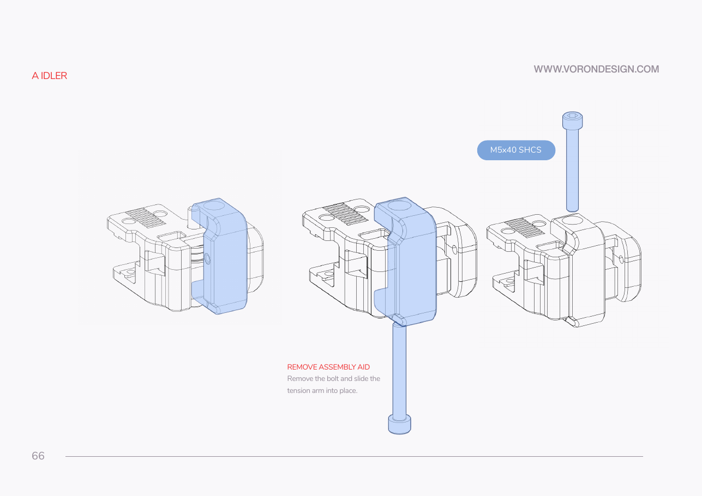{ crop="0.11 0.30 0.62 0.88" }
![`[a]_tensioner_left` vs `[a]_tensioner_right` — mirrors, same camera](assets/parts/pair-tensioner.png)

**What you're looking at:** The temporary screw comes out, and the blue `[a]_tensioner_right` slides into the slot between the two idler frames. The two arms are mirror images, the same C turned the other way, and the wrong one will not lie flat in the slot.

**Parts:**

- reused: `[a]_tensioner_right`, insert and M5 nut fitted

**Do:** Pinch the two frames together and pull the M5×40 SHCS out downward. Slide `[a]_tensioner_right` into the slot until its top boss lines up with the hole in the upper frame. Keep pinching, because nothing holds the stack now.

**Check:** the arm lies flat in the slot and its top boss is centred on the frame's top hole. If it fights you, it is `[a]_tensioner_left`.

**Helper:** Pinches the two idler frames together while you swap the bolt for the arm.

Source: [Voron manual p.66](https://github.com/VoronDesign/Voron-2/blob/de7e89d/Manual/Assembly_Manual_2.4r2.pdf#page=66)

---

### Step 04.10 — A idler: refit the M5×40 SHCS from the top

{ crop="0.62 0.17 0.93 0.75" }

**What you're looking at:** The same M5×40 goes back in from the top as the idler's **axle**. Its head sits in the arm's top boss and its thread runs into the nut in the foot, so the bearing stack rides on it and slides with the arm. It is not the tensioner.

**Parts:**

- reused: the same M5×40 SHCS

**Do:** Drop the M5×40 SHCS in from the **top**, through the arm's top boss, and screw it into the M5 nut in the foot until the head seats, then stop. If the arm will not slide, back it off a quarter turn.

**Check:** the head is seated in the arm's top boss, both bearings spin freely, and the arm still slides forward and back in the frame's slots (verify on bench).

The manual gives no torque for this screw. In the Voron CAD model the arm wraps round the two frames with only about 0.2 mm to spare each side, so cranking the screw pinches them and the arm cannot slide.

Source: [Voron manual p.66](https://github.com/VoronDesign/Voron-2/blob/de7e89d/Manual/Assembly_Manual_2.4r2.pdf#page=66)

---

### Step 04.11 — A idler: fit the M3 washer and M3×40 SHCS

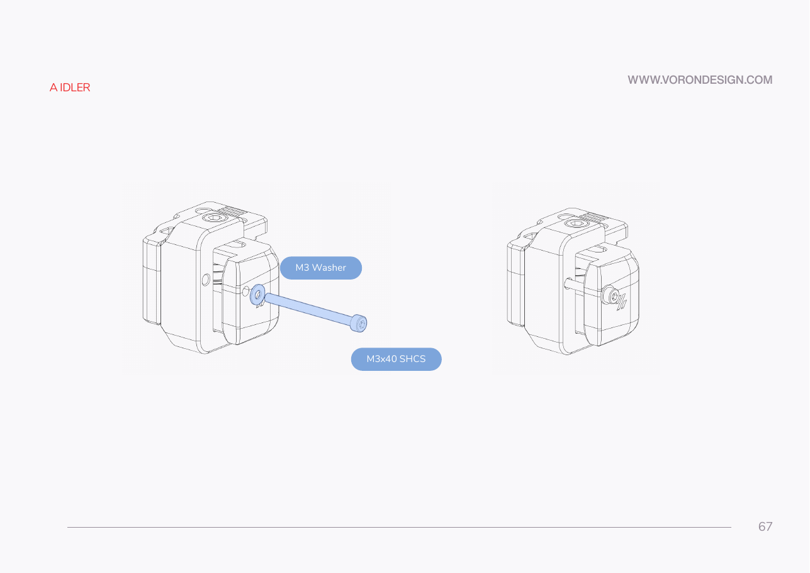

**What you're looking at:** The M3×40 goes in through the idler frame's front wall and threads into the insert in the arm's back wall. It is the belt **tensioner**: turning it in pulls the arm toward the wall. It does not clamp the frame halves.

**Parts:**

- 1× M3 washer
- 1× M3×40 SHCS

**Do:**

1. Put the washer under the head. Push the screw in level, front to back, through the frame's front wall, the face away from the extrusion, and into the arm's insert.
2. Turn it in only until the arm meets the wall and the screw is snug. Step 07.5 sets the tension.

**Check:** the screw is snug, not torqued (not specified — snug), with the arm against the wall, the washer trapped and the head flat on the frame.

Drawing the arm to the wall only parks it so it cannot slide about. It is not the belt tension, which is set with the belt on after the screw is backed out.

Source: [Voron manual p.67](https://github.com/VoronDesign/Voron-2/blob/de7e89d/Manual/Assembly_Manual_2.4r2.pdf#page=67) · [Video: Part 3 @1:07:00](https://www.youtube.com/watch?v=ii14-2COjuA&list=PL0fUJbigELQPqpeGOgHYisG4KaSXVtnNY&t=4020s)

---

### Step 04.12 — A idler: check your work

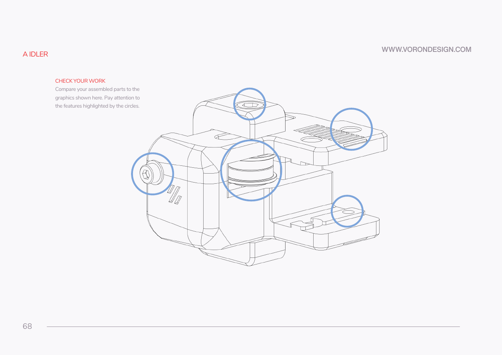

**What you're looking at:** The Voron manual circles five features on the finished A idler. Together they confirm that the axle, the tensioner, the bearing pair and the frame halves are all where they belong.

**Parts:** none.

**Do:**

1. Compare your idler with the five circled features on p.68: the axle head in the arm's boss; the ribbed upper frame; the bearing pair, flanges out; the M3×40 head and washer on the **frame's** side; the mounting hole in the lower frame's flat flange.
2. Put it in the **A IDLER** tray.

**Check:** all five features match the page, and the bearing pair spins freely under a fingertip with the frames closed.

**Helper:** Points to each circled feature on the page while you find it on the idler.

Source: [Voron manual p.68](https://github.com/VoronDesign/Voron-2/blob/de7e89d/Manual/Assembly_Manual_2.4r2.pdf#page=68)

Pause: ~40 min since the last pause — the A (front right) idler is complete and checked against p.68: bearings flange-out, the M5×40 axle in from the top and seated in the arm's nut, and the M3×40 tensioner with its washer snug. An idler is a self-contained unit; never stop with the temporary screw pulled out and the stack unsupported.

---

### Step 04.13 — B idler: stand the assembly-aid bolt in the lower frame

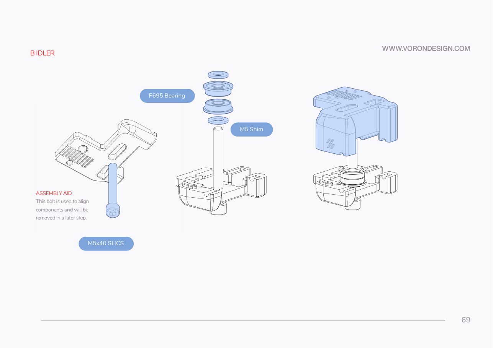{ crop="0.06 0.30 0.34 0.74" }

**What you're looking at:** The B idler, front left, starts with `front_idler_left_lower`, the **short** lower frame at 11.6 mm, so its bearing stack sits lower. That is why the B belt runs on a lower level than the A belt.

**Parts:**

- `front_idler_left_lower` ×1
- M5×40 SHCS ×1

**Do:** Lay `front_idler_left_lower` flat with its idler boss facing up, and push the M5×40 SHCS up through it from underneath. The B idler's boss is lower than the A idler's; that is correct.

**Check:** the screw stands straight up with its head fully seated. If the boss looks tall like the last one, you have the A idler's lower frame.

Source: [Voron manual p.69](https://github.com/VoronDesign/Voron-2/blob/de7e89d/Manual/Assembly_Manual_2.4r2.pdf#page=69)

---

### Step 04.14 — B idler: build the bearing stack

{ crop="0.27 0.17 0.58 0.64" }

**What you're looking at:** The same four-piece stack as on the A idler: spacer, F695 flange down, F695 flange up, spacer. The hardware is identical; only the frame height differs.

**Parts:**

- 2× M5 precision spacer
- 2× F695 bearing

**Do:** Bottom to top: an M5 precision spacer, an F695 **flange down**, an F695 **flange up**, and another M5 precision spacer, exactly as on the A idler.

**Check:** no flange shows in the middle of the stack, and both bearings spin freely.

Again, the brass **M5 precision spacer** takes the place of the manual's "M5 shim". [src](https://docs.ldomotors.com/en/voron/voron2/build-faq)

Source: [Voron manual p.69](https://github.com/VoronDesign/Voron-2/blob/de7e89d/Manual/Assembly_Manual_2.4r2.pdf#page=69) · [LDO Build Notes (Rev D)](https://docs.ldomotors.com/voron/voron2/build-faq) · [Video: Part 3 @1:23:36](https://www.youtube.com/watch?v=ii14-2COjuA&list=PL0fUJbigELQPqpeGOgHYisG4KaSXVtnNY&t=5016s)

---

### Step 04.15 — B idler: cap the stack with the upper frame

{ crop="0.60 0.17 0.82 0.64" }
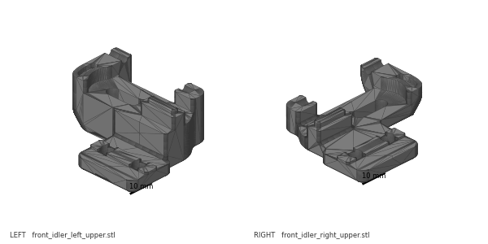

**What you're looking at:** `front_idler_left_upper` is the tall upper frame, 21.6 mm, where the A idler's upper frame was short. Each idler pairs one tall half with one short half, so two tall halves, or two short ones, on one idler means the uppers are swapped.

**Parts:**

- `front_idler_left_upper` ×1

**Do:** Lower `front_idler_left_upper` over the stack until the two frames meet.

**Check:** the frames sit flush, with no gap and no rocking.

Source: [Voron manual p.69](https://github.com/VoronDesign/Voron-2/blob/de7e89d/Manual/Assembly_Manual_2.4r2.pdf#page=69)

---

### Step 04.16 — B idler: pull the aid bolt and slide in the tension arm

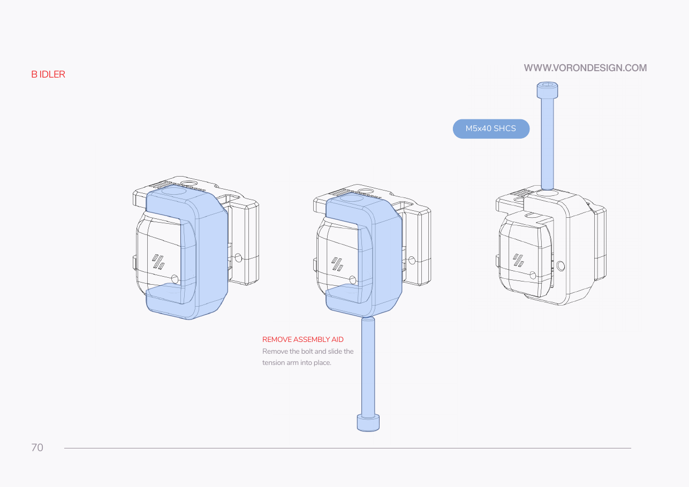{ crop="0.10 0.30 0.60 0.95" }

**What you're looking at:** `[a]_tensioner_left` goes into the B idler's slot, the mirror image of Step 04.9.

**Parts:**

- reused: `[a]_tensioner_left`, insert and M5 nut fitted

**Do:** Pinch the frames together, pull the M5×40 SHCS out downward, and slide `[a]_tensioner_left` into the slot until its top boss lines up with the frame's top hole.

**Check:** the arm lies flat in the slot and its boss is centred on the hole above it.

**Helper:** Pinches the two idler frames together while you swap the bolt for the arm.

Source: [Voron manual p.70](https://github.com/VoronDesign/Voron-2/blob/de7e89d/Manual/Assembly_Manual_2.4r2.pdf#page=70)

---

### Step 04.17 — B idler: refit the M5×40 SHCS from the top

{ crop="0.59 0.155 0.84 0.66" }

**What you're looking at:** The M5×40 axle goes back in from the top, through the arm's top boss into its trapped nut, the mirror of the A idler. It is the axle, not the tensioner, and it is seated, not cranked.

**Parts:**

- reused: the same M5×40 SHCS

**Do:** Drop it in from the top, through the arm's top boss, and screw it into the M5 nut in the arm's foot until the head seats, then stop, as on the A idler. If the arm will not slide, back it off a quarter turn.

**Check:** the head is seated in the top boss, both bearings spin freely, and the arm still slides forward and back in the frame's slots (verify on bench).

Source: [Voron manual p.70](https://github.com/VoronDesign/Voron-2/blob/de7e89d/Manual/Assembly_Manual_2.4r2.pdf#page=70)

---

### Step 04.18 — B idler: fit the M3 washer and M3×40 SHCS

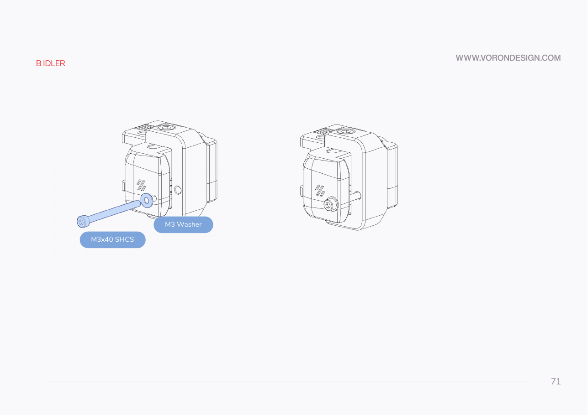

**What you're looking at:** The M3×40 tensioner and its washer go through the B idler frame's front wall into the arm's insert, the mirror of the A idler.

**Parts:**

- 1× M3 washer
- 1× M3×40 SHCS

**Do:** Put the washer under the head and push the screw in through the frame's front wall, the face away from the extrusion, into the arm's insert. Turn it until the arm is drawn up to the wall and the screw is snug: a parking spot only, which Step 07.5 backs out before the belt is tensioned.

**Check:** the screw is snug, not torqued (not specified — snug), with its head flat and the washer trapped.

Source: [Voron manual p.71](https://github.com/VoronDesign/Voron-2/blob/de7e89d/Manual/Assembly_Manual_2.4r2.pdf#page=71)

---

### Step 04.19 — B idler: check your work

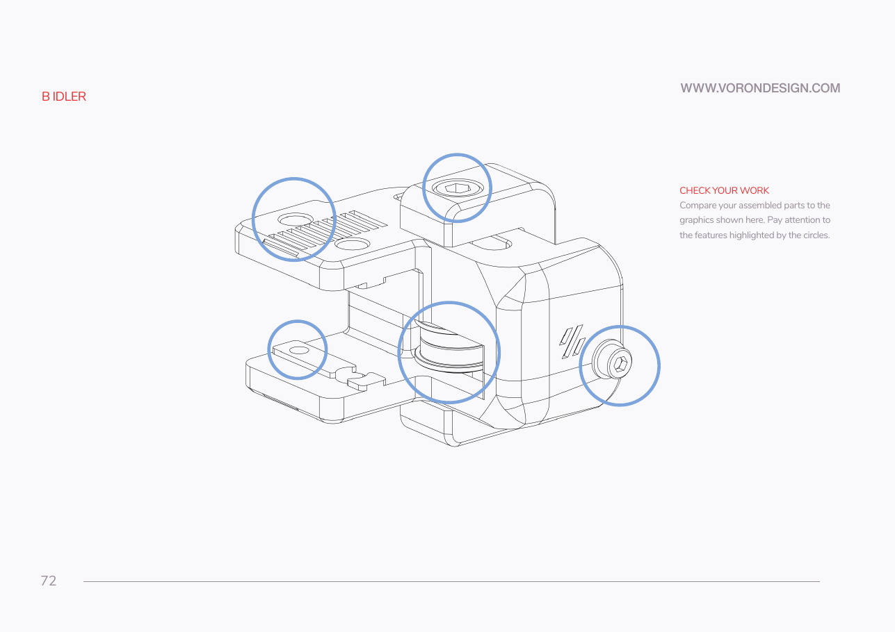

**What you're looking at:** The finished B idler has five circled features in the manual, plus one more test that catches a mixed-up pair: the two idlers side by side. Their bearing pairs sit at visibly different heights, and that difference is the gap between the two belt levels.

**Parts:** none.

**Do:**

1. Match the five circled features on p.72: the ribbed face, the M5×40 head in the top boss, the exposed bearing pair, the M3×40 head with its washer, and the mounting hole in the lower frame's flat flange.
2. Put it in the **B IDLER** tray.

**Check:** all five features match and the bearings spin freely. Held side by side, the two idlers' bearing pairs sit at visibly different heights.

**Helper:** Points to each circled feature on the page while you find it on the idler.

Source: [Voron manual p.72](https://github.com/VoronDesign/Voron-2/blob/de7e89d/Manual/Assembly_Manual_2.4r2.pdf#page=72)

Pause: ~35 min since the last pause — the B (front left) idler is complete and checked against p.72, and the two idlers sit side by side with visibly different bearing heights. Both are in their trays. Nothing is open.

---

### Step 04.20 — A drive: upper frame face down, two M5×30 BHCS

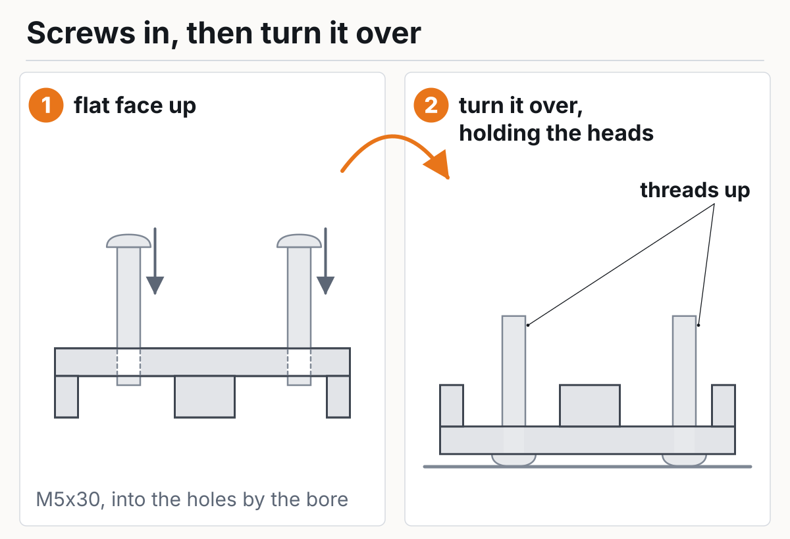
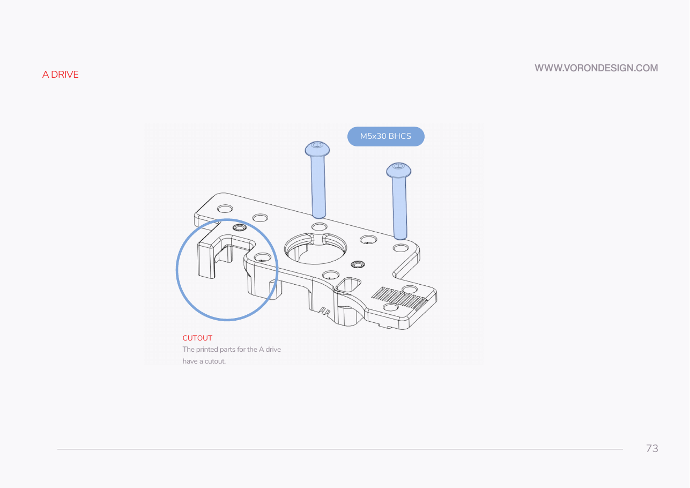


**What you're looking at:** The drive is built upside down. `a_drive_frame_upper` lies flat face down, resting on the heads of the two M5×30 screws, which stand up as the axles the bearing stacks thread onto. There is no printed pillar: what the manual calls a post is the standing screw.

**Parts:**

- reused: `a_drive_frame_upper`, inserts fitted
- M5×30 BHCS ×2

**Do:**

1. With the frame's flat face **up**, check it is the A part: two heat-set inserts in that face and the **cutout** circled on p.73. Drop the two M5×30 BHCS in from that face, into the 5.4 mm holes beside the motor bore, 37 mm apart.
2. Turn the frame over, holding the heads, so the threads stand up.

**Check:** both screws stand square, and the frame rests level on their two heads.

Source: [Voron manual p.73](https://github.com/VoronDesign/Voron-2/blob/de7e89d/Manual/Assembly_Manual_2.4r2.pdf#page=73) · [Video: Part 3 @1:04:59](https://www.youtube.com/watch?v=ii14-2COjuA&list=PL0fUJbigELQPqpeGOgHYisG4KaSXVtnNY&t=3899s)

---

### Step 04.21 — A drive: two-bearing stack on the near post

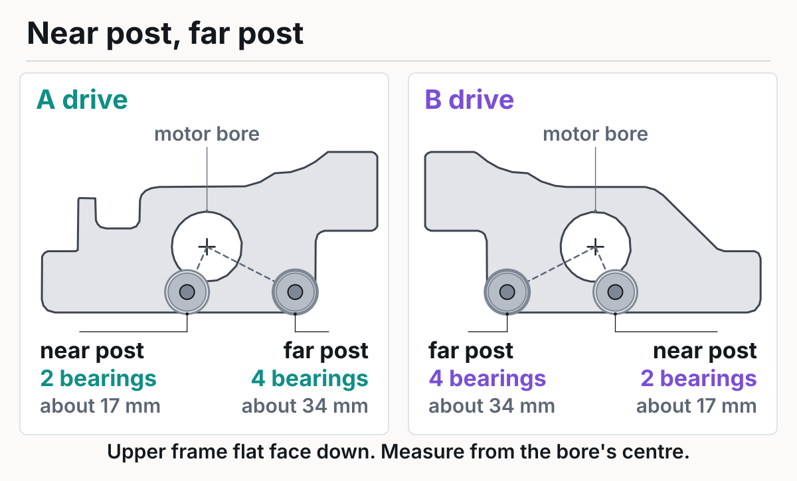
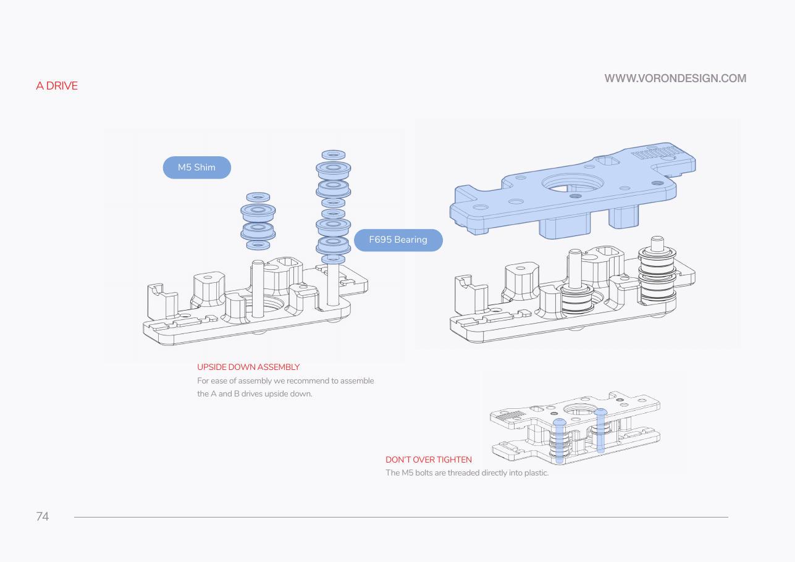{ crop="0.12 0.17 0.52 0.805" }

**What you're looking at:** The post **nearer** the motor bore takes one bearing pair: spacer, two F695 flanges outward, spacer. This post carries only one belt, so it takes half the stack of the other one.

**Parts:**

- 2× M5 precision spacer
- 2× F695 bearing

**Do:**

1. Work on the **near** screw, about 17 mm from the centre of the motor bore; the far one is about 34 mm away. Measure if the drawing is unclear.
2. Bottom to top: an M5 precision spacer, an F695 **flange down**, an F695 **flange up**, and another M5 precision spacer.

**Check:** one pair, flanges outward, with one spacer at each end: four pieces and 10 mm of stack. Four bearings here means the wrong screw.

The brass **M5 precision spacer** again takes the place of the manual's "M5 shim". [src](https://docs.ldomotors.com/en/voron/voron2/build-faq)

Source: [Voron manual p.74](https://github.com/VoronDesign/Voron-2/blob/de7e89d/Manual/Assembly_Manual_2.4r2.pdf#page=74) · [LDO Build Notes (Rev D)](https://docs.ldomotors.com/voron/voron2/build-faq)

---

### Step 04.22 — A drive: four-bearing stack on the far post

{ crop="0.36 0.25 0.555 0.62" }


**What you're looking at:** The post **farther** from the motor bore takes two pairs. Both belts pass through this drive, so it needs two grooves stacked, with two spacers meeting in the middle between them. It is the most often mis-stacked assembly in the build.

**Parts:**

- 4× M5 precision spacer
- 4× F695 bearing

**Do:**

1. Work on the **far** screw, about 34 mm from the centre of the motor bore. Measure if in doubt.
2. Load two pairs, bottom to top: spacer, F695 **flange down**, F695 **flange up**, spacer, spacer, F695 **flange down**, F695 **flange up**, spacer.

**Check:** eight pieces and 20 mm of stack, exactly **two** spacers touching in the middle, and no flange facing another flange.

**Helper:** Reads the eight-item stack order aloud and hands you each part in turn.

All four "M5 shims" the manual draws here are brass **M5 precision spacers**. [src](https://docs.ldomotors.com/en/voron/voron2/build-faq)

Source: [Voron manual p.74](https://github.com/VoronDesign/Voron-2/blob/de7e89d/Manual/Assembly_Manual_2.4r2.pdf#page=74) · [LDO Build Notes (Rev D)](https://docs.ldomotors.com/voron/voron2/build-faq)

---

### Step 04.23 — A drive: close it with `a_drive_frame_lower`

{ crop="0.48 0.17 0.91 0.91" }


**What you're looking at:** `a_drive_frame_lower`, the other half of the printed frame, closes over both posts. The M5×30 screws thread straight into the plastic of the lower frame, so you stop when the frames are closed and the screws snug, not torqued.

**Parts:**

- `a_drive_frame_lower` ×1

**Do:**

1. Lower `a_drive_frame_lower` onto both stacks, lining the M5×30 threads up with their blind holes.
2. Squeeze the two frames together and turn the drive over, so the screw heads are on top. Turn the two screws down alternately, two turns at a time, until the frames meet.
3. **Do not over-tighten: these screws thread into plastic.**

**Check:** both bearing pairs still spin freely with the frames closed, and neither screw went past closed and snug.

Source: [Voron manual p.74](https://github.com/VoronDesign/Voron-2/blob/de7e89d/Manual/Assembly_Manual_2.4r2.pdf#page=74)

Pause: ~25 min since the last pause — the A drive frames are closed snug over both bearing stacks; the motor and pulley are not fitted yet. Put the closed frame in the **A DRIVE** tray; never stop with a stack loaded and the lower frame off.

---

### Step 04.24 — A drive: set the pulley on the A motor at 16.5 mm

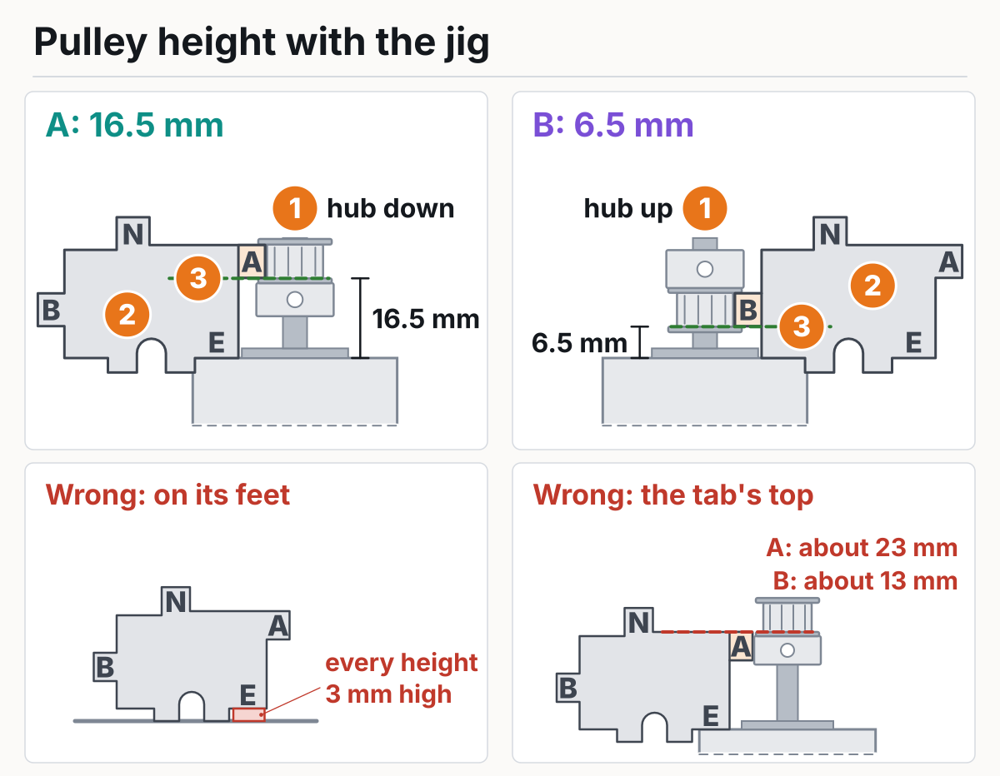
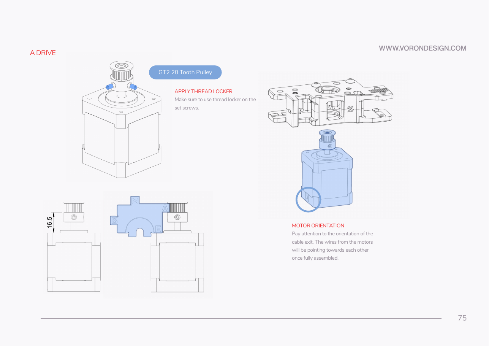{ crop="0.08 0.54 0.43 0.86" }


**What you're looking at:** The A motor gets its 20-tooth, 6 mm-wide **pulley**, the toothed wheel that drives the belt. Its height lines the belt up with the A idler's bearings; the jig's **A** tab sets it.

**Parts:**

- stepper motor, 0.9° A/B ×1
- GT2 20 T 6 mm pulley ×1
- tool: printed `pulley_jig.stl`
- tool: caliper

**Do:**

1. Slide the pulley on **hub first, teeth up**; the hub is the collar with the set screws.
2. Stand the jig on the motor face beside the pulley, letters upright, **A** tab toward it.
3. Slide the pulley down until its teeth underside is level with the **A** tab underside.

**Check:** the caliper reads 16.5 mm, motor face to teeth underside, hub down. About 23 mm means the teeth matched the tab's top, not its underside; about 19.5 mm, the jig stood on its feet.

**Helper:** Reads the caliper aloud while you slide the pulley along the shaft.

Stand the jig on its long bottom edge on the flat of the motor face, beside the motor's raised centring ring round the shaft, never on that ring. The two short feet by the jig's slot hang off the edge of the motor; if the jig stands on them, every height reads 3 mm high. Without the jig, set 16.5 mm with a caliper.

The two A/B motors are **0.9°** (`LDO-42STH48-2004MAH(VRN)`); the four Z motors are 1.8° and look the same. Read the label: **-2004MAH** is A/B (0.9°), **-2004AC** is Z (1.8°), so take an A/B motor, not a spare Z motor. This is why the LDO config carries `full_steps_per_rotation: 400` in `[stepper_x]` and `[stepper_y]`, set in Ch 12. [src](https://github.com/MotorDynamicsLab/LDOVoron2/blob/main/Firmware/leviathan-printer-rev-d-sbv2.cfg)

Source: [Voron manual p.75](https://github.com/VoronDesign/Voron-2/blob/de7e89d/Manual/Assembly_Manual_2.4r2.pdf#page=75) · [LDO Klipper config `leviathan-printer-rev-d-sbv2.cfg`](https://raw.githubusercontent.com/MotorDynamicsLab/LDOVoron2/667521d/Firmware/leviathan-printer-rev-d-sbv2.cfg) · [LDO 350 Rev D+ BOM](https://docs.ldomotors.com/en/voron/voron2/350_BOM/Rev_D+) · [Video: Part 3 @1:11:48](https://www.youtube.com/watch?v=ii14-2COjuA&list=PL0fUJbigELQPqpeGOgHYisG4KaSXVtnNY&t=4308s)

---

### Step 04.25 — A drive: threadlock and lock the pulley set screws

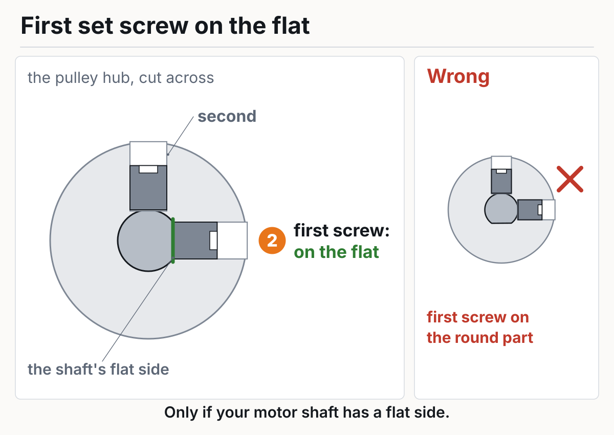
{ crop="0.15 0.17 0.54 0.52" }

**What you're looking at:** Two **set screws**, small headless screws in the hub, lock the pulley to the shaft. A loose one lets the pulley slip, which shows up as prints that drift diagonally, not as an obvious failure.

**Parts:**

- reused: the pulley's two set screws
- consumable: Loctite 243
- tool: 1.5 mm hex key

**Do:**

1. Leave the jig in place: its tab holds the height. Take out one set screw and put a drop of Loctite 243 on it unless it has a blue patch.
2. If the shaft has a flat side, turn the pulley so the screw hole faces it. Refit the screw and tighten it.
3. Do the same with the second screw where it lands, then check the height again.

**Check:** the pulley will not twist or slide under firm hand pressure and reads 16.5 mm.

Page 75 asks only for threadlocker. The flat rule is the manual's own, from its Z motor page: at least one set screw must touch the flat section of the shaft. [src](https://github.com/VoronDesign/Voron-2/blob/de7e89d/Manual/Assembly_Manual_2.4r2.pdf#page=38)

Source: [Voron manual p.75](https://github.com/VoronDesign/Voron-2/blob/de7e89d/Manual/Assembly_Manual_2.4r2.pdf#page=75)

---

### Step 04.26 — A drive: offer the motor up with the cable exit inboard

{ crop="0.53 0.20 0.81 0.77" }

**What you're looking at:** The motor goes into the frame, which is the right way up now. The manual's rule is that the two motors' cables point at each other once both drives are on the machine, so both reach the same cable duct.

**Parts:**

- reused: the A motor with its pulley

**Do:** Keep the drive the right way up, screw heads on top, and fit the motor into the frame from below with the **cable exit facing inboard**: toward the middle of the rear extrusion, where the B drive sits.

**Check:** with A at the rear right, its motor cable exits toward the middle of the machine, not out toward the right skirt.

Source: [Voron manual p.75](https://github.com/VoronDesign/Voron-2/blob/de7e89d/Manual/Assembly_Manual_2.4r2.pdf#page=75) · [Video: Part 3 @1:07:37](https://www.youtube.com/watch?v=ii14-2COjuA&list=PL0fUJbigELQPqpeGOgHYisG4KaSXVtnNY&t=4057s)

---

### Step 04.27 — A drive: three M3×30 SHCS through the frames into the motor

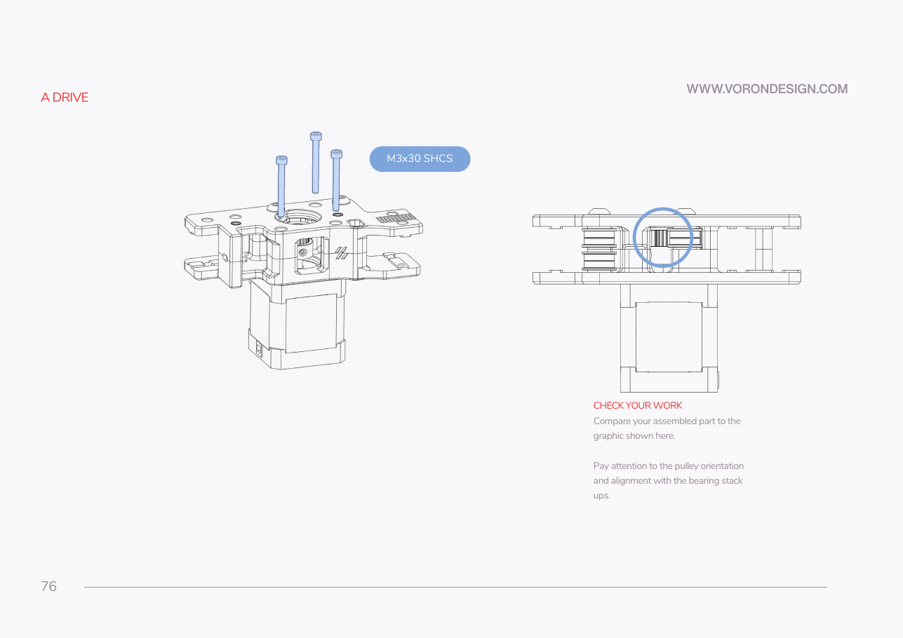{ crop="0.19 0.19 0.53 0.59" }

**What you're looking at:** Three M3×30 screws run down through both printed frames into the motor's face. Three, not four: the fourth motor hole has no clearance hole above it.

**Parts:**

- 3× M3×30 SHCS

**Do:**

1. Line the motor's mounting holes up with the three clearance holes around the motor bore.
2. Start all three M3×30 SHCS by hand, down through both frames into the motor.
3. Tighten them evenly, so they draw the motor up flat against the underside of the frame.

**Check:** three screws are in, not four, and the fourth motor hole stays empty. All three are tightened evenly and the motor face sits flat against the frame.

Source: [Voron manual p.76](https://github.com/VoronDesign/Voron-2/blob/de7e89d/Manual/Assembly_Manual_2.4r2.pdf#page=76) · [Video: Part 3 @1:13:34](https://www.youtube.com/watch?v=ii14-2COjuA&list=PL0fUJbigELQPqpeGOgHYisG4KaSXVtnNY&t=4414s)

---

### Step 04.28 — A drive: check your work and the belt path

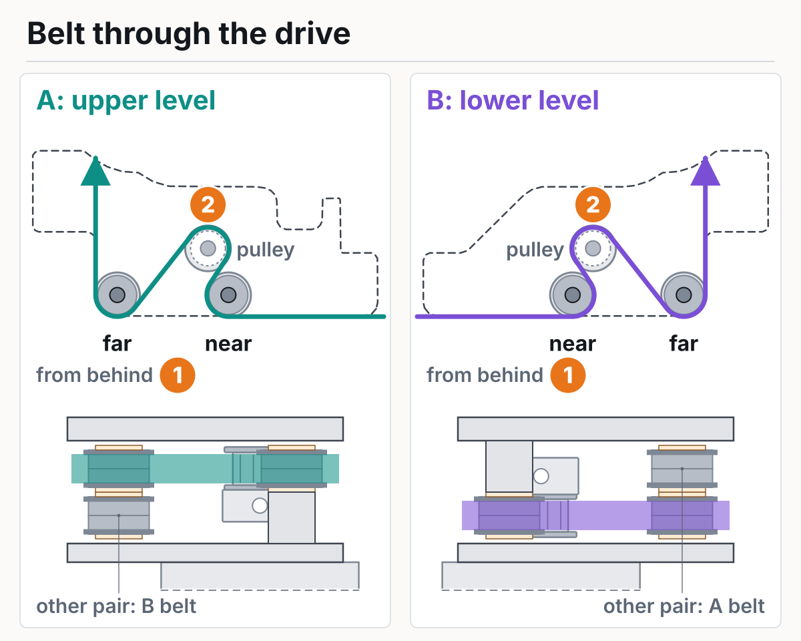
{ crop="0.58 0.30 0.90 0.80" }

**What you're looking at:** The A pulley runs on the **upper** belt level, in line with the near pair and the far post's upper pair. The belt's free end checks it.

**Parts:**

- tool: free end of the 6 mm belt reel, uncut
- consumable: masking tape
- tool: marker

**Do:**

1. Motor at the bottom, hold the drive with its cable exit on your right, as p.76 draws it from behind, and compare: the pulley sits on the upper level, in line with the near pair.
2. Run the belt end the way it will go: round the near pair, teeth round the pulley, and round the far post's **upper** pair.
3. Label the drive **A: REAR RIGHT**.

**Check:** the belt lies flat and level on the pulley, the near pair and the far post's **upper** pair, not riding up onto any flange.

**Helper:** Sights along the belt at eye level and says if it tilts.

The far post's lower pair sits 10 mm below the belt. That is correct: it carries the B belt, so leave that stack alone.

Source: [Voron manual p.76](https://github.com/VoronDesign/Voron-2/blob/de7e89d/Manual/Assembly_Manual_2.4r2.pdf#page=76) · [Video: Part 5 @1:12:36](https://www.youtube.com/watch?v=hTKCBrk36R0&list=PL0fUJbigELQPqpeGOgHYisG4KaSXVtnNY&t=4356s)

Pause: ~25 min since the last pause — the A drive is finished: a 2-bearing near post, a 4-bearing far post, frames closed snug, the pulley at 16.5 mm hub-down and threadlocked, the motor in with three M3×30 and its cable exit inboard, and the belt path checked straight. It is labelled **A: REAR RIGHT**. This is the natural stop; do not leave a bearing stack loaded with the lower frame off.

---

### Step 04.29 — B drive: upper frame face down, two M5×30 BHCS


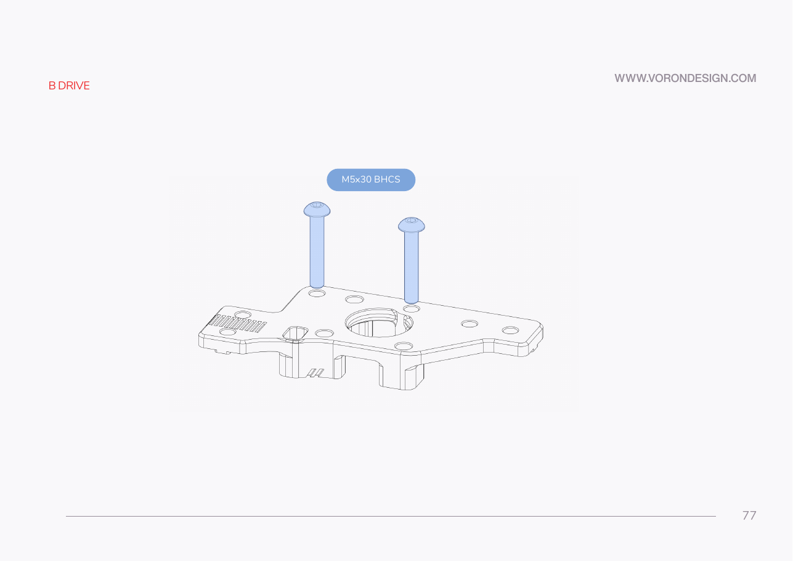
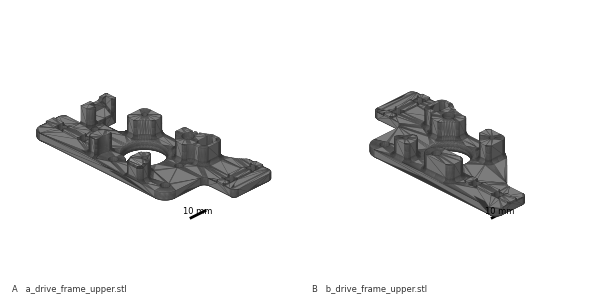

**What you're looking at:** `b_drive_frame_upper` goes on the bench the same upside-down way. This is the B part, with **no cutout lobe on the base plate and no insert bosses**. If you see either, you picked up the A frame.

**Parts:**

- `b_drive_frame_upper` ×1
- M5×30 BHCS ×2

**Do:**

1. As at Step 04.20, with the flat face up, check it is the B part: **no heat-set inserts** in that face and **no cutout**. Drop an M5×30 BHCS into each of the two 5.4 mm holes.
2. Turn the frame over, holding the heads, so they are underneath and the threads stand up.

**Check:** both screws stand square, and the frame rests level on their two heads.

Source: [Voron manual p.77](https://github.com/VoronDesign/Voron-2/blob/de7e89d/Manual/Assembly_Manual_2.4r2.pdf#page=77)

---

### Step 04.30 — B drive: four-bearing stack on the far post


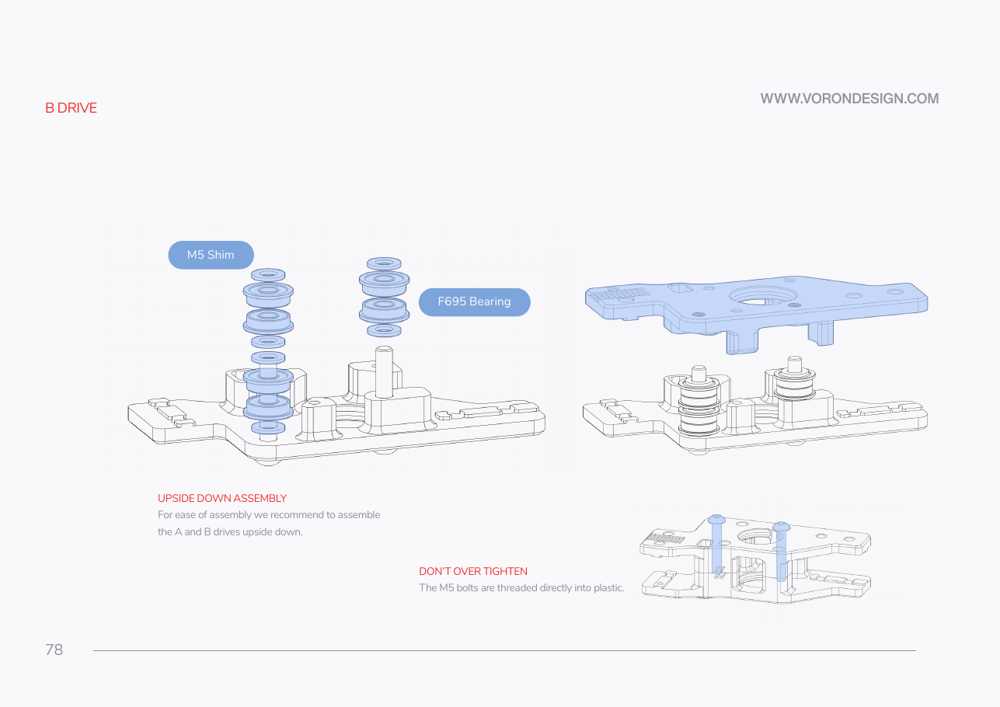{ crop="0.12 0.30 0.55 0.78" }

**What you're looking at:** On the B frame the four-bearing post is drawn on the **left**, because the B frame mirrors the A frame. It is still the post farther from the motor bore: its place on the page changed, the rule did not.

**Parts:**

- 4× M5 precision spacer
- 4× F695 bearing

**Do:**

1. Work on the **far** screw, about 34 mm from the centre of the motor bore. p.78 draws it on the **left** and p.74 on the right, so measure.
2. Load two pairs: spacer, F695 **flange down**, F695 **flange up**, spacer, spacer, F695 **flange down**, F695 **flange up**, spacer.

**Check:** eight pieces, two spacers meeting in the middle, and no flanges face to face anywhere: the same 20 mm stack as the A drive.

**Helper:** Reads the eight-item stack order aloud and hands you each part in turn.

These are brass **M5 precision spacers**, not shims. [src](https://docs.ldomotors.com/en/voron/voron2/build-faq)

Source: [Voron manual p.78](https://github.com/VoronDesign/Voron-2/blob/de7e89d/Manual/Assembly_Manual_2.4r2.pdf#page=78) · [LDO Build Notes (Rev D)](https://docs.ldomotors.com/voron/voron2/build-faq)

---

### Step 04.31 — B drive: two-bearing stack on the near post

{ crop="0.33 0.34 0.55 0.66" }

**What you're looking at:** The two-bearing post, nearer the motor bore, is drawn on the right. With it, each drive holds six bearings and six spacers.

**Parts:**

- 2× M5 precision spacer
- 2× F695 bearing

**Do:** On the **near** screw, about 17 mm from the centre of the motor bore and drawn on the right on p.78: spacer, F695 **flange down**, F695 **flange up**, spacer.

**Check:** a four-piece stack, 10 mm tall. Both drives now hold six bearings and six spacers each; count them before closing.

These are brass **M5 precision spacers**, not shims: the last two of the sixteen this chapter uses. [src](https://docs.ldomotors.com/en/voron/voron2/build-faq)

Source: [Voron manual p.78](https://github.com/VoronDesign/Voron-2/blob/de7e89d/Manual/Assembly_Manual_2.4r2.pdf#page=78) · [LDO Build Notes (Rev D)](https://docs.ldomotors.com/voron/voron2/build-faq)

---

### Step 04.32 — B drive: close it with `b_drive_frame_lower`

{ crop="0.42 0.30 0.94 0.84" }

**What you're looking at:** `b_drive_frame_lower` closes the B drive. The screws thread into plastic here too, so the same rule applies: closed and snug, then stop.

**Parts:**

- `b_drive_frame_lower` ×1

**Do:**

1. Lower `b_drive_frame_lower` onto both stacks. Squeeze the two frames together, turn the drive over so the screw heads are on top, and turn the two M5×30 BHCS down alternately until the frames meet.
2. **Do not over-tighten: these screws thread straight into plastic.**

**Check:** both bearing pairs spin freely with the frames closed.

Source: [Voron manual p.78](https://github.com/VoronDesign/Voron-2/blob/de7e89d/Manual/Assembly_Manual_2.4r2.pdf#page=78)

---

### Step 04.33 — B drive: set the pulley on the B motor at 6.5 mm — flipped


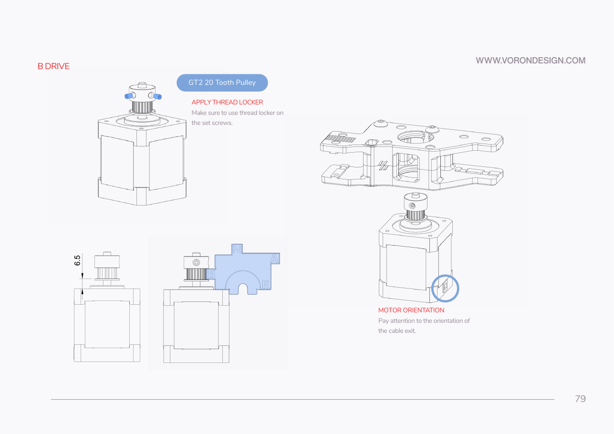{ crop="0.11 0.53 0.47 0.85" }


**What you're looking at:** The B pulley goes on **the other way up** from the A drive's. The two heights, 16.5 mm on A and 6.5 mm on B, keep the belts on separate levels; set them the same and the belts rub.

**Parts:**

- stepper motor, 0.9° A/B ×1
- GT2 20 T 6 mm pulley ×1
- tool: printed `pulley_jig.stl`
- tool: caliper

**Do:**

1. Slide the pulley on **teeth first, hub up**.
2. Stand the jig on the motor face beside the pulley, **B** tab toward it.
3. Push the pulley down until the underside of its teeth is level with the underside of the **B** tab: 6.5 mm.

**Check:** the caliper reads 6.5 mm, motor face to teeth underside, hub **up**. About 13 mm means the teeth matched the tab's top; about 9.5 mm, the jig stood on its feet.

**Helper:** Reads the caliper aloud and says whether the pulley is the flipped one.

Stand the jig on its long bottom edge as in Step 04.24, never on the two short feet by its slot.

Source: [Voron manual p.79](https://github.com/VoronDesign/Voron-2/blob/de7e89d/Manual/Assembly_Manual_2.4r2.pdf#page=79) · [Video: Part 3 @1:12:46](https://www.youtube.com/watch?v=ii14-2COjuA&list=PL0fUJbigELQPqpeGOgHYisG4KaSXVtnNY&t=4366s)

---

### Step 04.34 — B drive: threadlock and lock the pulley set screws

{ crop="0.15 0.17 0.47 0.48" }

**What you're looking at:** The B pulley's set screws get threadlocker and the height is measured again, exactly as on the A drive.

**Parts:**

- reused: the pulley's two set screws
- consumable: Loctite 243
- tool: 1.5 mm hex key

**Do:** Leave the jig in place and work one set screw at a time, exactly as on the A drive. Take it out, put a drop of Loctite 243 on it unless it has a blue patch, refit it and tighten it: the first one on the shaft's flat side, if there is one. Measure again with the jig and caliper.

**Check:** the pulley does not slip under hand pressure and still reads 6.5 mm.

The flat rule comes from the manual's Z motor page, as on the A drive. [src](https://github.com/VoronDesign/Voron-2/blob/de7e89d/Manual/Assembly_Manual_2.4r2.pdf#page=38)

Source: [Voron manual p.79](https://github.com/VoronDesign/Voron-2/blob/de7e89d/Manual/Assembly_Manual_2.4r2.pdf#page=79)

---

### Step 04.35 — B drive: offer the motor up with the cable exit inboard

{ crop="0.51 0.26 0.82 0.78" }

**What you're looking at:** The B motor goes in with its cable exit facing inboard, the mirror of the A drive. Held in their finished positions, the two drives' cables face each other across the back of the machine.

**Parts:**

- reused: the B motor with its pulley

**Do:** Keep the drive the right way up, screw heads on top, and fit the motor from below with the **cable exit facing inboard**, mirrored from the A drive, so that with B at the rear left its cable also points toward the middle of the machine.

**Check:** the two cable exits face each other when you hold both drives in their build positions. That is the manual's own test.

**Helper:** Holds the A drive in its rear-right position while you hold B beside it.

Source: [Voron manual p.79](https://github.com/VoronDesign/Voron-2/blob/de7e89d/Manual/Assembly_Manual_2.4r2.pdf#page=79) · [Video: Part 3 @1:16:29](https://www.youtube.com/watch?v=ii14-2COjuA&list=PL0fUJbigELQPqpeGOgHYisG4KaSXVtnNY&t=4589s)

---

### Step 04.36 — B drive: three M3×30 SHCS through the frames into the motor

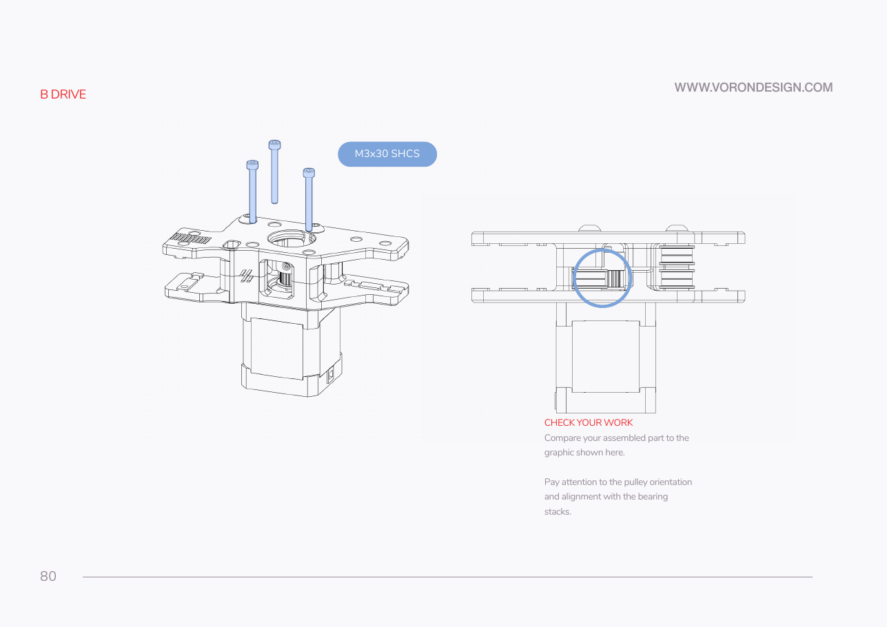{ crop="0.17 0.20 0.50 0.65" }

**What you're looking at:** The same three M3×30 screws go down through both frames into the motor face.

**Parts:**

- 3× M3×30 SHCS

**Do:** Start all three by hand through both frames into the motor, then tighten them evenly.

**Check:** three screws are in, the motor face sits flat against the frame, and nothing is cross-threaded, meaning no screw went in crooked and cut its own thread.

Source: [Voron manual p.80](https://github.com/VoronDesign/Voron-2/blob/de7e89d/Manual/Assembly_Manual_2.4r2.pdf#page=80)

---

### Step 04.37 — B drive: check your work and the belt path


{ crop="0.53 0.35 0.85 0.83" }

**What you're looking at:** The B pulley runs on the **lower** belt level, in line with the near pair and the far post's lower pair. The belt's free end checks it again.

**Parts:**

- tool: free end of the 6 mm belt reel, uncut
- consumable: masking tape
- tool: marker

**Do:**

1. Motor at the bottom, hold the drive with its cable exit on your left, as p.80 draws it from behind, and compare: the pulley sits on the lower level.
2. Run the end of the belt the way it will go: round the near pair, teeth round the pulley, and round the far post's **lower** pair.
3. Label the drive **B: REAR LEFT**.

**Check:** the belt lies flat and level on the pulley, the near pair and the far post's **lower** pair, not riding up onto any flange.

**Helper:** Sights along the belt at eye level and says if it tilts.

The far post's upper pair sits 10 mm above the belt. That is correct: it carries the A belt, so leave that stack alone.

Source: [Voron manual p.80](https://github.com/VoronDesign/Voron-2/blob/de7e89d/Manual/Assembly_Manual_2.4r2.pdf#page=80)

Pause: ~45 min since the last pause — the B drive is finished and labelled **B: REAR LEFT**, its pulley at 6.5 mm hub-up, and the two cable exits face each other when the drives are held in their build positions.

---

### Step 04.38 — Bag, label and hand off to Ch 05


**What you're looking at:** Page 81 of the Voron manual is a divider with nothing to build. On the bench are four finished assemblies, and each one fits only one corner of the machine, so each goes into its own bag with its corner written on it.

**Parts:**

- reused: the four finished assemblies
- consumable: four bags
- tool: marker

**Do:** Bag each assembly separately and write its corner on the bag: **A drive: rear right**, **B drive: rear left**, **A idler: front right**, **B idler: front left**.

**Check:** four bags carry four labels, and no bearings or spacers are left loose on the bench. Leftovers mean a stack is short.

**Helper:** Writes each corner on its bag and seals all four.

Source: [Voron manual p.81](https://github.com/VoronDesign/Voron-2/blob/de7e89d/Manual/Assembly_Manual_2.4r2.pdf#page=81)

Pause: ~15 min since the last pause — all four assemblies are bagged and labelled with their corners, and nothing is left over on the bench. Work through Checkpoint 04 before Ch 05.

---

## Checkpoint 04

**Built:** four CoreXY corners: two drive units and two front idlers

- [ ] Two drive units and two front idlers are built, each labelled with its corner of the machine.
- [ ] Every F695 pair is flange-out, plain faces touching, with one brass M5 precision spacer above and one below each pair.
- [ ] Each drive's far post holds 4 bearings and 4 spacers, with two spacers meeting in the middle. Each drive's near post and both idlers hold 2 bearings and 2 spacers.
- [ ] All six bearing groups spin freely with the frames closed and screwed together.
- [ ] On both idlers, the M5×40 axle head is seated in the arm's top boss, not cranked, and the M3×40 tensioner is snug in the arm's insert with the arm drawn against the front wall. The arm slid freely in the frame's slots before the M3×40 went in.
- [ ] `a_drive_frame_upper` has its two heat-set inserts; `b_drive_frame_upper` has none.
- [ ] Both motor pulleys are the **6 mm-wide** 20T (`5mm ID 6mm W`), not one of the four 9 mm Z-drive pulleys.
- [ ] The A pulley is hub down at 16.5 mm and the B pulley hub up at 6.5 mm, so the two look visibly different.
- [ ] Both pulleys are threadlocked and do not slip under hand pressure.
- [ ] The free end of the belt lies flat on each pulley, its near pair and the matching far-post pair: **upper** on A, **lower** on B. No tilt, and it rides up onto no flange. The other far-post pair sits 10 mm away, because it carries the other belt.
- [ ] Both motor cable exits point inboard and face each other when the drives are held in their build positions.
- [ ] Every M5×30 BHCS is snug only; none was tightened hard into the plastic thread.
- [ ] No bearings, spacers or other hardware are left over.

## Common mistakes

- **A bearing pair fitted flange to flange, or flanges inward.** The belt then rides on a flange edge instead of the bearings and shreds. Fix: open the stack and turn the two bearings so their plain faces meet. Look at the stack from the side: a flange in the middle is always wrong.
- **Four bearings on the near post and two on the far post.** The frames will not close square, or they close and pinch a bearing. Fix: the four-bearing stack always goes on the post farther from the motor bore, drawn on the right on p.74 and on the left on p.78.
- **A 9 mm 20T pulley on an A/B motor.** It looks right, but it is a Z-drive part and will not sit in the 6 mm belt level that a flange-out F695 pair makes. The kit ships exactly two 6 mm 20T pulleys and four 9 mm ones: count them before you start, and keep the four 9 mm ones with the Ch 02 Z bin.
- **Both pulleys at the same height, or the B pulley fitted hub-down.** The A and B belts then try to share one level and rub, and this cannot be fixed when the belts go on. Fix: A at 16.5 mm hub down, B at 6.5 mm hub up, both checked again after the set screws are tight, first with the jig (tab underside level with the underside of the teeth), then with the caliper.
- **Cranking the idler's M5×40 down hard.** It is the axle; the M3×40 through the frame's front wall is the tensioner (Ch 07 Step 07.5). The arm wraps round the frames with only about 0.2 mm to spare each side in the Voron CAD, so a hard pull squeezes them and the arm cannot slide when the belt is tensioned. Fix: back it off until the head just seats and the arm slides.
- **Motor cable exits pointing outboard.** The cables will not reach the drag chain, and the drive has to come apart with the gantry in the machine. Fix: before the three M3×30 go in, check that the exits face each other.
- **M5×30 BHCS tightened hard.** They thread into plastic (p.74, p.78) and strip for good, and a stripped post means reprinting a drive frame. Fix: stop at closed and snug.
- **A parts and B parts swapped.** The A frames have a cutout and `a_drive_frame_upper` has two heat-set inserts; the B frames have neither. On the idlers, the tall lower frame belongs to the A (right) idler.

## Next

**Ch 05 — Gantry: X and Y axes, XY joints, X carriage, titanium backers.** The four assemblies you just built screw onto the Y extrusions there (manual p.82–107); print batch **B04** must be done before you start it.
