# Chapter 05 — Gantry: X and Y axes, XY joints, X carriage, titanium backers

<!-- style: plain -->

You build the whole gantry on the bench: the XY bridge, both Y axes with their MGN9 rails, both XY joints, the X extrusion with its MGN12 rail, and the titanium extrusion backers. The chapter ends with the X axis riding on the Y carriages, and it unlocks Ch 06 (gantry install, Z belts, squaring).

**What you're building in this chapter:** The **gantry** is the whole moving upper half of the printer: a rectangle of aluminium extrusion that later hangs on four belts and slides up and down, with the toolhead riding inside it. Its back edge is the **XY bridge**, the cross-beam that carries the A and B motors you built in Ch 04. Two side extrusions, the **Y axes**, run forward from that bridge. Each has a linear rail along one face and a **front idler** block at its front end that turns its belt back. Spanning the two sides is the **X beam**, capped at each end by an **XY joint**: the printed blocks that ride on the Y carriages and turn each belt from its Y run to its X run. Screwed to the face opposite every rail are the **titanium backers**, flat strips that stop a steel rail bowing its aluminium extrusion as the chamber heats. Nothing in this chapter gets belts or squaring: both belong to Ch 06 and Ch 07, and doing either now would undo work done here.

```mascot
pose: hexkey
caption: Build the gantry on the bench, not in the frame. Clear the whole table, including that pile.
```

**Time:** 5.0–7.0 h hands-on, first build, two people ([survey §5.1 P05 / §7.2](../voron-build-instructions-survey.md)).

**Sessions:** 12 × ~30 min. Each one ends at a safe place to stop, and each `Pause:` line carries its own minutes, a first-build estimate.

**Prerequisites:**

- **Ch 04** is done: the A drive, the B drive and both front idler assemblies are built and checked (manual p.62–81). This chapter uses them whole.
- **Ch 00** is done: all seven rails are cleaned and packed with grease *before* they go on an extrusion ([LDO rail grease guide](https://docs.ldomotors.com/guides/rail_grease_guide)), and the rail guides `Tools/MGN9_rail_guide_x2.stl` and `Tools/MGN12_rail_guide_x2.stl` are printed (batch **B00**). The rails still wear their Ch 00 end bands (Step 00.17); they come off at Steps 05.11 and 05.33.
- **Printed parts:** batch **B04** (XY joints and X carriage, plate B04-P1, 8.8 h, black) and batch **B02**, blue plates P1, P2 and P4: the endstop pod is on P1, the 2-hole cable bridge on P2 and the raised cable bridge on P4, and the four upper Z-belt clips are one each on P1 and P2 and two on P4 ([print plan §B04](../voron-print-plan.md)). B04 needs Gate B (Step B00.7).
- **The titanium backer set** (Fabreeko/LDO, 350 size) is unpacked and counted, and **58 M3 roll-in T-nuts** are counted out from the kit bag: 29 for the rails and extrusion ends, 29 for the backers. The backer set ships none.
- **Extrusions:** the **C ×2, D ×1 and E ×1** you bagged in Ch 01.

**Tools**

- Hex drivers 2, 2.5, 3 and 4 mm. A **ball-end 2.5 mm** driver, whose rounded tip works at an angle, helps at the XY joints.
- **T10 Torx driver**, strongly preferred for the backers' M3 FHCS: a hex key slips out of a countersunk screw head easily ([backers README](https://github.com/tanaes/whopping_Voron_mods/tree/main/extrusion_backers)).
- The printed rail guides `MGN9_rail_guide_x2` and `MGN12_rail_guide_x2`, which hold each rail centred on its extrusion.
- A 300 mm steel rule and a caliper, to make the rail overhang equal at both ends.
- Masking tape to hold the carriages on their rails, and the kit's rubber rail stoppers.
- A 2.5 mm flat screwdriver for the cable-chain latches, if you dry-fit the chain end.

**Read first**

- **The titanium backers go on in this chapter, not after it.** Fitting them once the gantry is built means taking it apart. They go on the face **opposite the rail**: the top of the Y extrusions and the rear of the X extrusion.
- **Do not tension the A/B belts and do not square the gantry here.** Both happen in Ch 06 and Ch 07, and the official squaring starts by releasing belt tension, so doing either now would just be undone. Several joints are left slightly loose on purpose.
- **Every T-nut goes in before the drive and idler blocks cap the extrusion ends.** The kit's T-nuts are a tight fit, so test-fit them first or load them early.
- **A carriage slides off its rail easily, and a dropped one is ruined.** Tape or stop every carriage the moment its rail is on an extrusion. The rails must already be greased (Ch 00); if they are not, stop and do that first.
- **Which way up.** Until Step 05.41 the gantry is built the way it runs: motors hanging **down** below the bridge, Y rails **underneath**. Then it turns **upside down** (motors up, rails up) so the X axis can be lowered onto the Y carriages, and it stays that way until Ch 06 turns it back (Step 06.11). Every step that turns it over says so.

<!-- reference -->

**Printed parts**

Parts arrive in the bins named below (see the bin map in print/README.md#bins); check the bin label's list before you start.

| Looks like | STL | Bin | Qty | Colour |
|---|---|---|---|---|
| 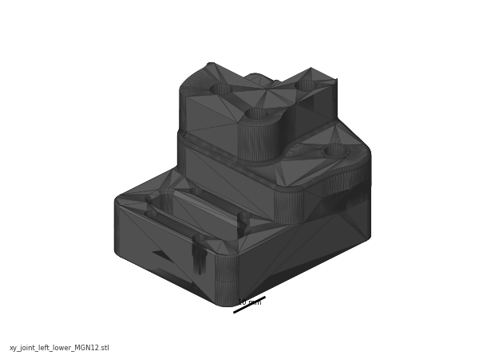{ width=96 } | `xy_joint_left_lower_MGN12.stl` | 05-XY | 1 | Black |
| 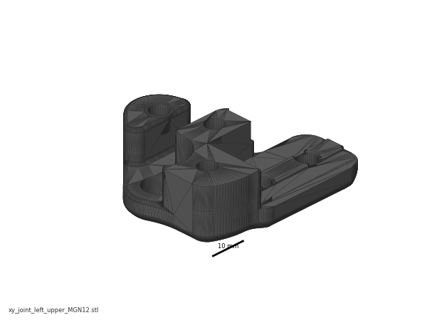{ width=96 } | `xy_joint_left_upper_MGN12.stl` | 05-XY | 1 | Black |
| 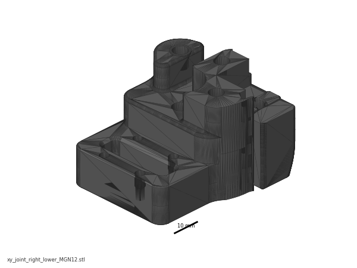{ width=96 } | `xy_joint_right_lower_MGN12.stl` | 05-XY | 1 | Black |
| 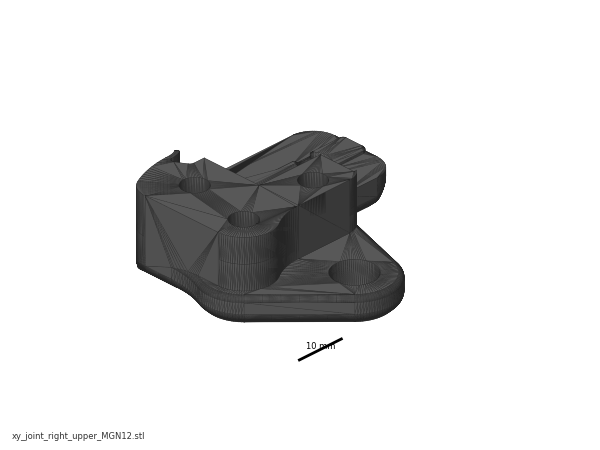{ width=96 } | `xy_joint_right_upper_MGN12.stl` | 05-XY | 1 | Black |
| { width=96 } | `[a]_xy_joint_cable_bridge_2hole.stl` | 05-XY | 1 (fallback, bagged at Step 05.46) | Blue |
| 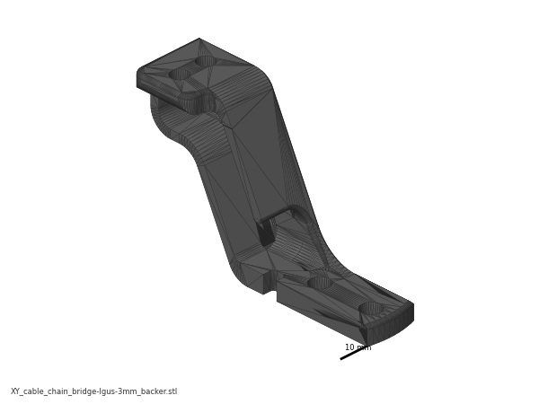{ width=96 } | `XY_cable_chain_bridge-Igus-3mm_backer.stl` | 05-XY | 1 (the one fitted, at Step 05.38: 3 mm taller, to match the Y backer) | Blue |
| 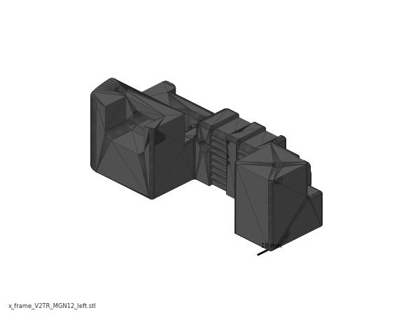{ width=96 } | `x_frame_V2TR_MGN12_left.stl` | 07-X | 1 | Black — *staged here, fitted in Ch 07* |
| 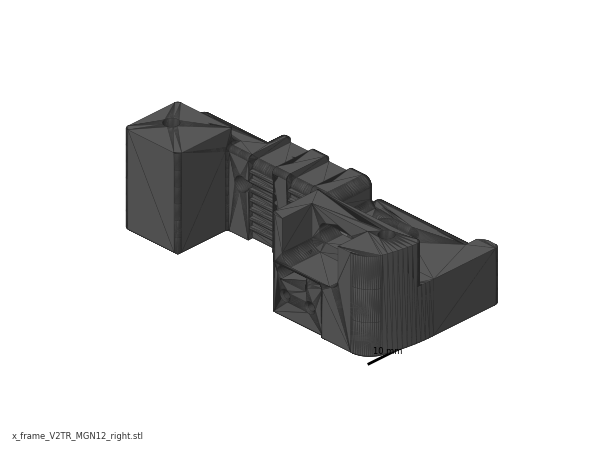{ width=96 } | `x_frame_V2TR_MGN12_right.stl` | 07-X | 1 | Black — *staged here, fitted in Ch 07* |
| 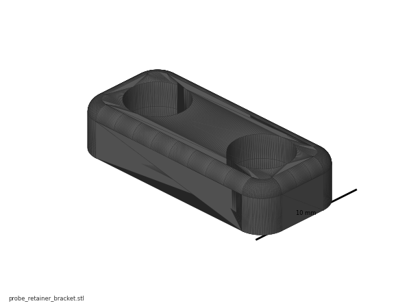{ width=96 } | `probe_retainer_bracket.stl` | 07-X | 1 | Black — *staged here, fitted in Ch 07/08* |
| { width=96 } | `[a]_endstop_pod_D2F_switch.stl` | 05-XY | 1 | Blue — *fitted here, Step 05.49* |
| { width=96 } | `[a]_z_belt_clip_upper_x4.stl` | 05-XY | 4 | Blue — *fitted here under the idler and drive M5×16 (p.91, p.93, p.95), loaded with belt in Ch 06* |

Do **not** print `[a]_endstop_pod_hall_effect.stl`, `[a]_xy_joint_cable_bridge_3hole.stl`, or any `xy_joint_*_MGN9` — wrong variants for this kit ([print plan §7](../voron-print-plan.md)).

**Hardware** (chapter totals)

| Fastener / part | Qty | Where |
|---|---|---|
| E extrusion (XY bridge) | 1 | p.85 |
| C extrusion (Y axis) | 2 | p.88 |
| D extrusion (X axis) | 1 | p.101 |
| MGN9H 400 mm rail | 2 | Y axes, p.88; carriage ships on the rail |
| MGN12H 400 mm rail | 1 | X axis, p.101; carriage ships on the rail |
| M5 roll-in T-nut | 26 | 8 in E (p.85), 12 in the C pair (p.89, p.90), 6 in D (p.102) |
| M3 roll-in T-nut | 29: 18 Y rails, 4 C-pair ends, 7 X rail | 9 per 20-hole MGN9 (p.88), 4 in the C pair (p.90), 7 for the 16-hole MGN12 (p.101) |
| M3 roll-in T-nut, backers | 29: 10 per Y backer, 9 on the X backer | from the kit's M3 roll-in bag; the backer set ships no T-nuts |
| M5×10 BHCS | 10 | 8 bridge-to-drive (p.86–87), 2 left XY joint (p.104) |
| M5×16 BHCS | 10 | 4 front idlers, through the upper Z-belt clips (p.91, p.93), 4 rear drive joints, same (p.95), 2 right XY joint + cable bridge (p.104) |
| M5×30 BHCS | 2 | XY joints from below (p.104) |
| M5×40 SHCS | 8 | 4 per XY joint (p.97–100) |
| M3×8 SHCS | 27: 18 Y rails, 7 X rail, 2 XY endstop PCB | one per marked rail hole (p.88, p.101): every other hole from the second, both end holes empty; 2 hold the PCB in its pod (p.163) |
| M3×16 SHCS | 6 | XY joints to the Y carriages (p.106): 4 left joint, 2 right joint; all six fitted, none spare |
| M3×30 SHCS | 2 | XY endstop pod to the right XY joint at 05.49: p.164 fits it through its body with 2× M3×30, not the M3×16 of p.106 |
| XY endstop PCB | 1 | in the pod (p.163), at 05.49; its cable plugs in at Ch 10 |
| M5 nut | 6 | 3 per XY joint (p.96) |
| **M5 precision spacer, brass** | 4 | 2 per XY joint stack — one below and one above the F695 pair (p.97, p.99) — replaces the manual's "M5 shim" |
| **M5 washer, black** | 2 | under the M5×30 heads (p.104) — replaces the manual's "M5 shim" |
| F695 bearing | 4 | 2 per XY joint |
| GT2 20-tooth idler, 6 mm wide | 2 | 1 per XY joint; the 9 mm wide ones are Ch 02's Z idlers |
| Titanium backer, Y — from Ti backer set | 2 | one per C extrusion: the plain one left, the one with four cable-chain pilot holes right, pilots at the rear |
| Titanium backer, X — from Ti backer set | 1 | D extrusion, rear face |
| M3×8 FHCS, Y backers — from Ti backer set | 20: 10 per Y backer | tanaes `Y_backer-350` and `Y_backer_chain-350` DXFs: 10 screw holes each, plus 4 chain pilots on the second *(verify on bench)* |
| M3×6 FHCS, X backer — from Ti backer set | 9 | tanaes `X_backer_chain-350` DXF: 9 holes, plus 4 chain pilots *(verify on bench)* |

The West3D/Fabreeko titanium set ships **22× M3×8 FHCS and 10× M3×6 FHCS**, two and one spare over the 20 + 9 holes, and **no T-nuts** ([West3D](https://west3d.com/products/titanium-backers-for-voron-2-4-trident-3-pack)).

**Notes behind "Read first"**

- **The titanium backers go on during this chapter, not after it.** Fitting them once the gantry is assembled or installed means a teardown (survey §5.2 W2). They mount on the face **opposite the rail** — top of the Y extrusions, rear of the X extrusion. *"If you have a single MGN12 but decide to put a backer on top, you will be actively contributing to the problem of bimetallic expansion!"* [src](https://github.com/tanaes/whopping_Voron_mods/tree/main/extrusion_backers)
- **Do not tension the A/B belts and do not square the gantry here.** Both are Ch 06/07, and the official squaring procedure begins by *releasing* A/B tension — tension it now and you undo it (survey §4.4 #2, §5.2 W1). Several joints in this chapter are deliberately left "slightly loose".
- **Every T-nut this chapter needs must go in before the drive and idler frames cap the extrusion ends.** LDO: *"Due to the tight tolerances of the extrusions and roll-in t-nuts it is advisable to either test fit before assembly … or to pre-load the t-nuts into the extrusions."* [src](https://docs.ldomotors.com/en/voron/voron2/build-faq)
- **Short a part?** This chapter needs exact counts: 4 F695, 4 spacers, 2 20T idlers, the backer screws. Recount against your Ch 00 inventory sheet, then contact Fabreeko support; do not borrow from another chapter's bag.
- **Rails ship dry.** If Ch 00's clean-and-pack pass has not been done, stop and do it — the flip-and-pack method needs access to the back of the rail (survey §4.4 #5).
- **Carriages slide off rails and are ruined by a drop** (manual p.88, p.101). Tape or stopper every carriage the moment its rail is on an extrusion.
- **Orientation.** Through p.105 the gantry is built the way it runs — motors hanging **down** below the bridge, Y rails **underneath** (p.85, p.116). p.106 turns it **upside down** (motors up, rails up) so the X axis can be lowered onto the Y carriages; it stays that way to the end of this chapter and is turned back in Ch 06 (Step 06.11). Every step that turns it over says so.

**Sources for this chapter:**

- [Voron 2.4r2 assembly manual, p.82–107](https://github.com/VoronDesign/Voron-2/blob/de7e89d/Manual/Assembly_Manual_2.4r2.pdf#page=82) — the page sequence this chapter transcribes, pinned at commit `de7e89d`
- [LDO Build Notes § Voron 2.4 build FAQ](https://docs.ldomotors.com/en/voron/voron2/build-faq) — Rev D kit deviations, T-nut pre-loading, rail stoppers
- [LDO printed-parts guide (Rev D)](https://docs.ldomotors.com/en/voron/voron2/printed_part_guide_rev_d) — 2-hole cable bridge, D2F endstop pod
- [Voron 2.4r2 assembly manual, p.163–164](https://github.com/VoronDesign/Voron-2/blob/de7e89d/Manual/Assembly_Manual_2.4r2.pdf#page=163) — the XY endstop pod, fitted early at Step 05.49 so the right XY joint has all four screws before Ch 06
- [LDO rail-grease guide](https://docs.ldomotors.com/guides/rail_grease_guide) — rail clean-and-pack, done in Ch 00
- [LDO cable-chain guide](https://docs.ldomotors.com/guides/cable_chain_guide) — chain-end clearance over the backers
- [Ti extrusion-backers README (tanaes)](https://github.com/tanaes/whopping_Voron_mods/tree/main/extrusion_backers) — which face the backers go on, and why; source of the two backer images (GPL-3.0)
- [Fabreeko](https://www.fabreeko.com/products/v2-4-trident-titanium-extrusion-backers) and [West3D](https://west3d.com/products/titanium-backers-for-voron-2-4-trident-3-pack) backer sets — supplied screw counts
- [Voron docs § V2 Gantry Squaring](https://docs.vorondesign.com/build/mechanical/v2_gantry_squaring.html) — why nothing is squared or tensioned in this chapter

**Video coverage (Steve Builds, pre-release LDO kit — differs from Rev D+):** [Part 3 @0:56:34](https://www.youtube.com/watch?v=ii14-2COjuA&list=PL0fUJbigELQPqpeGOgHYisG4KaSXVtnNY&t=3394s) (+2m), [Part 3 @1:19:23](https://www.youtube.com/watch?v=ii14-2COjuA&list=PL0fUJbigELQPqpeGOgHYisG4KaSXVtnNY&t=4763s) (+16m), [Part 3 @1:34:36](https://www.youtube.com/watch?v=ii14-2COjuA&list=PL0fUJbigELQPqpeGOgHYisG4KaSXVtnNY&t=5676s) (+9m), [Part 3 @1:43:29](https://www.youtube.com/watch?v=ii14-2COjuA&list=PL0fUJbigELQPqpeGOgHYisG4KaSXVtnNY&t=6209s) (+5m), [Part 4 @0:06:16](https://www.youtube.com/watch?v=ViB5Ulc9zDI&list=PL0fUJbigELQPqpeGOgHYisG4KaSXVtnNY&t=376s) (+7m), [Part 4 @0:34:10](https://www.youtube.com/watch?v=ViB5Ulc9zDI&list=PL0fUJbigELQPqpeGOgHYisG4KaSXVtnNY&t=2050s) (+9m), [Part 5 @1:05:40](https://www.youtube.com/watch?v=hTKCBrk36R0&list=PL0fUJbigELQPqpeGOgHYisG4KaSXVtnNY&t=3940s) (+1m), [Part 5 @1:20:27](https://www.youtube.com/watch?v=hTKCBrk36R0&list=PL0fUJbigELQPqpeGOgHYisG4KaSXVtnNY&t=4827s) (+13m)

---

### Step 05.1 — Clear the bench and confirm the sub-assemblies

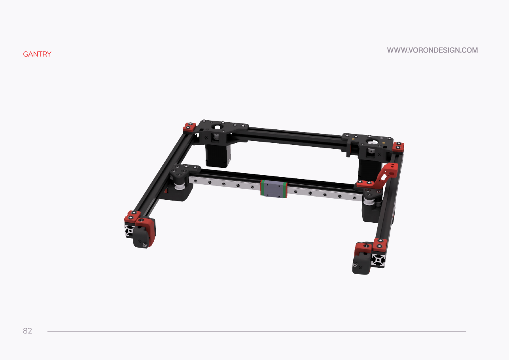

**What you're looking at:** This step gets the bench ready. The gantry is the moving frame above the bed that carries the toolhead: a rectangle of extrusions whose X beam slides along two side rails. The picture shows it finished, so you can see where the four Ch 04 sub-assemblies land at the corners.

**Parts:**

- reused: A drive assembly
- reused: B drive assembly
- reused: A idler assembly, front right
- reused: B idler assembly, front left
- staged: C extrusion ×2
- staged: D extrusion ×1
- staged: E extrusion ×1

**Do:**

1. Clear a bench at least 700 × 700 mm.
2. Lay the four Ch 04 sub-assemblies out, drives at the top and idlers at the bottom.
3. Keep the A drive on the **right** and the B drive on the **left**.

**Check:** All four Ch 04 assemblies match their CHECK YOUR WORK pages (p.68 and p.72 for the idlers, p.76 and p.80 for the drives), and all four spin freely.

Source: [Voron manual p.82](https://github.com/VoronDesign/Voron-2/blob/de7e89d/Manual/Assembly_Manual_2.4r2.pdf#page=82) · [Video: Part 4 @0:06:30](https://www.youtube.com/watch?v=ViB5Ulc9zDI&list=PL0fUJbigELQPqpeGOgHYisG4KaSXVtnNY&t=390s)

---

### Step 05.2 — Name the gantry parts

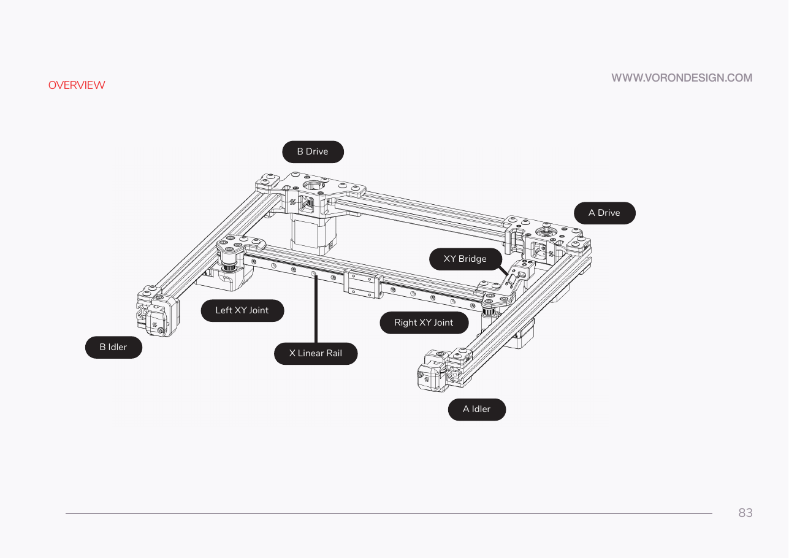

**What you're looking at:** The same rectangle, now labelled. **A** and **B** are the two CoreXY motors; neither one on its own "is" an axis. The XY bridge holds the drives apart, the XY joints cap the ends of the X beam, and the front idlers turn each belt back.

**Parts:** none.

**Do:**

1. Learn the names: B Drive rear left, A Drive rear right, XY Bridge, both XY Joints, X Linear Rail, B Idler front left, A Idler front right.
2. Check the **A** and **B** labels you put on the Ch 04 parts.

**Check:** You can point at the A drive, the B idler and the right XY joint without hesitating.

**Helper:** Points to each gantry part as you name it and repeats the name back.

Source: [Voron manual p.83](https://github.com/VoronDesign/Voron-2/blob/de7e89d/Manual/Assembly_Manual_2.4r2.pdf#page=83)

---

### Step 05.3 — Pick the cable-chain bridge

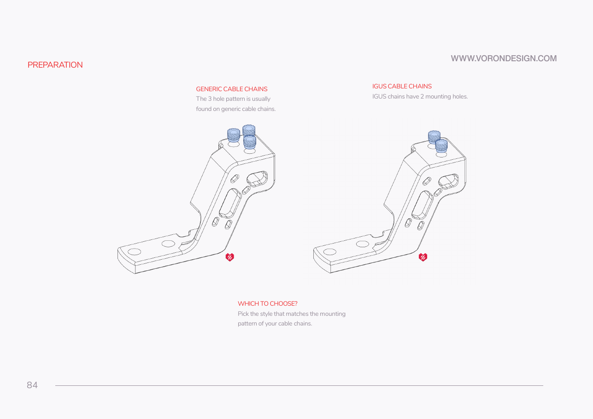{ crop="0.50 0.18 0.82 0.68" }

**What you're looking at:** The cable bridge is the blue arch on the right XY joint that lifts the toolhead's drag chain (the hinged track carrying its cables) clear of the belts. It has three holes for generic chains or two for the IGUS chains this kit ships; LDO's chain ends use two, so every chain part here is the 2-hole version. [src](https://docs.ldomotors.com/en/voron/voron2/printed_part_guide_rev_d)

**Parts:**

- `[a]_xy_joint_cable_bridge_2hole.stl` ×1 (blue)

**Do:**

1. Find the 2-hole bridge from plate B02-P2 and its raised alternate from B02-P4; you printed no 3-hole part.
2. Confirm the bridge has two holes on the raised pad, and set it beside the raised alternate.

**Check:** One 2-hole bridge and one raised alternate are on the bench, and no 3-hole part exists in this build.

The raised alternate, `XY_cable_chain_bridge-Igus-3mm_backer.stl`, has the same 2-hole pattern but stands 3 mm taller, to match the titanium Y backer under the chain's fixed end. Step 05.35 picks it. [src](https://github.com/tanaes/whopping_Voron_mods/tree/main/extrusion_backers)

Source: [Voron manual p.84](https://github.com/VoronDesign/Voron-2/blob/de7e89d/Manual/Assembly_Manual_2.4r2.pdf#page=84) · [LDO printed-parts guide (Rev D)](https://docs.ldomotors.com/en/voron/voron2/printed_part_guide_rev_d) · [Ti extrusion-backers README (tanaes)](https://github.com/tanaes/whopping_Voron_mods/tree/main/extrusion_backers) · [Video: Part 3 @1:43:24](https://www.youtube.com/watch?v=ii14-2COjuA&list=PL0fUJbigELQPqpeGOgHYisG4KaSXVtnNY&t=6204s)

---

### Step 05.4 — Test-fit T-nuts and stage the fasteners

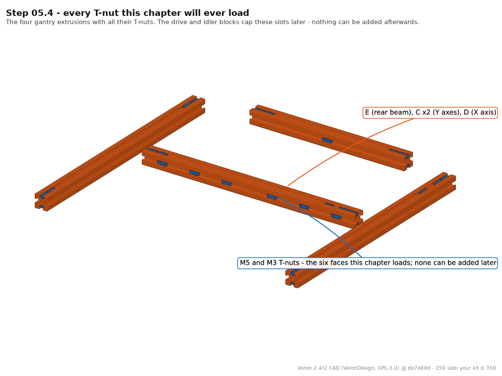
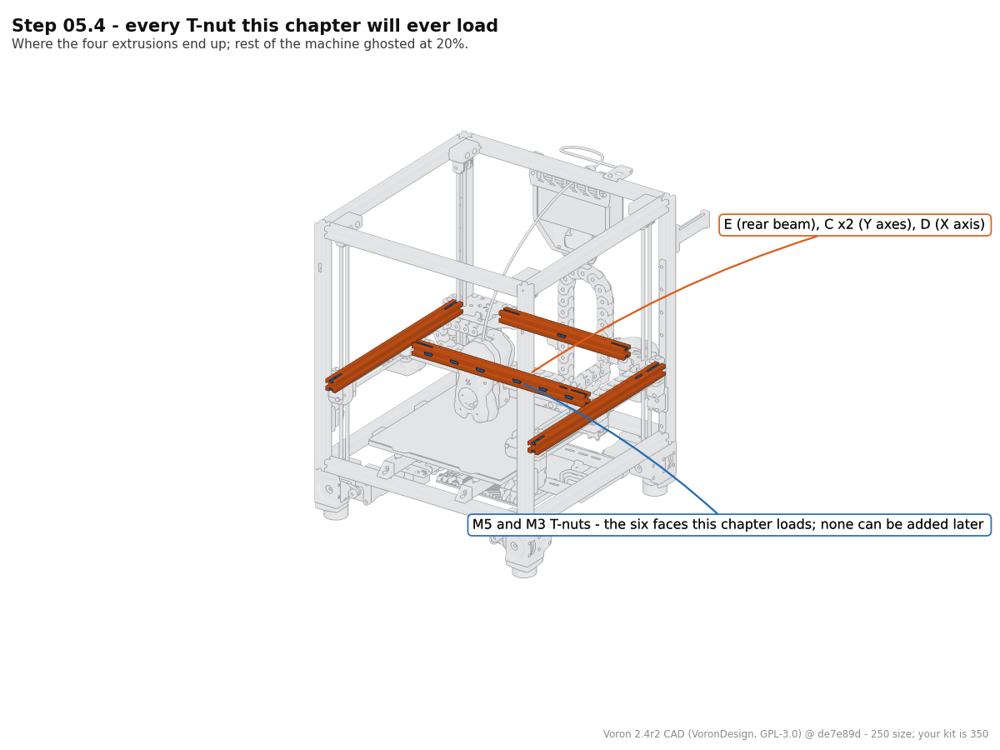

**What you're looking at:** A roll-in T-nut is a small nut that drops into an extrusion's slot and turns a quarter turn to lock, and almost every screw in this chapter pulls against one. The renders show the four extrusions, E, both C and D, with every T-nut already in its slot.

**Parts:**

- staged: M5 roll-in T-nut ×26
- staged: M3 roll-in T-nut ×58

**Do:**

1. Roll one M5 and one M3 T-nut through each face of all four extrusions.
2. Mark any face that binds with tape.
3. Count the fasteners out into labelled trays, following the chapter's Hardware table.

**Check:** Every T-nut you will use rolls in without force. A forced nut galls the slot, scraping and tearing the aluminium.

**Helper:** Counts the T-nuts and bolts into their piles and checks them against the list.

The CAD shows the 250-size extrusions (E 240, C 350, D 330 mm); yours are the 350 set. What carries over is which faces take nuts, and how many.

Source: [LDO Build Notes § Voron 2.4 build FAQ](https://docs.ldomotors.com/en/voron/voron2/build-faq) · [Voron manual p.85](https://github.com/VoronDesign/Voron-2/blob/de7e89d/Manual/Assembly_Manual_2.4r2.pdf#page=85) · [Video: Part 4 @0:36:43](https://www.youtube.com/watch?v=ViB5Ulc9zDI&list=PL0fUJbigELQPqpeGOgHYisG4KaSXVtnNY&t=2203s) · CAD: Voron 2.4r2 STEP @ de7e89d

Pause: ~25 min since the last pause — bench cleared, sub-assemblies laid out left and right, T-nuts test-rolled and counted into trays. Nothing is assembled yet. Cover the trays so nothing gets swept off.

---

### Step 05.5 — Load the E extrusion (XY bridge)

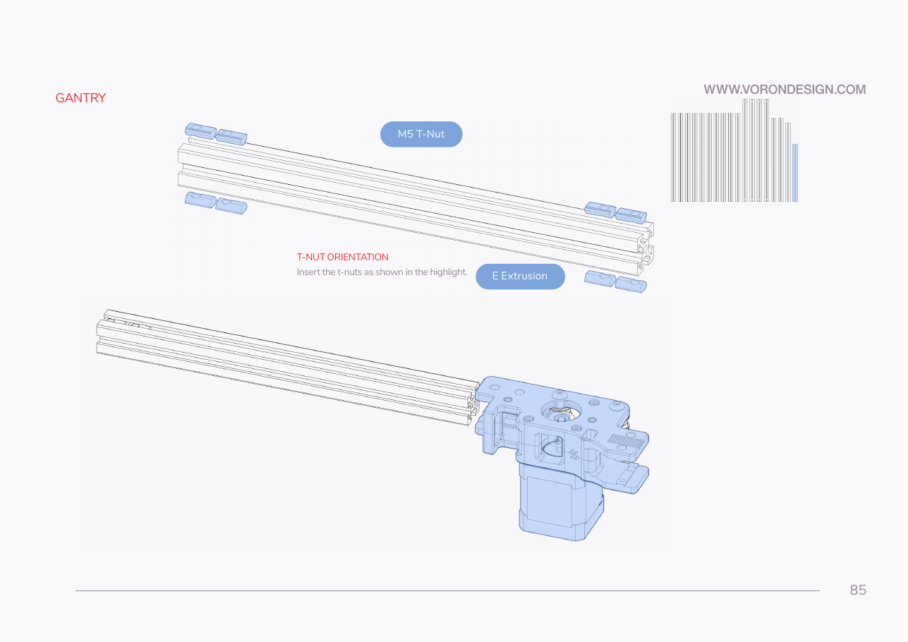{ crop="0.18 0.14 0.73 0.48" }

**What you're looking at:** The E extrusion is the **XY bridge**: the beam across the back of the gantry that holds the two drive blocks a fixed distance apart, and so sets the gantry's width. The eight M5 T-nuts are what those blocks screw down onto.

**Parts:**

- E extrusion ×1
- M5 T-nut ×8

**Do:**

1. Slide **eight** M5 T-nuts into the E extrusion: at each end, two in the **top** slot and two in the **bottom** slot. None go in the side slots.
2. Push them 10–15 mm in from the ends, under the drive frame's screw holes.

**Check:** Each end holds 4 nuts, 2 top and 2 bottom, threaded holes facing outward and none jammed.

Source: [Voron manual p.85](https://github.com/VoronDesign/Voron-2/blob/de7e89d/Manual/Assembly_Manual_2.4r2.pdf#page=85)

---

### Step 05.6 — Slide the A drive onto the E extrusion

{ crop="0.09 0.46 0.75 0.86" }

**What you're looking at:** The A drive is the right-hand assembly from Ch 04: a stepper motor with its 20-tooth pulley, wrapped in a printed frame that carries the belt bearing posts. It slides over the end of the bridge extrusion like a sleeve.

**Parts:**

- reused: A drive assembly
- reused: E extrusion with its eight T-nuts

**Do:**

1. Push the A drive onto one end of the E extrusion, motor pointing **down**. It stays this way up until the flip at Step 05.41.
2. Seat it until the printed part is flush (level) with the extrusion end.

**Check:** The plastic is flush with the aluminium end face, and you can see the four M5 T-nuts through the drive frame's screw holes.

Source: [Voron manual p.85](https://github.com/VoronDesign/Voron-2/blob/de7e89d/Manual/Assembly_Manual_2.4r2.pdf#page=85)

---

### Step 05.7 — Bolt the A drive to the bridge

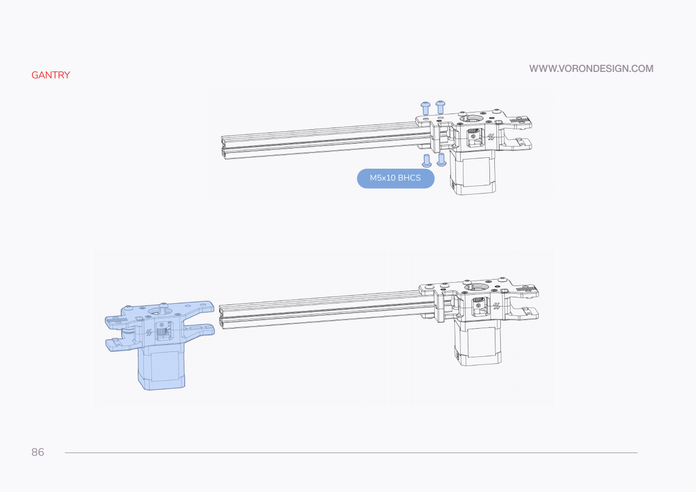{ crop="0.30 0.17 0.78 0.41" }

**What you're looking at:** Four M5×10 BHCS (button-head screws) pass through the drive frame's flange into the T-nuts underneath. They make the drive block and the bridge one rigid rear corner. A screw that spins freely means its T-nut never turned to lock, and the corner is holding on three.

**Parts:**

- M5×10 BHCS ×4

**Do:**

1. Drive four M5×10 BHCS, two into the upper slot and two into the lower, to snug, not torqued.
2. If a screw spins without pulling, its T-nut has not turned: back the screw out and reseat the nut.

**Check:** All four screws bite, and the drive frame does not rock on the extrusion.

Source: [Voron manual p.86](https://github.com/VoronDesign/Voron-2/blob/de7e89d/Manual/Assembly_Manual_2.4r2.pdf#page=86)

---

### Step 05.8 — Slide the B drive onto the other end

{ crop="0.13 0.51 0.80 0.82" }

**What you're looking at:** The B drive is the left-hand partner, not an identical copy. Its motor pulley sits at 6.5 mm where the A drive's sits at 16.5 mm, which puts the two belts at different heights, called belt planes, so they can cross without touching.

**Parts:**

- reused: B drive assembly

**Do:**

1. Push the B drive onto the free end of the E extrusion, motor down, flush with the end face.
2. Look at the motor cable exits: they must point **towards each other**. If they point apart, the drives are swapped end for end.

**Check:** Both motor cable exits face inward, and both printed parts are flush.

Source: [Voron manual p.86](https://github.com/VoronDesign/Voron-2/blob/de7e89d/Manual/Assembly_Manual_2.4r2.pdf#page=86)

---

### Step 05.9 — Bolt the B drive and check the bridge

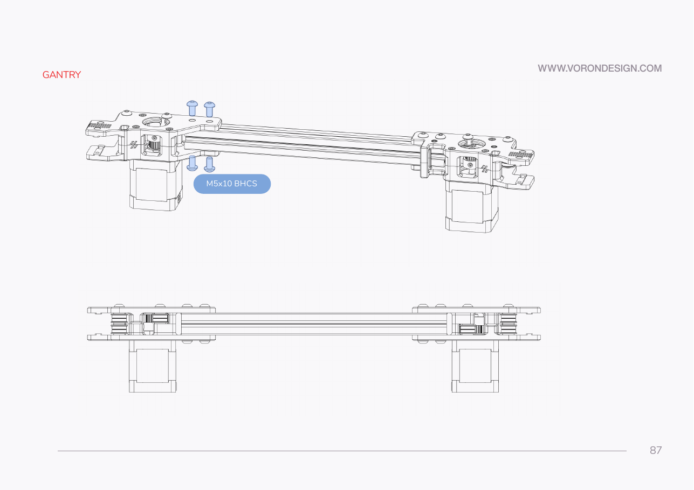{ crop="0.11 0.18 0.79 0.81" }

**What you're looking at:** With both drives screwed on, the bridge and drives become a single rear beam: the fixed back edge of the gantry, and the reference everything else is built to. The lower drawing in the picture is your alignment check.

**Parts:**

- M5×10 BHCS ×4

**Do:**

1. Fit the last four M5×10 BHCS, snug.
2. Compare with the lower drawing: the drive frames are parallel, and the two pulleys sit **one belt plane apart**, one high and one low, as drawn.

**Check:** The drives are parallel with no twist along the bridge, the pulleys are one plane apart, and all eight M5×10 are in and snug. Nothing here is torqued yet.

The lower drawing is seen from behind, so A is on the left: A's pulley sits high, B's low. Never move a pulley to make them match: the 10 mm step keeps the belts apart.

Source: [Voron manual p.87](https://github.com/VoronDesign/Voron-2/blob/de7e89d/Manual/Assembly_Manual_2.4r2.pdf#page=87)

Pause: ~30 min since the last pause — XY bridge screwed to both drive units, all eight M5×10 snug, none torqued. Lay the assembly flat, motors down. Do not start a Y rail: a rail must be centred and screwed down in one sitting.

---

### Step 05.10 — Load M3 T-nuts for the first Y rail

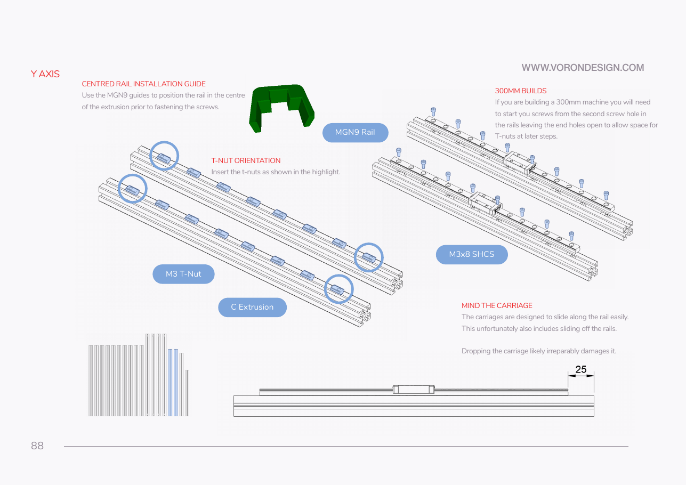{ crop="0.13 0.285 0.60 0.68" }

**What you're looking at:** The two C extrusions are the **Y axes**, the side beams the X beam slides along. Each carries an MGN9 linear rail on one face. The M3 T-nuts anchor every rail screw, and once the rail is down, no more can go in.

**Parts:**

- C extrusion ×1
- M3 T-nut ×9

**Do:**

1. The 400 mm MGN9H rail, `LDO-SLR9H-400Z0`, has 20 holes. Mark holes **2, 4 … 18**: every other hole from the second, so both end holes stay open, as p.88 asks.
2. Slide **9** M3 T-nuts into the extrusion, about 25 mm clear of each end.

**Check:** Nine nuts sit one per marked hole, all turned flat in the slot, with holes 1, 19 and 20 unmarked and about 25 mm clear at both ends.

**Helper:** Counts nine T-nuts into the slot and checks one sits under each marked hole.

Source: [Voron manual p.88](https://github.com/VoronDesign/Voron-2/blob/de7e89d/Manual/Assembly_Manual_2.4r2.pdf#page=88) · [LDO Build Notes § Voron 2.4 build FAQ](https://docs.ldomotors.com/en/voron/voron2/build-faq)

---

### Step 05.11 — Centre and start the first MGN9 rail

{ crop="0.11 0.15 0.97 0.58" }

**What you're looking at:** The rail is a hardened steel track; its carriage slides along it on tiny balls. The printed guides are U-shaped clips that hold the rail centred on the extrusion while you start the screws. LDO skips the end holes on every build, not only the 300 mm builds the manual names. [src](https://docs.ldomotors.com/en/voron/voron2/build-faq)

**Parts:**

- MGN9H 400 mm rail ×1
- M3×8 SHCS ×9
- tool: `MGN9_rail_guide_x2` jig ×2

**Do:**

1. Tape the carriage mid-rail, then peel off the Ch 00 end bands with the rail flat.
2. Sit the rail on the extrusion, centred by an MGN9 guide at each end.
3. Start holes **2** and **18**, then the rest. Hole 19 stays empty too.

**Check:** The rail is centred by both guides, with **25 mm** from extrusion end to rail end, measured equal at both ends.

**Helper:** Holds both rail jigs steady on the extrusion while you start holes 2 and 18.

Source: [Voron manual p.88](https://github.com/VoronDesign/Voron-2/blob/de7e89d/Manual/Assembly_Manual_2.4r2.pdf#page=88) · [LDO Build Notes § Voron 2.4 build FAQ](https://docs.ldomotors.com/en/voron/voron2/build-faq) · [LDO rail-grease guide](https://docs.ldomotors.com/guides/rail_grease_guide) · [Video: Part 3 @1:34:58](https://www.youtube.com/watch?v=ii14-2COjuA&list=PL0fUJbigELQPqpeGOgHYisG4KaSXVtnNY&t=5698s)

---

### Step 05.12 — Tighten the first Y rail

{ crop="0.33 0.74 0.88 0.87" }

**What you're looking at:** Now the rail is pulled flat onto the extrusion. Tightening from the centre outwards pushes any bow out to the free ends instead of trapping it in the middle; a rail screwed down bowed has a tight spot the carriage hits on every pass.

**Parts:**

- reused: M3×8 SHCS ×9

**Do:**

1. Run every screw in finger-tight, then re-check the guides at both ends and the middle.
2. Tighten from the centre outwards in two passes. No torque is specified: firm and even, not as hard as you can.
3. Fit a guide again afterwards to confirm nothing moved.

**Check:** No gap shows under the rail, the guide slides on at both ends and mid-span, and the carriage runs the full length freely.

Source: [Voron manual p.88](https://github.com/VoronDesign/Voron-2/blob/de7e89d/Manual/Assembly_Manual_2.4r2.pdf#page=88) · [LDO rail-grease guide](https://docs.ldomotors.com/guides/rail_grease_guide)

Pause: ~30 min since the last pause — first Y rail centred, all its M3×8 screwed down, carriage still on. Tape or stop the carriage before you walk away.

---

### Step 05.13 — Second Y axis, then load the end M5 T-nuts

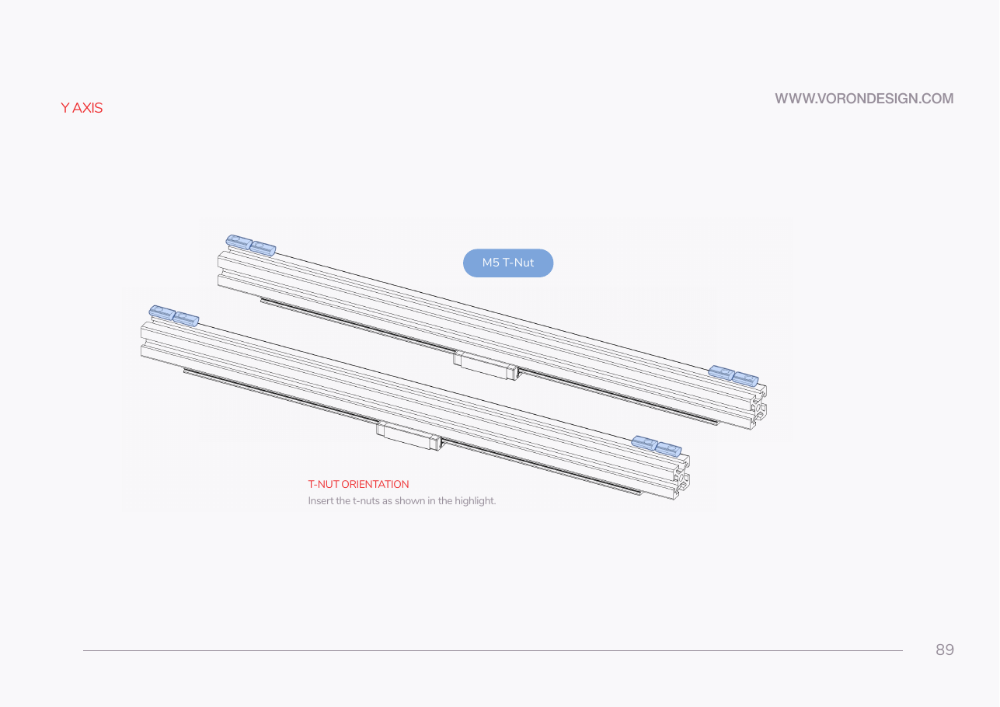

**What you're looking at:** The second Y axis is identical to the first; it only becomes the left or right side when its idler goes on. Its M5 T-nuts go in the face **opposite the rail**, the top face in the machine, for the idler and drive-frame flanges.

**Parts:**

- C extrusion ×1
- MGN9H 400 mm rail ×1
- M3 T-nut ×9
- M3×8 SHCS ×9
- M5 T-nut ×8
- tool: `MGN9_rail_guide_x2` jig ×2

**Do:**

1. Repeat Steps 05.10–05.12 on the second C extrusion, both rails facing the same way.
2. Slide **two M5 T-nuts into each end of each C extrusion**, eight in total, in the slot on the face **opposite the rail**.

**Check:** The two rails are equally centred, and each of the four extrusion ends has 2 M5 T-nuts in the top slot opposite the rail, none in the rail slot.

Source: [Voron manual p.89](https://github.com/VoronDesign/Voron-2/blob/de7e89d/Manual/Assembly_Manual_2.4r2.pdf#page=89)

---

### Step 05.14 — Load the reserved M5 + M3 pair at each end

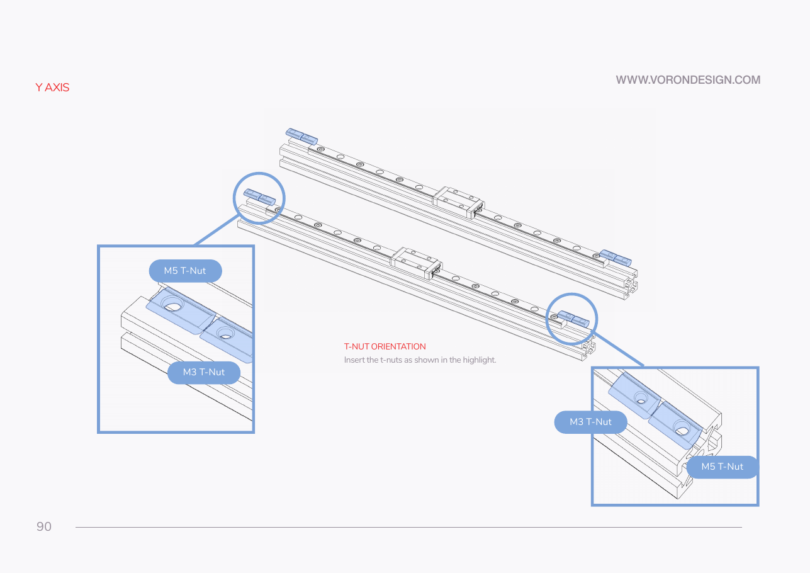

**What you're looking at:** One more M5 and one more M3 T-nut go in at each end, this time in the **rail's own slot**, the underside of the Y axis. Both anchor the Ch 06 Z joint bearing block and lower belt clip, and the idler and drive frames close these slots for good.

**Parts:**

- M5 T-nut ×4
- M3 T-nut ×4

**Do:**

1. At each end of each C extrusion, add **one M5 T-nut and one M3 T-nut** in the **rail's own slot**, in the bare 25 mm beyond the rail end. Not the top slot.
2. Put the M5 outermost and the M3 just inside it.

**Check:** Each end holds 2 M5 in the top slot, plus 1 M5 and 1 M3 in the rail slot beyond the rail end.

**Helper:** Checks every extrusion end: two M5 on top, one M5 and one M3 in the rail slot.

Source: [Voron manual p.90](https://github.com/VoronDesign/Voron-2/blob/de7e89d/Manual/Assembly_Manual_2.4r2.pdf#page=90)

---

### Step 05.15 — Stop the carriages running off

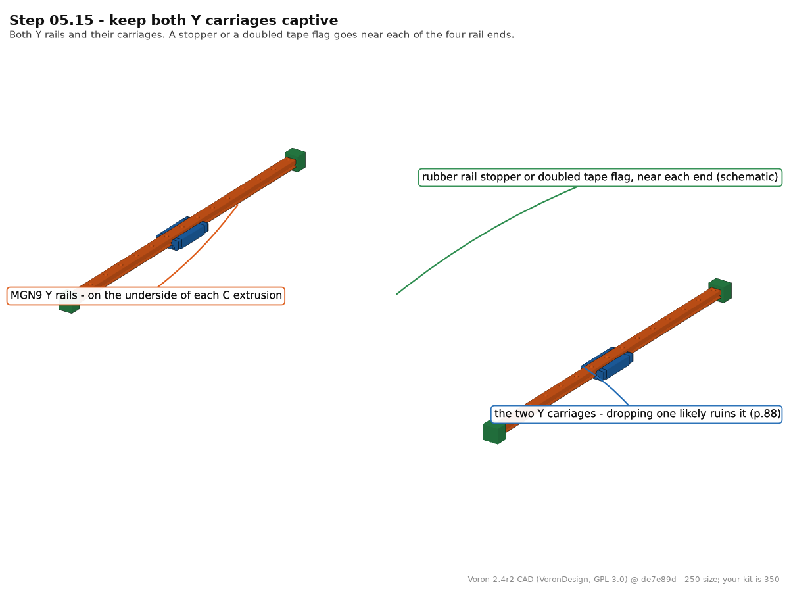
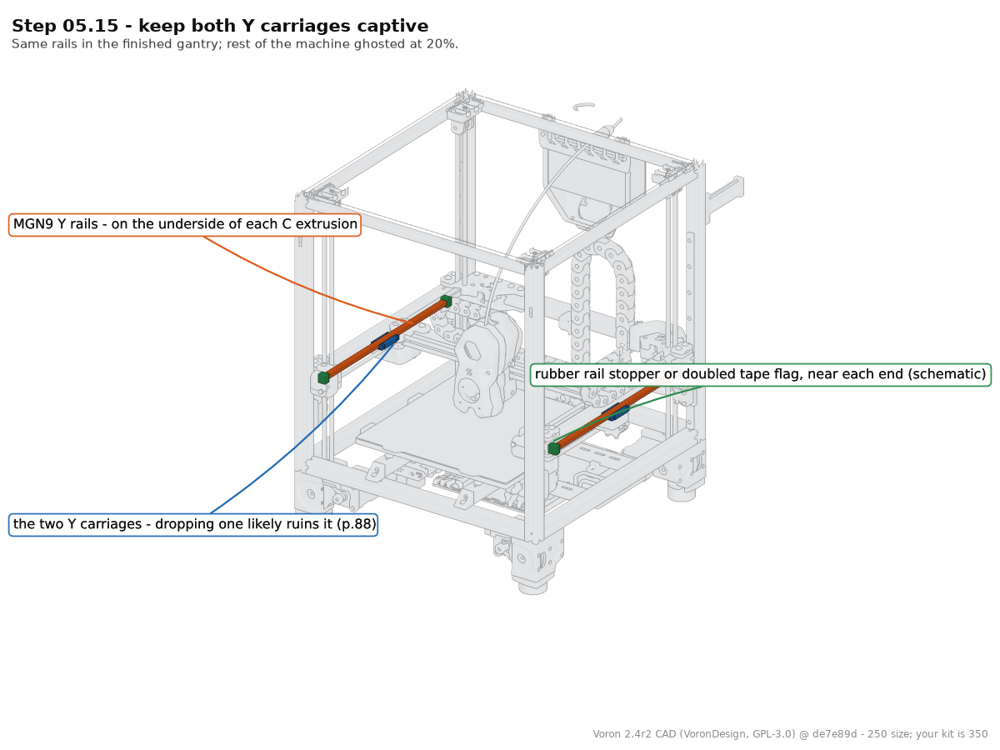

**What you're looking at:** A rail carriage keeps its balls only while it is on the rail: run it off the end and they scatter. The renders show the Y rails on the undersides of the C extrusions, each with one carriage and a stopper near each end.

**Parts:**

- tool: rubber rail stopper ×4
- consumable: masking tape, if the stoppers run short

**Do:**

1. Fit a rubber rail stopper, or a doubled tape flag, near each end of both Y rails so a carriage cannot run off.
2. Keep the stoppers: LDO reuses them under the Z joints during the Ch 06 install. [src](https://docs.ldomotors.com/en/voron/voron2/build-faq)

**Check:** Each Y carriage is trapped on its rail. The manual warns that *"dropping the carriage likely irreparably damages it"*.

The CAD Y rails are 300 mm MGN9; yours are 400 mm (Step 05.10). The stoppers go near the ends, wherever those ends are.

Source: [Voron manual p.88](https://github.com/VoronDesign/Voron-2/blob/de7e89d/Manual/Assembly_Manual_2.4r2.pdf#page=88) · [LDO Build Notes § Voron 2.4 build FAQ](https://docs.ldomotors.com/en/voron/voron2/build-faq) · CAD: Voron 2.4r2 STEP @ de7e89d

Pause: ~30 min since the last pause — both Y rails down and tightened, end M5 and M3 T-nuts loaded, both carriages trapped. Do not start a backer now: begin one only when you can finish it.

---

### Step 05.16 — Unpack and identify the titanium backers

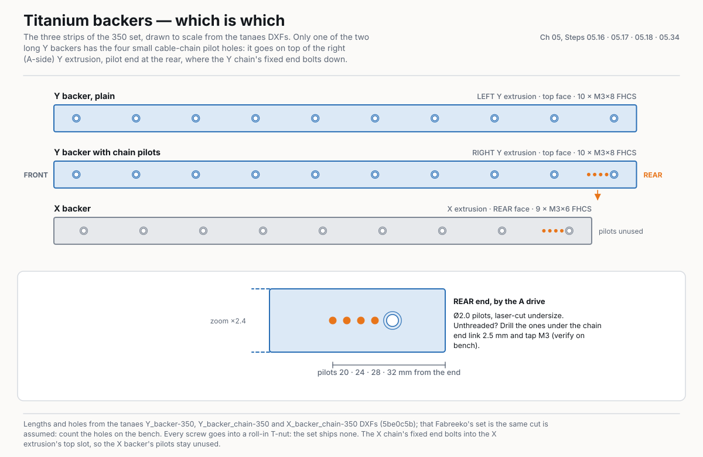

**What you're looking at:** The titanium backers are three drilled strips screwed to the face **opposite** a rail, cancelling most of the bow the steel rail puts into the aluminium as it heats. One long Y backer has four small pilot holes near one end, where the Y cable chain's fixed end screws down.

**Parts:**

- staged: titanium Y backer ×2 — from Ti backer set
- staged: titanium X backer ×1 — from Ti backer set
- staged: M3×8 FHCS ×20 — from Ti backer set
- staged: M3×6 FHCS ×9 — from Ti backer set

**Do:**

1. Sort them: the short one is **X**, and the long one with **four pilot holes** goes on the right.
2. Its pilots come tapped (threaded) M3 (verify on bench). If unthreaded, ask Fabreeko or LDO before Ch 10; never drill titanium.

**Check:** Three backers are sorted, the pilot one marked right with threaded pilots; screw holes count 10 per Y and 9 on X; 29 M3 T-nuts are set aside.

**Helper:** Sorts the backers by length and finds the one with the four small pilot holes.

A slightly bowed backer straightens as you clamp it down.

Source: [Ti extrusion-backers README (tanaes)](https://github.com/tanaes/whopping_Voron_mods/tree/main/extrusion_backers) · [Fabreeko backer set](https://www.fabreeko.com/products/v2-4-trident-titanium-extrusion-backers) · [West3D backer set](https://west3d.com/products/titanium-backers-for-voron-2-4-trident-3-pack) · CAD: Voron 2.4r2 STEP @ de7e89d

---

### Step 05.17 — Fit the first Y backer

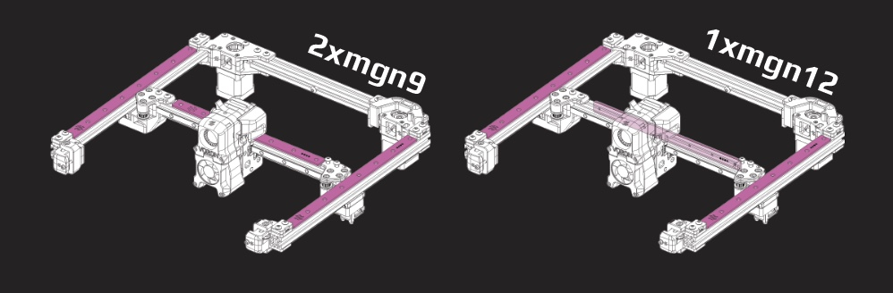

(no image of this kit's toolhead: the drawing shows the older Afterburner; only the magenta backer faces matter)

**What you're looking at:** This bare face of the first Y extrusion becomes the top of the right Y axis. FHCS are countersunk screws whose heads sink flush into the backer's cone-shaped holes; a hex key slips out of them, so use the T10 Torx.

**Parts:**

- titanium Y backer ×1 — from Ti backer set
- M3×8 FHCS ×10 — from Ti backer set
- M3 roll-in T-nut ×10
- tool: T10 Torx driver

**Do:**

1. This first C extrusion is the right Y and takes the **pilot-hole backer**. Lay it rail-down and work on the opposite face.
2. Roll ten M3 T-nuts in, lay the backer on, start every screw, then tighten the **M3×8 FHCS** from the centre outwards.
3. Tape-mark the pilot end **REAR**.

**Check:** The backer lies flat along its whole length, every screw is seated in its countersink, and both ends are clear of where the idler and drive frames land.

**Helper:** Holds the backer flat on the extrusion while you start every screw.

Never put a backer on the rail face. The point is to cancel the rail's bending with a strip on the face *opposite* it; doubling up on the rail side makes the bow worse. [src](https://github.com/tanaes/whopping_Voron_mods/tree/main/extrusion_backers)

Source: [Ti extrusion-backers README (tanaes)](https://github.com/tanaes/whopping_Voron_mods/tree/main/extrusion_backers) (image [`x_axis.jpeg`](https://raw.githubusercontent.com/tanaes/whopping_Voron_mods/main/extrusion_backers/images/x_axis.jpeg))

---

### Step 05.18 — Fit the second Y backer

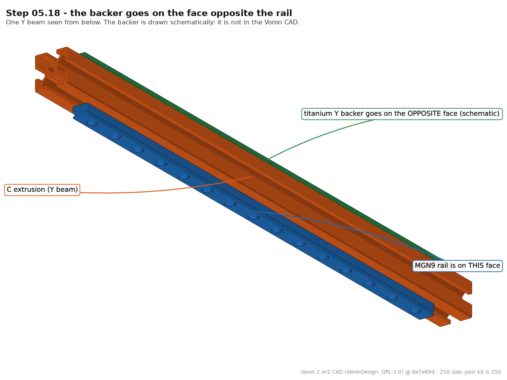
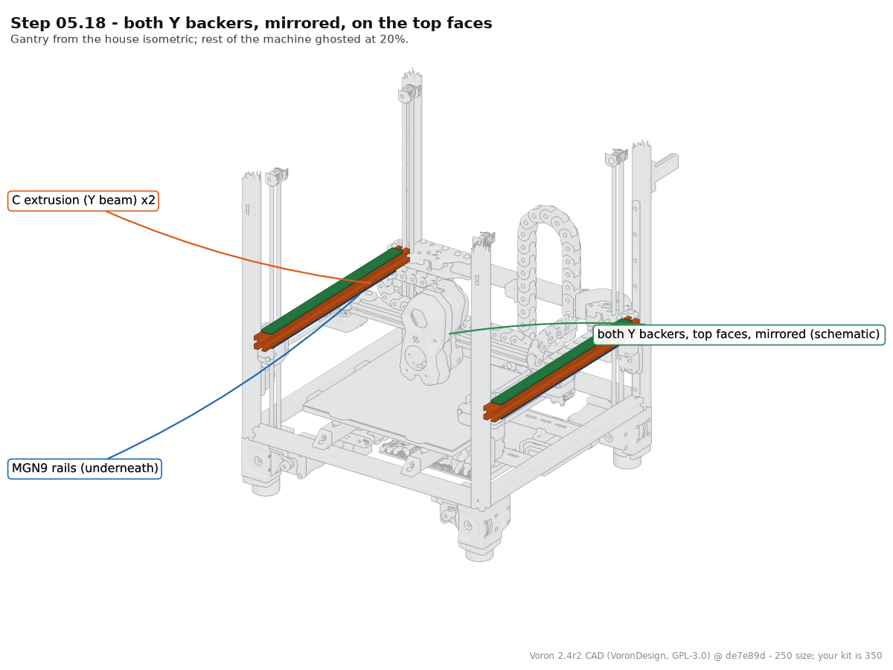

**What you're looking at:** The second Y extrusion gets the same treatment on the face opposite its rail. The first render shows one Y extrusion from underneath, rail face and backer face both in view; the second shows both Y beams in place, rails underneath and backers on top.

**Parts:**

- titanium Y backer ×1 — from Ti backer set
- M3×8 FHCS ×10 — from Ti backer set
- M3 roll-in T-nut ×10

**Do:**

1. Repeat with the **plain** Y backer on the second C extrusion, again on the face opposite its rail.
2. Lay the two Y assemblies side by side: rails facing the same way, backers facing the same way.

**Check:** Both backers lie flat on the face opposite the rail: the plain one here, and the pilot-hole one on the first extrusion with its pilot end marked REAR.

The CAD C extrusion is 350 mm with a 300 mm rail (the 250 machine); yours is the 350 kit's C with a 400 mm rail.

Source: [Ti extrusion-backers README (tanaes)](https://github.com/tanaes/whopping_Voron_mods/tree/main/extrusion_backers) · CAD: Voron 2.4r2 STEP @ de7e89d

Pause: ~35 min since the last pause — both titanium Y backers screwed down flat on the face opposite the rail. Before you stop, check that no screw head has been chewed by a slipping driver.

---

### Step 05.19 — Fit the front idler to the first Y axis

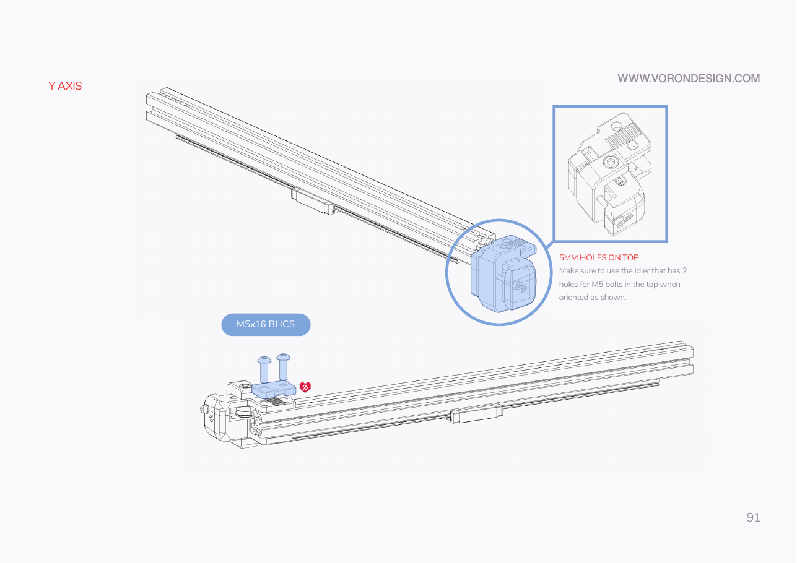{ crop="0.17 0.155 0.88 0.81" }

**What you're looking at:** The front idler block is the Ch 04 assembly that turns its belt around at the front corner. The blue upper Z-belt clip sits on its ridged top under the two M5×16, and in Ch 06 it clamps the second end of a Z belt.

**Parts:**

- reused: A idler assembly
- `[a]_z_belt_clip_upper_x4` ×1 (blue)
- M5×16 BHCS ×2

**Do:**

1. Take the **A idler**: FRONT RIGHT, the 21.6 mm frame, with **two M5 holes on top**.
2. Slide it onto the first C extrusion's unmarked end, the front.
3. Lay the upper clip over the holes, indent down, and drive two M5×16 BHCS through both.

**Check:** The clip sits flat on the idler top, both screws bite into T-nuts, and the idler is pulled up tight against the extrusion.

Source: [Voron manual p.91](https://github.com/VoronDesign/Voron-2/blob/de7e89d/Manual/Assembly_Manual_2.4r2.pdf#page=91) · [Video: Part 4 @0:06:41](https://www.youtube.com/watch?v=ViB5Ulc9zDI&list=PL0fUJbigELQPqpeGOgHYisG4KaSXVtnNY&t=401s)

---

### Step 05.20 — Check flush and notch orientation

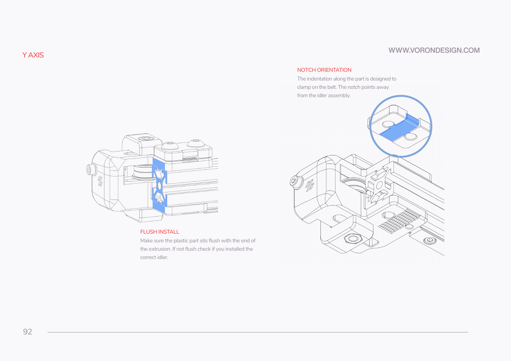{ crop="0.15 0.18 0.88 0.73" }

**What you're looking at:** The two front idlers are handed: different parts, not mirrored copies, with lower frames that differ by 10 mm to match the belt planes. Plastic flush with the end face means you have the correct one. The clip's notch is the indent that grips the belt.

**Parts:** none.

**Do:**

1. Sight the joint from the end: the plastic must sit flush with the end face.
2. A wrong-hand idler will not sit flush, so take it off rather than pulling it down with screws.
3. Check that the clip's notch points **away from the idler assembly**.

**Check:** The plastic is flush with the extrusion end, and the clip notch points away from the idler assembly.

Source: [Voron manual p.92](https://github.com/VoronDesign/Voron-2/blob/de7e89d/Manual/Assembly_Manual_2.4r2.pdf#page=92) · [Video: Part 4 @0:08:32](https://www.youtube.com/watch?v=ViB5Ulc9zDI&list=PL0fUJbigELQPqpeGOgHYisG4KaSXVtnNY&t=512s)

---

### Step 05.21 — Fit the second front idler

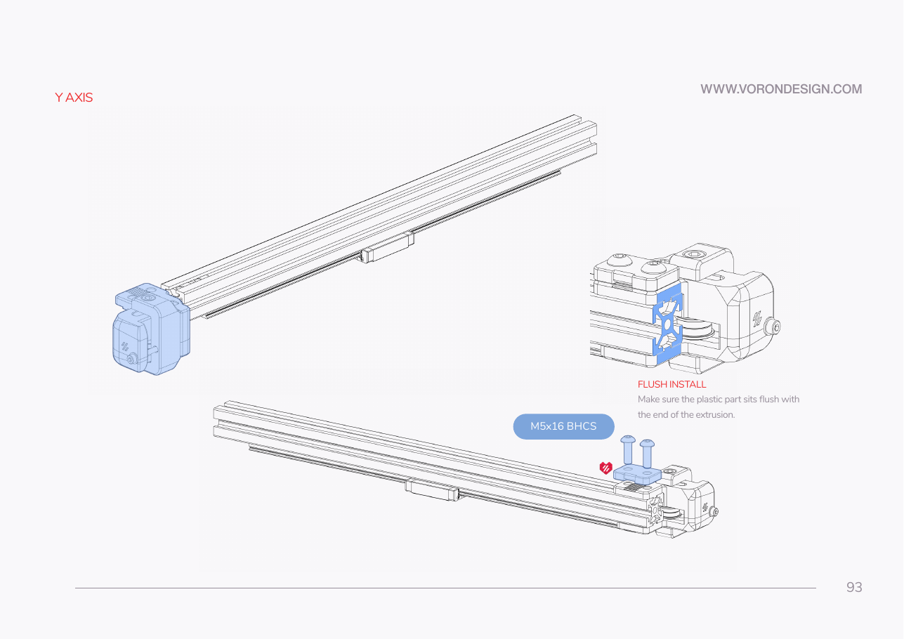

**What you're looking at:** The other front corner takes the opposite-hand idler and its own upper clip. After this the two Y assemblies are complete sides of the machine: rail, backer, idler and clip on each.

**Parts:**

- reused: B idler assembly
- `[a]_z_belt_clip_upper_x4` ×1 (blue)
- M5×16 BHCS ×2

**Do:**

1. Fit the **B idler** to the second Y assembly the same way: FRONT LEFT, the short 11.6 mm lower frame.
2. Push it flush, lay an upper clip on top, indent down, then drive two M5×16 BHCS through both, snug.

**Check:** Both Y assemblies have an idler and clip at the front, both flush, with both clip notches pointing away from the idler assembly.

Source: [Voron manual p.93](https://github.com/VoronDesign/Voron-2/blob/de7e89d/Manual/Assembly_Manual_2.4r2.pdf#page=93)

---

### Step 05.22 — Offer both Y axes to the drive units

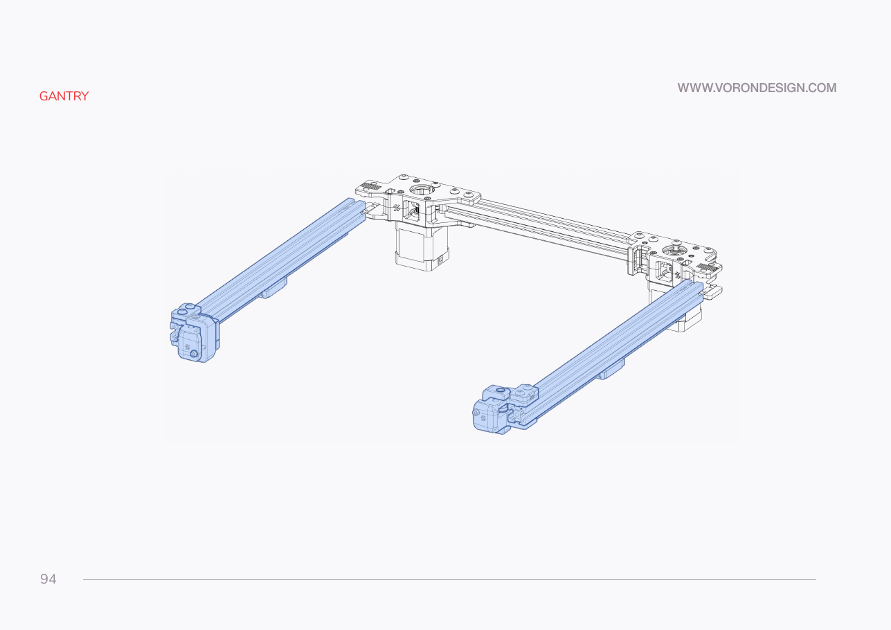

**What you're looking at:** Now the two sides meet the rear beam. The A drive takes the right-hand side and the B drive the left, so the Ch 04 belt planes reach the corners those belts run to. The result is a U, open at the front.

**Parts:**

- reused: both Y assemblies
- reused: the bridge and drives assembly

**Do:**

1. On a flat bench, bring each C extrusion into its drive frame: the **A idler** side into the A drive, the B idler side into the B drive.
2. Push each until the printed frame is flush with the extrusion end.

**Check:** The gantry is a U, with the A idler and A drive on one beam and B with B, and both rails and both backers face the same way.

Source: [Voron manual p.94](https://github.com/VoronDesign/Voron-2/blob/de7e89d/Manual/Assembly_Manual_2.4r2.pdf#page=94) · [Video: Part 4 @0:34:56](https://www.youtube.com/watch?v=ViB5Ulc9zDI&list=PL0fUJbigELQPqpeGOgHYisG4KaSXVtnNY&t=2096s)

---

### Step 05.23 — Bolt the Y axes to the drives

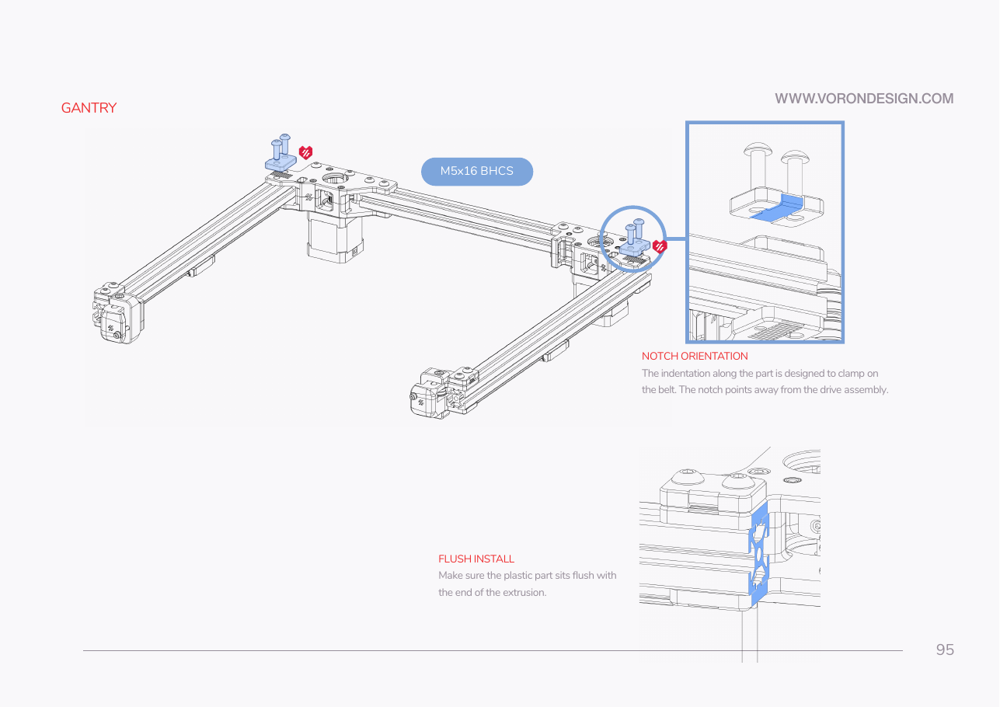{ crop="0.08 0.165 0.90 0.57" }

**What you're looking at:** Two M5×16 per side go down through an upper clip and the drive frame's flange into the rear-end T-nuts, closing the two rear corners. A block not pushed fully home leaves that corner short, and a short corner cannot be squared.

**Parts:**

- `[a]_z_belt_clip_upper_x4` ×2 (blue)
- M5×16 BHCS ×4

**Do:**

1. On each side, lay an upper clip on the drive frame's top flange, indent down, its notch pointing **away from the drive assembly**.
2. Drive two M5×16 BHCS through clip and flange into the rear M5 T-nuts, snug only.

**Check:** Four screws pass through two clips, both rear joints are flush, and both clip notches point away from the drive assembly.

Source: [Voron manual p.95](https://github.com/VoronDesign/Voron-2/blob/de7e89d/Manual/Assembly_Manual_2.4r2.pdf#page=95)

---

### Step 05.24 — Sanity-check the gantry frame, then leave it alone

{ crop="0.08 0.17 0.64 0.61" }

**What you're looking at:** All four corners are snug and none is torqued. Measuring inside face to inside face at both ends tells you the two Y axes are parallel. The frame can still rack, leaning into a parallelogram, and that freedom is deliberate: Ch 06 squares it in the frame.

**Parts:** none.

**Do:**

1. Lay the U-frame flat and measure from the inside face of one Y extrusion to the other, at the bridge and again at the idlers.
2. A difference means a corner block is not pushed home.
3. **Do not square or lock the gantry now**; Ch 06 does it in the frame.

**Check:** The front and rear spacings read the same on the rule.

**Helper:** Reads the rule at the idler end while you read it at the bridge.

Source: [Voron manual p.95](https://github.com/VoronDesign/Voron-2/blob/de7e89d/Manual/Assembly_Manual_2.4r2.pdf#page=95)

Pause: ~40 min since the last pause — front idlers fitted and both Y axes screwed to the drives, gantry frame checked and deliberately left slightly loose. Do not tighten anything further, and do not start an XY joint: each joint is a bearing stack you must finish in one go.

---

### Step 05.25 — Seat the M5 nuts in both XY joints

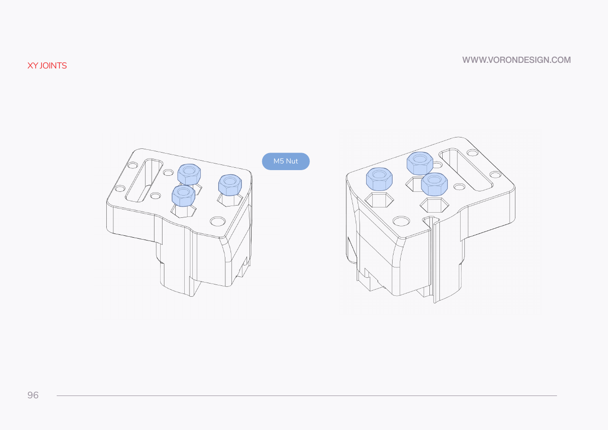
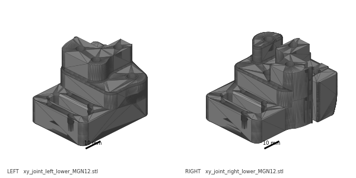

**What you're looking at:** The XY joints are the two printed blocks that ride on the Y carriages. Each is a thick **lower** body, about 34 mm, plus a thin **upper** plate, about 16 mm. The **right** lower body has a moulded wire channel; the **left** is plain.

**Parts:**

- `xy_joint_left_lower_MGN12` ×1
- `xy_joint_right_lower_MGN12` ×1
- M5 nut ×6

**Do:**

1. Drop **three M5 nuts** into the hex pockets of each XY joint body, flats lined up with the pocket.
2. Push each fully home with a spare M5 screw. A nut left sticking up stops the joint closing and cracks the pocket.

**Check:** Each joint has three nuts, all flush in their pockets, none turned out of the hex.

Source: [Voron manual p.96](https://github.com/VoronDesign/Voron-2/blob/de7e89d/Manual/Assembly_Manual_2.4r2.pdf#page=96) · [Video: Part 5 @1:18:07](https://www.youtube.com/watch?v=hTKCBrk36R0&list=PL0fUJbigELQPqpeGOgHYisG4KaSXVtnNY&t=4687s) (differs: substitutes Trident-repo parts still in beta at the time)

---

### Step 05.26 — Start the right XY joint bearing stack

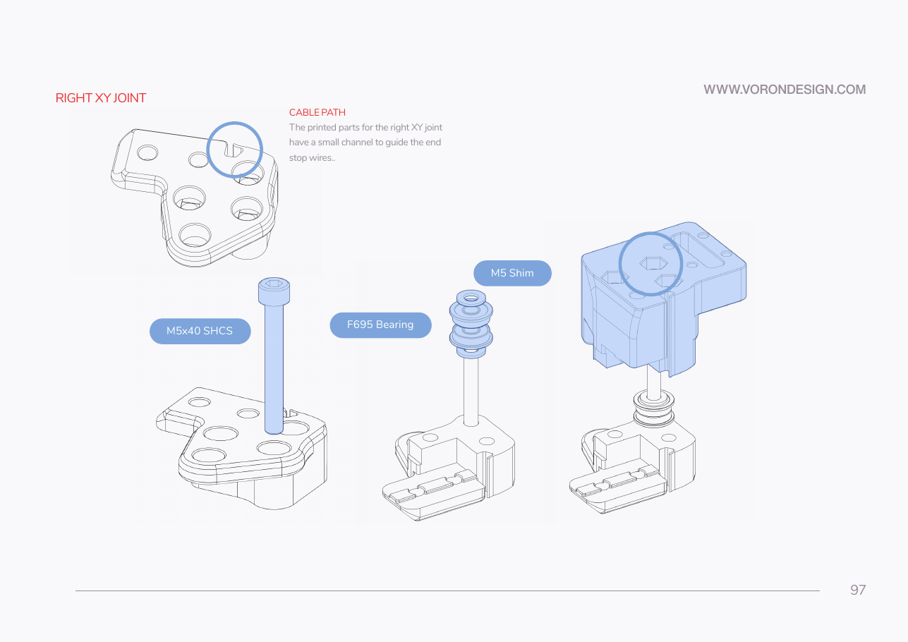{ crop="0.12 0.165 0.62 0.83" }
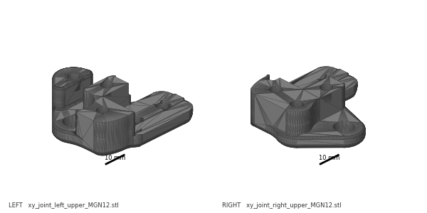
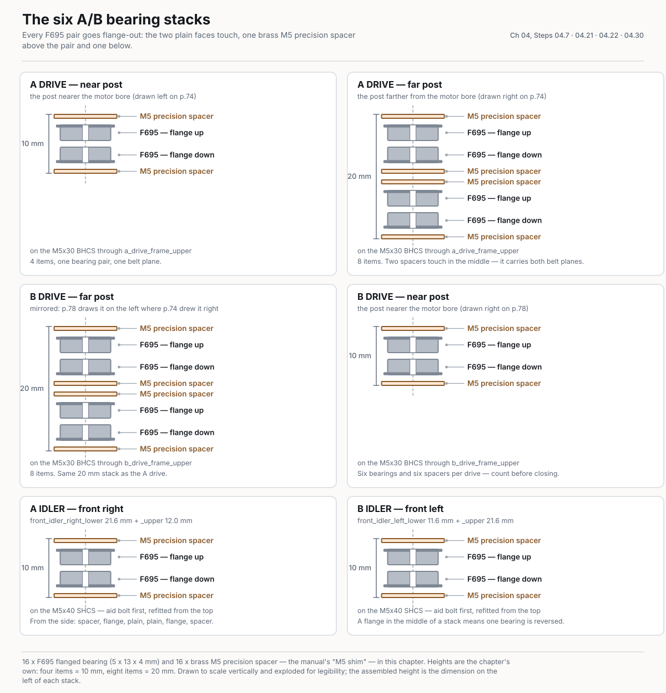

**What you're looking at:** The right-hand upper plate has the endstop wire channel, like its lower body. On the M5×40 you build the belt corner: two F695 flanged bearings, flanges out, between two brass precision spacers. In this LDO kit the manual's "M5 Shim" is that brass spacer, here and everywhere unless a page is explicitly noted otherwise. [src](https://docs.ldomotors.com/en/voron/voron2/build-faq)

**Parts:**

- `xy_joint_right_upper_MGN12` ×1
- M5×40 SHCS ×1
- F695 bearing ×2
- M5 precision spacer ×2

**Do:**

1. Keep the right-hand joint's moulded **cable path** clear and pointing as the page shows.
2. Push an M5×40 SHCS up through the upper plate.
3. Thread on, **bottom to top**: spacer, F695 **flange down**, F695 **flange up**, spacer.

**Check:** Four items are on the screw, reading spacer, flange, plain, plain, flange, spacer from the side; the bearings spin freely and the cable channel is clear.

Source: [Voron manual p.97](https://github.com/VoronDesign/Voron-2/blob/de7e89d/Manual/Assembly_Manual_2.4r2.pdf#page=97) · [LDO Build Notes § Voron 2.4 build FAQ](https://docs.ldomotors.com/en/voron/voron2/build-faq) · [Video: Part 3 @1:27:47](https://www.youtube.com/watch?v=ii14-2COjuA&list=PL0fUJbigELQPqpeGOgHYisG4KaSXVtnNY&t=5267s) (differs: pre-release kit had no titanium rail backers)

---

### Step 05.27 — Close the right XY joint

{ crop="0.61 0.33 0.84 0.82" }

**What you're looking at:** The lower body comes down over the bearing stack, and the M5×40's thread picks up one of its seated M5 nuts. The two halves must close plastic to plastic with no gap: a bearing pinched between them drags on the belt until Ch 07 finds it.

**Parts:**

- reused: `xy_joint_right_lower_MGN12` with its three M5 nuts

**Do:**

1. Bring the joint body down over the bearing stack so the M5×40's thread enters the nut pocket you loaded at Step 05.25.
2. Make the two halves meet with no gap and no bearing pinched between them.

**Check:** The halves are closed flat, the screw is caught in its nut, and the bearing stack still turns by finger.

Source: [Voron manual p.97](https://github.com/VoronDesign/Voron-2/blob/de7e89d/Manual/Assembly_Manual_2.4r2.pdf#page=97) · [Video: Part 3 @1:28:26](https://www.youtube.com/watch?v=ii14-2COjuA&list=PL0fUJbigELQPqpeGOgHYisG4KaSXVtnNY&t=5306s) (differs: pre-release kit had no titanium rail backers)

---

### Step 05.28 — Bolt the right XY joint together

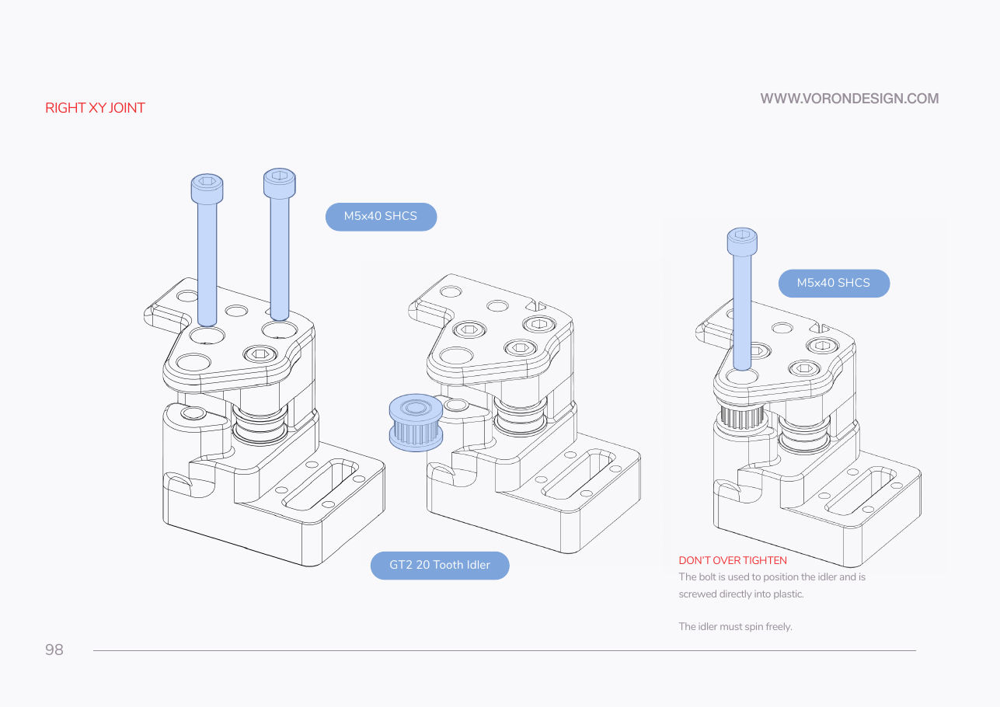{ crop="0.13 0.22 0.385 0.80" }

**What you're looking at:** The other two M5×40 go in now. Three screws into three trapped nuts turn the two printed halves into a single rigid block, which it has to be: belt tension in Ch 07 pulls hard on this corner and tries to pry it open.

**Parts:**

- M5×40 SHCS ×2

**Do:**

1. Turn the joint over, thin plate up, as the picture shows.
2. Drive the two remaining M5×40 SHCS down through the plate into the other two M5 nuts.
3. Tighten all three evenly and **firm**: they thread into steel nuts.

**Check:** No light shows between the halves anywhere, and the bearing stack still spins.

Source: [Voron manual p.98](https://github.com/VoronDesign/Voron-2/blob/de7e89d/Manual/Assembly_Manual_2.4r2.pdf#page=98) · [Video: Part 3 @1:21:27](https://www.youtube.com/watch?v=ii14-2COjuA&list=PL0fUJbigELQPqpeGOgHYisG4KaSXVtnNY&t=4887s) (differs: pre-release kit had no titanium rail backers)

---

### Step 05.29 — Fit the right joint's 20-tooth idler

{ crop="0.385 0.325 0.94 0.92" }

**What you're looking at:** The 20-tooth idler is a small toothed pulley running on its own bearing, and the toothed side of the belt wraps it. Its M5×40 threads straight into plastic and only holds the idler in place, so it stops the moment the head seats.

**Parts:**

- GT2 20-tooth idler ×1
- M5×40 SHCS ×1

**Do:**

1. Drop the 20T idler into its pocket.
2. Run an M5×40 SHCS down through it. This screw threads **directly into plastic** and only positions the idler.

**Check:** The idler spins under a fingernail flick with no drag and no wobble.

⚠ Do not over-tighten. Stop the moment the head seats and the idler still spins freely; a crushed pocket here shows up as belt noise and early wear in Ch 07.

Source: [Voron manual p.98](https://github.com/VoronDesign/Voron-2/blob/de7e89d/Manual/Assembly_Manual_2.4r2.pdf#page=98) · [Video: Part 3 @1:25:58](https://www.youtube.com/watch?v=ii14-2COjuA&list=PL0fUJbigELQPqpeGOgHYisG4KaSXVtnNY&t=5158s) (differs: pre-release kit had no titanium rail backers)

Pause: ~25 min since the last pause — right XY joint fully built and screwed together, its 20T idler fitted and spinning. Leave the left joint's parts bagged; do not part-build it.

---

### Step 05.30 — Build the left XY joint

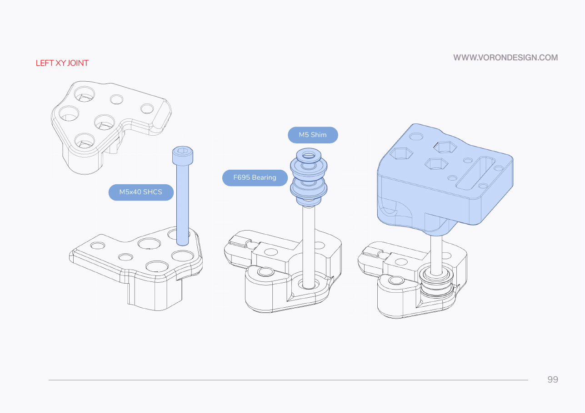

**What you're looking at:** The left joint is built exactly as the right was. The tell is the wire channel: only the right-hand pair has one, so if the parts in your hand have a channel, put them down; they belong to the right joint.

**Parts:**

- `xy_joint_left_upper_MGN12` ×1
- reused: `xy_joint_left_lower_MGN12` with its three M5 nuts
- M5×40 SHCS ×1
- F695 bearing ×2
- M5 precision spacer ×2

**Do:**

1. Mirror Steps 05.26–05.27: push an M5×40 up through the upper plate, then thread on spacer, F695 **flange down**, F695 **flange up**, spacer.
2. Close the joint body over it into its M5 nut. The left parts have no cable channel.

**Check:** The left and right joints sit on the bench as mirror images, not as two of the same hand.

Source: [Voron manual p.99](https://github.com/VoronDesign/Voron-2/blob/de7e89d/Manual/Assembly_Manual_2.4r2.pdf#page=99)

---

### Step 05.31 — Bolt the left joint and fit its idler

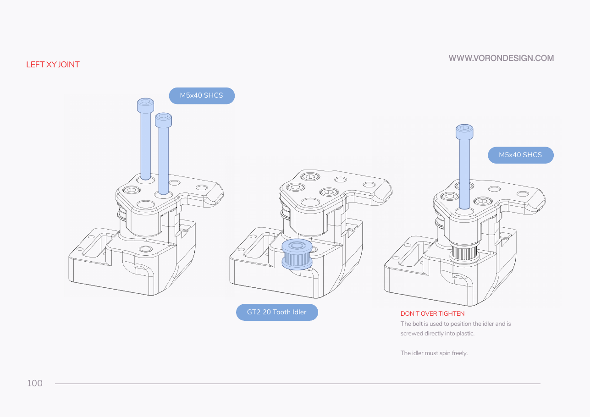

**What you're looking at:** Both joints end up with the same contents: four M5×40, two F695 between two precision spacers, and one 20-tooth idler each. Everything meant to spin must still spin freely; drag here becomes belt noise once the belts go on.

**Parts:**

- M5×40 SHCS ×3
- GT2 20-tooth idler ×1

**Do:**

1. Turn the joint over, thin plate up.
2. Drive two M5×40 SHCS down through the plate into the remaining M5 nuts, tightened evenly and firm into steel.
3. Fit the 20T idler and its own M5×40 into plastic: snug only, and it must spin.

**Check:** Both joints are complete, each with 4 M5×40, 2 F695, two spacers and one 20T idler, and all bearing stacks and both idlers turn freely.

Source: [Voron manual p.100](https://github.com/VoronDesign/Voron-2/blob/de7e89d/Manual/Assembly_Manual_2.4r2.pdf#page=100) · [Video: Part 3 @1:31:05](https://www.youtube.com/watch?v=ii14-2COjuA&list=PL0fUJbigELQPqpeGOgHYisG4KaSXVtnNY&t=5465s) (differs: pre-release kit had no titanium rail backers)

Pause: ~20 min since the last pause — both XY joints built, screwed together and fitted with their idlers, sitting loose on the bench. Do not slide them onto the X extrusion yet.

---

### Step 05.32 — Load M3 T-nuts for the X rail

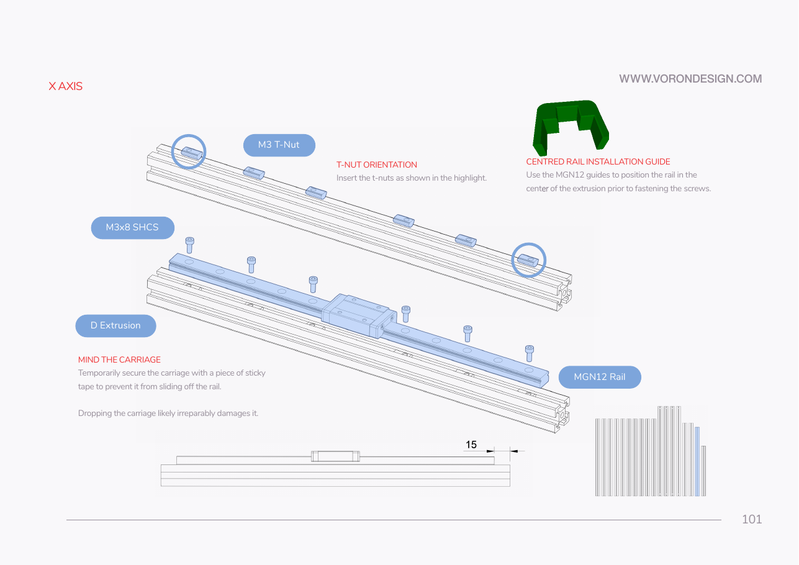{ crop="0.17 0.17 0.97 0.56" }

**What you're looking at:** The D extrusion is the **X beam**, the one the toolhead runs along. It carries an MGN12 rail, wider than the Y rails because it holds the toolhead off one carriage. The same T-nut rule applies: load them before the XY joints cap the ends.

**Parts:**

- D extrusion ×1
- M3 T-nut ×7

**Do:**

1. The **400 mm** MGN12H rail, `LDO-SLR12H-400Z1`, has 16 holes. Mark holes **2, 4 … 14**: every other hole from the second, so both end holes stay open.
2. Slide in **7** M3 T-nuts, about 15 mm clear of each end.

**Check:** Seven nuts lie flat, one per marked hole, with holes 1, 15 and 16 unmarked and the slot clear at both ends.

Source: [Voron manual p.101](https://github.com/VoronDesign/Voron-2/blob/de7e89d/Manual/Assembly_Manual_2.4r2.pdf#page=101)

---

### Step 05.33 — Centre and fit the MGN12 rail

{ crop="0.09 0.38 0.81 0.88" }

**What you're looking at:** The MGN12 goes on like the Y rails, with the larger MGN12 guides. It decides print quality across X, so it must sit centred along its whole length and pull down flat. LDO's rule holds here too: every other hole from the second, both end holes open. [src](https://docs.ldomotors.com/en/voron/voron2/build-faq)

**Parts:**

- MGN12H 400 mm rail ×1
- M3×8 SHCS ×7
- tool: `MGN12_rail_guide_x2` jig ×2

**Do:**

1. Tape the carriage mid-rail and peel off its Ch 00 bands with the rail flat.
2. Sit the rail on the D extrusion, centred by a guide at each end.
3. Start holes **2** and **14**, then the rest, and tighten from the centre outwards.

**Check:** **15 mm** of bare extrusion shows beyond each rail end, equal at both ends; the carriage runs with no tight spot, and no gap shows underneath.

Source: [Voron manual p.101](https://github.com/VoronDesign/Voron-2/blob/de7e89d/Manual/Assembly_Manual_2.4r2.pdf#page=101) · [LDO Build Notes § Voron 2.4 build FAQ](https://docs.ldomotors.com/en/voron/voron2/build-faq) · [LDO rail-grease guide](https://docs.ldomotors.com/guides/rail_grease_guide) · [Video: Part 3 @1:34:46](https://www.youtube.com/watch?v=ii14-2COjuA&list=PL0fUJbigELQPqpeGOgHYisG4KaSXVtnNY&t=5686s)

---

### Step 05.34 — Fit the X backer to the rear face

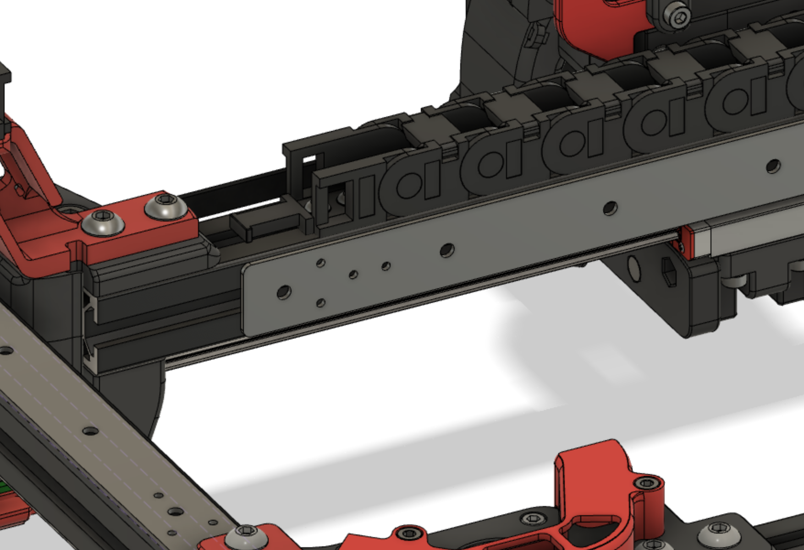

**What you're looking at:** The X backer goes on the rear face, the one opposite the rail, just as on the Y axes: steel rail on one face, titanium on the other, so the bows cancel. The top face stays bare for the XY joints and the cable bridge.

**Parts:**

- titanium X backer ×1 — from Ti backer set
- M3×6 FHCS ×9 — from Ti backer set
- M3 roll-in T-nut ×9
- tool: T10 Torx driver

**Do:**

1. Turn the D extrusion so the MGN12 rail faces you. The backer goes on the **rear face, opposite the rail**, not on top.
2. Roll nine M3 T-nuts in, start every screw, then tighten from the centre outwards. Use the **M3×6 FHCS for X**.

**Check:** The backer is flat on the face opposite the MGN12, every screw is an **M3×6** and seated, and the top face of the D extrusion is still clear.

The backers' designer puts the X backer on the rear, opposite the MGN12 rail, in most cases. With a single MGN12, a backer on top makes the bending from the two metals expanding at different rates worse, not better. [src](https://github.com/tanaes/whopping_Voron_mods/tree/main/extrusion_backers)

Source: [Ti extrusion-backers README (tanaes)](https://github.com/tanaes/whopping_Voron_mods/tree/main/extrusion_backers) (image [`fusion_x_chainmount.png`](https://raw.githubusercontent.com/tanaes/whopping_Voron_mods/main/extrusion_backers/images/fusion_x_chainmount.png))

---

### Step 05.35 — Check backer clearance for the cable chain


**What you're looking at:** The Y chain's fixed end screws onto the right Y backer, so it sits 3 mm higher than on a stock machine. The raised bridge lifts the chain's moving end, on the right XY joint, by the same 3 mm.

**Parts:**

- staged: cable-chain end link, for a dry fit
- staged: `XY_cable_chain_bridge-Igus-3mm_backer` ×1

**Do:**

1. Lay a chain end link on the right Y backer's pilot holes and check that the holes line up.
2. Set out the raised bridge, 3 mm taller than the stock one (verify on bench). Do not fit the chain.

**Check:** The raised bridge is set out, and the stock 2-hole bridge is put aside as the fallback.

"Igus" in the file name means the 2-hole chain-end pattern LDO ships. Both bridges have the same 5 mm foot, so the same M5×16 fit either one. [src](https://docs.ldomotors.com/guides/cable_chain_guide)

Source: [Ti extrusion-backers README (tanaes)](https://github.com/tanaes/whopping_Voron_mods/tree/main/extrusion_backers) · [LDO cable-chain guide](https://docs.ldomotors.com/guides/cable_chain_guide) · CAD: Voron 2.4r2 STEP @ de7e89d

Pause: ~35 min since the last pause — MGN12 rail centred and screwed down on the X extrusion, titanium X backer on the rear face, cable-chain clearance checked. Carriage taped so it cannot run off.

---

### Step 05.36 — Load the D extrusion's M5 T-nuts

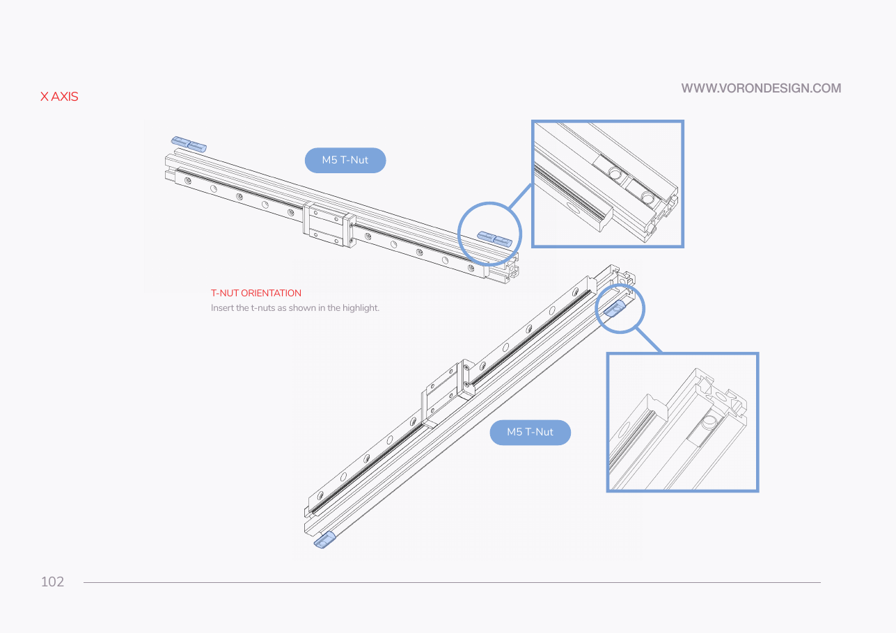{ crop="0.17 0.18 0.86 0.88" }

**What you're looking at:** Six M5 T-nuts go into two slots of the X beam: four in the top face the XY joints screw onto, and two in the bottom face for the screws that come up from underneath. They clamp each joint from both sides so it cannot rock.

**Parts:**

- M5 T-nut ×6

**Do:**

1. In the **top** slot, at 90° to the rail face, put **two M5 T-nuts at each end**, four in total.
2. In the **bottom** slot put **one at each end**, two in total. Nothing goes in the rail or backer slots.

**Check:** Six M5 T-nuts are in, 4 + 2, and the two singles line up with the through-holes the M5×30 screws will use from underneath.

**Helper:** Counts the six M5 T-nuts aloud: four in the top slot, two underneath.

Source: [Voron manual p.102](https://github.com/VoronDesign/Voron-2/blob/de7e89d/Manual/Assembly_Manual_2.4r2.pdf#page=102)

---

### Step 05.37 — Slide both XY joints onto the X extrusion

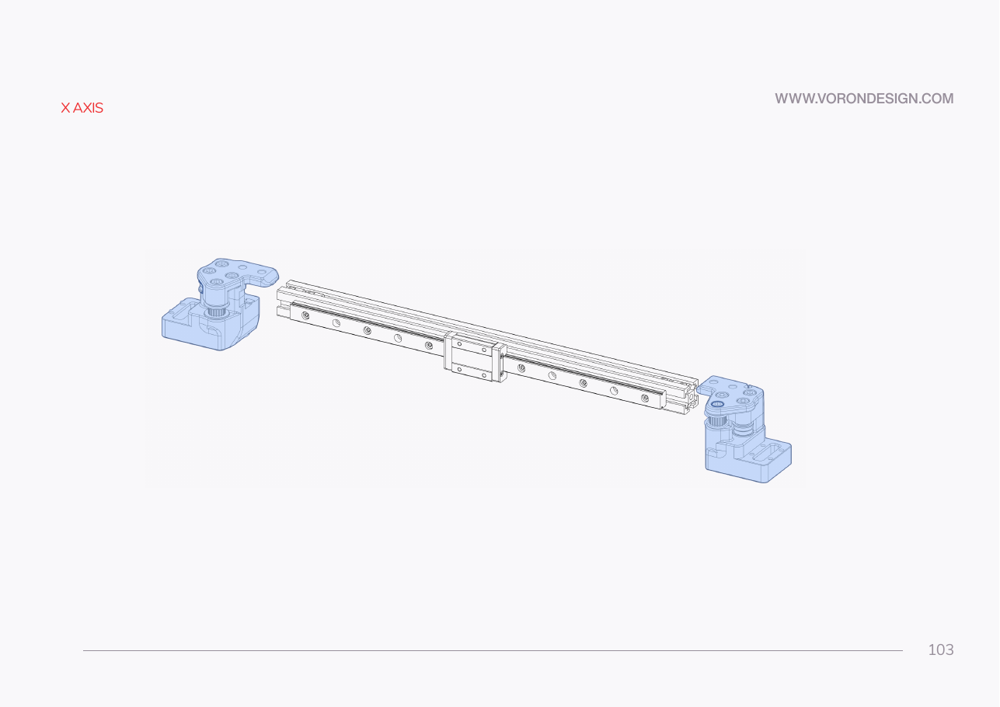

**What you're looking at:** Each joint's pocket slides over one end of the X beam. This is the first time the X axis exists as one object: beam, rail, backer and both belt corners.

**Parts:**

- reused: left XY joint
- reused: right XY joint

**Do:**

1. Push a joint onto each end of the D extrusion: the left joint on the left end, and the right joint, the one with the endstop cable channel, on the right.
2. Seat each until the extrusion bottoms out in the joint's pocket.

**Check:** Both joints are fully home, and the two 20T idlers and the two bearing stacks all face the same way along the extrusion.

Source: [Voron manual p.103](https://github.com/VoronDesign/Voron-2/blob/de7e89d/Manual/Assembly_Manual_2.4r2.pdf#page=103)

---

### Step 05.38 — Bolt the joints from above, with the cable bridge

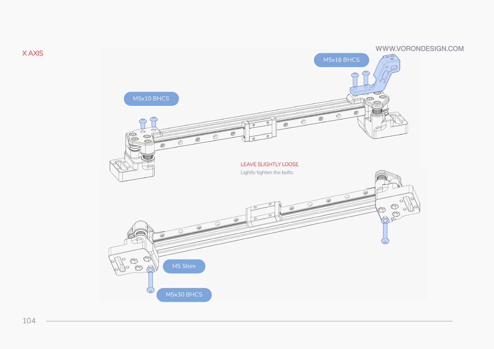{ crop="0.21 0.152 0.84 0.515" }

**What you're looking at:** Screws go through the top of each joint into the beam's top-slot T-nuts. On the right, the cable bridge's foot is sandwiched under the heads, so that side needs the longer M5×16. They stay slightly loose, because Ch 06 squares the gantry by nudging these joints.

**Parts:**

- M5×10 BHCS ×2
- `XY_cable_chain_bridge-Igus-3mm_backer` ×1
- M5×16 BHCS ×2

**Do:**

1. **Left** joint: drive two M5×10 BHCS down into the top-slot T-nuts.
2. **Right** joint: lay the cable bridge's foot over the same two holes and screw through both with the longer **M5×16 BHCS**.
3. Tighten lightly, as the page says: *"LEAVE SLIGHTLY LOOSE"*.

**Check:** The bridge foot lies flat with its arm standing up on the right-hand side, and all four screws are started and lightly tightened, none torqued.

Source: [Voron manual p.104](https://github.com/VoronDesign/Voron-2/blob/de7e89d/Manual/Assembly_Manual_2.4r2.pdf#page=104)

---

### Step 05.39 — Bolt the joints from below

{ crop="0.21 0.46 0.86 0.87" }

**What you're looking at:** Two more screws go up into the joints from under the beam, each with a black washer to spread the load on the plastic. Pulled from both faces, the joint cannot rock, but it stays lightly tightened until squaring. Here LDO uses the black M5 washer, not the precision spacer, for the manual's "M5 Shim". [src](https://docs.ldomotors.com/en/voron/voron2/build-faq)

**Parts:**

- M5×30 BHCS ×2
- black M5 washer ×2

**Do:**

1. Turn the X assembly over.
2. Run an M5×30 BHCS, with a washer under its head, up into each of the single M5 T-nuts from Step 05.36.
3. Tighten lightly again: the joint stays slightly loose until Ch 06.

**Check:** Both M5×30 are in with black washers under the heads, both lightly tightened.

LDO's note for p.104: *"Use the black M5 Washer instead of the M5 Shim cause it looks nicer."* This page is the documented exception to the precision-spacer substitution.

Source: [Voron manual p.104](https://github.com/VoronDesign/Voron-2/blob/de7e89d/Manual/Assembly_Manual_2.4r2.pdf#page=104) · [LDO Build Notes § Voron 2.4 build FAQ](https://docs.ldomotors.com/en/voron/voron2/build-faq)

---

### Step 05.40 — Check the X axis assembly

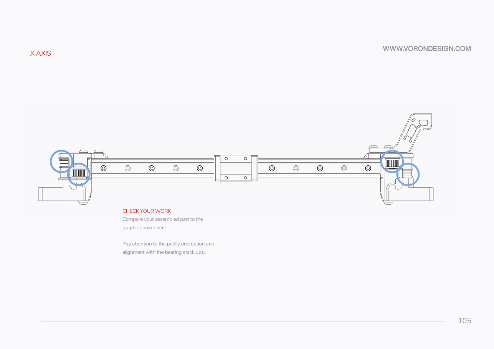

**What you're looking at:** Check the finished X axis against the drawing. Each belt's two corners must sit at the same height: one a millimetre out feeds the belt into the drive pulley at an angle and chews its edge.

**Parts:** none.

**Do:**

1. Check the order: on the **left** joint the F695 stack is upper and the 20T idler lower; on the **right** joint the 20T is upper and the F695 lower.
2. Sight along the extrusion: left 20T level with right F695, left F695 level with right 20T. Spin all four.

**Check:** The left 20T is level with the right F695 and the left F695 with the right 20T, nothing binds, and the MGN12 carriage still slides freely and is still taped.

**Helper:** Spins each bearing stack and idler and calls out any that drags.

Source: [Voron manual p.105](https://github.com/VoronDesign/Voron-2/blob/de7e89d/Manual/Assembly_Manual_2.4r2.pdf#page=105)

Pause: ~35 min since the last pause — both XY joints screwed to the X extrusion top and bottom, cable bridge on, assembly checked against p.105. Still motors down, the way it runs. The flip is the next step: do not try it alone.

---

### Step 05.41 — Turn the gantry upside down

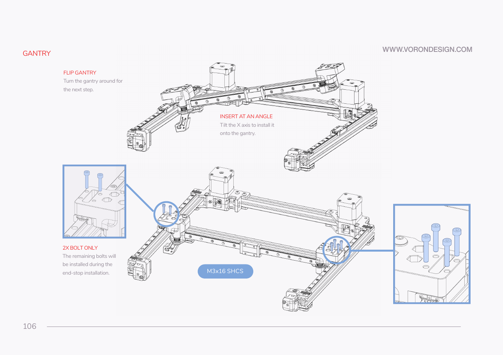{ crop="0.11 0.15 0.76 0.465" }

**What you're looking at:** So far the gantry has been built the way it runs: motors hanging below the bridge, Y rails underneath. Now it goes **upside down**, motors up and both Y rails facing up, so the X axis can be lowered onto the carriages.

**Parts:** none.

**Do:**

1. Get help: the gantry is large and the drives are heavy.
2. Turn it over so the A/B motors point **up** and both Y rails face you.
3. **The gantry is now upside down**, and it stays that way through Step 05.48.

**Check:** The motors are up, both Y rails and carriages are up, and nothing landed on a bearing stack. Left and right are now swapped from where you stand.

**Helper:** Holds the idler end level while you turn the gantry over.

Source: [Voron manual p.106](https://github.com/VoronDesign/Voron-2/blob/de7e89d/Manual/Assembly_Manual_2.4r2.pdf#page=106)

---

### Step 05.42 — Insert the X axis at an angle

{ crop="0.25 0.16 0.76 0.465" }

**What you're looking at:** The X axis drops onto the two Y carriages, the sliding blocks on the Y rails. Tilting it lets you land one joint at a time; lowering it flat means fighting both carriages at once, and a carriage shoved off its rail is ruined.

**Parts:**

- reused: the X axis assembly

**Do:**

1. Tilt the X axis in and land one joint on its Y carriage, then the other.
2. The right joint, with the cable bridge, goes on the **A drive** side, which is on your **left** now that the gantry is upside down.

**Check:** Both joints sit square on their carriages with the screw holes lined up, nothing fouls the Y extrusion, and the MGN12 rail faces the idler end.

**Helper:** Holds one XY joint on its carriage while you land the other.

Source: [Voron manual p.106](https://github.com/VoronDesign/Voron-2/blob/de7e89d/Manual/Assembly_Manual_2.4r2.pdf#page=106)

---

### Step 05.43 — Bolt the XY joints to the Y carriages

{ crop="0.11 0.45 0.95 0.88" }

**What you're looking at:** M3×16 screws go down through each XY joint into the threaded holes in the Y carriage below it. The right joint gets only two: the XY endstop pod, fitted next, fills its other two holes with its own **M3×30**.

**Parts:**

- M3×16 SHCS ×6

**Do:**

1. Fit all four M3×16 SHCS in the **left** joint.
2. Fit **two only** in the **right** joint. The page says: *"2X BOLT ONLY: the remaining bolts will be installed during the end-stop installation."*
3. Tighten all six firm: nothing later tightens them.

**Check:** One joint has 4 screws and the other 2, no M3×16 is left over, and the two empty holes wait for the pod's M3×30 in the next step.

Source: [Voron manual p.106](https://github.com/VoronDesign/Voron-2/blob/de7e89d/Manual/Assembly_Manual_2.4r2.pdf#page=106)

---

### Step 05.49 — Fit the XY endstop pod to the right joint

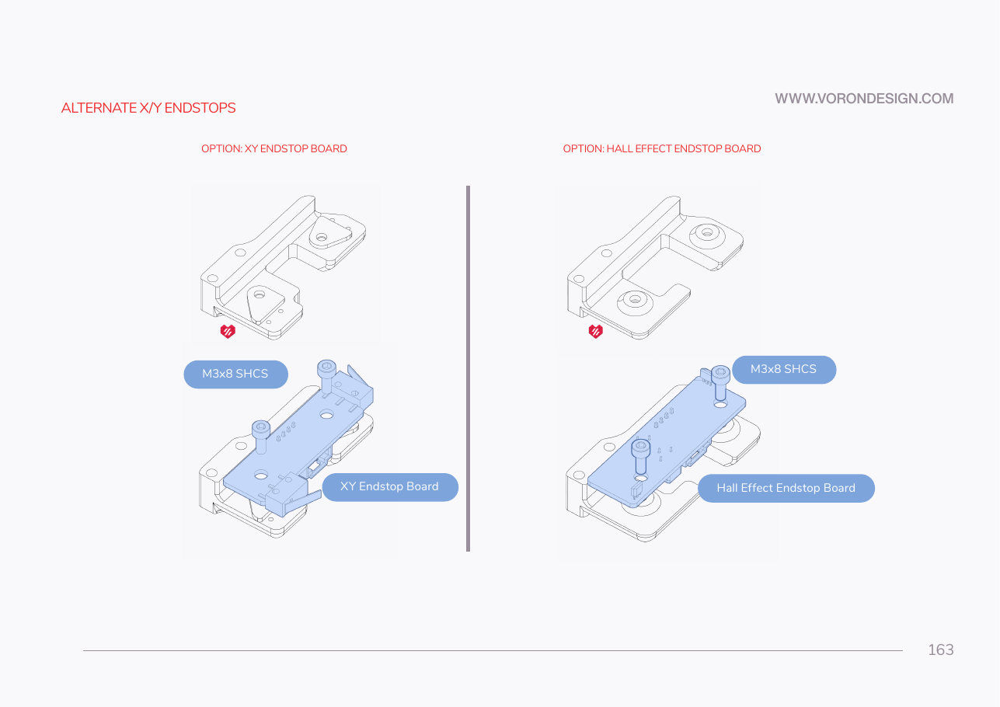{ crop="0.08 0.17 0.48 0.90" }
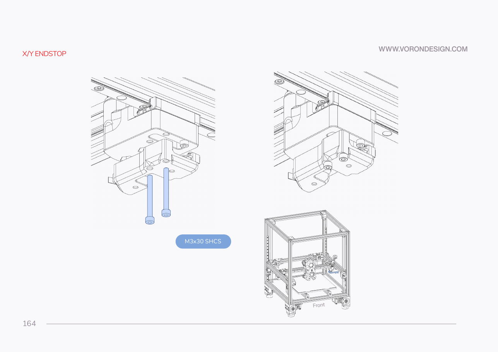{ crop="0.17 0.18 0.46 0.74" }

**What you're looking at:** The XY endstop board carries both limit switches, which give `G28` (homing) a repeatable starting point. It screws into the blue pod, and the pod fills the right joint's two empty holes, so that joint has all four screws before Ch 06 and Ch 07 load it.

**Parts:**

- `[a]_endstop_pod_D2F_switch` ×1
- XY endstop PCB ×1
- M3×8 SHCS ×2
- M3×30 SHCS ×2

**Do:**

1. Use only p.163's left-hand option, as LDO says; this kit has no hall-effect endstops: the board on the pod as drawn, two M3×8 SHCS. [src](https://docs.ldomotors.com/en/voron/voron2/build-faq)
2. Set the pod under the **right** XY joint, the bridge one, on your left. Drive two M3×30 SHCS through it into the empty holes, firm.

**Check:** The board is flat, both switches click, the pod is solid with no rotation, and the right joint now holds four screws.

**Helper:** Presses both switches on the fitted board and says whether each one clicks cleanly.

LDO's note for p.163: *"Follow only the step for the XY Endstop board."* Ignore the hall-effect half of the page. The endstop cable stays bagged until Ch 10.

Source: [Voron manual p.163](https://github.com/VoronDesign/Voron-2/blob/de7e89d/Manual/Assembly_Manual_2.4r2.pdf#page=163) · [Voron manual p.164](https://github.com/VoronDesign/Voron-2/blob/de7e89d/Manual/Assembly_Manual_2.4r2.pdf#page=164) · [Voron manual p.106](https://github.com/VoronDesign/Voron-2/blob/de7e89d/Manual/Assembly_Manual_2.4r2.pdf#page=106) · [LDO Build Notes § Voron 2.4 build FAQ](https://docs.ldomotors.com/en/voron/voron2/build-faq) · [Video: Part 6 @1:30:12](https://www.youtube.com/watch?v=8pWoYkY1DiA&list=PL0fUJbigELQPqpeGOgHYisG4KaSXVtnNY&t=5412s) (differs: fitted with the gantry in the frame)

---

### Step 05.44 — Run the X axis end to end

{ crop="0.255 0.47 0.745 0.89" }

**What you're looking at:** This is the first real test of the gantry as a mechanism. Even, light resistance the whole way means both rails are centred and both carriages sit square. Resistance that grows towards one end is racking, a Ch 06 problem, not a rail problem.

**Parts:** none.

**Do:**

1. Push the X axis slowly end to end several times, a hand on each XY joint.
2. A tight spot means a rail is not centred; stiffness that rises towards one end means racking. Do **not** loosen rails to fix it.

**Check:** The X axis travels fully in both directions with no notch and no rising resistance, both Y carriages moving together. Racking is normal and is corrected in Ch 06.

**Helper:** Slides the X carriage slowly end to end and reports any rough spot.

Source: [Voron manual p.106](https://github.com/VoronDesign/Voron-2/blob/de7e89d/Manual/Assembly_Manual_2.4r2.pdf#page=106)

Pause: ~40 min since the last pause — gantry upside down (motors up), X axis in and screwed to both Y carriages, endstop pod on the right joint, running end to end without binding. It stays upside down into Ch 06. The belts are still bagged and the XY joint screws only lightly tightened: leave both alone.

---

### Step 05.45 — Stage the X-carriage frame halves

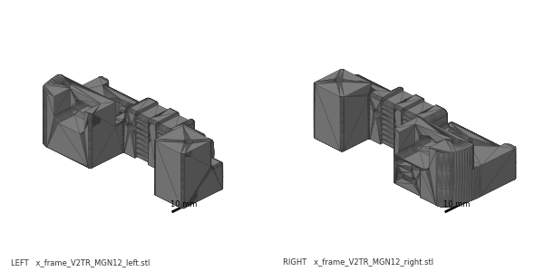
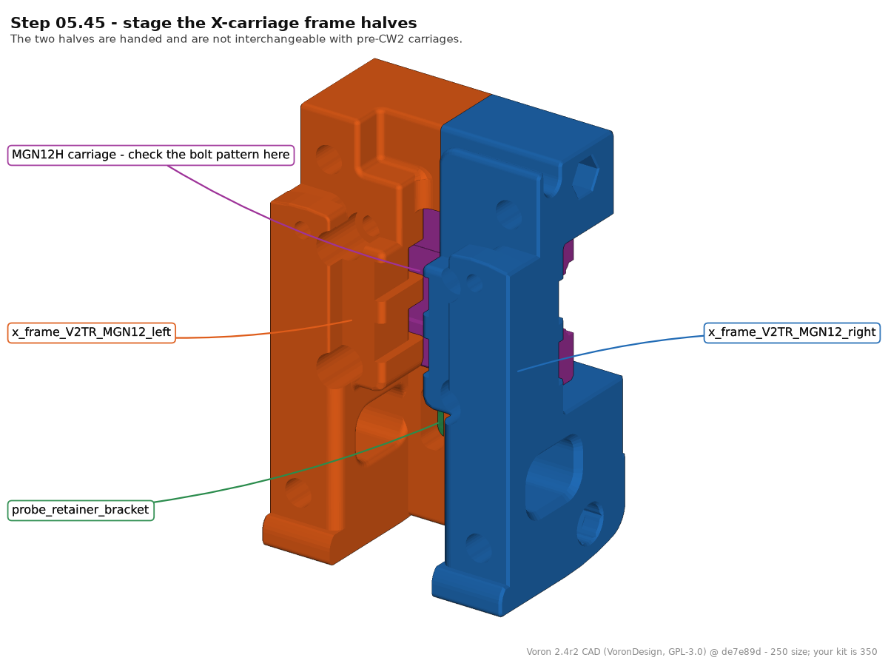
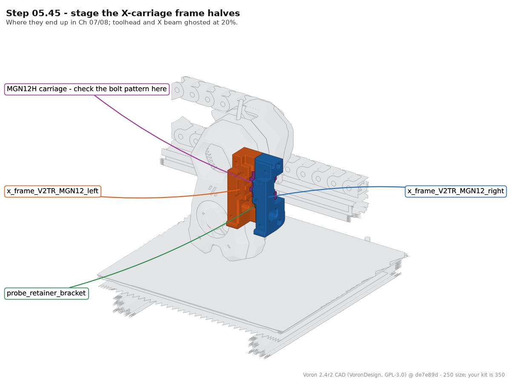

**What you're looking at:** The X carriage is the two-part frame that clamps onto the MGN12 carriage and becomes the mounting plate for the whole toolhead. These are the Clockwork 2 halves, handed so they fit together only one way; older X-carriage parts look the same and will not fit. LDO says to double-check you have the correct X carriage for Clockwork 2 and to follow the Stealthburner manual. [src](https://docs.ldomotors.com/en/voron/voron2/build-faq)

**Parts:**

- staged: `x_frame_V2TR_MGN12_left` ×1
- staged: `x_frame_V2TR_MGN12_right` ×1
- staged: `probe_retainer_bracket` ×1

**Do:**

1. Offer the two carriage halves to the MGN12 carriage and confirm the screw pattern matches before you commit any heat-set inserts.
2. Bag them, labelled, with the probe retainer.

**Check:** The screw pattern matches the MGN12 carriage, and both halves and the probe retainer are bagged and labelled for Ch 07.

LDO's note for p.129–130: *"If you are building Clockwork 2 double-check that you have the correct X-Carriage and follow the instructions in the Stealthburner manual."* The carriage goes on with the belts in Ch 07; the toolhead itself is Ch 08.

Source: [Voron manual p.129](https://github.com/VoronDesign/Voron-2/blob/de7e89d/Manual/Assembly_Manual_2.4r2.pdf#page=129) · [LDO Build Notes § Voron 2.4 build FAQ](https://docs.ldomotors.com/en/voron/voron2/build-faq) · [Video: Part 5 @1:05:47](https://www.youtube.com/watch?v=hTKCBrk36R0&list=PL0fUJbigELQPqpeGOgHYisG4KaSXVtnNY&t=3947s) (differs: substitutes Trident-repo parts still in beta at the time · MGN12 X was a mod then; it is stock on this kit) · CAD: Voron 2.4r2 STEP @ de7e89d

---

### Step 05.46 — Bag what belongs to later chapters


**What you're looking at:** The renders show both either-or choices: the D2F XY endstop pod you fitted, never the hall-effect pod, and a 2-hole bridge, the raised one included, never a 3-hole bridge. LDO's kit includes the XY microswitch board, so the D2F pod is the one to print. [src](https://docs.ldomotors.com/en/voron/voron2/printed_part_guide_rev_d)

**Parts:**

- staged: `[a]_cable_cover` ×1

**Do:**

1. Bag the `[a]_cable_cover` and the unused bridge variant separately, labelled.

**Check:** Two bags are labelled, and nothing Ch 06 or Ch 07 will need is loose on the bench.

**Helper:** Labels the two bags and writes what is inside each one.

Source: [LDO printed-parts guide (Rev D)](https://docs.ldomotors.com/en/voron/voron2/printed_part_guide_rev_d) · CAD: Voron 2.4r2 STEP @ de7e89d

---

### Step 05.47 — Stop here: no belts, no squaring

{ crop="0.11 0.45 0.95 0.88" }

**What you're looking at:** The gantry is complete as a mechanism and deliberately unfinished as a machine. Belts and squaring wait because the official squaring procedure *begins* by releasing A/B belt tension: tension them now and Ch 06 simply undoes it.

**Parts:** none.

**Do:**

1. Do not cut, route or tension the A/B belts.
2. Do not tighten the XY joints "properly", and do not square the gantry.
3. Ch 06 squares it **in the frame, with A/B tension released and the lower Z joints dropped**.

**Check:** The A/B belts are still in their bag, and the XY joint screws are still only lightly tightened.

Source: [Voron manual p.106](https://github.com/VoronDesign/Voron-2/blob/de7e89d/Manual/Assembly_Manual_2.4r2.pdf#page=106) · [Voron docs § V2 Gantry Squaring](https://docs.vorondesign.com/build/mechanical/v2_gantry_squaring.html)

---

### Step 05.48 — Log the measurements

(no image — see text)

**What you're looking at:** This is the record you will want in Ch 06. The rail overhangs show that each rail is centred; the two Y-to-Y spacings are the baseline you measure against once the gantry has been squared in the frame.

**Parts:**

- tool: pen

**Do:**

1. Record the rail overhangs you measured, Y and X at both ends, the two Y-to-Y spacings, which face each backer is on, and anything you left deliberately loose.

| Measurement | Target | Yours | Notes |
|---|---:|---|---|
| Y rail overhang, extrusion 1 — end A / end B | 25 / 25 mm | | |
| Y rail overhang, extrusion 2 — end A / end B | 25 / 25 mm | | |
| X rail overhang — end A / end B | 15 / 15 mm | | |
| Inside Y-to-Y spacing at the bridge | — | | |
| Inside Y-to-Y spacing at the idlers | = at bridge | | |
| Backer face — Y1 / Y2 / X | top / top / rear | | |
| Endstop pod on the right joint, M3×30 SHCS (p.164) | 2 | | |

**Check:** The numbers are written down, not "looked fine": you will want the Y-to-Y spacings when the gantry is squared in Ch 06.

**Helper:** Writes each gantry measurement into the log as you call it out.

Source: [Voron manual p.107](https://github.com/VoronDesign/Voron-2/blob/de7e89d/Manual/Assembly_Manual_2.4r2.pdf#page=107) · [survey §7.5](../voron-build-instructions-survey.md)

Pause: ~25 min since the last pause — gantry complete and still upside down (motors up), measurements written down, Ch 06 and Ch 07 parts bagged and labelled. Do not tension belts and do not square the gantry: both belong to Ch 06 and Ch 07, and both would be undone.

---

## Checkpoint 05

**Built:** a complete gantry with the X axis riding on both Y rails

- [ ] The E extrusion is joined to both drive units with 8 M5×10 BHCS; the drives are parallel, with no twist
- [ ] Both MGN9 rails are centred and tightened on holes **2, 4 … 18**, both end holes open, with equal overhang at both ends
- [ ] The MGN12 rail is centred and tightened on holes **2, 4 … 14**, both end holes open, with equal overhang at both ends
- [ ] Every carriage is held by a stopper or tape, and none was dropped
- [ ] Each of the four C-extrusion ends has 2 M5 in the top (backer) slot, and 1 M5 plus 1 M3 in the rail slot beyond the rail end
- [ ] **The titanium backers are on the face opposite the rail**: the top of both Y extrusions and the rear of the X extrusion. They are flat, every screw is seated, none is chewed by a slipping driver, and the pilot-hole Y backer is on the right with its pilots at the rear
- [ ] Both front idlers and both rear drive joints are flush with the extrusion ends, each with a blue upper Z-belt clip under its two M5×16, the clip notch pointing away from the idler or drive assembly
- [ ] Each XY joint has 3 M5 nuts, 4 M5×40 SHCS, 2 F695 flanges out between 2 precision spacers, and 1 free-spinning 20T idler; the three joint screws are firm and the idler screw snug
- [ ] The raised cable bridge is fitted to the **right** XY joint with M5×16 BHCS; the left joint is on M5×10
- [ ] The M5×30 BHCS have **black M5 washers** under their heads, both lightly tightened
- [ ] The XY joints are screwed to the Y carriages, 4 screws on one side and 2 on the other, all six M3×16 fitted, and the XY endstop pod fills the right joint's two other holes with **2 M3×30 SHCS** (p.164)
- [ ] The X axis runs the full Y travel with no tight spot
- [ ] The A/B belts are still unopened; nothing is squared and nothing is torqued down
- [ ] The gantry is **upside down** (motors up, rails up), with the right joint (bridge, endstop channel) on the A-drive side; it is turned back at Ch 06 Step 06.11

## Common mistakes

- **Fitting the backers after the gantry is built.** The idler and drive frames cap their T-nut slots, and the backer face is buried once the gantry is in the frame. Fixing it is a teardown of about 3 h (survey §5.2 W2).
- **Putting the X backer on top of the X extrusion.** With a single MGN12 on the front face, a top backer adds to the bimetallic bow (two metals expanding at different rates) instead of cancelling it, and it blocks the top slot the XY joints and cable bridge screw into.
- **Using the rails' end holes.** The manual forbids it only on 300 mm builds; LDO forbids it on all of them. Caught late, the rail comes off and goes back on.
- **Swapping the two Y backers.** Only one has the cable-chain pilot holes, and the Y chain's fixed end needs them at the rear of the right Y. Found in Ch 10, it means unscrewing a backer that the drive and idler frames already cap.
- **Forgetting the reserved T-nuts from p.90.** Nothing in this chapter uses them, so they are easy to skip, and then Ch 06's Z joints and Ch 10's chain hardware have nowhere to screw into. Count per slot before the idlers go on: 2 M5 in the top slot, 1 M5 and 1 M3 in the rail slot.
- **One spacer in an XY joint stack, or a flange facing inward.** Either the pair drops 1 mm and its inner rings are never clamped, or there is no belt channel at all. It shows up in Ch 07 as belt rub, and both joints come apart again (3 M5×40 and the idler each). The fix: spacer, flange down, flange up, spacer, read from the side before you close the joint (p.97, p.99).
- **Torquing the XY joints and "squaring" on the bench.** The joints are meant to stay slightly loose, and the gantry is squared in the frame with the belts slack. Tightening now, or tensioning belts now, costs a full de-tension in Ch 07 (survey §5.2 W1).
- **Leaving the blue upper Z-belt clips off the idlers and drives.** Nothing in this chapter loads them, but Ch 06 clamps every Z belt's second end under them (p.117, p.120). Fitting them later means backing out M5×16 screws on a gantry that is already in the frame.
- **Over-tightening the 20T idler screws.** They thread straight into plastic and only locate the idler. Crushed pockets show up later as belt noise you will blame on tension.

## Next

Ch 06 — Z axis: gantry install, Z belts and gantry squaring (manual p.108–123, plus the official 17-step squaring procedure); gated on batch **B05** (Z joints + Z chain, 1 plate, 6.2 h) — start it now if it is not already printed (it is batch B05, printed in numeric order). Keep the four rubber rail stoppers from Step 05.15: LDO uses them under the Z joints to rest the gantry during install.

Source: [survey §7.5](../voron-build-instructions-survey.md) · [Voron manual p.107](https://github.com/VoronDesign/Voron-2/blob/de7e89d/Manual/Assembly_Manual_2.4r2.pdf#page=107)
