# Chapter 06 — Z axis (and Chapter 06b — Gantry squaring)

<!-- style: plain -->

You hang the finished gantry on four Z joints, fit the belts at all four Z corners, and get the gantry roughly square to the frame. After that the machine can move up and down. **Part B (Ch 06b) is the real gantry squaring, and it cannot be done here: it needs the motors running, so you do it from the middle of Chapter 13 (Step 13.34), cold. The hot lock-in is Ch 14's.**

**What you're building in this chapter:** The gantry from Ch 05 now hangs in the frame from four **Z joints** and four **Z belts**. A Z joint is two printed blocks joined by one M5×40 screw. The `z_joint_lower` screws to the carriage, the ball-bearing block that rolls along the Z rail on a vertical. The `z_joint_upper`, or Z bearing block, screws under a gantry corner (a front idler or an A/B drive) and clamps the belt's first end beneath it. The belt's second end clamps on top of the same corner, under the blue upper clip fitted in Ch 05. Each belt runs from that corner down to the **Z drive** at the bottom of the vertical, around its pulley, up over the **Z idler** at the top, and back to the corner. So one drive raises one corner, and four together lift and level the gantry. Part A builds all of that and squares the gantry roughly. Part B, the real squaring, needs a running printer, so it runs from inside Ch 13 (Step 13.34), cold and with the machine open. The heat soak and the hot lock-in follow in Ch 14, once the panels are on.

```mascot
pose: caliper
caption: Four corners agreeing on one height. Get this right and every print remembers it.
```

**Time:** 3.5–5.0 h hands-on for Part A, first build (survey §7.2). Part B adds about 1 h hands-on, cold; the heat soak and the hot lock-in now live in Ch 14.

**Sessions:** 9 × ~30 min: 8 in Part A, and 1 in Part B, which is one unbroken session on purpose. Each stopping point gives its own minutes, and every figure is a first-build estimate.

**Prerequisites:**

- **Ch 02** is done: four Z drives built and screwed in, four Z idlers at the tops of the verticals, and four MGN9 Z rails on the verticals with their carriages on. The 16T/20T pulley stack is checked, the set screws carry threadlocker (survey §5.2 W12), and the deck panel is in.
- **Ch 05** is done: the complete gantry, with its X and Y extrusions, XY joints, X carriage and the titanium backers already fitted. Backers fitted after this point mean taking the gantry apart (survey §5.2 W2). It stays off the printer, as the manual leaves it at p.106–107.
- **Print batch B05**: the Z joints and the Z chain parts (`docs/voron-print-plan.md` §3 B05). Black ASA, 1 plate, 6.2 h.
- **Print batch B02**: the single blue accent session, which carries the four lower Z belt clips and the Z chain retainer brackets. The four upper clips went on in Ch 05 (Steps 05.19–05.23).
- No heat-set inserts in Part A: the Z joints take M5 nuts (Step 06.3).

**Tools**

- Hex keys 2.5, 3 and 4 mm, for Part A and again for Part B. A ball-end 4 mm key helps at the Z joints.
- **Two people** for the gantry lift (survey §7.3, chapter 06 row): Alex on one side, daughter on the other.
- The four rubber rail stoppers from the Y rails (Step 05.15; the LDO trick, below), or long zip ties as the fallback.
- Needle-nose pliers or tweezers for threading the belts (manual p.118).
- Steel rule or tape measure for cutting belt, and flush cutters.
- **Part B only:** a 150 mm machinist square (DIN 875/2), a digital caliper, a 150 mm rule, and a phone with a sound spectrum app: Spectroid (Android), Sound Spectrum Analysis (iOS) or Gates Carbon Drive.

**Consumables:** small zip ties ×4 for the belt tails, long zip ties ×4 only if you skip the rail-stopper trick, masking tape and a marker.

**Read first**

- **Fit the lower Z joints before the gantry goes in.** The Voron manual lifts the gantry in at p.114 and fits the lower joints at p.115–116. LDO swaps that order: fit the four lower joints first and park them on rubber rail stoppers, so the gantry rests on them without long zip ties.
- **Ignore every hall-effect option on p.110 and p.113.** This kit has no hall-effect endstops, so no 6×3 magnets and no `z_joint_upper_hall_effect.stl`. Its XY endstop is the D2F PCB pod, already on the right XY joint since Step 05.49.
- **The gantry lift takes two people,** and the manual says so (p.114). Nobody holds a 350 gantry with one hand while fishing for an M5×40.
- **p.122 is not the real squaring.** It gets the gantry square enough to fit the belts. The real squaring (Part B) starts by fully releasing the A/B belts and dropping the lower Z joints, so it comes after the firmware is running, and every belt tension before it is provisional. The notes below give the full schedule and the targets: Z belts 140 Hz and A/B belts 110 Hz, each over a 150 mm span.
- **A Z carriage that runs off the end of its rail is ruined:** its balls fall out. Keep the printed `z_rail_stop_x4` (batch B05) at the top of each rail, or keep a hand on the carriage.

<!-- reference -->

**Printed parts**

Parts arrive in the bins named below (see the bin map in print/README.md#bins); check the bin label's list before you start.

| Looks like | STL | Bin | Repo path | Qty | Colour | Batch |
|---|---|---|---|---:|---|---|
| 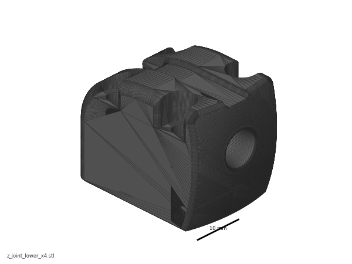{ width=96 } | `z_joint_lower_x4.stl` | 06-Z-joints | Voron-2 `STLs/Gantry/Z_Joints/` | 4 | Black | B05 |
| 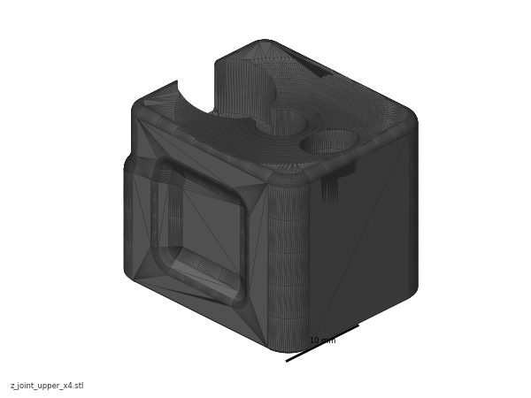{ width=96 } | `z_joint_upper_x4.stl` | 06-Z-joints | Voron-2 `STLs/Gantry/Z_Joints/` | 4 | Black | B05 |
| { width=96 } | `[a]_z_belt_clip_lower_x4.stl` | 06-Z-joints | Voron-2 `STLs/Gantry/` | 4 | Blue | B02 |
| { width=96 } | `[a]_z_belt_clip_upper_x4.stl` | 05-XY | Voron-2 `STLs/Gantry/` | 4 | Blue | B02 — **fitted in Ch 05** (p.91, p.93, p.95); loaded at Step 06.20 |
| 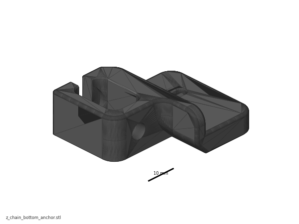{ width=96 } | `z_chain_bottom_anchor.stl` | 10-chains | Voron-2 `STLs/Gantry/` | 1 | Black | B05 — **fitted in Ch 10** (manual p.201–203) |
| 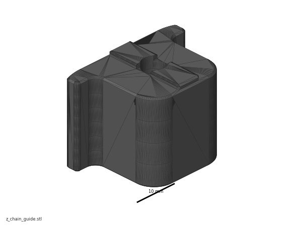{ width=96 } | `z_chain_guide.stl` | 10-chains | Voron-2 `STLs/Gantry/` | 1 | Black | B05 — **fitted in Ch 10** (manual p.201–203) |
| { width=96 } | `[a]_z_chain_retainer_bracket_x2.stl` | 10-chains | Voron-2 `STLs/Gantry/AB_Drive_Units/` | 2 | Blue | B02 — **fitted in Ch 10** (manual p.204) |
| 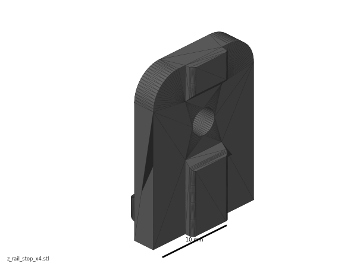{ width=96 } | `z_rail_stop_x4.stl` | 02-Z0 · 02-Z1 · 02-Z2 · 02-Z3 | LDOVoron2 `STLs/` | 4 | Black | B05 — optional rail-end safety stop, fitted at Step 02.10 |
| — | `z_joint_upper_hall_effect.stl` | — | Voron-2 `STLs/Gantry/Z_Joints/` | **0** | — | **SKIP** per LDO — no hall-effect endstops in this kit, not printed |

**Hardware** (chapter totals — Part A)

| Fastener / part | Qty | Note |
|---|---:|---|
| M5 hex nut | 4 | one per Z bearing block, manual p.110 |
| M3×30 SHCS | 4 | one per corner; passes through block → lower clip → front idler or A/B drive → the reserved rail-slot T-nut (Step 05.14), p.111 |
| M5×30 BHCS | 4 | one per corner, same stack, p.111. The second belt end clamps under the Ch 05 M5×16 pair instead |
| M3×20 SHCS | 16 | four per `z_joint_lower` into the MGN9 carriage, p.115 |
| M5×40 SHCS | 4 | one per Z joint, up from the lower joint into the block's M5 nut, p.115 |
| Gates open belt, 2GT, 9 mm | 4 × **~1400 mm** (manual minimum ≥1200 mm) | manual p.111 minimum for the 350; the kit ships **6 m** of 9 mm belt, so 4 × 1400 mm leaves ~400 mm spare for a mis-cut ([LDO 350 Rev D+ BOM](https://docs.ldomotors.com/en/voron/voron2/350_BOM/Rev_D+)) |
| 6×3 mm magnet | **0** | hall-effect option only — not used |
| Zip tie, 3×150 mm (belt tails) | 4 | manual p.120 |
| Zip tie, long (gantry support) | 0–4 | only if you skip the rubber-rail-stopper trick |
| Rubber rail stopper — from the Y rails | 4 | taken off the Y rails (Step 05.15) and fitted mid-rail on the Z rails — LDO note p.114–116 |

**Notes behind "Read first"**

- **Do manual p.115–116 before p.114.** LDO: *"We recommend completing steps on page 115-116 then use the rubber rail stopper under the Z joints mid rail. This will allow you to set the Gantry on page 114 on the joints without the need for long zipties."* Fit the four lower Z joints and park them at a known height first, then lower the gantry onto them. [src](https://docs.ldomotors.com/en/voron/voron2/build-faq)
- **Ignore every hall-effect option on p.110 and p.113.** LDO note p.145: *"SKIP The kit does not use hall effect endstops."* Four plain `z_joint_upper_x4`, no 6×3 magnets, no `z_joint_upper_hall_effect.stl`. The XY endstop on this kit is the D2F PCB pod, already on the right XY joint since Step 05.49. [src](https://docs.ldomotors.com/en/voron/voron2/build-faq)
- **The gantry lift is a two-person step and the manual says so** (p.114: *"An extra pair of hands helps with this step"*). Nobody holds a 350 gantry one-handed while fishing for an M5×40.
- **The gantry alignment on p.122 is not the gantry squaring.** p.122 gets the gantry square enough to belt. The real procedure (Part B) starts by *fully releasing* A/B belt tension and dropping the lower Z joints, so it has to come after firmware is up. Ch 07's A/B tension is provisional, and so is Part B's (survey §5.2 W1, §4.4 #2). A/B tension is set three times on purpose: Ch 07 (provisional — enough to home and QGL), Ch 06b Step 06b.15 (provisional again, after squaring, machine cold and open) and Ch 14 Step 14.4 (final — panels on, machine cold, door open, immediately before the closed-chamber soak and hot Z-joint tighten of Step 14.6). Z belts: Ch 06b Step 06b.3 (so QGL converges for squaring), set for the last time at Ch 14 Step 14.5, in the same cold session.
- **Belt tension targets:** Z belts **140 Hz** over a 150 mm span measured from the Z idler centres; A/B belts **110 Hz** over a 150 mm span. Both from [docs.vorondesign.com](https://docs.vorondesign.com/tuning/secondary_printer_tuning.html). voronldo.com's 80–100 Hz (A/B) and 110–130 Hz (Z) numbers are discarded — survey §4.3.
- **A Z carriage that runs off the end of its rail is a ruined carriage.** The balls fall out. Keep the printed `z_rail_stop_x4` (batch B05) at the top of each rail, or keep a hand on the carriage.

**Sources for this chapter:**

- [Voron 2.4r2 assembly manual, p.108–123](https://github.com/VoronDesign/Voron-2/blob/de7e89d/Manual/Assembly_Manual_2.4r2.pdf#page=108) — the page sequence Part A transcribes, pinned at commit `de7e89d`
- [Voron docs § V2 Gantry Squaring](https://docs.vorondesign.com/build/mechanical/v2_gantry_squaring.html) — the 17 numbered steps Part B transcribes, and the source of Part B's 15 mirrored images (GPL-3.0)
- [Ellis' Print Tuning Guide § V2 gantry squaring](https://ellis3dp.com/Print-Tuning-Guide/articles/voron_v2_gantry_squaring.html) — the same procedure, in Ellis' words
- [Voron docs § Secondary printer tuning](https://docs.vorondesign.com/tuning/secondary_printer_tuning.html) — the 140 Hz Z and 110 Hz A/B belt targets
- [LDO Build Notes § Voron 2.4 build FAQ](https://docs.ldomotors.com/en/voron/voron2/build-faq) — p.115–116-before-p.114 ordering, hall-effect skips
- [LDO cable-chain guide](https://docs.ldomotors.com/en/guides/cable_chain_guide) — Z chain, fitted later in Ch 10
- [Voron forum — de-racking thread](https://forum.vorondesign.com/threads/de-racking-again.1342/) and [Nero3D's de-racking video](https://www.youtube.com/watch?v=cOn6u9kXvy0) — the de-racking method Voron's step 12 delegates to

**Video coverage (Steve Builds, pre-release LDO kit — differs from Rev D+):** [Part 4 @0:12:41](https://www.youtube.com/watch?v=ViB5Ulc9zDI&list=PL0fUJbigELQPqpeGOgHYisG4KaSXVtnNY&t=761s) (+18m), [Part 4 @0:55:52](https://www.youtube.com/watch?v=ViB5Ulc9zDI&list=PL0fUJbigELQPqpeGOgHYisG4KaSXVtnNY&t=3352s) (+32m), [Part 4 @1:30:00](https://www.youtube.com/watch?v=ViB5Ulc9zDI&list=PL0fUJbigELQPqpeGOgHYisG4KaSXVtnNY&t=5400s) (+14m), [Part 5 @0:46:00](https://www.youtube.com/watch?v=hTKCBrk36R0&list=PL0fUJbigELQPqpeGOgHYisG4KaSXVtnNY&t=2760s) (+14m), [Part 5 @1:03:16](https://www.youtube.com/watch?v=hTKCBrk36R0&list=PL0fUJbigELQPqpeGOgHYisG4KaSXVtnNY&t=3796s) (+10m), [Part 6 @1:34:40](https://www.youtube.com/watch?v=8pWoYkY1DiA&list=PL0fUJbigELQPqpeGOgHYisG4KaSXVtnNY&t=5680s) (+2m), [Part 9 @2:49:00](https://www.youtube.com/watch?v=dmNwxUm4oik&list=PL0fUJbigELQPqpeGOgHYisG4KaSXVtnNY&t=10140s) (+5m)

---

## Part A — Chapter 06: Z axis (mechanical)

This part follows Voron manual pages 108 to 123. Nothing in it needs power.

---

### Step 06.1 — Confirm the starting state

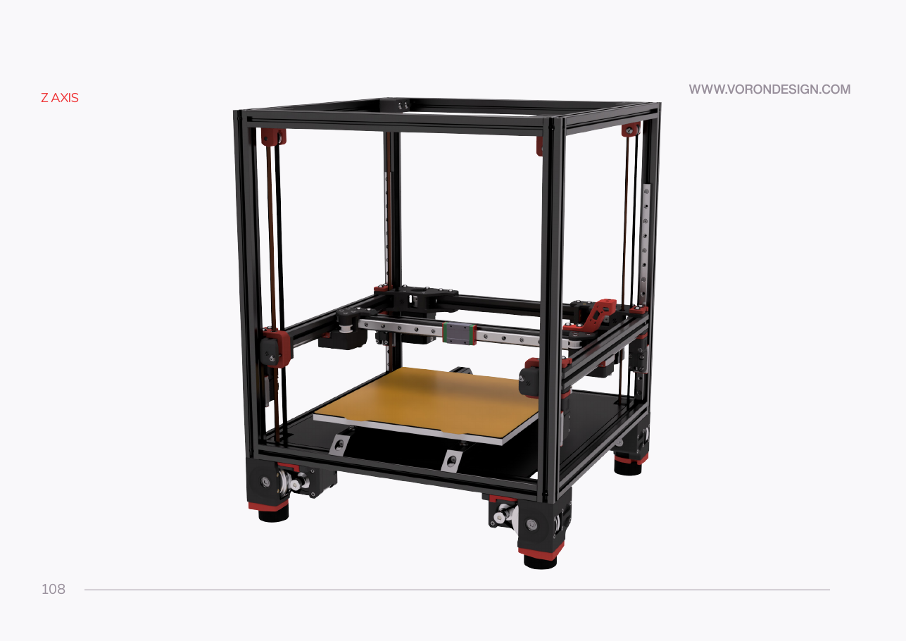{ crop="0.24 0.14 0.76 0.90" }

**What you're looking at:** Check what the gantry will hang from: a **Z drive** at each bottom corner, a **Z idler** at the top of each vertical, and a **Z rail** with a carriage on each vertical. Those four carriages carry the whole gantry.

**Parts:** none.

**Do:**

1. Check four Z drives screwed in, and four Z idlers with tensioners at the tops of the verticals.
2. Check four MGN9 Z rails on the second holes from each end, carriages on and greased, and the gantry on the bench with its titanium backers on.
3. Fix any rail that fights you now.

**Check:** Every Z carriage slides its full rail smoothly by hand, with no notchy or gritty spots.

Source: [Voron manual p.108](https://github.com/VoronDesign/Voron-2/blob/de7e89d/Manual/Assembly_Manual_2.4r2.pdf#page=108)

---

### Step 06.2 — Learn the four names

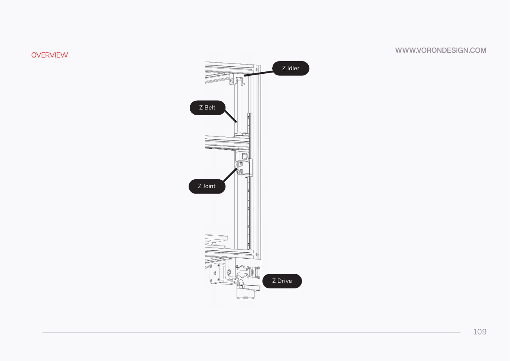{ crop="0.36 0.14 0.64 0.84" }

**What you're looking at:** One corner from top to bottom: the **Z idler** at the top of the vertical; the **Z joint**, which carries the gantry corner and is where the belt clamps; the **Z belt**; and the **Z drive** at the bottom. Four of these lift and level the gantry.

**Parts:** none.

**Do:**

1. Learn the stack at one corner: the Z drive at the bottom, the Z joint above it, the Z belt between them and the Z idler at the top.
2. Note that both ends of the belt clamp at the gantry corner, one under it and one on top.

**Check:** You can point at all four on the real machine at the front-left corner, before you build the other three.

Source: [Voron manual p.109](https://github.com/VoronDesign/Voron-2/blob/de7e89d/Manual/Assembly_Manual_2.4r2.pdf#page=109) · [Video: Part 4 @0:55:46](https://www.youtube.com/watch?v=ViB5Ulc9zDI&list=PL0fUJbigELQPqpeGOgHYisG4KaSXVtnNY&t=3346s)

---

### Step 06.3 — Seat an M5 nut in each Z bearing block

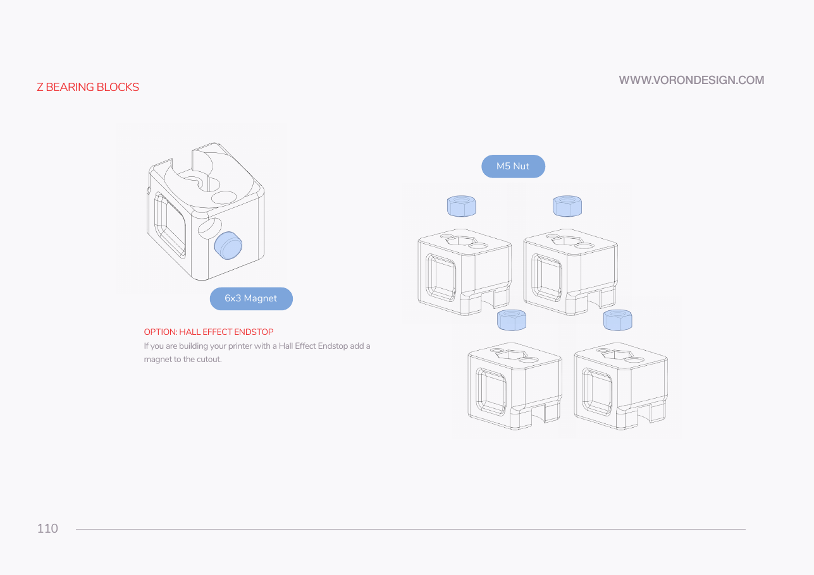{ crop="0.50 0.24 0.86 0.78" }


**What you're looking at:** Two blocks look alike. The **`z_joint_upper`** (the Z bearing block) clamps the first belt end and takes the M5 nut. The chunkier **`z_joint_lower`**, with four M3 holes, screws to the Z carriage. One M5×40 joins them into a [Z joint](16-glossary.md#z).

**Parts:**

- `z_joint_upper_x4` ×4
- M5 hex nut ×4

**Do:**

1. Press an M5 hex nut fully into each `z_joint_upper` pocket, square and flush, with the flat of a screwdriver. Never thread a screw through and crank it.
2. Skip the 6×3 mm magnet on this page: it is for hall-effect endstops, which this kit does not use (LDO note p.145). All four blocks are plain `z_joint_upper_x4`. [src](https://docs.ldomotors.com/en/voron/voron2/build-faq)

**Check:** Each nut sits flat, faces in line with the pocket walls, clear thread showing through from the far side.

Source: [Voron manual p.110](https://github.com/VoronDesign/Voron-2/blob/de7e89d/Manual/Assembly_Manual_2.4r2.pdf#page=110) · [LDO Build Notes § Voron 2.4 build FAQ](https://docs.ldomotors.com/en/voron/voron2/build-faq)

---

### Step 06.4 — Cut the four Z belts

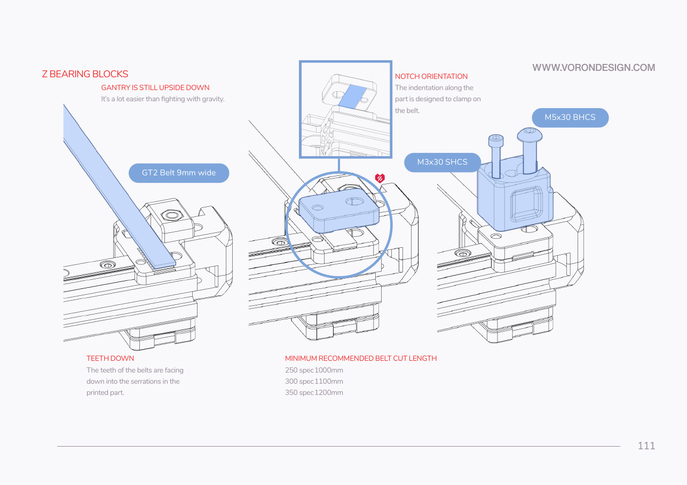{ crop="0.08 0.28 0.66 0.84" }

**What you're looking at:** The Z belts come off the reel of open-ended GT2 belt. This is the **9 mm** wide belt; the A/B belts in Ch 07 are the narrower 6 mm. Each Z belt is one cut length, not a loop: both ends clamp at one gantry corner, one below and one on top.

**Parts:**

- consumable: Gates 2GT open belt, 9 mm wide, four lengths of about 1400 mm
- consumable: masking tape

**Do:**

1. Cut four lengths of about **1400 mm**. The manual's minimum for a 350 is **1200 mm**, and the kit supplies 6 m, so 1400 leaves about 400 mm spare.
2. Cut straight across with flush cutters, between two teeth.
3. Label each belt with masking tape.

**Check:** Four belts of the same length to within a few mm, each with clean, square ends and no frayed cords.

Source: [Voron manual p.111](https://github.com/VoronDesign/Voron-2/blob/de7e89d/Manual/Assembly_Manual_2.4r2.pdf#page=111)

Pause: ~30 min since the last pause — M5 nuts are seated in all four Z bearing blocks, and four Z belts are cut to length and labelled by corner. Do not start clipping in a belt end: each corner is one continuous clip-and-clamp job.

---

### Step 06.5 — Lay the first belt end under the gantry corner

{ crop="0.08 0.10 0.36 0.84" }

**What you're looking at:** The first belt end goes onto the serrated pad (a patch of small ridges) under a gantry corner, which is a front idler or an A/B drive. The pad faces up while the gantry is upside down. Teeth down, the belt locks into the ridges and cannot creep under load.

**Parts:**

- reused: one cut Z belt

**Do:**

1. Work on the gantry off the printer, upside down, with the A/B motors up.
2. Lay one belt end on the serrated pad of a front idler or drive, **teeth down**.
3. Leave about 10 mm of belt past the pad.

**Check:** The belt teeth sit down in the pad's ridges, not on top of them, and the belt leaves the pad straight, not skewed.

Source: [Voron manual p.111](https://github.com/VoronDesign/Voron-2/blob/de7e89d/Manual/Assembly_Manual_2.4r2.pdf#page=111) · [Voron manual p.106](https://github.com/VoronDesign/Voron-2/blob/de7e89d/Manual/Assembly_Manual_2.4r2.pdf#page=106) · [Video: Part 4 @0:10:12](https://www.youtube.com/watch?v=ViB5Ulc9zDI&list=PL0fUJbigELQPqpeGOgHYisG4KaSXVtnNY&t=612s)

---

### Step 06.6 — Fit the lower belt clip

{ crop="0.36 0.10 0.74 0.62" }


**What you're looking at:** The **lower** blue belt clip, with one large hole and one small, goes on now, indented face down onto this first belt end. Its look-alike, the upper clip with two equal holes, is already on top of each corner from Ch 05.

**Parts:**

- `[a]_z_belt_clip_lower_x4` ×1

**Do:**

1. Drop the lower belt clip onto the belt, **indented face down onto the belt**.
2. Line up the clip's small hole with the M3 hole in the frame below it, and its large hole with the M5 hole.

**Check:** The clip lies flat with the belt caught under its indented face, and both holes line up with the frame underneath, with no offset.

Source: [Voron manual p.111](https://github.com/VoronDesign/Voron-2/blob/de7e89d/Manual/Assembly_Manual_2.4r2.pdf#page=111) · [Video: Part 4 @0:12:33](https://www.youtube.com/watch?v=ViB5Ulc9zDI&list=PL0fUJbigELQPqpeGOgHYisG4KaSXVtnNY&t=753s)

---

### Step 06.7 — Fit the Z bearing block

{ crop="0.58 0.21 0.92 0.72" }
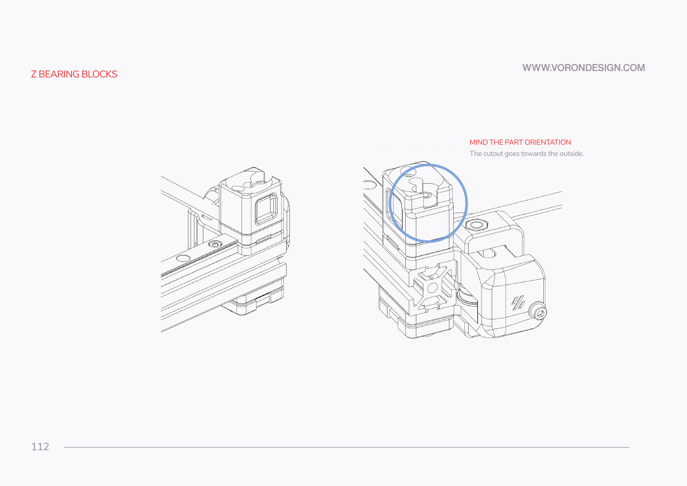{ crop="0.52 0.20 0.86 0.74" }

**What you're looking at:** The Z bearing block goes on top of this stack. Two screws run through the block, the lower clip and the corner frame into the T-nuts kept free for them in the rail slot, and they clamp the first belt end. Its cutout faces the vertical, away from the build space.

**Parts:**

- reused: one Z bearing block with its M5 nut
- M3×30 SHCS ×1
- M5×30 BHCS ×1

**Do:**

1. Set the Z bearing block on the lower clip, **cutout facing outward**.
2. Drive one M3×30 SHCS and one M5×30 BHCS through the block and the clip into the T-nuts. Make them **snug only**.

**Check:** The stack reads block, lower clip, corner frame, with one M3 and one M5 screw through all of it, the cutout facing outward, and a belt tail that does not pull out.

Source: [Voron manual p.111](https://github.com/VoronDesign/Voron-2/blob/de7e89d/Manual/Assembly_Manual_2.4r2.pdf#page=111) · [Voron manual p.112](https://github.com/VoronDesign/Voron-2/blob/de7e89d/Manual/Assembly_Manual_2.4r2.pdf#page=112) · [Video: Part 4 @0:12:53](https://www.youtube.com/watch?v=ViB5Ulc9zDI&list=PL0fUJbigELQPqpeGOgHYisG4KaSXVtnNY&t=773s)

---

### Step 06.8 — Repeat at all four corners

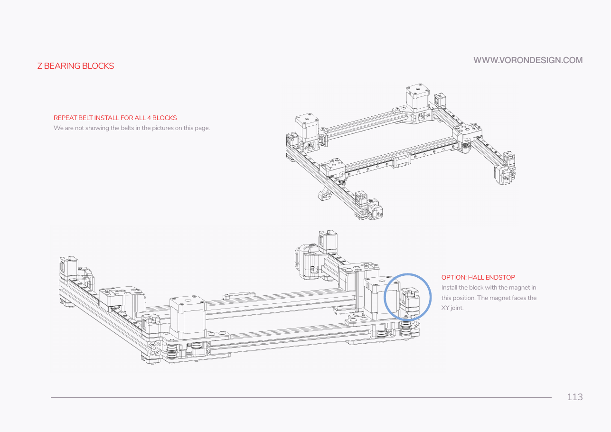

**What you're looking at:** The other three corners get the same stack. The manual leaves the belts out of these drawings, but you now have four long tails hanging off the gantry. A belt that gets stepped on has to be cut again, and there is only about 400 mm spare.

**Parts:**

- reused: the other three cut Z belts
- reused: the other three Z bearing blocks
- `[a]_z_belt_clip_lower_x4` ×3
- M3×30 SHCS ×3
- M5×30 BHCS ×3

**Do:**

1. Repeat steps 06.5 to 06.7 at the other three gantry corners.
2. Coil each belt tail loosely and tape it to its own Y extrusion, so nothing gets stepped on during the lift.

**Check:** Four blocks are fitted with all four cutouts facing outward, and four belt tails are clamped and coiled. Nothing on this gantry needs a magnet.

Source: [Voron manual p.113](https://github.com/VoronDesign/Voron-2/blob/de7e89d/Manual/Assembly_Manual_2.4r2.pdf#page=113)

Pause: ~40 min since the last pause — all four first belt ends are clamped under their gantry corners, with the Z bearing blocks on. The gantry is still on the bench with its belts hanging free: coil and tape each tail so nothing gets stepped on.

---

### Step 06.9 — Fit the four lower Z joints to the Z carriages

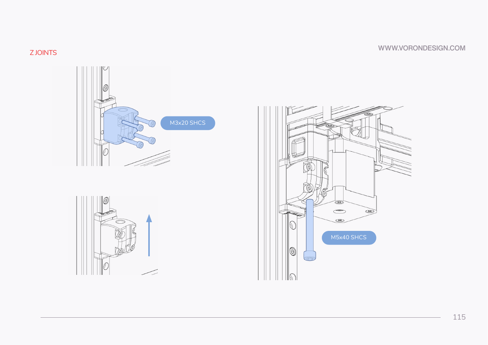{ crop="0.12 0.16 0.46 0.82" }

**What you're looking at:** The `z_joint_lower` is the other half of each Z joint. It screws sideways onto the MGN9 carriage on the vertical's Z rail, and its domed top is where the gantry's bearing block lands. LDO does this page and p.116 **before** the gantry goes in at p.114, not after. [src](https://docs.ldomotors.com/en/voron/voron2/build-faq)

**Parts:**

- `z_joint_lower_x4` ×4
- M3×20 SHCS ×16

**Do:**

1. Screw one `z_joint_lower` to each MGN9 Z carriage with **four M3×20 SHCS**, driven sideways into the carriage's threaded face: four per corner, no fewer.
2. Keep the domed top with the central hole facing up.
3. Tighten evenly and firmly, corner to corner.

**Check:** All four joints sit flat on their carriages at the same angle, and each carriage slides a few centimetres clear of the rail screws.

LDO's words: *"We recommend completing steps on page 115-116 then use the rubber rail stopper under the Z joints mid rail. This will allow you to set the Gantry on page 114 on the joints without the need for long zipties."*

Source: [Voron manual p.115](https://github.com/VoronDesign/Voron-2/blob/de7e89d/Manual/Assembly_Manual_2.4r2.pdf#page=115) · [LDO Build Notes § Voron 2.4 build FAQ](https://docs.ldomotors.com/en/voron/voron2/build-faq) · [Video: Part 4 @0:58:18](https://www.youtube.com/watch?v=ViB5Ulc9zDI&list=PL0fUJbigELQPqpeGOgHYisG4KaSXVtnNY&t=3498s)

---

### Step 06.10 — Park the four lower joints at a matched height

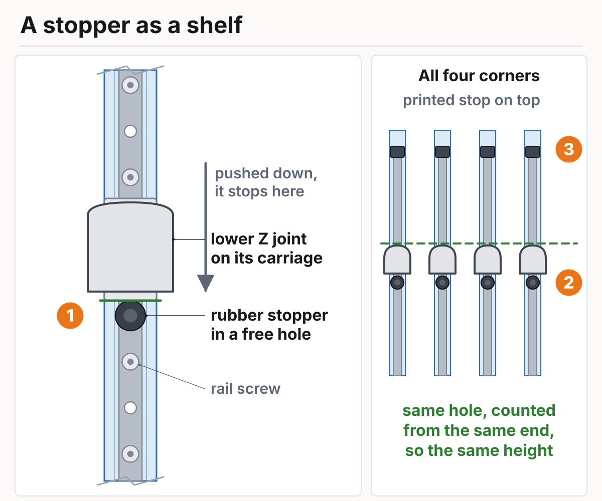


**What you're looking at:** A rubber rail stopper fits into a free rail hole and blocks the carriage. Screwed in directly under each lower joint, it is a shelf that parks all four joints at the same height. The printed `z_rail_stop_x4` does the same at the rail top.

**Parts:**

- Rubber rail stopper ×4 — from the Y rails
- reused: the four `z_rail_stop_x4`, on the rail tops or still in bins 02-Z0 to 02-Z3

**Do:**

1. Move each Z carriage to the middle of its rail, and fit a rubber stopper into the **free** hole **directly under** it.
2. Use the same hole, counted from the same end, at all four corners.
3. Fit a `z_rail_stop_x4` to any rail top that has none.

**Check:** The deck-to-joint-top height matches at all four corners within about 1 mm, and each carriage stops on its rubber stopper when pushed down.

**Helper:** Reads the rule at all four corners and calls out any joint that sits higher.

Source: [Voron manual p.115](https://github.com/VoronDesign/Voron-2/blob/de7e89d/Manual/Assembly_Manual_2.4r2.pdf#page=115) · [LDO Build Notes § Voron 2.4 build FAQ](https://docs.ldomotors.com/en/voron/voron2/build-faq)

Pause: ~25 min since the last pause — four lower Z joints are on the Z carriages and parked at a matched height. Do not try the gantry lift until your second person is there: the next segment is one unbroken two-person move.

---

### Step 06.11 — Turn the gantry over and stage the lift

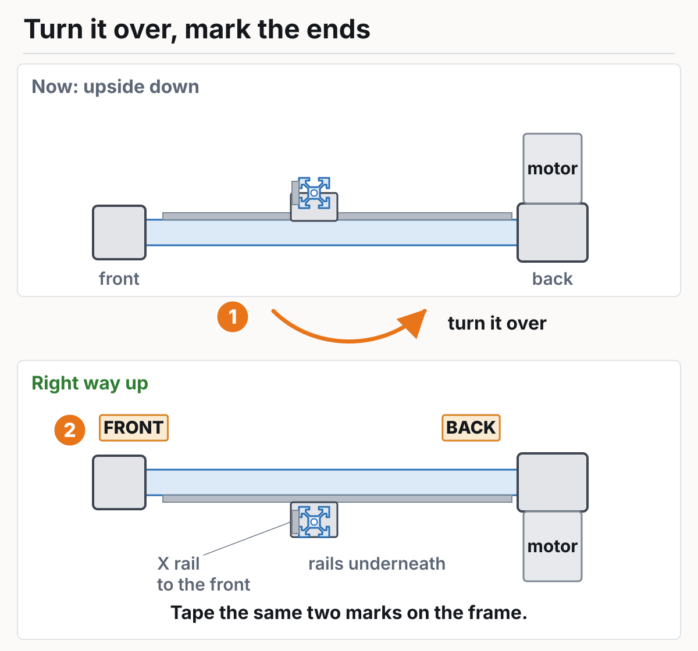

**What you're looking at:** The gantry turns back the way it runs: A/B motors hanging **down** below the rear extrusion, Y rails underneath, X rail facing the front, and the four Z bearing blocks at the corners with their tails hanging. The gantry is not the same front and back.

**Parts:**

- reused: the gantry

**Do:**

1. Turn the gantry the right way up: A/B motors **down**, Y rails underneath, X rail to the front.
2. Mark **Front** and **Back** with tape on the gantry and on the frame.
3. Agree out loud who lifts which end.

**Check:** Front and Back are marked and match on both parts, the belt tails are taped out of the way, and both people can reach their side without leaning over the bed.

**Helper:** Tapes the Front and Back marks, then holds one end while you turn the gantry over.

Source: [Voron manual p.113](https://github.com/VoronDesign/Voron-2/blob/de7e89d/Manual/Assembly_Manual_2.4r2.pdf#page=113) · [Voron manual p.106](https://github.com/VoronDesign/Voron-2/blob/de7e89d/Manual/Assembly_Manual_2.4r2.pdf#page=106) · [Voron manual p.116](https://github.com/VoronDesign/Voron-2/blob/de7e89d/Manual/Assembly_Manual_2.4r2.pdf#page=116) · [Video: Part 4 @1:01:50](https://www.youtube.com/watch?v=ViB5Ulc9zDI&list=PL0fUJbigELQPqpeGOgHYisG4KaSXVtnNY&t=3710s)

---

### Step 06.12 — Two-person lift: tilt the gantry into the frame

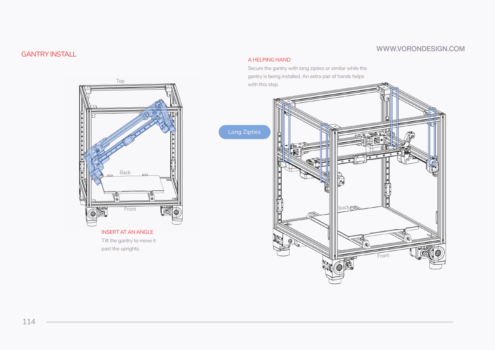{ crop="0.155 0.19 0.42 0.74" }

**What you're looking at:** This is the lift itself. The gantry will not pass the four verticals lying flat, so it goes in tilted and levels out inside the frame. Hold it by the Y extrusions only: the X carriage, the drive units and the belts are not handles.

**Parts:**

- reused: the gantry
- tool: a towel over the bed

**Do:**

1. Cover the bed with a towel.
2. Lift with **two people**, one per Y extrusion, hands on the extrusions only.
3. Lift from above and tilt **side to side**: one Y extrusion goes into the frame first, then bring the high side down.

**Check:** The gantry is inside the frame and level, its front at the front, each Z bearing block over its lower joint, and no belt pinched.

**Helper:** Lifts the other Y extrusion with you, hands on the extrusion only, and says stop if anything catches.

Source: [Voron manual p.114](https://github.com/VoronDesign/Voron-2/blob/de7e89d/Manual/Assembly_Manual_2.4r2.pdf#page=114)

---

### Step 06.13 — Set the gantry down onto the lower joints

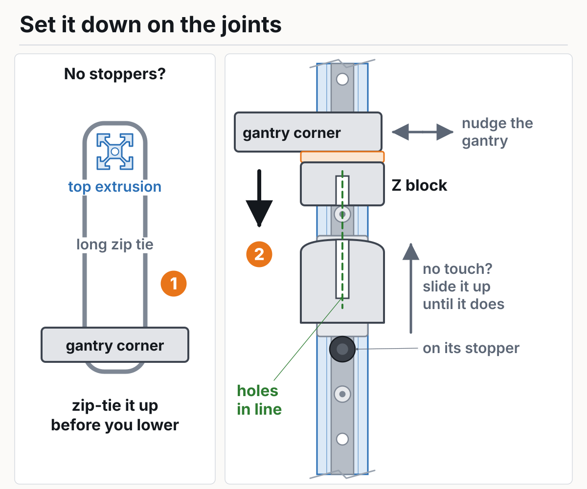
{ crop="0.44 0.155 0.92 0.82" }

**What you're looking at:** Each Z bearing block comes down onto the domed top of its lower joint. The last millimetre should be gravity, not force: if a block will not seat, slide that carriage along its rail instead of levering the gantry.

**Parts:**

- reused: the gantry
- consumable: long zip tie ×4, only without the rubber stoppers

**Do:**

1. Lower until each Z block sits on its lower joint, sliding a carriage up or down until the holes line up.
2. No rail stoppers? Then zip-tie each corner up over the top frame extrusion first.
3. Let go one person at a time, while the other still holds their side.

**Check:** The gantry rests on all four joints with nobody holding it. It does not rock, and no corner is visibly lower than the others.

**Helper:** Lowers the other side in step with you and lets go only when you say so.

Source: [Voron manual p.114](https://github.com/VoronDesign/Voron-2/blob/de7e89d/Manual/Assembly_Manual_2.4r2.pdf#page=114) · [Video: Part 4 @1:10:15](https://www.youtube.com/watch?v=ViB5Ulc9zDI&list=PL0fUJbigELQPqpeGOgHYisG4KaSXVtnNY&t=4215s)

---

### Step 06.14 — Bolt the first Z joint together

{ crop="0.52 0.28 0.86 0.82" }

**What you're looking at:** One M5×40 runs up through the lower joint's hole into the M5 nut, turning the two blocks into one Z joint. It stays light on purpose: the joint must still swivel while the gantry is squared, and it gets its full tightening only once, hot, in Ch 14.

**Parts:**

- M5×40 SHCS ×1

**Do:**

1. From underneath, run one M5×40 SHCS **up** through the lower joint's hole into the M5 nut held in the Z bearing block.
2. Tighten it **lightly only**, so the joint can still swivel. The final tightening is Ch 14 Step 14.6, hot.

**Check:** The screw threads in freely by hand for most of its length, and the joint still rocks slightly when you push the gantry corner.

Source: [Voron manual p.115](https://github.com/VoronDesign/Voron-2/blob/de7e89d/Manual/Assembly_Manual_2.4r2.pdf#page=115)

---

### Step 06.15 — Repeat at the other three joints

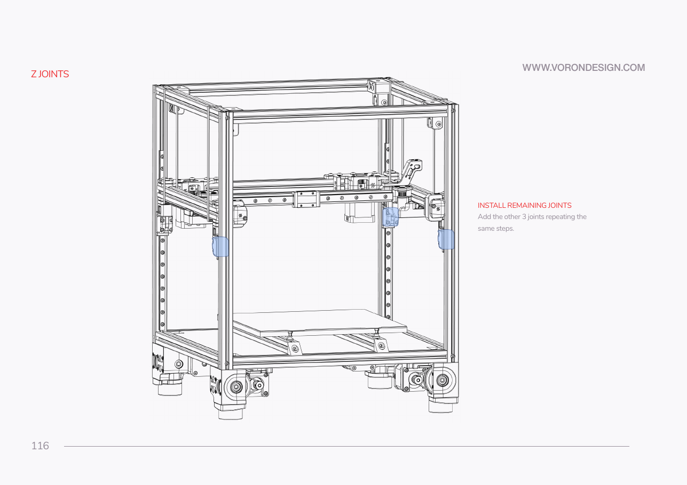{ crop="0.20 0.12 0.86 0.88" }

**What you're looking at:** The other three corners take the same single screw, just as light. With four in, the gantry is attached to all four Z carriages and moves up and down the verticals as one piece.

**Parts:**

- M5×40 SHCS ×3

**Do:** Join the other three joints the same way, with the same light tightening on all four.

**Check:** Four M5×40 are in, all light, and when you lift gently under one Y extrusion, the gantry moves as one piece, all four carriages together.

Source: [Voron manual p.116](https://github.com/VoronDesign/Voron-2/blob/de7e89d/Manual/Assembly_Manual_2.4r2.pdf#page=116) · [Video: Part 4 @1:20:06](https://www.youtube.com/watch?v=ViB5Ulc9zDI&list=PL0fUJbigELQPqpeGOgHYisG4KaSXVtnNY&t=4806s)

Pause: ~45 min since the last pause — the gantry is lifted into the frame and screwed to all four Z joints, which still move freely. This segment could not be broken up (two-person lift). The Z belts are not routed yet; leave the idlers alone.

---

### Step 06.16 — Extend all four Z idlers

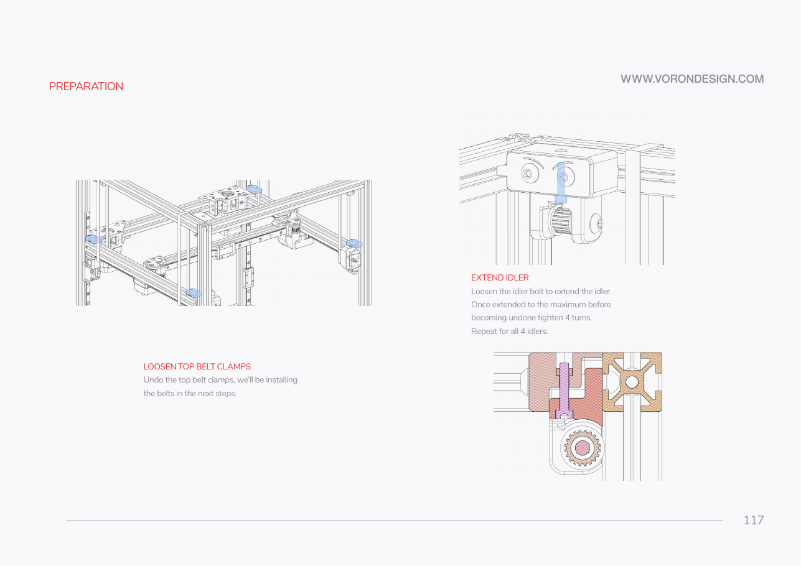{ crop="0.56 0.18 0.86 0.86" }

**What you're looking at:** The Z idler is the toothed pulley on a sliding bracket at the top of each vertical. Its screw is the tensioner: it moves the pulley, which changes how much belt the loop needs. Turning every one back the same four turns parks all four the same.

**Parts:** none.

**Do:**

1. Find the tensioner: the M3×16 under the blue slider, turned with a 2.5 mm key from below.
2. Loosen it anticlockwise from below, out as far as it goes before it comes undone.
3. Tighten it back **4 turns**. Repeat on all four idlers.

**Check:** All four idlers are extended and turned back by the same 4 turns, counted out loud, and none of the four screws has fallen out.

**Helper:** Counts the turns aloud at each idler and ticks off each corner when it is done.

Source: [Voron manual p.117](https://github.com/VoronDesign/Voron-2/blob/de7e89d/Manual/Assembly_Manual_2.4r2.pdf#page=117)

---

### Step 06.17 — Loosen the four top belt clamps

{ crop="0.08 0.28 0.48 0.72" }

**What you're looking at:** The blue upper clip on top of each front idler and A/B drive, fitted in Ch 05, is where the belt's *second* end clamps. Its two M5×16 also hold that idler or drive to the Y extrusion.

**Parts:** none.

**Do:**

1. At each corner, loosen the two M5×16 BHCS on top of the front idler or drive until a belt slides under the upper clip. **Do not take them out.**
2. Leave the M3×30 and M5×30 underneath alone.

**Check:** A strip of belt slips under the upper clip at all four corners, and no first belt end has moved.

Source: [Voron manual p.117](https://github.com/VoronDesign/Voron-2/blob/de7e89d/Manual/Assembly_Manual_2.4r2.pdf#page=117)

---

### Step 06.18 — Route the first belt down and around the Z drive

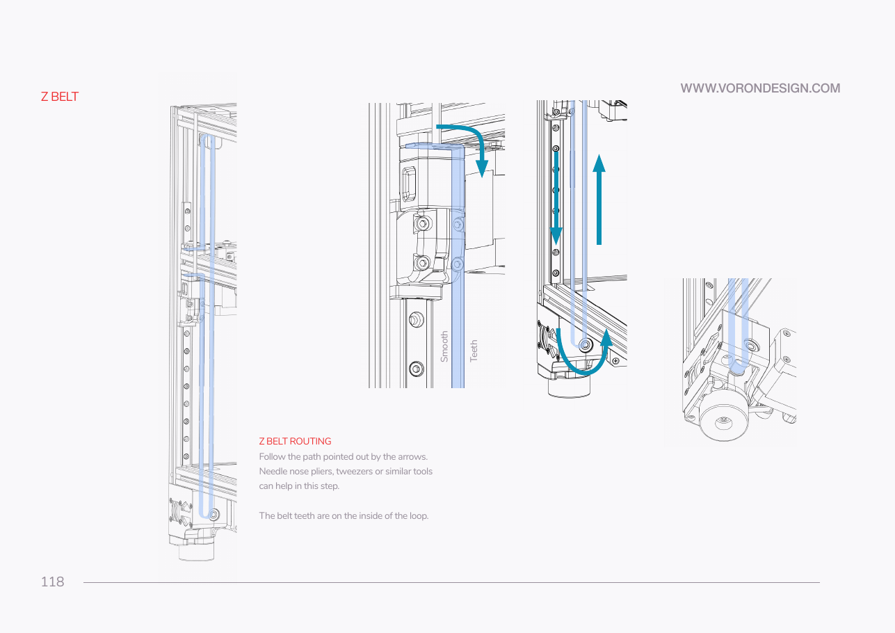{ crop="0.28 0.12 0.90 0.84" }
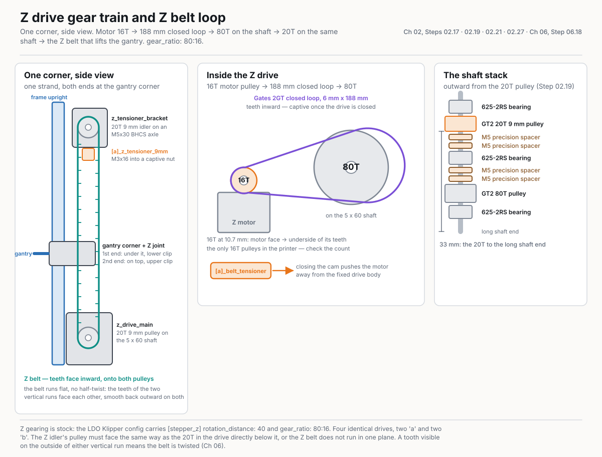

**What you're looking at:** The belt tail runs down the rail side of the vertical and wraps the toothed pulley in the Z drive, the pulley that lifts this corner. The teeth face inward so they grip; a belt running smooth side on over a toothed pulley skips teeth.

**Parts:**

- reused: one Z belt, first end clamped

**Do:**

1. Take the belt tail down past the lower Z joint on the **rail side**, around the Z drive pulley, and back up on the side further from the rail.
2. Keep the **teeth facing inward, onto the pulley**. Needle-nose pliers help.

**Check:** The belt sits all the way round the drive pulley, and the teeth of the two runs (the down and up lengths of belt) face each other. Teeth showing outside mean a twist.

Source: [Voron manual p.118](https://github.com/VoronDesign/Voron-2/blob/de7e89d/Manual/Assembly_Manual_2.4r2.pdf#page=118) · [Video: Part 4 @1:30:31](https://www.youtube.com/watch?v=ViB5Ulc9zDI&list=PL0fUJbigELQPqpeGOgHYisG4KaSXVtnNY&t=5431s)

---

### Step 06.19 — Take the belt up and over the Z idler

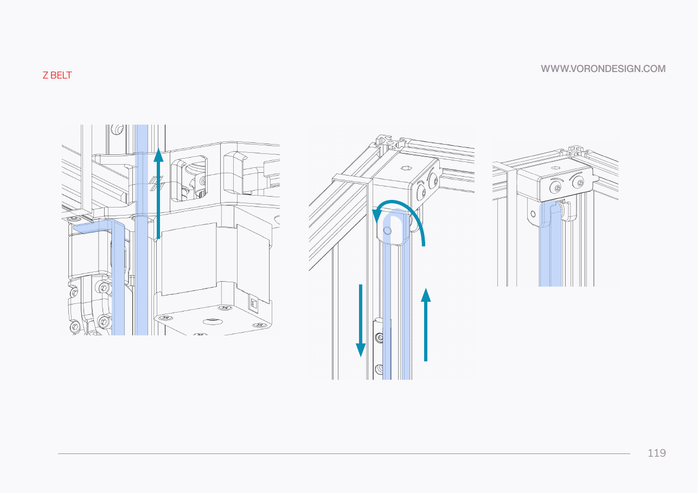{ crop="0.08 0.24 0.70 0.78" }

**What you're looking at:** The same belt continues up the run further from the rail, over the Z idler, and back down the rail side toward the joint, closing the loop. The idler's flanges, the raised rims on each side, are all that keep the belt on it.

**Parts:**

- reused: the same Z belt

**Do:**

1. Run the belt up the far run to the top of the vertical, over the Z idler pulley, and back down the rail side toward the Z joint.
2. Keep the teeth on the inside of the loop.

**Check:** The belt sits centred in the idler's groove between its flanges, and both runs hang straight up and down, clear of the extrusion.

Source: [Voron manual p.119](https://github.com/VoronDesign/Voron-2/blob/de7e89d/Manual/Assembly_Manual_2.4r2.pdf#page=119)

---

### Step 06.20 — Clamp the second end and pull it tight

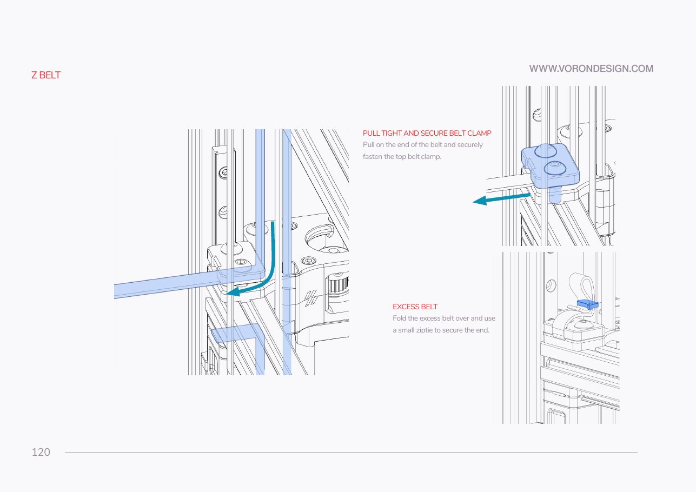{ crop="0.16 0.18 0.90 0.78" }

**What you're looking at:** The returning end feeds in under the upper clip, teeth down on the frame's serrated top, just as the first end went under the lower clip. Pulling the tail hard while you tighten takes out the slack; the tensioner only fine-tunes the rest.

**Parts:**

- reused: the upper belt clip on this corner
- reused: the two M5×16 BHCS on top of this corner

**Do:**

1. Feed the returning belt end between the upper clip and the frame's serrated top, teeth down.
2. Pull the tail hard and hold it while you tighten both M5×16, firmly but without crushing the belt.

**Check:** The long run plucks with real tension, not a floppy note, the tail does not slip, and the first belt end is still clamped.

**Helper:** Pulls the belt tail tight and holds it while you tighten both M5×16 bolts.

Source: [Voron manual p.120](https://github.com/VoronDesign/Voron-2/blob/de7e89d/Manual/Assembly_Manual_2.4r2.pdf#page=120) · [Video: Part 5 @0:47:55](https://www.youtube.com/watch?v=hTKCBrk36R0&list=PL0fUJbigELQPqpeGOgHYisG4KaSXVtnNY&t=2875s)

---

### Step 06.21 — Trim, fold and tie the excess

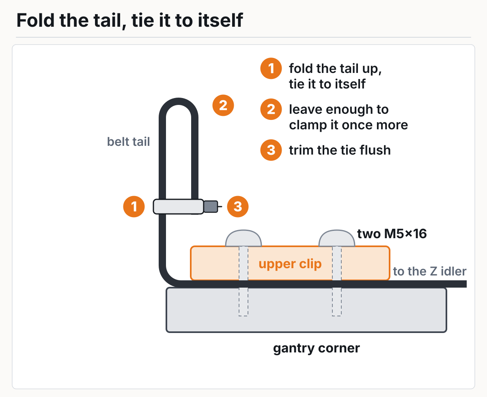
{ crop="0.54 0.48 0.90 0.88" }

**What you're looking at:** This is the spare belt past the clamp. Folded back and zip-tied, it cannot flap into a pulley or a panel. Left long instead of cut flush, it gives you one free re-clamp if the tension comes out wrong.

**Parts:**

- consumable: zip tie, 3×150 mm ×1

**Do:**

1. Fold the tail up and back on itself, and zip-tie the fold to itself just above the clip, as p.120 shows.
2. Leave enough tail to clamp it once more if the tension comes out wrong, so do not cut it flush yet.
3. Trim the zip tie's tail flush.

**Check:** The folded tail cannot flap into a pulley or panel, and nothing rubs as you move the gantry by hand.

Source: [Voron manual p.120](https://github.com/VoronDesign/Voron-2/blob/de7e89d/Manual/Assembly_Manual_2.4r2.pdf#page=120)

Pause: ~40 min since the last pause — all four Z idlers are extended, the top clamps loosened, and the **first** Z belt is routed, clamped at both ends, trimmed and tied. Never stop with a belt half routed: finish the corner you are on.

---

### Step 06.22 — Do the other three Z belts

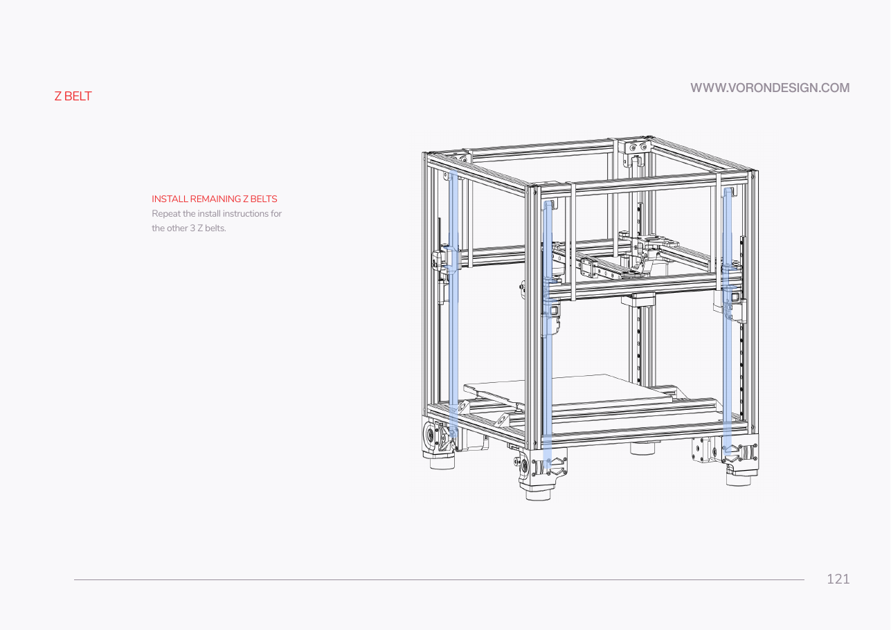{ crop="0.16 0.18 0.86 0.82" }

**What you're looking at:** The other three corners get the same four jobs each. Doing them in the same order every time shows you a corner that came out different, instead of finding it later as a QGL (the printer's automatic gantry levelling) that never settles.

**Parts:**

- reused: the other three Z belts
- consumable: zip tie, 3×150 mm ×3

**Do:**

1. Repeat steps 06.18 to 06.21 at each of the other three corners.
2. Do them in the same order every time, drive, then idler, then clamp, so you notice if one comes out different.

**Check:** Four belts are on and four tails tied, and every belt sits fully on its drive pulley and its idler.

Source: [Voron manual p.121](https://github.com/VoronDesign/Voron-2/blob/de7e89d/Manual/Assembly_Manual_2.4r2.pdf#page=121)

Pause: ~30 min since the last pause — all four Z belts are routed, clamped, trimmed and tied. The belts are about even by hand but not tensioned; do not touch the A/B front-idler tension screws, which are Ch 07's.

---

### Step 06.23 — Even the four belts by hand

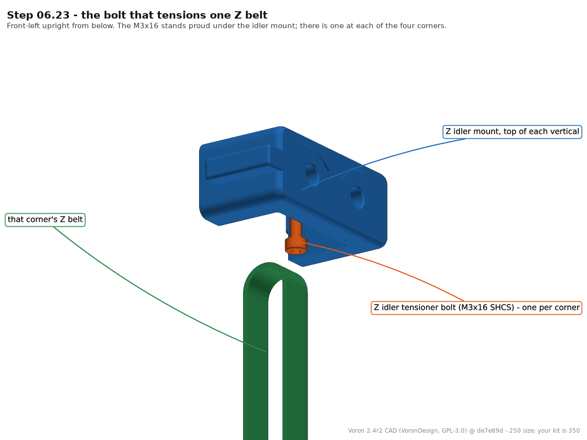
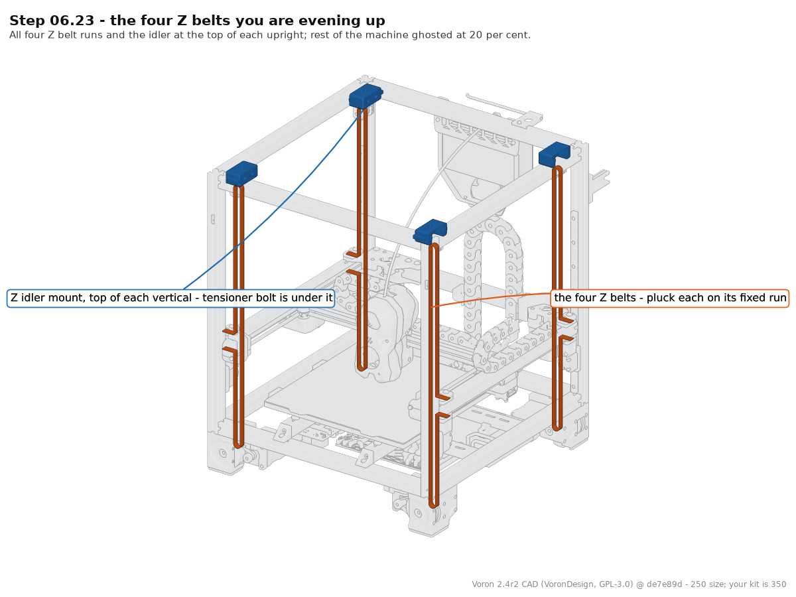

**What you're looking at:** The Z idler tensioner is the small screw sticking out below each idler. Plucking a belt gives a rough reading of its tension, and the four Z belts must be close to equal or QGL will not repeat. The measured 140 Hz target waits for Part B.

**Parts:** none.

**Do:**

1. Pluck each Z belt on the short run between the top belt clip and the Z idler.
2. Bring the four notes together with each corner's **Z idler tensioner screw**: 2.5 mm key from below, clockwise for tighter.

**Check:** All four belts sound within a semitone of each other, and lifting one gantry corner moves all four carriages together.

**Helper:** Plucks each Z belt in turn and says which note sounds lowest.

The CAD picture shows the idler height of the 250 machine. Either way, there is one of these screws at each of the four corners.

Source: [Voron manual p.121](https://github.com/VoronDesign/Voron-2/blob/de7e89d/Manual/Assembly_Manual_2.4r2.pdf#page=121) · [Voron docs § Secondary printer tuning — A/B and Z belts](https://docs.vorondesign.com/tuning/secondary_printer_tuning.html) · CAD: Voron 2.4r2 STEP @ de7e89d

---

### Step 06.24 — Square the gantry to the A/B drives and lock the X axis

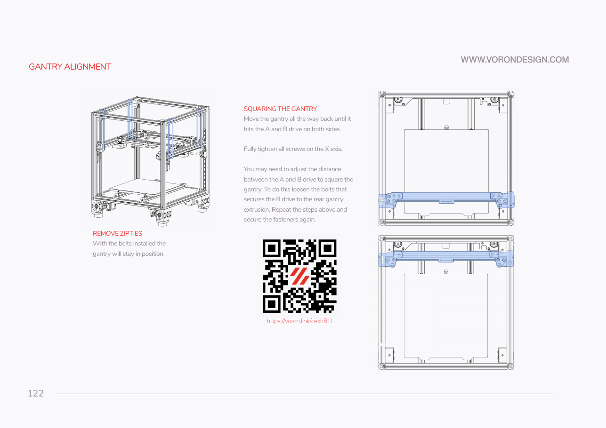{ crop="0.38 0.20 0.90 0.88" }
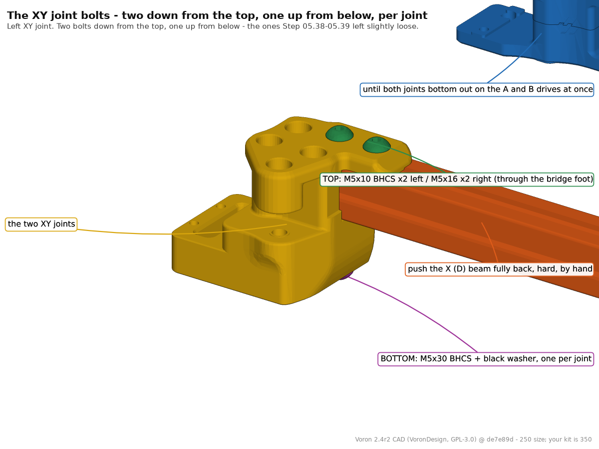

**What you're looking at:** Pushing the X extrusion back until both XY joints touch their drive units uses the rear drive blocks as a square. It is a rough mechanical square only; the full procedure, which this page's QR code ([voron.link/cekh81l](https://voron.link/cekh81l)) points to, is Part B.

**Parts:** none.

**Do:**

1. Push the X extrusion back until both XY joints hit the A and B drives at the same time.
2. Hold it there and tighten the three screws at each joint that clamp it to the X extrusion: two BHCS from above, one M5×30 from below. No Z belt clamps here.

**Check:** Looking down, the X extrusion is parallel to the rear frame extrusion when pushed fully back, and to the front extrusion when pushed fully forward.

??? note "If one side hits first"

    Then the spacing between the A and B drives needs adjusting; p.122 says you may need to. Loosen the screws that hold the B drive to the rear gantry extrusion, push the gantry back until both sides land together, then tighten them again. At each joint you tighten the M5×10 (left) or M5×16 (right) BHCS from Step 05.38 and the M5×30 with its black washer from 05.39. Never the Z belt-clamp screws at the drives and idlers, and never the rail screws.

Source: [Voron manual p.122](https://github.com/VoronDesign/Voron-2/blob/de7e89d/Manual/Assembly_Manual_2.4r2.pdf#page=122) · [Voron docs § V2 Gantry Squaring](https://docs.vorondesign.com/build/mechanical/v2_gantry_squaring.html) · CAD: Voron 2.4r2 STEP @ de7e89d · [Video: Part 6 @1:34:55](https://www.youtube.com/watch?v=8pWoYkY1DiA&list=PL0fUJbigELQPqpeGOgHYisG4KaSXVtnNY&t=5695s)

---

### Step 06.25 — Release the gantry and check it moves freely

{ crop="0.14 0.18 0.36 0.62" }

**What you're looking at:** With four belts on, the gantry holds its own weight; the zip ties and mid-rail stoppers were only scaffolding. Turning a Z drive by hand is a corner's first end-to-end test. Never spin a connected stepper motor fast: the current it makes (back-EMF) kills drivers.

**Parts:** none.

**Do:**

1. Cut any long zip ties and take out the four mid-rail stoppers.
2. Refit the rubber stoppers at the bottoms of the rails; the printed stops stay on top.
3. Turn each Z drive pulley by hand and watch that corner rise.

**Check:** The gantry stays where the belts hold it, unsupported, and turning any Z drive raises that corner smoothly, with no slipping or rubbing.

**Helper:** Watches the corner you turn and says whether it rises smoothly, with no slip.

Source: [Voron manual p.122](https://github.com/VoronDesign/Voron-2/blob/de7e89d/Manual/Assembly_Manual_2.4r2.pdf#page=122)

Pause: ~35 min since the last pause — the gantry is squared against the A/B drives, the X axis is locked, the gantry is released, and everything moves freely by hand. Leave the machine powered off.

---

### Step 06.26 — Close out the mechanical Z axis


**What you're looking at:** This step closes Part A. The Z [drag chain](16-glossary.md#d) is the plastic link chain that carries cables from the fixed frame up to the moving gantry. Its two black frame mounts and two blue retainer brackets are printed with this chapter and fitted in Ch 10.

**Parts:**

- staged: `z_chain_bottom_anchor` ×1
- staged: `z_chain_guide` ×1
- staged: `[a]_z_chain_retainer_bracket_x2` ×2
- staged: drag chain 10×15 R28 ×1

**Do:**

1. Bag the Z chain parts and label the bag **Ch 10, manual p.200–204**.
2. Leave the chain latches and the mounting for Ch 10.

**Check:** One labelled bag holds the chain, the anchor, the guide and both retainer brackets.

Source: [Voron manual p.123](https://github.com/VoronDesign/Voron-2/blob/de7e89d/Manual/Assembly_Manual_2.4r2.pdf#page=123)

Pause: ~15 min since the last pause — the Z axis is mechanically complete and logged. Stop here and go to Ch 07: Part B below cannot start until Ch 13 sends you to it at Step 13.34.

---

## Checkpoint 06

**Built:** a gantry hanging level on four belted Z corners

- [ ] Four `z_joint_upper` blocks are fitted, each with its M5 nut seated and its **cutout facing outward**.
- [ ] No 6×3 magnets are used, and no `z_joint_upper_hall_effect` part is printed or fitted.
- [ ] Four `z_joint_lower` are on the Z carriages, four M3×20 SHCS each, all four screwed down flat.
- [ ] Four M5×40 SHCS are in, **all still light**: they are tightened hot in Ch 14, not now and not in Part B.
- [ ] Four Z belts are routed drive, then idler, then clamp, with the teeth gripping every pulley and none twisted.
- [ ] Both belt ends are clamped at every corner: the first under the lower clip and the bearing block, the second under the upper clip's two M5×16. The tails are folded and zip-tied.
- [ ] All four belts pluck to roughly the same note, and nothing rubs anywhere within ±30 mm of Z travel.
- [ ] The six screws that clamp the XY joints to the X extrusion (Steps 05.38–05.39) are fully tightened, with the gantry held back against both A/B drives (p.122). The Z belt-clamp screws and rail screws are untouched.
- [ ] The gantry holds its own height on the belts, and the zip ties and the stoppers in the middle of the rails are removed.
- [ ] The Z chain parts are bagged and labelled for Ch 10.

**Next:** [Ch 07 — A/B belts and tensioning](07-ab-belts.md#step-071-confirm-the-gate-before-you-start). Part B (Ch 06b) below cannot start until Ch 13 Step 13.34 sends you to it.

## Common mistakes

- **Doing p.114 before p.115–116.** You end up wrestling a 350 gantry on long zip ties while trying to line up four joints. Fit the lower joints first and rest the gantry on rubber rail stoppers instead (LDO note p.114–116).
- **Fitting the hall-effect block or a 6×3 magnet** because the manual shows it. This kit has none (LDO p.145). If you printed `z_joint_upper_hall_effect.stl`, you printed the wrong file.
- **The block's cutout facing inward.** It is the one orientation mistake on p.112 that the manual calls out, and you cannot see it once the belt is on. Check all four before fitting the belts.
- **Putting the upper clip, the one with two equal holes, on the Z bearing block.** The Z joint stack takes only the lower clip (p.111). The upper clip sits on top of the front idler or drive, under its pair of M5×16 (Ch 05, p.91, p.95).
- **Removing the top belt clamp screws at p.117, or loosening the wrong pair.** The two M5×16 on top also hold the front idler or drive to the Y extrusion: loosen them only until a belt slides under the clip. The M3×30 and M5×30 underneath hold the first belt end; leave them alone.
- **Cutting the Z belts to 1200 mm** and finding, after the wrap, that it is just not enough. Cut about 1400 mm: long enough to wrap, and it still leaves about 400 mm of the kit's 6 m spare. Cutting four at 1500 mm uses up the whole reel.
- **Tightening the M5×40 Z joint screws now.** They stay light through Part B and get their final tightening hot, in Ch 14 (Voron squaring step 16). Tight joints here fight every squaring adjustment you make.
- **Leaving a Z carriage free near the top of its rail.** It slides off, the balls end up on the floor, and the carriage is scrap.

---

## Part B — Chapter 06b: Gantry squaring

⚠ **Do this from inside Chapter 13, not now.** Start Part B only when [Ch 13 Step 13.34](13-initial-startup.md#step-1334-hand-off-to-ch-06b-square-the-gantry-then-re-tension-ab) sends you here, once the machine homes and runs QGL. It needs a running printer, cold and open.

The procedure needs `SET_IDLE_TIMEOUT`, `G28`, `QUAD_GANTRY_LEVEL` and `SET_STEPPER_ENABLE`. It ends at Step 06b.16 by sending you back to Ch 13 Step 13.35. Ch 14 does the rest, after the panels go on in Ch 11 Part B: final belt tension (Steps 14.4–14.5, cold, door open), then the heat soak, the hot QGL runs and the hot tightening of the Z joints (Step 14.6).

**Why it is split out:** the procedure starts by *fully releasing the A/B belt tension* and *dropping the lower Z joints*, so anything you tension before this gets undone (survey §5.2 W1, §4.4 #2). The A/B tension from Ch 07 and the one you set at step 06b.15 are both provisional; Ch 14 Step 14.4 sets the final value.

**Part B is transcribed from** [V2 Gantry Squaring, docs.vorondesign.com](https://docs.vorondesign.com/build/mechanical/v2_gantry_squaring.html), which has 17 numbered steps. Steps 1–13 are transcribed below, each citing its original number, plus one added Z belt step. Steps 14–16 (heat soak, hot QGL, hot Z joint tightening) are handed to Ch 14 at Step 06b.16, and step 17 (`RESTART`) runs at 06b.16. [Ellis' identical section](https://ellis3dp.com/Print-Tuning-Guide/articles/voron_v2_gantry_squaring.html) has the same text. The manual's own p.122 QR code ([voron.link/cekh81l](https://voron.link/cekh81l)) points here.

**Extra tools for Part B:** 150 mm machinist square, digital caliper, 150 mm rule, phone spectrum app, hex keys 2.5, 3 and 4 mm.

[Z Locks](https://github.com/VoronDesign/VoronUsers/tree/master/printer_mods/tallman5/z-locks/) make step 06b.8 easier by holding the gantry while the joints are off. They are not required. [src](https://docs.vorondesign.com/build/mechanical/v2_gantry_squaring.html)

Source: [Voron docs § V2 Gantry Squaring](https://docs.vorondesign.com/build/mechanical/v2_gantry_squaring.html)

---

### Step 06b.1 — Raise the stepper idle timeout

(no image — see text)

**What you're looking at:** This step is one console command, with nothing to look at. Klipper, the printer's firmware, switches off idle stepper motors after 600 s by default, and once the Z motors let go, the gantry falls. This command sets the timeout to effectively never for the session.

**Parts:** none.

**Do:**

1. In the console, send `SET_IDLE_TIMEOUT TIMEOUT=99999`.
2. Do nothing else in Part B before this: the Z motors must stay powered and holding the gantry for the whole session. This is Voron step 1.

**Check:** The command is accepted with no error, and you can hear the Z motors holding.

Source: [Voron docs § V2 Gantry Squaring, step 1](https://docs.vorondesign.com/build/mechanical/v2_gantry_squaring.html)

---

### Step 06b.2 — Home and level

(no image — see text)

**What you're looking at:** `G28` homes the machine: it finds the start position of every axis. `QUAD_GANTRY_LEVEL`, or [QGL](16-glossary.md#q), probes four points and drives the four Z motors one by one until the gantry is parallel to the bed. QGL corrects height only; it cannot see racking (a gantry pushed out of square), which the rest of this procedure fixes.

**Parts:** none.

**Do:**

1. Send `G28`, then `QUAD_GANTRY_LEVEL`, and let it finish cleanly. This is Voron step 2.
2. From here on the machine stays homed and the Z motors stay holding.

**Check:** QGL settles within its retry limit. A machine that cannot complete QGL cannot be squared by this procedure.

Source: [Voron docs § V2 Gantry Squaring, step 2](https://docs.vorondesign.com/build/mechanical/v2_gantry_squaring.html)

---

### Step 06b.3 — Set the Z belts to 140 Hz

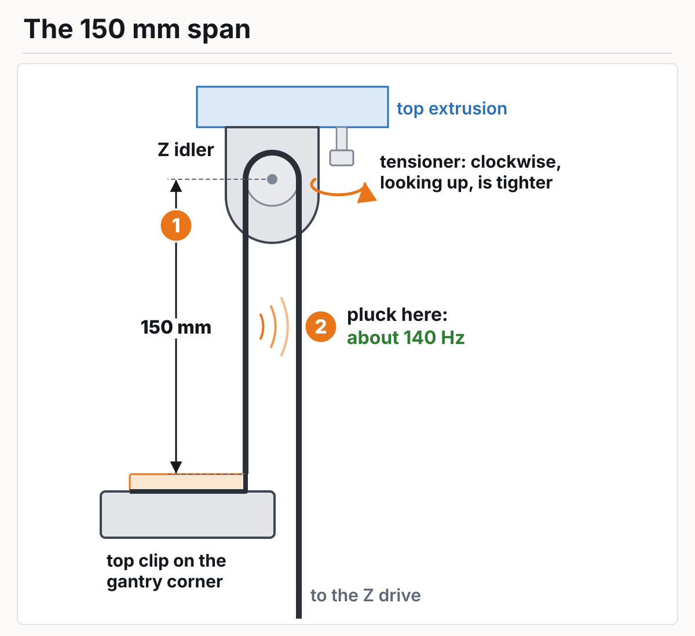

**What you're looking at:** Plucking a *measured* 150 mm span (the length of belt you pluck) and reading the lowest peak in a spectrum app turns tension into a number. Voron's figure for the 9 mm Z belt is 140 Hz; uneven belts make QGL wander. This step is not in the official procedure.

**Parts:** none.

**Do:**

1. Jog until a top belt clip sits **150 mm** below its Z idler centre, measured from the axle to the clip.
2. Pluck that span and adjust the tensioner until the lowest peak reads **about 140 Hz**.
3. Re-check all four after a move, then run `QUAD_GANTRY_LEVEL`.

**Check:** All four Z belts read 140 Hz ±5 Hz, still do after the gantry moves and returns, and QGL settles again afterwards.

**Helper:** Holds the phone at the belt span and reads the lowest peak aloud after each pluck.

Do this only after the idle timeout is raised and the machine is homed, so the Z motors hold the gantry throughout. The tensioner head sits under the blue slider and takes a 2.5 mm key from below. Clockwise, as you look up at the head, pulls the idler up and tightens the belt, so the note rises; p.117 shows that loosening it lets the idler drop. Voron's *"fixed side"* is the run this step measures: from the Z idler down to the top clip, where the belt is fixed to the gantry. [src](https://docs.vorondesign.com/tuning/secondary_printer_tuning.html)

Uneven Z belts are a known cause of a QGL that scatters (high σ) and will not repeat, and squaring with mismatched Z belts wastes the session (survey §4.3). This is the working setting QGL squares from; [Ch 14 Step 14.5](14-calibration.md#step-145-set-the-four-z-belts-to-140-hz-over-150-mm) sets it for the last time, cold, before the closed-chamber soak. [src](https://docs.vorondesign.com/tuning/secondary_printer_tuning.html)

Source: [Voron docs § V2 Gantry Squaring, step 1](https://docs.vorondesign.com/build/mechanical/v2_gantry_squaring.html) (prerequisite) · [Voron docs § Secondary printer tuning — A/B and Z belts](https://docs.vorondesign.com/tuning/secondary_printer_tuning.html) · [Ellis' Print Tuning Guide § V2 gantry squaring](https://ellis3dp.com/Print-Tuning-Guide/articles/voron_v2_gantry_squaring.html)

---

### Step 06b.4 — Park the gantry in the middle

(no image — see text)

**What you're looking at:** Parking the gantry in the middle of the build space is only about access: the next steps need a hex key on the XY joint screws from above *and* from below.

**Parts:** none.

**Do:** Jog the gantry to the centre of the build volume from Mainsail or the touchscreen, where you can reach both the top and the bottom of the gantry comfortably. This is Voron step 3.

**Check:** A hex key reaches an XY joint screw from above and from below without contorting yourself.

Source: [Voron docs § V2 Gantry Squaring, step 3](https://docs.vorondesign.com/build/mechanical/v2_gantry_squaring.html)

---

### Step 06b.5 — Disable only the A and B motors

(no image — see text)

**What you're looking at:** Switching off only the two CoreXY motors, A and B, which move the print head, lets you push the X extrusion around by hand. The Z motors stay on, because they, and nothing else, are holding the gantry off the bed.

**Parts:** none.

**Do:**

1. Send `SET_STEPPER_ENABLE STEPPER=stepper_x ENABLE=0`, then `SET_STEPPER_ENABLE STEPPER=stepper_y ENABLE=0`.
2. Disable **only** these two. The Z motors stay enabled: they are holding the gantry. This is Voron step 4.

**Check:** The X carriage moves freely by hand, and the gantry does not sink.

Source: [Voron docs § V2 Gantry Squaring, step 4](https://docs.vorondesign.com/build/mechanical/v2_gantry_squaring.html)

---

### Step 06b.6 — Release the A/B belt tension completely

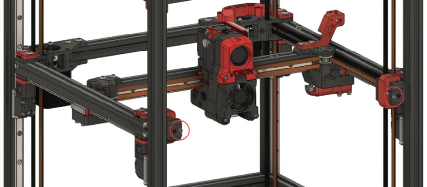

**What you're looking at:** The two front idler tensioners get backed fully off. The A/B belts pull the X extrusion diagonally, so any tension left in them drags the gantry back out of line while you are trying to line it up.

**Parts:** none.

**Do:**

1. Back both front idler tensioners fully off, until the belts are fully slack.
2. If tension remains with the idlers fully backed off, release the belt ends from the X carriage. This is Voron step 5.

**Check:** Both A/B belts are slack enough to lift 10 mm off their path with one finger.

Source: [Voron docs § V2 Gantry Squaring, step 5](https://docs.vorondesign.com/build/mechanical/v2_gantry_squaring.html) · image [`Gantry-ABTension.png`](https://raw.githubusercontent.com/VoronDesign/Voron-Documentation/master/build/mechanical/images/v2_gantry_squaring/Gantry-ABTension.png)

---

### Step 06b.7 — Confirm access to the Z and XY joints (the side panels are not on yet)

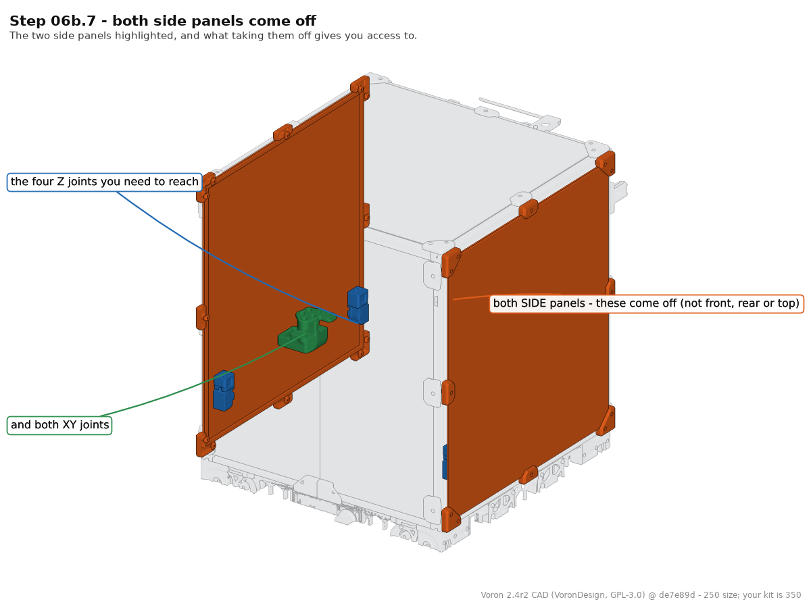

**What you're looking at:** Voron's step 6 is written for a finished machine with its panels on, and takes the two side panels off purely for access. The picture shows those side panels and, behind them, the four Z joints in the corners and the two XY joints on the gantry.

**Parts:** none.

**Do:**

1. Your side, back and top panels are not on yet, so there is nothing to remove. This is Voron step 6.
2. Confirm that all four Z joints and both XY joints can be reached with a hex key, top and bottom.

**Check:** All four Z joints and both XY joints are clear to reach.

Source: [Voron docs § V2 Gantry Squaring, step 6](https://docs.vorondesign.com/build/mechanical/v2_gantry_squaring.html) · CAD: Voron 2.4r2 STEP @ de7e89d

---

### Step 06b.8 — Unscrew and drop the lower Z joints

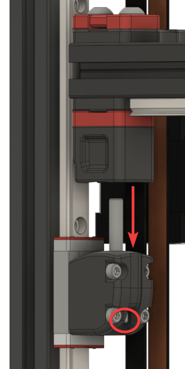
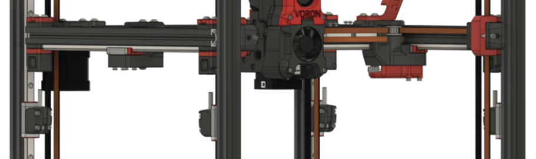

**What you're looking at:** The four lower Z joints come unscrewed and slide down their rails, away from the gantry. With them out of the way, the gantry hangs on its four Z belts and settles where it naturally sits, the position you build the joints back to.

**Parts:**

- reused: the four Z-joint M5×40 SHCS

**Do:**

1. Take the M5×40 out of each Z joint and slide the four lower joints down their rails, away from the gantry.
2. Do one at a time, and keep a hand on the gantry. This is Voron step 7.

**Check:** All four lower joints are clear of the gantry, the gantry hangs on the four Z belts alone, and it is not swinging.

**Helper:** Steadies the gantry corner you are working on while you take out its M5×40.

Voron's warning: *"Make sure your printer is on a (fairly) level surface. Unlevel surfaces could cause your gantry to swing too much to one side. It doesn't have to be perfectly level; just don't do it on a hill!"*

Source: [Voron docs § V2 Gantry Squaring, step 7](https://docs.vorondesign.com/build/mechanical/v2_gantry_squaring.html) · images [`ZJoint-Lowered.png`](https://raw.githubusercontent.com/VoronDesign/Voron-Documentation/master/build/mechanical/images/v2_gantry_squaring/ZJoint-Lowered.png), [`ZJoints-Lowered.png`](https://raw.githubusercontent.com/VoronDesign/Voron-Documentation/master/build/mechanical/images/v2_gantry_squaring/ZJoints-Lowered.png)

---

### Step 06b.9 — Partially loosen the X/Y joints

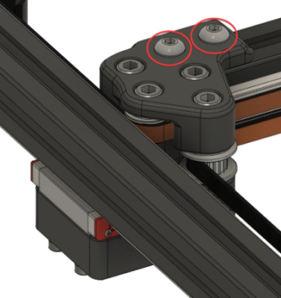
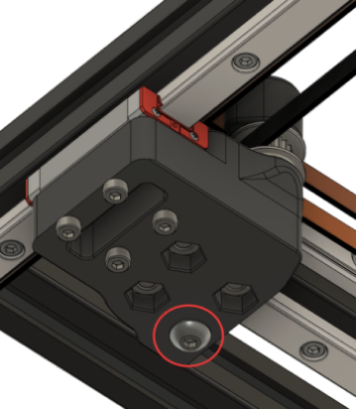


**What you're looking at:** Three screws clamp each XY joint to the X extrusion: two BHCS from above and one M5×30 with its black washer from below. Loosened just enough, each joint slides along the X extrusion, and that is how the gantry's width is adjusted.

**Parts:** none.

**Do:**

1. At each XY joint, loosen only the three screws that clamp it to the X extrusion: two BHCS from above, one M5×30 and washer from below. Do both sides.
2. Loosen them enough to slide by hand, and no more. This is Voron step 8.1.

**Check:** Each XY joint slides along its extrusion under firm hand pressure, and nothing else was loosened.

Source: [Voron docs § V2 Gantry Squaring, step 8.1](https://docs.vorondesign.com/build/mechanical/v2_gantry_squaring.html) · images [`XYLoosen-Top.png`](https://raw.githubusercontent.com/VoronDesign/Voron-Documentation/master/build/mechanical/images/v2_gantry_squaring/XYLoosen-Top.png), [`XYLoosen-Bottom.png`](https://raw.githubusercontent.com/VoronDesign/Voron-Documentation/master/build/mechanical/images/v2_gantry_squaring/XYLoosen-Bottom.png) · CAD: Voron 2.4r2 STEP @ de7e89d

---

### Step 06b.10 — Partially loosen the A/B joints and the front idlers

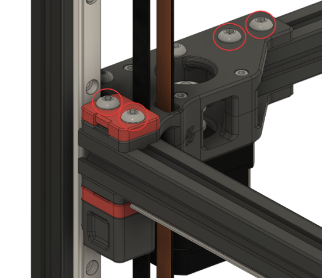
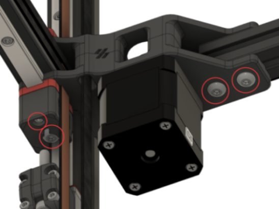
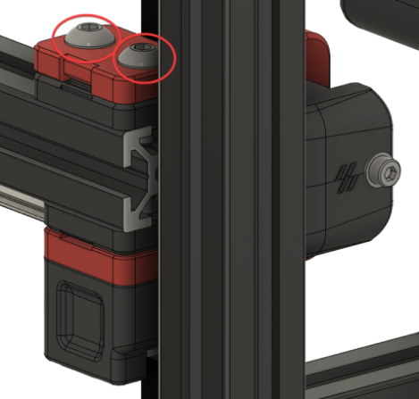
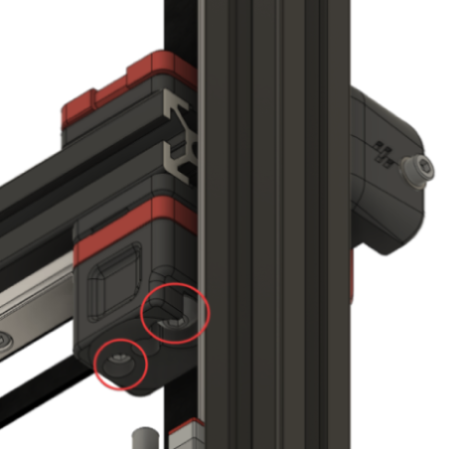

**What you're looking at:** Two A/B drives and two front idlers each clamp a Z belt with two screw pairs: the M5×16 pair on top through the upper clip, and the M3×30 and M5×30 under the bearing block. Each drive also has two M5×10 above and two below, into the rear extrusion.

**Parts:** none.

**Do:**

1. Ease every circled screw just enough to slide by hand: on each A/B drive, both clamp pairs and the four M5×10 into the rear extrusion; on each front idler, both clamp pairs.
2. Voron warns: *"Don't overdo the belt clamps!"* This is Voron steps 8.2 and 8.3.

**Check:** All six printed assemblies can be nudged along their extrusions by hand, and every Z belt end is still gripped, top and bottom.

⚠ **This corner hangs from its Z belt.** The top M5×16 clamp its second end, the bottom M3×30 and M5×30 its first. Work one corner at a time, about a turn each. Voron: *"Where there are Z belt clamps, ensure that you do not loosen the bolts to the point of the Z-belts releasing. Only loosen enough to allow for adjustments."*

Source: [Voron docs § V2 Gantry Squaring, step 8.2–8.3](https://docs.vorondesign.com/build/mechanical/v2_gantry_squaring.html) · images [`ABLoosen-Top.png`](https://raw.githubusercontent.com/VoronDesign/Voron-Documentation/master/build/mechanical/images/v2_gantry_squaring/ABLoosen-Top.png), [`ABLoosen-Bottom.png`](https://raw.githubusercontent.com/VoronDesign/Voron-Documentation/master/build/mechanical/images/v2_gantry_squaring/ABLoosen-Bottom.png), [`IdlersLoosen-Top.png`](https://raw.githubusercontent.com/VoronDesign/Voron-Documentation/master/build/mechanical/images/v2_gantry_squaring/IdlersLoosen-Top.png), [`IdlersLoosen-Bottom.png`](https://raw.githubusercontent.com/VoronDesign/Voron-Documentation/master/build/mechanical/images/v2_gantry_squaring/IdlersLoosen-Bottom.png)

---

### Step 06b.11 — Level the gantry onto the Z joints

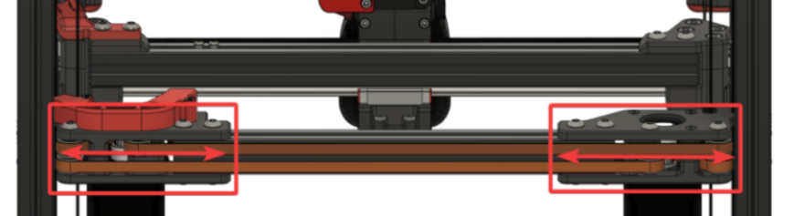
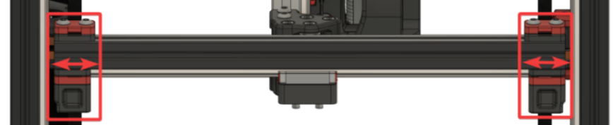
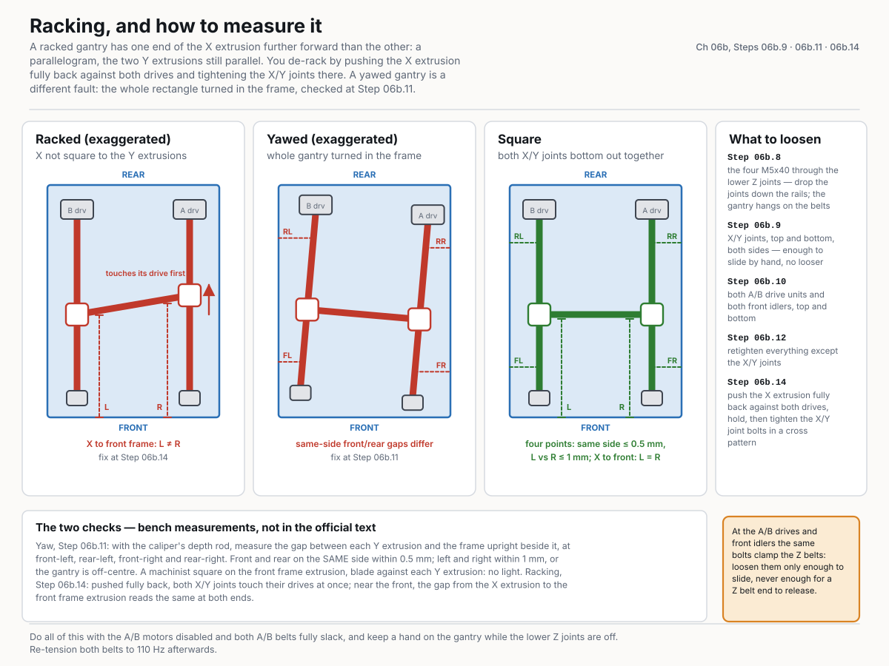
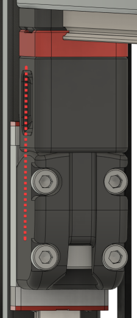
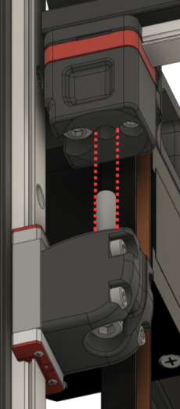
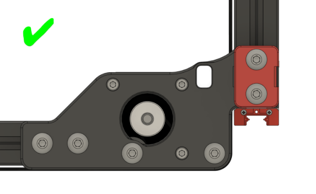
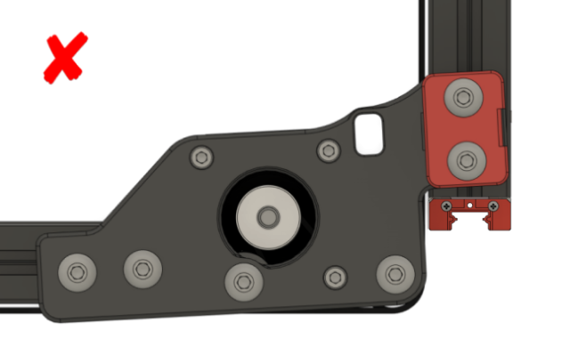

**What you're looking at:** Slide the six loosened assemblies along their extrusions until the gantry's four corners land over the four lower Z joints. Voron gives two conditions: each Z joint feels flush along its side, and the M5×40 slides in without hitting the sides of its hole.

**Parts:** none.

**Do:**

1. Slide the six loosened assemblies until the gantry sits on the four lower Z joints.
2. At each corner, raise the lower joint and start the M5×40 by hand: it drops in without coaxing.

**Check:** Both Voron conditions are met at all four corners, no A/B joint is rotated, and the four-point gap measurement is within its limits.

**Helper:** Writes the four gap readings into the table as you call them out.

??? note "The four-point gap measurement (bench check, not in the official text)"

    With the caliper's depth rod, measure the sideways gap between each **Y extrusion** and the frame vertical beside it, at front-left, rear-left, front-right and rear-right. Front and rear **on the same side** must agree within **0.5 mm**: a difference means the gantry is skewed in the frame. Left and right must agree within **1 mm**: a difference means the gantry is off-centre. Then stand a machinist square on the front frame extrusion at **each front corner**, blade against the Y extrusion: no light should show under the blade at either corner. Write the numbers down; you repeat this at 06b.12 and 06b.14.

    | Point | Measured (mm) | Pass |
    |---|---|---|
    | Front-left (left Y ↔ front-left vertical) | | |
    | Rear-left (left Y ↔ rear-left vertical) | | |
    | Front-right (right Y ↔ front-right vertical) | | |
    | Rear-right (right Y ↔ rear-right vertical) | | |

Source: [Voron docs § V2 Gantry Squaring, step 9.1–9.2](https://docs.vorondesign.com/build/mechanical/v2_gantry_squaring.html) · images [`XAdjust.png`](https://raw.githubusercontent.com/VoronDesign/Voron-Documentation/master/build/mechanical/images/v2_gantry_squaring/XAdjust.png), [`YAdjust.png`](https://raw.githubusercontent.com/VoronDesign/Voron-Documentation/master/build/mechanical/images/v2_gantry_squaring/YAdjust.png), [`Alignment-Side.png`](https://raw.githubusercontent.com/VoronDesign/Voron-Documentation/master/build/mechanical/images/v2_gantry_squaring/Alignment-Side.png), [`Alignment-Hole.png`](https://raw.githubusercontent.com/VoronDesign/Voron-Documentation/master/build/mechanical/images/v2_gantry_squaring/Alignment-Hole.png), [`Alignment-AB-Good.png`](https://raw.githubusercontent.com/VoronDesign/Voron-Documentation/master/build/mechanical/images/v2_gantry_squaring/Alignment-AB-Good.png), [`Alignment-AB-Bad.png`](https://raw.githubusercontent.com/VoronDesign/Voron-Documentation/master/build/mechanical/images/v2_gantry_squaring/Alignment-AB-Bad.png)

---

### Step 06b.12 — Retighten everything except the X/Y joints

(no image — see text)

**What you're looking at:** Everything you loosened is tightened again except the XY joints. Those stay free because the de-racking step that follows pushes the X extrusion hard against the two drive units and tightens the joints in that position.

**Parts:** none.

**Do:**

1. Tighten every extrusion screw you loosened at 06b.9 and 06b.10, Z belt clamps included, **except the three joint-to-extrusion screws at each XY joint**. Those stay loose for de-racking (pushing the gantry back into square).
2. Repeat the flush-and-screw-slides-in check at all four corners. This is Voron step 10.

**Check:** The A/B joints and front idlers are tight, top and bottom, the M5×40 still starts by hand at all four Z joints, and the four-point measurement has not changed.

Source: [Voron docs § V2 Gantry Squaring, step 10](https://docs.vorondesign.com/build/mechanical/v2_gantry_squaring.html)

---

### Step 06b.13 — Reinstall the lower Z joints, lightly

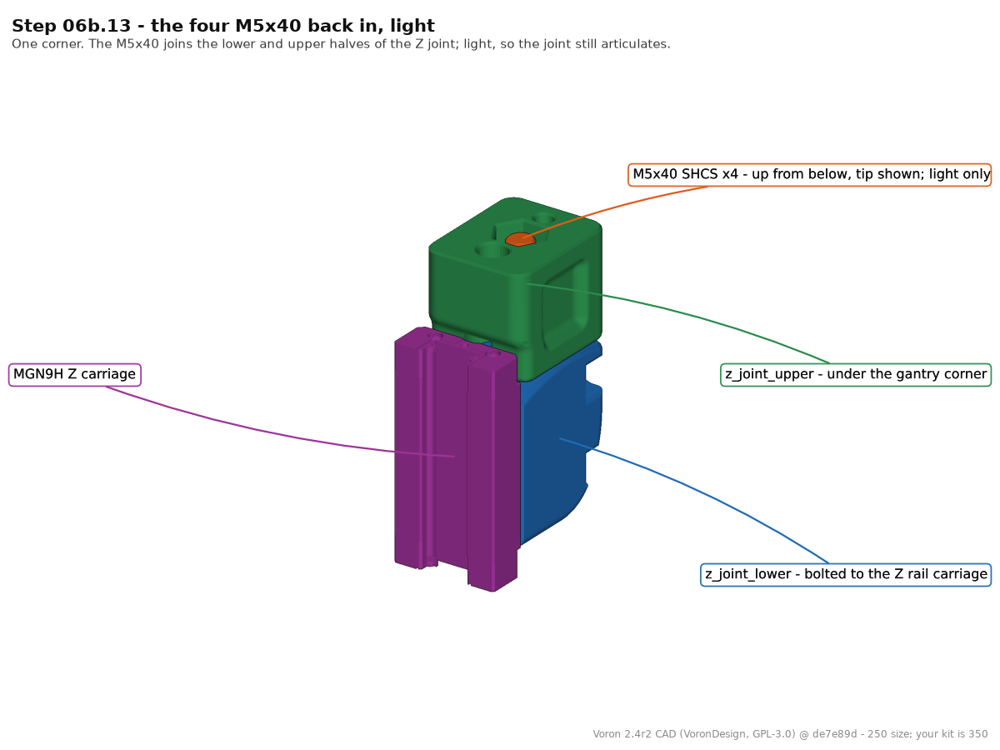
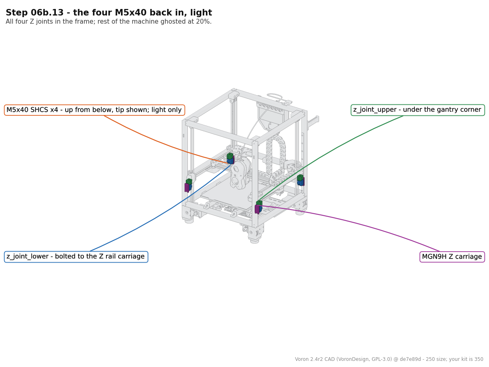

**What you're looking at:** The four M5×40 go back in, light again: the de-racking and the QGL runs that follow both need the joints free to move. They get their only full tightening hot, in Ch 14.

**Parts:**

- reused: the four Z-joint M5×40 SHCS

**Do:**

1. Slide the four lower joints back up and run one M5×40 up into each from below.
2. Tighten lightly only: the joint must still move freely. This is Voron step 11.

**Check:** All four screws are in, and each joint still moves when you push the gantry corner sideways.

Source: [Voron docs § V2 Gantry Squaring, step 11](https://docs.vorondesign.com/build/mechanical/v2_gantry_squaring.html) · CAD: Voron 2.4r2 STEP @ de7e89d

---

### Step 06b.14 — De-rack the gantry, then tighten the X/Y joints


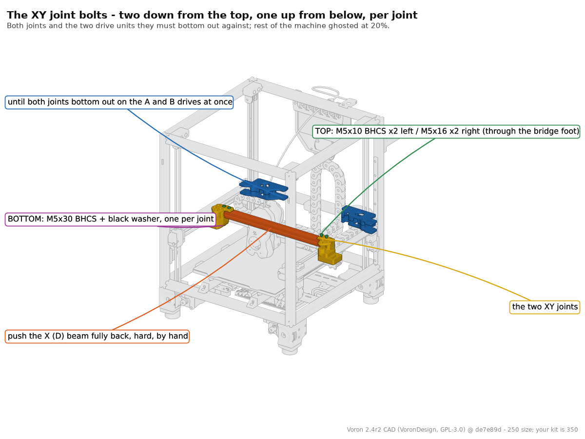

**What you're looking at:** [Racking](16-glossary.md#r) is the gantry sitting as a parallelogram, not a rectangle. QGL passes a racked gantry happily, and parts come out skewed. Pushing the X extrusion hard against both drives squares it to the machine's only reference.

**Parts:** none.

**Do:**

1. A/B motors disabled, belts slack: push the X extrusion **fully back** until both joints bottom out on their drives.
2. Hold it there and tighten each joint's three joint-to-extrusion screws, cross pattern, a bit at a time.
3. Touch only those six; drives, idlers and Z belt clamps stay as 06b.12 left them.

**Check:** Pushed back, both XY joints touch their drives at once, and near the front, the X extrusion is equally far from the front frame extrusion at both ends.

The Voron doc hands this method to [Nero3D's de-racking video](https://www.youtube.com/watch?v=cOn6u9kXvy0) instead of writing it out; this step is that method in words. Voron's own note on this step: *"Make sure to come back here afterwards! The following steps are still important."*

??? note "If one side still leads"

    Loosen the XY joint screws and repeat: the extrusion crept while they were being tightened. If the racking is still there after two attempts, the community fallback is to loosen each A/B belt's anchor at the X carriage until the belt slides through under a firm pull, pull both belts to equal tension with pliers while feeling the teeth engage, then anchor them again. The Voron forum's de-racking thread describes it. Afterwards, measure the four points from 06b.11 again and confirm the same-side pair still agrees within 0.5 mm.

Source: [Voron docs § V2 Gantry Squaring, step 12](https://docs.vorondesign.com/build/mechanical/v2_gantry_squaring.html) · [Nero3D — de-racking video](https://www.youtube.com/watch?v=cOn6u9kXvy0) · [Voron forum — de-racking thread](https://forum.vorondesign.com/threads/de-racking-again.1342/) · CAD: Voron 2.4r2 STEP @ de7e89d

---

### Step 06b.15 — Re-tension the A/B belts to 110 Hz (provisional, cold)

(no image — see text)

**What you're looking at:** The A/B belts get their second tension here, still provisional, because 06b.6 released whatever Ch 07 set. Voron's figure is 110 Hz measured over a 150 mm span; a plucked frequency only means something with a stated span.

**Parts:** none.

**Do:**

1. Move the X extrusion until the XY joint idler centres are **150 mm** from the front idlers.
2. Pluck that span and adjust each front tensioner to **about 110 Hz**, going back and forth until both match.
3. Move the extrusion and check again.

**Check:** A and B read within a few Hz of each other at about 110 Hz, and still do after the gantry has moved and come back.

**Helper:** Holds the phone at each belt span and reads the lowest peak aloud after each pluck.

This is Voron step 13. 110 Hz is about 2 lb of tension, deliberately at the low end. Ignore voronldo.com's 80–100 Hz figure for a 350: it names no span, and the span is what makes a frequency meaningful (survey §4.3). This is a cold, open-machine working value; Ch 14 Step 14.4 sets it for the last time with the panels on, cold and door open, just before the soak, so do not chase the last few Hz here. [src](https://docs.vorondesign.com/tuning/secondary_printer_tuning.html)

Source: [Voron docs § V2 Gantry Squaring, step 13](https://docs.vorondesign.com/build/mechanical/v2_gantry_squaring.html) · [Voron docs § Secondary printer tuning — A/B and Z belts](https://docs.vorondesign.com/tuning/secondary_printer_tuning.html) · [survey §4.3 / §7.5](../voron-build-instructions-survey.md)

---

### Step 06b.16 — Hand off: RESTART, then back to Ch 13 Step 13.35 — panels (Ch 11 Part B) and Ch 14's final tension and hot lock-in come after

(no image — see text)

**What you're looking at:** Voron's steps 14–16, the heat soak, the hot QGL runs and the hot tightening, need a chamber that closes, and the panels are not on yet. So squaring stops here, cold: the gantry square and de-racked, the Z joints light, and the A/B belts at a working tension.

**Parts:** none.

**Do:**

1. With a hand under the gantry, run `RESTART`: the idle timeout from 06b.1 goes back to its default.
2. Go back to [Ch 13 Step 13.35](13-initial-startup.md#step-1335-re-heat-and-re-qgl-after-squaring) and finish Ch 13.
3. Leave the four M5×40 **light**: nothing set in this part is final.

**Check:** `RESTART` has completed, `SET_IDLE_TIMEOUT` is back to the config default, the four M5×40 are still light, and you have let the gantry down by hand, since `RESTART` releases the Z motors.

This is Voron step 17, done now instead of in Ch 14 because the M5×40 stay light for days, not minutes. Ch 13 picks up at 13.35 with `G28`, a new QGL, Z=0, the bed mesh and the first cube. Then fit the back, side and top panels and the Clicky-Clack door ([Ch 11 Part B](11-skirts-panels-door.md#part-b-after-ch-13)). Final A/B and Z belt tension, cold with the door open at 14.4–14.5, then the heat soak, the 3–5 hot QGL runs and the hot tightening of the four M5×40 Z joint screws at 14.6, are [Ch 14 Part B](14-calibration.md#part-b-belts-final-tension).

Source: [Voron docs § V2 Gantry Squaring, steps 14–17](https://docs.vorondesign.com/build/mechanical/v2_gantry_squaring.html) · [Ch 14 Part B — Belts, final tension](14-calibration.md#part-b-belts-final-tension) · [Ch 11 Part B](11-skirts-panels-door.md#part-b-after-ch-13)

Pause: ~60 min since the last pause — the gantry is squared and de-racked cold, the A/B belts are at a provisional 110 Hz, the four Z joint M5×40 are still light, and `RESTART` has been run. Part B is one session by design: it starts by releasing all A/B tension, so stopping part-way leaves the machine unusable. Do not tighten the Z joints and do not chase the belt numbers; both are Ch 14's (belts cold at 14.4–14.5, joints hot at 14.6).

---

## Checkpoint 06b

**Built:** a square, de-racked gantry on four light Z joints

- [ ] `SET_IDLE_TIMEOUT TIMEOUT=99999` was set **first** (Step 06b.1), and the machine was homed and levelled with QGL (06b.2) before any belt was plucked or any screw touched.
- [ ] Four Z belts measured at **140 Hz** over a 150 mm span (Step 06b.3), all four within ±5 Hz. They are set for the last time at Ch 14 Step 14.5 (cold, same session as 14.4).
- [ ] Only `stepper_x` and `stepper_y` were disabled; the Z motors held the gantry throughout.
- [ ] The A/B belts were fully slack before any adjustment was made.
- [ ] At every XY joint, only the three joint-to-extrusion screws (Steps 05.38–05.39) were loosened. At the A/B drives and front idlers, both Z belt-clamp pairs were eased only enough to slide, no Z belt end slipped, and all were tightened again at 06b.12.
- [ ] Both A/B joints are checked for rotation against the good and bad reference pictures.
- [ ] At all four Z joints, the M5×40 starts by hand with the joint raised, with no coaxing.
- [ ] **The four-point gantry-to-frame gaps are recorded**: same-side front and rear within 0.5 mm, left and right within 1 mm.
- [ ] The machinist square shows no light at **both** front corners: the Y extrusions are square to the frame (Step 06b.11).
- [ ] De-racked (Step 06b.14): pushed back, both XY joints touch their drives at once, and near the front, the gap from the X extrusion to the front frame extrusion is equal at both ends.
- [ ] The A/B belts are re-tensioned to a provisional **110 Hz** over a 150 mm span and matched to each other. The final value is Ch 14 Step 14.4.
- [ ] The four Z joint M5×40 screws are **still light**: they are tightened hot in Ch 14, not here.
- [ ] `RESTART` was run at Step 06b.16 and the idle timeout is back to default; the next page is Ch 13 Step 13.35.

**Next:** [Ch 13 Step 13.35](13-initial-startup.md#step-1335-re-heat-and-re-qgl-after-squaring): re-heat and run QGL again after squaring, then Ch 11 Part B.

## Common mistakes (06b)

- **Doing this before Ch 13.** Four of the seventeen steps are G-code commands. Trying it without a running printer means guessing at "level" with no QGL to check against.
- **Plucking the Z belts before the idle timeout is raised and the machine is homed.** Klipper's default 600 s timeout releases the Z motors partway through a step, and the gantry sags onto whatever is under it. Do Steps 06b.1–06b.2 first, every time.
- **Tensioning the A/B belts in Ch 07, or here, and treating that as final.** Step 06b.6 undoes Ch 07's, and Ch 14 Step 14.4 sets the real one with the panels on, cold, just before the closed-chamber soak. Both earlier values are working values.
- **Overdoing the belt clamps at step 06b.10.** The gantry is hanging on the Z belts, and at each A/B drive and front idler both screw pairs clamp one: the top M5×16 its second end, the bottom M3×30 and M5×30 its first. Ease them just enough to slide; a released end drops that corner. At 06b.9 only the three joint-to-extrusion screws move.
- **Tightening the Z joints cold, here.** The point of the hot lock-in (Ch 14 Step 14.6) is to freeze the gantry at its full heat expansion. Tightening cold throws that away, and it shows up as an uneven first layer. The joints stay light from 06b.13 until Ch 14, and light through the rest of Ch 13.
- **Skipping the de-racking step because QGL passed.** QGL levels the gantry in Z; it says nothing about whether the X extrusion is square to the Y axes. A racked gantry passes QGL happily and prints skewed parts.
- **Believing voronldo.com's tension numbers.** Its 80–100 Hz (A/B) and 110–130 Hz (Z) conflict with the official figures and name no span. Use 110 Hz and 140 Hz over 150 mm (survey §4.3).

## Next

**After Part A:** [Ch 07 — A/B belts and tensioning](07-ab-belts.md) (manual p.124–145) once Checkpoint 06 is clear; tension provisionally, because Part B will release it. **After Part B:** back to [Ch 13 Step 13.35](13-initial-startup.md#step-1335-re-heat-and-re-qgl-after-squaring) (re-heat, re-QGL, Z=0, mesh, first cube); then [Ch 11 Part B](11-skirts-panels-door.md#part-b-after-ch-13) (panels and door); then [Ch 14 Steps 14.4–14.6](14-calibration.md#part-b-belts-final-tension) for final belt tension (cold), then the hot soak and the hot Z-joint tighten.

Source: [Voron docs § V2 Gantry Squaring, steps 14–17](https://docs.vorondesign.com/build/mechanical/v2_gantry_squaring.html)
