# Chapter 07 — A/B belts and tensioning

<!-- style: plain -->

You cut, thread and clamp the two belts that move the print head, give them a first tension, and fit the inductive probe to the X carriage. After this chapter the gantry is a working XY motion system, and everything that follows (toolhead, wiring, bring-up) assumes the belts are on.

**What you're building in this chapter:** Two belt loops, and the printed X carriage that clamps their ends. In CoreXY neither motor owns an axis: the rear-**right** motor drives the **A** belt, the rear-**left** motor drives **B**, and the print head moves in X when both turn the same way and in Y when they turn opposite ways. Each belt is one loop that starts and ends at the X carriage, starting in its **left** half. A runs in the **upper** plane, B in the **lower**, and they **never cross**. A belt's teeth wrap the toothed motor pulley that drives it; everywhere else its smooth back runs over a plain bearing stack (flanged bearings on one screw). The exception is the XY joints at the ends of the X extrusion, where each belt wraps one toothed 20T idler teeth-on: A the right joint's upper idler, B the left joint's lower one. Its other turn there is on a plain F695 pair (p.105, p.135, p.136, p.138). The joint and the height decide this, so never twist a belt to change it. Both loops are the same length, so equal belts give equal tension, and no tensioner can undo a length error. Last, you fit the inductive probe that later levels the gantry and maps the bed.

```mascot
pose: caliper
caption: Belts that sound alike are not alike. Measure both. My ears are excellent. I still measure.
```

**Time:** 2.5–4.0 h hands-on, first build ([survey §5.1 P07 / §7.2 Ch 07](../voron-build-instructions-survey.md)).

**Sessions:** 5 × ~30 min, a first-build estimate; each `Pause:` line carries its own segment minutes. Segment 3, threading both belts, cannot be broken and needs ~80 min in one sitting. If you must stop inside it, there is a soft stop after Step 07.16.

**Prerequisites:**

- **Ch 04** is done: A/B drives and front idlers assembled, motor pulley set screws threadlocked.
- **Ch 05** is done: gantry, XY joints and titanium backers, with the X carriage halves bagged at Step 05.45.
- **Ch 06 Part A** is done: the gantry is installed on the Z joints and the Z belts are clamped.
- **Printed parts:** batch **B02** for the blue accents (`[a]_tensioner_left/right`, `[a]_cable_cover`), **B03** for the front idlers, and **B04** for the XY joints, the X carriage and `probe_retainer_bracket`.
- **The gantry moves freely by hand over its full travel with no belts on.** Fix any binding now, not after the belts are on.

**Tools**

- Ball-end hex 2.5 mm, for every screw in this chapter
- Needle-nose pliers and tweezers for threading the belts (the manual suggests them on p.132)
- Flush cutters or sharp scissors for the belt; a steel rule or tape of at least 2.2 m; a 150 mm steel rule for the tension span; a marker
- A phone with a spectrum app, which shows the pitch of a sound: **Spectroid** (Android), **Sound Spectrum Analysis** (iOS), or **Gates Carbon Drive** (both; use its "motorcycle" option) ([Voron tuning docs](https://docs.vorondesign.com/tuning/secondary_printer_tuning.html))
- Nutopress Pro insert press with its M3 tip, only if the heat-set inserts on p.129 were not done in the batch insert pass. Use the X-Tronic iron with the LDO brass tip only if a part will not fit under the press

**Read first**

- **The tension you set here is provisional.** Set enough to home the printer and level the gantry (QGL). Ch 06b releases it completely to square the gantry, and Ch 14 Step 14.4 sets the final number. Tensioning to final now just gets undone.
- **Equal length is the whole trick.** Cut each belt against the other, never to a tape measure alone.
- **The only tension number is 110 Hz over a 150 mm span**, from the Voron tuning docs. The Voron manual gives none. Do not use a "push it 2 mm with your finger" test: nothing here calibrates it.
- **Nothing in this chapter is torqued.** Clamp the first belt ends firmly and the second ends lightly, pull the belts tight by hand, then tighten the carriage screws fully. There is no torque figure; do not invent one.
- **Three kit differences land here:** check the X carriage files (p.129–130), tape the probe (p.143), and skip p.145. The probe lead is never cut.

<!-- reference -->

**Printed parts**

Parts arrive in the bins named below (see the bin map in print/README.md#bins); check the bin label's list before you start.

| Looks like | STL | Bin | Qty | Colour |
|---|---|---|---:|---|
| 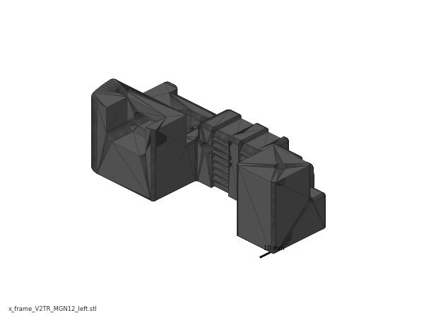{ width=96 } | `Gantry/X_Axis/X_Carriage/x_frame_V2TR_MGN12_left` | 07-X | 1 | Black |
| 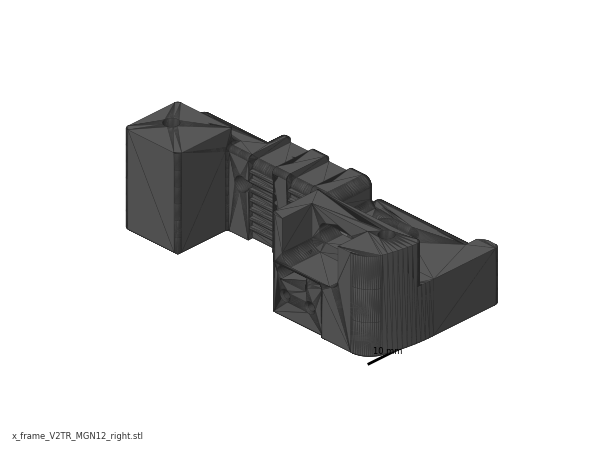{ width=96 } | `Gantry/X_Axis/X_Carriage/x_frame_V2TR_MGN12_right` | 07-X | 1 | Black |
| 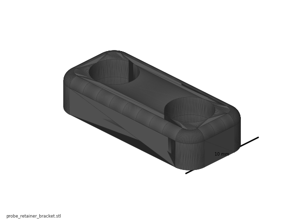{ width=96 } | `Gantry/X_Axis/X_Carriage/probe_retainer_bracket` | 07-X | 1 | Black |
| { width=96 } | `Gantry/Front_Idlers/[a]_tensioner_left` | 04-B | 1 | Blue — fitted in Ch 04, adjusted here |
| { width=96 } | `Gantry/Front_Idlers/[a]_tensioner_right` | 04-A | 1 | Blue — fitted in Ch 04, adjusted here |
| { width=96 } | `Gantry/AB_Drive_Units/[a]_cable_cover` | 07-X | 1 | Blue — dry-fitted here, fitted at Step 10.66 |

**Hardware** (chapter totals)

| Fastener / part | Qty | Where |
|---|---|---|
| Gates 2GT open belt, 6 mm wide | 2 lengths, cut equal | A and B belts (p.125, p.131 — see Step 07.8) |
| M3×8 SHCS | 4 | belt clamps, 2 per X carriage half (p.131, p.140) |
| M3×12 SHCS | 2 | 1 per X carriage half, in the plain hole beside the belt slot, head 3 mm off the plastic (p.130) |
| M3×30 SHCS | 4 | 2 carriage bolts (p.140) + 2 probe retainer bracket (p.143) |
| M3 nut | 2 | right X carriage half, capture the M3×30 carriage bolts (p.129) |
| M3 heat-set insert | 4 | 1 per X carriage half, in the bottom hole + 2 in `probe_retainer_bracket` (p.129); the M3×12 stop screws do not use them |
| Inductive probe, Omron TL-Q5MC | 1 | X carriage (p.143) |
| Fibreglass tape (LDO-supplied) | as needed | probe insulation, front + sides only (LDO note p.143) |

**Notes behind "Read first"**

- **The tension you set here is provisional.** Gantry squaring (Ch 06b) *begins* by fully releasing A/B belt tension, and it needs a running printer (`G28`, `QUAD_GANTRY_LEVEL`, `SET_STEPPER_ENABLE`), so it happens inside Ch 13. Set enough tension to home and QGL. A/B tension is set three times on purpose: Ch 07 (provisional — enough to home and QGL), Ch 06b Step 06b.15 (provisional again, after squaring, cold and open) and Ch 14 Step 14.4 (final — panels on, cold, door open, immediately before the closed-chamber soak and hot Z-joint tighten of 14.6). Z belts: 06b.3 (so QGL converges for squaring), set for the last time at 14.5, same cold session. Ch 14 owns the final number; tensioning to final now just gets undone — that is [survey §5.2 W1](../voron-build-instructions-survey.md), a ~1.5 h rework.
- **Equal length is the whole trick.** Both belt paths are the same length by design, so if the two belts are cut identical, equal tension follows (p.125). Cut each belt against the other, never to a tape measure alone: fold-cut both at once (Step 07.8), or do as p.125 recommends: route one, remove it, and cut the second to match it.
- **There is no sourced deflection number.** The official manual gives *no* tension figure at all — only the equal-length rule. The one sourced number in this build's document set is **110 Hz over a 150 mm span** ([Voron secondary tuning](https://docs.vorondesign.com/tuning/secondary_printer_tuning.html)). voronldo.com's 80–100 Hz is discarded ([survey §4.3](../voron-build-instructions-survey.md)). Do not substitute a "push it 2 mm with your finger" test — nothing here calibrates it.
- **Nothing in this chapter is torqued.** The left half clamps the first belt ends at p.131. The right half's belt clamps and the carriage bolts go on lightly, the belts get pulled tight by hand, then those screws are fully tightened (p.140–141; p.141's middle panel highlights only the right half's two M3×8). The manual specifies no torque values; don't invent one.
- Three LDO deviations land in this page range: the X-carriage variant check (p.129–130), probe insulation (p.143), and p.145 skipped entirely.
- **The inductive probe is built once, here.** Insulation, fitting, the 6 mm height and the cable route are Steps 07.34–07.37 (manual p.143–144). The tape goes on here and nowhere else: Ch 10 Step 10.30 only confirms it. The lead is never cut: it arrives pre-terminated for the toolhead board, and Ch 08 Step 08.50 plugs it in. Ch 08 otherwise only confirms the decision and bags the Klicky set. The `probe_retainer_bracket` and the fibreglass tape are counted in this chapter's totals, not Ch 08's.

**Sources for this chapter:**

- [Voron 2.4r2 assembly manual, p.124–145](https://github.com/VoronDesign/Voron-2/blob/de7e89d/Manual/Assembly_Manual_2.4r2.pdf#page=124) — the page sequence this chapter transcribes, pinned at commit `de7e89d`
- [Voron docs § Secondary printer tuning — A/B Belts](https://docs.vorondesign.com/tuning/secondary_printer_tuning.html) — the only sourced tension figure, 110 Hz over 150 mm, and the source of the spectrum image (GPL-3.0)
- [Voron docs § V2 Gantry Squaring](https://docs.vorondesign.com/build/mechanical/v2_gantry_squaring.html) — why this tension is provisional
- [LDO Build Notes § Voron 2.4 build FAQ](https://docs.ldomotors.com/en/voron/voron2/build-faq) — X-carriage variant check, probe insulation, p.145 skipped
- [LDO 350 Rev D+ BOM](https://docs.ldomotors.com/en/voron/voron2/350_BOM/Rev_D+) and [onetwo3D's 350 BOM](https://www.onetwo3d.co.uk/voron-bill-of-material/voron-2-4-350mm-bill-of-material/) — belt supplied as 6.21 m bulk, 2000 mm per belt
- [Voron 2.4r2 assembly manual, p.204](https://github.com/VoronDesign/Voron-2/blob/de7e89d/Manual/Assembly_Manual_2.4r2.pdf#page=204) — the `[a]_cable_cover` arch, screwed onto the A drive over the Z-chain wire bundle in Ch 10

**Video coverage (Steve Builds, pre-release LDO kit — differs from Rev D+):** [Part 4 @1:38:20](https://www.youtube.com/watch?v=ViB5Ulc9zDI&list=PL0fUJbigELQPqpeGOgHYisG4KaSXVtnNY&t=5900s) (+6m), [Part 5 @1:52:44](https://www.youtube.com/watch?v=hTKCBrk36R0&list=PL0fUJbigELQPqpeGOgHYisG4KaSXVtnNY&t=6764s) (+8m), [Part 6 @0:01:10](https://www.youtube.com/watch?v=8pWoYkY1DiA&list=PL0fUJbigELQPqpeGOgHYisG4KaSXVtnNY&t=70s) (+18m), [Part 8 @1:43:45](https://www.youtube.com/watch?v=Q3Q1szaFfSE&list=PL0fUJbigELQPqpeGOgHYisG4KaSXVtnNY&t=6225s) (+6m)

---

## Understand the path before you cut anything

### Step 07.1 — Confirm the gate before you start

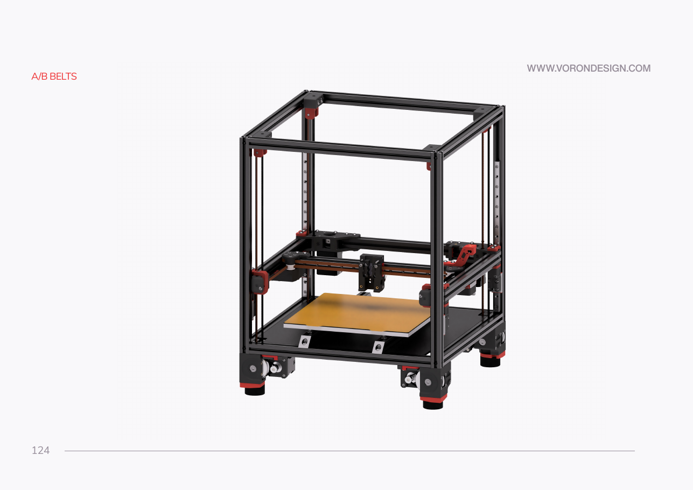{ crop="0.32 0.14 0.76 0.84" }

**What you're looking at:** Before any belt goes on, prove that the gantry slides freely in X and Y with nothing driving it. The belts are the last mechanical link, and they thread through bearing stacks (small piles of bearings that turn the belt) at six places. Binding is far cheaper to find now.

**Parts:** none.

**Do:**

1. Confirm the gantry is on the Z joints and the Z belts are clamped, from Ch 06 Part A.
2. Push the gantry by hand through its full Y travel, and the X carriage through its full X travel.

**Check:** travel that stays smooth: no notchy spots, no resistance rising at either end, and no carriage running off a rail. The X carriage coasts when you push it.

Source: [Voron manual p.124](https://github.com/VoronDesign/Voron-2/blob/de7e89d/Manual/Assembly_Manual_2.4r2.pdf#page=124)

### Step 07.2 — Learn the rule that governs this chapter

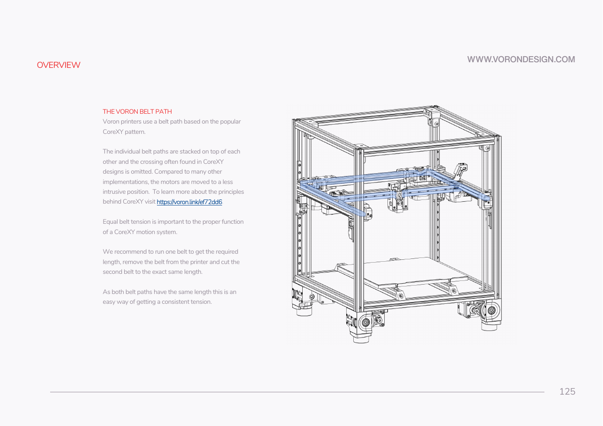{ crop="0.16 0.18 0.86 0.82" }

**What you're looking at:** This page is the idea behind the whole chapter. In CoreXY neither motor owns an axis: two belt loops connect both motors to the carriage. The print head moves in X when the motors turn together and in Y when they turn opposite ways.

**Parts:** none.

**Do:**

1. Read p.125.
2. Note that the two belt paths are stacked at different heights and never cross: each belt stays in one horizontal plane for its whole loop.
3. Note that both paths are the same length by design. Equal length is how you get equal tension.

**Check:** a clear picture in your head: you can say, without looking, where the A belt leaves the carriage and where it comes back.

Source: [Voron manual p.125](https://github.com/VoronDesign/Voron-2/blob/de7e89d/Manual/Assembly_Manual_2.4r2.pdf#page=125)

### Step 07.3 — Trace the A belt path

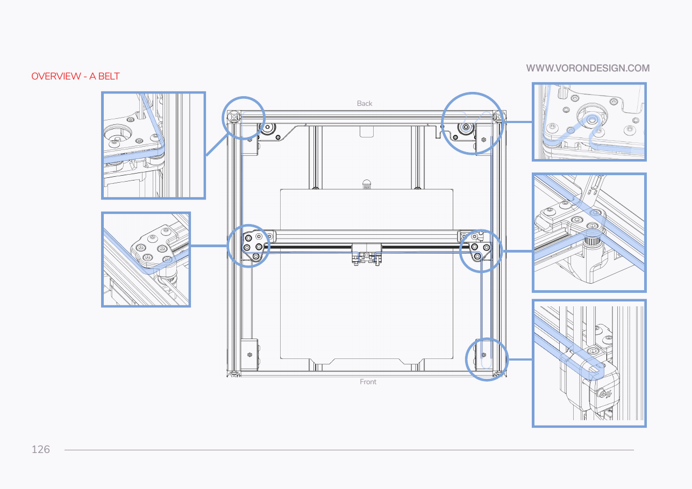
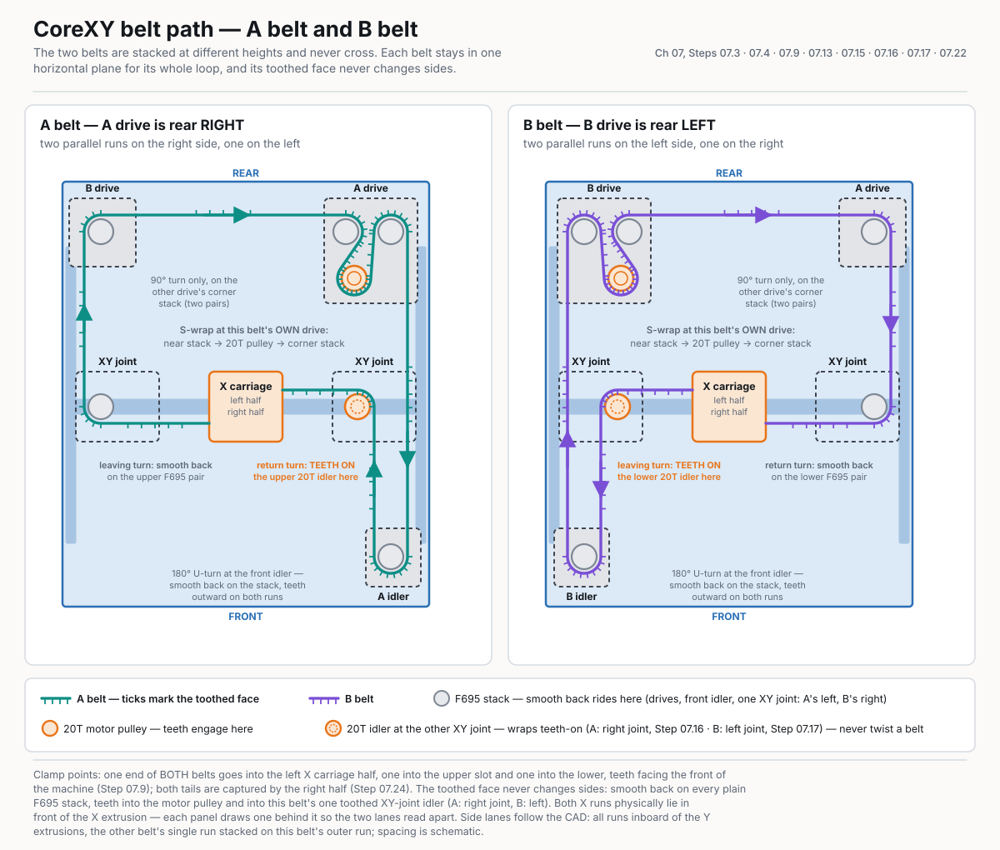

**What you're looking at:** The **A** belt is driven by the rear-right motor and runs in the upper of the two planes: its motor pulley and front idler sit 10 mm higher than B's. The diagram traces the same loop seen from above.

**Parts:** none.

**Do:**

1. Trace the loop on p.126: X carriage, left XY joint, rearward along the left Y extrusion, the rear-left idler stack, the rear extrusion, the A drive's S-wrap (an S-shaped path round its motor pulley), forward along the right Y, the U-turn at the front-right idler, rearward to the right XY joint, and the carriage.

**Check:** two parallel A runs on the right-hand side and one on the left, with the A drive at the rear right. [src](../voron-build-instructions-survey.md)

Source: [Voron manual p.126](https://github.com/VoronDesign/Voron-2/blob/de7e89d/Manual/Assembly_Manual_2.4r2.pdf#page=126)

### Step 07.4 — Trace the B belt path

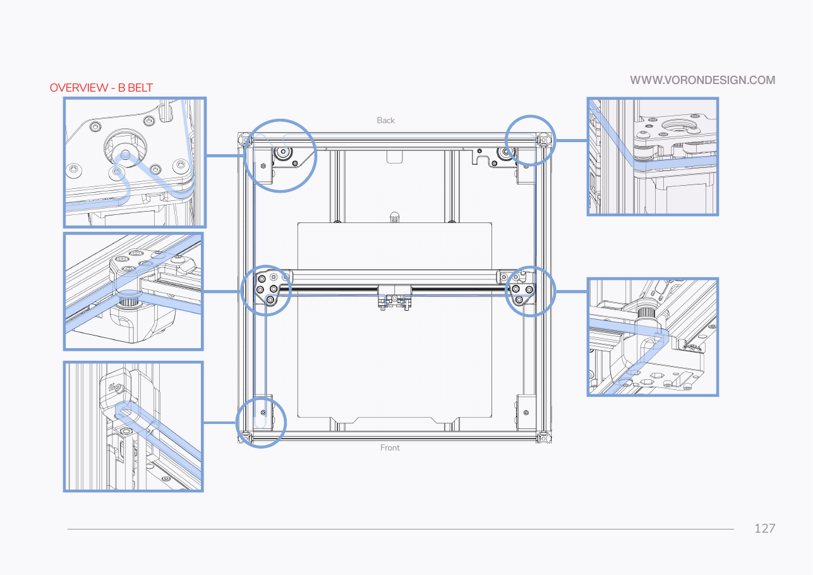


**What you're looking at:** The **B** belt is A's mirror image: driven by the rear-left motor, in the lower plane, with two runs on the left and one on the right. Each drive unit carries a toothed motor pulley for its own belt and a plain stack for the other.

**Parts:** none.

**Do:**

1. Trace the loop on p.127: X carriage, the left XY joint teeth-on (teeth against the idler), forward along the left Y, the front-left idler U-turn, the B drive's S-wrap, the rear extrusion, the rear-right idler stack, forward along the right Y, the right XY joint on the smooth back, and the carriage.
2. Never wrap both belts on one pulley.

**Check:** a ready answer: B turns first at the left XY joint, teeth-on.

Source: [Voron manual p.127](https://github.com/VoronDesign/Voron-2/blob/de7e89d/Manual/Assembly_Manual_2.4r2.pdf#page=127)

---

## Prepare the idlers and the X carriage

### Step 07.5 — Set both front-idler tensioners

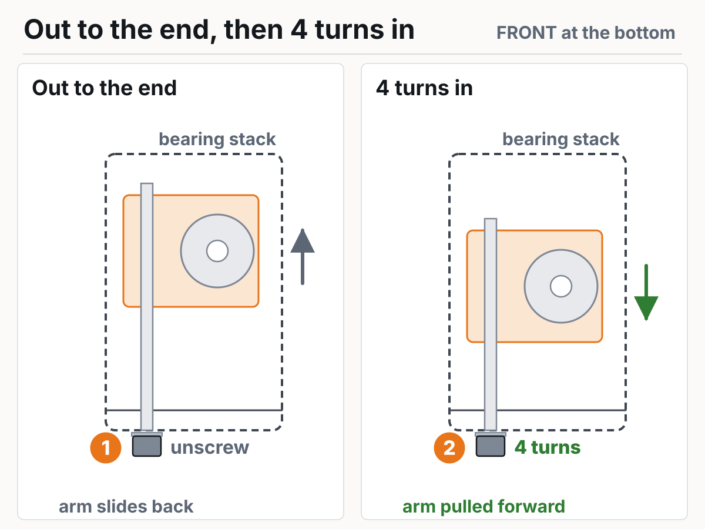
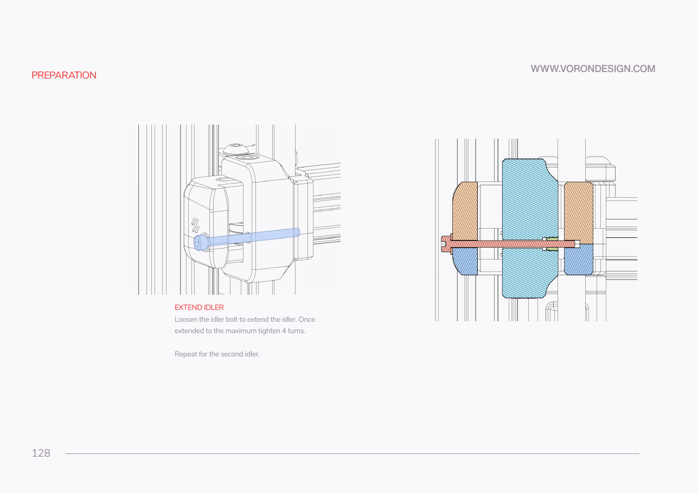{ crop="0.18 0.22 0.92 0.74" }
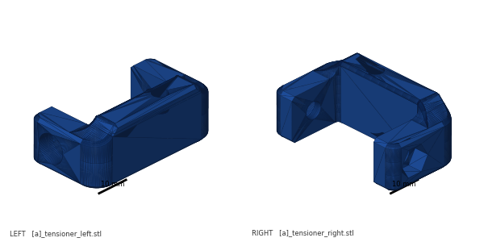

**What you're looking at:** The front-idler tensioners are the two blue parts at the front, fitted in Ch 04. Each carries an M3×40 screw that sets belt tension: winding it in pulls the idler forward and tightens that belt, and backing it out releases it.

**Parts:**

- reused: the two front-idler M3×40 SHCS
- reused: the two front-idler M3 washers

**Do:**

1. Back each M3×40 out until the tension arm is at the slack end of its travel. If the arm does not follow, push it back by hand to its stop, screw head against the idler's front.
2. Wind it back in exactly 4 turns. Count the turns, and give both idlers the same number.

**Check:** both tensioner screws standing out of the front idler bodies by the same amount, with travel left in both directions.

**Helper:** Counts the four turns aloud on each tensioner so both idlers get the same number.

Source: [Voron manual p.128](https://github.com/VoronDesign/Voron-2/blob/de7e89d/Manual/Assembly_Manual_2.4r2.pdf#page=128) · [Voron docs § V2 Gantry Squaring, step 5](https://docs.vorondesign.com/build/mechanical/v2_gantry_squaring.html)

Pause: ~25 min since the last pause — both belt paths traced against p.126–127, and both front-idler tensioners backed out and wound back in 4 turns each. Nothing is cut. Do not start cutting belt unless you can also thread it.

### Step 07.6 — Fit the heat-set inserts and M3 nuts

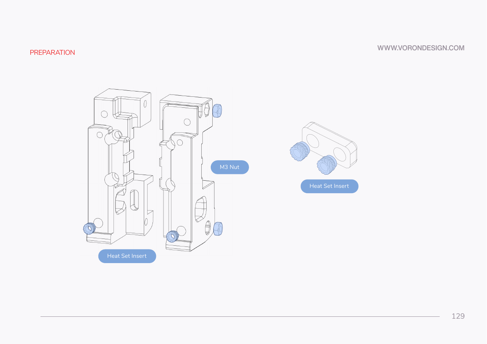{ crop="0.16 0.22 0.76 0.78" }
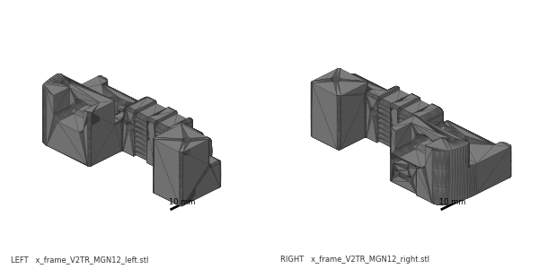

**What you're looking at:** Four heat-set inserts go in here: one in each X carriage half and two in the probe retainer bracket. A heat-set insert is a knurled brass sleeve melted into the plastic to give a screw metal threads.

**Parts:**

- `x_frame_V2TR_MGN12_left` ×1
- `x_frame_V2TR_MGN12_right` ×1
- `probe_retainer_bracket` ×1
- M3 heat-set insert ×4
- M3 nut ×2

**Do:**

1. Confirm you printed `x_frame_V2TR_MGN12_left` and `x_frame_V2TR_MGN12_right`, the R2 / Stealthburner halves, not the ones for the older Afterburner toolhead.
2. If the inserts went in during the Ch 00 pass, check them; otherwise set all four flush and square to the face.
3. Press the two M3 nuts into their pockets in the right carriage half.

**Check:** inserts flush and square, nuts fully seated with no gap behind them, and an M3 screw starting by hand in every insert.

⚠ The press tip and a freshly set insert both burn. Raise and park the head between inserts, keep the bench ventilated, and hold parts by the far edge until they cool.

This is LDO's kit note for these pages: *"If you are building Clockwork 2 double-check that you have the correct X-Carriage and follow the instructions in the Stealthburner manual."* [src](https://docs.ldomotors.com/voron/voron2/build-faq) (p.129–130)

Source: [Voron manual p.129](https://github.com/VoronDesign/Voron-2/blob/de7e89d/Manual/Assembly_Manual_2.4r2.pdf#page=129) · [LDO Build Notes § Voron 2.4 build FAQ](https://docs.ldomotors.com/en/voron/voron2/build-faq)

### Step 07.7 — Set the two carriage stop screws to 3 mm

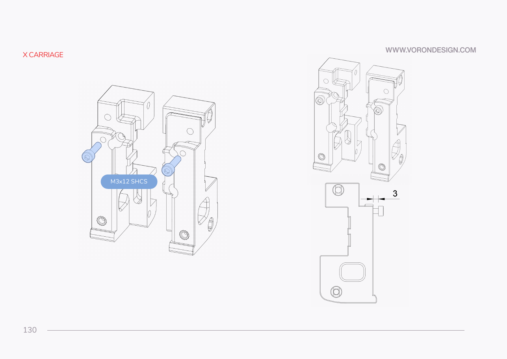{ crop="0.14 0.155 0.84 0.86" }

**What you're looking at:** These two M3×12 are stop screws, not fasteners. The 3 mm left between each head and the plastic sets how the two carriage halves meet over the belt, so the two screws must match each other as well as the number.

**Parts:**

- M3×12 SHCS ×2

**Do:**

1. In each carriage half, thread one M3×12 into the plain hole beside the belt slot shown on p.130, not into the heat-set insert at the bottom.
2. Stop when the head stands 3 mm off the plastic. Measure it with the caliper's depth blade.

**Check:** both screws at 3 mm ±0.5 mm, and the same on both halves.

Source: [Voron manual p.130](https://github.com/VoronDesign/Voron-2/blob/de7e89d/Manual/Assembly_Manual_2.4r2.pdf#page=130)

---

## Cut and clamp

### Step 07.8 — Cut both belts to the same length

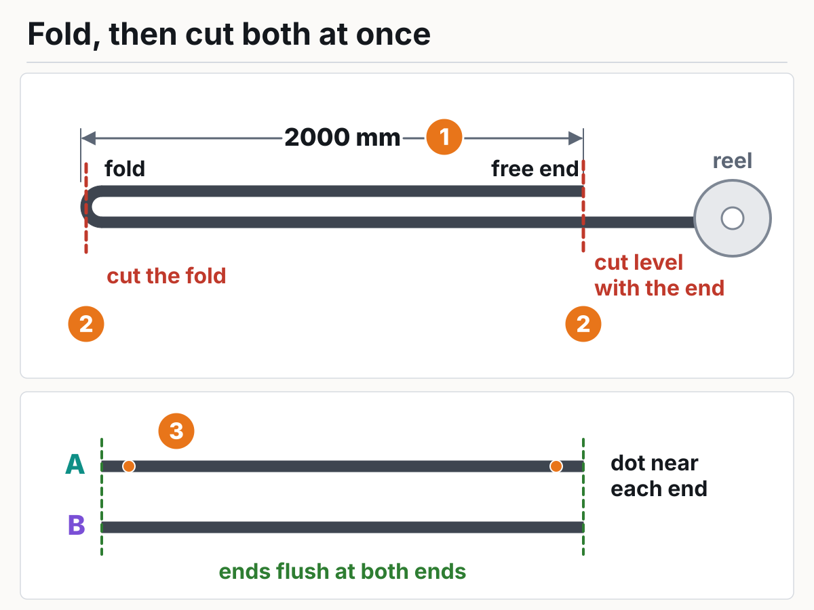

**What you're looking at:** This is the chapter's most important measurement. Both belt paths are the same length by design, so equal belts end up at equal tension.

**Parts:**

- consumable: Gates 2GT open belt, 6 mm wide, two equal lengths

**Do:**

1. Measure 2000 mm from the belt's free end and fold it back there.
2. Lay the doubled belt flat and cut through both layers at the fold, square across. Then cut the reel side level with the free end.
3. Mark one belt A with a dot on its smooth back near each end: it goes in the upper slot, and once threaded the two look identical.

**Check:** two belts side by side against a square edge, far ends flush, and about 100 mm of tail at each clamp (verify on bench).

⚠ Cut carefully: a few millimetres of difference between the two belts is a permanent imbalance that the tensioners cannot remove.

Voron's own method, from p.125, works too: route the first belt off the reel as A, mark its length, take it off, cut it, then cut the second against it.

Source: [Voron manual p.125](https://github.com/VoronDesign/Voron-2/blob/de7e89d/Manual/Assembly_Manual_2.4r2.pdf#page=125) · [LDO 350 Rev D+ BOM](https://docs.ldomotors.com/en/voron/voron2/350_BOM/Rev_D+) · [LDO Build Notes § Voron 2.4 build FAQ](https://docs.ldomotors.com/en/voron/voron2/build-faq) · [onetwo3D Voron 2.4 350 BOM](https://www.onetwo3d.co.uk/voron-bill-of-material/voron-2-4-350mm-bill-of-material/)

Pause: ~30 min since the last pause — heat-set inserts and M3 nuts in the carriage halves, stop screws set to 3 mm, both belts cut to matched length and marked A and B. Coil the two belts and bag them: the next segment is the one that cannot be broken.

### Step 07.9 — Clamp the first end of both belts in the left carriage half

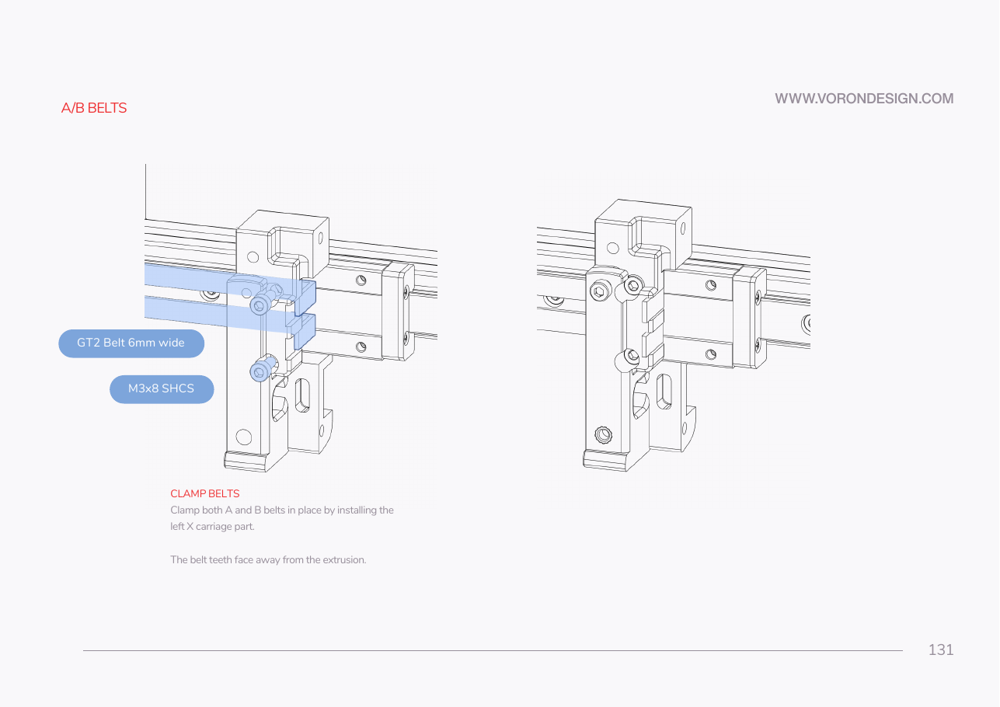{ crop="0.05 0.20 0.46 0.82" }
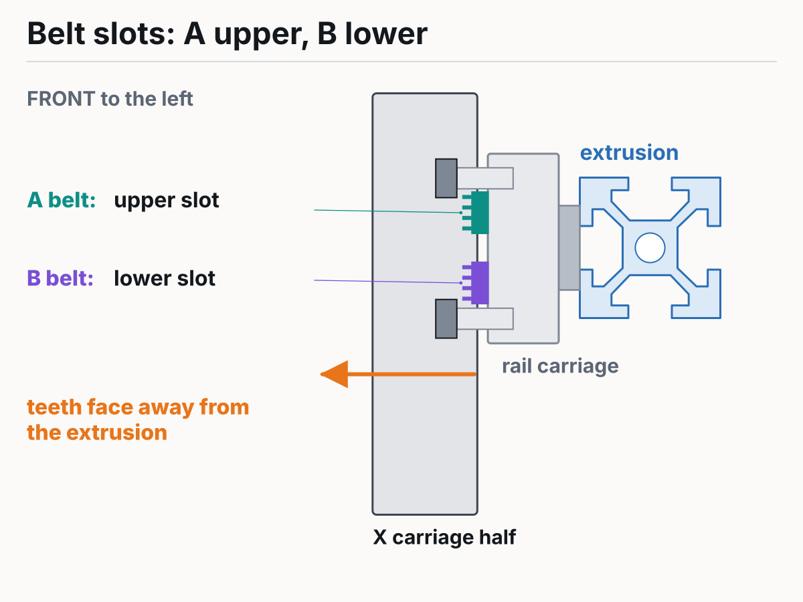

**What you're looking at:** The X carriage holds a belt by squeezing it between its two printed halves. Both belts' first ends go into the left half: A, whose pulley and idler sit 10 mm higher, in the upper slot and B in the lower.

**Parts:**

- reused: the left X carriage half
- reused: both cut belts, marked A and B
- M3×8 SHCS ×2

**Do:**

1. Feed belt A into the upper slot of the left half and B into the lower, teeth facing away from the extrusion.
2. Hold the left half, belts in, against the rail carriage (the block that rides the X rail), and fully tighten both M3×8 screws, which hold these ends for good.

**Check:** both ends held fast under a firm tug, the A mark in the upper slot, the teeth facing the same way, and neither belt twisted.

Source: [Voron manual p.131](https://github.com/VoronDesign/Voron-2/blob/de7e89d/Manual/Assembly_Manual_2.4r2.pdf#page=131)

---

## Route the A belt

Work in one direction round the loop. Needle-nose pliers or tweezers make the bearing stacks easier to manage (p.132).

⚠ Never force a belt round a bearing stack: you will damage the flange or unseat a bearing. If it will not go at a front idler, use the access trick in Step 07.15.

### Step 07.10 — A belt: leave the carriage and turn at the left XY joint

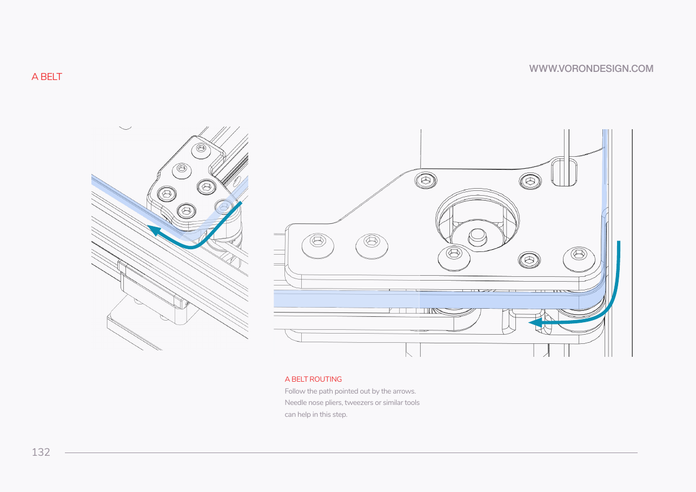{ crop="0.12 0.24 0.37 0.70" }

**What you're looking at:** At the left XY joint, the A belt turns 90° around the joint's upper, plain F695 pair, smooth back against the bearings. The toothed idler below it belongs to B. Keep the belt centred in the groove: a belt that climbs a flange frays.

**Parts:**

- reused: the A belt

**Do:**

1. Take the end of A left along the X extrusion to the left XY joint.
2. Wrap it 90° around the joint's plain bearing stack, smooth back on the bearings, so it runs rearward along the left Y extrusion.

**Check:** the belt sitting centred in the stack's groove, not climbing a flange, smooth back on the bearings, with no twist back to the carriage.

Source: [Voron manual p.132](https://github.com/VoronDesign/Voron-2/blob/de7e89d/Manual/Assembly_Manual_2.4r2.pdf#page=132)

### Step 07.11 — A belt: run rearward up the left Y extrusion

{ crop="0.14 0.175 0.52 0.80" }

**What you're looking at:** This is the one long run down the left side of the machine. Nothing turns the belt here, so the only things to get right are keeping it parallel to the extrusion and clear of every printed part on the way.

**Parts:**

- reused: the A belt

**Do:**

1. Run the belt straight back along the left Y extrusion to the rear-left drive unit. This is the single run on the left side, shown in the top-left inset of p.126.

**Check:** a run parallel to the extrusion along its whole length, clear of the printed parts and the Z belt.

Source: [Voron manual p.126](https://github.com/VoronDesign/Voron-2/blob/de7e89d/Manual/Assembly_Manual_2.4r2.pdf#page=126)

### Step 07.12 — A belt: turn 90° at the rear-left idler stack

{ crop="0.14 0.175 0.42 0.42" }

**What you're looking at:** The rear-left corner is the **B** drive unit, and it carries two things at two heights: B's toothed motor pulley, and a plain bearing stack that belongs to the **A** belt. A wraps the plain stack only. Wrapping the pulley instead would lock the two axes together.

**Parts:**

- reused: the A belt

**Do:**

1. Wrap the belt round the idler stack at the rear-left corner, smooth back on it, not the B motor pulley beside it.
2. Turn it to run right along the rear extrusion towards the A drive.

**Check:** the B motor pulley untouched and free to spin, and the A belt running along the rear extrusion at a constant height.

Source: [Voron manual p.126](https://github.com/VoronDesign/Voron-2/blob/de7e89d/Manual/Assembly_Manual_2.4r2.pdf#page=126)

### Step 07.13 — A belt: S-wrap the A drive motor pulley

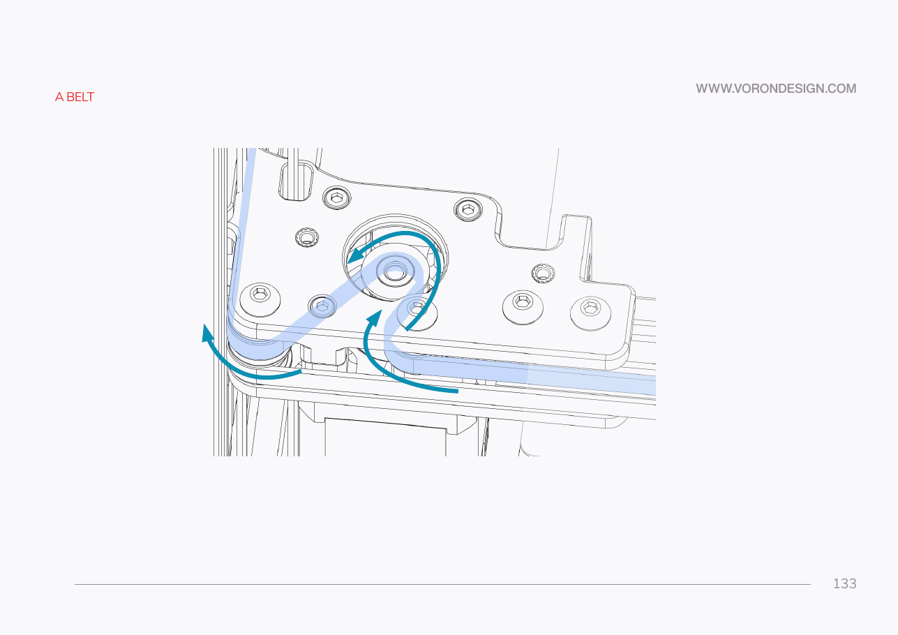{ crop="0.22 0.20 0.74 0.72" }

**What you're looking at:** An S-wrap gives a drive pulley its grip. The belt comes in over one bearing, wraps a large arc of the toothed motor pulley, and leaves over a second bearing. More teeth in contact means the belt cannot skip under hard acceleration.

**Parts:**

- reused: the A belt

**Do:**

1. At the A drive unit, rear right, take the belt round the first stack, over the toothed motor pulley, and back out round the second, in the S-shape on p.133.
2. Seat the belt on the pulley teeth, not on a flange.

**Check:** a pulley that turns tooth by tooth when you nudge the belt, without slipping, and a belt that leaves heading forward along the right Y extrusion.

Source: [Voron manual p.133](https://github.com/VoronDesign/Voron-2/blob/de7e89d/Manual/Assembly_Manual_2.4r2.pdf#page=133)

### Step 07.14 — A belt: run forward down the right Y extrusion

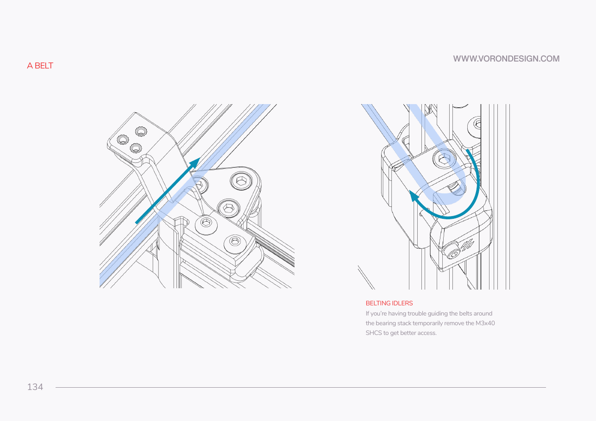{ crop="0.16 0.22 0.50 0.70" }

**What you're looking at:** On its way forward, A passes the right XY joint at its own height without wrapping it; it wraps that joint on the return run. Checking that a long run is at the same height at both ends catches a half-twist.

**Parts:**

- reused: the A belt

**Do:**

1. Run the belt forward along the right Y extrusion, past the right XY joint without wrapping it, all the way to the front-right idler. The left-hand image on p.134 shows the belt passing the joint at its own height.

**Check:** a belt clear of the XY joint's printed parts, with no rub and no contact, and at the same height at both ends of the run.

Source: [Voron manual p.134](https://github.com/VoronDesign/Voron-2/blob/de7e89d/Manual/Assembly_Manual_2.4r2.pdf#page=134)

### Step 07.15 — A belt: U-turn at the front-right idler

{ crop="0.60 0.22 0.88 0.80" }

**What you're looking at:** The front-right idler is a 180° turnaround: the belt goes round it and comes straight back, which is why the right side ends up with two parallel runs. The smooth back of the belt rides this stack, not the teeth.

**Parts:**

- reused: the A belt

**Do:**

1. Wrap the belt 180° around the front-right idler bearing stack.
2. Bring it back rearward, parallel to the run you just made.

**Check:** two right-side runs, parallel and not touching, with the smooth back on the idler and the teeth facing away from it on both runs: outboard on the way out, inboard on the way back.

If the stack will not take the belt, take out that idler's M3×40 SHCS tensioner screw, thread the belt, refit the screw, then redo Step 07.5. No drive or joint has that screw.

Source: [Voron manual p.134](https://github.com/VoronDesign/Voron-2/blob/de7e89d/Manual/Assembly_Manual_2.4r2.pdf#page=134)

### Step 07.16 — A belt: turn at the right XY joint and return to the carriage

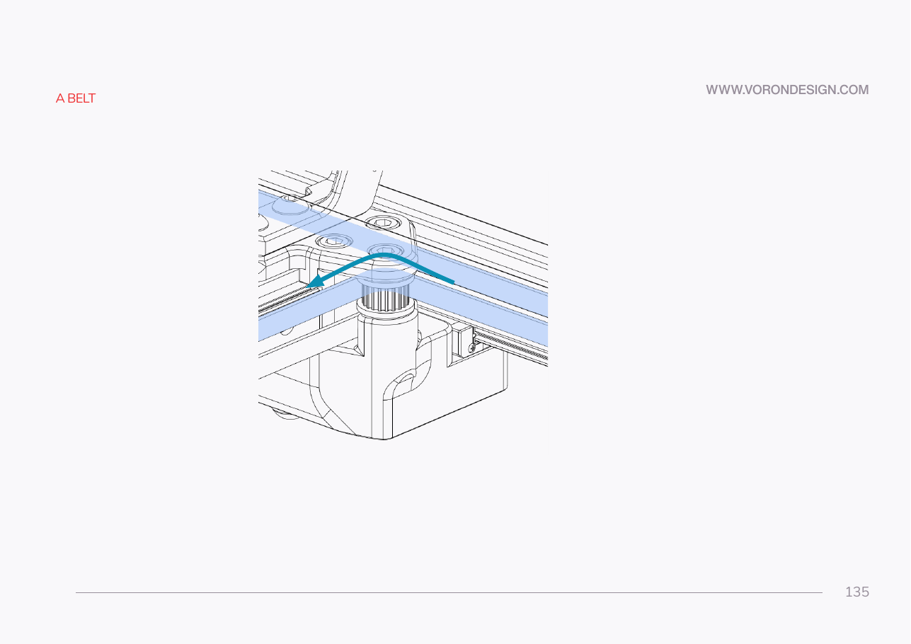{ crop="0.27 0.24 0.62 0.68" }

**What you're looking at:** The right XY joint closes the A loop. Here the belt wraps the joint's upper, toothed 20T idler teeth-on, because the return run doubled back at the front idler and its teeth now face inboard. This is correct, not a mistake in the routing.

**Parts:**

- reused: the A belt

**Do:**

1. Take the returning run rearward to the right XY joint.
2. Wrap it 90° round the joint's toothed idler, teeth meshing, then bring it left along the X extrusion to the X carriage. Leave the tail loose there.

**Check:** A as a closed path, both ends at the carriage, teeth on the right joint's toothed idler and the smooth back everywhere else.

*Soft stop (not a Pause):* if you must break here, tape the loose A tail to the X extrusion so it cannot pull back through a stack. When you come back, run a fingertip round all seven places the A belt touches before you start Step 07.17.

Source: [Voron manual p.135](https://github.com/VoronDesign/Voron-2/blob/de7e89d/Manual/Assembly_Manual_2.4r2.pdf#page=135)

---

## Route the B belt

B runs one plane below A and mirrors it: its U-turn is at the front left and its drive at the rear left. Like A, it leaves the left carriage half heading left, so its first turn is at the left XY joint too, on the joint's lower, toothed idler, and its last is at the right joint. The joint B passes without wrapping is the left one, on its way back to the B drive, just as A passed the right one on its way out. The manual's B pages (p.136, then p.137, then p.138) run in exactly this order.

### Step 07.17 — B belt: leave the carriage and turn teeth-on at the left XY joint

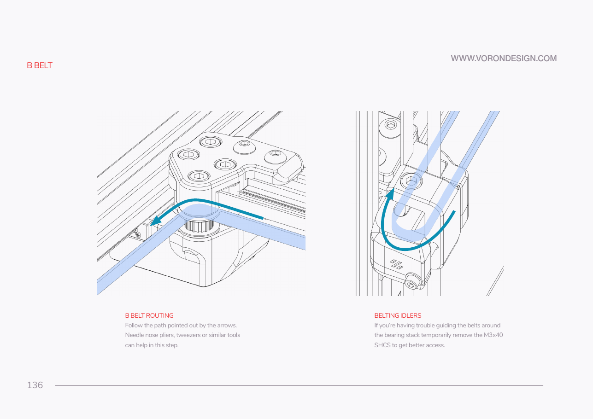{ crop="0.16 0.24 0.52 0.84" }

**What you're looking at:** Back at the left XY joint, one plane down. Below the plain F695 pair that A already wraps sits the joint's toothed 20T idler. B makes its first turn on it, teeth meshing, turning from the X direction to run forward down the left Y extrusion.

**Parts:**

- reused: the B belt

**Do:**

1. Take the end of B left along the X extrusion, below A, to the left XY joint.
2. Wrap it 90° round the joint's lower, toothed idler, teeth meshing, so it runs forward along the left Y extrusion.

**Check:** B's teeth centred on the toothed idler, A on the plain stack directly above with a visible gap, and B leaving forward with no twist.

Source: [Voron manual p.136](https://github.com/VoronDesign/Voron-2/blob/de7e89d/Manual/Assembly_Manual_2.4r2.pdf#page=136) · [Voron manual p.105](https://github.com/VoronDesign/Voron-2/blob/de7e89d/Manual/Assembly_Manual_2.4r2.pdf#page=105)

### Step 07.18 — B belt: run forward and U-turn at the front-left idler

{ crop="0.60 0.24 0.90 0.84" }

**What you're looking at:** The 180° turnaround at the front-left idler gives the left side its two parallel runs. It mirrors A's front-right turn: the smooth back rides the stack and the teeth face away from it. For B it comes early in the loop.

**Parts:**

- reused: the B belt

**Do:**

1. Run the belt forward along the left Y extrusion to the front-left idler.
2. Wrap it 180° round the idler bearing stack, smooth back on it, and bring it rearward on the outer run, parallel to the run you just made.

**Check:** two parallel left-side runs that do not touch, with the smooth back on the idler and the teeth facing away from it on both runs: inboard on the way out, outboard on the way back.

If the stack will not take the belt, take out that idler's M3×40 SHCS tensioner screw, thread the belt, refit the screw, then redo Step 07.5. No drive or joint has that screw.

Source: [Voron manual p.136](https://github.com/VoronDesign/Voron-2/blob/de7e89d/Manual/Assembly_Manual_2.4r2.pdf#page=136)

### Step 07.19 — B belt: run rearward up the left outer run, past the left XY joint

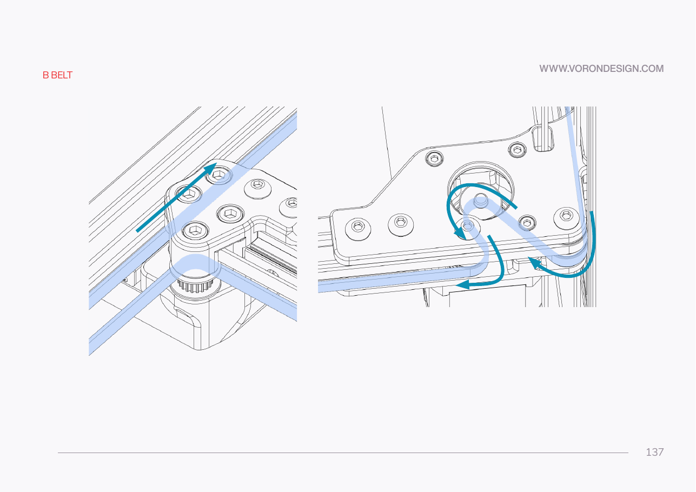{ crop="0.12 0.20 0.44 0.74" }

**What you're looking at:** B's return run goes up the left side, outboard of the forward run. It passes the left XY joint at its own height without touching it and carries on to the B drive at the rear left. Check the height at both ends to catch a half-twist.

**Parts:**

- reused: the B belt

**Do:**

1. Run the belt rearward along the left Y extrusion on the outer run, past the left XY joint without wrapping anything, all the way to the B drive unit at the rear left.

**Check:** a belt clear of the joint's printed parts and of the inner run, both left-side runs parallel, and the height the same at both ends.

Source: [Voron manual p.137](https://github.com/VoronDesign/Voron-2/blob/de7e89d/Manual/Assembly_Manual_2.4r2.pdf#page=137)

### Step 07.20 — B belt: S-wrap the B drive motor pulley

{ crop="0.45 0.20 0.87 0.64" }

**What you're looking at:** The same S-wrap as at the A drive, this time on the B motor at the rear left: bearing stack, toothed motor pulley, bearing stack. The plain stack on this unit that A already turns on sits at another height and is not touched.

**Parts:**

- reused: the B belt

**Do:**

1. At the B drive unit, rear left, take the belt round the first stack, over the toothed motor pulley, and back out round the second, in the S-shape on p.137.
2. Seat it on the pulley teeth, not a flange.

**Check:** a B pulley that turns tooth by tooth when you nudge the belt, with no slip, A untouched on its idler stack, and B running below A.

Source: [Voron manual p.137](https://github.com/VoronDesign/Voron-2/blob/de7e89d/Manual/Assembly_Manual_2.4r2.pdf#page=137)

### Step 07.21 — B belt: run right along the rear and turn 90° at the rear-right idler stack

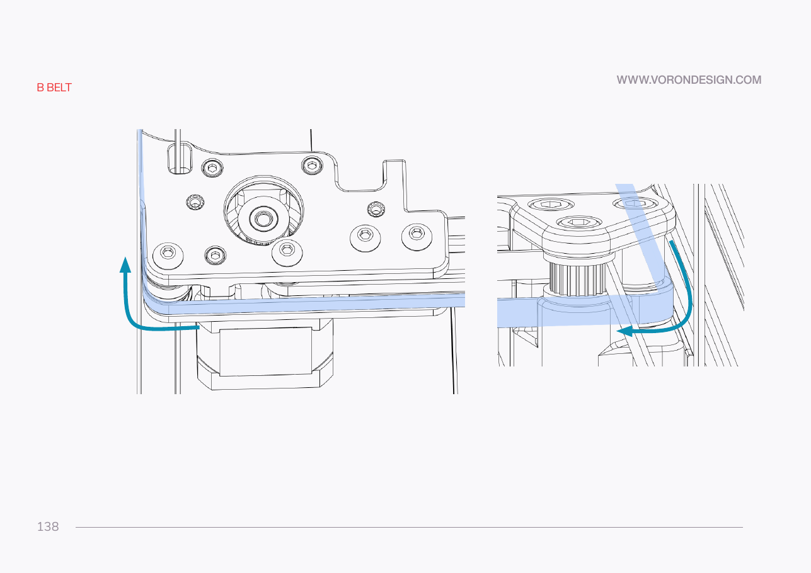{ crop="0.16 0.20 0.58 0.70" }

**What you're looking at:** The rear-right corner is the **A** drive unit, and like the rear left it carries a motor pulley and a plain stack. B wraps the plain stack only, smooth back on it, turning from the rear extrusion to run forward down the right Y extrusion.

**Parts:**

- reused: the B belt

**Do:**

1. Run the belt right along the rear extrusion to the A drive unit.
2. Wrap it 90° round that unit's idler stack, not the A motor pulley beside it, and turn it forward down the right Y extrusion.

**Check:** an A motor pulley that still turns freely, and B running along the rear below A without touching it, then leaving forward as the single right-side run.

Source: [Voron manual p.138](https://github.com/VoronDesign/Voron-2/blob/de7e89d/Manual/Assembly_Manual_2.4r2.pdf#page=138)

### Step 07.22 — B belt: run forward, turn smooth at the right XY joint and return to the carriage

{ crop="0.60 0.30 0.93 0.66" }

**What you're looking at:** The right XY joint closes the B loop. Here the belt meets the joint's lower, plain F695 stack, smooth back on the bearings, with A's toothed idler directly above it. It is the mirror of the left joint, one plane down.

**Parts:**

- reused: the B belt

**Do:**

1. Run the belt forward along the right Y extrusion to the right XY joint.
2. Wrap it 90° round the joint's lower, plain stack, smooth back and under A's toothed idler, then take it left to the carriage. Leave the tail loose.

**Check:** B's smooth back on the lower plain stack and A on the toothed idler above with a visible gap. Both belts are now closed paths.

Source: [Voron manual p.138](https://github.com/VoronDesign/Voron-2/blob/de7e89d/Manual/Assembly_Manual_2.4r2.pdf#page=138)

### Step 07.23 — Check both belts against the overviews before closing the carriage


**What you're looking at:** Two complete loops, still open at the carriage. This is the last moment when a wrong route costs minutes rather than an hour. You are testing four things: teeth on the toothed wheels, smooth back on every plain stack, no half-twist, and belts stacked, not crossed.

**Parts:** none.

**Do:**

1. Put p.126 and p.127 beside the machine and walk both loops.
2. Nudge the belt at each motor pulley and watch the pulley turn tooth by tooth rather than slip.
3. Look along every straight run: the teeth face the same way at both ends.

**Check:** teeth on both motor pulleys and on the two toothed XY-joint idlers, smooth back on every plain stack, no half-twist, belts stacked not crossed, and the pulleys free.

**Helper:** Reads out each stop on the loop from p.126 and p.127 while you check it on the machine.

Source: [Voron manual p.127](https://github.com/VoronDesign/Voron-2/blob/de7e89d/Manual/Assembly_Manual_2.4r2.pdf#page=127) · [Voron manual p.126](https://github.com/VoronDesign/Voron-2/blob/de7e89d/Manual/Assembly_Manual_2.4r2.pdf#page=126)

---

## Capture the ends, pull tight, inspect

### Step 07.24 — Fit the right X carriage half to capture the belt ends

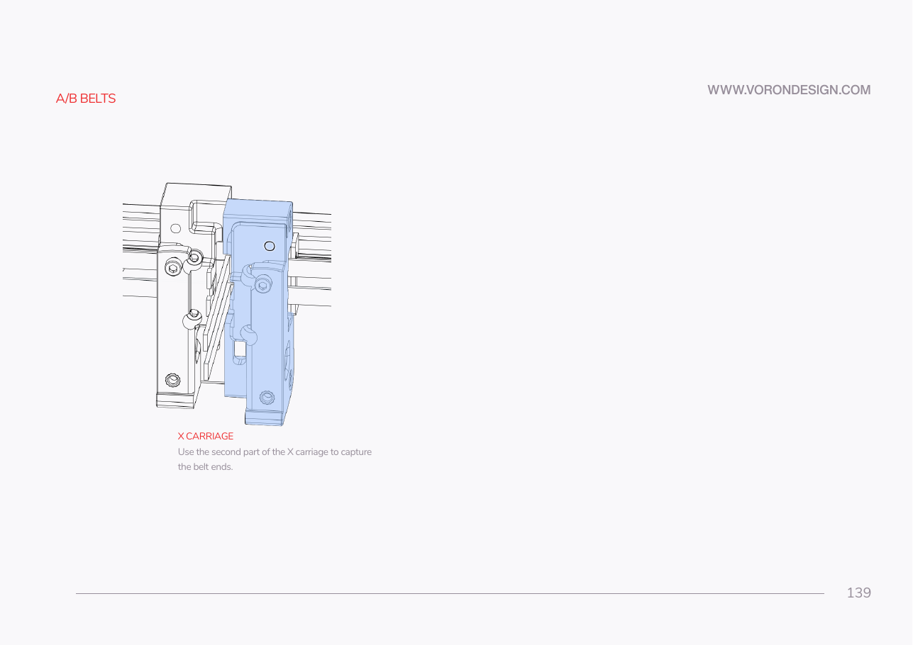{ crop="0.12 0.26 0.42 0.76" }


**What you're looking at:** The right carriage half is the other jaw of the clamp. Each loose tail goes into the slot at its own height, so the two belts stay in their own planes right up to where they are gripped.

**Parts:**

- reused: the right X carriage half
- reused: both belts, tails loose

**Do:**

1. Feed the two loose belt tails into their clamp slots in the right X carriage half, each into the slot at its own height.
2. Offer the half up to the carriage. Do not fasten anything yet.

**Check:** both tails seated in their slots, and both belts leaving the carriage without a twist.

Source: [Voron manual p.139](https://github.com/VoronDesign/Voron-2/blob/de7e89d/Manual/Assembly_Manual_2.4r2.pdf#page=139)

### Step 07.25 — Fix the belts, lightly

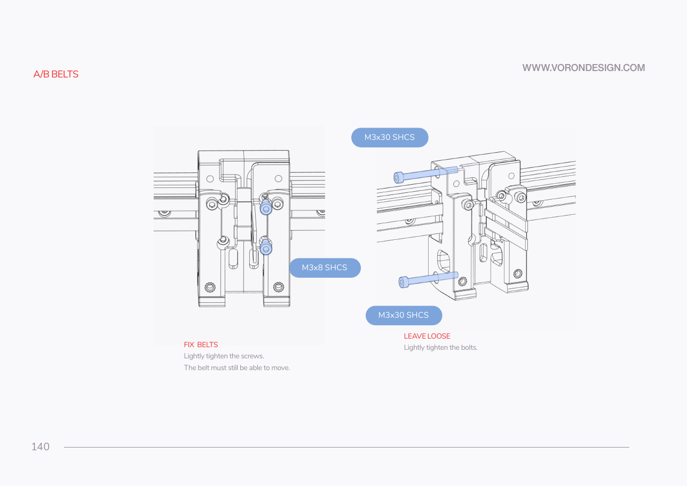{ crop="0.20 0.24 0.53 0.78" }

**What you're looking at:** These two screws stay deliberately loose. The clamp still has to let belt be pulled through it, because the next steps take the slack out of both loops by pulling on these tails. Tighten now and you lock the slack in.

**Parts:**

- M3×8 SHCS ×2

**Do:**

1. Run the two M3×8 SHCS into the right carriage half.
2. Tighten them only lightly. As p.140 says, the belt must still be able to move.

**Check:** belt that you can still draw through the clamp by hand with moderate effort.

Source: [Voron manual p.140](https://github.com/VoronDesign/Voron-2/blob/de7e89d/Manual/Assembly_Manual_2.4r2.pdf#page=140)

### Step 07.26 — Fit the carriage bolts and leave them loose

{ crop="0.527 0.18 0.86 0.76" }

**What you're looking at:** The two M3×30 carriage screws pass through both halves into the M3 nuts you pressed into their pockets earlier. They squeeze the halves together onto the belts, and they stay light for now for the same reason as the clamp screws.

**Parts:**

- M3×30 SHCS ×2

**Do:**

1. Pass the two M3×30 SHCS through the carriage, one at the top and one at the bottom, into the captive M3 nuts.
2. Tighten them lightly.

**Check:** two carriage halves held together but still able to shift slightly, with nothing torqued.

Source: [Voron manual p.140](https://github.com/VoronDesign/Voron-2/blob/de7e89d/Manual/Assembly_Manual_2.4r2.pdf#page=140)

### Step 07.27 — Pull both belts tight and equalise the tails

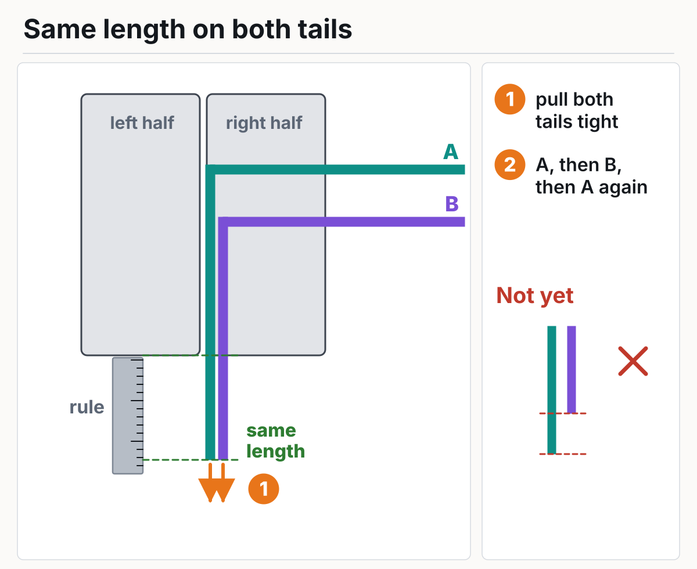
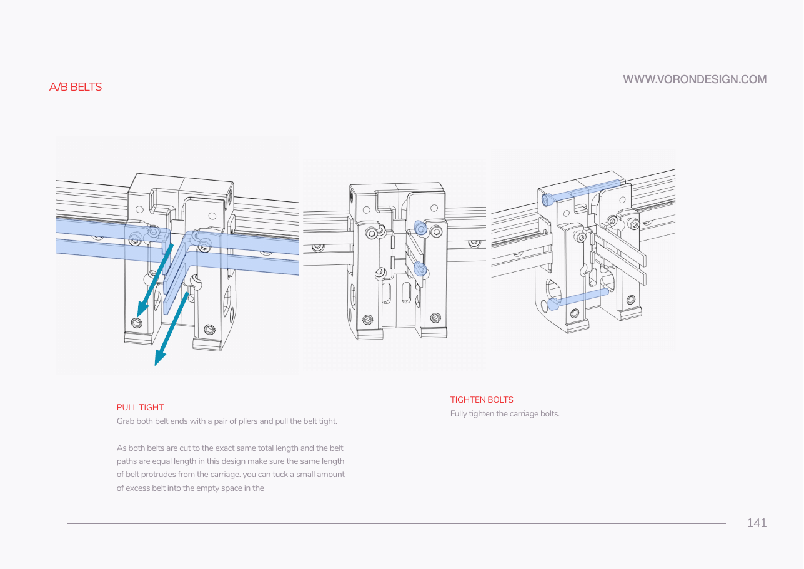{ crop="0.06 0.28 0.46 0.88" }

**What you're looking at:** This is where belt tension is really set; the tensioners only trim it. Because both belts and both paths are the same length, equal tails mean equal tension.

**Parts:** none.

**Do:**

1. Grab both belt ends with pliers and pull the belt tight, until the same length sticks out of the carriage on both belts.
2. Pull one, then the other, then back again, because each pull changes the other. Tuck a little excess into the carriage. Leave the rest uncut: squaring in Ch 06b may need to free and re-clamp these ends.

**Check:** tails that match on the rule, and still match after you move the gantry through its full XY travel. If one crept, back off its M3×8 and pull it again.

**Helper:** Reads both tail lengths off the rule and says which belt sticks out further.

Source: [Voron manual p.141](https://github.com/VoronDesign/Voron-2/blob/de7e89d/Manual/Assembly_Manual_2.4r2.pdf#page=141) · [Voron docs § Secondary printer tuning — A/B Belts](https://docs.vorondesign.com/tuning/secondary_printer_tuning.html)

### Step 07.28 — Tighten the carriage bolts

{ crop="0.37 0.18 0.86 0.738" }

**What you're looking at:** Now everything is made firm. The M3×8 thread into the rail carriage and the M3×30 into captive nuts. Stop at solid: there is no torque figure, and a stripped thread means opening the carriage with both belts in it.

**Parts:** none.

**Do:**

1. Fully tighten the right half's two M3×8 belt-clamp screws first, the ones p.140 left light, as the middle panel of p.141 shows. The left half's two went fully tight in Step 07.9: check they still are.
2. Then fully tighten the two M3×30 carriage screws, stopping when they are firm.

**Check:** belts that do not slip when you pull hard on each one at the carriage, and an X carriage that still runs the full X rail without catching on anything.

Source: [Voron manual p.141](https://github.com/VoronDesign/Voron-2/blob/de7e89d/Manual/Assembly_Manual_2.4r2.pdf#page=141)

Pause: ~80 min since the last pause — the long one, with no safe stop inside it. Both belts are routed, both ends captured in the carriage, the tails equalised and the carriage screws tightened. Only stop here once the carriage is closed and both belts are held at both ends.

### Step 07.29 — Belt-rub inspection at every idler stack

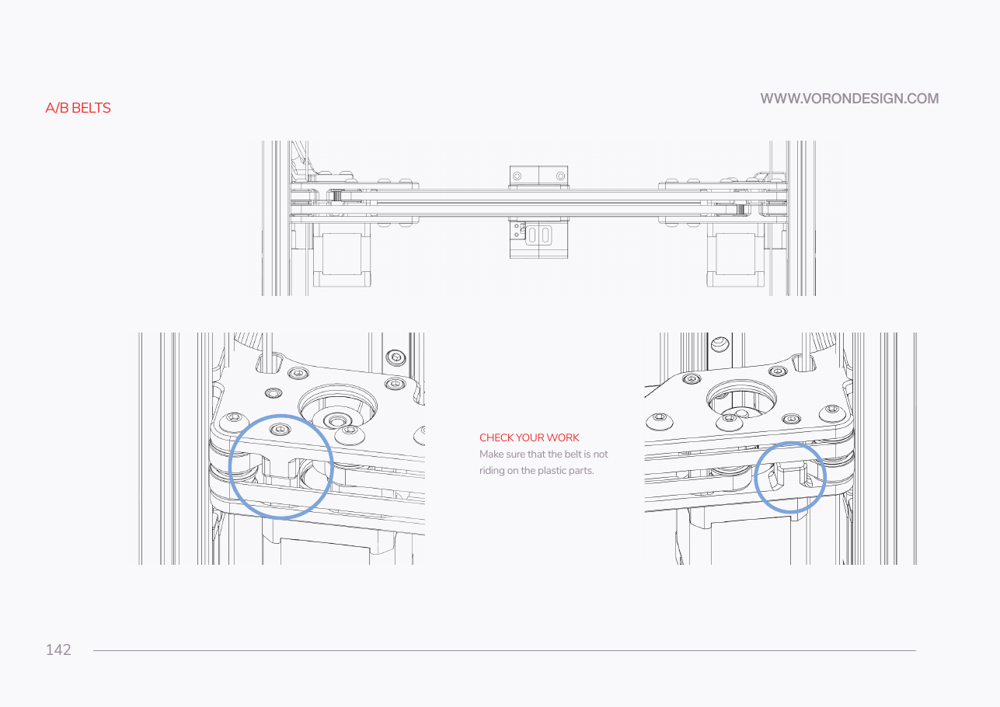{ crop="0.12 0.18 0.92 0.82" }

**What you're looking at:** A belt touches something at fourteen places, in six locations: two at each XY joint, one at each front idler, and four at each drive (two S-wrap stacks, the motor pulley and the other belt's stack). A belt riding a printed flange ticks once per revolution.

**Parts:** none.

**Do:**

1. Look at both edges of the belt where it enters and leaves every stack. As p.142 says, the belt must not ride on the plastic parts.
2. Repeat with the gantry at the extreme front, the extreme rear, and both ends of X.

**Check:** daylight between both belt edges and the printed part at every stack, in every position, with no rub marks, dust, tick or squeak.

**Helper:** Watches one side of every stack as you move the gantry and calls out any rub.

Source: [Voron manual p.142](https://github.com/VoronDesign/Voron-2/blob/de7e89d/Manual/Assembly_Manual_2.4r2.pdf#page=142) · [Voron docs § V2 Gantry Squaring, step 5](https://docs.vorondesign.com/build/mechanical/v2_gantry_squaring.html) · [Video: Part 4 @1:39:56](https://www.youtube.com/watch?v=ViB5Ulc9zDI&list=PL0fUJbigELQPqpeGOgHYisG4KaSXVtnNY&t=5996s)

---

## Initial tension (provisional)

This tension is provisional: the squaring procedure starts by releasing it completely ([V2 gantry squaring, step 5](https://docs.vorondesign.com/build/mechanical/v2_gantry_squaring.html); [survey §4.4 #2 and §5.2 W1](../voron-build-instructions-survey.md)). What you set here only needs to be good enough to home, level the gantry (QGL) and run the bring-up in Ch 13. **Ch 14 Step 14.4 owns the final number.**

### Step 07.30 — Set the 150 mm measuring span

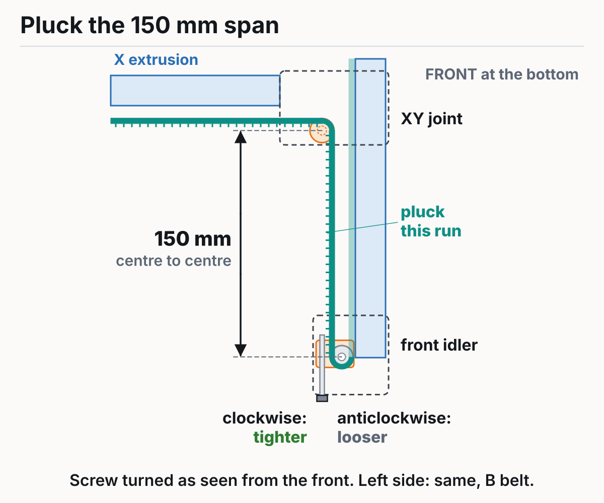
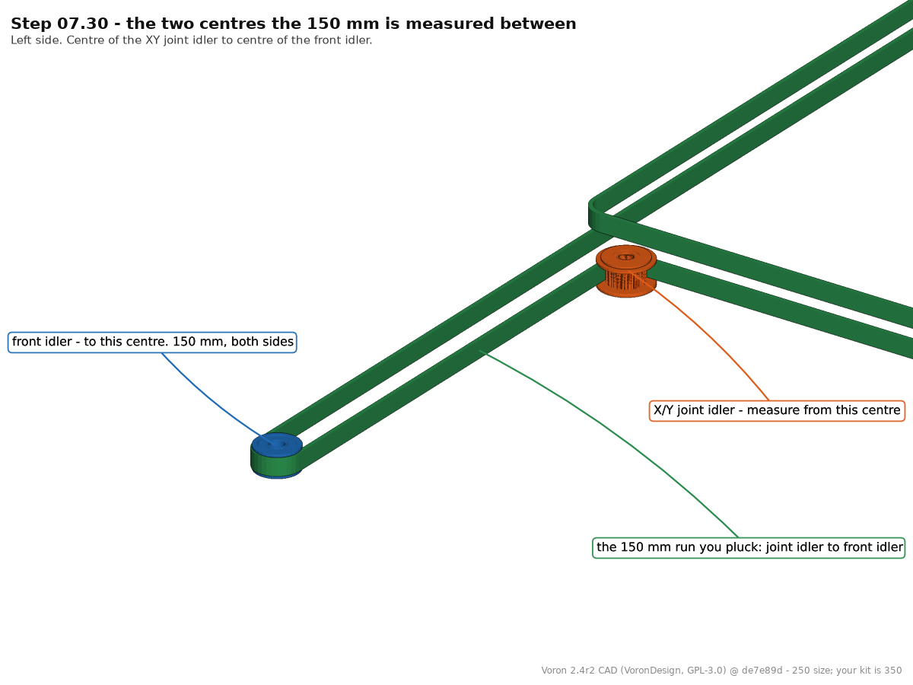
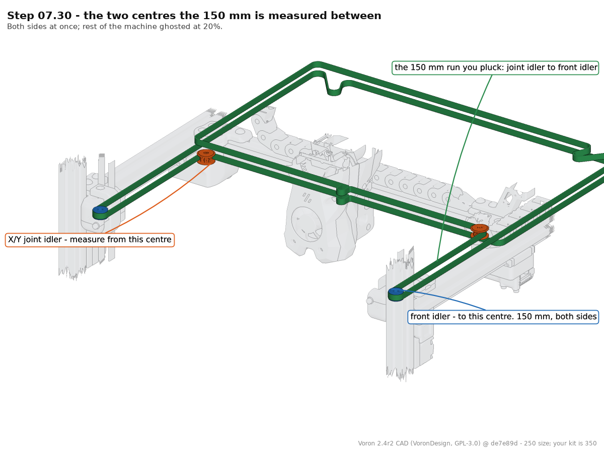

**What you're looking at:** A plucked belt's pitch depends on the length of free belt that vibrates, its span, so a frequency means nothing without it. The span runs between the idler in the XY joint and the idler in the front idler block.

**Parts:** none.

**Do:**

1. Move the X extrusion forward by hand until the XY joint idler centres are 150 mm from the front idler centres.
2. Measure centre to centre with the rule on both sides, with the gantry square to the frame, not skewed.

**Check:** 150 mm on the left and 150 mm on the right, measured to the same features.

**Helper:** Holds the rule between the two idler centres and reads the number aloud on each side.

The two CAD pictures show a parked 250 machine, not the measuring position. Take which two centres to use from them, and take the number from the rule.

Source: [Voron docs § Secondary printer tuning — A/B Belts](https://docs.vorondesign.com/tuning/secondary_printer_tuning.html) · [Voron manual p.141](https://github.com/VoronDesign/Voron-2/blob/de7e89d/Manual/Assembly_Manual_2.4r2.pdf#page=141) · [Video: Part 6 @0:10:08](https://www.youtube.com/watch?v=8pWoYkY1DiA&list=PL0fUJbigELQPqpeGOgHYisG4KaSXVtnNY&t=608s) · CAD: Voron 2.4r2 STEP @ de7e89d

### Step 07.31 — Read both belts with the phone

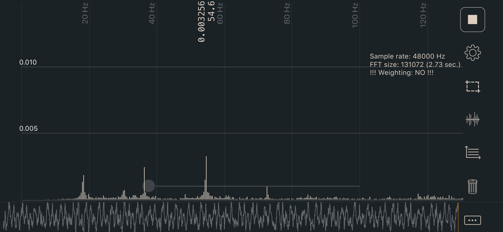
(no image of your own belt: this is Voron's example of the app's screen, not a belt at 110 Hz. The 54.6 Hz at the top labels its tallest peak, not its lowest. Copy no number from it.)

**What you're looking at:** A spectrum app turns a plucked belt into a plot of loudness against pitch, in hertz (Hz, vibrations per second). You want the lowest peak the pluck makes, the fundamental. A belt also rings at two and three times that, the harmonics, and a harmonic reads as far too tight.

**Parts:** none.

**Do:**

1. Start the spectrum app, hold the phone close to the belt, and pluck the free 150 mm section like a guitar string.
2. Read the lowest peak that jumps up with each pluck, not the loudest and not a harmonic. Do both belts.

**Check:** three plucks in a row landing within a few Hz of each other. A reading that jumps around is a harmonic or room noise.

**Helper:** Holds the phone by the belt and reads the lowest peak aloud after each pluck.

Source: [Voron docs § Secondary printer tuning — A/B Belts](https://docs.vorondesign.com/tuning/secondary_printer_tuning.html) · image [`sound-spectrum-belt.jpg`](https://raw.githubusercontent.com/VoronDesign/Voron-Documentation/main/tuning/images/sound-spectrum-belt.jpg)

### Step 07.32 — Bring both belts to ~110 Hz

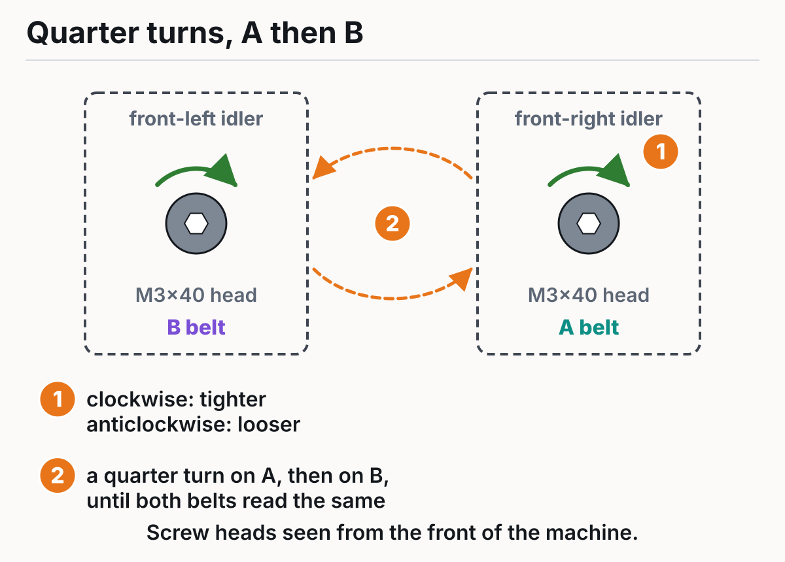

**What you're looking at:** The two tensions affect each other: tightening one belt shifts the X extrusion and changes the other. So you get there by alternating quarter turns between the two belts, not by finishing one belt and then starting the other.

**Parts:** none.

**Do:**

1. Adjust with the front-idler tensioner screws. Seen from the front, clockwise winds a screw in for more tension, anticlockwise lets it out. Aim for about 110 Hz over the 150 mm span, about 2 lb.
2. Alternate quarter turns between the two belts until they read the same.

**Check:** both belts reading about 110 Hz. Do not chase the number: this tension is provisional, and Ch 14 Step 14.4 sets it last.

**Helper:** Reads each belt's lowest peak aloud after every quarter turn you make.

Source: [Voron docs § Secondary printer tuning — A/B Belts](https://docs.vorondesign.com/tuning/secondary_printer_tuning.html)

### Step 07.33 — Move the gantry, return, and re-check

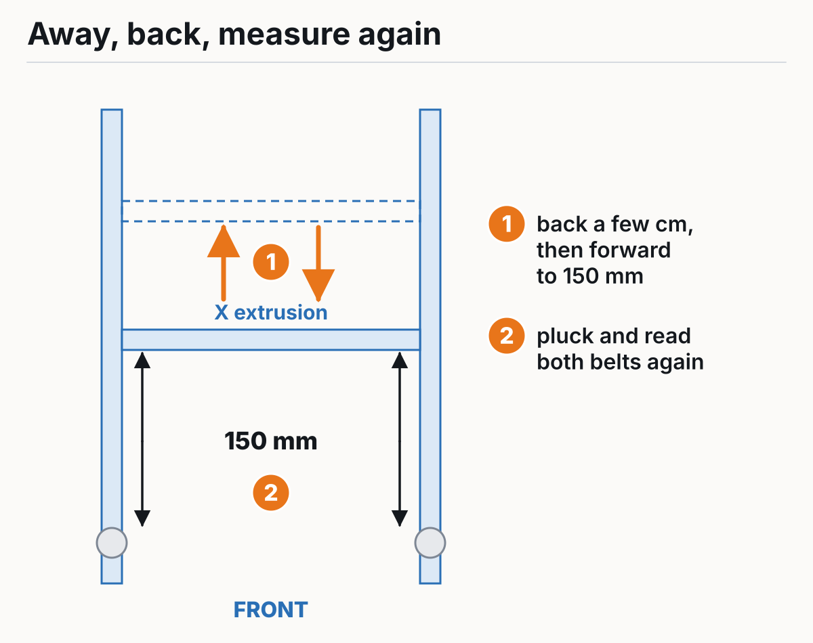

**What you're looking at:** Moving the gantry away and back re-seats both belts in every stack and lets trapped slack spread out. A reading that only holds while the gantry has not moved is not a reading.

**Parts:** none.

**Do:**

1. Move the X extrusion back at least a few centimetres, then forward again to the 150 mm span.
2. Measure both belts again.

**Check:** both belts within a few Hz of each other, at about 110 Hz, after the gantry has moved away and back.

Right now, A and B being equal matters more than hitting 110 Hz exactly. Unequal tension racks the gantry (pulls it out of square) and fights the squaring you do in Ch 06b, which releases this tension completely anyway.

If the two will not come together, the usual causes, in order, are unequal belt lengths (Step 07.8), unequal tails at the carriage, or a belt rubbing somewhere.

Source: [Voron docs § Secondary printer tuning — A/B Belts](https://docs.vorondesign.com/tuning/secondary_printer_tuning.html) · [survey §7.2 Ch 07](../voron-build-instructions-survey.md) · [Video: Part 6 @0:15:01](https://www.youtube.com/watch?v=8pWoYkY1DiA&list=PL0fUJbigELQPqpeGOgHYisG4KaSXVtnNY&t=901s)

Pause: ~30 min since the last pause — belt-rub check clean at all fourteen contacts, both belts reading ~110 Hz over a 150 mm span and equal to each other after moving the gantry. This tension is provisional, so do not chase the number further: Ch 06b releases it entirely and Ch 14 sets it for the last time.

---

## Finish the X carriage: inductive probe

### Step 07.34 — Insulate the probe and keep its lead whole

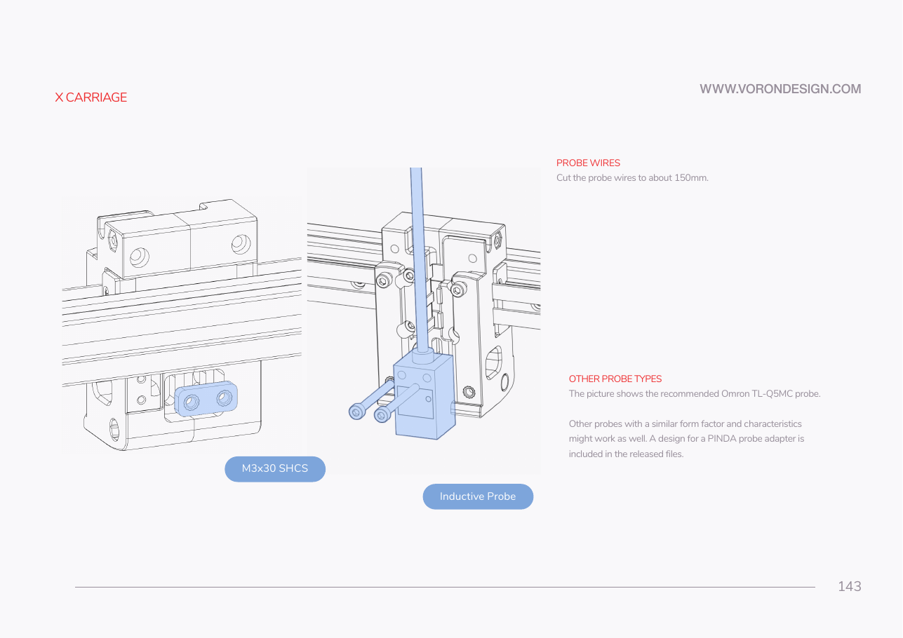{ crop="0.37 0.24 0.61 0.80" }
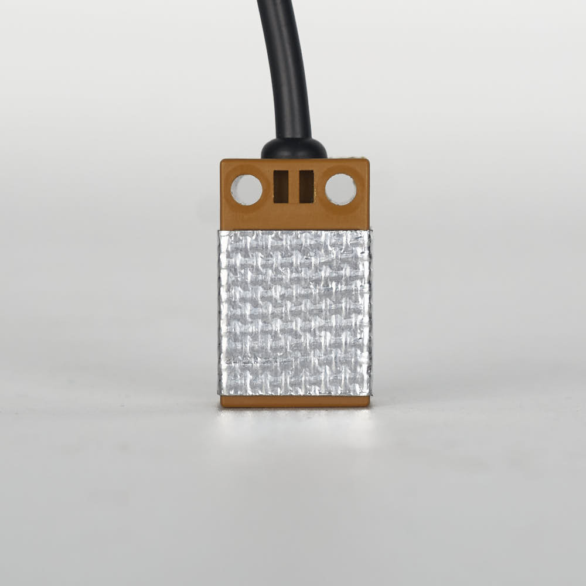

**What you're looking at:** The inductive probe is a small rectangular block with two mounting holes at the top and a lead coming out of it. It senses the steel bed without touching it, for QGL (levelling the gantry) and the bed mesh. Tape insulates it before it is fitted.

**Parts:**

- staged: Omron TL-Q5MC inductive probe ×1, in the Toolhead PCB Cables bag
- consumable: fibreglass tape 2×12 cm

**Do:**

1. Wrap at least two layers of fibreglass tape round the front and sides of the block, starting slightly up from the bottom edge.
2. Leave the lead full length and coil the spare loosely.

**Check:** the back and the bottom sensing face bare, the mounting holes clear, and the lead uncut with its connector on.

⚠ **Rev D+ / LDO:** Do not cut the probe lead. p.143 says to cut the probe wires to about 150 mm, but this kit's lead comes pre-cut and crimped for the Nitehawk `PROBE` port, Step 08.60. [src](https://docs.ldomotors.com/en/voron/voron2/wiring_guide_rev_d#insulating-the-z-probe)

Too much tape stops the probe triggering, so if it fails in Ch 13, peel some off.

Source: [Voron manual p.143](https://github.com/VoronDesign/Voron-2/blob/de7e89d/Manual/Assembly_Manual_2.4r2.pdf#page=143) · [LDO Build Notes § Voron 2.4 build FAQ](https://docs.ldomotors.com/en/voron/voron2/build-faq) · [LDO wiring guide § Insulating the Z probe](https://docs.ldomotors.com/en/voron/voron2/wiring_guide_rev_d#insulating-the-z-probe) · [LDO 350 Rev D+ BOM](https://docs.ldomotors.com/en/voron/voron2/350_BOM/Rev_D+)

### Step 07.35 — Fit the probe and its retainer bracket

{ crop="0.06 0.24 0.60 0.80" }

**What you're looking at:** The retainer bracket is the small printed bar with two heat-set inserts that sits behind the carriage. The two M3×30 clamp the probe block to the carriage face through it. Keep them snug only, so the probe can still slide for the next step.

**Parts:**

- Omron TL-Q5MC inductive probe ×1
- reused: the probe retainer bracket
- M3×30 SHCS ×2

**Do:**

1. Hold the probe on the carriage face, lead up.
2. Pass the two M3×30 SHCS through its mounting holes and the carriage into the retainer bracket's inserts behind.
3. Tighten them enough to hold the probe but still let it slide.

**Check:** a probe held square and parallel to the carriage face that you can still push up and down with firm finger pressure.

Source: [Voron manual p.143](https://github.com/VoronDesign/Voron-2/blob/de7e89d/Manual/Assembly_Manual_2.4r2.pdf#page=143)

### Step 07.36 — Set the probe height

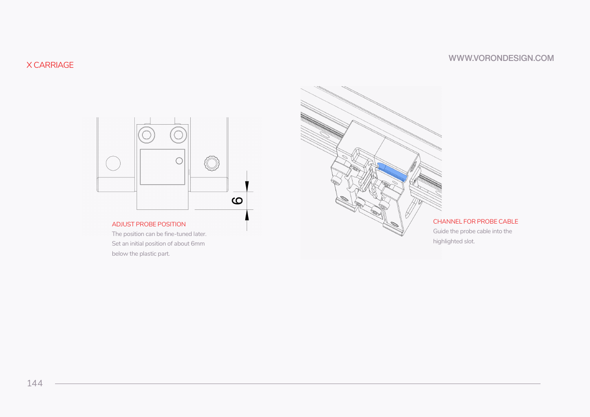{ crop="0.15 0.26 0.46 0.64" }

**What you're looking at:** Setting 6 mm of probe below the plastic is a starting position, not a calibration. It puts the sensing face where it will see the bed with margin to spare; the real trigger offset is measured during bring-up in Ch 13.

**Parts:** none.

**Do:**

1. Slide the probe until its tip sits about 6 mm below the plastic part. This is a starting position only, fine-tuned during bring-up.
2. Fully tighten the two M3×30.

**Check:** 6 mm ±1 mm on the caliper's depth blade, and a probe that does not move when you push on it.

**Helper:** Reads the caliper depth aloud while you slide the probe to 6 mm.

Source: [Voron manual p.144](https://github.com/VoronDesign/Voron-2/blob/de7e89d/Manual/Assembly_Manual_2.4r2.pdf#page=144)

### Step 07.37 — Route the probe cable

{ crop="0.50 0.18 0.90 0.64" }

**What you're looking at:** The moulded slot is the one place the probe cable can sit without getting caught between the belts and the rail carriage across the full X travel. The cable plugs into the toolhead board in Ch 08.

**Parts:** none.

**Do:**

1. Guide the probe cable into the moulded slot in the carriage.
2. Leave the coiled end loose above the carriage until Step 08.60 plugs it into `PROBE`.
3. Move the carriage from end to end and watch the cable.

**Check:** a cable held in the slot and clear of both belts and the rail carriage over the full travel.

**Helper:** Slides the X carriage slowly end to end while you watch the probe cable.

Source: [Voron manual p.144](https://github.com/VoronDesign/Voron-2/blob/de7e89d/Manual/Assembly_Manual_2.4r2.pdf#page=144)

### Step 07.38 — Hall-effect endstop magnet: skip

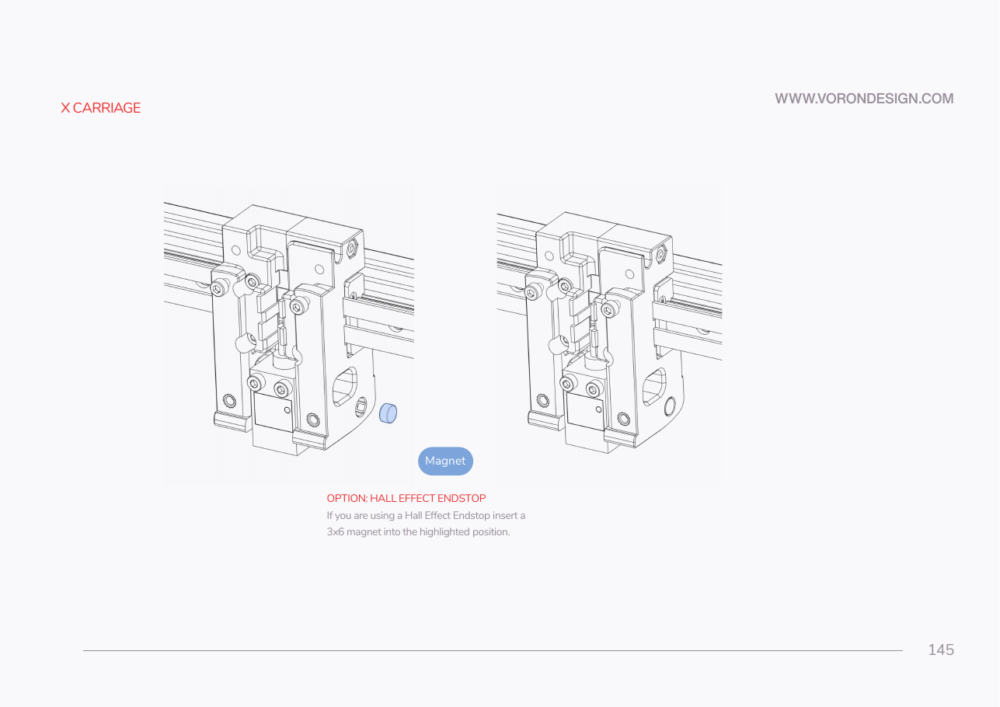{ crop="0.15 0.26 0.52 0.80" }

**What you're looking at:** You skip this page. The pocket it shows in the carriage takes a magnet for the hall-effect endstop option (an endstop tells the printer an axis has reached its end). This kit uses a microswitch board in the printed endstop pod instead, on the right XY joint since Ch 05, so the pocket stays empty.

**Parts:** none.

**Do:**

1. Do nothing here. Do not insert a 3×6 magnet.

**Check:** an empty magnet pocket in the carriage.

LDO's build notes say to skip page 145 because the kit does not use hall-effect endstops. It ships the XY microswitch board and the `[a]_endstop_pod_D2F_switch` printed part instead, fitted at Step 05.49. [src](https://docs.ldomotors.com/voron/voron2/build-faq) (p.145), [survey §4.2](../voron-build-instructions-survey.md)

Source: [Voron manual p.145](https://github.com/VoronDesign/Voron-2/blob/de7e89d/Manual/Assembly_Manual_2.4r2.pdf#page=145) · [LDO Build Notes § Voron 2.4 build FAQ](https://docs.ldomotors.com/en/voron/voron2/build-faq)

### Step 07.39 — Dry-fit the A/B drive cable cover

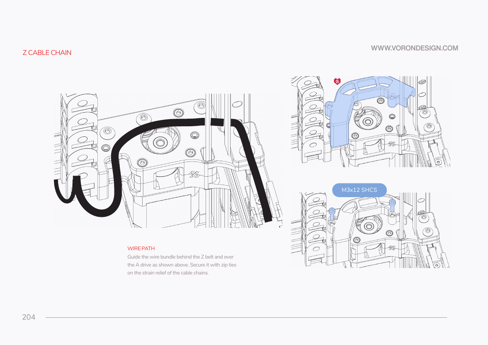

**What you're looking at:** The `[a]_cable_cover` is the blue arch at the upper right of p.204. It screws onto the A drive at the rear right, over the wire bundle that Ch 10 routes behind the Z belt. With the belts on, you can now check that it clears them.

**Parts:**

- staged: `[a]_cable_cover` ×1

**Do:**

1. Hold the cover against the A drive, its two holes over the two heat-set inserts in the top of `a_drive_frame_upper`, and check that it clears both belts.
2. Do not screw it on: the wire bundle goes under it first. Bag it for Step 10.66.

**Check:** both holes lined up with the inserts, neither belt touching the arch, and the cover bagged and labelled for Ch 10.

Source: [Voron manual p.204](https://github.com/VoronDesign/Voron-2/blob/de7e89d/Manual/Assembly_Manual_2.4r2.pdf#page=204) · [`STLs/Gantry/AB_Drive_Units/`](https://github.com/VoronDesign/Voron-2/tree/Voron2.4/STLs/Gantry/AB_Drive_Units) · CAD: Voron 2.4r2 STEP @ de7e89d

Pause: ~30 min since the last pause — inductive probe taped, fitted, set to height and its cable routed; endstop magnet correctly skipped; cable cover dry-fitted and bagged for Ch 10. The gantry is a working XY system. Do not tension further and do not square the gantry.

---

## Checkpoint 07

**Built:** a working CoreXY gantry with matched belts and its probe

- [ ] Both belts follow p.126 (A) and p.127 (B). Each belt stays in one plane, and neither crosses the other.
- [ ] No half-twist anywhere. At the X carriage the belt teeth face away from the extrusion, and each belt's toothed face stays on the same side all the way round.
- [ ] Teeth are meshed on both toothed motor pulleys (each pulley turns tooth by tooth when the belt is nudged, with no slip) and on the two toothed XY-joint idlers, A at the right joint and B at the left. The smooth back is on every plain stack.
- [ ] No belt rides on a printed part at any of the fourteen contacts in six locations, checked at both ends of X travel and both ends of Y travel (p.142).
- [ ] The same length of belt sticks out of the X carriage on both belts, after moving the gantry away and back (p.141).
- [ ] The two carriage screws and all four M3×8 belt clamps are fully tightened, and nothing slips under a hard pull.
- [ ] **Both belts read within a few Hz of each other at ~110 Hz over a 150 mm span**, re-checked after moving the gantry. This is provisional: Ch 14 Step 14.4 sets the final value.
- [ ] The gantry moves through its full XY range by hand with even resistance, no ticking and no notchy spots.
- [ ] The probe is taped on the front and sides only and fitted, its lead **uncut** with its factory connector, its tip 6 mm below the plastic, and its cable in the slot.
- [ ] No hall-effect magnet is fitted (p.145 skipped).
- [ ] Turn the A motor pulley by hand: the carriage moves diagonally. Turn both pulleys the same way: it moves in a straight line. That is CoreXY.

## Common mistakes

- **Tensioning to final now.** Ch 06b releases A/B tension completely as its first move, and it cannot run until the printer is alive (Ch 13). The final value is set at Ch 14 Step 14.4: cold, door open, just before the 14.6 soak. Set ~110 Hz, confirm A ≈ B, and move on. Chasing the last 5 Hz here is time you will spend again.
- **Cutting the second belt to a tape measure instead of against the first.** Any length error becomes a permanent tension imbalance that you will try to fix with the tensioners, and they cannot fix it. Fold-cut both together, or take the routed first belt off and cut the second against it (Step 07.8).
- **Wrapping the wrong part of a rear drive unit.** Each drive unit holds the motor pulley for its own belt *and* an idler stack for the other belt. Putting the A belt on the B motor pulley looks plausible and locks the two axes together. The top-left inset of p.126 and the top-right inset of p.127 show which is which.
- **A half-twist in a long run.** It shows up as a belt that runs fine at one end of travel and rubs at the other. Look along each straight run and confirm the teeth face the same way at both ends.
- **"Fixing" the teeth-on turn at an XY joint with a half-twist.** Each belt meets one toothed idler at the XY joints, A at the right joint (Step 07.16) and B at the left (Step 07.17), and wraps it teeth-on by design. A twist put in to get the smooth back there walks the belt off a flange at the far end of travel.
- **Reading a harmonic on the phone.** Spectrum apps show peaks at 2× and 3× the fundamental, so a 220 Hz reading looks "too tight" and sends you loosening a correctly tensioned belt. Take the *lowest* peak, and take three plucks.
- **Forcing a belt round a bearing stack.** You will damage the flange or unseat a bearing. At a front idler, take out the M3×40 SHCS, thread the belt, refit it and redo Step 07.5 (Step 07.15, p.134). A drive unit or XY joint has no such screw: find what is catching instead.

## Next

[Ch 08 — Toolhead](08-toolhead.md): Stealthburner, Clockwork 2.5 and the Nitehawk-SB V2, where all five Rev D+ deviations land.
