# Chapter 08 — Toolhead: Stealthburner, Clockwork 2.5, Revo HF, Nitehawk-SB V2

<!-- style: plain -->

You build the complete toolhead on the bench (extruder, hotend, fans, LEDs and toolboard) and hang it on the X carriage with every connector made, so Ch 10 only has to pull one cable, the umbilical, through the drag chain.

**What you're building in this chapter:** The toolhead is the part that actually prints, and you build it as four assemblies. The **[Clockwork 2.5](16-glossary.md#c)** is the extruder: a slim stepper motor turns two geared wheels that grip the filament between them and push it down. Filament enters through a push-in fitting (a collet) on top. The **tool cartridge** is the removable block that holds the **[Revo HF](16-glossary.md#r)** hotend (a finned heatsink, a HeaterCore with the heater and thermistor, and a nozzle you change by hand) plus the PTFE tube that feeds it. The **[Stealthburner](16-glossary.md#s)** is the blue shell that wraps the front. It carries two fans, one blowing through the hotend's heatsink to keep its cold side cold and one blowing cooling air at the print, and three addressable LEDs behind a diffuser. The **[Nitehawk-SB V2](16-glossary.md#n)** is the toolboard: a small circuit board riding on the toolhead. It collects the heater, thermistor, fans, LEDs, probe and extruder motor onto one cable carrying USB and 24 V, instead of a bundle of loose wires. You build all four on the bench and only then hang them on the X carriage, with every toolhead-side connector already made.

```mascot
pose: hexkey
caption: Small fasteners, tight spaces. Build over a tray, because carpet eats M3 screws and denies it.
```

**Time:** 3.0–4.5 h hands-on, first build (survey §7.2).

**Sessions:** 10 × ~30 min. Every minute figure in this chapter, here and in the Pause lines, is a first-build estimate.

**Prerequisites:**

- **Ch 05 (Gantry)** is done: the X extrusion and MGN12 rail are on the gantry, and the rail carriage runs the full X travel without sticking.
- **Ch 07 (A/B belts)** is done: the X carriage halves (`x_frame_V2TR_MGN12_left/right`) are built with their heat-set inserts and M3 nuts (Step 07.6), and the belts are clamped into the carriage and tensioned. The carriage must be finished before anything hangs off it.
- **Print batches: B02** for the blue accent parts (`[a]_stealthburner_main_body`, `[a]_guidler_a/b` and `[a]_latch` from plate B02-P5, `[a]_latch_shuttle` from B02-P4, and a spare `[a]_pcb_spacer`), **B06** for the Stealthburner `revo_voron` printheads, the LED parts, the Clockwork 2.5 black parts `main_body_collet`, `motor_plate` and `cable_cover`, and the Klicky set, and **B04** for the carriage. Batch ids come from `docs/voron-print-plan.md`.
- **Bought, not in the kit BOM:** a 4 mm Bowden collet and its clip for the extruder's PTFE inlet (Step 08.14; SB p.21). The 350 BOM lists one 4 mm Bowden coupler, which Ch 11 fits in the back panel.
- **Printed parts LDO supplies, so you print none of them:** CW2 Chain Anchor Tilted ×1, CW2 PCB Spacer ×1, Stealthburner LED Diffuser ×1 (clear PETG), LDO Nozzle Probe ×1, NH Adapter Mount ×1. [src](https://docs.ldomotors.com/en/voron/voron2/350_BOM/Rev_D+)

**Tools**

- Hex keys 1.5, 2 and 2.5 mm (the 1.5 mm is supplied)
- Nutopress Pro insert press with its M3 tip; the X-Tronic iron with the kit's LDO brass tip only for a part that will not fit under the press
- Flush cutters and a small flat file, for the 5015 fan's ears
- Multimeter, for continuity and the thermistor's resistance
- Digital caliper, for the drive-gear position and the PTFE length
- JST-PH2.0 crimp tool, **only** if you re-terminate the Revo's leads yourself
- Fine sandpaper (two sheets supplied), for the drive shaft's end face and the fan ears
- Small pliers, needle-nose pliers (for the main body's support, SB p.23) and tweezers

**Consumables:** medium-strength threadlocker (Loctite 243), light grease for the BMG idler bearings, E0508 ferrules, zip ties 3×150 mm.

**Read first**

- **Fit all 17 heat-set inserts before you assemble anything** (Steps 08.3–08.7). A missed insert in the extruder's main body means taking the extruder back apart to bare plastic.
- **Five of the kit's six Rev D+ changes land in this chapter.** Three small toolboard sockets are JST-PH2.0, not XH2.5; the fan adapter's header is keyed and reversed; there is no accelerometer mount; the USB adapter takes the V2 cover; and two ground wires guard against static. Read the board's printed labels before every plug.
- **The kit ships two probes, and you use the inductive one,** fitted in Ch 07. The Klicky parts are printed but only bagged.
- **Skip the accelerometer (ADXL) mount.** The toolboard has one built in. The toolboard's XY-endstop port stays empty, and the PROBE port's third pin is a live 24 V.
- **Good for short sessions:** the inserts, the idler, the bearings, the Revo, the leads, the fan ears and the LED chain need no printer. Heat-set the inlet panel (Ch 09 Step 09.10) and the bed WAGO mount (Step 09.34) in the same iron session.

<!-- reference -->

**Printed parts**

Parts arrive in the bins named below (see the bin map in print/README.md#bins); check the bin label's list before you start.

| Looks like | STL | Bin | Qty | Colour |
|---|---|---|---|---|
| { width=96 } | `[a]_stealthburner_main_body.stl` | 08-SB | 1 | Blue |
| 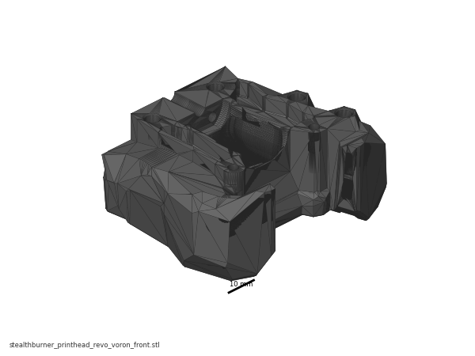{ width=96 } | `stealthburner_printhead_revo_voron_front.stl` | 08-SB | 1 | Black |
| 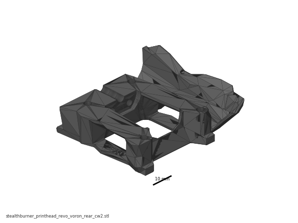{ width=96 } | `stealthburner_printhead_revo_voron_rear_cw2.stl` | 08-SB | 1 | Black |
| { width=96 } | `[o]_stealthburner_LED_carrier.stl` | 08-SB | 1 | Black (opaque) |
| { width=96 } | `[o]_stealthburner_LED_diffuser_mask.stl` | 08-SB | 1 | Black (opaque) |
| — | `[c]_stealthburner_LED_diffuser.stl` | — | 1 | **kit-supplied** in clear PETG — not printed here |
| 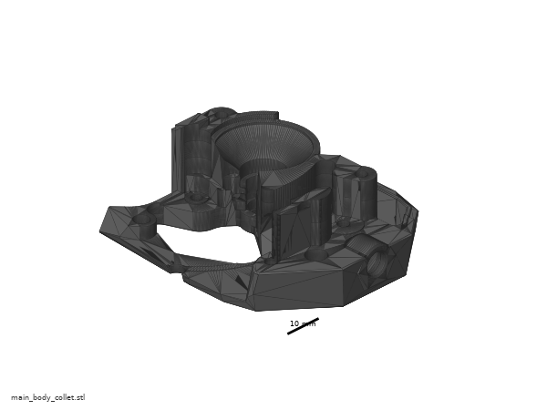{ width=96 } | `main_body_collet.stl` (Clockwork 2.5, collet option) | 08-CW2 | 1 | Black |
| 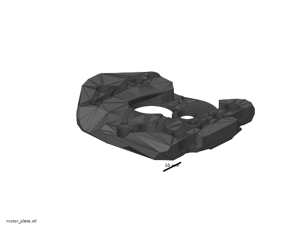{ width=96 } | `motor_plate.stl` (Clockwork 2.5) | 08-CW2 | 1 | Black |
| { width=96 } { width=96 } | `[a]_guidler_a.stl` / `[a]_guidler_b.stl` | 08-CW2 | 1 each | Blue |
| { width=96 } { width=96 } | `[a]_latch.stl` / `[a]_latch_shuttle.stl` | 08-CW2 | 1 each | Blue |
| { width=96 } | `[a]_pcb_spacer.stl` | spare-alt | 1 | **Supplied printed**; you printed a 0.3 g spare |
| 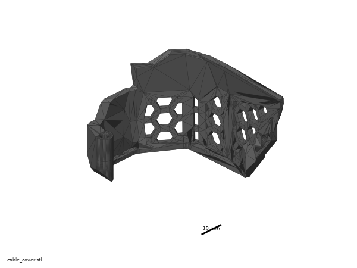{ width=96 } | `cable_cover.stl` (Clockwork 2.5) | 08-CW2 | 1 | Black — covers the toolboard; Step 08.62 |
| 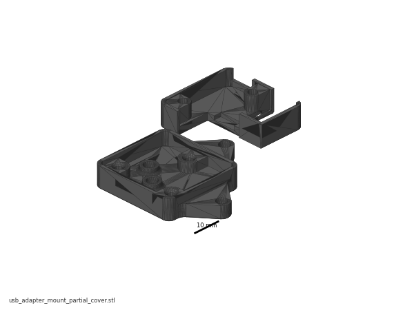{ width=96 } | `usb_adapter_mount_partial_cover.stl` (Nitehawk-SB-V2 repo) | 08-CW2 | 1 | Black — B07-P3; fitted at Step 08.64 |
| — | CW2 Chain Anchor Tilted | — | 1 | **Supplied printed** — do **not** print `chain_anchor_2hole` |
| — | Klicky set (`KlickyProbe_v2` ×2, `Probe_Dock_v2.1`, `Probe_magnet_holder`, `Probe_pressfit_holder`, `KlickyProbe_AB_mount_v2` + holder, `Mount_*`, `Dock_mount_fixed_v2`) | — | 1 set | Black — **alternative path only**, bag it (Step 08.54) |

**Hardware** (chapter totals)

| Fastener / part | Qty | Note |
|---|---|---|
| Heat-set insert, brass, M3×5×4 | 17 | 3 CW2.5 main body, 7 motor plate, 1 latch shuttle, 1 guidler arm, 3 chain anchor, 2 printhead front — all `(verify on bench)`, the SB manual highlights locations, not counts; the CW2.5 STLs carry 3 and 7 insert bores; the latch takes none (SB p.15, and its STL has a plain Ø3.4 bore) |
| M3×8 SHCS | 10 | 1 motor, 1 chain anchor, 4 tool cartridge, 2 toolboard, 2 CW2.5→carriage |
| M3×16 SHCS | 4 | 1 joins the guidler halves, 2 tool cartridge, 1 cable cover (threads into the cover, SB p.38) |
| M3×20 SHCS | 2 | 1 chain anchor, 1 latch pivot (SB p.29) |
| M3×25 SHCS | 5 | 2 main body to motor plate, 1 tension arm, 2 SB mounting |
| M3×30 SHCS | 1 | 1 motor (the probe's 2 are counted in Ch 07) |
| M3×50 SHCS | 2 | SB mounting (lower pair) |
| M3×6 BHCS | 1 | cable cover's side fixing (SB p.38) |
| M3×10 FHCS | 2 | fan adapter PCB through the 5015's two screw holes into the body (Step 08.44); they replace SB p.64's two M3×6 FHCS `(verify on bench)` |
| Bowden collet, 4 mm — from a separate purchase, no 350 BOM row | 1 | press-fit into the main body's PTFE inlet, Step 08.14 (SB p.21) |
| Bowden clip — from a separate purchase, no 350 BOM row | 1 | locks the collet, Step 08.14 |
| M3 washer | 1 | under the M3×8 motor bolt |
| Nozzle-probe hardware (M2×10 self-tapping ×2, M3 set screw ×1) | 0 here | the nozzle probe is built once, in Ch 09 Steps 09.27–09.29 — counted in that chapter's table |
| MR85 bearing | 2 | 1 motor plate, 1 main body |
| Bondtech IDGA gear set | 1 | idler half built at Step 08.9, drive half at 08.15 |
| Thumb Screw Kit (thumbscrew, spring ~12 mm × 6 mm OD × 1 mm wire, washer) | 1 | |
| LDO-36STH20-1004AHG(VRN) pancake stepper, NEMA14 36 mm | 1 | |
| E3D Revo Hotend (HF), Revo Voron form factor | 1 | 60 W (LDO Edition HeaterCore), 300 °C max, Semitec 104NT-4-R025H42G |
| PTFE tube, 4 mm OD, 2 mm ID, 10 cm | 1 | tool cartridge, 11 mm stickout; cut stock |
| 40×40×10 axial fan, 24 V | 1 | hotend fan |
| 50×50×15 centrifugal fan, 24 V | 1 | part cooling |
| Nitehawk-SB V2 toolboard | 1 | STM32G0B1, integrated ADXL345 |
| Stealthburner Fan Adapter PCB (SBurnerFanAdapter_V2.0) | 1 | |
| Toolhead cable, USB and 24 V, XT30(2+2) | 1 | from the Toolhead PCB Cables bag |
| M3×10 SHCS — from the kit, no 350 BOM row | 3 | USB adapter stack (assembled here, mounted in Ch 09); LDO's printed-parts guide names the size, the 350 BOM lists no M3×10 SHCS `(verify on bench)` |
| Extruder Motor Ground Wire | 1 | toolboard to extruder motor (Rev D+ BOM, *Electronics 2*); counted at Step 08.43, board end under a toolboard M3×8; motor end at Step 08.53 |
| M3 screw, motor end of the grounding cable — from the LDO kit, no BOM row | 1 | length not published `(verify on bench)` |
| CW2 Chain Anchor Tilted | 1 | LDO-supplied printed; inserts at Step 08.6, fitted at 08.25 |
| CW2 PCB Spacer | 1 | LDO-supplied printed; under the toolboard at Step 08.43 |
| Stealthburner LED Diffuser | 1 | LDO-supplied, clear PETG; Step 08.35 |
| USB Adapter PCB | 1 | stacked at Step 08.64, clipped to the rail in Ch 09 |
| NH Adapter Mount | 1 | LDO-supplied printed base; Step 08.64 |

**Notes behind "Read first"**

- **Do the insert pass before you assemble anything.** A missed insert in the CW2.5 main body means stripping the extruder back to bare plastic (survey §5.2 W3). All 17 go in first, in Steps 08.3–08.7.
- **Five of the six Rev D+ deltas land in this chapter.** PROBE / TH0 / XY-Endstop are **JST-PH2.0**, not XH2.5; the board-to-board fan header is **keyed and gender-reversed**; there is no ADXL mount; the USB-adapter cover is the V2 part; and two ground wires carry LDO's ESD grounding scheme (Steps 08.43, 08.53; survey §4.1).
- **The kit ships both probes and you build the inductive one.** LDO's wiring guide, the Rev D+ Klipper config and survey §4.3 all assume the Omron inductive probe for QGL plus the LDO nozzle probe as the Z endstop. The Klicky parts are printed; bag them (Step 08.54).
- **Skip the ADXL mount entirely.** The Nitehawk-SB has an ADXL345 on board. Do not fit the two extra inserts SB p.46 highlights, and do not print `ADXL345_Mounts/*`. [src](https://docs.ldomotors.com/en/voron/voron2/printed_part_guide_rev_d)
- **The XY-endstop port on the toolboard is unused** in a standard build, and the PROBE port's third pin is 24 V — Klicky must not have it populated. [src](https://docs.ldomotors.com/en/voron/voron2/wiring_guide_rev_d#wiring-the-toolhead-pcb)
- **Bench-only work, good for a short session**: Steps 08.3–08.7 (inserts), 08.9–08.11 (idler, guidler, thumbscrew), 08.12–08.14 (bearings), 08.27 (Revo) and 08.33–08.36 (leads, 5015 ears, LED chain) need no printer. The inlet panel (plate B07-P1, Ch 09 Step 09.10) and LDO's supplied bed WAGO mount (Ch 09 Step 09.34) are already on the bench, so heat-set both in the same iron session as 08.3–08.7 — those two steps then become a confirm.

**Sources for this chapter**

- [Stealthburner assembly manual](https://github.com/VoronDesign/Voron-Stealthburner/blob/1572a42e6df5d2f0ddf04a2145be4dc9c3693723/Manual/Assembly_Manual_SB.pdf#page=11), pinned commit `1572a42`, the Stealthburner r2 / Clockwork 2.5 release — pp. 11–21, 23–38, 45–64, 68, 73–76. The spine of this chapter: 49 of the 65 steps. Pages this build skips: p.22 (the ECAS04 body option; this build fits the collet body), pp. 39–42 (the optional hall-effect filament sensor, not fitted), p.67 (a four-screw carriage this build does not use) and pp. 77–78 (the ADXL mount; the Nitehawk-SB V2 has its own accelerometer).
- [Voron 2.4r2 assembly manual](https://github.com/VoronDesign/Voron-2/blob/de7e89d/Manual/Assembly_Manual_2.4r2.pdf#page=129), pinned commit `de7e89d` — pp. 129–130 (carriage prep), 144 (probe), 146–147 (the hand-off to and from the SB manual).
- LDO Rev D wiring guide — [§ Wiring the Toolhead PCB](https://docs.ldomotors.com/en/voron/voron2/wiring_guide_rev_d#wiring-the-toolhead-pcb) and [§ Assembling the Nozzle Probe](https://docs.ldomotors.com/en/voron/voron2/wiring_guide_rev_d).
- [LDO Rev D printed-parts guide](https://docs.ldomotors.com/en/voron/voron2/printed_part_guide_rev_d) — which parts LDO supplies printed and which are on the do-not-print list.
- [LDO Rev D+ 350 BOM](https://docs.ldomotors.com/en/voron/voron2/350_BOM/Rev_D+) — fan voltages, supplied printed parts.
- [LDO Build Notes / build FAQ](https://docs.ldomotors.com/voron/voron2/build-faq) — the per-page deviations for pp. 129–130, 144, 146–147.
- [LDO Nitehawk-SB V2 board doc § ESD Hardening](https://docs.ldomotors.com/en/Toolboard/nitehawk-sb-v2#esd-hardening) — the grounding scheme (Step 08.53).
- [Nitehawk-SB-V2 repo](https://github.com/MotorDynamicsLab/Nitehawk-SB-V2) — board [pinout](https://github.com/MotorDynamicsLab/Nitehawk-SB-V2/blob/master/Images/nhsbv2_pcb_pinout.jpg), [fan-adapter pinout](https://github.com/MotorDynamicsLab/Nitehawk-SB-V2/blob/master/Images/sbv2_fan_adapter_pcb_pinout.jpg), [grounding scheme](https://github.com/MotorDynamicsLab/Nitehawk-SB-V2/blob/master/Images/grounding_scheme.jpg), [ground routing](https://github.com/MotorDynamicsLab/Nitehawk-SB-V2/blob/master/Images/toolboard_ground_routing.jpg), [chain ties](https://github.com/MotorDynamicsLab/Nitehawk-SB-V2/blob/master/Images/cable_chain_ties.jpg), [USB-adapter ground](https://github.com/MotorDynamicsLab/Nitehawk-SB-V2/blob/master/Images/usb_adapter_gnd.jpg), [`STLs/`](https://github.com/MotorDynamicsLab/Nitehawk-SB-V2/tree/master/STLs). The repo carries no LICENSE file (re-checked 2026-09-05); the six board images this chapter needs are nevertheless mirrored into `assets/remote/08-toolhead/` under Alex's 2026-09-05 image-licensing ruling (CONVENTIONS.md — LDO / Nitehawk-SB V2 / Leviathan / LDOVoron2 material, attributed, non-commercial), with the original URLs kept in every Source line. See that folder's `SOURCES.txt`.
- [LDO Rev D+ Klipper config `leviathan-printer-rev-d-sbv2.cfg`](https://github.com/MotorDynamicsLab/LDOVoron2/blob/main/Firmware/leviathan-printer-rev-d-sbv2.cfg) — `chain_count`, `color_order`, the fan pins, `[probe]`, `[resonance_tester]`.
- [E3D Revo Voron support](https://e3d-online.com/pages/revo-support-voron) — hotend assembly order and the anti-clockwise-only rule.
- [Voron Stealthburner printheads README](https://github.com/VoronDesign/Voron-Stealthburner/blob/main/STLs/Stealthburner/Printheads/README.md) — the `E-RV` hotend code.
- [Klicky Probe (Voron v2.4)](https://github.com/jlas1/Klicky-Probe/tree/main/Printers/Voron/v1.8_v2.4_Legacy_Trident) — alternative path only, Step 08.54.
- [Fabreeko LDO Voron 2.4 kit page](https://www.fabreeko.com/products/ldo-voron-v2-4-kit) — what "Rev D+" means (the secondary USB port).

**Video coverage (Steve Builds, pre-release LDO kit — differs from Rev D+):** [Part 5 @1:33:00](https://www.youtube.com/watch?v=hTKCBrk36R0&list=PL0fUJbigELQPqpeGOgHYisG4KaSXVtnNY&t=5580s) (+13m), [Part 5 @1:45:23](https://www.youtube.com/watch?v=hTKCBrk36R0&list=PL0fUJbigELQPqpeGOgHYisG4KaSXVtnNY&t=6323s) (+8m), [Part 5 @2:00:12](https://www.youtube.com/watch?v=hTKCBrk36R0&list=PL0fUJbigELQPqpeGOgHYisG4KaSXVtnNY&t=7212s) (+22m), [Part 5 @2:17:50](https://www.youtube.com/watch?v=hTKCBrk36R0&list=PL0fUJbigELQPqpeGOgHYisG4KaSXVtnNY&t=8270s) (+30m), [Part 5 @3:07:12](https://www.youtube.com/watch?v=hTKCBrk36R0&list=PL0fUJbigELQPqpeGOgHYisG4KaSXVtnNY&t=11232s) (+10m), [Part 5 @3:17:06](https://www.youtube.com/watch?v=hTKCBrk36R0&list=PL0fUJbigELQPqpeGOgHYisG4KaSXVtnNY&t=11826s) (+22m), [More Extras! @0:46:09](https://www.youtube.com/watch?v=D_44fDp9xt8&list=PL0fUJbigELQPqpeGOgHYisG4KaSXVtnNY&t=2769s) (+26m)

---

## A — Part preparation and heat-set inserts

### Step 08.1 — Sort the printed parts and confirm the hotend code

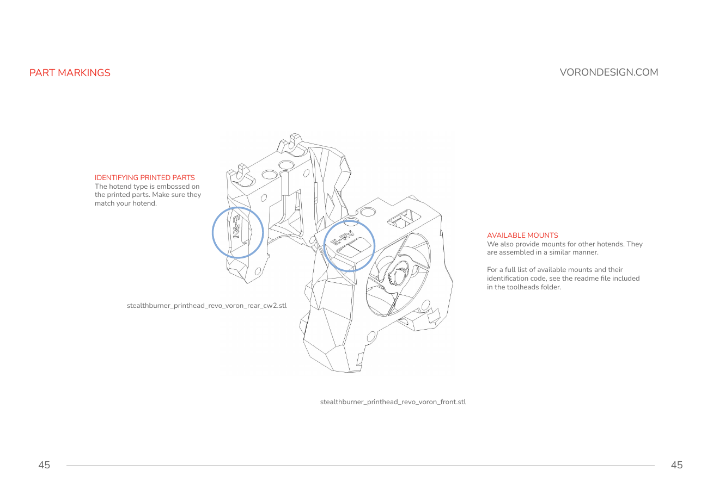{ crop="0.12 0.24 0.68 0.84" }

**What you're looking at:** [Stealthburner](16-glossary.md#s) is the toolhead: a shell carrying two fans and three LEDs around a removable **tool cartridge** that holds the hotend. The two printhead halves make up that cartridge, and a code moulded into each, circled on SB p.45, says which hotend they fit.

**Parts:**

- staged: all B02 and B06 toolhead prints
- staged: the two `revo_voron` printhead halves

**Do:**

1. Lay the parts out in build order and bag the Klicky set.
2. Read the code on both printhead halves. It must say **E-RV**, short for E3D Revo Voron.
3. Tell the halves apart: the large `_front` holds the hotend, and the thin `_rear_cw2` closes it.

**Check:** Both halves read `E-RV`, and you have one front and one rear. A different printhead folder means reprinting.

**Helper:** Reads the moulded code on each printhead half aloud and sorts the prints into build order.

The `revo_voron` folder is the settled choice for this kit: the Stealthburner printhead README maps "E3D Revo Voron → E-RV". [src](https://github.com/VoronDesign/Voron-Stealthburner/blob/main/STLs/Stealthburner/Printheads/README.md)

Source: [SB manual p.45](https://github.com/VoronDesign/Voron-Stealthburner/blob/1572a42e6df5d2f0ddf04a2145be4dc9c3693723/Manual/Assembly_Manual_SB.pdf#page=45)

---

### Step 08.2 — Snap the built-in supports out of the Stealthburner body

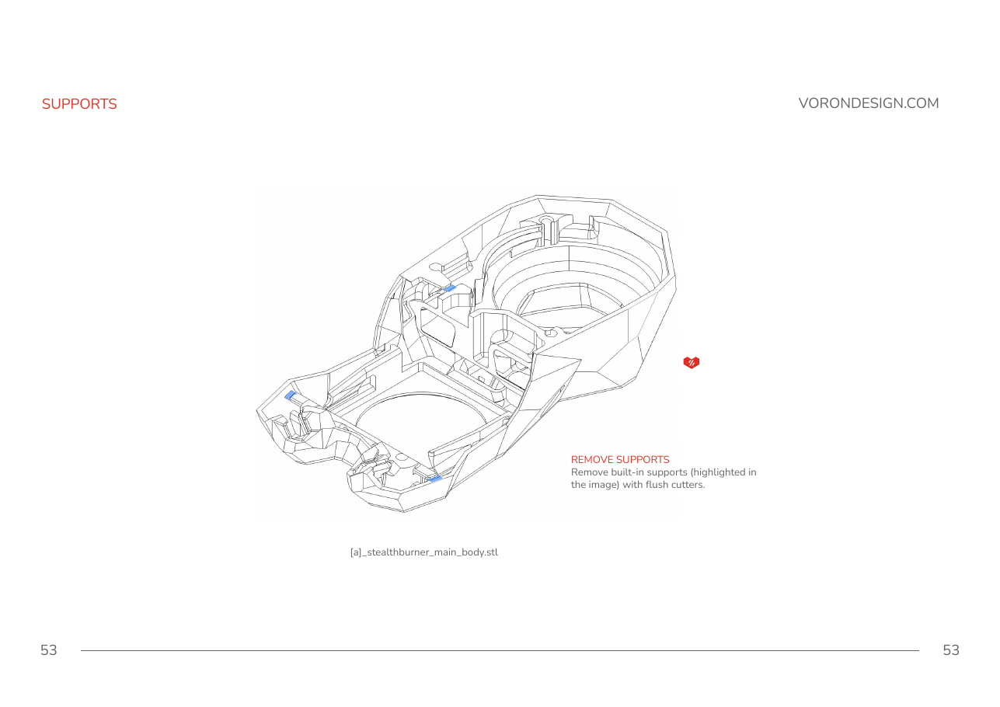{ crop="0.24 0.24 0.78 0.80" }


**What you're looking at:** The blue main body is the Stealthburner shell itself, carrying the LEDs, the air ducts and both fans. It prints with throwaway support plastic inside. The thin webs across the fan pockets are the exception: they snap as a fan is pushed in, and that snap holds the fan.

**Parts:**

- `[a]_stealthburner_main_body` ×1

**Do:**

1. Snap out the three built-in supports SB p.53 highlights, using flush cutters. Pry and break them; do not carve.
2. Leave the supports in the fan pockets alone. SB p.60 says those break when the fans go in.

**Check:** The LED pockets, the diffuser channels and the two mounting holes are clear, and the fan pockets still have their thin support webs.

Source: [SB manual p.53](https://github.com/VoronDesign/Voron-Stealthburner/blob/1572a42e6df5d2f0ddf04a2145be4dc9c3693723/Manual/Assembly_Manual_SB.pdf#page=53)

---

### Step 08.3 — Inserts: Clockwork 2.5 main body

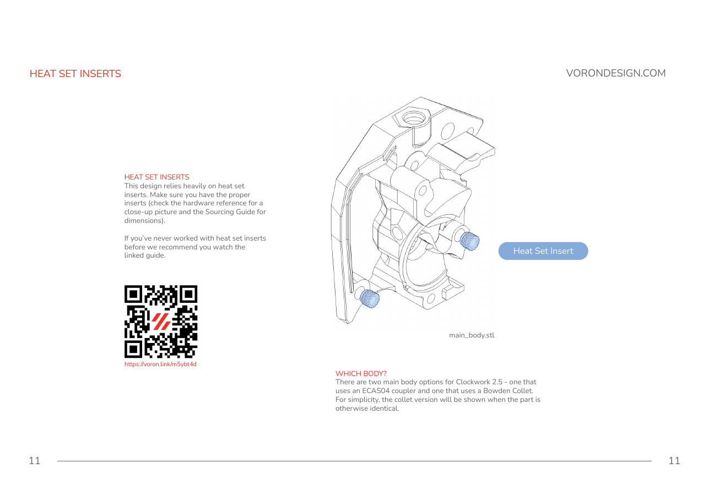{ crop="0.42 0.18 0.86 0.84" }
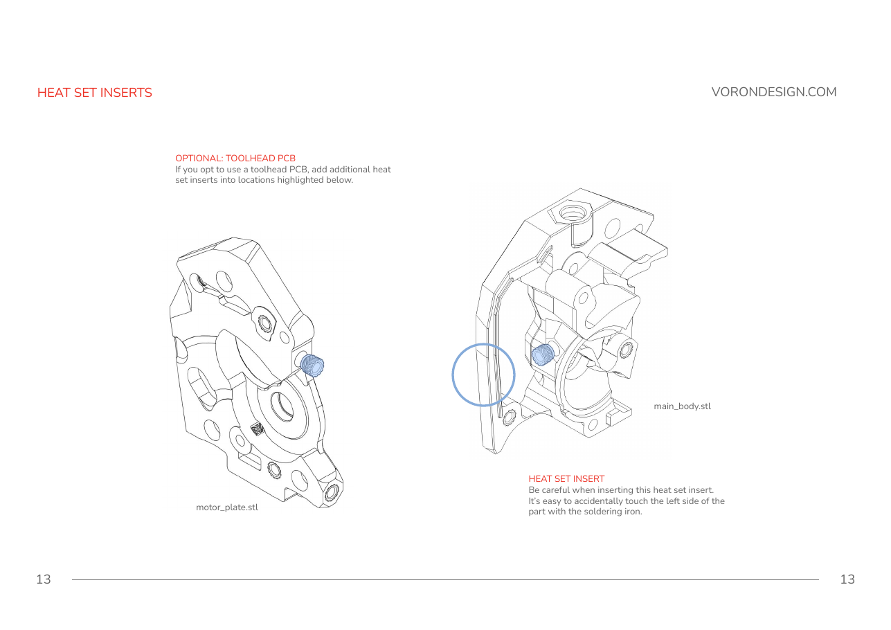{ crop="0.48 0.28 0.84 0.84" }


**What you're looking at:** [Clockwork 2.5](16-glossary.md#c) is the extruder that grips filament and pushes it down. `main_body_collet` is its front half: a bearing, the filament path and the collet port. A [heat-set insert](16-glossary.md#h) is a knurled brass sleeve melted into plastic so a screw threads into metal.

**Parts:**

- `main_body_collet` ×1
- heat-set insert, M3×5×4 ×3

**Do:**

1. Set the press to the ASA figure on your Ch 00 Step 00.14 coupon.
2. Press in the two inserts SB p.11 highlights: foot and side face.
3. Add p.13's third, for the toolhead board. It sits beside a tall wall: line it up directly under the tip. Press each one square.

**Check:** All three sit below the surface, none tilted, and an M3 screw starts by hand in each: 3, matching the STL's insert holes.

⚠ Rev D+ / LDO: the p.13 "OPTIONAL: TOOLHEAD PCB" inserts are not optional here. The Nitehawk-SB V2 bolts to the CW2.5 with two M3×8 into these inserts, one in the main body and one in the motor plate. [src](https://docs.ldomotors.com/en/voron/voron2/wiring_guide_rev_d#wiring-the-toolhead-pcb)

Source: [SB manual p.11](https://github.com/VoronDesign/Voron-Stealthburner/blob/1572a42e6df5d2f0ddf04a2145be4dc9c3693723/Manual/Assembly_Manual_SB.pdf#page=11) · [SB manual p.13](https://github.com/VoronDesign/Voron-Stealthburner/blob/1572a42e6df5d2f0ddf04a2145be4dc9c3693723/Manual/Assembly_Manual_SB.pdf#page=13)

---

### Step 08.4 — Inserts: Clockwork 2.5 motor plate

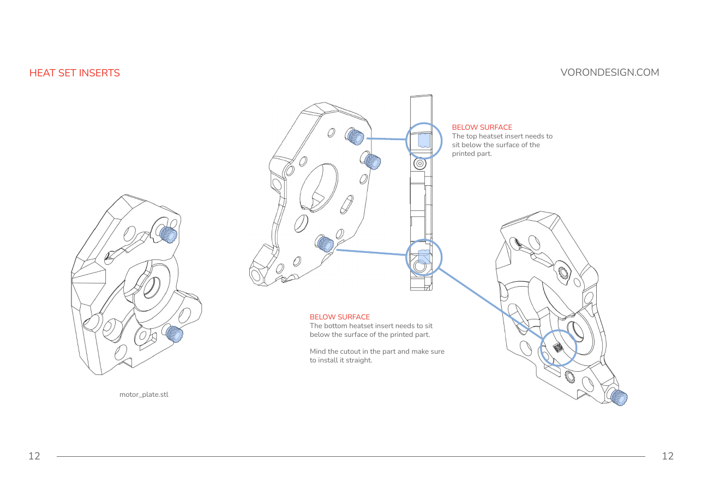{ crop="0.08 0.17 0.92 0.83" }
{ crop="0.16 0.22 0.46 0.84" }


**What you're looking at:** The motor plate is the extruder's other half: the thin 8.2 mm plate with the large central hole that closes the extruder and carries the pancake stepper. Its inserts must finish **below** the surface, because one that sticks up stops the motor sitting flat.

**Parts:**

- `motor_plate.stl` ×1
- heat-set insert, M3×5×4 ×7

**Do:**

1. Press in the **six** inserts SB p.12 draws: three in the motor face, two in the inner face, one in the edge.
2. Sink the top and bottom motor-face inserts **below** the surface, and mind the cutout by the bottom one.
3. Add the **seventh**, from SB p.13, for the toolhead board.

**Check:** A steel rule laid across each insert shows none sticking up, and the count is 7, matching the STL's seven insert holes.

Source: [SB manual p.12](https://github.com/VoronDesign/Voron-Stealthburner/blob/1572a42e6df5d2f0ddf04a2145be4dc9c3693723/Manual/Assembly_Manual_SB.pdf#page=12) · [SB manual p.13](https://github.com/VoronDesign/Voron-Stealthburner/blob/1572a42e6df5d2f0ddf04a2145be4dc9c3693723/Manual/Assembly_Manual_SB.pdf#page=13)

---

### Step 08.5 — Inserts: latch shuttle and guidler arm (flush, not below)

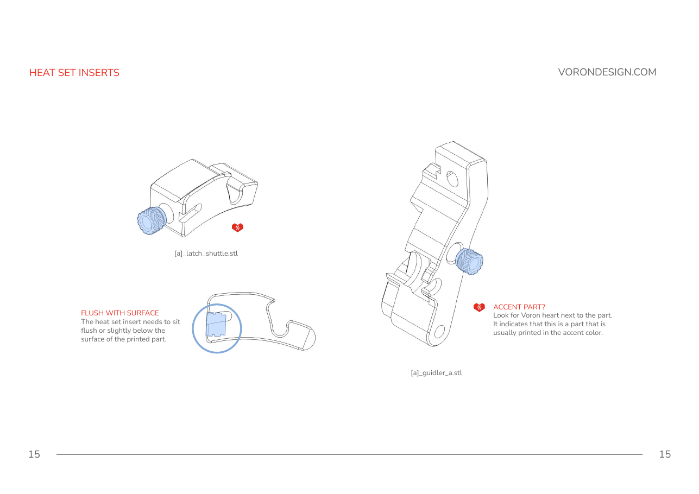{ crop="0.08 0.26 0.92 0.80" }


**What you're looking at:** The latch shuttle and the guidler arm are two of the extruder's blue parts. The arm swings the idler gear against the drive gear to grip the filament, and the shuttle takes the thumbscrew. The latch hooks over the shuttle and pivots on a plain screw.

**Parts:**

- `[a]_latch_shuttle` ×1
- `[a]_guidler_a` ×1
- heat-set inserts M3×5×4 ×2

**Do:**

1. Press one insert into the end face of the latch shuttle and one into the side boss of the guidler arm.
2. Finish both **flush or only slightly below** the surface, never sunk. The latch takes none.

**Check:** A straightedge across each insert face rocks on the plastic, not on the brass, and the count is 2, as p.15 draws them.

Source: [SB manual p.15](https://github.com/VoronDesign/Voron-Stealthburner/blob/1572a42e6df5d2f0ddf04a2145be4dc9c3693723/Manual/Assembly_Manual_SB.pdf#page=15)

---

### Step 08.6 — Inserts: CW2 chain anchor (Igus 2-hole pattern)

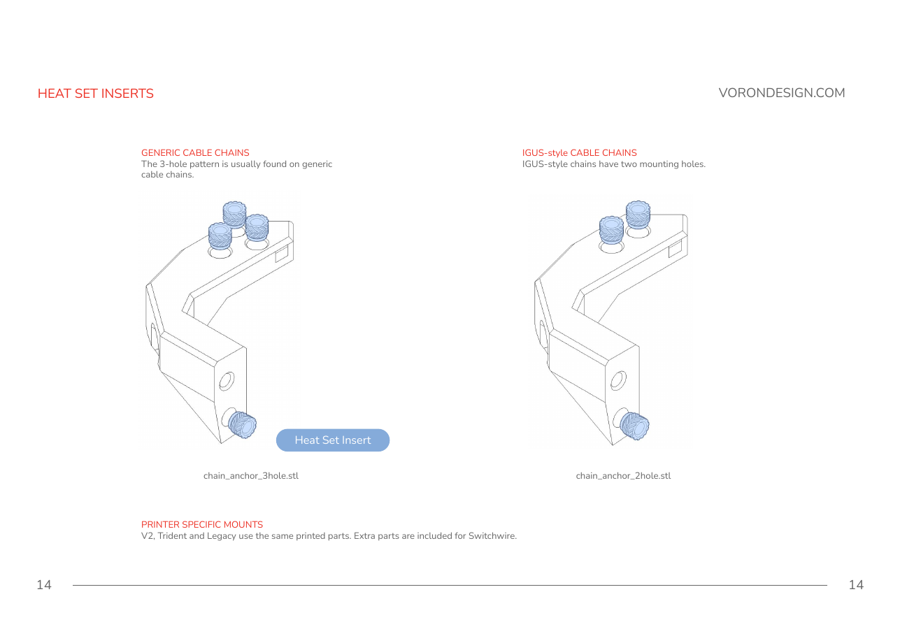{ crop="0.56 0.20 0.82 0.78" }

**What you're looking at:** The chain anchor is the block on the back of the extruder that the toolhead [drag chain](16-glossary.md#d)'s end plate bolts to, so the chain pulls on plastic and not on the toolboard's connectors. Two hole patterns exist; this kit's is the IGUS two-hole. LDO supplies its own **tilted** anchor, already printed.

**Parts:**

- staged: CW2 Chain Anchor Tilted ×1
- heat-set insert, M3×5×4 ×3

**Do:**

1. SB p.14 draws Voron's anchor. Your kit's **Igus-pattern 2-hole** chain uses its two-hole row.
2. LDO's anchor has three top holes 8 mm apart `(verify on bench)`. Fill the **two** your chain end plate sits over, plus **one** in the front tab.

**Check:** A chain end plate offered to the anchor has its two screw holes over your two inserts, and the count is 3 `(verify on bench)`.

⚠ Rev D+ / LDO: do not print or use `Clockwork2.5/chain_anchor_2hole.stl`. LDO supplies the **tilted** anchor printed, and the print plan lists the Voron file as deliberately not printed. Always take `_2hole`, never `_3hole`, anywhere in this build. [src](https://docs.ldomotors.com/en/voron/voron2/printed_part_guide_rev_d)

Source: [SB manual p.14](https://github.com/VoronDesign/Voron-Stealthburner/blob/1572a42e6df5d2f0ddf04a2145be4dc9c3693723/Manual/Assembly_Manual_SB.pdf#page=14)

---

### Step 08.7 — Inserts: front printhead half — and the two you skip

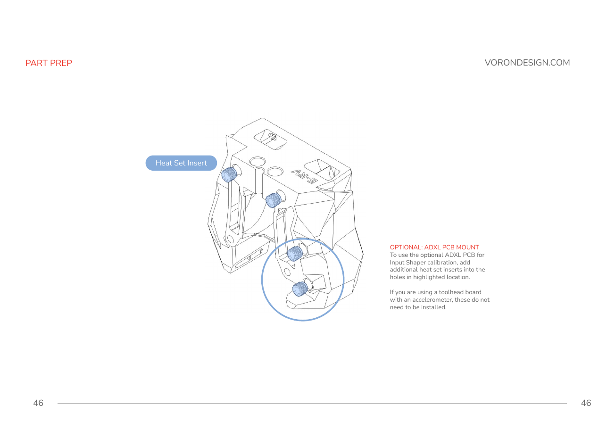{ crop="0.22 0.24 0.84 0.78" }

**What you're looking at:** The front printhead half is the large half of the tool cartridge, the one the hotend sits in. Two of the four holes SB p.46 highlights mount an [ADXL345](16-glossary.md#a) accelerometer, a motion sensor. The [Nitehawk-SB V2](16-glossary.md#n) has one on board, so those two stay empty.

**Parts:**

- `stealthburner_printhead_revo_voron_front` ×1
- heat-set inserts M3×5×4 ×2

**Do:**

1. Find the four holes SB p.46 highlights on the face the rear half meets.
2. Fit only the **upper two**, just below the top edge, pressing in sideways, not through the top face.
3. Leave the **circled pair** empty: it is the ADXL mount.

**Check:** Two inserts sit in the upper holes of the back face; the top face, the circled pair and the thin rear half stay bare. The count is 2 `(verify on bench)`.

⚠ Rev D+ / LDO: the Nitehawk-SB V2 carries an ADXL345 on board, with `[resonance_tester] accel_per_hz: 100` already configured. There is no toolhead accelerometer to mount, now or later. SB p.46 agrees: with an accelerometer on the toolboard, the circled pair is not needed. [src](https://github.com/MotorDynamicsLab/LDOVoron2/blob/main/Firmware/leviathan-printer-rev-d-sbv2.cfg)

Source: [SB manual p.46](https://github.com/VoronDesign/Voron-Stealthburner/blob/1572a42e6df5d2f0ddf04a2145be4dc9c3693723/Manual/Assembly_Manual_SB.pdf#page=46)

---

### Step 08.8 — Confirm the X carriage is ready to receive a toolhead

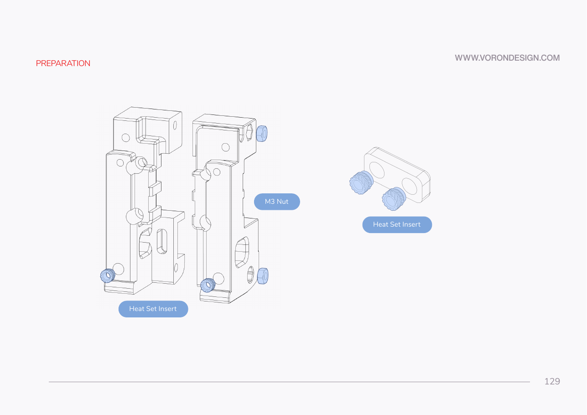{ crop="0.14 0.22 0.76 0.80" }
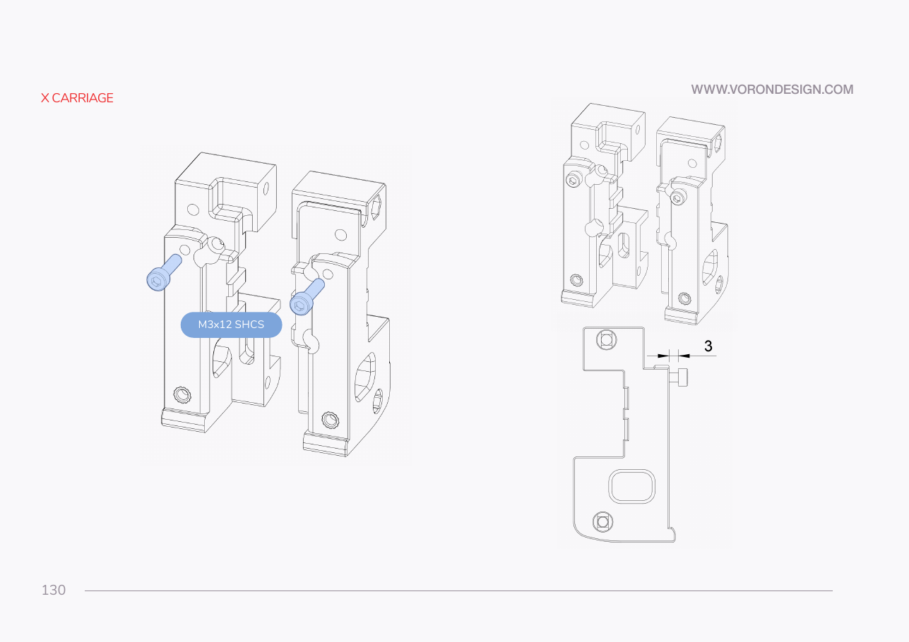{ crop="0.14 0.155 0.82 0.86" }
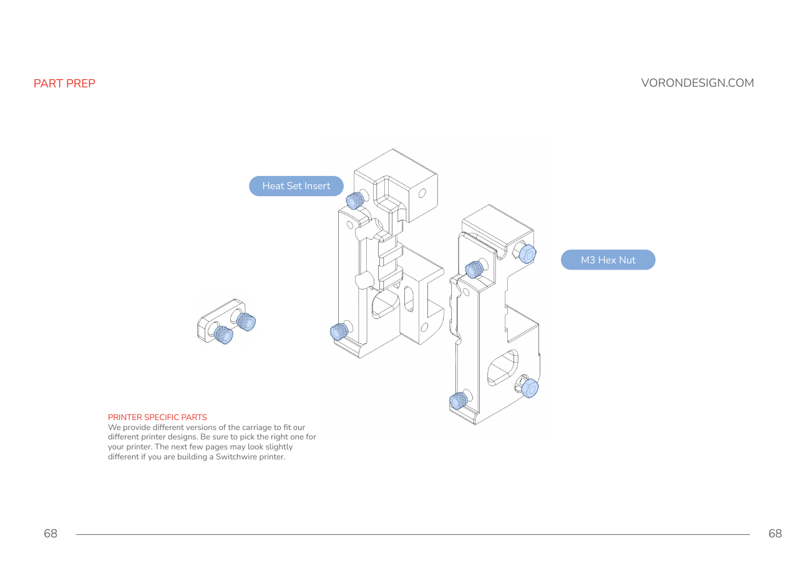{ crop="0.12 0.24 0.86 0.84" }

**What you're looking at:** The [X carriage](16-glossary.md#x) is the pair of halves clamped to the MGN12 rail carriage and to both belts in Ch 05/07, and the whole toolhead hangs off it. This step fits nothing: it checks that every insert, nut and belt clamp is already in.

**Parts:**

- reused: the X carriage on the gantry

**Do:**

1. Check the halves are the **Stealthburner** carriage, `x_frame_V2TR_MGN12_left/right`, not an older MGN9 or CW1 one. LDO's Build Notes flag p.129–130 for this. [src](https://docs.ldomotors.com/voron/voron2/build-faq)
2. Check the heat-set inserts and M3 nuts from manual p.129 and SB p.68 are all in.
3. Check both belt clamps are closed on the belt ends.

**Check:** Every carriage insert and nut is present, the carriage slides the full X travel by hand without sticking, and both belts are clamped.

LDO's notes also say to follow the Stealthburner manual for the carriage detail. SB p.67 draws a different carriage held by four front screws; this build keeps the p.68 carriage.

Source: [Voron manual p.129](https://github.com/VoronDesign/Voron-2/blob/de7e89d/Manual/Assembly_Manual_2.4r2.pdf#page=129) · [Voron manual p.130](https://github.com/VoronDesign/Voron-2/blob/de7e89d/Manual/Assembly_Manual_2.4r2.pdf#page=130) · [SB manual p.68](https://github.com/VoronDesign/Voron-Stealthburner/blob/1572a42e6df5d2f0ddf04a2145be4dc9c3693723/Manual/Assembly_Manual_SB.pdf#page=68)

Pause: ~35 min since the last pause — all 17 heat-set inserts are in and cool, the printed parts are sorted in build order, and the carriage is checked. Nothing is assembled yet. Park the press head, switch it off and let the tip cool. Do not start the extruder with any insert still missing: from Step 08.12 on they are buried under a bearing and a gear train.

---

## B — Clockwork 2.5 extruder

### Step 08.9 — Build the BMG idler assembly and grease it

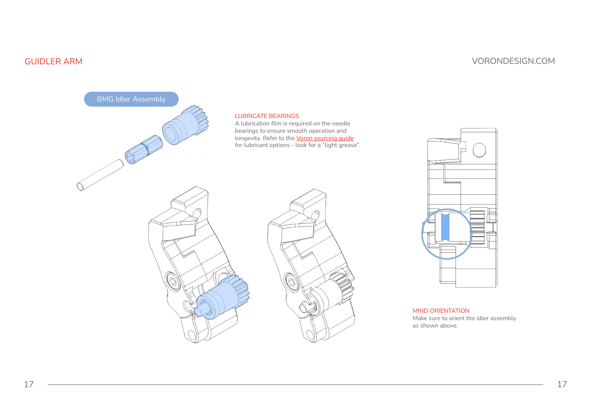{ crop="0.10 0.19 0.92 0.84" }

**What you're looking at:** A Bondtech dual-drive extruder grips filament between **two** geared wheels, not one wheel and a plain bearing. This is the second wheel, the BMG idler gear. It runs on a bearing sleeve on its own shaft, toothed face towards the filament.

**Parts:**

- Bondtech IDGA gear set ×1
- consumable: light grease, Super Lube

**Do:**

1. Slide the IDGA set's idler gear, shaft and bearing sleeve together.
2. Wipe a thin film of Super Lube 21030 onto the bearing surfaces `(verify on bench)`.
3. Keep the toothed face towards the filament path.

**Check:** The idler spins freely, with no gritty feel and no play along its shaft.

Source: [SB manual p.17](https://github.com/VoronDesign/Voron-Stealthburner/blob/1572a42e6df5d2f0ddf04a2145be4dc9c3693723/Manual/Assembly_Manual_SB.pdf#page=17)

---

### Step 08.10 — Close the guidler arm

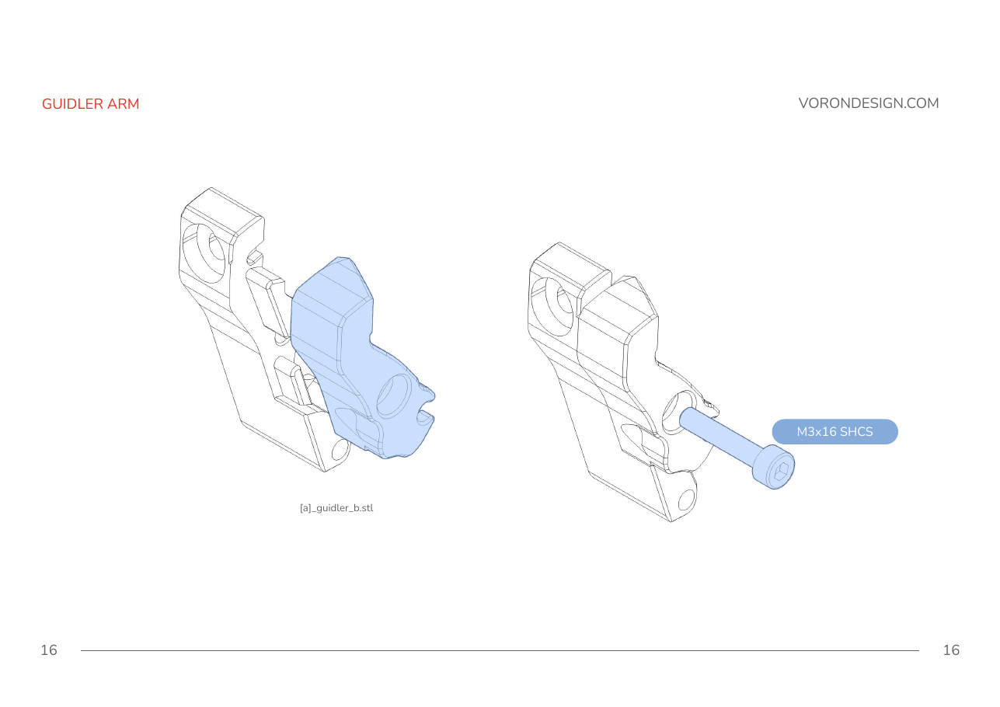{ crop="0.15 0.24 0.92 0.78" }

**What you're looking at:** The guidler is the swinging arm that carries the idler. It is two blue halves joined by one M3×16 (p.16), and the idler assembly slides into the joined arm on its own shaft (p.17).

**Parts:**

- `[a]_guidler_a` ×1
- `[a]_guidler_b` ×1
- M3×16 SHCS ×1
- reused: the greased idler assembly

**Do:**

1. Join the two guidler halves with one M3×16 SHCS, as p.16 shows.
2. Slide the greased idler assembly from 08.9 into the arm from the side, the way p.17 circles it: toothed face toward the filament path.
3. Tighten to snug only.

**Check:** The idler spins freely in the closed arm, and the two halves meet with no gap.

Source: [SB manual p.16](https://github.com/VoronDesign/Voron-Stealthburner/blob/1572a42e6df5d2f0ddf04a2145be4dc9c3693723/Manual/Assembly_Manual_SB.pdf#page=16)

---

### Step 08.11 — Fit the latch shuttle and the BMG thumbscrew assembly

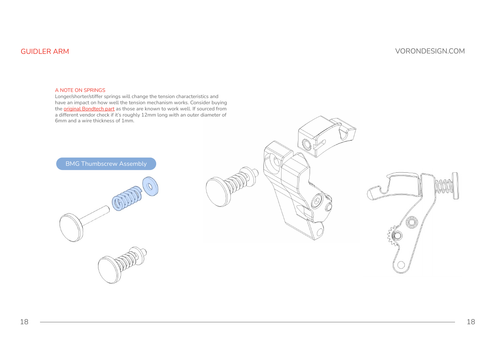{ crop="0.08 0.22 0.95 0.82" }

**What you're looking at:** The thumbscrew, spring and washer set the extruder's grip, and the latch shuttle is what they thread into. Winding the thumbscrew in squeezes the spring and pushes the guidler arm, and so the idler, harder onto the filament.

**Parts:**

- `[a]_latch_shuttle` ×1
- Thumb Screw Kit ×1

**Do:**

1. Seat the latch shuttle on top of the guidler's boss, hook facing the latch side, as on the right of p.18.
2. Slide the kit's spring, then the washer, onto the thumbscrew.
3. Pass the thumbscrew through the boss and thread it into the shuttle's insert.

**Check:** The shuttle is captive and draws against the spring by hand, and the spring measures roughly 12 mm long, 6 mm across the outside, with 1 mm wire.

A substitute spring of the wrong size changes how the tension builds and prints badly, so get the Bondtech part before continuing.

Source: [SB manual p.18](https://github.com/VoronDesign/Voron-Stealthburner/blob/1572a42e6df5d2f0ddf04a2145be4dc9c3693723/Manual/Assembly_Manual_SB.pdf#page=18)

---

### Step 08.12 — Seat the first MR85 in the motor plate

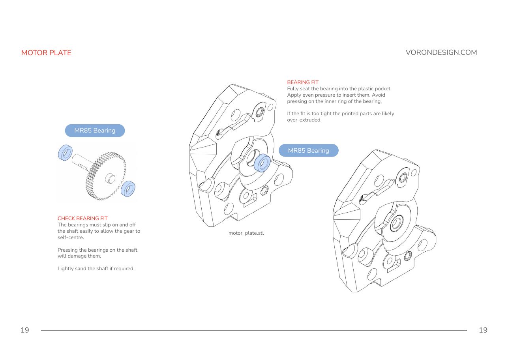{ crop="0.35 0.20 0.88 0.82" }

**What you're looking at:** An MR85 is a small ball bearing, 5 mm bore and 8 mm outside. Two of them carry the extruder's drive shaft, one in each printed half. Pressing on the **inner** ring drives the load through the balls and dents the tracks they run in (the races).

**Parts:**

- reused: the motor plate with its inserts
- MR85 bearing ×1

**Do:**

1. Press the MR85 fully into its plastic pocket, with even pressure on the **outer** ring only. Never push on the inner ring.
2. If it needs real force, the part is over-extruded (printed slightly fat). Check the print rather than hammering the bearing in.

**Check:** The bearing face is flush with the pocket floor and the bearing spins freely.

Source: [SB manual p.19](https://github.com/VoronDesign/Voron-Stealthburner/blob/1572a42e6df5d2f0ddf04a2145be4dc9c3693723/Manual/Assembly_Manual_SB.pdf#page=19)

---

### Step 08.13 — Check the drive shaft slides through both bearings

{ crop="0.08 0.32 0.32 0.78" }

**What you're looking at:** The drive shaft carries the filament drive gear and the 50 T gear that the motor's small gear (the pinion) turns. The bearings must **slide** on it, not press on, so the gear train can find its own centre.

**Parts:**

- reused: the drive shaft from the IDGA set
- reused: the MR85 in the motor plate
- staged: MR85 bearing ×1
- consumable: sandpaper, fine

**Do:**

1. Try each bearing on the shaft: it must **slip on and off by hand** so the gear can centre itself. Pressing a bearing onto the shaft destroys it.
2. If either is tight, lightly sand the shaft with a few passes, then test again.

**Check:** Each bearing slides on and off with fingertip force and does not rock.

**Helper:** Slides each bearing on and off the shaft and says whether it catches anywhere.

Source: [SB manual p.19](https://github.com/VoronDesign/Voron-Stealthburner/blob/1572a42e6df5d2f0ddf04a2145be4dc9c3693723/Manual/Assembly_Manual_SB.pdf#page=19)

---

### Step 08.14 — Seat the second MR85, fit the collet and clear the support

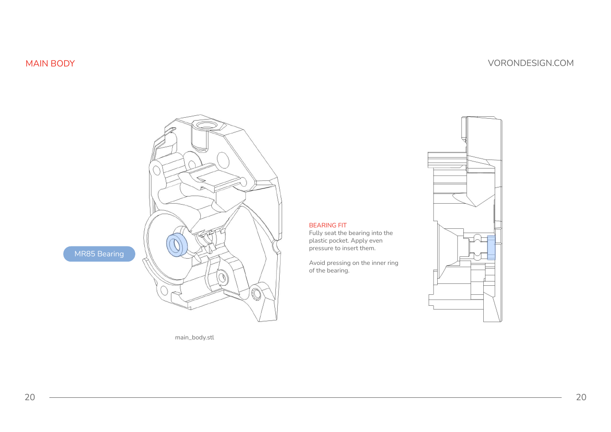{ crop="0.08 0.24 0.84 0.80" }
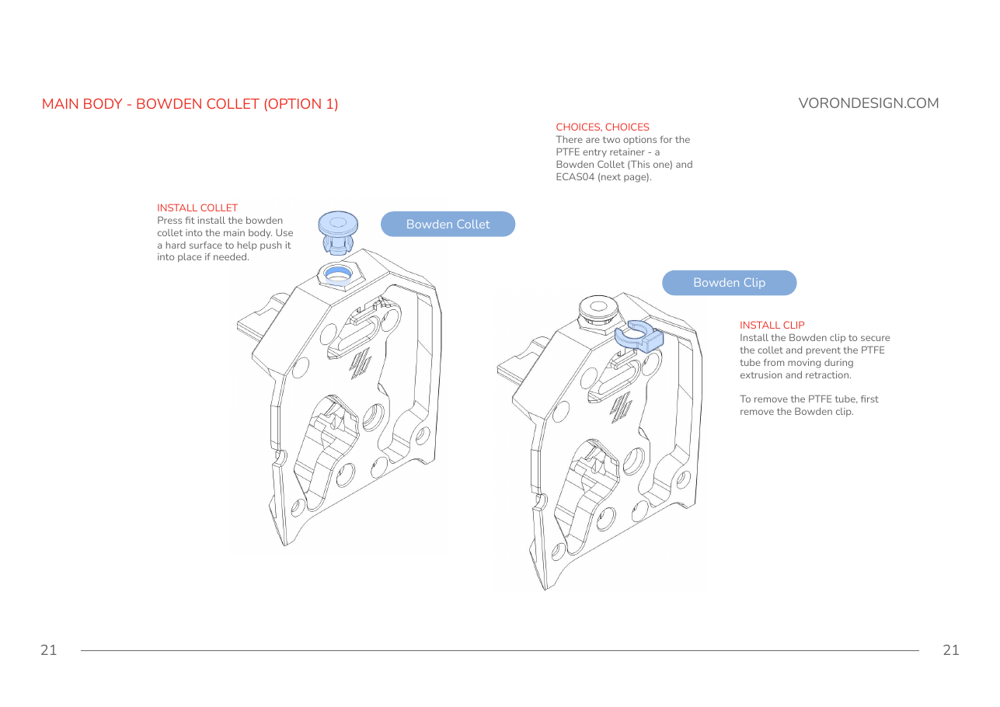{ crop="0.14 0.16 0.92 0.84" }
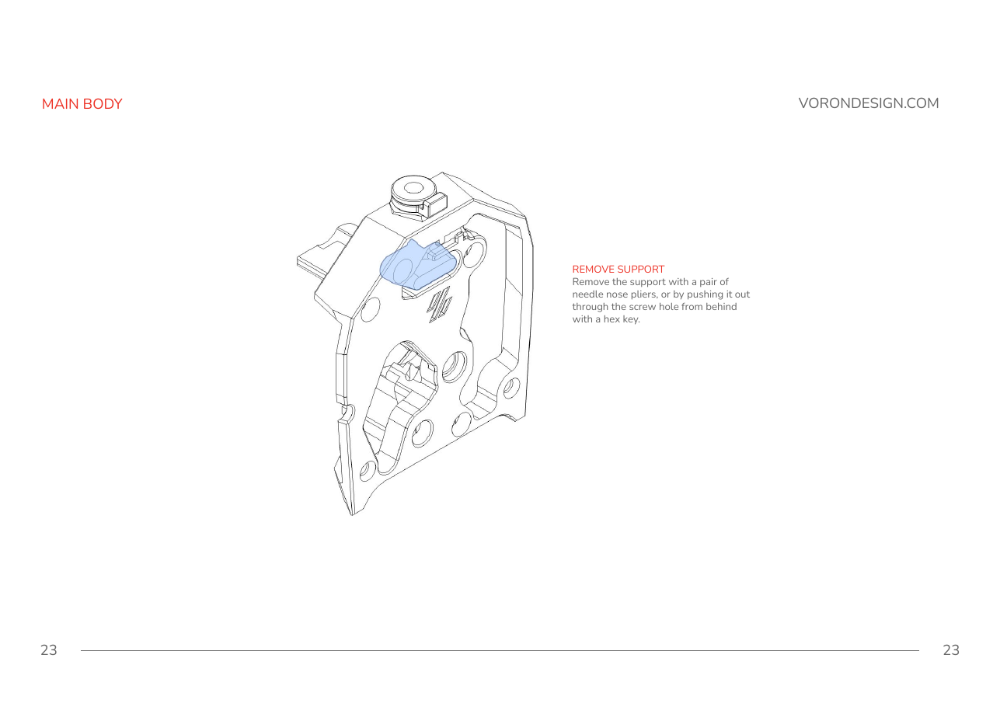{ crop="0.27 0.22 0.78 0.75" }

**What you're looking at:** The second MR85 goes in the main body. The Bowden collet is the push-in fitting that grips the inlet PTFE tube; its clip stops the tube creeping when the extruder pulls filament back (retraction). The printed p.23 support bridges a screw hole.

**Parts:**

- reused: the CW2.5 main body with its inserts
- MR85 bearing ×1
- Bowden collet, 4 mm ×1 — from a separate purchase
- Bowden clip ×1 — from a separate purchase
- tool: needle-nose pliers

**Do:**

1. Press the second MR85 in by its outer ring only.
2. Press the Bowden collet into the top port and fit its clip. If it resists, press the body onto a hard flat surface (SB p.21).
3. Pull the p.23 support with needle-nose pliers, or push it out from behind with a hex key.

**Check:** The bearing is flush and free, the collet seated with its clip on, and the screw hole under the support clear.

Source: [SB manual p.20](https://github.com/VoronDesign/Voron-Stealthburner/blob/1572a42e6df5d2f0ddf04a2145be4dc9c3693723/Manual/Assembly_Manual_SB.pdf#page=20) · [SB manual p.21](https://github.com/VoronDesign/Voron-Stealthburner/blob/1572a42e6df5d2f0ddf04a2145be4dc9c3693723/Manual/Assembly_Manual_SB.pdf#page=21) · [SB manual p.23](https://github.com/VoronDesign/Voron-Stealthburner/blob/1572a42e6df5d2f0ddf04a2145be4dc9c3693723/Manual/Assembly_Manual_SB.pdf#page=23)

---

### Step 08.15 — Set the drive gear at its initial position and threadlock it

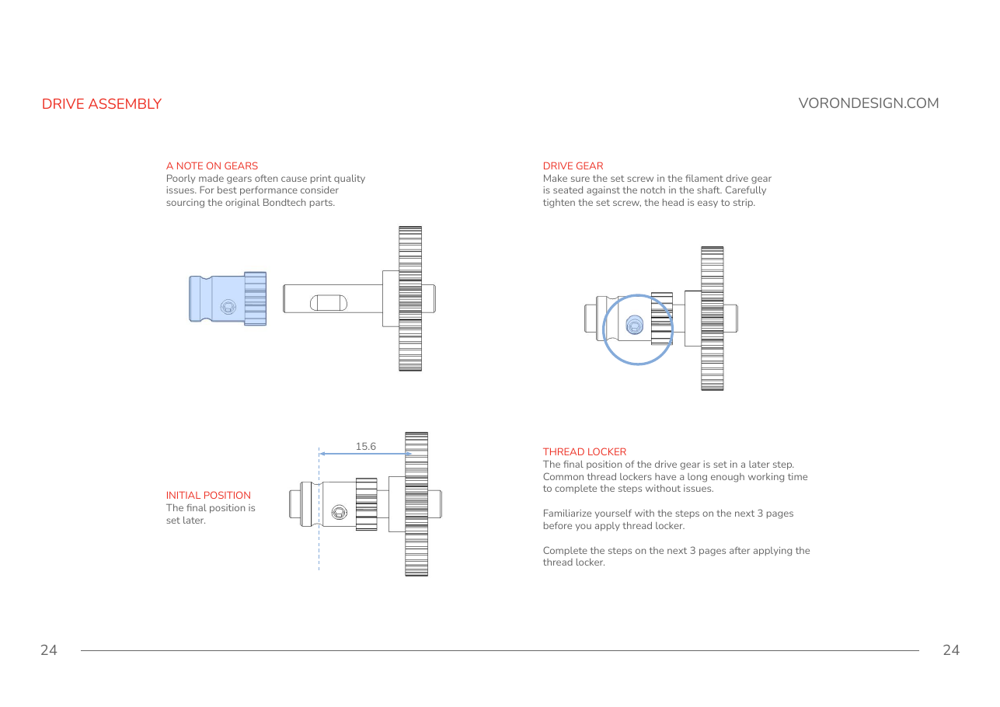{ crop="0.14 0.20 0.84 0.83" }

**What you're looking at:** The filament drive gear is the toothed wheel that pushes the filament, and 15.6 mm is where its teeth line up with the filament path. Its set screw must land on the **flat machined into the shaft**, not on the round, or the gear creeps.

**Parts:**

- reused: the drive gear, 50T gear and shaft from the IDGA set
- tool: caliper
- consumable: medium-strength threadlocker

**Do:**

1. Read SB p.24–27 first.
2. Slide the drive gear on, **set screw on the shaft's machined notch**, to the **15.6 mm** dimension on p.24.
3. Put threadlocker on the set screw and tighten it carefully: its head strips easily.

**Check:** The caliper reads 15.6 mm at the dimensioned face and the set screw sits on the notch, not the round. Step 08.18 corrects the position.

Source: [SB manual p.24](https://github.com/VoronDesign/Voron-Stealthburner/blob/1572a42e6df5d2f0ddf04a2145be4dc9c3693723/Manual/Assembly_Manual_SB.pdf#page=24)

---

### Step 08.16 — Drop the drive assembly into the motor plate

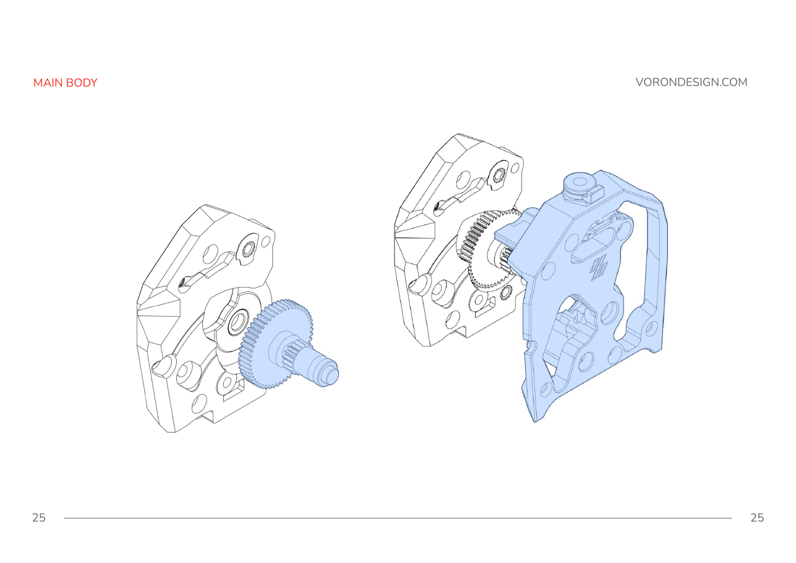{ crop="0.15 0.34 0.45 0.80" }

**What you're looking at:** Shaft, drive gear and 50 T gear go into the motor plate as one assembly, the shaft picking up the bearing from 08.12. Everything turns on bearing drag alone: a gear touching plastic wears a groove and adds a permanent load.

**Parts:**

- reused: the drive assembly
- reused: the motor plate with its MR85

**Do:**

1. Lower the shaft-and-gears assembly into the motor plate, 50T gear first, so the shaft enters the MR85 you fitted in 08.12, as on the left of SB p.25.

**Check:** The shaft turns by hand with only bearing drag, and no gear rubs the plastic.

Source: [SB manual p.25](https://github.com/VoronDesign/Voron-Stealthburner/blob/1572a42e6df5d2f0ddf04a2145be4dc9c3693723/Manual/Assembly_Manual_SB.pdf#page=25)

---

### Step 08.17 — Close the extruder with the main body

{ crop="0.48 0.22 0.86 0.78" }
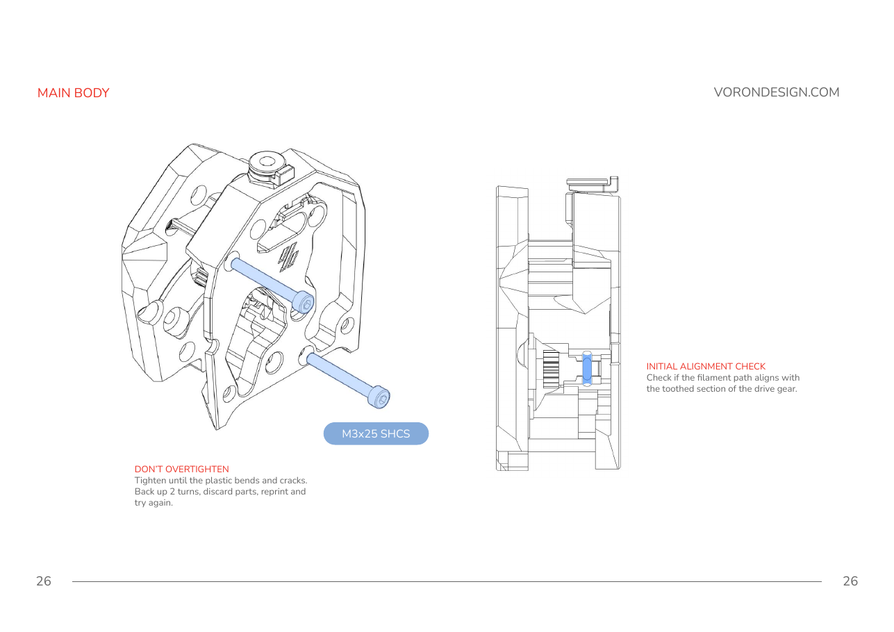{ crop="0.12 0.22 0.92 0.82" }

**What you're looking at:** The main body closes the extruder and picks up the shaft's second bearing. These two M3×25 pull two printed parts together, and past the point where the parts actually meet you are bending plastic, not tightening a joint.

**Parts:**

- reused: the CW2.5 main body with its MR85 and collet
- M3×25 SHCS ×2

**Do:**

1. Bring the main body onto the motor plate so the shaft picks up its MR85.
2. Drive two M3×25 SHCS through the main body, as p.26 shows.
3. Tighten until the parts meet, then stop. Tightened past that, the plastic bends and cracks.

**Check:** No gap shows along the joint between the parts, no plastic has turned white with stress at either screw boss, and the shaft still turns freely.

Source: [SB manual p.25](https://github.com/VoronDesign/Voron-Stealthburner/blob/1572a42e6df5d2f0ddf04a2145be4dc9c3693723/Manual/Assembly_Manual_SB.pdf#page=25) · [SB manual p.26](https://github.com/VoronDesign/Voron-Stealthburner/blob/1572a42e6df5d2f0ddf04a2145be4dc9c3693723/Manual/Assembly_Manual_SB.pdf#page=26)

---

### Step 08.18 — Verify drive-gear alignment with real filament

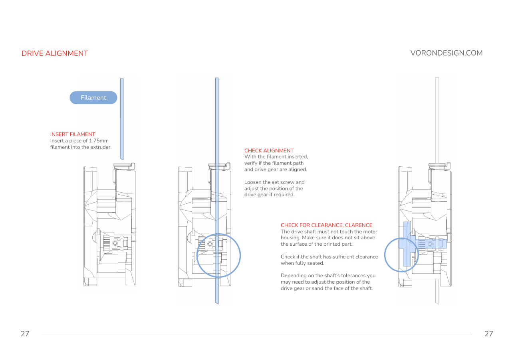{ crop="0.08 0.20 0.90 0.85" }

**What you're looking at:** This is a live check with real filament, because 15.6 mm is only a starting point. The filament must land on the drive gear's **toothed band**, not on the smooth shoulder either side; a gear a millimetre out grips only some of the time.

**Parts:**

- consumable: 1.75 mm filament, a 100 mm offcut

**Do:**

1. Push filament down the path: it must land on the gear's **toothed** section, not the shoulder.
2. If it is off, loosen the set screw, nudge the gear, check again and tighten again.
3. Sand the shaft's end face if it sticks up.

**Check:** The filament centres on the gear teeth, and the shaft end sits at or below the plastic surface when fully seated.

**Helper:** Shines a torch down the filament path and says whether the filament meets the teeth.

Source: [SB manual p.27](https://github.com/VoronDesign/Voron-Stealthburner/blob/1572a42e6df5d2f0ddf04a2145be4dc9c3693723/Manual/Assembly_Manual_SB.pdf#page=27)

Pause: ~30 min since the last pause — the drive train is closed between the main body and the motor plate, and threadlocker is curing on the drive-gear set screw. Do not loosen the set screw again or work the drive gear against a tight spot while the threadlocker sets. The motor is not on yet, so nothing is under load.

---

### Step 08.19 — Hang the tension arm — and leave it loose

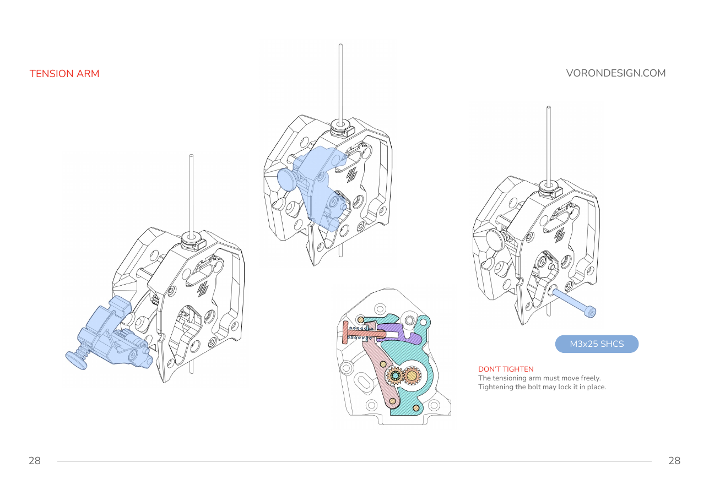{ crop="0.08 0.17 0.92 0.88" }

**What you're looking at:** The tension arm's M3×25 is a **hinge pin**, not a fastener. Tightened, the arm cannot swing and the extruder cannot grip filament at all. Left loose, the arm swings and the spring does the work it was fitted for.

**Parts:**

- reused: the guidler assembly
- M3×25 SHCS ×1

**Do:**

1. Set the guidler, the tension arm, on its pivot and pass one M3×25 SHCS through.
2. **Do not tighten it.** This screw is a hinge pin: tightening it locks the arm and kills the filament grip.

**Check:** The arm swings through its full travel under finger pressure and falls back under spring load.

Source: [SB manual p.28](https://github.com/VoronDesign/Voron-Stealthburner/blob/1572a42e6df5d2f0ddf04a2145be4dc9c3693723/Manual/Assembly_Manual_SB.pdf#page=28)

---

### Step 08.20 — Fit the latch

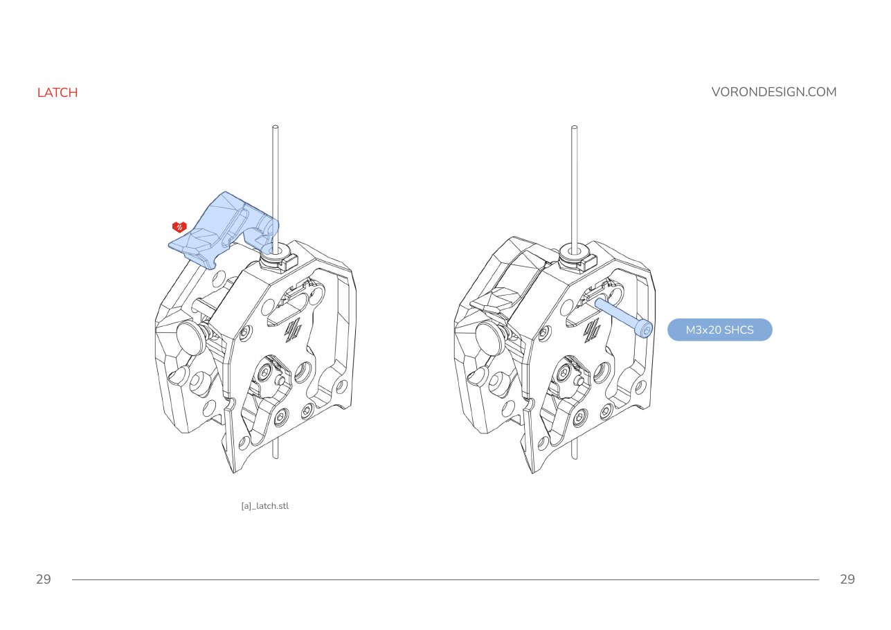{ crop="0.16 0.18 0.90 0.82" }

**What you're looking at:** The latch is the blue lever that hooks over the latch shuttle from 08.11 to hold the guidler arm closed against the spring, so filament can be loaded one-handed. It also has to pivot, so it too is snug rather than tight.

**Parts:**

- `[a]_latch` ×1
- M3×20 SHCS ×1

**Do:**

1. Drop the latch over its post and fix it with one M3×20 SHCS, the length SB p.29 calls for.
2. Tighten to snug: the latch must still pivot.

**Check:** The latch swings over and hooks the shuttle, holding the guidler closed, and lets go cleanly when lifted.

Source: [SB manual p.29](https://github.com/VoronDesign/Voron-Stealthburner/blob/1572a42e6df5d2f0ddf04a2145be4dc9c3693723/Manual/Assembly_Manual_SB.pdf#page=29) · [Video: Part 5 @1:48:10](https://www.youtube.com/watch?v=hTKCBrk36R0&list=PL0fUJbigELQPqpeGOgHYisG4KaSXVtnNY&t=6490s) (differs: builds Afterburner + Clockwork 1; this kit is Stealthburner + Clockwork 2.5 + Revo HF)

---

### Step 08.21 — Set the filament tension

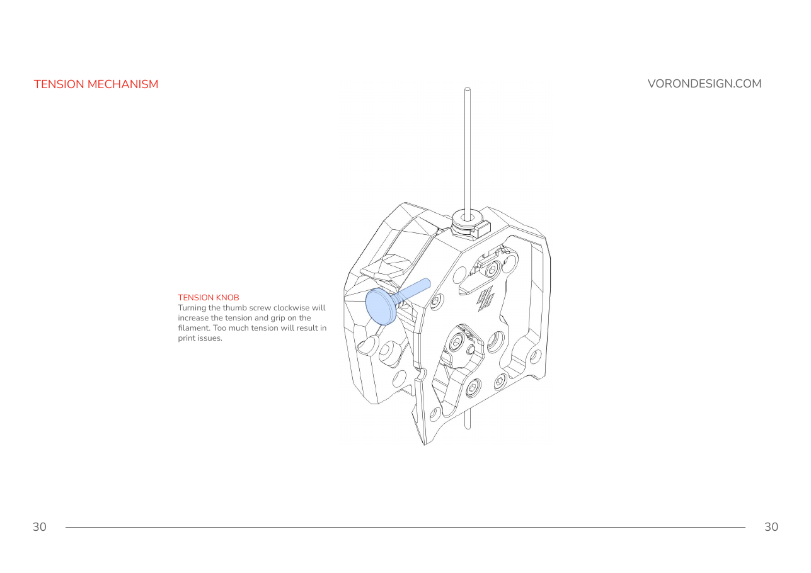{ crop="0.20 0.14 0.70 0.80" }

**What you're looking at:** The thumbscrew is the only grip adjustment: it sets **how hard** the idler presses the filament onto the drive gear. The Clockwork 2.5 has no anti-squish screw, so the second adjustment in a CW2 guide does not apply. Shallow tooth marks are right; a flattened track is not.

**Parts:**

- reused: the assembled extruder
- consumable: 1.75 mm filament offcut

**Do:**

1. Turn the thumbscrew clockwise to add grip. SB p.30 warns that too much tension causes print problems, so start light.

**Check:** With filament loaded, the arm closes without the gears grinding against each other, and the filament shows shallow tooth marks rather than a flattened track.

Source: [SB manual p.30](https://github.com/VoronDesign/Voron-Stealthburner/blob/1572a42e6df5d2f0ddf04a2145be4dc9c3693723/Manual/Assembly_Manual_SB.pdf#page=30)

---

### Step 08.22 — Fit the pancake stepper, first bolt

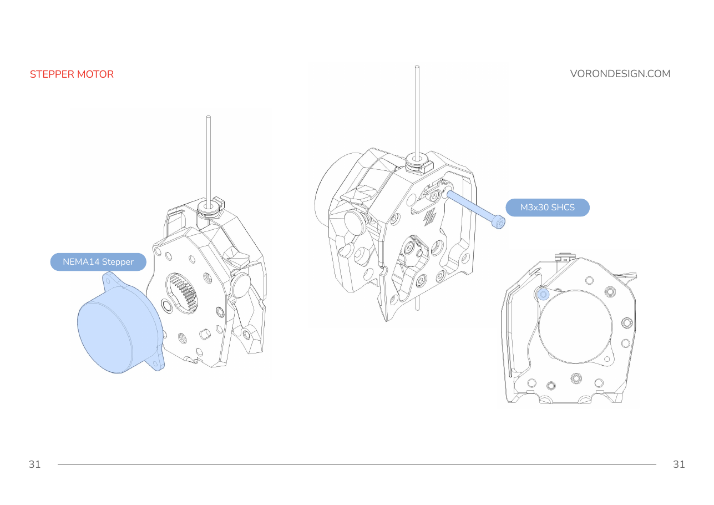{ crop="0.06 0.20 0.90 0.82" }

**What you're looking at:** The pancake stepper is a slim NEMA14 motor. Its pinion drives the 50 T gear, and that gear reduction gives the extruder its pushing force. Both its screws stay loose to start with, because the motor's position in its slots **is** the gear-mesh adjustment.

**Parts:**

- LDO-36STH20-1004AHG(VRN) NEMA14 pancake stepper ×1
- M3×30 SHCS ×1

**Do:**

1. Hold the stepper to the motor plate, pinion entering the 50T gear chamber, with the cable leaving where the CW2.5 body routes it.
2. Start the M3×30 SHCS in the upper mounting position and leave it loose.

**Check:** The motor sits flat against the plate, with the pinion engaged but not jammed against the bottom.

Source: [SB manual p.31](https://github.com/VoronDesign/Voron-Stealthburner/blob/1572a42e6df5d2f0ddf04a2145be4dc9c3693723/Manual/Assembly_Manual_SB.pdf#page=31)

---

### Step 08.23 — Fit the second motor bolt through the front access hole

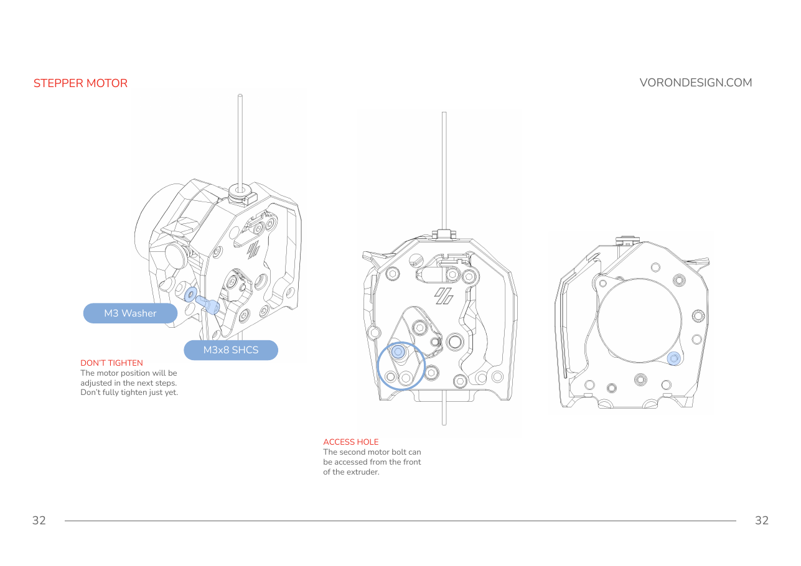{ crop="0.08 0.17 0.90 0.86" }

**What you're looking at:** The second motor screw is reached from the front of the extruder through an access hole. It is the screw people forget, and a motor held by one screw slowly turns in its slots under load until the gears no longer mesh.

**Parts:**

- M3×8 SHCS ×1
- M3 washer ×1

**Do:**

1. Put the washer on the M3×8 SHCS and drive it into the second motor position, through the access hole at the **front** of the extruder.
2. Leave this one loose too.

**Check:** Both motor screws are started and still finger-loose, and the motor can be nudged in its slots.

Source: [SB manual p.32](https://github.com/VoronDesign/Voron-Stealthburner/blob/1572a42e6df5d2f0ddf04a2145be4dc9c3693723/Manual/Assembly_Manual_SB.pdf#page=32)

---

### Step 08.24 — Set the gear mesh, then tighten both motor bolts

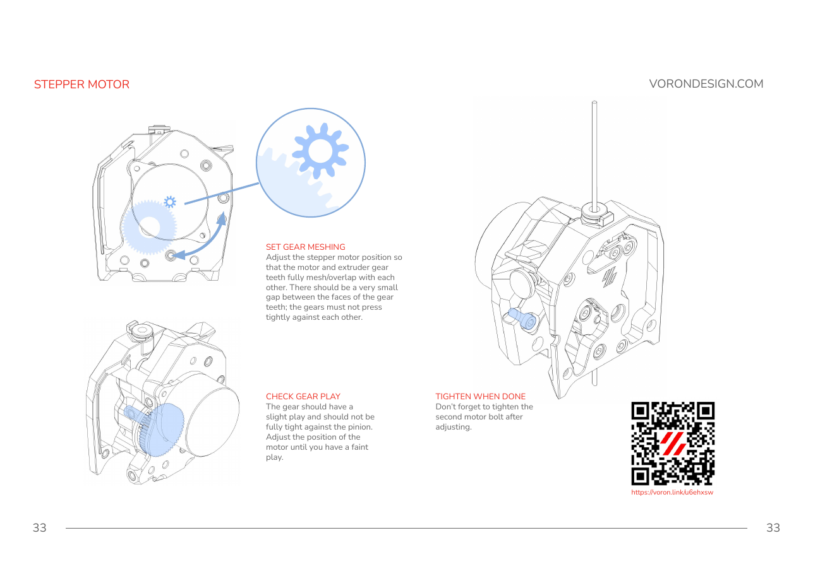{ crop="0.08 0.17 0.92 0.88" }

**What you're looking at:** Gear mesh is how deeply the pinion's teeth overlap the 50 T gear's. Too shallow and the teeth skip under load; pressed together and the drivetrain binds and whines. You want full tooth overlap with a faint backlash (a tiny free play), then the motor locked there.

**Parts:**

- reused: the extruder assembly

**Do:**

1. Slide the motor until the pinion and the 50T teeth fully overlap with a **very small** gap between the tooth faces. Turn the drive shaft by hand as you adjust.
2. Tighten the M3×30 first, then the M3×8.

**Check:** Turning the drive gear by hand shows a barely noticeable backlash and no tight spot anywhere through a full turn, and both screws are tight.

Source: [SB manual p.33](https://github.com/VoronDesign/Voron-Stealthburner/blob/1572a42e6df5d2f0ddf04a2145be4dc9c3693723/Manual/Assembly_Manual_SB.pdf#page=33) · [Video: Part 5 @1:41:54](https://www.youtube.com/watch?v=hTKCBrk36R0&list=PL0fUJbigELQPqpeGOgHYisG4KaSXVtnNY&t=6114s) (differs: builds Afterburner + Clockwork 1; this kit is Stealthburner + Clockwork 2.5 + Revo HF)

---

### Step 08.25 — Fit the LDO tilted chain anchor

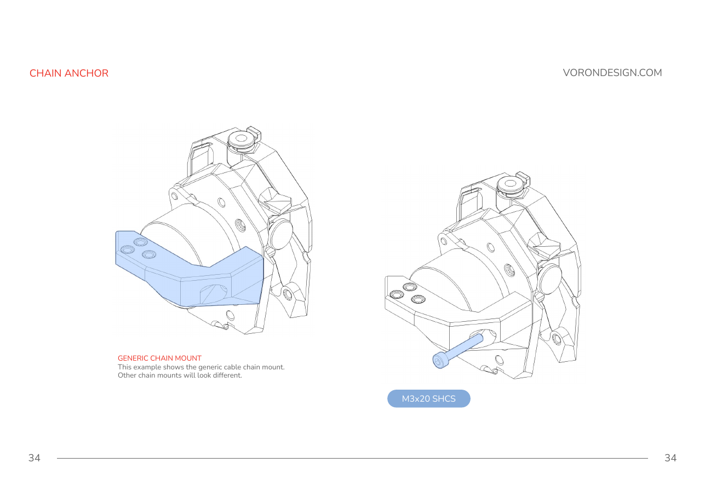{ crop="0.14 0.22 0.86 0.84" }

**What you're looking at:** The chain anchor is the end point of the toolhead's cable run. The umbilical, the one cable that feeds the toolhead, is tied to it, so every pull from the moving drag chain lands on this printed block and not on the toolboard's connectors.

**Parts:**

- CW2 Chain Anchor Tilted ×1
- M3×20 SHCS ×1

**Do:**

1. SB p.34 draws Voron's generic anchor; yours is LDO's tilted one, fitted the same way.
2. Sit it on the rear of the CW2.5, chain face pointing back along the X extrusion, and fix it with one M3×20 SHCS.

**Check:** The anchor is solid on the body, and its two chain holes face rearwards and slightly up.

Source: [SB manual p.34](https://github.com/VoronDesign/Voron-Stealthburner/blob/1572a42e6df5d2f0ddf04a2145be4dc9c3693723/Manual/Assembly_Manual_SB.pdf#page=34)

---

### Step 08.26 — Fit the chain anchor's second bolt

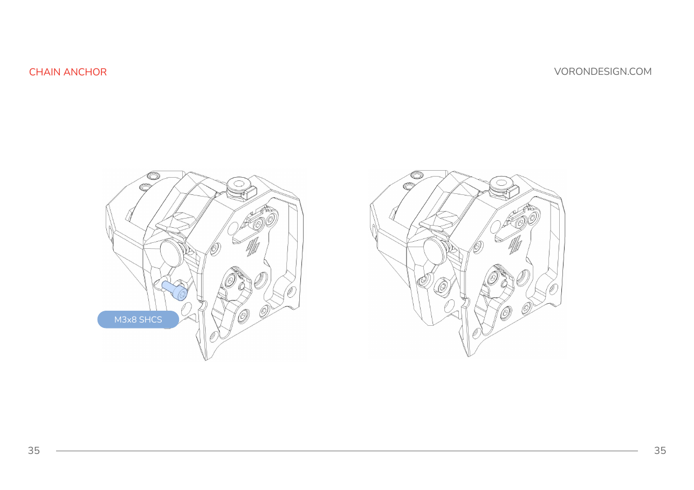{ crop="0.12 0.32 0.46 0.76" }

**What you're looking at:** This M3×8 is the anchor's second fixing; the CW2 manual called its position the cable bridge. On one screw the anchor can twist. On two, the cable path is rigid, which is what a drag chain tugging at it needs.

**Parts:**

- M3×8 SHCS ×1

**Do:**

1. Drive the M3×8 SHCS into the position SB p.35 shows on the latch side of the extruder: the second fixing that ties the anchor to the body.

**Check:** The anchor no longer twists when you push it sideways.

Source: [SB manual p.35](https://github.com/VoronDesign/Voron-Stealthburner/blob/1572a42e6df5d2f0ddf04a2145be4dc9c3693723/Manual/Assembly_Manual_SB.pdf#page=35)

Pause: ~25 min since the last pause — the Clockwork 2.5 is a complete sub-assembly that holds itself together: mesh set, both motor screws tight, chain anchor fitted with both its screws. The tension arm's M3×25 is loose on purpose because it is a hinge pin. Do not tighten it to tidy the assembly up before you walk away.

---

## C — Tool cartridge and E3D Revo HF

### Step 08.27 — Assemble the Revo HF hotend

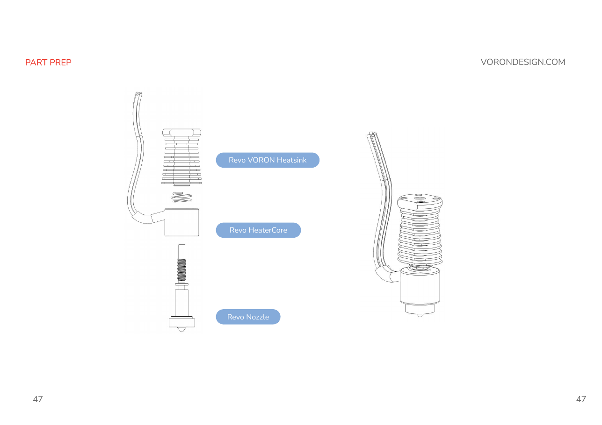{ crop="0.18 0.20 0.76 0.82" }

**What you're looking at:** The [Revo HF](16-glossary.md#r) is E3D's quick-change hotend, in three pieces: the **heatsink**, the finned top the filament enters; the **HeaterCore**, with the heater and thermistor (temperature sensor) in one module; and a **nozzle** that screws in by hand. A retaining spring holds the HeaterCore captive.

**Parts:**

- staged: Revo Voron heatsink
- staged: Revo retaining spring
- staged: Revo HeaterCore
- staged: Revo nozzle

**Do:**

1. Fit the spring into the groove on the heatsink's **bottom** and push the HeaterCore on.
2. Screw the nozzle in **finger-tight only**, with no tools.
3. Aim the cables by turning the HeaterCore **anti-clockwise only**; turning it clockwise releases the spring.

**Check:** The nozzle is fully in and hand-tight, the HeaterCore is captive under spring load, and the cables point to the rear.

Source: [SB manual p.47](https://github.com/VoronDesign/Voron-Stealthburner/blob/1572a42e6df5d2f0ddf04a2145be4dc9c3693723/Manual/Assembly_Manual_SB.pdf#page=47) · [E3D Revo Voron support](https://e3d-online.com/pages/revo-support-voron)

---

### Step 08.28 — Seat the hotend in the front printhead half

{ crop="0.18 0.20 0.76 0.82" }
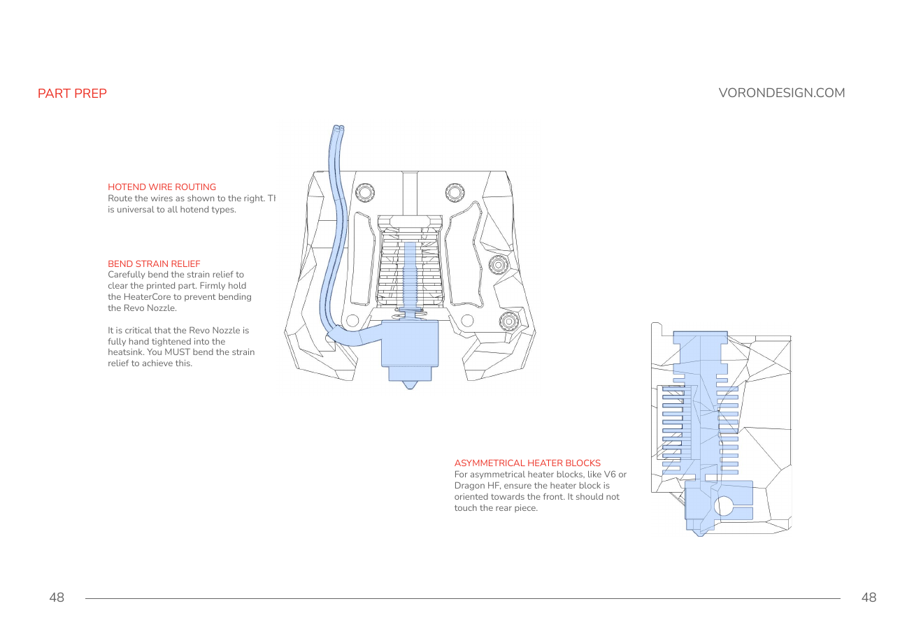{ crop="0.10 0.17 0.62 0.62" }

**What you're looking at:** The front printhead half is the pocket the hotend lives in. The heatsink's groove sits on a moulded rib that stops the hotend turning when you hand-tighten the nozzle. SB p.48 draws the hotend in this half: it goes in before the wires are routed.

**Parts:**

- reused: the front printhead half with its inserts
- E3D Revo HF hotend, assembled ×1

**Do:**

1. Drop the Revo Voron heatsink into the front printhead half so its groove sits on the printed rib, with the HeaterCore's wires pointing up the side p.48 draws them on.
2. Do not bend anything yet.

**Check:** The heatsink cannot turn in the pocket, and the nozzle sticks out centrally.

Source: [SB manual p.47](https://github.com/VoronDesign/Voron-Stealthburner/blob/1572a42e6df5d2f0ddf04a2145be4dc9c3693723/Manual/Assembly_Manual_SB.pdf#page=47) · [SB manual p.48](https://github.com/VoronDesign/Voron-Stealthburner/blob/1572a42e6df5d2f0ddf04a2145be4dc9c3693723/Manual/Assembly_Manual_SB.pdf#page=48)

---

### Step 08.29 — Route the wires and bend the strain relief so the nozzle can seat fully

{ crop="0.10 0.17 0.62 0.62" }

**What you're looking at:** The strain relief is the stainless steel sleeve where the HeaterCore's wires leave the module. With it in the way, the nozzle cannot go the last part-turn in, and a nozzle not fully seated leaks molten plastic into the printhead on the first hot print.

**Parts:**

- reused: the Revo in the front half

**Do:**

1. Route the hotend wires up the side of the front half as SB p.48 shows.
2. Bend the HeaterCore's stainless strain relief clear of the printed part, holding the HeaterCore firmly so no load goes on the nozzle.

**Check:** The relief clears its wall, the nozzle still turns the last part-turn in by hand, and the wires leave rearwards, clear of the nozzle.

Source: [SB manual p.48](https://github.com/VoronDesign/Voron-Stealthburner/blob/1572a42e6df5d2f0ddf04a2145be4dc9c3693723/Manual/Assembly_Manual_SB.pdf#page=48)

---

### Step 08.30 — Close the tool cartridge

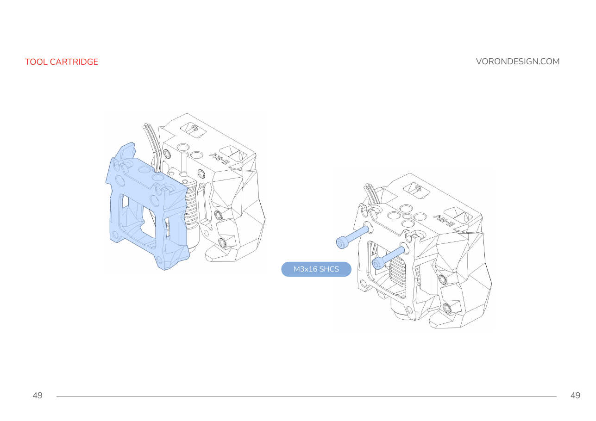{ crop="0.16 0.24 0.86 0.80" }

**What you're looking at:** With the rear half on and two screws in, the **tool cartridge** exists as one object: hotend, both printhead halves and, next, the PTFE tube, as a unit that later slides up into the toolhead. Any movement here is movement of the nozzle.

**Parts:**

- `stealthburner_printhead_revo_voron_rear_cw2` ×1
- M3×16 SHCS ×2

**Do:**

1. Bring the thin rear half onto the front half around the hotend.
2. Drive two M3×16 SHCS through it into the front half's inserts.

**Check:** The two halves close with no gap, and the hotend has no play in any direction.

Source: [SB manual p.49](https://github.com/VoronDesign/Voron-Stealthburner/blob/1572a42e6df5d2f0ddf04a2145be4dc9c3693723/Manual/Assembly_Manual_SB.pdf#page=49)

---

### Step 08.31 — Fit the four tool-cartridge mounting bolts

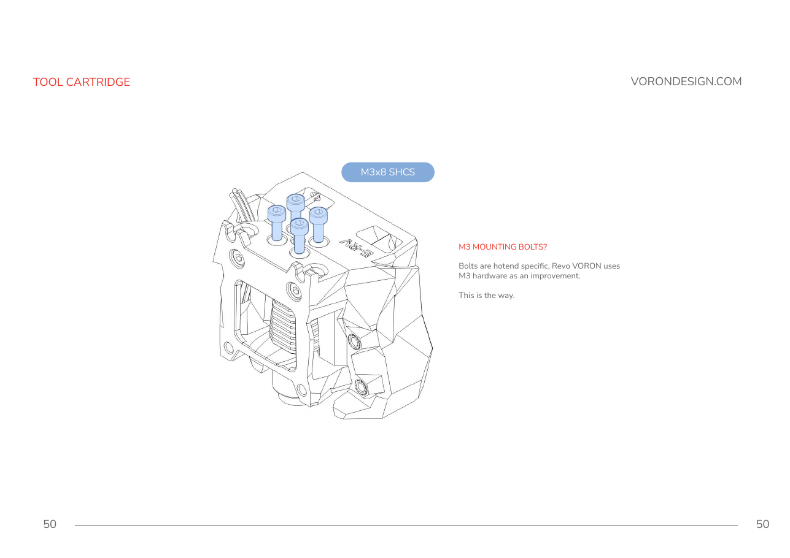{ crop="0.25 0.27 0.80 0.78" }

**What you're looking at:** These four M3×8 are **studs**, not fasteners. Their heads hook into keyholes in the Clockwork 2.5 when the cartridge slides up into place at Step 08.61, so all four must stand at exactly the same height or the cartridge hangs crooked.

**Parts:**

- M3×8 SHCS ×4

**Do:**

1. Drive four M3×8 SHCS into the top face of the tool cartridge until each head sits on the plastic.
2. Stop there; do not overtighten.

**Check:** All four heads are seated, at the same height.

**Helper:** Checks that the four bolt heads stand at the same height and points at any that sits high.

Source: [SB manual p.50](https://github.com/VoronDesign/Voron-Stealthburner/blob/1572a42e6df5d2f0ddf04a2145be4dc9c3693723/Manual/Assembly_Manual_SB.pdf#page=50)

---

### Step 08.32 — Cut and fit the PTFE to 11 mm stickout

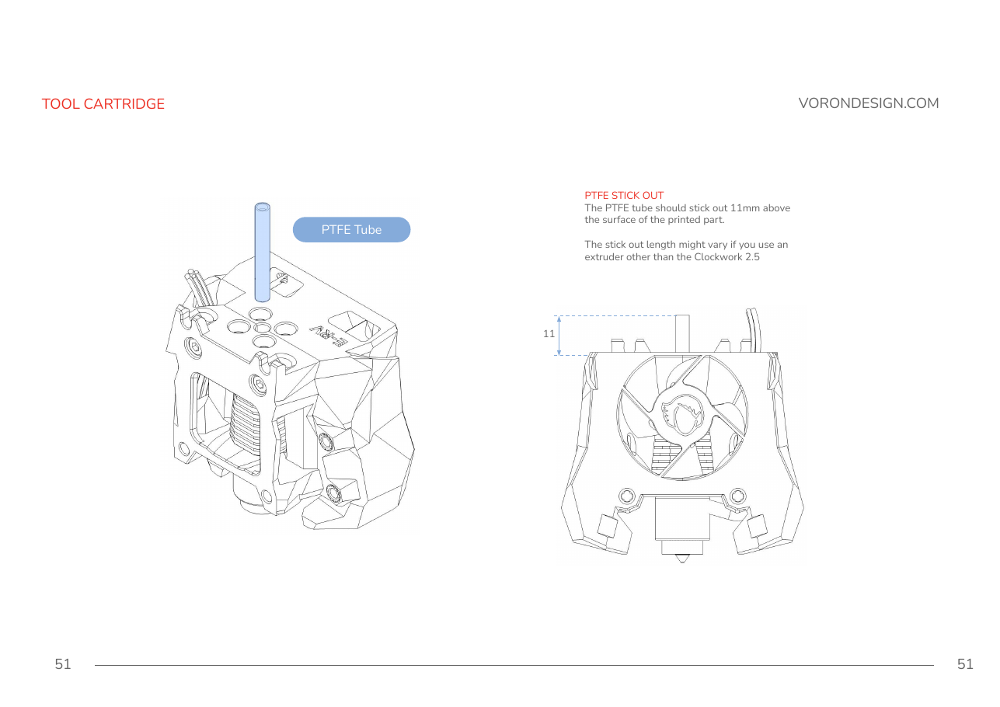{ crop="0.15 0.24 0.82 0.82" }

**What you're looking at:** The PTFE tube is the slippery plastic liner that guides filament from the extruder's outlet down into the hotend. 11 mm standing above the cartridge is the Clockwork 2.5 figure: the length that closes the gap between the two, so the filament cannot buckle under extrusion pressure.

**Parts:**

- consumable: PTFE tube, 4 mm OD, 2 mm ID, 10 cm
- tool: caliper
- tool: flush cutters

**Do:**

1. Push the PTFE down into the tool cartridge until it stops on the heatsink.
2. Cut it so exactly **11 mm** stands above the printed part. Cut square: a slanted cut leaves a step that catches filament.

**Check:** The caliper reads 11 mm across the part that sticks out, and 1.75 mm filament pushed through enters the hotend without catching.

Source: [SB manual p.51](https://github.com/VoronDesign/Voron-Stealthburner/blob/1572a42e6df5d2f0ddf04a2145be4dc9c3693723/Manual/Assembly_Manual_SB.pdf#page=51) · [Video: Part 5 @2:06:01](https://www.youtube.com/watch?v=hTKCBrk36R0&list=PL0fUJbigELQPqpeGOgHYisG4KaSXVtnNY&t=7561s) (differs: builds Afterburner + Clockwork 1; this kit is Stealthburner + Clockwork 2.5 + Revo HF)

Pause: ~20 min since the last pause — the tool cartridge is closed around the Revo, the four M3×8 studs are in, and the PTFE is cut to 11 mm. Bag it nozzle-up. Do not put a tool on the nozzle and do not stand the cartridge on its nozzle: both undo the hand-tight seat you just set.

---

### Step 08.33 — Terminate the hotend leads for the Nitehawk V2

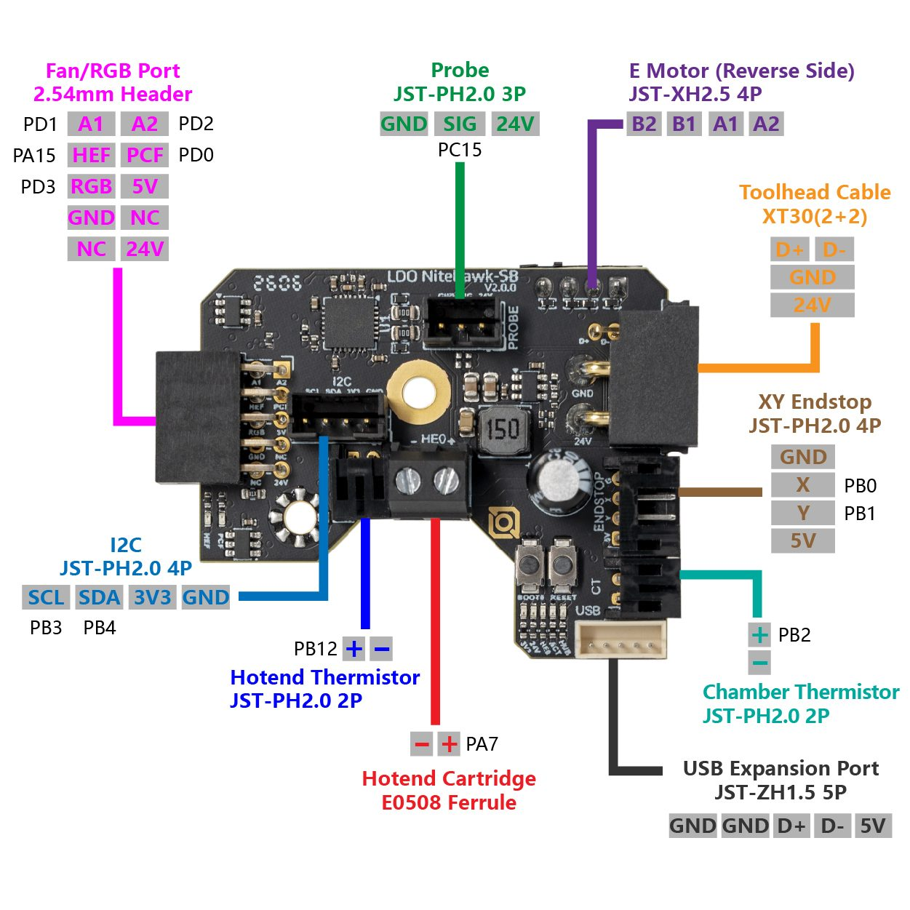

**What you're looking at:** The [Nitehawk-SB V2](16-glossary.md#n) is the **toolboard**: a circuit board on the toolhead that collects heater, thermistor, fans, LEDs, probe and motor onto one USB-plus-24 V cable. `HE0` is its heater screw terminal, `TH0` its 2-pin [JST-PH2.0](16-glossary.md#j) socket. A [ferrule](16-glossary.md#f) is a sleeve that stops stranded wire splaying in a screw terminal.

**Parts:**

- reused: the Revo heater and thermistor leads
- consumable: E0508 ferrule ×2, only if re-terminating
- consumable: JST-PH2.0 2-pin housing and crimps, only if re-terminating

**Do:**

1. Open the Toolhead PCB Cables bag. If LDO's cables mate with the Revo's Molex Micro-Fit 3.0 2-pin, use them as they are.
2. Otherwise cut the Revo's leads and fit **E0508 ferrules** for `HE0` and a **JST-PH2.0 2-pin** housing for `TH0`. `(verify on bench — depends on what LDO packed for the Revo option)`

**Check:** The heater leads end in two crimped E0508 ferrules with no stray strands, and the thermistor lead ends in a 2-pin PH2.0 housing that drops into `TH0` without force.

⚠ Rev D+ / LDO: the Rev D wiring guide says *"the connector type to use is JST-XH2.5 two pin"* for the thermistor. On the V2 board, `TH0`, `PROBE` and the XY endstop are **JST-PH2.0**. An XH2.5 housing will not fit, and the PH2.0 body forces easily into the wrong header: check the silkscreen (printed labels) before every insertion. [src](https://github.com/MotorDynamicsLab/Nitehawk-SB-V2)

Source: [Nitehawk-SB V2 pinout](https://github.com/MotorDynamicsLab/Nitehawk-SB-V2/blob/master/Images/nhsbv2_pcb_pinout.jpg)

---

### Step 08.34 — Prepare the 5015 part-cooling blower

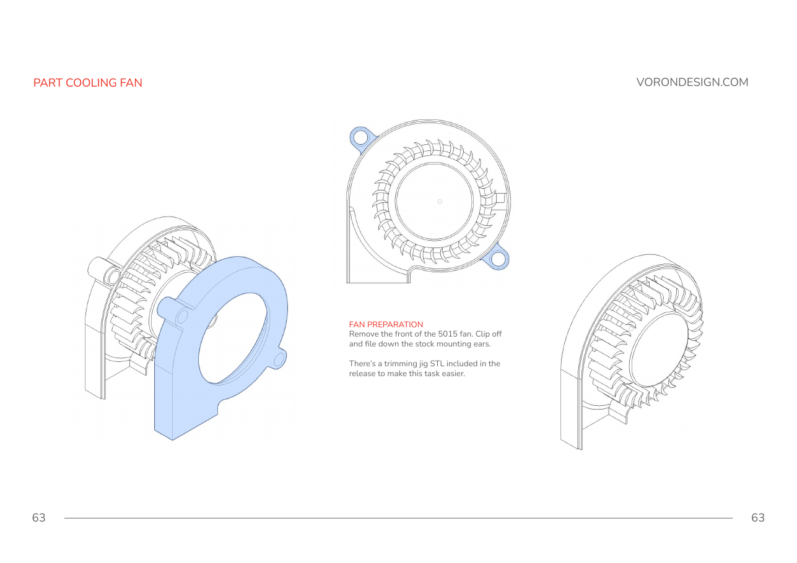{ crop="0.08 0.20 0.90 0.82" }

**What you're looking at:** The 5015 is the **part-cooling blower**: a centrifugal fan, which throws air sideways out of a spout rather than straight through, so it can feed the printhead's narrow ducts. Its moulded mounting ears belong to a different machine; Stealthburner grips the bare housing.

**Parts:**

- staged: 50×50×15 centrifugal fan, 24 V ×1
- tool: flush cutters
- tool: small flat file

**Do:**

1. Remove the front cover of the 5015.
2. Clip the mounting ears off flush and file what is left until the housing sides are flat.

**Check:** No ear sticks out from the housing wall, and the fan drops into the SB main body pocket without spreading the printed walls.

SB p.63's trimming jig is now in the repo's `STLs/Tools/` folder; no plate prints it.

Source: [SB manual p.63](https://github.com/VoronDesign/Voron-Stealthburner/blob/1572a42e6df5d2f0ddf04a2145be4dc9c3693723/Manual/Assembly_Manual_SB.pdf#page=63) · [Video: Part 6 @0:20:10](https://www.youtube.com/watch?v=8pWoYkY1DiA&list=PL0fUJbigELQPqpeGOgHYisG4KaSXVtnNY&t=1210s)

---

## D — Stealthburner body: LEDs and fans

### Step 08.35 — Build the logo LED into its carrier

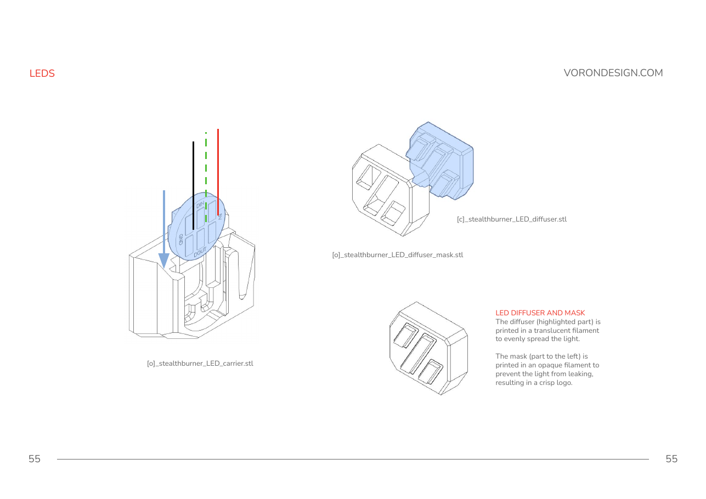{ crop="0.16 0.22 0.88 0.80" }

**What you're looking at:** The logo LED sits behind a three-part sandwich. From the outside in: the **opaque mask** with three windows is the face you see; the **clear PETG diffuser** behind it pushes three prongs forward through those windows; and the carrier holds the LED behind both.

**Parts:**

- `[o]_stealthburner_LED_carrier` ×1
- `[o]_stealthburner_LED_diffuser_mask` ×1
- Stealthburner LED Diffuser, clear PETG ×1
- logo LED, chain index 1 ×1 — from the LDO kit, no BOM row

**Do:**

1. Seat the logo LED in the carrier, wires leaving upwards.
2. Stack from the outside in: the opaque mask, then the diffuser with its prongs forward and flat base behind, then the LED carrier. The right side of SB p.55 draws the result.

**Check:** Three see-through bars sit flush in the black face, the diffuser's flat base is behind the mask and not in front, and nothing rattles.

Source: [SB manual p.55](https://github.com/VoronDesign/Voron-Stealthburner/blob/1572a42e6df5d2f0ddf04a2145be4dc9c3693723/Manual/Assembly_Manual_SB.pdf#page=55)

---

### Step 08.36 — Wire the three-LED chain

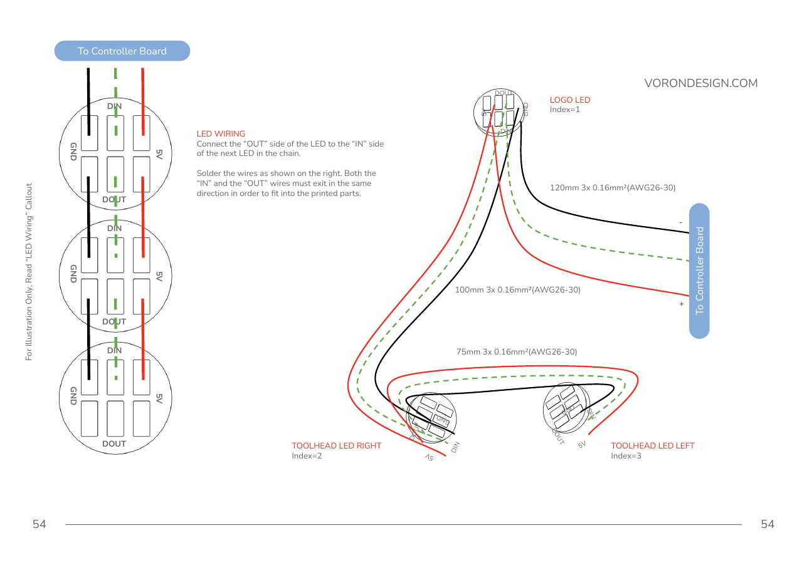

**What you're looking at:** These are addressable LEDs wired as a chain: data goes **in** to the first and **out** to the next, so each LED's place in the chain is its address. The logo is index 1, the right toolhead LED 2 and the left 3, the order `chain_count: 3` and every LED macro assume.

**Parts:**

- reused: the logo LED in its carrier
- toolhead LED, chain index 2 and 3 ×2 — from the LDO kit, no BOM row
- consumable: 3-core 0.16 mm² wire, AWG26–30, 295 mm, only if not pre-soldered

**Do:**

1. Check the toolhead cable bag: many Rev D kits ship this chain already soldered.
2. Otherwise solder **OUT to IN**: 120 mm to logo 1, 100 mm to right 2, 75 mm to left 3, wires leaving the same way.

**Check:** Each data wire has continuity, connector to logo DIN, then each DOUT to the next DIN; 5 V and GND are common; no 5 V–GND short.

The Rev D+ config declares `chain_count: 3` and `color_order: GRBW`. A colour-order mismatch shows up as wrong colours, never as a failure: if the LEDs light in the wrong colours in Ch 13, change `color_order`; do not rewire. [src](https://github.com/MotorDynamicsLab/LDOVoron2/blob/main/Firmware/leviathan-printer-rev-d-sbv2.cfg)

Source: [SB manual p.54](https://github.com/VoronDesign/Voron-Stealthburner/blob/1572a42e6df5d2f0ddf04a2145be4dc9c3693723/Manual/Assembly_Manual_SB.pdf#page=54)

Pause: ~25 min since the last pause — the hotend leads are terminated, the 5015 ears are trimmed and filed, and the three-LED chain is soldered and checked for continuity. Nothing is in the Stealthburner body yet. Switch the iron off and let it cool. Do not coil the chain tightly: the 120, 100 and 75 mm leads are cut to fit the printed channels, and kinking them loses that length.

---

### Step 08.37 — Seat the two toolhead LEDs

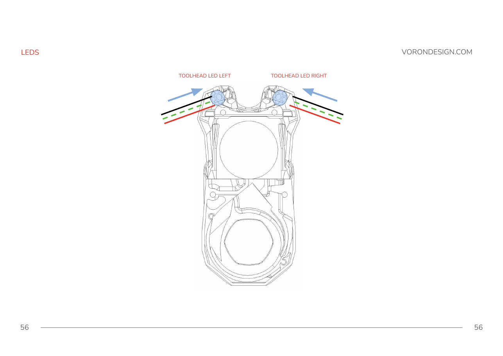{ crop="0.30 0.18 0.72 0.82" }

**What you're looking at:** The two toolhead LEDs sit in the top corners of the body and light the print area from above. SB p.56 names them as seen from behind: index 2 is the toolhead's own right, the pocket on **your left** when you face the printer.

**Parts:**

- reused: the two toolhead LEDs on their chain
- reused: the Stealthburner main body

**Do:**

1. Push each toolhead LED into its pocket in the top corners of the main body, from the outside inwards, wires trailing outwards.
2. Remember p.56 is drawn from behind: its **RIGHT** pocket is index 2, its **LEFT** pocket index 3.

**Check:** Both LEDs sit at the bottom of their pockets and face down into the print area.

Source: [SB manual p.56](https://github.com/VoronDesign/Voron-Stealthburner/blob/1572a42e6df5d2f0ddf04a2145be4dc9c3693723/Manual/Assembly_Manual_SB.pdf#page=56)

---

### Step 08.38 — Insert the LED diffusers and push them forward

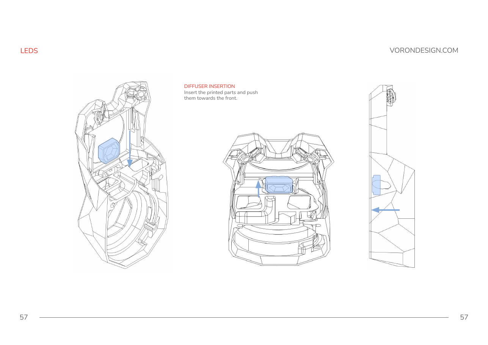{ crop="0.14 0.20 0.88 0.80" }
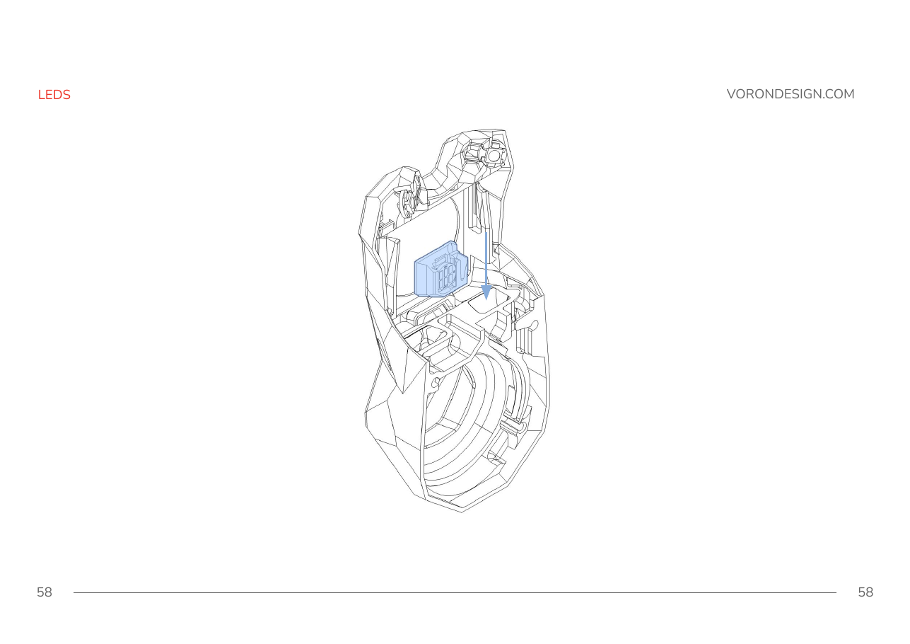{ crop="0.36 0.18 0.66 0.82" }

**What you're looking at:** The diffusers are the see-through panels you stacked at 08.35: the mask-and-diffuser sandwich and the LED carrier, which the SB manual feeds into the body in two pieces. Pushed fully forward they sit flush with the front; left back, they leave a shadow line.

**Parts:**

- reused: the logo LED stack, mask with diffuser and the LED carrier

**Do:**

1. Drop the mask-and-diffuser into the top slot and push it **towards the front** until it fills the front window, as on p.57.
2. Drop the carrier with its LED in behind it, as on p.58.

**Check:** The diffuser faces sit flush with the front of the body, with no gap behind them.

Source: [SB manual p.57](https://github.com/VoronDesign/Voron-Stealthburner/blob/1572a42e6df5d2f0ddf04a2145be4dc9c3693723/Manual/Assembly_Manual_SB.pdf#page=57) · [SB manual p.58](https://github.com/VoronDesign/Voron-Stealthburner/blob/1572a42e6df5d2f0ddf04a2145be4dc9c3693723/Manual/Assembly_Manual_SB.pdf#page=58) · [Video: More Extras! @1:06:03](https://www.youtube.com/watch?v=D_44fDp9xt8&list=PL0fUJbigELQPqpeGOgHYisG4KaSXVtnNY&t=3963s) (differs: builds Afterburner + Clockwork 1; this kit is Stealthburner + Clockwork 2.5 + Revo HF)

---

### Step 08.39 — Route the LED wires out of the body

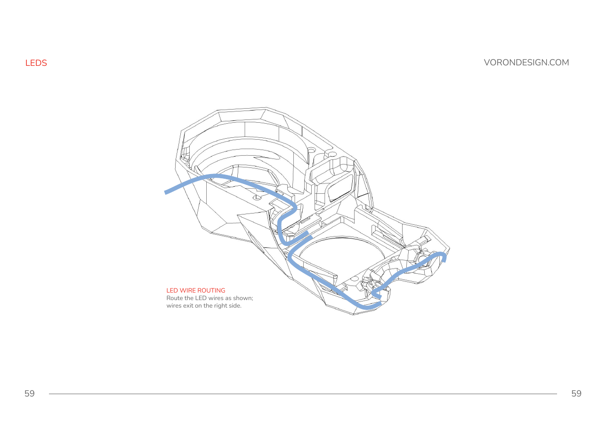{ crop="0.25 0.22 0.78 0.76" }

**What you're looking at:** Every wire in the body is routed to leave on **one** side, so the whole harness can go to the fan adapter as one bundle. A wire crossing a fan opening is a wire the spinning fan wheel (the impeller) will find sooner or later.

**Parts:**

- reused: the LED chain in the body

**Do:**

1. Lay the LED wires into the moulded channels so the whole harness **leaves on the right side** of the body.
2. Keep them out of the fan pockets.

**Check:** With the body face-down, no wire crosses either fan opening, and the harness leaves as one bundle on the right.

Source: [SB manual p.59](https://github.com/VoronDesign/Voron-Stealthburner/blob/1572a42e6df5d2f0ddf04a2145be4dc9c3693723/Manual/Assembly_Manual_SB.pdf#page=59)

---

### Step 08.40 — Clip in the hotend fan, correct way round

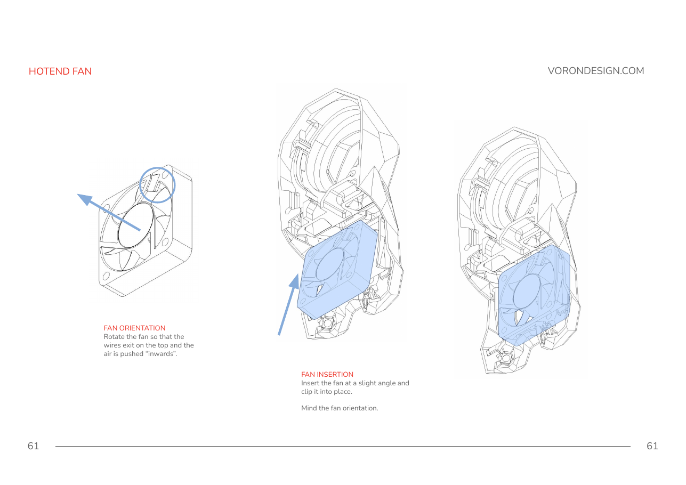{ crop="0.10 0.16 0.88 0.86" }

**What you're looking at:** The 4010 axial fan is the **hotend** fan: it blows through the heatsink's fins to keep the cold side of the hotend cold. Its direction is fixed: the moulded arrow must point *into* the heatsink. As it seats, the fan snaps the body's support webs.

**Parts:**

- 40×40×10 axial fan, 24 V ×1

**Do:**

1. Turn the fan so its **wires leave at the top** and its airflow pushes **inwards**, into the heatsink. Confirm it against the moulded arrow on the frame.
2. Clip it in at a slight angle; it snaps the body's support webs.

**Check:** The wires are at the top, the airflow arrow points into the body, and the impeller spins freely under a finger with no rub.

**Helper:** Finds the airflow arrow on the fan frame and checks that it points into the body.

Source: [SB manual p.61](https://github.com/VoronDesign/Voron-Stealthburner/blob/1572a42e6df5d2f0ddf04a2145be4dc9c3693723/Manual/Assembly_Manual_SB.pdf#page=61)

---

### Step 08.41 — Route the hotend fan wires

{ crop="0.20 0.20 0.64 0.78" }

**What you're looking at:** The fan wires join the LED harness in the same right-hand channel: one bundle, one exit, and nothing trapped under the fan frame.

**Parts:**

- reused: the hotend fan's leads

**Do:**

1. Lay the fan wires into their channel so they leave on the **right side**, alongside the LED harness.

**Check:** Every wire leaves on one side, and nothing is pinched under the fan frame.

Source: [SB manual p.62](https://github.com/VoronDesign/Voron-Stealthburner/blob/1572a42e6df5d2f0ddf04a2145be4dc9c3693723/Manual/Assembly_Manual_SB.pdf#page=62)

---

### Step 08.42 — Fit the part-cooling blower

{ crop="0.18 0.22 0.82 0.80" }

**What you're looking at:** The trimmed 5015 goes in the **upper** fan pocket, above the hotend fan. Which fan goes where matters: the config drives them on different pins, and Ch 13's fan check tests whether top and bottom got swapped.

**Parts:**

- 50×50×15 centrifugal fan, trimmed ×1

**Do:**

1. Push the trimmed blower into the **upper** pocket, above the hotend fan, outlet feeding the ducts and wires leaving on the right.
2. Leave out SB p.64's two M3×6 FHCS: the fan adapter's M3×10 take those holes at 08.44 `(verify on bench)`.

**Check:** The blower sits square in the upper pocket, held by the snapped webs, with the 4010 below it, its impeller spinning freely and its outlet aimed down the duct.

Source: [SB manual p.64](https://github.com/VoronDesign/Voron-Stealthburner/blob/1572a42e6df5d2f0ddf04a2145be4dc9c3693723/Manual/Assembly_Manual_SB.pdf#page=64) · [LDO wiring guide § Wiring the Toolhead PCB](https://docs.ldomotors.com/en/voron/voron2/wiring_guide_rev_d#wiring-the-toolhead-pcb)

Pause: ~20 min since the last pause — the Stealthburner body is fully loaded: three LEDs seated, diffusers pushed forward, both fans in, the blower held by its webs until its screws go in at 08.44, and every wire leaving on the right. Rest it face-down on a soft cloth. Do not put weight on the diffuser faces, and spin the impellers with nothing but a finger.

---

## E — Nitehawk-SB V2 and the fan adapter

### Step 08.43 — Bolt the Nitehawk-SB V2 to the Clockwork 2.5

{ crop="0.08 0.18 0.86 0.80" }


**What you're looking at:** The [Nitehawk-SB V2](16-glossary.md#n) toolboard is the larger board in LDO's first photo; the triangular one is the fan adapter, fitted next. SB p.36 draws the spacer and two screws on the 2.5; LDO's second photo, on a Clockwork 2, shows the ground lug.

**Parts:**

- Nitehawk-SB V2 ×1
- CW2 PCB Spacer ×1 (supplied printed)
- M3×8 SHCS ×2
- Extruder Motor Ground Wire ×1

**Do:**

1. Sit the PCB spacer against the CW2.5's side, the toolboard on top, and fix them with two M3×8 SHCS. Handle the board by its edges.
2. Trap the **Extruder Motor Ground Wire's ring lug under the lower M3×8 head**, tail pointing down, as LDO's photo shows.

**Check:** The board sits parallel on its spacer with the 10-pin header facing forward, and the ground lug is under a screw head with its tail free.

A screw that will not start means a tilted insert. The ground wire's motor end waits for Step 08.53.

Source: [SB manual p.36](https://github.com/VoronDesign/Voron-Stealthburner/blob/1572a42e6df5d2f0ddf04a2145be4dc9c3693723/Manual/Assembly_Manual_SB.pdf#page=36) · [LDO wiring guide § Wiring the Toolhead PCB](https://docs.ldomotors.com/en/voron/voron2/wiring_guide_rev_d#wiring-the-toolhead-pcb) · [`toolboard_ground_routing.jpg`](https://github.com/MotorDynamicsLab/Nitehawk-SB-V2/blob/master/Images/toolboard_ground_routing.jpg) · [Nitehawk-SB V2 doc § ESD Hardening](https://docs.ldomotors.com/en/Toolboard/nitehawk-sb-v2#esd-hardening)

---

### Step 08.44 — Mount the fan adapter PCB on the back of the 5015


**What you're looking at:** The fan adapter is the small board that collects both fans and the LED chain on the *body* side and hands them to the toolboard through one board-to-board header, so the blue body lifts off with its three plugs still connected.

**Parts:**

- Stealthburner Fan Adapter PCB (SBurnerFanAdapter_V2.0) ×1
- M3×10 FHCS ×2

**Do:**

1. Lay the adapter on the **back of the 5015 fan**, its two end holes over the fan's two screw holes.
2. Drive two M3×10 FHCS through both into the body `(verify on bench)`. They take the place of SB p.64's M3×6.

**Check:** The board lies flat against the fan, the fan is held firm, and the P1 header points at the toolboard's header when the body is offered up.

Source: [LDO wiring guide § Wiring the Toolhead PCB](https://docs.ldomotors.com/en/voron/voron2/wiring_guide_rev_d#wiring-the-toolhead-pcb) · [SB manual p.64](https://github.com/VoronDesign/Voron-Stealthburner/blob/1572a42e6df5d2f0ddf04a2145be4dc9c3693723/Manual/Assembly_Manual_SB.pdf#page=64) · [SB V2 fan adapter pinout](https://github.com/MotorDynamicsLab/Nitehawk-SB-V2/blob/master/Images/sbv2_fan_adapter_pcb_pinout.jpg)

---

### Step 08.45 — Check the fan-voltage solder jumpers before anything is powered


**What you're looking at:** Each three-pad group is a **solder jumper**: it picks 24 V or 5 V for its fan port by which outer pad is joined to the middle one. From the factory that join is a hair-thin trace on the board, not a solder blob, and the factory default is 24 V on both.

**Parts:**

- reused: the fan adapter PCB
- tool: magnifier
- tool: multimeter

**Do:**

1. Confirm both selectors, printed `24V  V_HEF  5V` and `24V  V_PCF  5V`, are on the **24 V** side. Both your fans are 24 V per the Rev D+ 350 BOM.
2. LDO's 5 V conversion cuts the trace and solders a bridge: do neither. Cut nothing.

**Check:** The meter shows both selectors continuous from the middle pad to `24V` and open to `5V`; the factory trace is too thin to see. `(verify on bench)`

**Helper:** Reads the meter aloud at each selector while you hold the probes.

Source: [SB V2 fan adapter pinout](https://github.com/MotorDynamicsLab/Nitehawk-SB-V2/blob/master/Images/sbv2_fan_adapter_pcb_pinout.jpg)

---

### Step 08.46 — Plug the fans and the LED chain into the adapter


**What you're looking at:** Three JST-PH2.0 3-pin plugs go in, one per port. On each fan port the middle pin is the tacho line, which reports the fan's real speed to Klipper. The classic mistake is swapping P2 and P4: both fans run, but the machine cools the hotend instead of the print.

**Parts:**

- reused: the hotend fan, 5015 and LED chain leads

**Do:**

1. Plug the three JST-PH2.0 3-pin plugs in, one per port, as the table below shows.

| Port | What plugs in | Pinout, silkscreen order |
|---|---|---|
| **P2** | 4010 axial **hotend fan** | `+` / `A1` (tacho) / `−` |
| **P3** | **Neopixel** LED chain | `5V` / `GND` / `RGB` |
| **P4** | 5015 **part cooling** blower | `−` / `A2` (tacho) / `+` |

If you ever re-crimp a fan lead, take the polarity from the silkscreen next to the port, not from the fan's wire colours.

**Check:** All three plugs are fully in with their latches engaged and no wire under tension, P2 to the axial fan and P4 to the blower.

⚠ Conflict: LDO's graphic `nhsbv2_pcb_pinout.jpg` labels the Fan/RGB header `PA15 → HEF` and `PD0 → PCF`. The adapter silkscreen, LDO's board doc and the Rev D+ config say the opposite: `[fan]` on `nhk:PA15` tacho `nhk:PD2`, `[heater_fan hotend_fan]` on `nhk:PD0` tacho `nhk:PD1`. Three of four agree: wire by **port function**, P2 axial, P4 blower. If Ch 13's *Verify Fans* spins the wrong fan, swap the `pin:` values. **Do not re-crimp.** [src](https://github.com/MotorDynamicsLab/LDOVoron2/blob/main/Firmware/leviathan-printer-rev-d-sbv2.cfg) · [board doc](https://docs.ldomotors.com/en/Toolboard/nitehawk-sb-v2#port-and-pin-definitions)

Source: [SB V2 fan adapter pinout](https://github.com/MotorDynamicsLab/Nitehawk-SB-V2/blob/master/Images/sbv2_fan_adapter_pcb_pinout.jpg)

Pause: ~20 min since the last pause — the Nitehawk-SB V2 and the fan adapter are mounted, both fan-voltage selectors are confirmed at 24 V, and the three PH2.0 fan and LED plugs are in. Do not mate the board-to-board header yet: that happens with the Stealthburner body at Step 08.62. Do not cut or bridge a voltage-selector pad.

---

### Step 08.47 — Ready the HE0 terminal for the heater leads


**What you're looking at:** `HE0` is the heater output, the highest-current thing on this board, which is why it is a screw terminal and not a plug. A cartridge heater is a plain resistor, so polarity does not matter. What matters is that no stray strand escapes a ferrule and bridges the terminals.

**Parts:**

- reused: the Revo heater leads
- tool: 2.5 mm slot-head screwdriver

**Do:**

1. Find the `HE0` screw terminal and back both screws out with the 2.5 mm slot-head screwdriver.
2. Check that each heater lead ends in a tight ferrule. Connect nothing yet: the hotend meets the board at Step 08.61.

**Check:** Both `HE0` screws are backed out and the terminal is empty, and no copper strand shows outside either ferrule.

Source: [Nitehawk-SB V2 pinout](https://github.com/MotorDynamicsLab/Nitehawk-SB-V2/blob/master/Images/nhsbv2_pcb_pinout.jpg)

---

### Step 08.48 — Measure the hotend thermistor and find TH0


**What you're looking at:** `TH0` reads the hotend thermistor, an NTC resistor: its resistance **falls** as it heats. Klipper works out the temperature from that resistance, so an open lead looks like a hotend that never warms up and a shorted one like a hotend on fire.

**Parts:**

- reused: the Revo thermistor lead
- tool: multimeter

**Do:**

1. Measure across the thermistor's lead: a Semitec 104NT-4-R025H42G reads **100 kΩ at 25 °C**. A reading near 0 Ω or open means a broken lead.
2. Find `TH0`, the **2-pin JST-PH2.0** to the left of the heater terminal, signal `PB12`. Plug nothing in.

**Check:** The meter read about 100 kΩ, and `TH0` stays empty until Step 08.61. `(verify on bench)`

**Helper:** Reads the meter aloud and says whether it shows about 100 kΩ.

Source: [Nitehawk-SB V2 pinout](https://github.com/MotorDynamicsLab/Nitehawk-SB-V2/blob/master/Images/nhsbv2_pcb_pinout.jpg)

---

### Step 08.49 — Extruder motor into E MOTOR


**What you're looking at:** `E MOTOR` is the only [JST-XH2.5](16-glossary.md#j) connector left on this board, and it is on the **reverse** side. A stepper motor is a pair of coils: plugging or unplugging one on a live board dumps their stored energy straight back into the motor driver and kills it.

**Parts:**

- reused: the pancake stepper lead

**Do:**

1. Find the `E MOTOR` port: a **JST-XH2.5 4-pin on the reverse side of the board**, pin order `B2 B1 A1 A2`. This one connector did **not** change to PH2.0.
2. Plug the stepper in.

**Check:** The plug is fully in the rear header.

⚠ Never plug or unplug a stepper with the printer powered: back-EMF kills drivers.

Source: [Nitehawk-SB V2 pinout](https://github.com/MotorDynamicsLab/Nitehawk-SB-V2/blob/master/Images/nhsbv2_pcb_pinout.jpg)

---

### Step 08.50 — Find the PROBE port


**What you're looking at:** `PROBE` is the 3-pin port for the [inductive probe](16-glossary.md#i), the sensor the machine uses for [QGL](16-glossary.md#q) and the bed mesh. Its third pin carries a live **24 V**, so any probe expecting 5 V there must have that pin left out of the housing.

**Parts:** none.

**Do:**

1. Find `PROBE`, a **JST-PH2.0 3-pin**, and read its silkscreen: `GND / SIG (PC15) / 24V`.
2. Leave it empty. The probe sits on the X carriage, so its lead plugs in at Step 08.60.

**Check:** You can trace GND / SIG / 24V against the silkscreen, and nothing is plugged into `PROBE`.

⚠ Rev D+ / LDO: the third pin is a live **24 V** feed. If you ever fit a Klicky here, its 24 V pin must be left unpopulated, with no contact in that slot of the housing. If you fit a TAP-style board, confirm it is 24 V-tolerant first. [src](https://docs.ldomotors.com/en/voron/voron2/wiring_guide_rev_d#wiring-the-toolhead-pcb)

Source: [Nitehawk-SB V2 pinout](https://github.com/MotorDynamicsLab/Nitehawk-SB-V2/blob/master/Images/nhsbv2_pcb_pinout.jpg)

---

### Step 08.51 — Chamber thermistor into CT; the cable cover waits


**What you're looking at:** `CT` takes the chamber thermistor, which measures the air inside the enclosure rather than any heater. Its tip has to hang in free chamber air, away from the hotend. The cable cover stays off until the hotend leads are connected.

**Parts:**

- chamber thermistor, pre-terminated ×1 — from the LDO kit, no BOM row
- staged: `cable_cover` ×1
- staged: M3×16 SHCS ×1
- staged: M3×6 BHCS ×1

**Do:**

1. Plug the external chamber thermistor into `CT`, a **JST-PH2.0 2-pin**, signal `PB2`, and leave its free end loose.
2. Set the `cable_cover`, its M3×16 SHCS and its M3×6 BHCS beside the toolhead: the cover closes at Step 08.62.

**Check:** The plug is fully in `CT`, and the cover and its two screws are set aside, not fitted.

⚠ The stock Clockwork 2.5 `cable_cover` (SB p.37–38) has no clip or tie point for the chamber thermistor. Lead its tip out of the cover into free air, clear of the hotend, the fans and the drag chain; where it ties off is `(verify on bench)`.

Source: [Nitehawk-SB V2 pinout](https://github.com/MotorDynamicsLab/Nitehawk-SB-V2/blob/master/Images/nhsbv2_pcb_pinout.jpg) · [SB manual p.37](https://github.com/VoronDesign/Voron-Stealthburner/blob/1572a42e6df5d2f0ddf04a2145be4dc9c3693723/Manual/Assembly_Manual_SB.pdf#page=37) · [Video: Part 5 @3:41:55](https://www.youtube.com/watch?v=hTKCBrk36R0&list=PL0fUJbigELQPqpeGOgHYisG4KaSXVtnNY&t=13315s) (differs: no toolboard — loom to the mainboard; this kit runs a Nitehawk-SB V2 on one USB+24 V umbilical)

---

### Step 08.52 — Account for the ports you are not using


**What you're looking at:** `XY ENDSTOP` and `I2C` stay empty. The **USB expansion** header and the `BOOT0` / `RESET` buttons must stay reachable: the buttons flash firmware in Ch 12, and that spare USB port is the "+" in Rev D**+**. The harness map shows every port and pin.

**Parts:** none.

**Do:**

1. Go over the board once and confirm what stays empty, using the table below.

| Port | Type | Status in this build |
|---|---|---|
| `XY ENDSTOP` | JST-PH2.0 4P — `GND / X (PB0) / Y (PB1) / 5V` | **Unused.** The XY endstop PCB wires to the Leviathan, not the toolhead |
| `I2C` | JST-PH2.0 4P — `SCL (PB3) / SDA (PB4) / 3V3 / GND` | **Unused** |
| `USB` expansion | JST-ZH1.5 5P — `GND / GND / D+ / D− / 5V` | **Unused now.** This is the "+" in Rev D+; leave it physically reachable |
| `BOOT` / `RESET` buttons | tactile, beside the USB header | Leave clear — Ch 12 flashing may need them |

**Check:** Nothing is plugged into `XY ENDSTOP` or `I2C`, and the USB expansion header and both buttons are not buried under a cable bundle.

**Helper:** Reads each port name from the table aloud while you find it on the board.

Leave enough umbilical slack that the secondary USB port stays reachable without pulling the toolhead off. A future eddy-current probe or nozzle camera plugs in there, and that port is the whole reason this kit is "Rev D+". [src](https://www.fabreeko.com/products/ldo-voron-v2-4-kit)

Source: [Nitehawk-SB V2 pinout](https://github.com/MotorDynamicsLab/Nitehawk-SB-V2/blob/master/Images/nhsbv2_pcb_pinout.jpg)

---

### Step 08.53 — Land the ground wire's motor end on the extruder motor


**What you're looking at:** One short wire with a ring lug at each end, and the reason it exists is static. LDO's ESD (static discharge) scheme makes one continuous path: extruder motor body, toolboard ground, umbilical, USB adapter, frame, earth. Its board end went under a toolboard screw at 08.43. [src](https://docs.ldomotors.com/en/Toolboard/nitehawk-sb-v2#esd-hardening)

**Parts:**

- reused: the Extruder Motor Ground Wire, board end under the toolboard M3×8
- M3 screw, motor end of the grounding cable ×1 — from the LDO kit, no BOM row

**Do:**

1. Put the motor-end ring lug on the short supplied screw, length `(verify on bench)`, in a **free face hole** of the NEMA14.
2. LDO's photo uses the lower hole, nearest the chain anchor; bend the lug clear of the anchor. Tighten to snug only.

**Check:** The meter shows continuity from the toolboard `GND` pad to the motor can, both lugs are under a screw head, and the wire cannot reach any moving part.

**Boundary:** this step is the source of record for the ESD grounding scheme. Ch 10 Step 10.58 fits the frame-side leg and re-checks the path; if LDO changes the procedure, correct it here first and make Ch 10 point back.

⚠ Rev D+ / LDO: **use the supplied cable**. LDO warns that larger ring lugs can short the board. Both cables are Rev D+ BOM rows (*Electronics 2*): the **Extruder Motor Ground Wire** here, the **DC Ground Wire** at Ch 09–10. **If either is missing**, report it to Fabreeko and ask in `#ldo_motors`; do not improvise a ground (survey §4.1 ⑤).

Source: [`grounding_scheme.jpg`](https://github.com/MotorDynamicsLab/Nitehawk-SB-V2/blob/master/Images/grounding_scheme.jpg) · [`toolboard_ground_routing.jpg`](https://github.com/MotorDynamicsLab/Nitehawk-SB-V2/blob/master/Images/toolboard_ground_routing.jpg)

Pause: ~25 min since the last pause — the extruder motor and chamber thermistor are plugged in, the ground wire runs from the toolboard to the motor body, and the cable cover is set aside, still off. The heater, hotend thermistor and probe leads are not plugged in yet: they wait for the carriage. Nothing is powered and nothing is on the carriage. Do not plug the umbilical's far end into anything and do not power the printer to "just check": Checkpoint 08 and Ch 13 do that, in that order.

---

## F — Probe

### Step 08.54 — Confirm the probe decision and bag the Klicky set

(no image — decision step; the probe itself was fitted in Ch 07 Steps 07.34–07.37)

**What you're looking at:** [Klicky](16-glossary.md#k) is a microswitch probe (a tiny click switch) that docks with magnets: the toolhead picks it up from a dock, probes with it and puts it back. This build uses the [inductive probe](16-glossary.md#i) instead, fitted in Ch 07, with Z zero from the [nozzle probe](16-glossary.md#n) built in Ch 09.

**Parts:** none.

**Do:**

1. Build nothing here. The kit ships both probes, and **Ch 07 already fitted the inductive one**.
2. Bag the Klicky parts from B06-P2, unbuilt. Z height comes from the LDO nozzle probe, not from either.

**Check:** The inductive probe from Ch 07 is on the carriage and the Klicky bag is closed.

Three sources agree on the inductive probe. LDO's wiring guide wires it to `PROBE` as the default; the Rev D+ Klipper config's `[probe]` block is written for it (`pin: nhk:PC15`, `x_offset: 0`, `y_offset: 25.0`, *"not used for Z height, only Quad Gantry Leveling"*) with no Klicky macros; and it ships with its plug already fitted, while Klicky needs a cable you make. [src](https://github.com/MotorDynamicsLab/LDOVoron2/blob/main/Firmware/leviathan-printer-rev-d-sbv2.cfg)

> **Alternative: Klicky probe (do not build now)**
>
> Klicky is a supported mod, not a different wiring plan: it uses the same `PROBE` port with the **24 V pin left unpopulated**, and adds a probe that docks with magnets, plus the macros and dock-safety logic to drive it.
>
> - **Parts:** `KlickyProbe_v2` (print 2; one is a spare), `KlickyProbe_AB_mount_v2` + `_holder`, `Probe_Dock_v2.1`, `Dock_mount_fixed_v2`, `Mount_*` and `Probe_*` magnet press-fit jigs.
> - **Magnets:** 6×3 mm N35: 4 in the probe, 3 in the toolhead mount, 1 in the dock. Press them in with the printed helpers; a crooked magnet gives a probe that does not repeat. Glue is optional insurance.
> - **Switch:** Omron D2F-5 or D2F-5L with the lever removed.
> - **Hardware:** 2× M3×8 SHCS (mount to the AB carriage), 2× M3×20 (dock), 2× M5×10 + T-nuts (dock to the rear gantry rail).
> - **Wiring:** signal and ground only; the magnets carry the switch circuit.
> - **Cost of switching later:** the dock, the macros and a fresh probe calibration. Nothing you build in this chapter has to be undone.
> - [src](https://github.com/jlas1/Klicky-Probe/tree/main/Printers/Voron/v1.8_v2.4_Legacy_Trident)
>
> If you later add the Decontaminator purge bucket, you need `Dock_sidemount_fixed_v2` + `Dock_sidemount_left_v2` instead of `Dock_mount_fixed_v2`. Reprint then, not now.

Source: decision step — see Ch 07 Steps 07.34–07.37 · [Video: More Extras! @0:30:00](https://www.youtube.com/watch?v=D_44fDp9xt8&list=PL0fUJbigELQPqpeGOgHYisG4KaSXVtnNY&t=1800s)

---

### Step 08.55 — Confirm the inductive probe fitted in Ch 07

{ crop="0.15 0.18 0.90 0.62" }

**What you're looking at:** This is a check of Ch 07's work, not new assembly. The thing most worth checking again is the tape: too much of it, especially near the bottom sensing face, is the usual reason an inductive probe will not trigger in Ch 13.

**Parts:** none.

**Do:**

1. The probe was seated in `probe_retainer_bracket` and set in **Ch 07 Steps 07.34–07.37**, its lead left whole. Confirm its two M3×30 SHCS are tight.
2. Confirm the tape is intact and the lead is still coiled loose above the carriage.

**Check:** The probe does not move under finger pressure, sits 6 mm ±1 mm below the plastic, and is taped on the **front and sides only**, with its lead held in place.

**Helper:** Reads the caliper aloud from the probe tip to the plastic; about 6 mm passes.

If the tape is torn, re-wrap the front and sides only, never the back or the bottom sensing face. Too much tape is the usual cause of a probe that will not trigger in Ch 13: remove a strip at a time before you suspect the board. [src](https://docs.ldomotors.com/voron/voron2/build-faq)

Source: [Voron manual p.144](https://github.com/VoronDesign/Voron-2/blob/de7e89d/Manual/Assembly_Manual_2.4r2.pdf#page=144)

---

### Step 08.56 — The LDO nozzle probe is built in Ch 09 — not here


**What you're looking at:** The LDO [nozzle probe](16-glossary.md#n) is this kit's **Z endstop**: a sprung shaft on a microswitch, mounted on the *frame*, that the nozzle is driven down onto. Z zero is a measurement of the real nozzle tip, so changing a nozzle does not spoil it.

**Parts:** none.

**Do:**

1. Do nothing here. Leave the nozzle-probe bag closed and labelled for Ch 09.
2. Its cable lands on the Leviathan's `Z-ENDSTOP`, never on the toolboard, so there is no toolhead-side work on it at all.

**Check:** The nozzle-probe bag is still sealed and labelled for Ch 09.

**Boundary:** Ch 09 Steps 09.27–09.29 own the assembly and 09.30 the mounting (**2× M3×25 SHCS** into the bed extrusion's side slot); Ch 10 lands the cable. If LDO changes the assembly, correct Ch 09 and keep this pointer.

LDO's nozzle probe replaces the official Voron endstop and uses LDO's own printed part: `nozzle_probe.stl` and `nozzle_probe_ldo.stl` are both on the do-not-print list because the part is supplied. [src](https://docs.ldomotors.com/en/voron/voron2/printed_part_guide_rev_d)

Source: [LDO wiring guide § Assembling the Nozzle Probe](https://docs.ldomotors.com/en/voron/voron2/wiring_guide_rev_d)

Pause: ~10 min since the last pause — the probe decision is recorded, the inductive probe from Ch 07 is confirmed on the carriage, and the nozzle-probe bag is still closed for Ch 09. The Klicky bag stays closed. Do not open either bag to "get ahead": the nozzle probe is built and mounted in Ch 09.

---

## G — Mounting the toolhead

### Step 08.57 — Read the handoff page and get help for the lift

{ crop="0.28 0.24 0.58 0.76" }

**What you're looking at:** Page 146 is the printer manual's Stealthburner title page. The printer manual has no toolhead content of its own, so everything from Step 08.1 to here came from the Stealthburner manual; the one-line pointer on p.147, at 08.65, sends you there and back.

**Parts:** none.

**Do:**

1. Note that manual p.146–147 hands you to the Stealthburner manual and expects you back. You are back.
2. The toolhead goes onto a belted gantry, so support the carriage with one hand and never let the toolhead hang on a half-started screw.

**Check:** The gantry is parked mid-travel, the carriage can be reached from the front and both sides, and nothing else is on the bed for a screwdriver to drop onto.

LDO's Build Notes mark p.146–147 as "Stealthburner + CW2 per the SB manual": the printer manual contains no toolhead steps at all, only this pointer. Everything in this chapter came from the Stealthburner manual and LDO's own guides, which is why it is written out rather than transcribed. [src](https://docs.ldomotors.com/voron/voron2/build-faq)

Source: [Voron manual p.146](https://github.com/VoronDesign/Voron-2/blob/de7e89d/Manual/Assembly_Manual_2.4r2.pdf#page=146)

---

### Step 08.58 — Hang the Clockwork 2.5 on the carriage, first bolt

{ crop="0.18 0.20 0.88 0.82" }

**What you're looking at:** The extruder hooks onto the X carriage and hangs from it, held by two M3×8. Until the first one is snug, the carriage takes the weight through your hand, and a toolhead let go on a half-started screw lands on the bed.

**Parts:**

- reused: the CW2.5 assembly with its toolboard
- M3×8 SHCS ×1

**Do:**

1. Offer the CW2.5 up to the X carriage so its hooks engage the carriage and the extruder hangs straight down.
2. Start one M3×8 SHCS in the position you can reach and take it to snug.

**Check:** The carriage, not your hand, holds the extruder, and the extruder is not rotated.

**Helper:** Holds the carriage steady at mid-travel while you start the first bolt.

Source: [SB manual p.73](https://github.com/VoronDesign/Voron-Stealthburner/blob/1572a42e6df5d2f0ddf04a2145be4dc9c3693723/Manual/Assembly_Manual_SB.pdf#page=73)

---

### Step 08.59 — Second CW2.5 bolt, through the front access hole

{ crop="0.14 0.20 0.92 0.82" }

**What you're looking at:** The second screw again goes in from the front, through the access hole. With both in, extruder and carriage are one rigid body, which stops the toolhead rotating under belt acceleration and printing a smeared corner.

**Parts:**

- M3×8 SHCS ×1

**Do:**

1. Drive the second screw through the access hole at the **front** of the extruder.
2. Tighten both to snug.

**Check:** Pushing and pulling the extruder moves it nowhere against the carriage, and both screws are tight.

Source: [SB manual p.74](https://github.com/VoronDesign/Voron-Stealthburner/blob/1572a42e6df5d2f0ddf04a2145be4dc9c3693723/Manual/Assembly_Manual_SB.pdf#page=74)

---

### Step 08.60 — Plug in the toolhead cable and the probe


**What you're looking at:** The [umbilical](16-glossary.md#u) is the single cable carrying USB data and 24 V to the toolhead, on an XT30 connector: two large power pins and two small signal pins in one shell. It and the probe lead plug in now that the extruder is mounted.

**Parts:**

- toolhead cable, USB and 24 V, XT30(2+2) ×1
- reused: the inductive probe's pre-terminated lead

**Do:**

1. Plug the toolhead cable into its **XT30** connector, `D+ / D− / GND / 24V`. Leave its far end free; the USB adapter is wired in Ch 10.
2. Uncoil the probe lead from the carriage and plug it into `PROBE`, `GND / SIG (PC15) / 24V`.

**Check:** Both plugs are fully in, the probe lead reaches `PROBE` without pulling tight, and the cable's free end is coiled and labelled, clear of the bed.

Source: [Nitehawk-SB V2 pinout](https://github.com/MotorDynamicsLab/Nitehawk-SB-V2/blob/master/Images/nhsbv2_pcb_pinout.jpg) · [LDO wiring guide § Wiring the Toolhead PCB](https://docs.ldomotors.com/en/voron/voron2/wiring_guide_rev_d#wiring-the-toolhead-pcb) · [SB manual p.73](https://github.com/VoronDesign/Voron-Stealthburner/blob/1572a42e6df5d2f0ddf04a2145be4dc9c3693723/Manual/Assembly_Manual_SB.pdf#page=73)

---

### Step 08.61 — Slide the tool cartridge in and land the hotend leads

{ crop="0.20 0.20 0.80 0.82" }


**What you're looking at:** The tool cartridge slides up from below and its four stud heads drop into keyholes in the Clockwork 2.5, which makes the hotend a unit you can swap rather than something bolted in. As it rises, the PTFE picks up the extruder's filament path.

**Parts:**

- reused: the tool cartridge with its four M3×8 studs
- reused: the Revo heater leads
- reused: the Revo thermistor lead
- tool: 2.5 mm slot-head screwdriver

**Do:**

1. Lift the tool cartridge until its four stud heads sit in the CW2.5's keyholes, with the leads fed up past the extruder.
2. Fasten both heater leads in `HE0`; tighten each one and tug it to test.
3. Plug the thermistor into `TH0`.

**Check:** The cartridge is square, the nozzle centred, and it cannot drop out. No copper shows outside either ferrule, neither heater lead pulls out, and the `TH0` housing is fully seated.

Source: [SB manual p.75](https://github.com/VoronDesign/Voron-Stealthburner/blob/1572a42e6df5d2f0ddf04a2145be4dc9c3693723/Manual/Assembly_Manual_SB.pdf#page=75) · [Nitehawk-SB V2 pinout](https://github.com/MotorDynamicsLab/Nitehawk-SB-V2/blob/master/Images/nhsbv2_pcb_pinout.jpg)

---

### Step 08.62 — Fit the Stealthburner body and mate the board-to-board header

{ crop="0.13 0.18 0.88 0.80" }
{ crop="0.08 0.17 0.90 0.84" }
{ crop="0.10 0.19 0.90 0.84" }


**What you're looking at:** Last, the blue body closes onto the toolhead and the fan adapter's header mates with the toolboard's. That header is keyed **and** its gender was reversed from V1, so resistance means it is backwards, never that it needs more force.

**Parts:**

- reused: the Stealthburner body with LEDs, fans and fan adapter
- reused: the chamber thermistor, plugged into `CT`
- `cable_cover` ×1
- M3×16 SHCS ×1
- M3×6 BHCS ×1
- M3×25 SHCS ×2
- M3×50 SHCS ×2

**Do:**

1. Open the latch, hold the cover on and drive the M3×16 into it from the front; add the M3×6 BHCS.
2. Close the body on, mating the headers. **Keyed: resistance means backwards.**
3. Fit **two M3×25** upper and **two M3×50** lower.

**Check:** The cover is on both screws with the thermistor tip in free air, there is no gap along the joint between body and cartridge, the four screws are snug and the header is fully seated.

⚠ The cable cover closes here, after the last lead is connected. Both screws go to snug only: the M3×16 threads straight into the cover's plastic. SB p.38 reaches the M3×16 through the front access hole with the latch open; reaching the side M3×6 BHCS with the toolhead on the carriage is `(verify on bench)`.

⚠ Rev D+ / LDO: LDO's Rev D guide calls it a "2×4 header". On the V2 board it is **10-pin, 2×5**, and both the **gender and the keying changed** from V1. Toolboard row order: tacho / tacho, the two fan drives, `RGB (PD3)` and 5 V, `GND` and NC, NC and 24 V. See Step 08.46 for the fan-pin conflict. [src](https://github.com/MotorDynamicsLab/Nitehawk-SB-V2)

Source: [SB manual p.37](https://github.com/VoronDesign/Voron-Stealthburner/blob/1572a42e6df5d2f0ddf04a2145be4dc9c3693723/Manual/Assembly_Manual_SB.pdf#page=37) · [SB manual p.38](https://github.com/VoronDesign/Voron-Stealthburner/blob/1572a42e6df5d2f0ddf04a2145be4dc9c3693723/Manual/Assembly_Manual_SB.pdf#page=38) · [SB manual p.76](https://github.com/VoronDesign/Voron-Stealthburner/blob/1572a42e6df5d2f0ddf04a2145be4dc9c3693723/Manual/Assembly_Manual_SB.pdf#page=76) · [Video: Part 5 @3:12:08](https://www.youtube.com/watch?v=hTKCBrk36R0&list=PL0fUJbigELQPqpeGOgHYisG4KaSXVtnNY&t=11528s) (differs: builds Afterburner + Clockwork 1; this kit is Stealthburner + Clockwork 2.5 + Revo HF · no toolboard — loom to the mainboard; this kit runs a Nitehawk-SB V2 on one USB+24 V umbilical)

---

### Step 08.63 — Park the umbilical on the chain anchor — chain ties are Ch 10


**What you're looking at:** LDO's photo shows the Ch 10 end state; today only the loose tie at the anchor applies. A **service loop** is deliberate slack between anchor and chain, so the umbilical is never pulled tight at either end of X travel.

**Parts:**

- reused: the toolhead cable
- consumable: zip tie, 3×150 mm ×1

**Do:**

1. Lay the cable over the chain anchor from 08.25 and put **one loose zip tie** through its tab, loose enough that the cable still slides.
2. Coil and label the free end. The chain ties are **Ch 10 Steps 10.59 and 10.66**.

**Check:** The cable leaves over the anchor, not over a fan or belt, the coil hangs clear of the bed, and nothing pulls on the XT30.

Tight wires inside a drag chain fatigue and break: it is LDO's most repeated warning, and manual p.194–195 says the same. The cable must be **pulled through the chain before the chain ends are mounted** in Ch 10; doing it after means taking the chain apart (survey §5.2 W7).

Source: [`cable_chain_ties.jpg`](https://github.com/MotorDynamicsLab/Nitehawk-SB-V2/blob/master/Images/cable_chain_ties.jpg)

---

### Step 08.64 — Set the USB adapter aside with the right cover


**What you're looking at:** The [USB adapter PCB](16-glossary.md#u) is the frame end of the umbilical: 24 V goes in, and the toolhead cable comes out as a USB connection to the Pi. The V2 **partial** cover leaves one screw head showing so a ring lug can bolt to it.

**Parts:**

- USB Adapter PCB ×1
- NH Adapter Mount ×1
- `usb_adapter_mount_partial_cover.stl` (**Nitehawk-SB-V2 repo**) ×1
- M3×10 SHCS ×3 — from the kit, no 350 BOM row

**Do:**

1. Stack the USB adapter into its mount base and close it with the **V2 partial cover**, not the full V1 `usb_adapter_mount.stl` cover. It leaves open the point for the adapter-to-frame ground lead, Step 10.58.
2. Bag the assembly for Ch 09.

**Check:** One mounting screw head shows and can be reached through the cover, and the board's `24V IN` terminal and its 6-pin, 2×3 Micro-Fit 3.0 umbilical socket can both be reached.

**Helper:** Checks that one screw head shows through the cover, then labels the bag for Ch 09.

The Nitehawk-SB-V2 repo's `STLs/` folder contains exactly one file, `usb_adapter_mount_partial_cover.stl`, and it is the cover this kit needs (print plan §0, correction #1). B07 also prints the V1 `Nitehawk-SB/STLs/usb_adapter_mount.stl`, for a spare **base** only. [src](https://github.com/MotorDynamicsLab/Nitehawk-SB-V2/tree/master/STLs)

Source: [`usb_adapter_gnd.jpg`](https://github.com/MotorDynamicsLab/Nitehawk-SB-V2/blob/master/Images/usb_adapter_gnd.jpg)

---

### Step 08.65 — Return to the printer manual

{ crop="0.17 0.18 0.86 0.72" }

**What you're looking at:** This is the return page. The toolhead is mechanically complete and every connector on the toolhead side is made. Everything below the deck is Ch 09 and Ch 10: the USB adapter, the 24 V feed, the Z endstop and the drag-chain runs.

**Parts:** none.

**Do:**

1. Read manual p.147, the "return here to proceed" page: from here the printer manual leads again.

**Check:** Nothing on the toolhead is loose, nothing is left unplugged, and the umbilical's free end is coiled and labelled.

Source: [Voron manual p.147](https://github.com/VoronDesign/Voron-2/blob/de7e89d/Manual/Assembly_Manual_2.4r2.pdf#page=147)

Pause: ~35 min since the last pause — the toolhead is on the carriage, the body is on with the board-to-board header mated, and the umbilical is parked on the chain anchor with one loose tie, its free end coiled and labelled. This is the end of the hands-on work in this chapter. Do not apply power: Checkpoint 08 below is a test on the cold bench, and it is the last cheap chance to find a toolhead fault.

---

## Checkpoint 08 — bench test before anything is powered

**Built:** a complete toolhead, wired and hanging on the X carriage

Do all of this with the printer **unplugged**. It is the last chance to find a toolhead fault cheaply: after Ch 10 the electronics bay is closed, and after Ch 13 a wiring error costs a component.

- [ ] **Heater resistance.** Across the two `HE0` ferrules, the meter shows a low, steady reading that is not zero. A 60 W 24 V Revo HF cartridge is roughly **9.6 Ω** (24²/60). Anything near 0 Ω is a short, and an open reading is a broken lead. `(verify against the value E3D prints on your cartridge)`
- [ ] **Heater isolation.** No continuity between either heater lead and the heatsink, the nozzle, the frame or the toolboard `GND` pad.
- [ ] **Thermistor at room temperature.** Across the `TH0` lead, about **100 kΩ at 25 °C** for the Semitec 104NT-4-R025H42G. Warm the HeaterCore with your fingers and watch the resistance **fall**. An NTC whose reading rises is the wrong part or a bad connection.
- [ ] **Probe.** Continuity from each `PROBE` pin to the matching probe wire, and none between `24V` and `GND`.
- [ ] **LED chain.** No short between 5 V and GND at the chain connector, and continuity along the chain in the order logo, right, left.
- [ ] **Fan direction, checked by eye.** The hotend fan's moulded arrow points **into** the heatsink and its wires leave at the top. The 5015 blows down into the ducts. Both impellers spin freely with a flick of a finger and no rub. Ch 13 *Verify Fans* confirms the powered spin-up.
- [ ] **Fan-voltage jumpers.** `V_HEF` and `V_PCF` both on **24 V**, nothing cut, nothing bridged to 5 V.
- [ ] **Fan ports.** Axial on **P2**, blower on **P4**, LEDs on **P3**. If the wrong fan spins in Ch 13, fix it in the config, not by re-crimping (see *Common mistakes*).
- [ ] **Board-to-board header** fully seated, and the Stealthburner front snapped on with **no gap** along the joint.
- [ ] **Mechanical.** The extruder shaft turns freely by hand; the gear mesh has a faint play; the tension arm swings; the latch closes; the Bowden clip is on the collet; and filament runs from the CW2.5 collet through the PTFE to the nozzle without catching.
- [ ] **Probe height** still about 6 mm below the plastic, with the tape intact on the front and sides only. It was set in Ch 07 Steps 07.34–07.37 and checked again at Step 08.55.
- [ ] **Cable discipline.** Move X to both ends by hand: the parked umbilical never goes tight, nothing rubs a belt and nothing touches the nozzle. The secondary USB port is still reachable. The chain slack and the chain ties are Ch 10 Steps 10.59 and 10.66.
- [ ] The Extruder Motor Ground Wire (Steps 08.43 and 08.53) is fitted as LDO's ESD Hardening section describes or, if it was missing from *Electronics 2*, reported to Fabreeko and asked about in `#ldo_motors`. Do not let Ch 10 close the bay with this unresolved.

---

## Common mistakes

- **Assembling before the insert pass.** A missed insert in the CW2.5 main body or motor plate means stripping the extruder back to bare plastic and melting brass into a part that already holds a bearing and a gear train. Do Steps 08.3–08.7 first, every time.
- **Forcing a JST-PH2.0 plug into the wrong header.** The PH2.0 bodies on `PROBE`, `TH0`, `CT` and `XY ENDSTOP` are small and alike, and the Rev D guide's XH2.5 text sends people looking for the wrong connector. Read the silkscreen before every insertion.
- **Pressing the board-to-board header in when it will not go.** The V2 header is keyed *and* gender-reversed compared with every Rev D photo. If it resists, it is backwards. Pressing harder bends pins, and the damage cannot be seen once the body is on.
- **Overtightening the tension-arm or motor-plate screws.** The tension arm's M3×25 is a hinge pin: tighten it and the extruder cannot grip filament. The motor plate's M3×25 pair will crack the main body if you keep turning; the manual's own advice is to bin the part and reprint.
- **Skipping the strain-relief bend on the Revo.** If the strain relief is not bent clear, the nozzle cannot be fully hand-tightened into the heatsink, and molten plastic leaks out at the first hot print.
- **Building Klicky because the parts are on the bench.** They are printed as a future option. The kit's config, wiring guide and ready-made cable are all for the inductive probe; mixing the two costs you a probe recalibration and a set of macros you do not have yet.

---

## Next

**Ch 09 — Electronics bay.** DIN rails, the Leviathan and its voltage-selection jumpers, the Pi, and the USB adapter you bagged in Step 08.64, with its DC Ground Wire fitted (the frame end lands at Ch 10 Step 10.58).
