# Chapter 09 — Electronics bay

<!-- style: plain -->

You fit out the space under the deck panel and connect nothing: two DIN rails, the two printed B11 conduits that replace LDO's five wire ducts, the Meanwell 24 V PSU, the Omron SSR, the Leviathan mainboard carrying the Raspberry Pi 4B, the Nitehawk USB adapter, the mains inlet and WAGO blocks, and both endstops. Everything is mounted and nothing is wired. That unlocks Ch 10, one continuous wiring job that ends at Checkpoint #1.

**What you're building in this chapter:** The bay, under the deck panel, holds every electronic part. Two **DIN rails**, the standard 35 mm slotted steel rail that industrial gear clips onto, run left to right across the deck. The front rail carries the **Leviathan**, this kit's mainboard, driving all five steppers, both heaters, the fans and the endstops, with the Raspberry Pi bolted on top, and the **USB adapter** where the toolhead cable ends. The rear rail carries the **PSU**, the Meanwell supply that turns mains into the 24 V everything runs on, and the **SSR**, a solid-state relay: an electronic switch with no moving contacts that lets the low-voltage board turn the mains bed heater on and off. On the rear frame go the **IEC inlet** (socket, switch and fuse in one) and three **WAGO** lever connectors that share out live, neutral and earth. Two printed B11 **conduits** replace LDO's five PVC wire ducts (layout v3): a **DC loop** and an **AC conduit**. Above the deck, under the plate, go the **nozzle probe** that sets Z zero and the **bed WAGO breakout**. The XY endstop went on the gantry in Ch 05; here you only check it.

```mascot
pose: point
caption: Mount everything before wiring anything. A board you move later takes six connectors with it.
```

**Time:** 3.0–4.5 h hands-on, first build (survey §7.2, plus the B11 conduits).

**Sessions:** 8 × ~30 min. Each `Pause:` line gives its own minutes for that stretch, and every figure is a first-build estimate.

**Prerequisites:**

- **Ch 00a — Mains safety** is done: who does the mains work, and the SSR rail-earth question (00a.7), are settled before the inlet, PSU and SSR go in.
- **Ch 01–03** are done: the frame is squared, the deck panel and deck supports are in (manual p.28–30), and the build plate is on with its three leads loose **above** the deck, none through it (Ch 03 Step 03.14).
- **Ch 03** parked four T-nuts in the bed extrusions' inner slots: two M3 on the right for the probe, two M5 on the left for the bed WAGO mount.
- **Ch 05–06** are done: the gantry is installed, with the XY endstop pod on its right joint since Ch 05. Steps 09.32–09.33 check it.
- **Ch 08** bagged the USB-adapter stack at Step 08.64; it is clipped on at 09.25.
- **Batch B07 — Electronics bay + lighting.** Plate **B07-P1** carries `power_inlet_IECGS_1mm` (moved out of B08, index correction #11). The manual fits the inlet panel at p.156/167, in this chapter, so B07-P1 must be printed before you start or steps 09.10–09.12 stall. The PSU brackets and the stabiliser come off B07-P3. The COB light-strip mounts on all three B07 plates are *not* used here; they are Ch 10. **No part of B08 is needed in this chapter.**
- **Ch 08's insert pass (optional).** The inlet panel and the bed WAGO mount both need heat-set inserts before assembly (survey §5.2 W3). Do them in the same press session as Steps 08.3–08.7 so Steps 09.10 and 09.34 start with a confirm, or set them in the step instead.
- **Batch B11 — Bay ducting, all seven plates.** B11-P4, P5 and P7 print after the kit-day bay measurements ([B11.10](print/B11-bay-ducting.md#after-the-kit-day-measurements)). An A/B motor lead that measures short at B11.9 gets a longer replacement lead; layout v3 stays. The **LDO layout** notes below are only for a build without B11.
- **You can work ahead.** These steps are bench work that needs no printer, good for a short session: the inserts in 09.10 and 09.34, 09.14–09.15 (PSU selector and brackets), 09.17 (SSR on its bracket), 09.19–09.23 (Leviathan brackets, jumpers, Pi, HAT adapter), 09.25 (USB-adapter clip) and 09.27–09.29 (nozzle probe). If you did the two insert jobs in Ch 08's iron session, 09.10 and 09.34 start with a confirm.

**Tools**

- 2.5 mm flat-blade screwdriver (supplied): the tool for every plug-type terminal in the bay.
- PH1 screwdriver for the M2 self-tapping screws, and PH2 for the PSU and SSR terminals.
- Hex keys 2, 2.5 and 3 mm.
- Nutopress Pro insert press with its M3 tip. Use the X-Tronic iron with the LDO brass tip only for a part that will not fit under the press.
- Hacksaw or fine-tooth saw and a file, for the DIN rail. Side cutters or a fine saw for PVC wire duct, needed only for the LDO layout or the fallback middle run.
- Steel rule 300 mm or longer, a marker and the digital caliper.
- Multimeter: it is used properly in Ch 10, but keep it on the bench from now on.
- Ferrule crimp tool, square, for VE0508: optional. Every kit lead ships with its ferrules on, so you need it only if a lead is re-terminated in Ch 10.

**Consumables:** 3M VHB tape (supplied, for the printed conduits), IPA and a lint-free cloth, masking tape and a marker for labelling.

**Read first**

- **Pull every voltage-selection jumper off the Leviathan before it goes near the rail** (Step 09.19). Each jumper picks 5 V or 24 V for one output, and mixing voltages on the shared 24 V supply permanently destroys the board and whatever is plugged into it. They go back in Ch 10, one at a time, after each part's voltage is confirmed.
- **Nothing is wired in this chapter, and the bay stays open.** Mains wiring is the one job in this build that can kill you, so Ch 10 does it as one deliberate sequence that ends at LDO's **Checkpoint #1**: continuity within each colour group, no continuity between L, N and PE, PSU selector confirmed, all with the cord unplugged. Leave the C13 cord in its bag. Skirts and the bottom panel go on in Ch 11, only after Checkpoint #1 passes.
- **Manual pages p.148–172 describe a different machine**, with a BTT Octopus board, a mini12864 display, a 5 V PSU and a separate Pi bracket. Use them only for the DIN-rail method and the mounting positions; each step says where your kit differs.
- **Left and right are always the printer's own,** as you would say them standing at the front of the upright machine. With the printer on its head, stand at its **rear** (the edge the deck notch points to) and look down into the bay: your left is then the printer's left, the same view as LDO's placement photo and the manual's p.169/p.171 insets. From the front everything is mirrored, and the bay is not symmetric.
- **Test-fit every roll-in T-nut and never force one.** The fit in this kit is tight, and a forced nut galls the slot (tears up its metal).

<!-- reference -->

**Printed parts**

Parts arrive in the bins named below (see the bin map in print/README.md#bins); check the bin label's list before you start. No B11 lid comes out here: the AC lids wait in bin 10-lids-AC for Ch 10 Step 10.80, the DC lids in 11-lids-DC for Ch 11 Step 11.52.

| Looks like | STL | Bin | Qty | Colour |
|---|---|---|---|---|
| 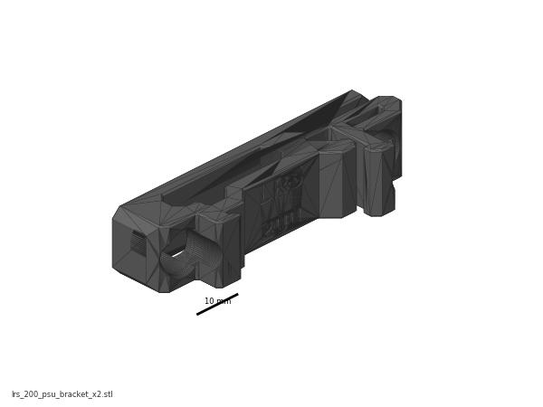{ width=96 } | `Electronics_Bay/lrs_200_psu_bracket_x2` | 09-bay | 2 | Black |
| 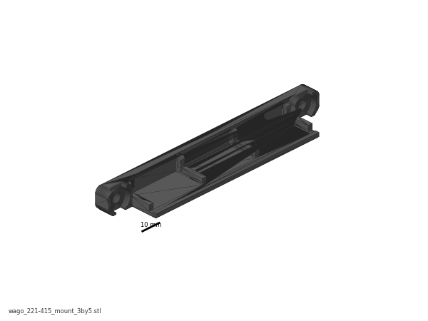{ width=96 } | `Electronics_Bay/wago_221-415_mount_3by5` | 09-bay | 1 | Black |
| 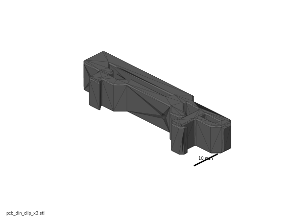{ width=96 } | `Electronics_Bay/pcb_din_clip_x3` | 09-bay | 3 (spares — the kit supplies 4 printed, this chapter fits 3) | Black |
| 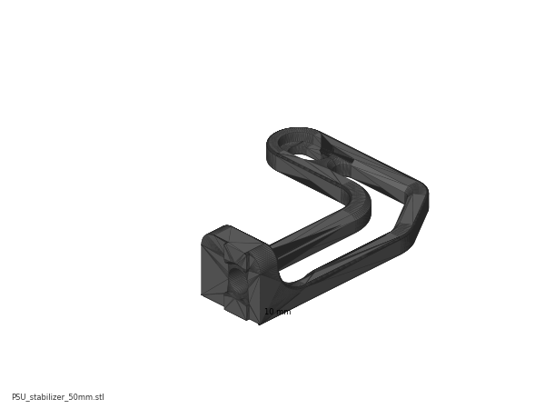{ width=96 } | `Electronics_Bay/PSU_stabilizer_50mm` | 09-bay | 1 — **fit only if needed**, see 09.16 | Black |
| 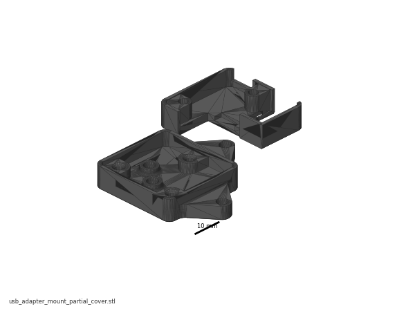{ width=96 } | `Nitehawk-SB-V2/usb_adapter_mount_partial_cover` | 08-CW2 | 1 | Black — fitted in Ch 08 Step 08.64, bagged with the adapter |
| 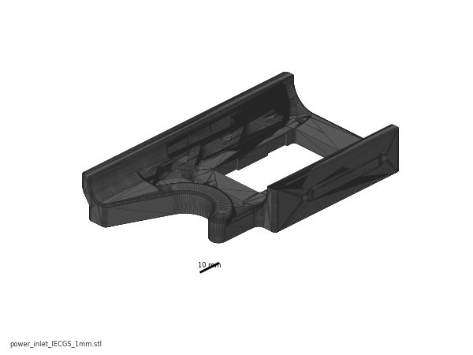{ width=96 } | `Skirts/power_inlet_IECGS_1mm` | 09-bay | 1 (batch B07-P1) | Black |
| 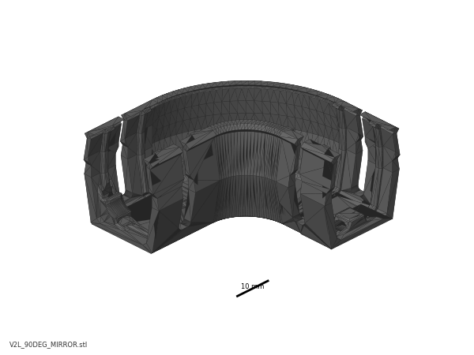{ width=96 } | B11 DC loop, 09.6: `CMD_V3_1H_154mm_DUCT` ×2, `CMD_V3_1H_90DEG` ×2, `V2L_90DEG_MIRROR`, `V2L_58mm_DUCT` ×3, `V2L_130mm_DUCT`, `V2L_70mm_DUCT`, `CMD_Remix-V3_DUCT-2B_45deg` ×2, `V3L_10mm_DUCT` | 09-ducts-DC | 13 | Black |
| 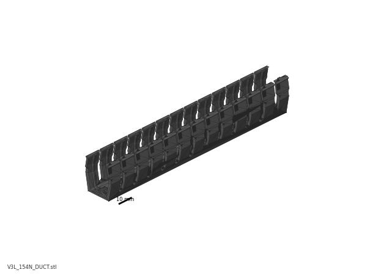{ width=96 } | B11 middle run, 09.6: `V3L_154N_DUCT` ×2, `V3L_T_REG_N` ×2, or B11's fallback set | 09-ducts-DC | 4 | Black |
| 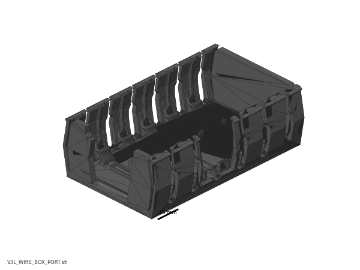{ width=96 } | B11 AC conduit, 09.36: `V3L_WIRE_BOX_PORT`, `V3L_90DEG_R15` ×2, `V3L_34mm_DUCT_HOLE`, `CMD_V3_1H_T_SHORT`, `V3L_10mm_DUCT` ×2, `CMD_Remix-V3_DUCT-1M_ENDCAP` ×2 | 09-ducts-AC | 9 | Black |

**Supplied printed by LDO — do not print these:** Leviathan Bracket Left ×1, Leviathan Bracket Right ×1, NH Adapter Mount ×1, DIN Clip ×4, LDO Nozzle Probe ×1, Bed WAGO Mount ×1. [src](https://docs.ldomotors.com/en/voron/voron2/350_BOM/Rev_D+)

**Hardware** (chapter totals)

| Fastener / part | Qty | Note |
|---|---|---|
| DIN rail, 35 mm W, slotted | 2 | length not stated by the manual or LDO — **(verify on bench)** |
| DIN rail plastic end cap | 4 | 2 per rail |
| PVC wire duct, 20 W × 25 H | 5 | **LDO layout only** (3 across, 2 front-to-back). Layout v3 uses one, as the middle run, only if B11.10's gap row failed. Cut lengths **(verify on bench)** |
| M5×10 BHCS | 8 | 4 DIN rails, 2 mains WAGO mount, 2 bed WAGO mount |
| M5 T-nut | 2 | 2 mains WAGO mount — the 4 DIN-rail T-nuts are placed in Ch 02 Step 02.11 and the 2 bed WAGO mount T-nuts are parked in Ch 03 Step 03.12, 0 new here |
| M4×6 BHCS | 6 | 4 PSU brackets **(verify)**, 2 SSR to its metal bracket |
| M3×8 SHCS | 6 | 4 Leviathan to brackets **(verify)**, 2 inlet panel; the XY endstop PCB's 2 are Ch 05's |
| M3×6 BHCS | 2 | 2×2 XH splicer PCB to the bed WAGO mount, per LDO's wiring guide; its printed-parts guide says 2× M3×8 SHCS `(verify on bench)` |
| M3×10 FHCS | 0 | p.156's two fix the filtered inlet; the IEC-GS module snaps into `power_inlet_IECGS_1mm` on its 1 mm tabs, no screws (CAD, STL) |
| M3×25 SHCS | 2 | nozzle probe to the bed extrusion — **not** the manual's M3×20 |
| M3×30 SHCS | 0: fitted in Ch 05 | XY endstop pod to the gantry (manual p.164), fitted at Step 05.49 and counted in Ch 05's table |
| M3 T-nut | 2 | 2 inlet panel; the nozzle probe's 2 are parked in Ch 03 Step 03.12 |
| M2×10 self-tapping | 8 (LDO's BOM lists 43) | 4 DIN clips to Leviathan brackets (09.20), 2 the USB adapter's DIN clip (09.25), 2 Z endstop PCB (09.28) — the adapter stack itself is held by 3× M3×10 SHCS fitted in Ch 08 Step 08.64 |
| M3×5×4 heat-set insert | 5: 3 inlet panel + 2 bed WAGO mount | inlet panel: 1 in the rail's bottom face for the bottom-panel hinge (Ch 11), 2 in the cut-out for the p.222 belt guard (three Ø4.7 bores in `power_inlet_IECGS_1mm.stl`; p.156 draws five because the filtered variant adds two for its inlet screws); the mains WAGO mount has none, only two M5 holes |
| Meanwell LRS-200-24 PSU | 1 | 115/230 V selector switch on the side |
| Omron G3NB-210B-1 SSR | 1 | |
| DIN rail mount bracket for SSR, metal | 1 | off-the-shelf metal; there is no printed SSR mount |
| AC inlet, integrated switch & fuse | 1 | one module — not the manual's separate inlet + rocker |
| WAGO 221-415 (5-way) | 3 | mains distribution, L / N / PE |
| WAGO 221-412 (2-way) | 2 | bed WAGO mount |
| LDO Leviathan mainboard | 1 | |
| Leviathan Bracket Left | 1 | LDO-supplied printed |
| Leviathan Bracket Right | 1 | LDO-supplied printed |
| DIN Clip | 3 | 2 Leviathan brackets, 1 USB adapter; LDO ships 4, the 4th is a spare (LDO printed-parts guide) |
| DC Ground Wire | 1 | USB adapter's exposed mounting point (09.25); frame end landed in Ch 10 Step 10.58 |
| Raspberry Pi 4B | 1 | reseller-optional line item |
| Raspberry Pi heatsink | 1 | |
| Pi standoff — from the Leviathan box | 4 | **(verify on bench)** |
| Raspberry Pi 3/4 HAT power adapter — from the Leviathan box | 1 | the Pi 5 adapter stays bagged **(verify on bench)** |
| Z endstop PCB | 1 | |
| 2×2 XH splicer PCB | 1 | bed thermistor breakout |
| LDO Nozzle Probe, collar pre-pressed | 1 | LDO-supplied printed; the collar is part of it `(verify on bench)` |
| Nozzle probe shaft, 5 mm | 1 | |
| M3×2 set screw | 1 | nozzle-probe collar, threadlocker pre-applied |
| Bed WAGO Mount | 1 | LDO-supplied printed |

**Notes behind "Read first"**

**Left and right in this chapter** are always the printer's own — the way you would say them standing at the front of the upright machine, display towards you. With the printer on its head, work from the printer's **rear** (the edge the deck notch points to — 09.4 — with the A/B motors hanging from the gantry's rear corners above it) and look down into the bay: the front edge is far from you, and your left is the printer's left. That is exactly the view in LDO's placement photo (display at the top of the frame) and in the manual's p.169/p.171 insets (labelled *Front* at the top). Stand at the front of the inverted printer instead and everything below is mirrored — and the bay is not symmetric.

- **Remove *every* voltage-selection jumper from the Leviathan before it goes anywhere near the rail** (step 09.19). Mixing voltages on the shared 24 V supply permanently destroys the controller and whatever is plugged into it. Jumpers go back in Ch 10, one at a time, after each component's voltage is confirmed. [src](https://ldomotion.com/guides/voron-leviathan-v1-3)
- **Nothing is wired in this chapter.** Mains wiring is the one step in this build that can kill you, and it is done as one deliberate sequence in Ch 10 that ends at LDO's **Checkpoint #1** — continuity within each colour group, no continuity between L, N and PE, PSU selector confirmed, all with the cord unplugged. Leave the C13 cord in its bag. (survey §4.4 #8)
- **The manual pages p.148–172 describe a different machine** — a BTT Octopus, a mini12864, a 5 V PSU and a separate Pi bracket. Use them for the DIN-rail technique and the mounting geometry only; every part that differs carries a `⚠` callout at its step. [src](https://docs.ldomotors.com/voron/voron2/build-faq)
- **Do not close the bay.** Skirts and the bottom panel go on in Ch 11, only after Checkpoint #1 passes. Fitting them now costs an hour of re-opening plus the safety check you skipped (survey §5.2 W8).
- **Test-fit every roll-in T-nut.** Extrusion and T-nut tolerances on this kit are tight; a forced nut galls the slot. [src](https://docs.ldomotors.com/voron/voron2/build-faq)
- **Bench-only work, good for a short session**: 09.10 and 09.34's inserts, 09.14–09.15 (PSU selector and brackets), 09.17 (SSR on its bracket), 09.19–09.23 (Leviathan brackets, jumpers, Pi, HAT adapter), 09.25 (USB-adapter clip) and 09.27–09.29 (nozzle probe) need no printer. If you did the two heat-set jobs in Ch 08's iron session, 09.10 and 09.34 start with a confirm.

**Sources for this chapter:**

- [Voron 2.4r2 assembly manual, p.148–172](https://github.com/VoronDesign/Voron-2/blob/de7e89d/Manual/Assembly_Manual_2.4r2.pdf#page=148) — mounting geometry and DIN technique only; the boards on those pages are a different machine. Pinned at commit `de7e89d`. p.28–29 supply the deck and DIN-rail pages
- [LDO wiring guide (Rev D)](https://docs.ldomotors.com/en/voron/voron2/wiring_guide_rev_d) — the placement this chapter actually builds: [General Placement](https://docs.ldomotors.com/en/voron/voron2/wiring_guide_rev_d#general-placement), [DIN rails and wire ducts](https://docs.ldomotors.com/en/voron/voron2/wiring_guide_rev_d#installing-the-din-rails-and-wire-ducts), [Preparing the inlet](https://docs.ldomotors.com/en/voron/voron2/wiring_guide_rev_d#preparing-the-inlet), [Preparing the PSU](https://docs.ldomotors.com/en/voron/voron2/wiring_guide_rev_d#preparing-the-power-supply-unit), [Preparing the mainboard](https://docs.ldomotors.com/en/voron/voron2/wiring_guide_rev_d#preparing-the-mainboard-ldo-voron-leviathan-board), [Assembling the nozzle probe](https://docs.ldomotors.com/en/voron/voron2/wiring_guide_rev_d#assembling-the-nozzle-probe), [Wiring the bed heater](https://docs.ldomotors.com/en/voron/voron2/wiring_guide_rev_d#wiring-the-bed-heater), [Checkpoint #1](https://docs.ldomotors.com/en/voron/voron2/wiring_guide_rev_d#checkpoint-1)
- [LDO Build Notes § Voron 2.4 build FAQ](https://docs.ldomotors.com/en/voron/voron2/build-faq) — every page in p.148–172 that this kit skips or replaces
- [LDO Leviathan V1.3 board guide](https://ldomotion.com/guides/voron-leviathan-v1-3) — voltage-selection jumpers and Pi mounting (link-only; no licence)
- [LDO printed-parts guide (Rev D)](https://docs.ldomotors.com/en/voron/voron2/printed_part_guide_rev_d) and [LDO 350 Rev D+ BOM](https://docs.ldomotors.com/en/voron/voron2/350_BOM/Rev_D+) — which brackets to print, what the kit supplies
- [Nitehawk-SB V2 repo](https://github.com/MotorDynamicsLab/Nitehawk-SB-V2) — the USB adapter stack and its grounding wire
- [LDO XY-endstop repin guide](https://docs.ldomotors.com/en/guides/XY_Endstop_Cable_Reconnecting_Guide) — connector order on the XY endstop PCB
- Mirrored images in this chapter are LDO Motors' (docs.ldomotors.com, LDOVoron2, Nitehawk-SB V2), used with attribution; see `assets/remote/09-electronics-bay/SOURCES.txt`

**Video coverage (Steve Builds, pre-release LDO kit — differs from Rev D+):** [Part 5 @2:47:07](https://www.youtube.com/watch?v=hTKCBrk36R0&list=PL0fUJbigELQPqpeGOgHYisG4KaSXVtnNY&t=10027s) (+21m), [Part 6 @1:30:45](https://www.youtube.com/watch?v=8pWoYkY1DiA&list=PL0fUJbigELQPqpeGOgHYisG4KaSXVtnNY&t=5445s) (+12m), [Part 7 @0:05:08](https://www.youtube.com/watch?v=eHo0k2wQsJw&list=PL0fUJbigELQPqpeGOgHYisG4KaSXVtnNY&t=308s) (+4m), [Part 7 @0:24:27](https://www.youtube.com/watch?v=eHo0k2wQsJw&list=PL0fUJbigELQPqpeGOgHYisG4KaSXVtnNY&t=1467s) (+9m), [Part 7 @0:31:06](https://www.youtube.com/watch?v=eHo0k2wQsJw&list=PL0fUJbigELQPqpeGOgHYisG4KaSXVtnNY&t=1866s) (+5m), [Part 7 @0:35:54](https://www.youtube.com/watch?v=eHo0k2wQsJw&list=PL0fUJbigELQPqpeGOgHYisG4KaSXVtnNY&t=2154s) (+20m), [Part 7 @0:59:20](https://www.youtube.com/watch?v=eHo0k2wQsJw&list=PL0fUJbigELQPqpeGOgHYisG4KaSXVtnNY&t=3560s) (+12m), [Part 8 @0:31:02](https://www.youtube.com/watch?v=Q3Q1szaFfSE&list=PL0fUJbigELQPqpeGOgHYisG4KaSXVtnNY&t=1862s) (+23m), [Part 8 @1:54:21](https://www.youtube.com/watch?v=Q3Q1szaFfSE&list=PL0fUJbigELQPqpeGOgHYisG4KaSXVtnNY&t=6861s) (+21m)

---

### Step 09.1 — Read the end state

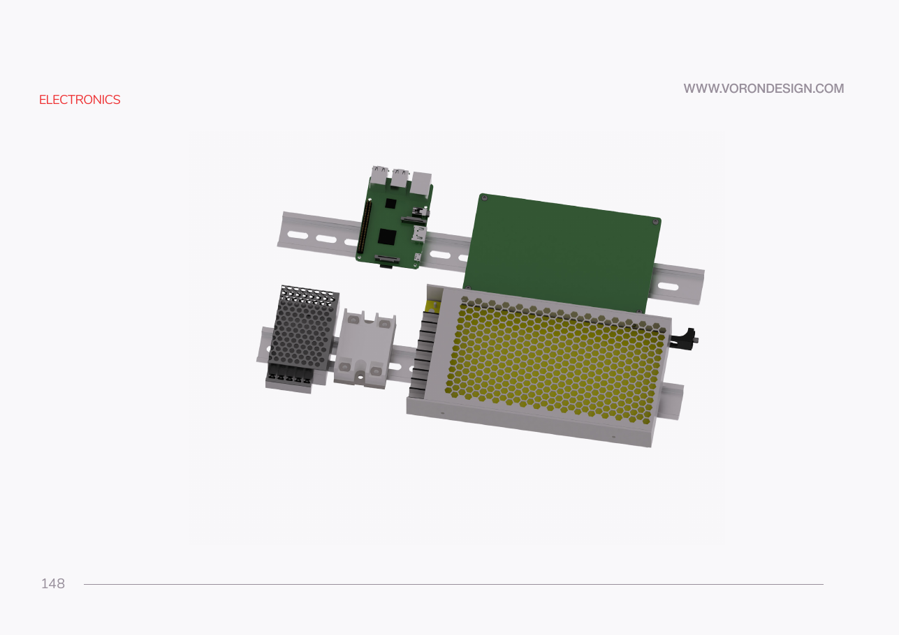{ crop="0.24 0.24 0.90 0.72" }

**What you're looking at:** The bay is the space under the deck panel where every electronic part lives. Two **[DIN rails](16-glossary.md#d)**, the 35 mm steel top-hat rail industrial gear clips onto, run across it: boards on the front rail, power on the rear.

**Parts:** none.

**Do:**

1. Look at the render: the two rails and where they sit are right for your kit, even though three of the five parts pictured are wrong.
2. Note that nothing is fastened to the acrylic deck except the wire ducts.

**Check:** The parts on your bench are LDO's Leviathan, LRS-200-24 and Omron SSR, not the manual's Octopus, 5 V PSU and Pi bracket.

Source: [Voron manual p.148](https://github.com/VoronDesign/Voron-2/blob/de7e89d/Manual/Assembly_Manual_2.4r2.pdf#page=148) · [LDO wiring guide § General Placement](https://docs.ldomotors.com/en/voron/voron2/wiring_guide_rev_d#general-placement) · [Video: Part 7 @0:05:02](https://www.youtube.com/watch?v=eHo0k2wQsJw&list=PL0fUJbigELQPqpeGOgHYisG4KaSXVtnNY&t=302s)

---

### Step 09.2 — Read the placement you are actually building

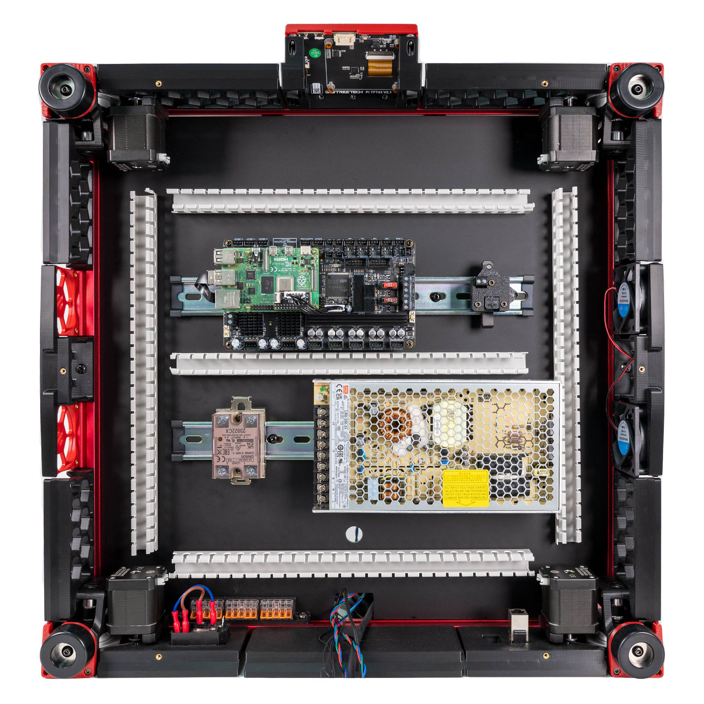
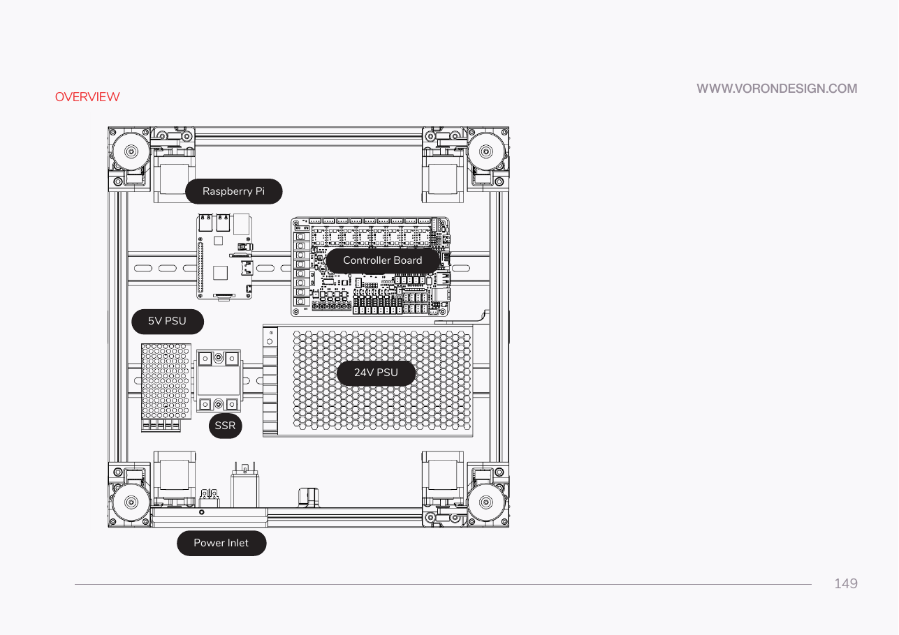{ crop="0.10 0.19 0.58 0.88" }

**What you're looking at:** Match the bay against LDO's photo, not p.149. The manual shows a **Raspberry Pi on its own bracket**, a **BTT Octopus** and a **5 V PSU**; your kit has none: the Pi mounts *on* the Leviathan, which replaces the Octopus and supplies the Pi's 5 V.

**Parts:** none.

**Do:**

1. On the front rail, find the Leviathan and Pi, with the USB adapter beside it.
2. On the rear rail, find the SSR on the left and the PSU on the right, terminal block facing the SSR.
3. At the rear-left, find the inlet panel against the Z-motor mount, mains WAGO blocks to its right.

**Check:** You can find each item of LDO's photo on your bench; 09.36 checks the full bay against it.

**Helper:** Points to each item in LDO's photo as you find it: Leviathan, Pi, USB adapter, SSR, PSU and inlet.

LDO's notes on the swapped parts: [src](https://docs.ldomotors.com/voron/voron2/build-faq) · [wiring guide § General Placement](https://docs.ldomotors.com/en/voron/voron2/wiring_guide_rev_d#general-placement)

Source: [Voron manual p.149](https://github.com/VoronDesign/Voron-2/blob/de7e89d/Manual/Assembly_Manual_2.4r2.pdf#page=149) · [LDO wiring guide § General Placement](https://docs.ldomotors.com/en/voron/voron2/wiring_guide_rev_d#general-placement) · image [`S0General_Placement.jpg`](https://raw.githubusercontent.com/MotorDynamicsLab/LDOVoron2/main/Images/WiringGuide/RevD/S0General_Placement.jpg) · [LDO Build Notes § Voron 2.4 build FAQ](https://docs.ldomotors.com/en/voron/voron2/build-faq)

---

### Step 09.3 — Turn the printer over and pre-load the rear T-nuts

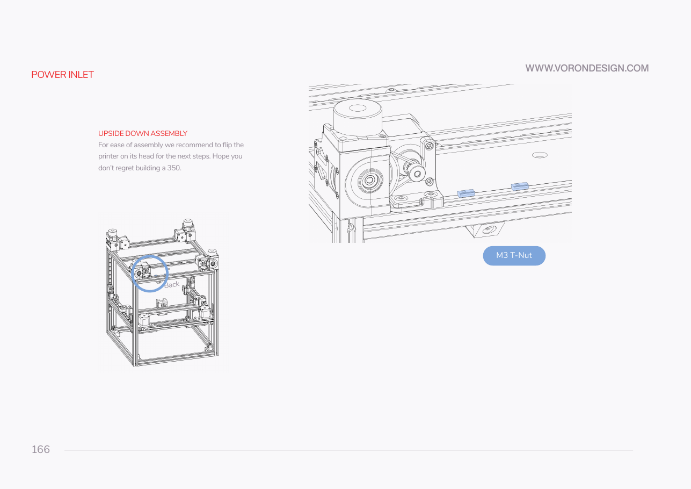{ crop="0.08 0.17 0.84 0.76" }

**What you're looking at:** The bay is on the *underside* of the machine, so this chapter is done with the printer upside down. The two M3 T-nuts go in now because once the inlet panel sits against that slot, no nut can be fed in behind it.

**Parts:**

- M3 T-nut ×2

**Do:**

1. Strap the gantry at the top, or clamp the four Z belts.
2. Take the flex plate off and turn the printer upside down onto a blanket, with two people.
3. Drop two M3 T-nuts into the rear extrusion's upward slot.

**Check:** The printer stands stable on its top, the gantry is strapped with no load on the belts, and two M3 T-nuts slide freely in the rear slot.

**Helper:** Steadies the second side of the frame as it rolls onto the blanket, on a count of three.

Source: [Voron manual p.166](https://github.com/VoronDesign/Voron-2/blob/de7e89d/Manual/Assembly_Manual_2.4r2.pdf#page=166) · [LDO wiring guide § Installing the DIN rails and wire ducts](https://docs.ldomotors.com/en/voron/voron2/wiring_guide_rev_d#installing-the-din-rails-and-wire-ducts)

---

### Step 09.4 — Verify the deck panel before you drill anything into the layout

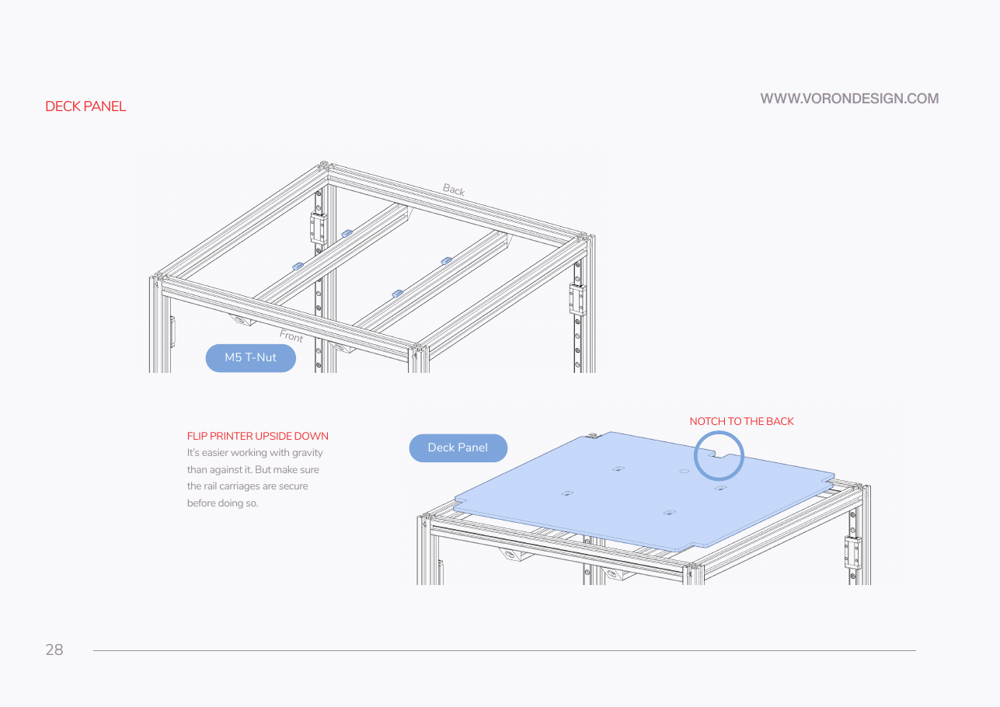{ crop="0.40 0.56 0.95 0.84" }

**What you're looking at:** The deck panel separates the chamber above from the bay below, and the DIN rails screw **through** it into the bed extrusions. The deck supports come in 3 mm and 4 mm versions, and the wrong pair leaves the panel flexing.

**Parts:**

- reused: the deck panel

**Do:**

1. Check the notch faces the back and the rear wire opening is clear.
2. Measure the edge with the caliper: the BOM lists 469 × 469 × **3 mm** and LDO's guide assumes 4 mm.
3. If Ch 02 fitted `deck_support_4mm_x8` and the panel measures 3 mm, swap them for `deck_support_3mm_x8` now: the deck will carry the rails and everything on them. [src](https://docs.ldomotors.com/en/voron/voron2/350_BOM/Rev_D+)

**Check:** The notch points back, the opening is clear, the thickness is recorded and the supports match it.

**Helper:** Reads the caliper at the deck edge aloud and writes the thickness down.

Source: [Voron manual p.28](https://github.com/VoronDesign/Voron-2/blob/de7e89d/Manual/Assembly_Manual_2.4r2.pdf#page=28) · [LDO wiring guide § Installing the DIN rails and wire ducts](https://docs.ldomotors.com/en/voron/voron2/wiring_guide_rev_d#installing-the-din-rails-and-wire-ducts) · [LDO 350 Rev D+ BOM](https://docs.ldomotors.com/en/voron/voron2/350_BOM/Rev_D+)

---

### Step 09.5 — Fit the two DIN rails, running left to right

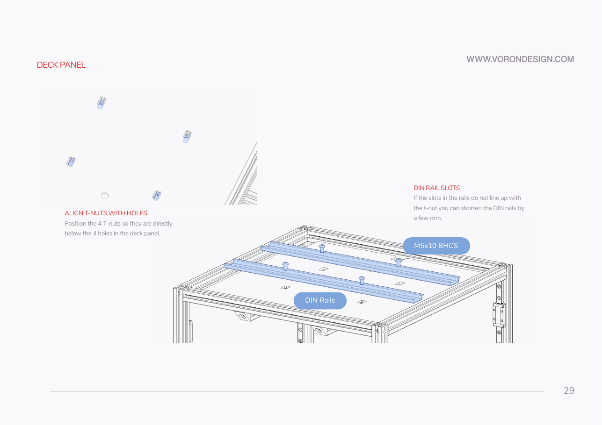{ crop="0.08 0.48 0.90 0.92" }

**What you're looking at:** The two DIN rails are 35 mm slotted steel, cut to length. Every electronic part clips onto one of them, so a board can slide along or lift off without touching the deck. They run left to right across *both* bed extrusions, one screw into each.

**Parts:**

- DIN rail ×2
- DIN rail plastic end cap ×4
- M5×10 BHCS ×4
- reused: the four deck T-nuts

**Do:**

1. Slide each deck T-nut directly under one of the deck panel's four holes.
2. Lay each rail across **both** extrusions over two holes, front rail and rear rail.
3. Screw each rail down with M5×10 BHCS, snug, then fit the end caps.

**Check:** Both rails run parallel, left to right, two screws each through the deck holes, inside the deck edges, clear of the Z belts, four end caps on.

⚠ LDO publishes no **cut length** for a 350's rails **(verify on bench)**. Cut both the same and keep them inside the deck panel. Then use p.29's way out: if a rail slot does not land on a T-nut, shorten the rail by a few mm rather than moving the nut off the extrusion.

Source: [Voron manual p.29](https://github.com/VoronDesign/Voron-2/blob/de7e89d/Manual/Assembly_Manual_2.4r2.pdf#page=29) · [LDO wiring guide § Installing the DIN rails and wire ducts](https://docs.ldomotors.com/en/voron/voron2/wiring_guide_rev_d#installing-the-din-rails-and-wire-ducts) · [Video: Part 2 @0:56:00](https://www.youtube.com/watch?v=2U0YahE8w_0&list=PL0fUJbigELQPqpeGOgHYisG4KaSXVtnNY&t=3360s)

Pause: ~30 min since the last pause — the printer is on its top, the rear T-nuts are in, the deck panel is checked, and both DIN rails are screwed through the deck holes with their end caps on. Nothing is laid on the deck or clipped to a rail yet. Leave the printer where it is if you can: standing it back up costs you the T-nut access.

---

### Step 09.6 — Lay the printed DC conduit

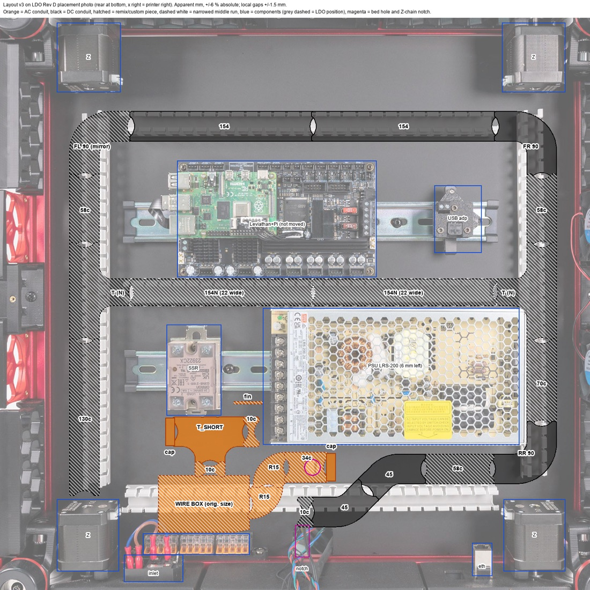
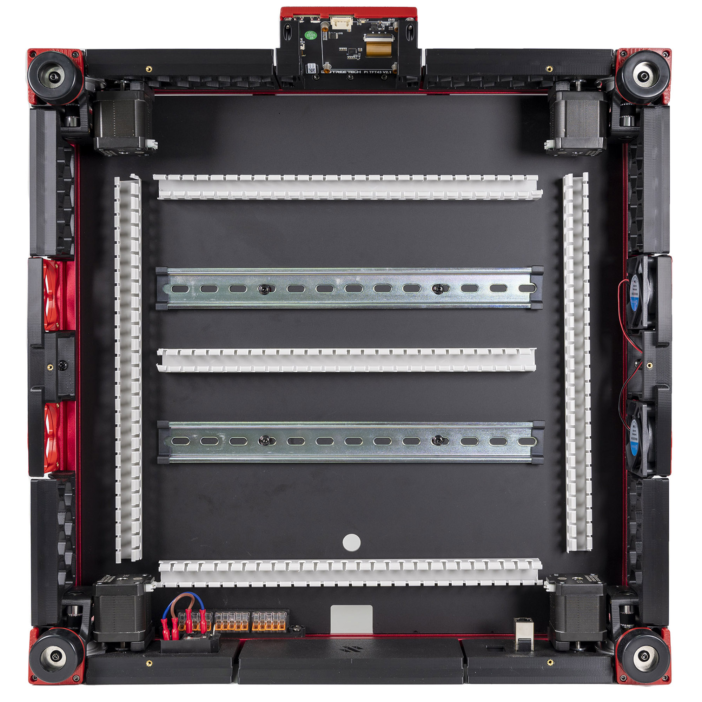

**What you're looking at:** Layout v3 replaces LDO's five PVC wire ducts with two printed conduits. The DC loop, drawn black on the overlay, runs round the front from the rear-left Z motor to the notch, open at both rear ends, with a narrowed middle run.

**Parts:**

- `CMD_V3_1H_154mm_DUCT` ×2
- `CMD_V3_1H_90DEG` ×2
- `V2L_90DEG_MIRROR` ×1
- `V2L_58mm_DUCT` ×3
- `V2L_130mm_DUCT` ×1
- `V2L_70mm_DUCT` ×1
- `CMD_Remix-V3_DUCT-2B_45deg` ×2
- `V3L_10mm_DUCT` ×1
- `V3L_T_REG_N` ×2
- `V3L_154N_DUCT` ×2
- consumable: masking tape

**Do:**

1. Lay the DC loop against the overlay without tape, every joint pushed closed.
2. Mark each joint and each run end on masking tape on the deck.
3. Leave the loop loose until 09.36; the VHB tape, lids and AC parts stay in their bins.

**Check:** One loose run goes from Z motor to notch, joints marked, round hole uncovered, notch open for the DC bundle, no motor or plug touched.

**Helper:** Writes each joint's mark on the masking tape as the adult pushes the pieces closed.

On the overlay, 58c, 130c, 70c and 10c are the straights of that length, FL 90 is `V2L_90DEG_MIRROR`, T (N) is `V3L_T_REG_N` and 45 is the 45° pair. Fit the narrowed middle run only if B11.10's gap row passed `(verify on bench)`. Otherwise fit stock `CMD_V3_1H_T_REG` in place of each narrowed T and butt LDO's PVC middle duct against both T stems `(verify on bench)`. Where B11's fallback 82 mm straight goes is not drawn yet. [B11 options](print/B11-bay-ducting.md#after-the-kit-day-measurements)

**LDO layout:** cut five PVC ducts instead, three left to right (ahead of the front rail, between the rails and behind the rear one) and two front to back down the sides. Lengths are not published `(verify on bench)`; keep the offcuts. [LDO § DIN rails and wire ducts](https://docs.ldomotors.com/en/voron/voron2/wiring_guide_rev_d#installing-the-din-rails-and-wire-ducts)

Source: `review/2026-09-23-bay-mods/layout-v3/layout-v3.md` · [B11 — Bay ducting](print/B11-bay-ducting.md) · [MSS duct remix, Printables 502306](https://www.printables.com/model/502306), after RyanDam's Cable Management Duct, GPL-3.0 · [LDO wiring guide § Installing the DIN rails and wire ducts](https://docs.ldomotors.com/en/voron/voron2/wiring_guide_rev_d#installing-the-din-rails-and-wire-ducts) · image [`S0_Din_Raill.jpg`](https://raw.githubusercontent.com/MotorDynamicsLab/LDOVoron2/main/Images/WiringGuide/RevD/S0_Din_Raill.jpg) · [Video: Part 7 @0:55:08](https://www.youtube.com/watch?v=eHo0k2wQsJw&list=PL0fUJbigELQPqpeGOgHYisG4KaSXVtnNY&t=3308s)

---

### Step 09.7 — Learn the DIN clip motion once

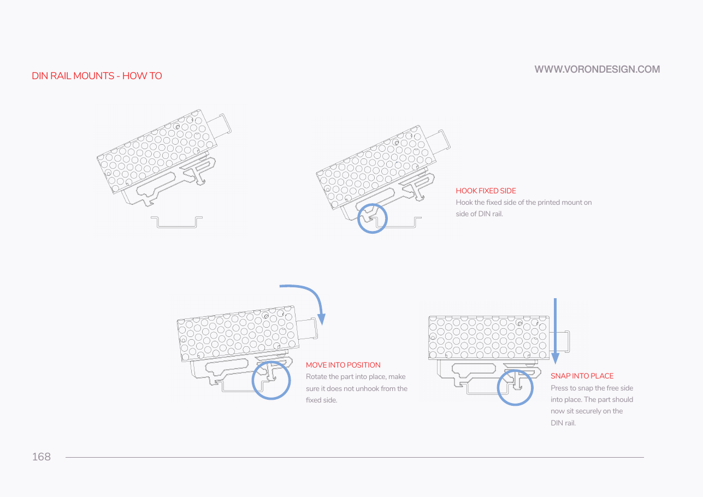

**What you're looking at:** A [DIN clip](16-glossary.md#d) is the sprung foot that grips the rail: one side is a fixed hook, the other a spring latch. Every clipped part in this chapter goes on the same way, and pressing one on flat first breaks the latch.

**Parts:**

- one spare printed `pcb_din_clip` ×1

**Do:**

1. Practise on a spare clip: hook the **fixed** side over one rail edge.
2. Rotate the part down flat with that hook still engaged.
3. Press until the sprung side snaps over the other edge.

**Check:** The clip sits square on the rail without rocking, and it slides along the rail under firm thumb pressure but not under its own weight.

**Helper:** Practises hook, rotate and snap on the spare clip until it clicks on first time.

Source: [Voron manual p.168](https://github.com/VoronDesign/Voron-2/blob/de7e89d/Manual/Assembly_Manual_2.4r2.pdf#page=168) · [LDO wiring guide § Installing the DIN rails and wire ducts](https://docs.ldomotors.com/en/voron/voron2/wiring_guide_rev_d#installing-the-din-rails-and-wire-ducts) · [Video: Part 7 @0:28:22](https://www.youtube.com/watch?v=eHo0k2wQsJw&list=PL0fUJbigELQPqpeGOgHYisG4KaSXVtnNY&t=1702s)

Pause: ~25 min since the last pause — both DIN rails are on and the DC loop is laid out on its tape marks, not stuck; the VHB, lids and AC parts wait for 09.36. A piece knocked out of place goes back to its marks. Slide the middle run aside if a board needs room to clip on, since 09.36 centres it again. Nothing is clipped to a rail yet. Leave the printer where it is if you can: standing it back up costs you the T-nut access.

---

### Step 09.8 — Do not build the Pi bracket

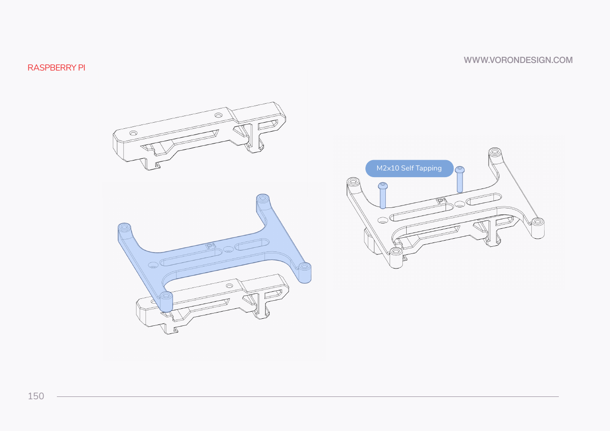
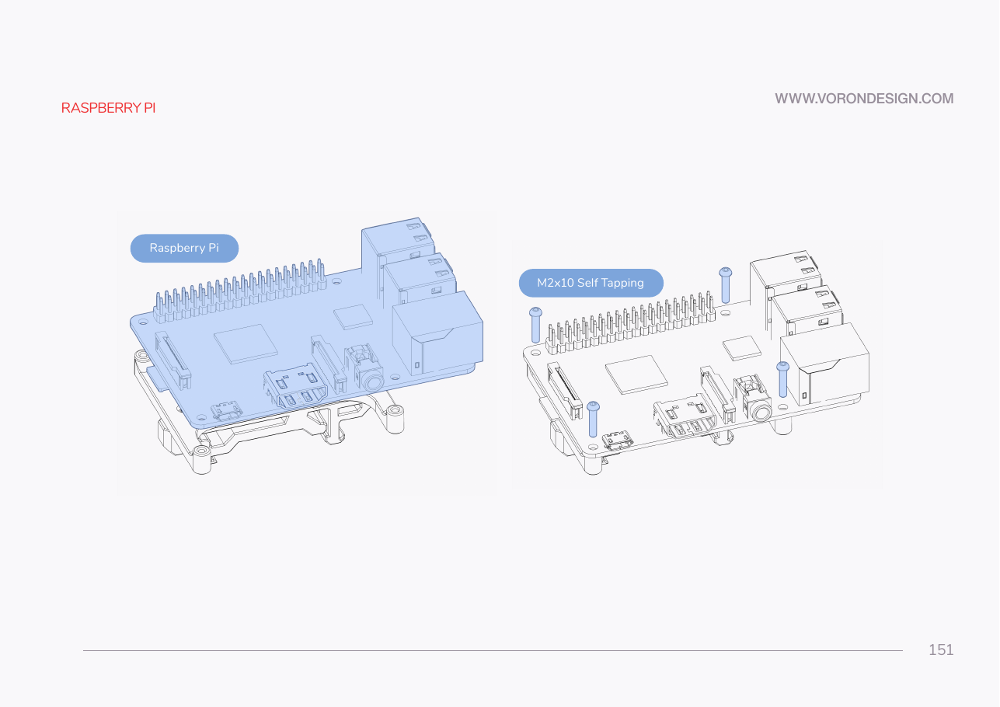

**What you're looking at:** A deliberate skip. The manual mounts the Raspberry Pi on its own printed bracket because its machine uses a separate controller board; the Leviathan has its own Pi mounting area with standoffs, so both pages are dead here.

**Parts:** none.

**Do:**

1. Skip manual p.150–151.
2. Put the Pi aside for step 09.22.

**Check:** No `raspberrypi_bracket` or `beefy_raspberry_bracket` is in your printed-parts bin, because the print plan never printed them.

LDO's note on p.150 points at the Beefy Raspberry Pi Mount and then says *"it does not apply for rev D kits"*. [src](https://docs.ldomotors.com/voron/voron2/build-faq)

Source: [Voron manual p.150](https://github.com/VoronDesign/Voron-2/blob/de7e89d/Manual/Assembly_Manual_2.4r2.pdf#page=150) · [Voron manual p.151](https://github.com/VoronDesign/Voron-2/blob/de7e89d/Manual/Assembly_Manual_2.4r2.pdf#page=151) · [LDO wiring guide § General Placement](https://docs.ldomotors.com/en/voron/voron2/wiring_guide_rev_d#general-placement) · [LDO Build Notes § Voron 2.4 build FAQ](https://docs.ldomotors.com/en/voron/voron2/build-faq)

---

### Step 09.9 — Do not fit a 5 V PSU

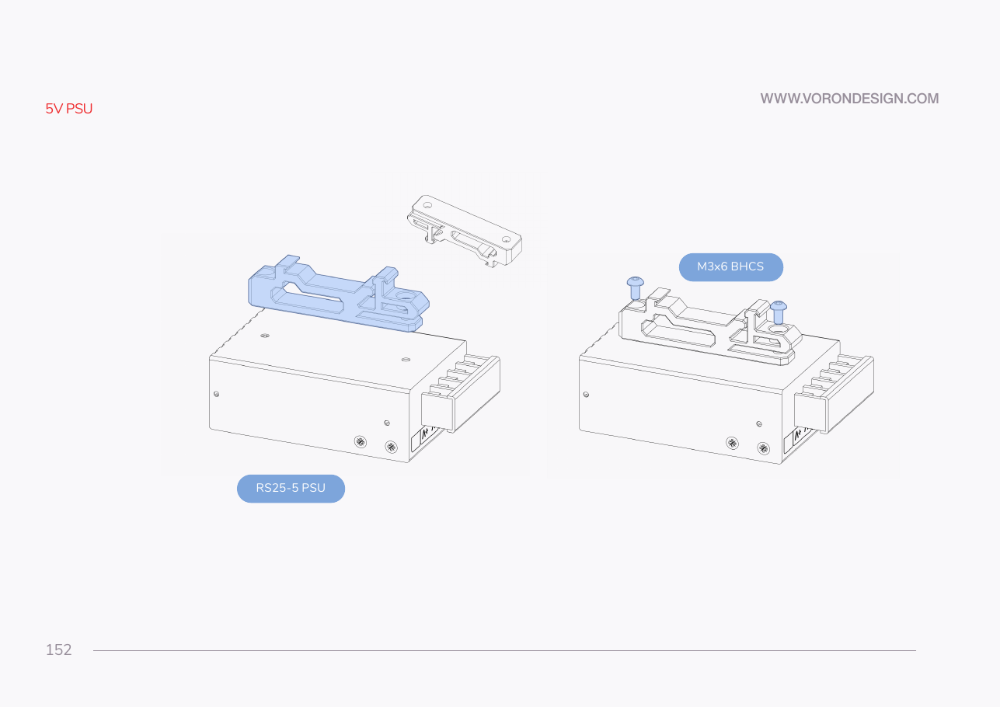
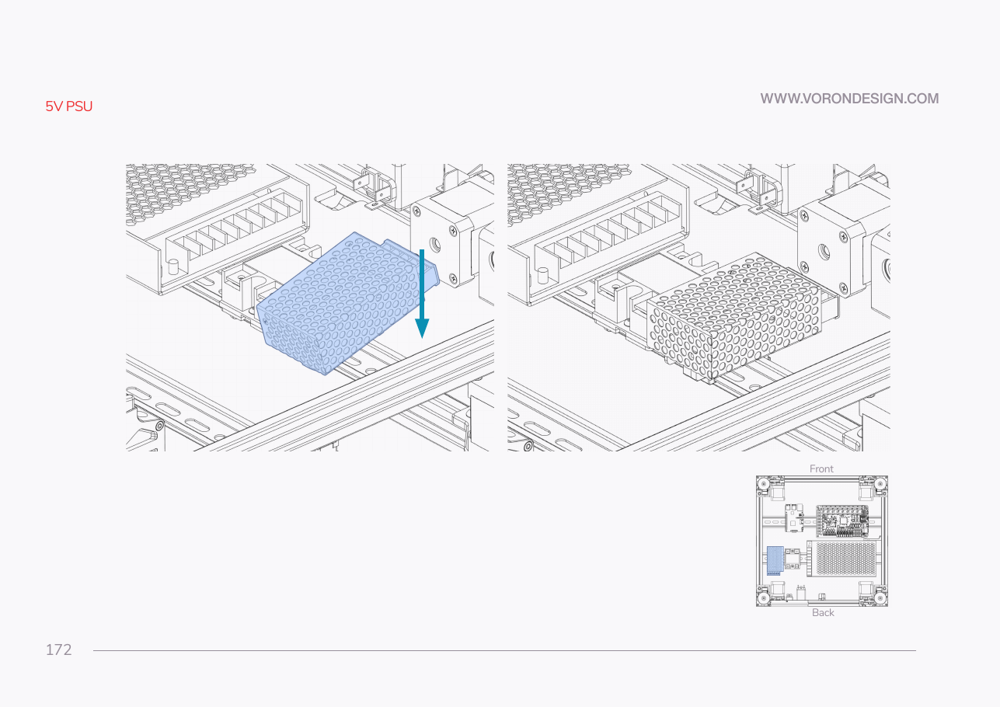

**What you're looking at:** Another skip, for a related reason: the manual's machine carries a second, 5 V power supply just to run the Pi. The Leviathan makes the Pi's 5 V itself, through the GPIO power adapter fitted at 09.23, so this build has exactly one PSU in it.

**Parts:** none.

**Do:**

1. Skip manual p.152 and p.172.
2. Expect no RS25-5 in the kit and no space set aside for one.

**Check:** No RS-25-5 or second supply is in the kit boxes, and the Pi power lead and 3/4 HAT adapter are bagged for 09.23.

LDO: *"The kit does not use a 5V PSU."* This also removes manual p.190 later in the build. [src](https://docs.ldomotors.com/voron/voron2/build-faq)

Source: [Voron manual p.152](https://github.com/VoronDesign/Voron-2/blob/de7e89d/Manual/Assembly_Manual_2.4r2.pdf#page=152) · [Voron manual p.172](https://github.com/VoronDesign/Voron-2/blob/de7e89d/Manual/Assembly_Manual_2.4r2.pdf#page=172) · [LDO wiring guide § Preparing the power supply unit](https://docs.ldomotors.com/en/voron/voron2/wiring_guide_rev_d#preparing-the-power-supply-unit) · [LDO Build Notes § Voron 2.4 build FAQ](https://docs.ldomotors.com/en/voron/voron2/build-faq)

---

### Step 09.10 — Heat-set the power inlet panel

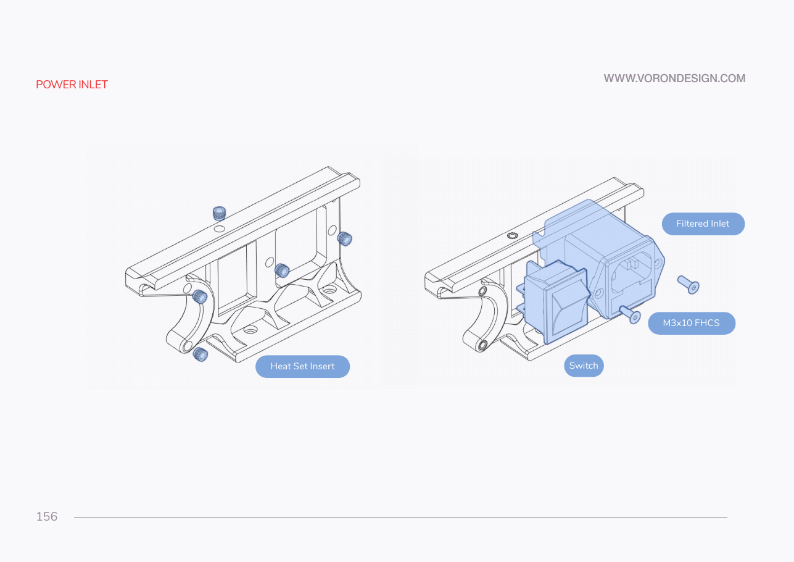{ crop="0.14 0.26 0.47 0.68" }


**What you're looking at:** The inlet panel is the printed plate that fills a rear-skirt cut-out and carries the mains socket. LDO ships the **1.0 mm AC inlet with an integrated switch**, so yours is **`power_inlet_IECGS_1mm`**, with a different cut-out from the manual's `power_inlet_filtered`. [Heat-set inserts](16-glossary.md#h) give it metal threads for the bottom-panel hinge and the belt guard, both fitted in Ch 11.

**Parts:**

- `power_inlet_IECGS_1mm` ×1
- M3×5×4 heat-set insert ×3

**Do:**

1. If Ch 08's insert pass did this panel, confirm it and move on.
2. Otherwise, at your ASA insert temperature, press one insert into each of the three bores, flush: one in the rail, two in the curved cut-out. p.156 draws five.

**Check:** Every insert is flush or a hair below, none tilted, with no plastic bulged around a boss.

LDO's notes on the inlet panel: [src](https://docs.ldomotors.com/voron/voron2/build-faq) · [Rev D printed parts guide](https://docs.ldomotors.com/en/voron/voron2/printed_part_guide_rev_d)

Source: [Voron manual p.156](https://github.com/VoronDesign/Voron-2/blob/de7e89d/Manual/Assembly_Manual_2.4r2.pdf#page=156) · [LDO wiring guide § Preparing the inlet](https://docs.ldomotors.com/en/voron/voron2/wiring_guide_rev_d#preparing-the-inlet) · [LDO printed-parts guide (Rev D)](https://docs.ldomotors.com/en/voron/voron2/printed_part_guide_rev_d) · [LDO Build Notes § Voron 2.4 build FAQ](https://docs.ldomotors.com/en/voron/voron2/build-faq)

---

### Step 09.11 — Fit the combined IEC inlet module

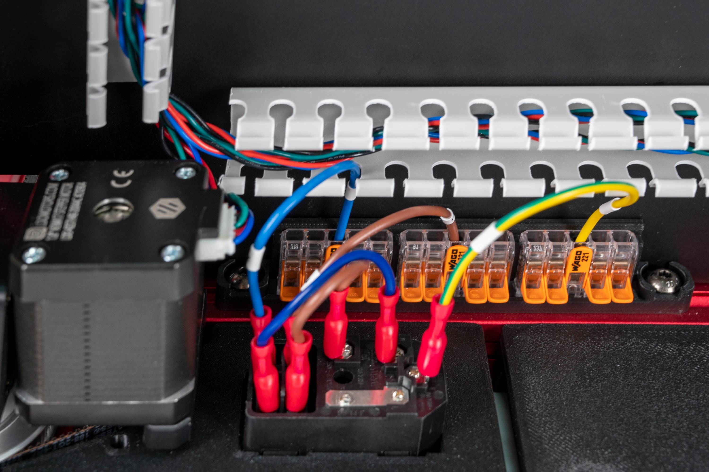
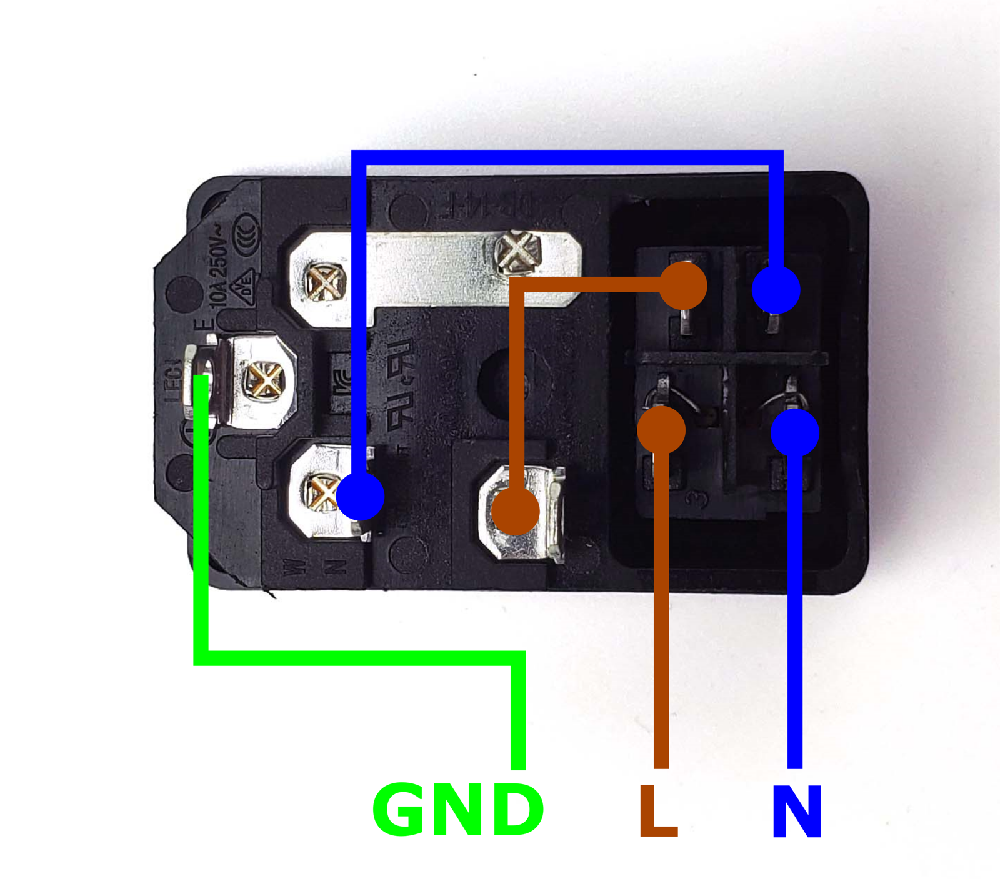

**What you're looking at:** The **IEC inlet** is where mains enters the machine. The manual fits **two** parts here, a filtered inlet *and* a separate rocker switch; yours is **one module** combining the C14 socket, the on/off rocker and the fuse holder. It is live the moment a cord is in, so nothing touches its spade terminals until Ch 10.

**Parts:**

- AC inlet with integrated switch & fuse ×1

**Do:**

1. Press the module into the panel from the outside, earth pin at the top when the printer is upright and switch facing out, until its tabs snap behind the panel wall. It takes no screws.
2. Connect nothing to its spade terminals.

**Check:** The module sits square without rocking, the fuse drawer is reachable, the switch rocks freely, and nothing is wired.

⚠ Check the module's factory wiring **by eye only** against LDO's inlet layout above: L (live) fused, N (neutral) direct, PE (protective earth) never switched or fused. Nothing lights up until Ch 10's first power-on. [src](https://docs.ldomotors.com/en/voron/voron2/wiring_guide_rev_d#preparing-the-inlet)

Source: [LDO wiring guide § Preparing the inlet](https://docs.ldomotors.com/en/voron/voron2/wiring_guide_rev_d#preparing-the-inlet) · image [`S2_inlet.jpg`](https://raw.githubusercontent.com/MotorDynamicsLab/LDOVoron2/main/Images/WiringGuide/RevD/S2_inlet.jpg)

---

### Step 09.12 — Mount the inlet panel to the rear extrusion

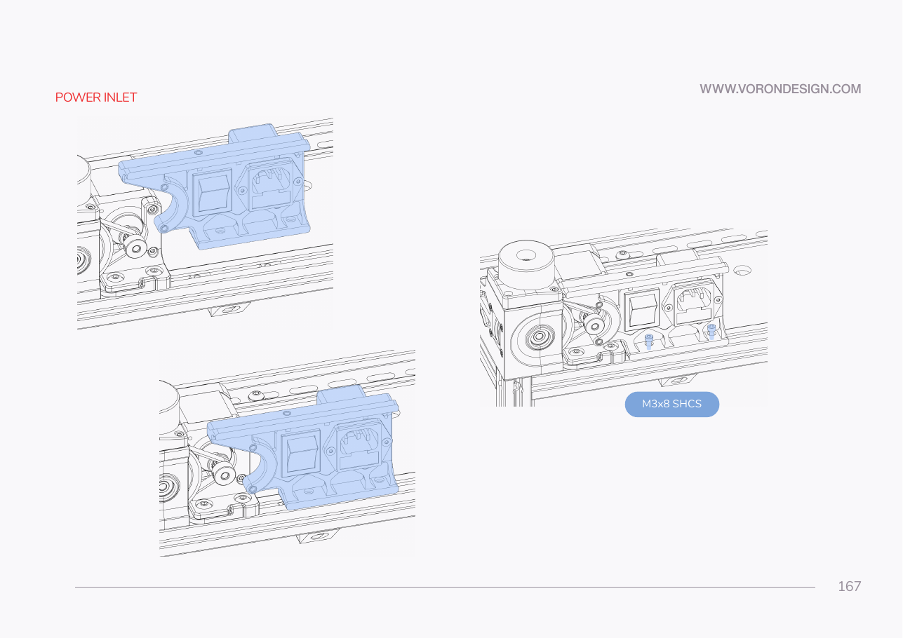

**What you're looking at:** The panel hooks over the rear extrusion's slot and screws to the two T-nuts from Step 09.3. Its position matters twice: hard against the Z-motor mount so the rear skirt pieces line up, and inside the footprint where the rear skirt lands in Ch 11.

**Parts:**

- M3×8 SHCS ×2
- reused: the two pre-loaded rear M3 T-nuts

**Do:**

1. Hook the panel's lip over the rear extrusion's slot and start two M3×8 SHCS into the T-nuts, loose.
2. Slide it against the rear-left Z-motor mount, then tighten. The WAGO block goes to its right.

**Check:** The panel lies flat against the extrusion with no gap at the lip and no overhang where the rear skirt lands in Ch 11, and the inlet is reachable from outside.

Source: [Voron manual p.167](https://github.com/VoronDesign/Voron-2/blob/de7e89d/Manual/Assembly_Manual_2.4r2.pdf#page=167) · [LDO wiring guide § Preparing the inlet](https://docs.ldomotors.com/en/voron/voron2/wiring_guide_rev_d#preparing-the-inlet) · [Video: Part 7 @0:59:57](https://www.youtube.com/watch?v=eHo0k2wQsJw&list=PL0fUJbigELQPqpeGOgHYisG4KaSXVtnNY&t=3597s)

---

### Step 09.13 — Build and mount the mains WAGO block

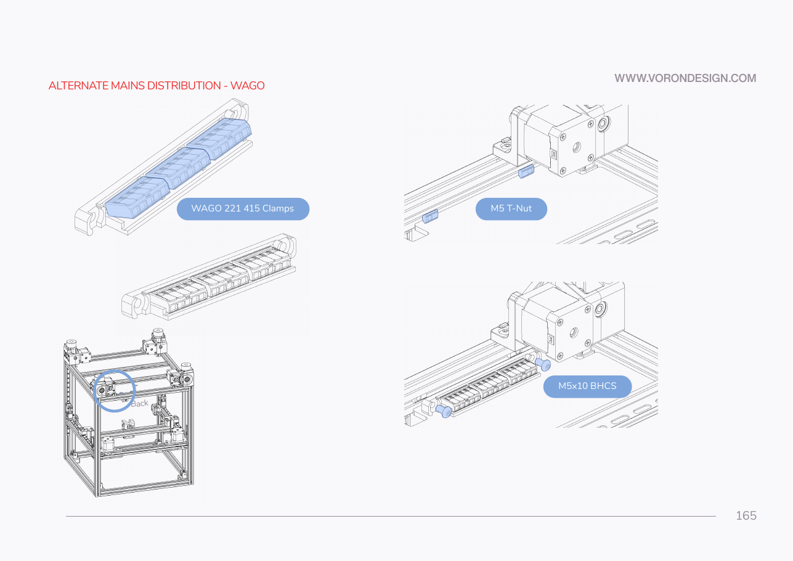

**What you're looking at:** A **[WAGO 221](16-glossary.md#w)** is a lever connector: lift the lever, push a stripped wire end in, drop the lever, and it is clamped. These three 5-way blocks are the mains distribution points, one each for live, neutral and protective earth.

**Parts:**

- `wago_221-415_mount_3by5` ×1
- WAGO 221-415 (5-way) ×3
- M5×10 BHCS ×2
- M5 T-nut ×2

**Do:**

1. Snap the three WAGO 221-415 clamps into the mount, levers facing outward.
2. Slide two M5 T-nuts into the rear extrusion's inner slot, **right** of the inlet panel.
3. Hook the mount on and fasten it with M5×10 BHCS.

**Check:** All three clamps are seated with no step between clamp and mount, every lever lifts freely, and the mount is solid within reach of the inlet's leads.

The manual titles p.165 *"ALTERNATE MAINS DISTRIBUTION — WAGO"*. For this kit it is not an alternate but the only path: the BOM ships three 221-415 clamps, and Ch 10 uses them as the L / N / PE distribution points. [src](https://docs.ldomotors.com/en/voron/voron2/350_BOM/Rev_D+)

Source: [Voron manual p.165](https://github.com/VoronDesign/Voron-2/blob/de7e89d/Manual/Assembly_Manual_2.4r2.pdf#page=165) · [LDO wiring guide § Preparing the inlet](https://docs.ldomotors.com/en/voron/voron2/wiring_guide_rev_d#preparing-the-inlet) · [LDO 350 Rev D+ BOM](https://docs.ldomotors.com/en/voron/voron2/350_BOM/Rev_D+)

Pause: ~30 min since the last pause — the Pi bracket and 5 V PSU are correctly skipped, the inlet panel has its inserts and the IEC module, the panel is screwed to the rear extrusion, and the mains WAGO block is built and mounted. **Nothing is terminated and the C13 cord stays in its bag**: do not connect anything to the inlet.

---

### Step 09.14 — Set the PSU voltage selector to 115 V

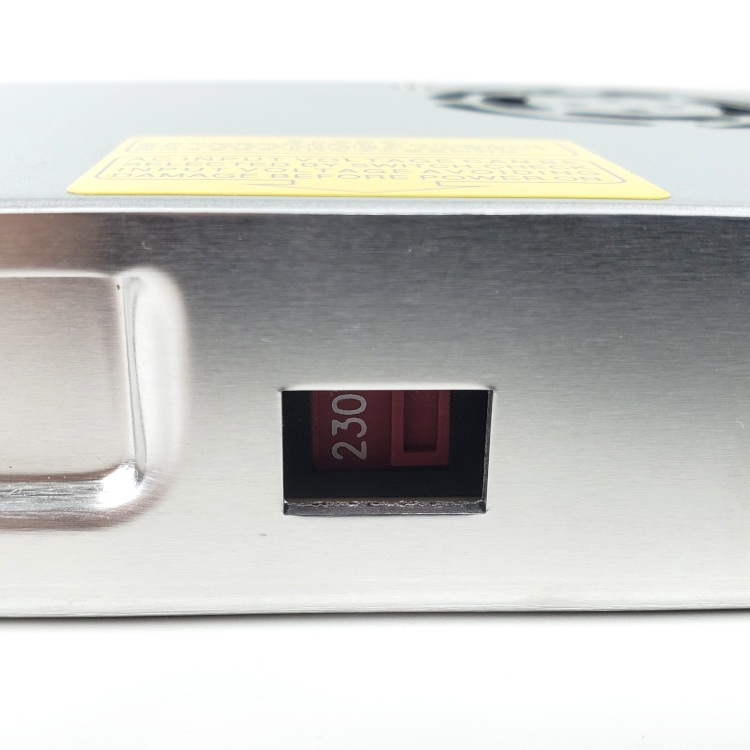

**What you're looking at:** The **PSU** is the Meanwell LRS-200-24, which makes the 24 V that runs the motors, fans, boards and toolhead. It does not adjust itself to the mains: a recessed slide switch selects 115 V or 230 V, and 115 V on 230 V mains destroys it.

**Parts:**

- staged: Meanwell LRS-200-24 PSU ×1

**Do:**

1. Find the recessed slide switch on the side of the PSU, next to the yellow warning label.
2. Push it to **115 V** for US mains with the 2.5 mm flat screwdriver, while it is still easy to reach.

**Check:** The selector reads 115 V, or 120 V on units marked that way: either is the low-voltage position.

⚠ LDO calls this out twice, in *Preparing the Power Supply Unit* and again in Checkpoint #1: *"Flick the switch to the correct value before powering it on! Failing to do so can destroy the power supply!"* Ch 10 checks it again before the first power-on. [src](https://docs.ldomotors.com/en/voron/voron2/wiring_guide_rev_d#preparing-the-power-supply-unit)

EU builds may get a Meanwell RSP-200-24 instead: power-factor corrected (PFC), universal input and no switch. If yours has no selector, that is the unit and nothing needs setting. [src](https://docs.ldomotors.com/en/voron/voron2/wiring_guide_rev_d#preparing-the-power-supply-unit)

Source: [LDO wiring guide § Preparing the power supply unit](https://docs.ldomotors.com/en/voron/voron2/wiring_guide_rev_d#preparing-the-power-supply-unit) · image [`psu_switch.jpg`](https://raw.githubusercontent.com/MotorDynamicsLab/LDOVoron2/main/Images/WiringGuide/psu_switch.jpg) · [Video: Part 8 @0:40:16](https://www.youtube.com/watch?v=Q3Q1szaFfSE&list=PL0fUJbigELQPqpeGOgHYisG4KaSXVtnNY&t=2416s)

---

### Step 09.15 — Fit the printed DIN brackets to the PSU

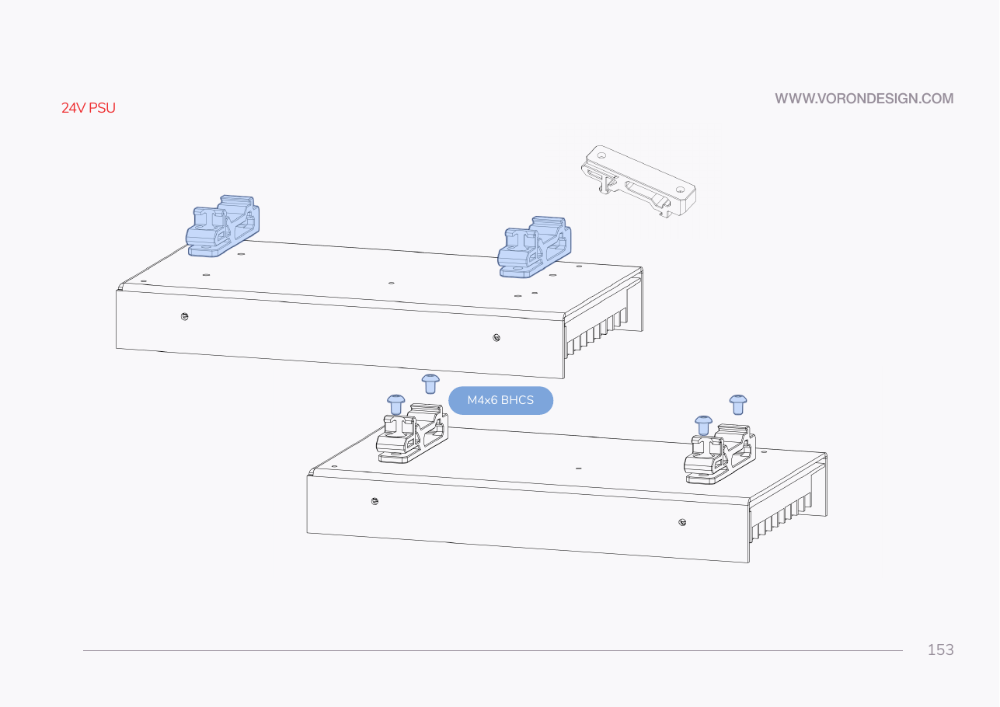{ crop="0.30 0.48 0.92 0.90" }

**What you're looking at:** The manual's "24 V PSU" is a generic block; yours is the **Meanwell LRS-200-24**, and these two printed brackets are its *entire* mounting system, screwed into its factory M4 holes to give it two DIN hooks. Screws longer than M4×6 reach inside a 200 W mains supply. [src](https://docs.ldomotors.com/en/voron/voron2/350_BOM/Rev_D+)

**Parts:**

- Meanwell LRS-200-24 PSU ×1
- `lrs_200_psu_bracket_x2` ×2
- M4×6 BHCS ×4 **(verify on bench)**

**Do:**

1. Sit the two brackets on the PSU's long solid face, the one *without* vents, over the factory M4 holes.
2. Drive M4×6 BHCS, both brackets facing the same way so their DIN hooks line up. Use no longer screws.

**Check:** Both hooks are parallel and in the same plane, the terminal block is on the edge that will face the SSR, and on a rail offcut both hooks engage at once.

Source: [Voron manual p.153](https://github.com/VoronDesign/Voron-2/blob/de7e89d/Manual/Assembly_Manual_2.4r2.pdf#page=153) · [LDO wiring guide § Preparing the power supply unit](https://docs.ldomotors.com/en/voron/voron2/wiring_guide_rev_d#preparing-the-power-supply-unit) · [LDO 350 Rev D+ BOM](https://docs.ldomotors.com/en/voron/voron2/350_BOM/Rev_D+) · [Video: Part 8 @0:37:04](https://www.youtube.com/watch?v=Q3Q1szaFfSE&list=PL0fUJbigELQPqpeGOgHYisG4KaSXVtnNY&t=2224s)

---

### Step 09.16 — Clip the PSU onto the rear rail

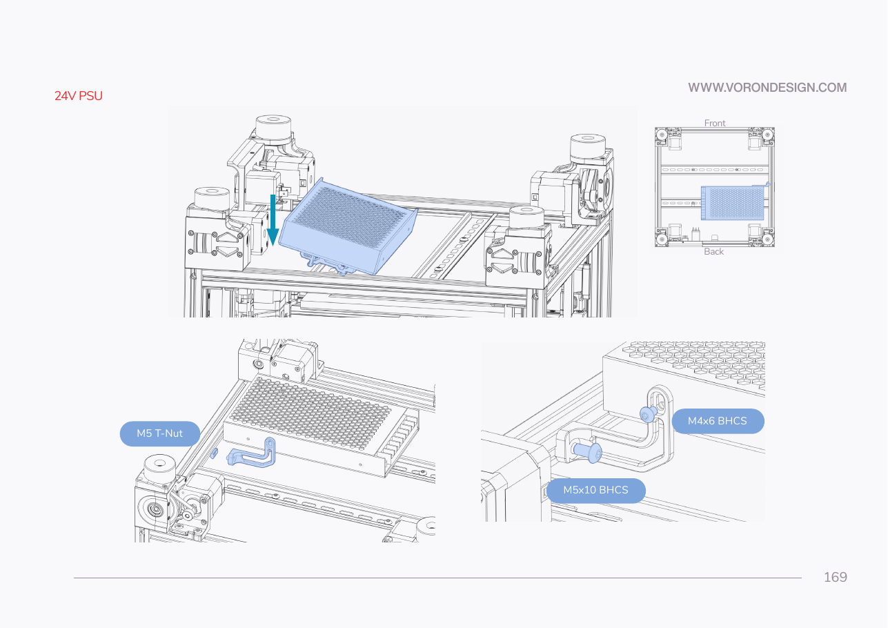{ crop="0.10 0.18 0.92 0.52" }

**What you're looking at:** The motion from Step 09.7 again, with the heaviest part in the bay. Its two printed brackets carry it alone, so skip p.169's bottom half (the support bracket).

**Parts:**

- reused: the PSU on its brackets

**Do:**

1. Hook, rotate and snap the PSU onto the **rear** DIN rail at the bay's right, terminal block facing left.
2. Slide it left until its front-right corner is 2 mm from the dry-laid right T's rear fillet (rounded corner), then stop, so its left end stays 3 mm or more from the SSR run's open end.
3. Fit `PSU_stabilizer_50mm` **only** if the PSU visibly sags or rocks.

**Check:** Both brackets are latched without rocking, the corner is 2 mm or more from the fillet, and a PH2 driver reaches every terminal screw.

LDO: *"PAGE 169 SKIP. The kit does not use a support bracket."* That bracket is the L-shaped one with its M5 T-nut, M5×10 BHCS and M4×6 BHCS. [src](https://docs.ldomotors.com/voron/voron2/build-faq) The print plan prints `PSU_stabilizer_50mm` anyway as a 4 g insurance part; if the PSU sits firm, it stays in the spares bin. [src](../voron-print-plan.md) §6

09.36 checks the 3 mm gap `(verify on bench)`. If the psu row at [B11.10](print/B11-bay-ducting.md#step-b1110-measure-the-gaps-the-custom-pieces-fill) failed, that run is one 10 mm piece shorter and the PSU has more room. **LDO layout:** no shift; slide the PSU clear of the right-hand PVC duct, where LDO's placement photo shows it, so a PH2 driver reaches every terminal screw. [LDO § General Placement](https://docs.ldomotors.com/en/voron/voron2/wiring_guide_rev_d#general-placement)

Source: [Voron manual p.169](https://github.com/VoronDesign/Voron-2/blob/de7e89d/Manual/Assembly_Manual_2.4r2.pdf#page=169) · [LDO wiring guide § General Placement](https://docs.ldomotors.com/en/voron/voron2/wiring_guide_rev_d#general-placement) · [LDO Build Notes § Voron 2.4 build FAQ](https://docs.ldomotors.com/en/voron/voron2/build-faq) · [print plan §B08](../voron-print-plan.md) · `review/2026-09-23-bay-mods/layout-v3/layout-v3.md` § What changed, bench checks 5 and 6

---

### Step 09.17 — Fit the SSR to its metal DIN bracket

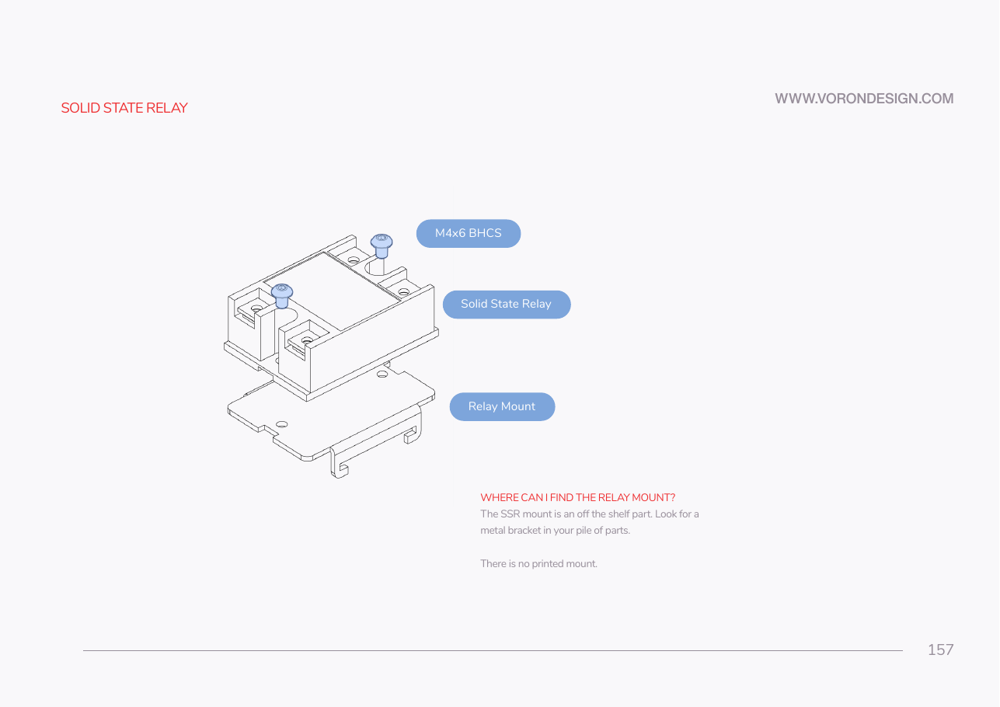{ crop="0.20 0.28 0.72 0.82" }

**What you're looking at:** The **[SSR](16-glossary.md#s)**, a solid-state relay, is an electronic switch with no moving contacts: DC on its input terminals switches the mains through its load terminals. Terminals **1 / 2 are LOAD**, **3 + / 4 − are INPUT**, and swapping them is the error LDO calls catastrophic.

**Parts:**

- Omron G3NB-210B-1 SSR ×1
- metal DIN rail mount bracket ×1
- M4×6 BHCS ×2

**Do:**

1. Find the stamped metal bracket in the hardware bags.
2. Lay the SSR on it and put two M4×6 BHCS through its mounting ears.
3. Read the label before tightening: which pair is LOAD, which is INPUT, and the LED beside terminal 3.

**Check:** The SSR sits square on the bracket, both screws are tight, the bracket's spring latch moves freely, and you can say which pair is load.

Source: [Voron manual p.157](https://github.com/VoronDesign/Voron-2/blob/de7e89d/Manual/Assembly_Manual_2.4r2.pdf#page=157) · [LDO wiring guide § General Placement](https://docs.ldomotors.com/en/voron/voron2/wiring_guide_rev_d#general-placement) · [Video: Part 8 @0:36:59](https://www.youtube.com/watch?v=Q3Q1szaFfSE&list=PL0fUJbigELQPqpeGOgHYisG4KaSXVtnNY&t=2219s)

---

### Step 09.18 — Clip the SSR onto the rear rail

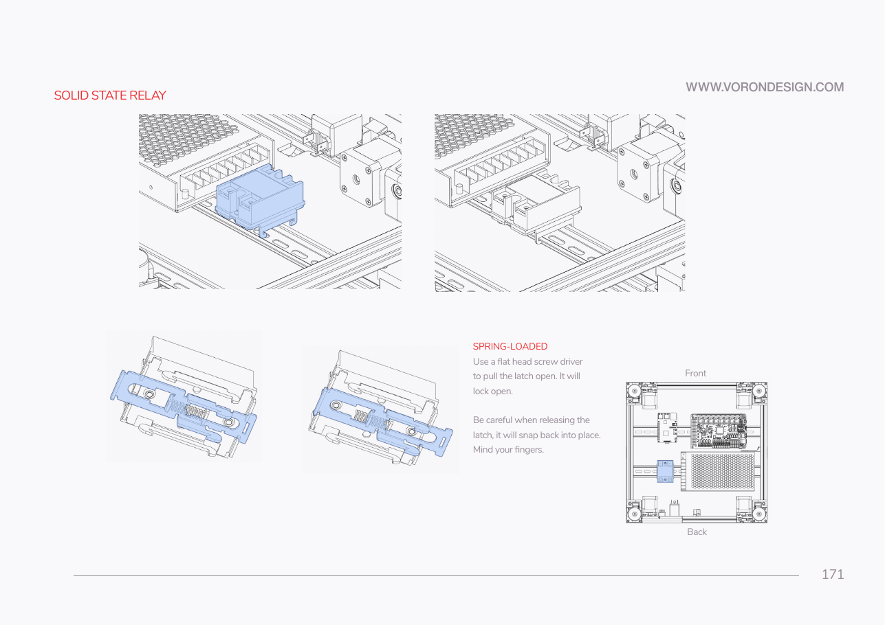

**What you're looking at:** The bracket's spring latch holds the SSR on the rail and locks open, so both hands are free. Orientation is the point of this step: control terminals facing the front rail and load terminals facing the rear, so no mains wire crosses the bay.

**Parts:**

- reused: the SSR on its bracket

**Do:**

1. Pull the latch open with the 2.5 mm screwdriver; it locks open.
2. Hook the SSR over the rear rail **left of the PSU** and release the latch, minding your fingers.
3. Make sure INPUT faces the front rail and LOAD the rear.

**Check:** The SSR is latched square with no rocking, both terminal pairs are reachable with a PH2 driver, and roughly 30 mm of clear rail separates the SSR and PSU.

⚠ The SSR body is stamped **"EARTH THE MOUNTING RAIL"**. LDO's build runs no PE wire to the rail: it touches the frame only through steel screws into anodised extrusion, which is not a PE bond. Do not count the rail as earthed. Who decides whether that is acceptable was settled at [00a.7](00a-mains-safety.md#step-00a7-the-ssr-is-marked-earth-the-mounting-rail-and-this-build-does-not). [src](https://docs.ldomotors.com/en/voron/voron2/wiring_guide_rev_d#connecting-the-ffc-cable-ethernet-cable-usb-cable-and-fame-pe)

LDO flags the SSR wiring as *"critical — an incorrect connection can cause catastrophic damage"*. Getting the orientation right now makes Ch 10 unambiguous (survey §4.4 #8).

Source: [Voron manual p.171](https://github.com/VoronDesign/Voron-2/blob/de7e89d/Manual/Assembly_Manual_2.4r2.pdf#page=171) · [LDO wiring guide § Frame PE](https://docs.ldomotors.com/en/voron/voron2/wiring_guide_rev_d#connecting-the-ffc-cable-ethernet-cable-usb-cable-and-fame-pe) · [Ch 00a Step 00a.7](00a-mains-safety.md#step-00a7-the-ssr-is-marked-earth-the-mounting-rail-and-this-build-does-not)

Pause: ~30 min since the last pause — the PSU voltage selector is confirmed at 115 V, and the PSU and SSR are both on their DIN brackets and clipped to the rear rail. The mains terminals are still bare; leave the PSU cover on and the cord bagged.

---

### Step 09.19 — Strip every voltage-selection jumper off the Leviathan

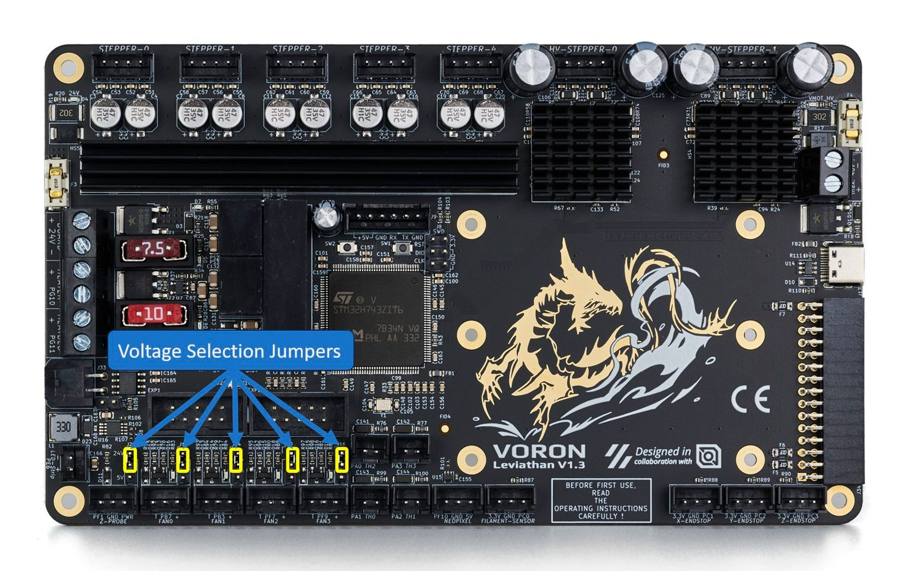
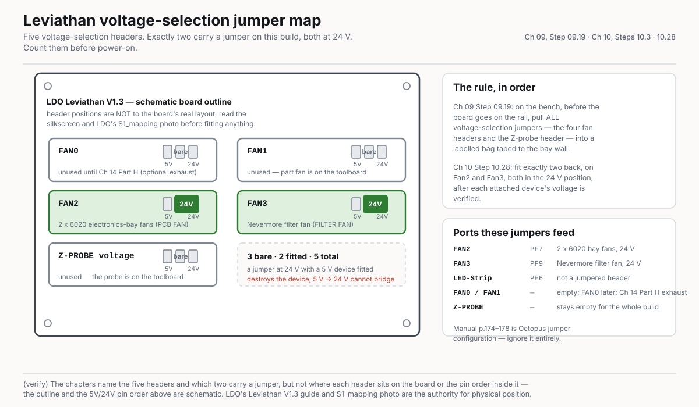

**What you're looking at:** The **[Leviathan](16-glossary.md#l)** is this kit's mainboard: it drives six steppers, the bed heater, the fans and the endstops, and carries the Pi on top. The five headers arrowed here are its **voltage-selection jumpers**, each picking 5 V or 24 V for that output.

**Parts:**

- staged: LDO Leviathan mainboard ×1
- tool: a small pot or bag for the jumpers

**Do:**

1. On an anti-static surface, pull **all** the voltage-selection jumpers, from the four fan headers and the Z-probe voltage header.
2. Put them in a labelled bag and tape it to the bay wall.
3. Do this before the board goes on the rail.

**Check:** No jumper is left in any voltage-selection header, and the bag is labelled and stored where Ch 10 will find it.

**Helper:** Counts the jumpers into the bag, five in all, and writes its label.

⚠ LDO's rule, word for word: *"Remove all of the jumpers used for voltage selection prior to installation."* and *"Mixing voltage will permanantly damage the controller and attached components."* Jumpers go back only in Ch 10, one part at a time, after each attached device's voltage is verified. [src](https://ldomotion.com/guides/voron-leviathan-v1-3)

Ignore manual p.174–178 entirely when you get there: that is Octopus jumper setup. LDO: *"Follow the instruction in the LDO guide for configuring the Leviathan controller board."* [src](https://docs.ldomotors.com/voron/voron2/build-faq)

Source: [LDO Leviathan V1.3 board guide](https://ldomotion.com/guides/voron-leviathan-v1-3) · [LDO Build Notes § Voron 2.4 build FAQ](https://docs.ldomotors.com/en/voron/voron2/build-faq)

---

### Step 09.20 — Fit DIN clips to the two Leviathan brackets

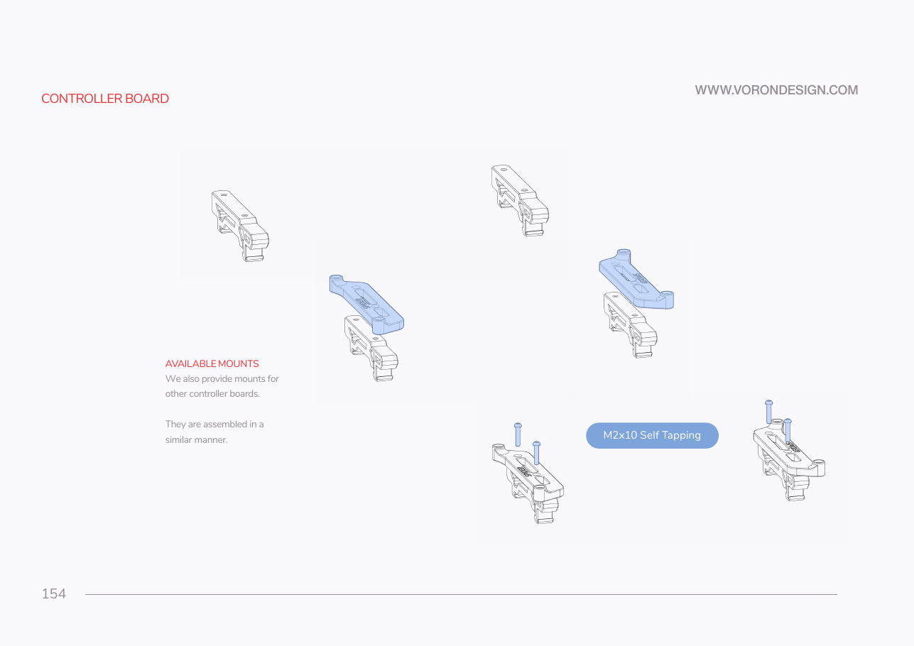{ crop="0.50 0.60 0.92 0.88" }

**What you're looking at:** p.154 shows the **Octopus** bracket set. You use `Leviathan_bracket_set`, two brackets supplied printed by LDO (do not print them), one for each short end of the board, each carrying one of **two** DIN clips; the method is the same. The M2 self-tapping screws cut their own thread in ASA, so a screw run in and out a few times strips the boss. [src](https://docs.ldomotors.com/en/voron/voron2/wiring_guide_rev_d#preparing-the-mainboard-ldo-voron-leviathan-board)

**Parts:**

- Leviathan Bracket Left ×1
- Leviathan Bracket Right ×1
- DIN Clip ×2
- M2×10 self-tapping ×4

**Do:**

1. Sit a DIN clip on each bracket.
2. Drive two M2×10 self-tapping screws through the clip into the bracket with a PH1.
3. Go slowly and stop the moment the head seats.

**Check:** Two bracket-and-clip assemblies are done, mirror images of each other, with the clips square and both hooks facing the same direction.

**Helper:** Holds each bracket steady on the bench while the adult drives the M2 screws.

Source: [Voron manual p.154](https://github.com/VoronDesign/Voron-2/blob/de7e89d/Manual/Assembly_Manual_2.4r2.pdf#page=154) · [LDO wiring guide § Preparing the mainboard](https://docs.ldomotors.com/en/voron/voron2/wiring_guide_rev_d#preparing-the-mainboard-ldo-voron-leviathan-board) · [Video: Part 7 @0:32:16](https://www.youtube.com/watch?v=eHo0k2wQsJw&list=PL0fUJbigELQPqpeGOgHYisG4KaSXVtnNY&t=1936s)

---

### Step 09.21 — Bolt the Leviathan to its brackets

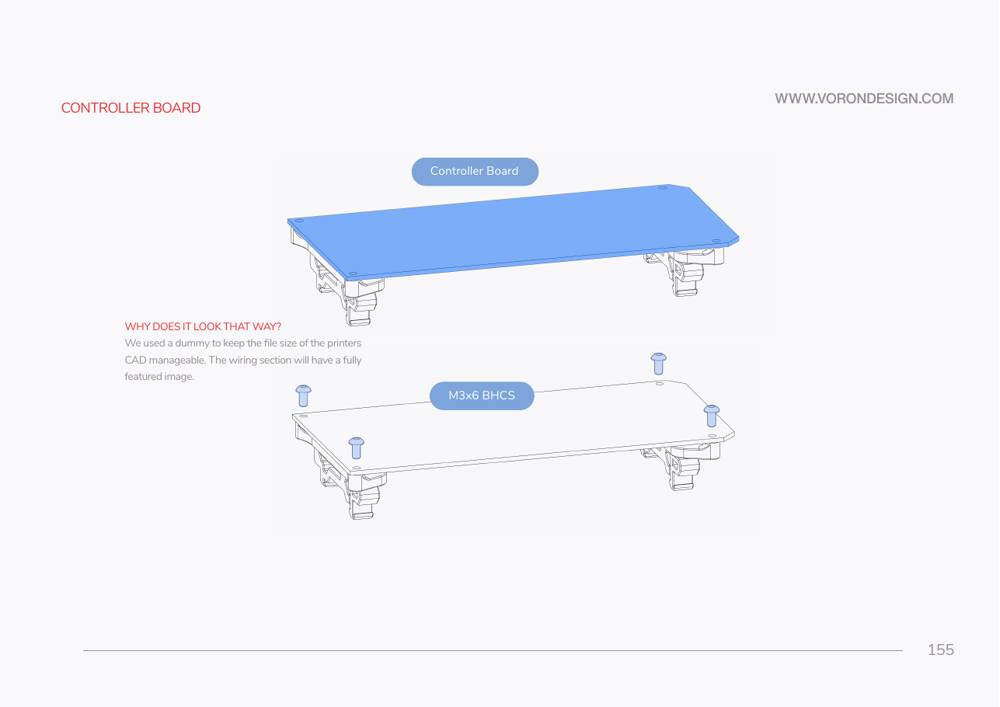{ crop="0.28 0.49 0.76 0.74" }

**What you're looking at:** The board screws to those brackets at its corner mounting holes, the only place a circuit board takes a screw without flexing. The manual's dummy Octopus uses **M3×6 BHCS**; the Leviathan takes **M3×8 SHCS** through the LDO brackets. Twisted, only one DIN hook engages the rail.

**Parts:**

- LDO Leviathan mainboard ×1
- reused: the two bracket assemblies
- M3×8 SHCS ×4 **(verify on bench)**

**Do:**

1. Stand the two brackets clips-down on an anti-static surface.
2. Lay the Leviathan **face up** across them, one short end on each.
3. Check one M3×8 SHCS seats without bottoming out, then drive all four through the corner holes, finger-tight plus a nudge.

**Check:** Components face up, brackets underneath, the board flat with its two DIN hooks in one plane, and on a rail offcut both clips engage together.

LDO's note on the Leviathan screws: [src](https://docs.ldomotors.com/en/voron/voron2/wiring_guide_rev_d#preparing-the-mainboard-ldo-voron-leviathan-board)

Source: [Voron manual p.155](https://github.com/VoronDesign/Voron-2/blob/de7e89d/Manual/Assembly_Manual_2.4r2.pdf#page=155) · [LDO wiring guide § Preparing the mainboard](https://docs.ldomotors.com/en/voron/voron2/wiring_guide_rev_d#preparing-the-mainboard-ldo-voron-leviathan-board)

---

### Step 09.22 — Heatsink and mount the Raspberry Pi 4B on the Leviathan


**What you're looking at:** The Raspberry Pi is the computer that runs Klipper; the Leviathan is only the motion controller it commands. It mounts on the Leviathan's own standoffs, where some Pi ports may be blocked, so check which you lose **now**, while you can still turn the Pi.

**Parts:**

- Raspberry Pi 4B ×1
- Raspberry Pi heatsink ×1
- Pi standoff ×4 **(verify on bench)** — from the Leviathan box
- reused: the microSD card imaged on the bench Pi

**Do:**

1. Stick the heatsink on the Pi's SoC (its main chip), if it is not on yet.
2. Screw the standoffs in and fasten the Pi on them, USB and Ethernet facing **outward, away from the connector banks**.
3. Check the microSD card is seated.

**Check:** The Pi sits flat on all standoffs, Ethernet and two USB-A ports clear the Leviathan (three with the camera), the SD card is seated, and nothing shorts underneath.

LDO: *"Some ports of the Raspberry Pi may not be usable due to interference with the Leviathan ports."* Ch 10 needs Ethernet and two USB ports, for the Leviathan and the toolboard USB adapter, plus a third for the camera add-on. [src](https://ldomotion.com/guides/voron-leviathan-v1-3)

Source: [LDO Leviathan V1.3 board guide](https://ldomotion.com/guides/voron-leviathan-v1-3) · [LDO wiring guide § General Placement](https://docs.ldomotors.com/en/voron/voron2/wiring_guide_rev_d#general-placement) · image [`S0General_Placement.jpg`](https://raw.githubusercontent.com/MotorDynamicsLab/LDOVoron2/main/Images/WiringGuide/RevD/S0General_Placement.jpg) · [Video: Part 7 @1:10:35](https://www.youtube.com/watch?v=eHo0k2wQsJw&list=PL0fUJbigELQPqpeGOgHYisG4KaSXVtnNY&t=4235s) (differs: BTT Octopus + separate Raspberry Pi; this kit is a Leviathan with the Pi mounted on it)

---

### Step 09.23 — Fit the Raspberry Pi 3/4 HAT power adapter

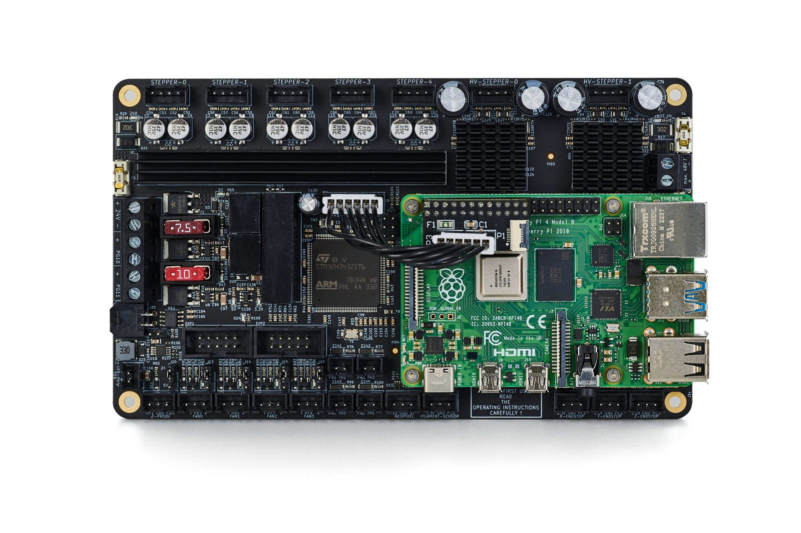

**What you're looking at:** This is how the Pi gets its power: a small adapter sits on its GPIO header (its double row of pins) and takes 5 V from a dedicated port on the Leviathan. The kit ships Pi 5 and Pi 3/4 versions, and they are not interchangeable.

**Parts:**

- Raspberry Pi 3/4 HAT power adapter ×1 **(verify on bench)** — from the Leviathan box

**Do:**

1. Seat the **3/4** adapter onto the Pi's GPIO header in the orientation LDO's image shows.
2. Connect its lead to the Leviathan's Raspberry Pi supply port. There is no USB-C brick in this machine.

**Check:** The adapter is fully seated on the GPIO pins with no row offset, and its lead reaches the Leviathan's Pi power port without tension.

⚠ The kit ships adapters for both **Pi 5** and **Pi 3/4**, and *"the orientation differs"* between them. You have a Pi 4B: use the 3/4 adapter. Fitting the Pi 5 adapter to a Pi 4 puts supply on the wrong pins. [src](https://ldomotion.com/guides/voron-leviathan-v1-3)

This replaces manual p.190 as well (*"the kit uses the Leviathan to supply the 5v power for the Raspberry PI"*). [src](https://docs.ldomotors.com/voron/voron2/build-faq)

Source: [LDO Leviathan V1.3 board guide](https://ldomotion.com/guides/voron-leviathan-v1-3) · [LDO Build Notes § Voron 2.4 build FAQ](https://docs.ldomotors.com/en/voron/voron2/build-faq) · [Video: Part 8 @1:55:00](https://www.youtube.com/watch?v=Q3Q1szaFfSE&list=PL0fUJbigELQPqpeGOgHYisG4KaSXVtnNY&t=6900s) (differs: BTT Octopus + separate Raspberry Pi; this kit is a Leviathan with the Pi mounted on it)

---

### Step 09.24 — Clip the Leviathan and Pi onto the front rail

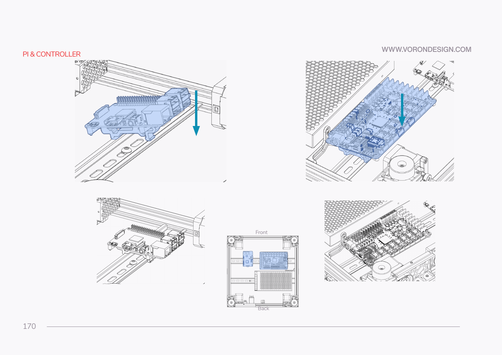{ crop="0.60 0.16 0.92 0.52" }

**What you're looking at:** Hook, rotate, snap for the third time, now with the Pi on the board. Skip the manual's arrangement on p.170–171, which puts a Pi and an Octopus on the same rail as separate items: you have one clipped assembly.

**Parts:**

- reused: the Leviathan and Pi assembly

**Do:**

1. Hook, rotate and snap the assembly onto the **front** DIN rail, biased left so the right-hand end stays free for the USB adapter.
2. Keep the high-current terminal block facing the PSU, so the 24 V wires run short.

**Check:** Both clips are latched and the board is square, no part of the Pi or Leviathan touches a duct, the deck or the frame, and every connector bank is reachable.

LDO: *"Refer to the wiring guide for Leviathan and electronics general placement."* [src](https://docs.ldomotors.com/voron/voron2/build-faq)

Source: [Voron manual p.170](https://github.com/VoronDesign/Voron-2/blob/de7e89d/Manual/Assembly_Manual_2.4r2.pdf#page=170) · [LDO wiring guide § General Placement](https://docs.ldomotors.com/en/voron/voron2/wiring_guide_rev_d#general-placement) · [LDO Build Notes § Voron 2.4 build FAQ](https://docs.ldomotors.com/en/voron/voron2/build-faq)

Pause: ~30 min since the last pause — every voltage-selection jumper is off the Leviathan and bagged, and the board is on its brackets with the Pi and its HAT adapter, the whole stack clipped to the front rail. Do not put a jumper back: they go in one at a time in Ch 10.

---

### Step 09.25 — Confirm the USB adapter stack and clip it

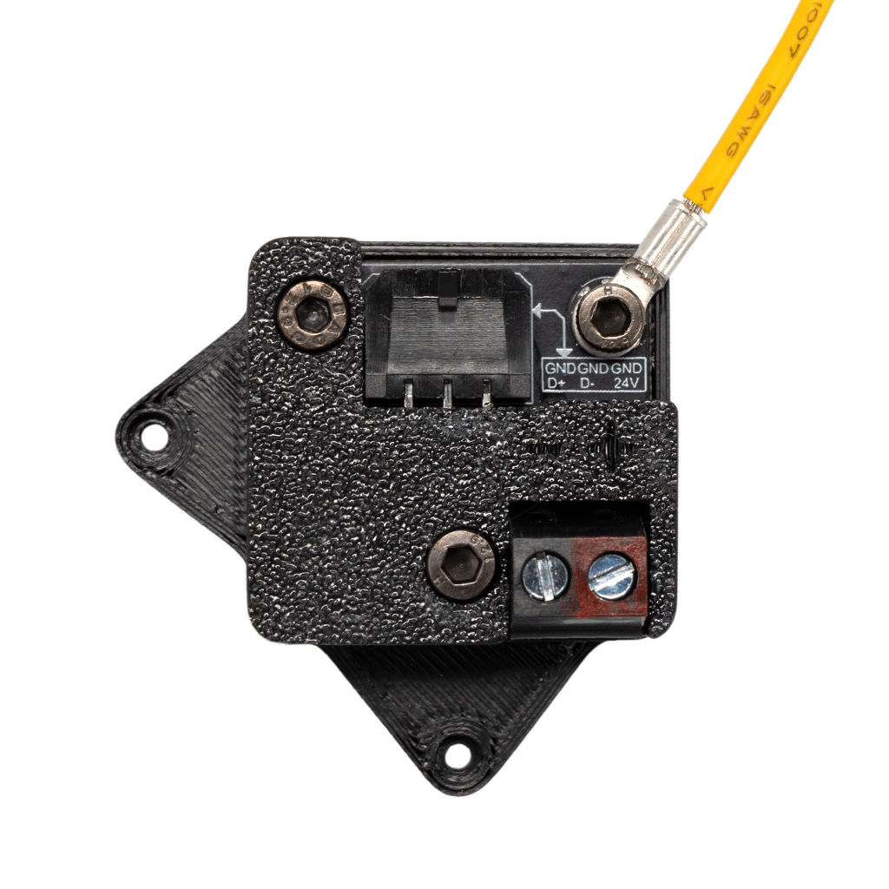

**What you're looking at:** The **[USB adapter](16-glossary.md#u)** is the bay-side end of the toolhead umbilical: 24 V goes in, and the toolhead's connection comes out as USB to the Pi. The V2 **partial** cover leaves one mounting screw bare on purpose, for the ESD (static discharge) ring terminal.

**Parts:**

- reused: the bagged USB adapter stack, three M3×10 SHCS and the partial cover
- DIN Clip ×1
- M2×10 self-tapping ×2 **(verify on bench)**
- DC Ground Wire ×1

**Do:**

1. Confirm the bagged stack: three M3×10 SHCS, and the **partial** cover.
2. Fit a DIN clip to the base's back with the M2×10 self-tappers, which are for the clip only.
3. Screw the DC Ground Wire's ring terminal to the bare mounting point.

**Check:** The PCB is captive, the 6-pin, 2×3 Micro-Fit 3.0 socket and USB connector are reachable, the cover is on, and the ring terminal sits on the one bare point.

⚠ Use the **supplied** grounding cable. LDO: *"Be sure to use the supplied grounding cable since using larger O ring connectors may cause inadvertent shorting of the PCB boards."*

LDO's Rev D Printed Parts Guide: *"Use 3 M3x10 SHCS screws to attach the base, adapter PCB, and cover together."* If your stack has the **V1** full cover, swap in [`usb_adapter_mount_partial_cover.stl`](https://raw.githubusercontent.com/MotorDynamicsLab/Nitehawk-SB-V2/master/STLs/usb_adapter_mount_partial_cover.stl) rather than leaving out the ground (survey §4.1 ⑤). [src](https://docs.ldomotors.com/en/voron/voron2/printed_part_guide_rev_d)

Source: [Nitehawk-SB V2 repo](https://github.com/MotorDynamicsLab/Nitehawk-SB-V2) · [LDO printed-parts guide (Rev D)](https://docs.ldomotors.com/en/voron/voron2/printed_part_guide_rev_d) · image [`usb_adapter_gnd.jpg`](https://raw.githubusercontent.com/MotorDynamicsLab/Nitehawk-SB-V2/master/Images/usb_adapter_gnd.jpg)

---

### Step 09.26 — Clip the USB adapter to the front rail

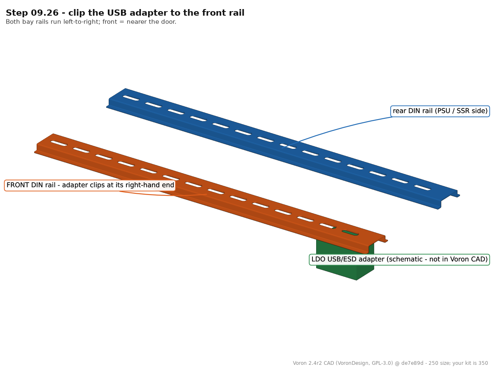
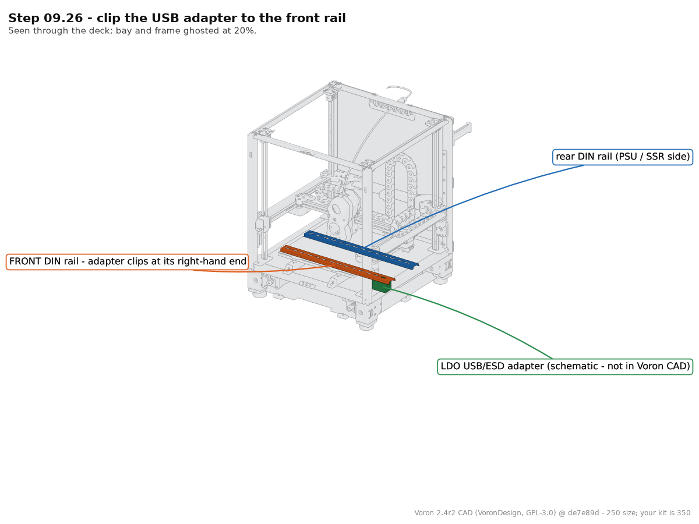

**What you're looking at:** The adapter goes on the right-hand end of the front rail, the rail nearer the door, with its umbilical socket facing the right-hand duct run the umbilical follows from the notch, so nothing pulls sideways on the connector. The CAD renders show the position.

**Parts:**

- reused: the USB adapter assembly

**Do:**

1. Clip it onto the **right-hand end of the front DIN rail**, beside the Leviathan, umbilical connector facing the right-hand duct run.
2. Route the ground lead to the nearest frame extrusion and leave it hanging.

**Check:** The adapter is latched and square, its umbilical socket faces the right-hand duct run, not the Leviathan, and the ground lead reaches a frame extrusion with slack.

The CAD bay layout is the 250 machine's; its rails are shorter than yours, but front/rear and left/right are the same.

This is the Rev D+ ESD path: extruder motor body → toolboard → umbilical → USB adapter → **frame/earth**. Skipping the frame end leaves the chain broken. LDO's procedure is the board doc § ESD Hardening (Ch 08 Step 08.53); ask in `#ldo_motors` only if your hardware differs. (survey §4.1 ⑤)

Source: [LDO wiring guide § General Placement](https://docs.ldomotors.com/en/voron/voron2/wiring_guide_rev_d#general-placement) · image [`S0General_Placement.jpg`](https://raw.githubusercontent.com/MotorDynamicsLab/LDOVoron2/main/Images/WiringGuide/RevD/S0General_Placement.jpg) · CAD: Voron 2.4r2 STEP @ de7e89d

---

### Step 09.27 — Confirm the collar in the LDO nozzle-probe body

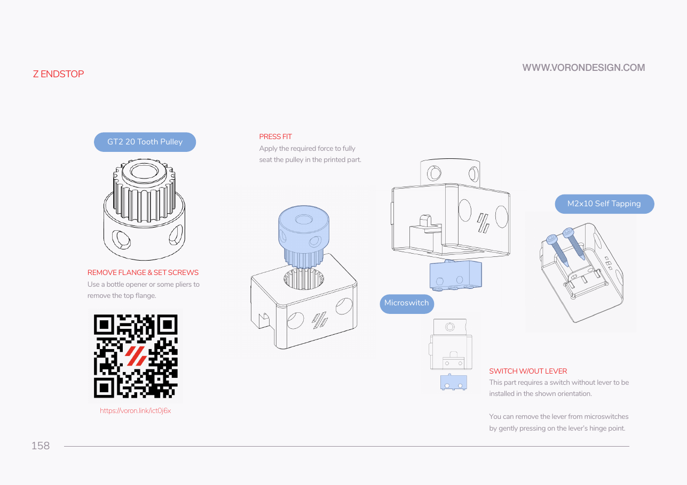{ crop="0.36 0.24 0.56 0.72" }
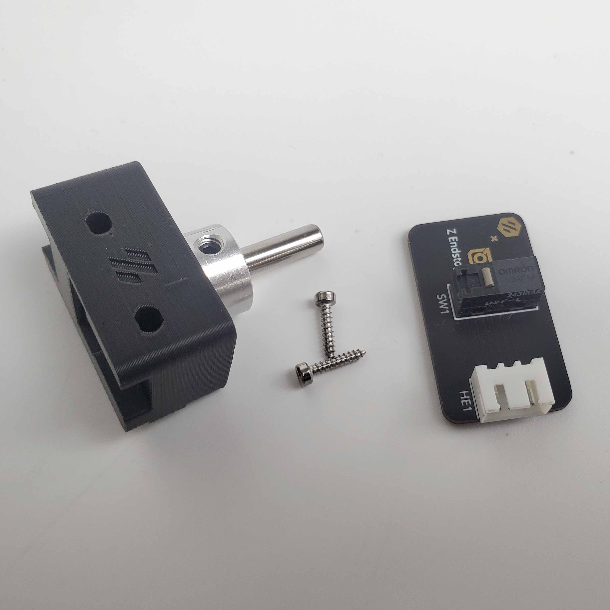

**What you're looking at:** The **[nozzle probe](16-glossary.md#n)** is this kit's Z endstop, not a bed probe: a 5 mm shaft sliding freely in a printed body screwed to the *frame*, which the nozzle is driven down onto to find Z zero. Use LDO's supplied printed part, not the Voron `nozzle_probe.stl`.

**Parts:**

- LDO Nozzle Probe, collar pre-pressed ×1 `(verify on bench)`

**Do:**

1. Confirm the collar is pressed fully into its seat.
2. If yours arrived loose, press it in with steady thumb or vice pressure, never a hammer, until it bottoms out.
3. Ignore the manual's "remove flange & set screws" and lever-removal steps, which are for a bare microswitch.

**Check:** The collar sits flush and square in the body with no gap under its flange, and the printed part is not split.

**Helper:** Looks under the collar's flange and says whether any gap shows.

The print plan deliberately never printed either probe body. [src](https://docs.ldomotors.com/voron/voron2/build-faq)

Source: [Voron manual p.158](https://github.com/VoronDesign/Voron-2/blob/de7e89d/Manual/Assembly_Manual_2.4r2.pdf#page=158) · [LDO wiring guide § Assembling the nozzle probe](https://docs.ldomotors.com/en/voron/voron2/wiring_guide_rev_d#assembling-the-nozzle-probe) · image [`z_stop_parts.jpg`](https://raw.githubusercontent.com/MotorDynamicsLab/LDOVoron2/main/Images/WiringGuide/z_stop_parts.jpg) · [LDO Build Notes § Voron 2.4 build FAQ](https://docs.ldomotors.com/en/voron/voron2/build-faq)

---

### Step 09.28 — Fit the Z endstop PCB

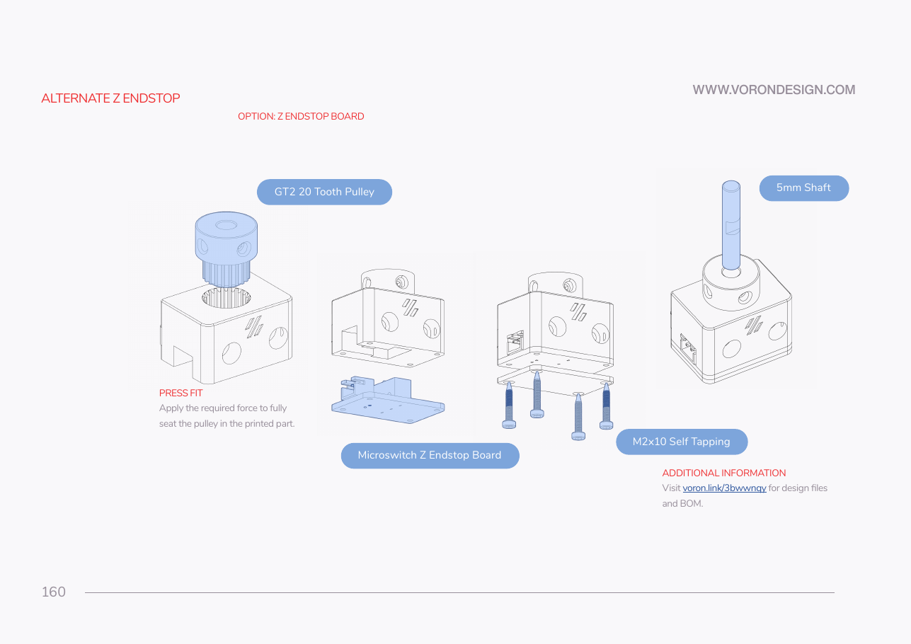{ crop="0.34 0.28 0.68 0.72" }
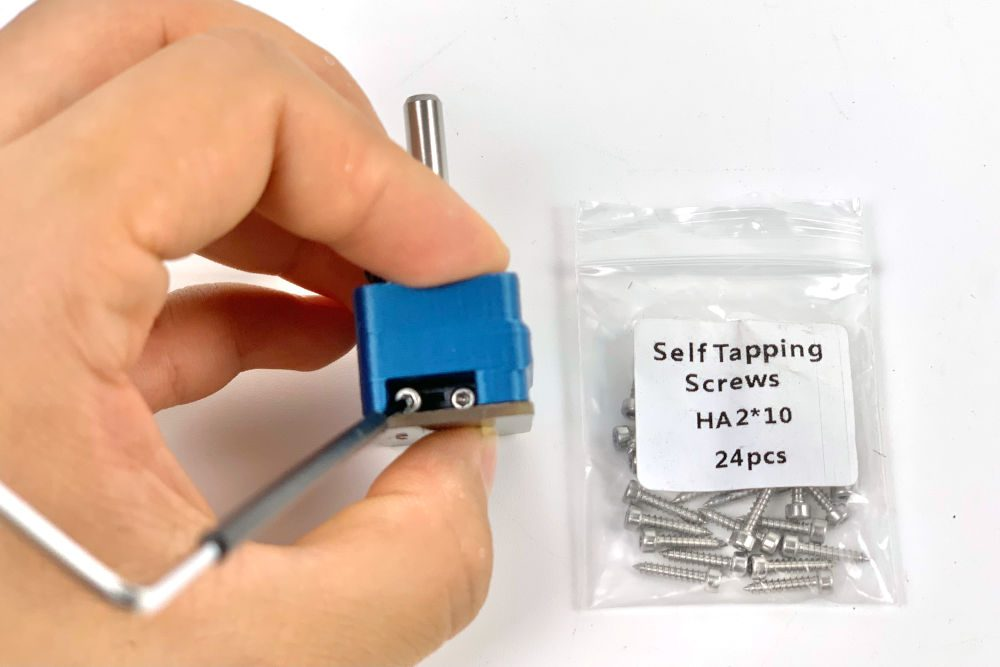

**What you're looking at:** The Z endstop PCB is a small board carrying a D2F microswitch and a plug, so nothing is soldered. Its plunger sits under the shaft's bore: the shaft drops onto it, the switch clicks, and Klipper reads that as Z zero.

**Parts:**

- Z endstop PCB (D2F switch board) ×1
- M2×10 self-tapping ×2

**Do:**

1. Sit the PCB against the printed body so the switch plunger is under the pulley bore.
2. Drive two M2×10 self-tapping screws **sideways** through the switch's two holes into the printed part, not the four the manual's render shows.
3. Use the PH1, go slowly, and stop when each screw seats.

**Check:** The PCB is solid, the switch square under the bore and the plunger free; pressing the plunger gives a clean click and it returns fully.

**Helper:** Presses the switch plunger and says whether the click is clean and it springs back.

p.160 is titled *"ALTERNATE Z ENDSTOP"* in the manual; for this kit it is the only path. LDO: *"Use the LDO Z endstop printed part and PCB."* There is nothing to solder: the PCB carries a connector. [src](https://docs.ldomotors.com/en/voron/voron2/wiring_guide_rev_d#assembling-the-nozzle-probe)

Source: [Voron manual p.160](https://github.com/VoronDesign/Voron-2/blob/de7e89d/Manual/Assembly_Manual_2.4r2.pdf#page=160) · [LDO wiring guide § Assembling the nozzle probe](https://docs.ldomotors.com/en/voron/voron2/wiring_guide_rev_d#assembling-the-nozzle-probe) · image [`z_stop_install_3.jpg`](https://raw.githubusercontent.com/MotorDynamicsLab/LDOVoron2/main/Images/WiringGuide/z_stop_install_3.jpg)

---

### Step 09.29 — Fit the 5 mm shaft and its retaining set screw

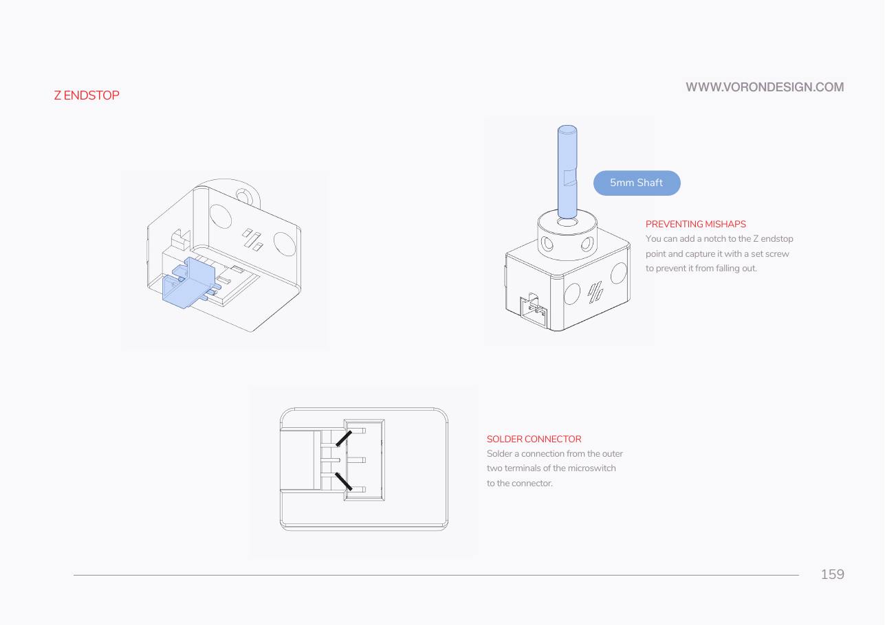{ crop="0.54 0.18 0.92 0.56" }

**What you're looking at:** The 5 mm shaft is the part the nozzle actually touches. The single set screw only has to stop it falling out: any tighter and it clamps the shaft, and a shaft that will not drop under its own weight drifts Z zero.

**Parts:**

- nozzle probe shaft, 5 mm ×1
- M3×2 set screw ×1

**Do:**

1. Drop the 5 mm shaft through the bore onto the switch plunger.
2. Run the collar's set screw in until it just holds the shaft in, still sliding freely.
3. If the shaft has no notch, stop the screw short of the shaft.

**Check:** The released shaft drops freely and clicks the switch; upside down, a notched shaft stays put and an un-notched one may slide.

**Helper:** Releases the shaft and says whether it drops freely and clicks the switch.

Follow **only** the 5 mm shaft part of p.159; its soldered-connector half does not apply to the PCB version. LDO: *"Remember to install one set screw into the pulley, but do not overtighten it… it should not be so tight as to impede the shaft from freely moving up and down."* [src](https://docs.ldomotors.com/voron/voron2/build-faq)

Source: [Voron manual p.159](https://github.com/VoronDesign/Voron-2/blob/de7e89d/Manual/Assembly_Manual_2.4r2.pdf#page=159) · [LDO wiring guide § Assembling the nozzle probe](https://docs.ldomotors.com/en/voron/voron2/wiring_guide_rev_d#assembling-the-nozzle-probe) · [LDO Build Notes § Voron 2.4 build FAQ](https://docs.ldomotors.com/en/voron/voron2/build-faq)

---

### Step 09.30 — Mount the nozzle probe on the bed extrusion

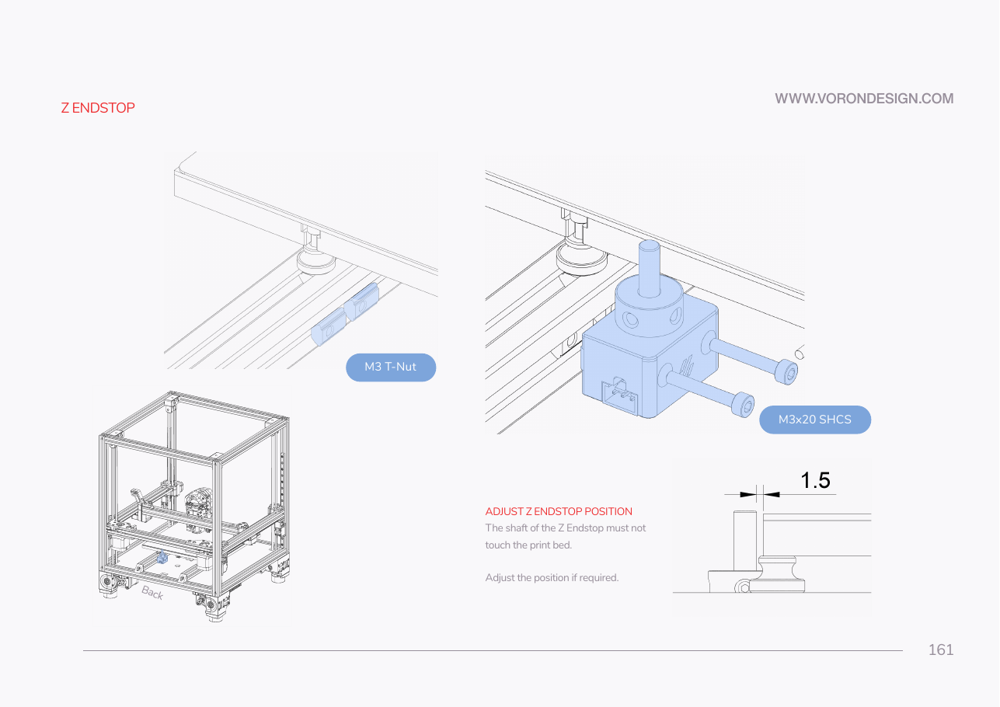{ crop="0.16 0.20 0.90 0.87" }
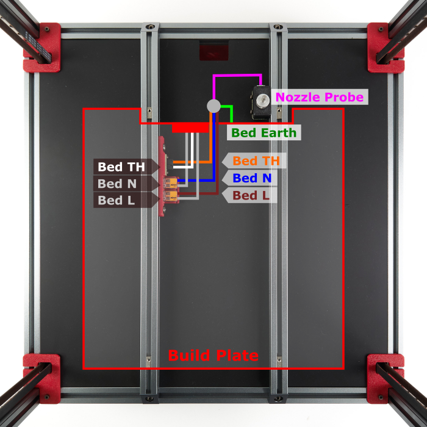
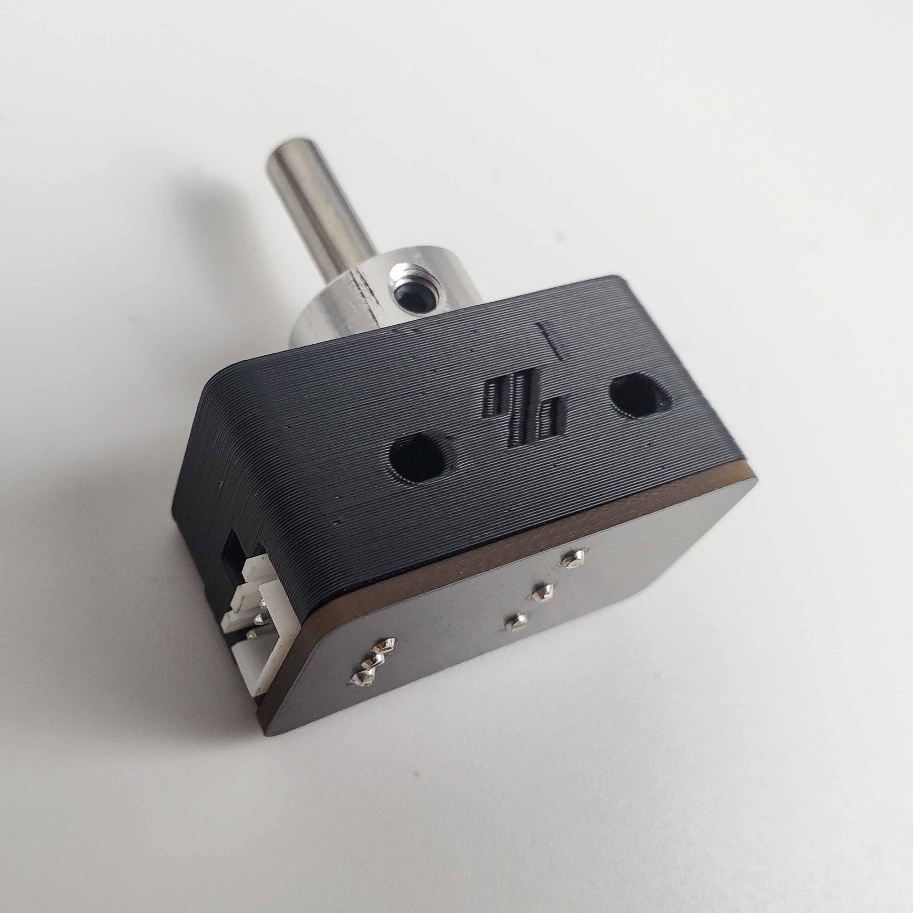

**What you're looking at:** The probe sits **above** the deck (the deck hangs under the bed extrusions), on the right extrusion's inner face, its pin 2–3 mm behind the plate's rear edge: the gap Step 13.24 checks. LDO's thicker body needs **M3×25 SHCS ×2**, not the manual's **M3×20 SHCS**.

**Parts:**

- reused: the nozzle probe assembly
- M3×25 SHCS ×2
- reused: the two M3 T-nuts parked in the right extrusion's inner slot

**Do:**

1. Slide the two M3 T-nuts parked in the right extrusion's inner slot toward its rear end.
2. Fit the probe on that face, pin away from the deck, M3×25 snug.
3. Slide it until the pin is just behind the plate's rear edge.

**Check:** A 2 mm hex key fits between pin and plate, a 3 mm does not; the pin clicks the switch and returns, the body is square, the connector reachable.

**Helper:** Tries the 2 mm and 3 mm hex keys between pin and plate and says which one fits.

p.161 draws this gap as 1.5 mm; its rule is only that the shaft never touches the plate, and 2–3 mm meets it. [src](https://docs.vorondesign.com/build/startup/startup.html#bed-locating) Un-notched shaft? Bag and label it `probe shaft — refit before 13.24`. [src](https://docs.ldomotors.com/en/voron/voron2/wiring_guide_rev_d#assembling-the-nozzle-probe)

The probe lead stays in the chamber until Ch 10. **Layout v3** drops it through the rear notch at 10.34; **LDO layout** through the round deck hole. Nothing goes through the deck here.

Source: [Voron manual p.161](https://github.com/VoronDesign/Voron-2/blob/de7e89d/Manual/Assembly_Manual_2.4r2.pdf#page=161) · [LDO wiring guide § Assembling the nozzle probe](https://docs.ldomotors.com/en/voron/voron2/wiring_guide_rev_d#assembling-the-nozzle-probe) · image [`z_stop_final.jpg`](https://raw.githubusercontent.com/MotorDynamicsLab/LDOVoron2/main/Images/WiringGuide/z_stop_final.jpg) · [LDO wiki build-plate mapping](https://docs.ldomotors.com/v2_wire_guide/build_plate_mapping.png) · [Voron startup guide § Bed locating](https://docs.vorondesign.com/build/startup/startup.html#bed-locating)

Pause: ~30 min since the last pause — the USB adapter stack is confirmed and clipped, and the nozzle probe is assembled (collar, PCB, 5 mm shaft) and mounted above the deck on the right bed extrusion's inner slot, pin just behind the plate's rear edge. The printer is still on its head. Nothing is plugged in.

---

### Step 09.31 — Do not build the soldered X/Y microswitches

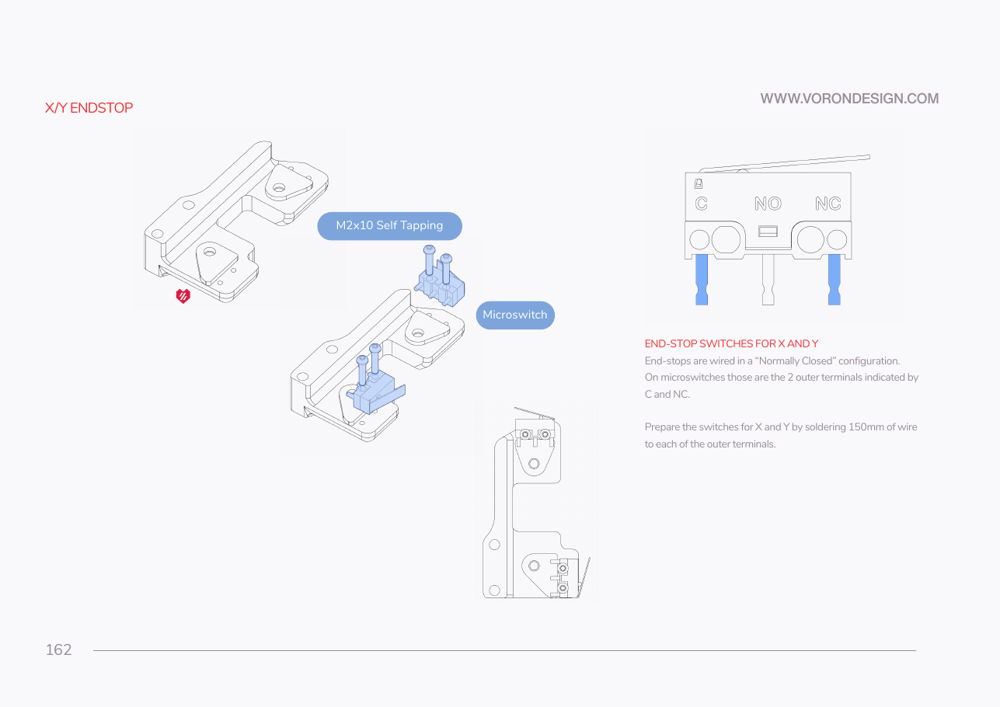

**What you're looking at:** A skip. The manual builds its XY endstops from two loose microswitches with soldered wires; this kit ships them as one small PCB with a single 4-pin connector, so there is nothing to cut, strip or solder.

**Parts:** none.

**Do:**

1. Skip manual p.162.
2. Skip the hall-effect option on p.163 too: this kit has no hall-effect endstops anywhere (LDO note on p.145).

**Check:** Your XY endstop is one PCB with one 4-pin JST-XH connector, not two loose microswitches with flying leads.

LDO: *"The kit uses the X/Y Endstop PCB board."* [src](https://docs.ldomotors.com/voron/voron2/build-faq)

Source: [Voron manual p.162](https://github.com/VoronDesign/Voron-2/blob/de7e89d/Manual/Assembly_Manual_2.4r2.pdf#page=162) · [LDO Build Notes § Voron 2.4 build FAQ](https://docs.ldomotors.com/en/voron/voron2/build-faq)

---

### Step 09.32 — Check the XY endstop board and its cable labels

{ crop="0.08 0.17 0.48 0.90" }

**What you're looking at:** The XY endstop PCB carries both the X and Y limit switches, which tell the machine where each axis physically ends and give `G28` a repeatable starting point. It went into its blue pod on the right XY joint in Ch 05; only its cable is loose.

**Parts:**

- reused: the endstop pod with its XY endstop PCB

**Do:**

1. Press each switch on the board once.
2. Find the XY endstop cable in the kit and read the labels on its plug end, before Ch 10.

**Check:** Both switches click cleanly, the connector is reachable from below, and the cable reads *XES / YES*.

**Helper:** Presses both switches on the fitted board and says whether each one clicks cleanly.

LDO documents a batch whose XY endstop cable is labelled *"X Stop / Y Stop"* instead of *"XES / YES"* and needs re-pinning. [XY endstop repin guide](https://docs.ldomotors.com/en/guides/XY_Endstop_Cable_Reconnecting_Guide)

Source: [Voron manual p.163](https://github.com/VoronDesign/Voron-2/blob/de7e89d/Manual/Assembly_Manual_2.4r2.pdf#page=163) · [Ch 05 Step 05.49](05-gantry.md#step-0549-fit-the-xy-endstop-pod-to-the-right-joint) · [LDO XY-endstop repin guide](https://docs.ldomotors.com/en/guides/XY_Endstop_Cable_Reconnecting_Guide)

---

### Step 09.33 — Check the endstop pod through full travel

{ crop="0.17 0.18 0.46 0.74" }

**What you're looking at:** The pod has hung from the right-hand XY joint's underside on two **M3×30 SHCS** since Ch 05. With the gantry now in the frame, this is the first time it travels past the frame, the Z rails and the chains.

**Parts:**

- reused: the endstop pod on its two M3×30 SHCS

**Do:**

1. Check the two M3×30 are still firm.
2. Move the toolhead slowly through full X and Y travel, watching the pod.

**Check:** The pod is solid with no rotation, and through full X and Y travel it touches nothing: frame, Z rail, chain or toolhead.

**Helper:** Watches the pod while the adult moves the toolhead through X and Y, and calls out any touch.

Source: [Voron manual p.164](https://github.com/VoronDesign/Voron-2/blob/de7e89d/Manual/Assembly_Manual_2.4r2.pdf#page=164) · [Ch 05 Step 05.49](05-gantry.md#step-0549-fit-the-xy-endstop-pod-to-the-right-joint) · [Video: Part 6 @1:30:12](https://www.youtube.com/watch?v=8pWoYkY1DiA&list=PL0fUJbigELQPqpeGOgHYisG4KaSXVtnNY&t=5412s)

---

### Step 09.34 — Build and mount the bed WAGO breakout


**What you're looking at:** The bed WAGO mount, a Rev C+ addition with no manual page, is a small breakout **above** the deck, in the chamber under the plate, on the left bed extrusion. The plate's three short leads end here, so the plate lifts off from above; extension leads carry on below the deck.

**Parts:**

- Bed WAGO Mount ×1 (LDO-supplied printed)
- M3×5×4 heat-set inserts ×2
- 2×2 XH splicer PCB ×1
- M3×6 BHCS ×2
- WAGO 221-412 (2-way) ×2
- M5×10 BHCS ×2
- reused: the two M5 T-nuts parked in the left extrusion's inner slot

**Do:**

1. Heat-set two inserts into the **front** face and let them cool.
2. Screw on the splicer PCB and snap in both WAGOs.
3. Screw the mount to the **left** bed extrusion's parked M5 T-nuts, under the plate's rear half.

**Check:** Inserts flush, splicer PCB solid, both levers free, and the mount above the deck, clear of the plate underside, with the plate's three leads reaching it with slack.

Two 2-way WAGOs break out bed L and N, and the splicer PCB the thermistor. LDO's wiring guide fixes the splicer PCB with M3×6 BHCS, its printed-parts guide with M3×8 SHCS `(verify on bench)`. LDO's build-plate mapping puts the mount above the deck on the left bed extrusion so the plate detaches from the top. Nothing goes below the deck here; terminating is Ch 10. [src](https://docs.ldomotors.com/en/voron/voron2/wiring_guide_rev_d#wiring-the-bed-heater)

Source: [LDO wiring guide § Wiring the bed heater](https://docs.ldomotors.com/en/voron/voron2/wiring_guide_rev_d#wiring-the-bed-heater) · [LDO wiki build-plate mapping](https://docs.ldomotors.com/v2_wire_guide/build_plate_mapping.png) · [LDO 350 Rev D+ BOM](https://docs.ldomotors.com/en/voron/voron2/350_BOM/Rev_D+) · image [`bed_wago_mount.jpg`](https://docs.ldomotors.com/v2_wire_guide/bed_wago_mount.jpg)

Pause: ~20 min since the last pause — the XY endstop pod is checked and its cable labels read, and the bed WAGO breakout is built and mounted above the deck on the left bed extrusion. The plate's three leads reach it with slack; none of them is terminated.

---

### Step 09.35 — Stage the mains-safety hardware, then stop

(no image — see text)

**What you're looking at:** No picture; this is a laying-out step. A **[ferrule](16-glossary.md#f)** is a metal sleeve crimped over a stranded wire so it enters a screw terminal as one solid pin. Every kit lead ships with its ferrule crimped on, so the five loose ones and a crimp tool matter only if a lead has to be re-terminated in Ch 10.

**Parts:**

- consumable: VE0508 ferrule ×5, spares
- staged: C13 power cord ×1
- staged: FRAME PE cable ×1 — from the Cable Kit box
- tool: ferrule crimp tool, only if you own one
- tool: cable tags

**Do:**

1. Lay out five spare **VE0508 ferrules**, the ring terminal and tags.
2. Find the frame PE point between the WAGO mount and the notch.
3. Find the inlet's strain relief and confirm the C13 cord is bagged.

**Check:** Five spare ferrules are present, a clean metal-to-metal frame PE point is identified, the cord is bagged and the inlet switch is off.

⚠ **No wiring happens in this chapter and no plug goes in a socket.** LDO: *"Mains wiring should only be performed by certified personnel…"* Ch 10 gates on **Checkpoint #1** before anything is switched on: cord unplugged, continuity within each colour group, **no** continuity between L, N and PE, PSU selector at 115 V. [src](https://docs.ldomotors.com/en/voron/voron2/wiring_guide_rev_d#checkpoint-1)

Source: [LDO wiring guide § Checkpoint #1](https://docs.ldomotors.com/en/voron/voron2/wiring_guide_rev_d#checkpoint-1) · [survey §7.5](../voron-build-instructions-survey.md)

---

### Step 09.36 — Stick down both conduits, then check the bay


**What you're looking at:** Both conduits are stuck down last because they must clear the boards, the WAGO blocks and the SSR.

**Parts:**

- reused: the dry-laid DC loop
- `V3L_WIRE_BOX_PORT` ×1
- `V3L_90DEG_R15` ×2
- `V3L_34mm_DUCT_HOLE` ×1
- `CMD_V3_1H_T_SHORT` ×1
- `V3L_10mm_DUCT` ×2
- `CMD_Remix-V3_DUCT-1M_ENDCAP` ×2
- consumable: VHB tape
- consumable: IPA and a lint-free cloth
- consumable: cable tags

**Do:**

1. Wipe the deck with IPA and stick the DC loop to its marks with VHB, its middle run centred between the Leviathan and PSU.
2. Stick the AC conduit down with VHB as the overlay shows, the 34 mm run over the round hole.
3. Tag the boards and WAGO blocks, then compare the bay with the overlay and LDO's photo.

**Check:** The middle run is 1.5 mm or more off the Leviathan and the PSU, the PSU is 3 mm or more from the SSR run, and the stub sits on the box port.

⚠ **Middle run:** check its 1.5 mm with the boards on before any VHB goes down; VHB does not let go. If it cannot clear both edges, stop: B11's fallback, stock T junctions and LDO's PVC middle duct, is printed and fitted instead `(verify on bench)`.

⚠ **Stub:** 10 mm on the layout; B11.10 set its real length `(verify on bench)`. Seat it on the box port and let the T sit back from the SSR by any remainder; L, N and FG must still enter the SSR run's open end. Never leave a gap in the AC conduit. [B11.10](print/B11-bay-ducting.md#step-b1110-measure-the-gaps-the-custom-pieces-fill)

The render colours the AC bodies orange to tell them from the lids; yours are all black.

**LDO layout:** no AC conduit. The mains runs share LDO's rear PVC duct; compare the bay against [LDO's placement photo](assets/remote/09-electronics-bay/bay-general-placement.jpg) only, standing at the rear. [LDO § General Placement](https://docs.ldomotors.com/en/voron/voron2/wiring_guide_rev_d#general-placement)

---

## Checkpoint 09

**Built:** a fully fitted electronics bay with nothing wired yet

- [ ] Two DIN rails run **left-to-right**, each fastened with one M5×10 BHCS into each bed extrusion, and all four plastic end caps are fitted.
- [ ] The DC loop is stuck down with VHB at 09.36 as one continuous run, rear-left Z motor to the notch, its middle run 1.5 mm or more off the Leviathan and the PSU. The AC conduit is stuck down against the WAGO blocks, behind the SSR and over the round deck hole. The notch is clear and every lid is off and bagged. LDO layout: five PVC ducts, the opening clear.
- [ ] The Meanwell LRS-200-24 selector is set to **115 V**, and the PSU is on the rear rail on its two printed brackets, its front-right corner 2 mm or more clear of the right T's rear fillet and its left end 3 mm or more from the SSR run's open end. **No** support bracket is fitted.
- [ ] The Omron SSR is on its metal bracket, latched to the rear rail left of the PSU, with LOAD (1/2) and INPUT (3+/4−) identified and reachable.
- [ ] **Every** Leviathan voltage-selection jumper is removed and bagged.
- [ ] The Leviathan is on the front rail with the Pi 4B mounted on it, heatsink fitted, SD card in, and the **3/4** HAT power adapter seated.
- [ ] The USB adapter is on the front rail with the partial cover, and the DC Ground Wire is attached to its bare mounting point; the frame end is left loose for Ch 10.
- [ ] The IEC inlet module (one part, not two) is in `power_inlet_IECGS_1mm`, the panel is screwed to the rear extrusion hard against the rear-left Z-motor mount, and three WAGO 221-415 clamps sit in the mains WAGO mount to its right.
- [ ] The nozzle probe is assembled (collar fully in, PCB on two M2×10, shaft free) and mounted on **M3×25 SHCS** above the deck on the right bed extrusion's inner slot, pin 2–3 mm behind the plate's straight rear edge; its lead is not yet through the deck. If the 5 mm shaft is out (un-notched, 09.29), it is bagged and labelled `probe shaft — refit before 13.24`.
- [ ] The XY endstop pod from Ch 05 is tight on the right XY joint, its cable labels read XES / YES or are repinned, and through full X and Y travel it touches nothing.
- [ ] The bed WAGO breakout is built and mounted **above** the deck on the left bed extrusion, under the plate's rear half; the plate's three leads reach it with slack, and the plate still lifts off from above.
- [ ] Nothing is wired and nothing is plugged in. Duct lids, skirts and the bottom panel are off. The multimeter is on the bench.

## Common mistakes

- **Fitting the p.169 support bracket "because it's in the manual".** LDO explicitly skips it, and the two printed brackets are the mount. An unneeded L-bracket screwed to the frame just puts a screw where a cable wants to go.
- **Leaving the Leviathan's voltage jumpers in.** This is the one mistake in this chapter that destroys hardware. They come out before the board is installed, not before it is wired.
- **Setting the PSU selector after the bay is full.** Once the PSU is on the rail behind a wire duct, the switch is nearly invisible. Set it at 09.14, before the PSU goes on the rail.
- **Fitting the V1 USB adapter cover.** It hides the grounding point that Rev D+ exists to expose, and the ESD path ends up broken without any sign.
- **Closing the bay, or plugging the cord in "just to see the PSU light".** Both belong after Checkpoint #1 in Ch 10 (survey §5.2 W8).
- **Over-driving M2 self-tapping screws into ASA.** Two turns too far strips the boss, and the DIN clip or the Z endstop PCB never sits solid again.

## Next

Ch 10 — Wiring: above-deck, below-deck, mains and **Checkpoint #1** (LDO wiring guide, in its own order, plus manual p.194–195 for drag-chain slack). Nothing in this bay gets energised until that checkpoint passes.

Source: [LDO wiring guide § General Placement](https://docs.ldomotors.com/en/voron/voron2/wiring_guide_rev_d#general-placement) · [survey §7.5](../voron-build-instructions-survey.md)

Pause: ~45 min since the last pause — both conduits stuck down with their lids off, bay fully populated, tagged and checked against the v3 overlay and LDO's layout, printer still on its head, mains-safety hardware staged in one labelled bag, meter beside it. **Do not start Ch 10 in a leftover ten minutes**: mains work is a fresh session with a clear head, and it ends at LDO's Checkpoint #1.
