# Chapter 10 — Wiring and Checkpoint #1

<!-- style: plain -->

You build every harness in the machine: mains, 24 V, motors, sensors, lighting and the toolhead cable. The chapter ends at the gate that must pass before the machine is ever plugged in.

**What you're building in this chapter:** Four systems of wires. The **mains side** carries wall power: the C14 inlet (the socket the cord plugs into, with its switch and fuse), three WAGO lever blocks for Live, Neutral and earth, the 24 V PSU (power supply), and the SSR (solid-state relay) that lets the firmware switch the mains bed heater. It goes in after the work above the deck, in LDO's order: inlet, WAGO bus and PSU, proved with a meter and powered once at LDO's Checkpoint #1, then the SSR and bed leads, wired dead. The **24 V side** runs from the PSU to the Leviathan mainboard, to the board's separate stepper supply, and to the USB adapter PCB that feeds the toolhead. The **signal side** is everything the machine senses and lights with: six motor cables, the XY endstop pod, the nozzle probe that sets Z=0, the bed thermistor, two COB light strips, the bay and filter fans, and the Pi's screen, network and USB links. The three **drag chains**, X, Y and Z, let every cable follow the moving gantry for years without wearing out. The work above the deck and the chains come first, with the printer upright, as LDO's guide puts them; then, on its right side, the mains and Checkpoint #1, the SSR and bed leads, and the board, 24 V, umbilical and bay. Section numbers are names, like step ids, not the order you work in: Sections 3 and 4, then 1, 2 and 2b, then 5 to 8. It ends unplugged, open and metered.

**Time:** 5.0–7.0 h hands-on, first build (survey §5.1, §7.2).

**Sessions:** 14 × ~30 min. Each stopping point below gives its own minutes, and every minute figure in this chapter is a first-build estimate worked out from the time range and the step count.

**Prerequisites:**

- **Ch 03** is done: the build plate is screwed down, and its heater and thermistor leads hang loose **above** the deck, none through it.
- **Ch 06** is done: the gantry is in and the Z belts are on. The gantry must move by hand over its full Z travel, because that is what sets the slack in the chains.
- **Ch 07** is done: the probe wires already run along the X extrusion (manual p.143).
- **Ch 08** is done: Stealthburner + CW2.5 + Nitehawk-SB **V2** assembled, every toolhead-side connector seated, and the USB-adapter PCB stack built.
- **Ch 09** is done: the DIN rails; the B11 conduits (the DC loop at 09.6 and the AC conduit at 09.36, every lid off; layout v3); the Leviathan on its brackets; the Raspberry Pi on its standoffs with the HAT power adapter; the nozzle-probe PCB built and mounted; the bed WAGO mount fitted above the deck on the left bed extrusion; the SSR on its DIN bracket; the USB-adapter PCB on its DIN clip. **Ch 09 also fitted the inlet panel with its IEC module and mounted it on the rear extrusion (Steps 09.10–09.12), and built and mounted the mains WAGO block (Step 09.13).** Nothing in this chapter builds those; 10.4–10.7 only confirm and label them.
- **Print batches: B05** (Z joints and the Z chain parts) and **B07** (electronics bay and lighting: the eight COB mounts across its three plates, and the 3×5 WAGO mount). B07 also carries `power_inlet_IECGS_1mm` on **plate B07-P1** (moved out of B08, index correction #11). One B08 part is needed early: `mount.stl` (plate B08-P4) gets its two inserts at Step 10.35, then goes together with the B02 `[a]_faceplate` at Step 10.50, because the touchscreen module has to exist before its ribbon is latched; so Ch 11 Steps 11.5–11.6 are done from there. Both are pre-kit prints. Nothing else from B08 is needed before Ch 11.
- **Print batch B11**: `V2L_STRIP_FIN` and the AC conduit lids, both in bin 10-lids-AC, for Step 10.80.
- **Camera:** its 3 m USB cable in hand for Step 10.81, before the slot covers go on at 10.38. Its mount prints in B12 and is fitted in Ch 11 Part C.
- **DIN-rail earth lead**, bought before you start: a green/yellow lead with an M5 ring terminal, an M5×12 BHCS and an M5 serrated lock washer, for Step 10.82. None of it is in the kit.

**Tools**

- **Multimeter, mandatory.** It needs continuity (a beeper), a 2 MΩ or 20 MΩ resistance range you can select by hand, and a DC volts range. The L↔N test at 10.19, 10.21 and 10.78 reads 100 kΩ or more, or `OL`, on that range, because the PSU input sits across L and N. No multimeter, no power-on.
- 2.5 mm flat-blade screwdriver (supplied), for the WAGO levers, the plug-type terminals and the drag-chain latches
- PH2 Phillips screwdriver, for the PSU terminal block and the SSR terminals
- Hex keys 2, 2.5, 3 and 4 mm
- Flush cutters, small long-nose pliers, and tweezers (for the endstop repin)
- Nutopress Pro insert press with its M3 tip. Use the X-Tronic iron with the LDO brass tip only for a part that will not fit under the press. All twenty inserts go in one pass at step 10.35 (COB mounts ×16, the two Z chain retainer brackets ×1 each, the TFT mount ×2 for step 10.50), so the press is hot once and never during an electrical segment.
- Label maker, or the cable tags supplied in the kit

**Consumables:** zip ties (of the 100 supplied, this chapter uses 30–40), VE0508 ferrules ×5 (not used on the mains: LDO names them for a re-terminated hotend heater lead, Ch 08), a VHB pad for the strip fin, and IPA with a lint-free cloth for the extrusion slots before the covers go on.

**Read first**

- **Mains is the one part of this build that can kill you.** Nothing gets plugged in until Checkpoint #1 passes with a meter. LDO says mains wiring should only be done by certified people trained in local rules and safety standards. If that is not you, stop at step 10.8, the first mains run, and have Sections 1, 2 and 2b done by someone who is.
- **Set the PSU's 115/230 V switch before any mains wiring,** and check it again at Checkpoint #1. Getting it wrong destroys the PSU the first time it is switched on.
- **Keep every wire loose inside every drag chain.** Tight wires wear out and break. It is LDO's most repeated warning, and the toolhead cable (the umbilical) is the one it kills.
- **Close nothing until Checkpoint 10 passes,** except the AC lids at 10.80: no DC duct covers, no skirts, no bottom panel. Opening a closed bay again costs an hour and tempts you to skip the meter.
- **Never plug or unplug a motor, or the umbilical's Micro-Fit plug, with power on.** It can kill the motor drivers, the Nitehawk toolboard or the Pi.

<!-- reference -->

**Printed parts**

Parts arrive in the bins named below (see the bin map in print/README.md#bins); check the bin label's list before you start.

| Looks like | STL | Bin | Qty | Colour |
|---|---|---|---|---|
| 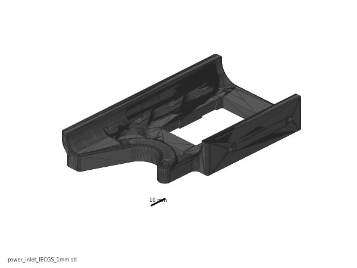{ width=96 } | `power_inlet_IECGS_1mm.stl` (Voron-2 `STLs/Skirts/`) | 09-bay | 1 | Black — heat-set, fitted with its IEC module and mounted in Ch 09 (09.10–09.12); nothing to build here |
| 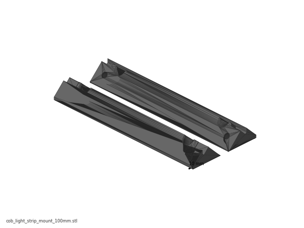{ width=96 } | `cob_light_strip_mount_100mm.stl` (LDOVoron2 `STLs/COB Light Strip/`) | 10-lights | 6 | Black |
| 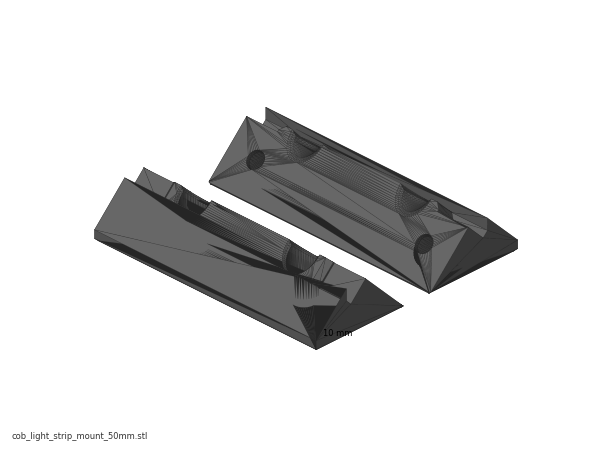{ width=96 } | `cob_light_strip_mount_50mm.stl` (LDOVoron2 `STLs/COB Light Strip/`) | 10-lights | 2 | Black |
| 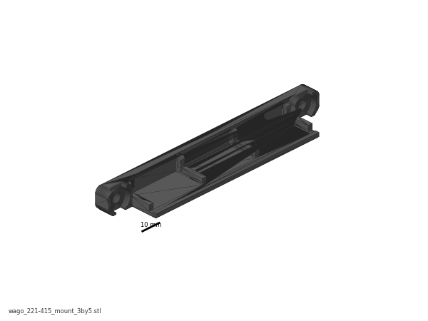{ width=96 } | `wago_221-415_mount_3by5.stl` (Voron-2 `STLs/Electronics_Bay/`) | 09-bay | 1 | Black — fitted in Ch 09, populated here |
| 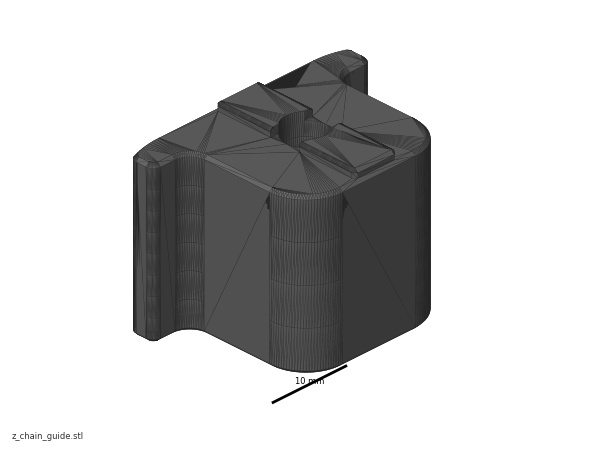{ width=96 } 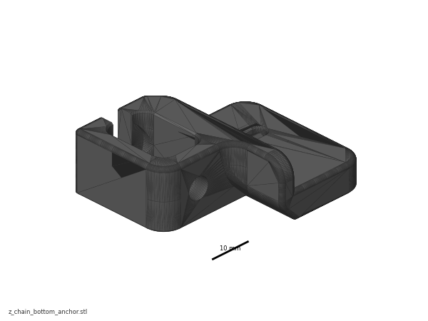{ width=96 } | `z_chain_guide` / `z_chain_bottom_anchor` (batch B05) | 10-chains | 1 / 1 | Black |
| { width=96 } | `[a]_z_chain_retainer_bracket_x2` (batch **B02**, plates B02-P1 and B02-P2) | 10-chains | 2: one in the Z chain bottom anchor, one in the A drive (p.202) | Blue |
| { width=96 } | `[a]_cable_cover` (batch **B02**), over the Z-chain bundle at step 10.66 (p.204) | 07-X | 1 | Blue |
|  | `2x3 Splitter Spacer` | — | 2 | LDO-supplied printed — do not print |
| 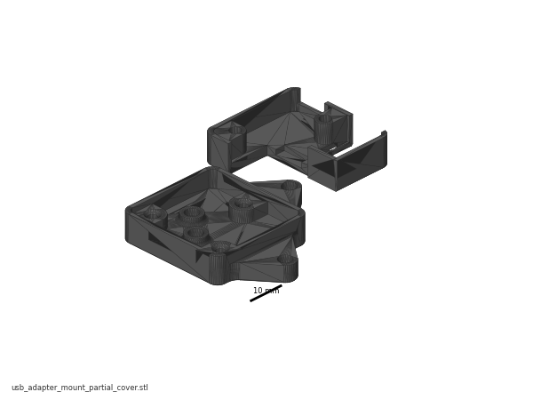{ width=96 } | `usb_adapter_mount_partial_cover.stl` (**Nitehawk-SB-V2** repo) | 08-CW2 | 1 | Black — fitted in Ch 08/09, used here |
| 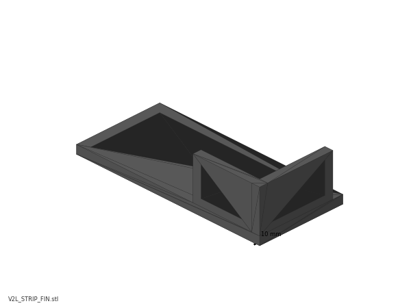{ width=96 } | `V2L_STRIP_FIN.stl` (batch **B11**, plate B11-P3), step 10.80 | 10-lids-AC | 1 | Black |
| 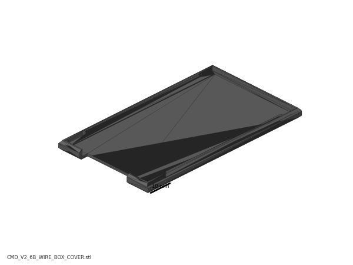{ width=96 } | AC conduit lids, step 10.80: `CMD_V2_6B_WIRE_BOX_COVER.stl`, `V3L_90DEG_R15_COVER.stl` ×2, `V3L_34mm_DUCT_COVER.stl`, `CMD_V2_6B_T_SHORT_COVER.stl`, `V3L_10mm_DUCT_COVER.stl` ×2 (batch **B11**) | 10-lids-AC | 7 | Black |

**Hardware** (chapter totals)

| Fastener / part | Qty | Note |
|---|---|---|
| 3×2 XH splicer PCB | 2 | one for the 6020 fan pair, one as the LED junction |
| 2×3 Splitter Spacer | 2 | LDO-supplied printed, one under each 3×2 splicer |
| Keystone CAT6 insert | 1 | plugged at 10.51, snapped into its panel in Ch 11 |
| C13 power cord | 1 | first plugged in at 10.23, then out of the room |
| Drag chain 10×10 R18 | 2 | X chain and Y chain |
| Drag chain 10×15 R28 | 1 | Z chain |
| M3×5×4 brass heat-set insert | 20: 16 COB mounts + 2 retainer brackets + 2 TFT mount | one per Z chain retainer bracket (p.201, one bore in the STL); the TFT mount's two for step 10.50 |
| M3×6 FHCS | 16 | COB mount halves |
| M3×8 SHCS | 21: 16 COB mounts + 4 splicer PCBs + 1 ESD frame end | 16 COB mounts to extrusion, 2 per splicer PCB ×2, 1 for the ESD cable's frame end at 10.58 **(verify on bench)** |
| M3 hammerhead T-nut, 2020 | 20 | pairs with the M3×8 SHCS above |
| M3×6 FHCS (chain ends, X and Y) | 6: 3 X chain + 3 Y chain | manual p.197, p.199: one at each fixed end (X into a T-nut, Y into the backer's tapped pilot), two into each 2-hole moving end **(verify on bench)** |
| M3 roll-in T-nut, 2020 | 2: 1 X chain end + 1 ESD frame end | X chain fixed end; the ESD cable's frame end at 10.58 **(verify on bench)**. The Y chain's fixed end screws into the right Y backer instead |
| M3×10 FHCS | 2 | Z chain top and bottom ends, one each into a retainer bracket (p.202, CAD) |
| M3×12 SHCS | 2 | `[a]_cable_cover` into the A drive's two inserts (p.204, CAD) |
| M5×10 BHCS | 3 | Z chain bottom anchor (p.201), Z chain guide on the gantry's rear beam (p.203), frame PE lug |
| M5 roll-in T-nut, 2020 | 3 | the same three |
| M5 locking washer | 2 | frame PE stack |
| DIN-rail earth lead set: green/yellow lead with an M5 ring terminal, M5×12 BHCS, M5 serrated lock washer — from an electrical supplier and a hardware shop | 1 set | **not in the kit**, bought for Step 10.82; the rail's M5×10 it replaces goes to spares |
| Extrusion slot cover, 6 mm | up to 9 | closes the slots the LED leads run in |
| Zip ties 3×150 mm | ~35 | from the 100 supplied |

**Notes behind "Read first"**

- **Mains is the one step in this build that can kill you.** Nothing gets plugged in until Checkpoint #1 passes with a meter. LDO: *"Mains wiring should only be performed by certified personnel trained in local regulations and safety standards."* If that is not you, stop at step 10.8 — the first mains run — and get Sections 1, 2 and 2b done by someone who is: every mains lead, both earth leads and Checkpoint #1. [src](https://docs.ldomotors.com/en/voron/voron2/wiring_guide_rev_d)
- **Set the PSU's 115/230 V selector before any mains wiring** and check it again at Checkpoint #1. Getting it wrong destroys the PSU on the first switch-on. [src](https://docs.ldomotors.com/en/voron/voron2/wiring_guide_rev_d#preparing-the-power-supply-unit)
- **Keep every wire loose inside every drag chain.** Taut wires fatigue and break — the single most-repeated LDO warning, and the umbilical is the cable it kills. [src](https://docs.ldomotors.com/voron/voron2/build-faq)
- **Close nothing until Checkpoint 10 passes,** except the AC lids at 10.80. No DC duct covers, no skirts, no bottom panel. Re-opening a closed bay costs an hour and tempts you to skip the meter (survey §5.2 W8).
- **Never plug or unplug a stepper, or the Micro-Fit umbilical connector, with power on.** Back-EMF kills drivers (general driver practice, not an LDO instruction); hot-plugging the umbilical can take out the Nitehawk or the Pi. [src](https://docs.ldomotors.com/en/Toolboard/nitehawk-sb-v2#cable-pinout-adapter-side)
- Your Rev D+ toolboard is a **Nitehawk-SB V2**. The Klipper config and the USB serial-ID pattern both differ from the Rev D wiring guide — that is Ch 12's problem, but do not let anyone talk you into loading `leviathan-printer-rev-d.cfg` on this board (survey §4.1 ①②).

**Manual pages this chapter replaces.** The official manual's Wiring chapter describes a BTT Octopus machine with a 5 V PSU. Per LDO's build notes, **skip p.182–183, 186–190, 192–193, 196 and 205–209 entirely**; for p.191 LDO says to follow its wiring guide, so do that instead. Only p.181 (PSU voltage check), p.194–195 (cable-chain overview) and p.197–204 (chain mounting) survive, and they appear below as steps. [src](https://docs.ldomotors.com/voron/voron2/build-faq)

**Sources for this chapter:**

- [Voron 2.4r2 Assembly Manual](https://github.com/VoronDesign/Voron-2/blob/de7e89d/Manual/Assembly_Manual_2.4r2.pdf), pinned commit `de7e89d` — p.143, p.156, p.181, p.194–195, p.197–204
- [LDO wiring guide, Rev D](https://docs.ldomotors.com/en/voron/voron2/wiring_guide_rev_d) — every connector step below cites its own section anchor
- [LDO Build Notes (build FAQ)](https://docs.ldomotors.com/voron/voron2/build-faq#build-notes) — the per-page notes for p.152, p.156, p.162–163, p.172, p.190–191, p.194–196
- [LDO Rev D printed-parts guide](https://docs.ldomotors.com/en/voron/voron2/printed_part_guide_rev_d) and [Rev D+ 350 BOM](https://docs.ldomotors.com/en/voron/voron2/350_BOM/Rev_D+)
- [LDO Leviathan V1.3 guide](https://ldomotion.com/guides/voron-leviathan-v1-3) — board silkscreen, jumper block, port map
- [Nitehawk-SB V2 board doc](https://docs.ldomotors.com/en/Toolboard/nitehawk-sb-v2) and the [Nitehawk-SB-V2 repo](https://github.com/MotorDynamicsLab/Nitehawk-SB-V2/tree/42ae497) at commit `42ae497` (pinout, grounding and cable-chain images)
- [LDO XY endstop reconnecting guide](https://docs.ldomotors.com/en/guides/XY_Endstop_Cable_Reconnecting_Guide) and [BTT 4.3" screen rotate guide](https://docs.ldomotors.com/en/guides/btt_43_rotate_guide)
- [`leviathan-printer-rev-d-sbv2.cfg`](https://github.com/MotorDynamicsLab/LDOVoron2/blob/667521d/Firmware/leviathan-printer-rev-d-sbv2.cfg) at commit `667521d` — the pin assignments this chapter wires to
- [Klipper `temperature_sensors.cfg`](https://github.com/Klipper3d/klipper/blob/f0892d8/klippy/extras/temperature_sensors.cfg) at commit `f0892d8` — the thermistor curve in step 10.76
- Step images mirrored into `assets/remote/10-wiring/` — [LDOVoron2](https://github.com/MotorDynamicsLab/LDOVoron2/tree/8270e8c/Images/WiringGuide) at `8270e8c`, the [Nitehawk-SB-V2 images](https://github.com/MotorDynamicsLab/Nitehawk-SB-V2/tree/42ae497/Images) at `42ae497`, and six diagrams from the LDO wiki. All are LDO Motors' work, mirrored with attribution for this non-commercial manual; owner, source URL, date and sha256 for each are in that folder's `SOURCES.txt`

**Video coverage (Steve Builds, pre-release LDO kit — differs from Rev D+):** [Part 4 @1:43:50](https://www.youtube.com/watch?v=ViB5Ulc9zDI&list=PL0fUJbigELQPqpeGOgHYisG4KaSXVtnNY&t=6230s) (+13m), [Part 6 @0:24:08](https://www.youtube.com/watch?v=8pWoYkY1DiA&list=PL0fUJbigELQPqpeGOgHYisG4KaSXVtnNY&t=1448s) (+2m), [Part 6 @0:25:44](https://www.youtube.com/watch?v=8pWoYkY1DiA&list=PL0fUJbigELQPqpeGOgHYisG4KaSXVtnNY&t=1544s) (+22m), [Part 6 @1:04:10](https://www.youtube.com/watch?v=8pWoYkY1DiA&list=PL0fUJbigELQPqpeGOgHYisG4KaSXVtnNY&t=3850s) (+27m), [Part 7 @0:08:36](https://www.youtube.com/watch?v=eHo0k2wQsJw&list=PL0fUJbigELQPqpeGOgHYisG4KaSXVtnNY&t=516s) (+16m), [Part 7 @1:29:40](https://www.youtube.com/watch?v=eHo0k2wQsJw&list=PL0fUJbigELQPqpeGOgHYisG4KaSXVtnNY&t=5380s) (+12m), [Part 8 @0:53:06](https://www.youtube.com/watch?v=Q3Q1szaFfSE&list=PL0fUJbigELQPqpeGOgHYisG4KaSXVtnNY&t=3186s) (+37m), [Part 8 @1:25:00](https://www.youtube.com/watch?v=Q3Q1szaFfSE&list=PL0fUJbigELQPqpeGOgHYisG4KaSXVtnNY&t=5100s) (+10m), [Part 8 @1:34:41](https://www.youtube.com/watch?v=Q3Q1szaFfSE&list=PL0fUJbigELQPqpeGOgHYisG4KaSXVtnNY&t=5681s) (+3m), [Part 8 @1:37:22](https://www.youtube.com/watch?v=Q3Q1szaFfSE&list=PL0fUJbigELQPqpeGOgHYisG4KaSXVtnNY&t=5842s) (+7m), [Part 8 @1:43:45](https://www.youtube.com/watch?v=Q3Q1szaFfSE&list=PL0fUJbigELQPqpeGOgHYisG4KaSXVtnNY&t=6225s) (+11m), [Part 9 @0:04:57](https://www.youtube.com/watch?v=dmNwxUm4oik&list=PL0fUJbigELQPqpeGOgHYisG4KaSXVtnNY&t=297s) (+15m), [Part 9 @0:45:19](https://www.youtube.com/watch?v=dmNwxUm4oik&list=PL0fUJbigELQPqpeGOgHYisG4KaSXVtnNY&t=2719s) (+3m), [Part 9 @0:47:56](https://www.youtube.com/watch?v=dmNwxUm4oik&list=PL0fUJbigELQPqpeGOgHYisG4KaSXVtnNY&t=2876s) (+8m), [More Extras! @0:43:01](https://www.youtube.com/watch?v=D_44fDp9xt8&list=PL0fUJbigELQPqpeGOgHYisG4KaSXVtnNY&t=2581s) (+4m), [More Extras! @1:59:20](https://www.youtube.com/watch?v=D_44fDp9xt8&list=PL0fUJbigELQPqpeGOgHYisG4KaSXVtnNY&t=7160s) (+23m), [More Extras! @2:18:10](https://www.youtube.com/watch?v=D_44fDp9xt8&list=PL0fUJbigELQPqpeGOgHYisG4KaSXVtnNY&t=8290s) (+53m)

---

## Section 3 — Above deck: probe, endstops, nozzle probe, lighting

The chapter starts here, as LDO's guide does: the work above the deck and the chains come before the mains. **First, with two people, stand the printer upright from its head.** It stays upright to the end of 10.66, and the helper can work with you throughout. The leads these two sections drop through the deck hang unplugged in the bay until 10.1 parks them.

<a id="step-1030-insulate-the-inductive-probe"></a>

### Step 10.30 — Confirm the inductive probe's tape

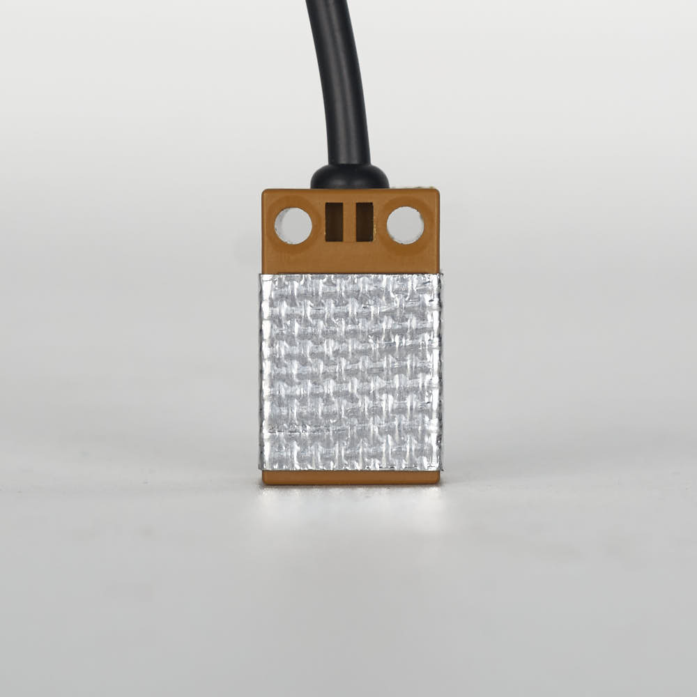

**What you're looking at:** The [inductive probe](16-glossary.md#i) is the small Omron sensor on the X carriage that senses the metal bed for gantry levelling; it never sets Z=0. Its fibreglass tape, fitted earlier, shields it from hotend heat. This step only confirms it.

**Parts:** none.

**Do:**

1. Look at the probe on the carriage. Confirm the tape from Step 07.34 is intact on the front and sides.
2. Leave it: LDO asks for at least two layers there. Patch a torn spot only. If the probe later fails to trigger, LDO's fix is to trim bits of tape away. [src](https://docs.ldomotors.com/en/voron/voron2/wiring_guide_rev_d#insulating-the-z-probe)

**Check:** The sensing face and the back are bare, and the tape does not bulge past the probe's lower rim.

Source: [Voron manual p.143](https://github.com/VoronDesign/Voron-2/blob/de7e89d/Manual/Assembly_Manual_2.4r2.pdf#page=143) · [LDO wiring guide § Insulating the Z-probe](https://docs.ldomotors.com/en/voron/voron2/wiring_guide_rev_d#insulating-the-z-probe) · [LDO wiki probe insulation photo](https://docs.ldomotors.com/v2_wire_guide/v2_revc/probe_insulation.jpg)

---

### Step 10.31 — Read the XY endstop cable labels

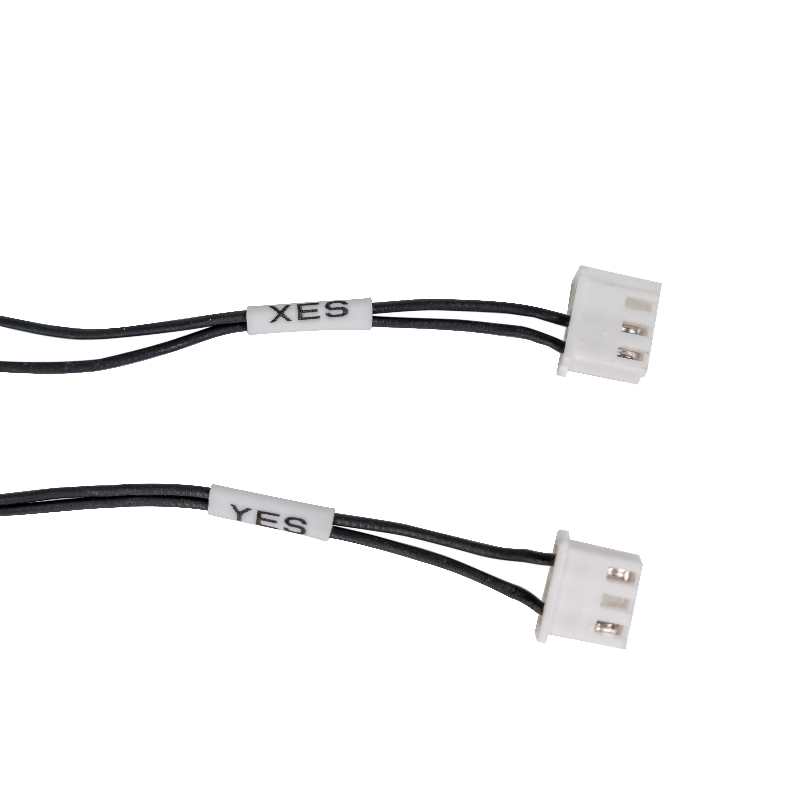

**What you're looking at:** One cable carries both limit switches (endstops): a single 4-pin plug at the gantry end that splits into two 3-pin plugs at the mainboard end. The photo is LDO's correct cable, its two 3-pin ends labelled **XES** and **YES**; the wrongly pinned batch reads X Stop and Y Stop instead.

**Parts:**

- staged: XY endstop cable ×1

**Do:** Read the labels on the two 3-pin connectors.

**Check:** You have matched the two labels to one row of the table below.

**Helper:** Reads both 3-pin labels aloud and points to the matching row in the table.

| Labels read | Meaning |
|---|---|
| **XES** and **YES** | correct cable — go to step 10.33 |
| **X Stop** and **Y Stop** | known bad batch — do step 10.32 first |

Check now: a wrongly pinned cable will not damage the Leviathan, but X and Y homing simply will not work, and you would not find out until Ch 13. [src](https://docs.ldomotors.com/en/guides/XY_Endstop_Cable_Reconnecting_Guide)

Source: [LDO wiring guide § Wiring the XY endstop](https://docs.ldomotors.com/en/voron/voron2/wiring_guide_rev_d#wiring-the-xy-endstop) · [LDO XY endstop reconnecting guide](https://docs.ldomotors.com/en/guides/XY_Endstop_Cable_Reconnecting_Guide)

---

### Step 10.32 — Repin the XY endstop cable (only if labelled X Stop / Y Stop)

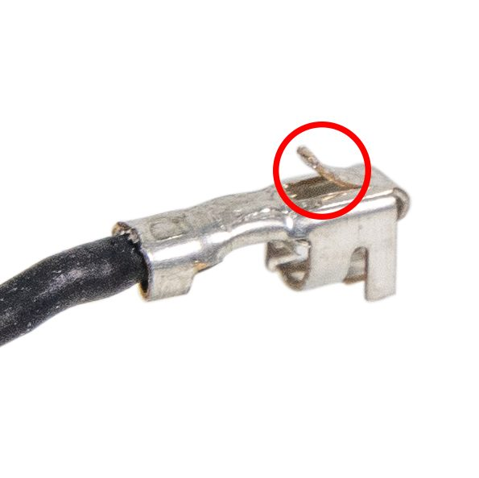

**What you're looking at:** Inside a JST housing, the small white plug, a springy retention tab holds each crimped wire: press it flat and the wire slides out, bend it up and it locks again.

**Parts:**

- staged: XY endstop cable ×1
- tool: tweezers or the supplied 2.5 mm flat screwdriver

**Do:**

1. On **X Stop**, both wires sit in outer positions. Take the one that beeps to an outer pin of the 4-pin plug, LDO's position **3**: press its tab down, pull it out, bend the tab up, and push it into the empty middle, position **2**.
2. On **Y Stop**, move the middle wire, position **2**, into the empty outer position **3**. Use light force only.

**Check:** All four rows of LDO's map below beep with the meter on continuity, and each repinned wire survives a light tug.

| JST-XH 4P pin | goes to |
|---|---|
| 4 | X Stop pin 2 |
| 3 | X Stop pin 1 |
| 2 | Y Stop pin 1 |
| 1 | Y Stop pin 3 |

Pin numbers follow the drawings in LDO's reconnecting guide, open it beside you: on each plug the middle pin is 2, and the 4-pin plug's outer pin on the X Stop side is 4.

Source: [LDO XY endstop reconnecting guide](https://docs.ldomotors.com/en/guides/XY_Endstop_Cable_Reconnecting_Guide) · [LDO guide image `retention_tab.jpg`](https://docs.ldomotors.com/en/guides/XY_Endstop_Cable_Reconnecting_Guide)

---

### Step 10.33 — XY endstop cable → the gantry PCB

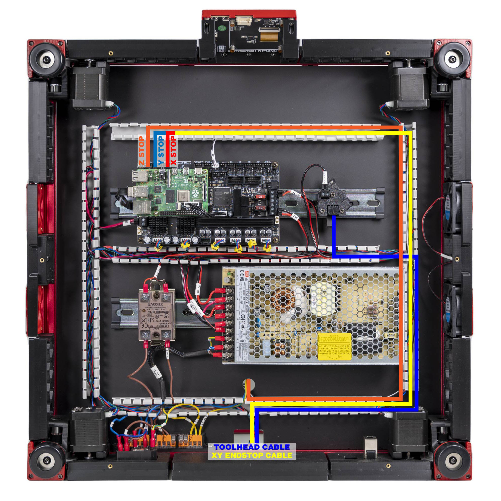

**What you're looking at:** The [XY endstop pod](16-glossary.md#x) is the small PCB on the **right** XY joint carrying both the X and the Y microswitch. X homes to the right and Y to the rear, so the pod sits where both limits are hit. It replaces the manual's separate X and Y microswitches, so LDO skips p.162 and keeps only p.163's XY endstop board step. [src](https://docs.ldomotors.com/voron/voron2/build-faq)

**Parts:**

- XY endstop cable ×1 — from the Cable Kit box
- reused: the XY endstop PCB on the right XY joint

**Do:**

1. Plug the **4-pin** end into the XY endstop PCB. Leave the two 3-pin ends free; they reach the Leviathan in step 10.45.
2. Lay the cable along the **right** Y extrusion toward the rear-right, ready for the Y chain.

**Check:** The connector is fully in, and the cable leaves the PCB without pressing on the switch bodies.

Source: [LDO Rev D photo S6 gantry-cable mapping](https://raw.githubusercontent.com/MotorDynamicsLab/LDOVoron2/8270e8c/Images/WiringGuide/RevD/S6_mapping.jpg) · [LDO wiring guide § Wiring the XY endstop](https://docs.ldomotors.com/en/voron/voron2/wiring_guide_rev_d#wiring-the-xy-endstop) · [LDO Build Notes p.162, p.163](https://docs.ldomotors.com/voron/voron2/build-faq#build-notes)

---

### Step 10.34 — Nozzle-probe (Z endstop) cable

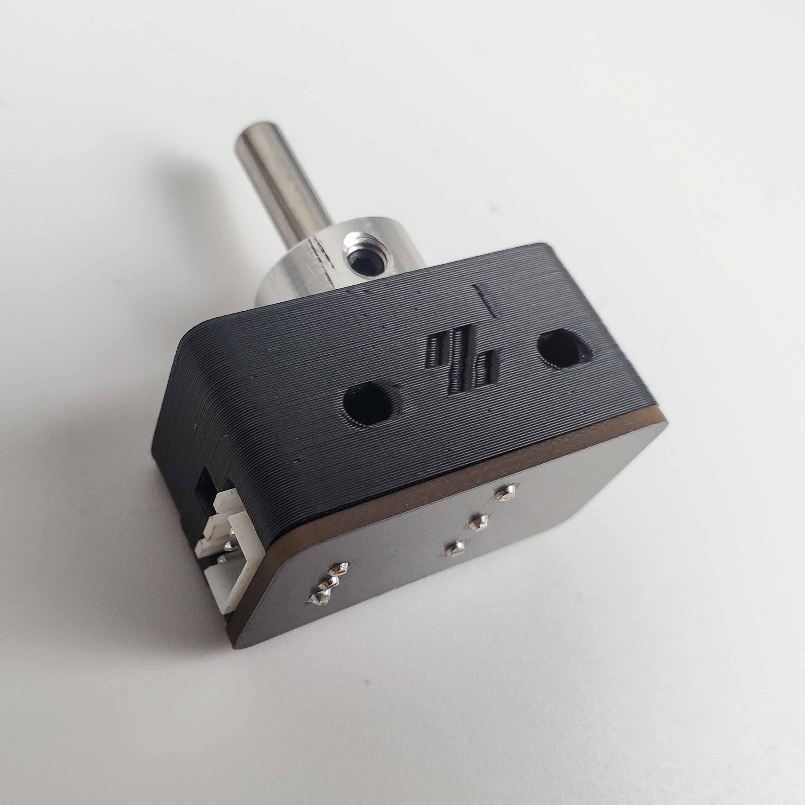

**What you're looking at:** The [nozzle probe](16-glossary.md#n) is LDO's mechanical Z endstop: a sprung 5 mm pin below the bed that the nozzle itself presses down onto a D2F microswitch, on the little PCB Ch 09 mounted. This, not the inductive probe, is what sets Z=0.

**Parts:**

- Z endstop cable ×1 — from the Cable Kit box
- reused: the nozzle-probe PCB

**Do:**

1. Plug the 3-pin connector onto the nozzle-probe PCB.
2. Route the lead across the deck and drop it through the Z-chain notch beside the bundle, not the round hole.

**Check:** The 5 mm shaft, pressed with a finger, moves freely, clicks the D2F and springs back. Bagged shaft (09.30): fit it for this check, then re-bag. The set screw in its collar, Ch 09's small GT2 pulley, stops the shaft falling out but must **not** grip it.

**Helper:** Presses the probe shaft down and says when the switch clicks and the shaft springs back.

**Layout v3:** the notch route adds about 44 mm; check the lead has spare during this fit `(verify on bench)`. If it is short, make a longer replacement lead, same 3-pin connector; a DC lead never enters the AC conduit. **LDO layout:** it drops through the round hole alongside the bed cables, per LDO's build-plate mapping. [LDO § Wiring the bed heater](https://docs.ldomotors.com/en/voron/voron2/wiring_guide_rev_d#wiring-the-bed-heater)

Source: [LDO wiring guide § Assembling the nozzle probe](https://docs.ldomotors.com/en/voron/voron2/wiring_guide_rev_d#assembling-the-nozzle-probe) · [LDO wiring photo z_stop_final.jpg](https://raw.githubusercontent.com/MotorDynamicsLab/LDOVoron2/8270e8c/Images/WiringGuide/z_stop_final.jpg) · [Video: Part 8 @1:49:54](https://www.youtube.com/watch?v=Q3Q1szaFfSE&list=PL0fUJbigELQPqpeGOgHYisG4KaSXVtnNY&t=6594s) (differs: Euclid probe (Klicky fitted later, Part 11); this kit uses the Omron inductive probe + LDO nozzle probe, Klicky bagged · BTT Octopus + separate Raspberry Pi; this kit is a Leviathan with the Pi mounted on it)

Pause: ~25 min since the last pause — probe tape confirmed, XY endstop cable read (and repinned if needed) and plugged into the gantry PCB, nozzle-probe lead run to the Z-chain notch. Both cables are loose on the gantry, not yet in a chain.

---

### Step 10.35 — Assemble the eight COB light-strip mounts

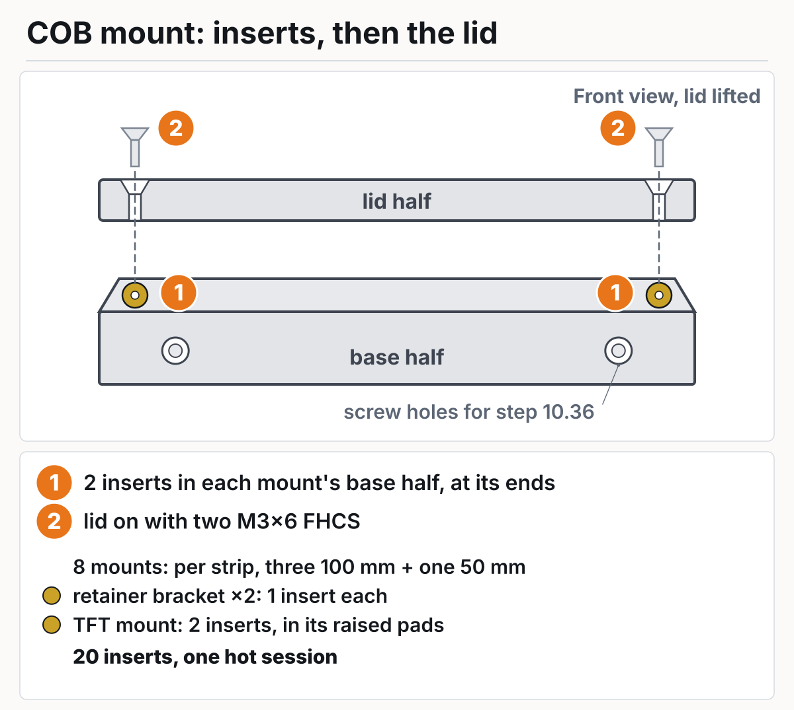

**What you're looking at:** [COB light strips](16-glossary.md#c) are the chamber lighting: a continuous line of LEDs under one phosphor coating rather than separate dots. Each printed mount is a two-piece clamshell that grips the strip and screws to a frame extrusion.

**Parts:**

- `cob_light_strip_mount_100mm` ×6
- `cob_light_strip_mount_50mm` ×2
- M3×5×4 heat-set insert ×20
- M3×6 FHCS ×16
- staged: `[a]_z_chain_retainer_bracket` ×2
- staged: `mount` ×1

**Do:**

1. Melt two inserts into one half of each mount, one into each retainer bracket, and two into the TFT `mount`'s bosses, its raised round pads.
2. Close the halves with two M3×6 FHCS. Four mounts per strip: three 100 mm plus one 50 mm.

**Check:** The halves close **flush** and no mount rocks on glass. The bracket and TFT inserts sit flush, and an M3 screw starts by hand in each.

⚠ The press tip and a freshly set insert both burn. Raise and park the head between inserts, keep the bench ventilated, hold parts by the far edge until they cool, and switch the press off between sessions.

Source: [LDOVoron2 `STLs/COB Light Strip`](https://github.com/MotorDynamicsLab/LDOVoron2/tree/8270e8c/STLs/COB%20Light%20Strip) · [LDO wiring guide § Routing the LED strips](https://docs.ldomotors.com/en/voron/voron2/wiring_guide_rev_d#routing-the-led-strips)

---

### Step 10.36 — Mount the COB strips left and right

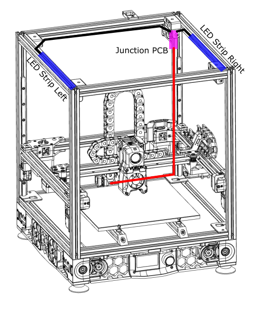

**What you're looking at:** The strips go on the inner faces of the two top side extrusions, aimed down into the chamber. The diagram is LDO's plan for both strips and for the leads that meet at the rear.

**Parts:**

- COB LED strip ×2 — from the LDO kit, box not in the Rev D+ BOM
- reused: the eight assembled COB mounts
- M3×8 SHCS ×16
- M3 hammerhead T-nut ×16

**Do:**

1. Slide four mounts into the inner face of the top-left extrusion and four into the top-right, evenly spaced.
2. Fasten each with two M3×8 SHCS into hammerhead nuts. Press the strips into their channels, leads to the rear.

**Check:** Both strips are level and fully seated, and both leads reach the top rear-right corner with slack to spare.

**Helper:** Holds each COB mount in place on the top extrusion while the adult drives its screws.

Source: [LDO wiring guide § Routing the LED strips](https://docs.ldomotors.com/en/voron/voron2/wiring_guide_rev_d#routing-the-led-strips) · [LDO wiring photo led_route.png](https://raw.githubusercontent.com/MotorDynamicsLab/LDOVoron2/8270e8c/Images/WiringGuide/led_route.png)

---

### Step 10.37 — Mount the LED junction PCB on its spacer

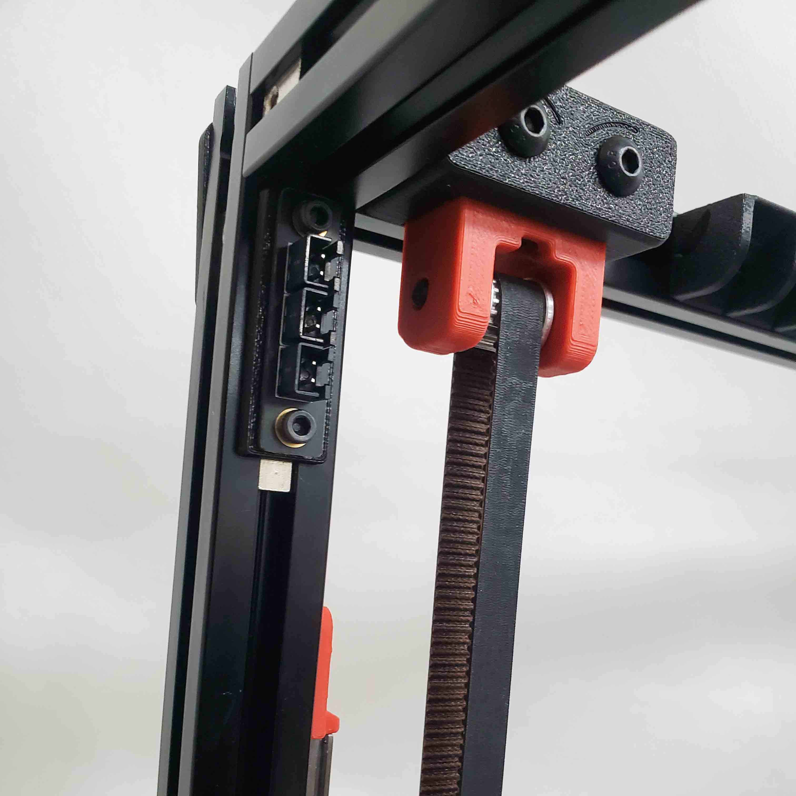

**What you're looking at:** The 3×2 splicer PCB is a plain junction board: the two strip leads plug into two ports, and the third carries one cable down to the mainboard. The printed spacer holds the bare board off the extrusion, which would otherwise short its underside.

**Parts:**

- 3×2 XH splicer PCB ×1
- `2x3 Splitter Spacer` ×1 (LDO-supplied printed)
- M3×8 SHCS ×2
- M3 hammerhead T-nut ×2

**Do:**

1. Stack the PCB on the printed spacer and screw the pair to the rear-right vertical, just below the top corner, on the face the photo shows.
2. Plug the left and right strip leads into two of the three ports.

**Check:** **The spacer is fitted**, and nothing on the PCB's underside touches aluminium. LDO calls it out twice: screwing the bare PCB against the extrusion shorts it.

Source: [LDO wiring guide § Routing the LED strips](https://docs.ldomotors.com/en/voron/voron2/wiring_guide_rev_d#routing-the-led-strips) · [LDO wiring photo led_splitter_placement.jpg](https://raw.githubusercontent.com/MotorDynamicsLab/LDOVoron2/8270e8c/Images/WiringGuide/led_splitter_placement.jpg)

---

### Step 10.81 — Add-on: lay the camera's USB cable before the slots close


**What you're looking at:** The camera hangs a small USB board inside the top front extrusion, fitted in Ch 11 Part C. Its cable runs in covered slots like the LED lead, so it goes in now, before the next step closes them.

**Parts:**

- camera USB cable, 3 m ×1 — from the camera add-on order
- consumable: masking tape

**Do:**

1. Lay the whole run first: the lower slot of the top front extrusion, then of the top right one, then down the rear-right vertical's slot below the PCB, past both seals, to the notch and the Pi.
2. If it reaches, tape a 10 cm tail 5 cm left of front centre.

**Check:** The tail is taped left of the front centre, the cable sits below every slot lip, and the plug end is tagged at the Pi, unplugged.

**Helper:** Feeds the cable along each slot from the corner while the adult seats it.

The cable leaves the camera at its left end, hence the tail left of centre. If it falls short of the Pi, get a longer cable. If a lower slot is taken, use another free slot on that extrusion, never the top front inner slot, clear of Z travel `(verify on bench)`.

Source: [HappyCam, Printables 488020](https://www.printables.com/model/488020) · `slicer/addons/happycam-488020/README.md` · [LDO wiring guide § Routing the LED strips](https://docs.ldomotors.com/en/voron/voron2/wiring_guide_rev_d#routing-the-led-strips)

---

### Step 10.38 — Route the LED lead down to the deck and close the slots

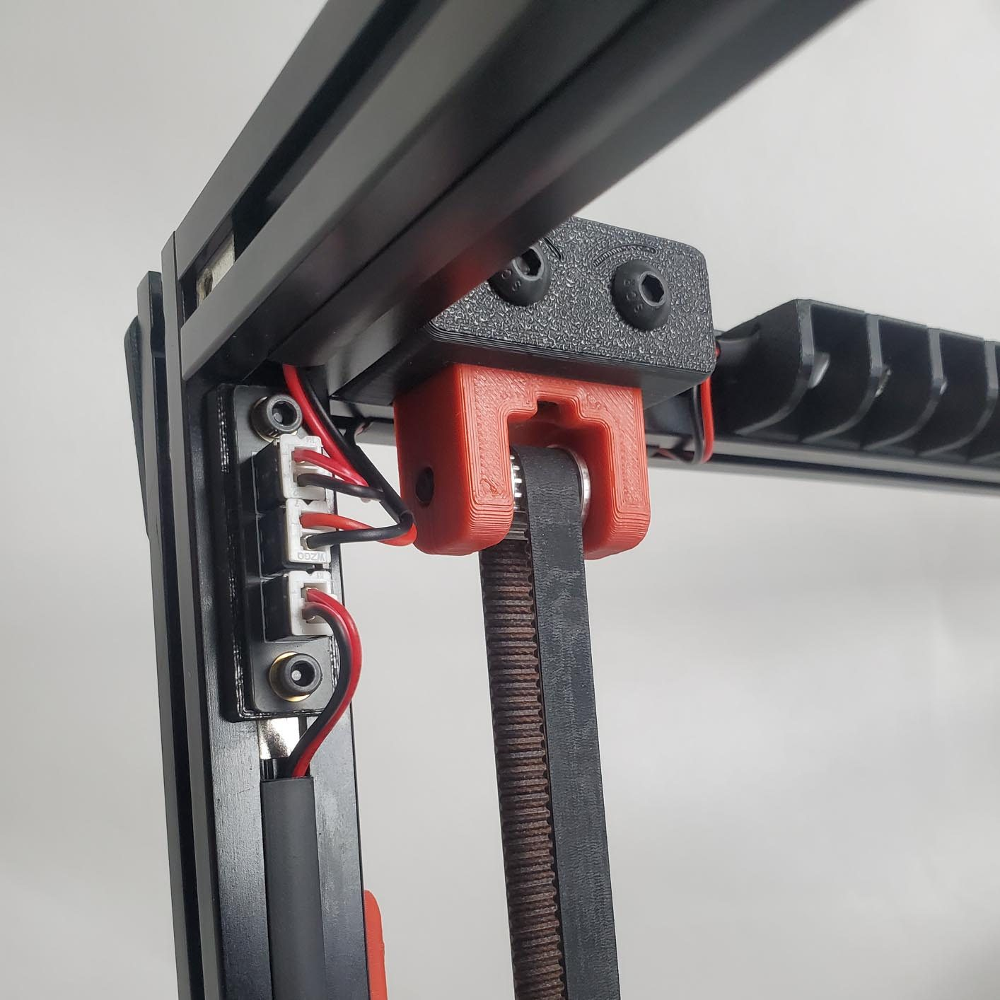


**What you're looking at:** Extrusion slot covers are flexible plastic strips that press into an extrusion slot and protect the LED cable down to the deck. Ch 11's top panel and Z-belt covers close this path for good.

**Parts:**

- *LED STRIP* cable ×1 — from the Cable Kit box
- consumable: extrusion slot cover, 6 mm, up to 9

**Do:**

1. Plug the *LED STRIP* cable into the junction PCB's third port and run it down the rear-right vertical's slot below the PCB, then through the Z-chain notch. The seals from Step 01.23 stay in: the lead enters below the top seal and leaves above the bottom one.
2. Press 6 mm slot covers over every slot a cable occupies. Do it **now**.

**Check:** No cable is outside a covered slot except the short hops past the seals, and nothing crosses the gantry's Z travel.

**Blind-joint seals:** each vertical's slot is plugged just under the top horizontal and just over the bottom one. Never pull a seal to pass a cable. The camera cable shares this slot `(verify on bench)`.

**Alternative:** you may instead route through the **Z-motor A opening**; if you do, print the [alternate Z-belt cover `z_belt_cover_a_led.stl`](https://github.com/MotorDynamicsLab/LDOVoron2/blob/main/STLs/z_belt_cover_a_led.stl) for Ch 11. Decide now, not in Ch 11. [src](https://docs.ldomotors.com/voron/voron2/build-faq)

Source: [LDO wiring guide § Routing the LED strips](https://docs.ldomotors.com/en/voron/voron2/wiring_guide_rev_d#routing-the-led-strips) · [LDO wiring photo led_final.jpg](https://raw.githubusercontent.com/MotorDynamicsLab/LDOVoron2/8270e8c/Images/WiringGuide/led_final.jpg) · [LDOVoron2 `z_belt_cover_a_led.stl`](https://github.com/MotorDynamicsLab/LDOVoron2/blob/8270e8c/STLs/z_belt_cover_a_led.stl) · [survey §5.2 W5](../voron-build-instructions-survey.md) · [Video: Part 9 @0:17:48](https://www.youtube.com/watch?v=dmNwxUm4oik&list=PL0fUJbigELQPqpeGOgHYisG4KaSXVtnNY&t=1068s)

---

### Step 10.39 — Chamber thermistor, if your batch includes one

(no image — see text)

**What you're looking at:** The chamber thermistor is a small temperature sensor hanging in free air inside the enclosure, reporting how hot the chamber has become. On a Rev D+ machine it belongs on the toolboard's `CT` port, not on any of the Leviathan's four thermistor inputs.

**Parts:**

- reused: the chamber thermistor, if your batch has one

**Do:**

1. Nothing on the Leviathan: the chamber thermistor goes on the **toolboard's CT port**, a Ch 08 step.
2. If yours is still loose, place its tip in free chamber air, away from the hotend, where nothing it passes can snag it.

**Check:** Your batch BOM tells you whether the part is in the kit, and the Klipper config's `[temperature_sensor chamber_temp]` reads `nhk:PB2`, the toolboard, not the mainboard.

It is tempting to put the chamber sensor on one of the Leviathan's four thermistor inputs. Do not: `leviathan-printer-rev-d-sbv2.cfg` expects it on the toolboard. [src](https://github.com/MotorDynamicsLab/LDOVoron2/blob/main/Firmware/leviathan-printer-rev-d-sbv2.cfg)

LDO's guide hangs it from a holder on LDO's Clockwork 2 cable door. The Clockwork 2.5 `cable_cover` on this build has no holder, so the tip leads out of the cover into free air, as Step 08.51 sets it. [src](https://docs.ldomotors.com/en/Toolboard/nitehawk-sb-v2#printed-parts)

Source: [`leviathan-printer-rev-d-sbv2.cfg`](https://github.com/MotorDynamicsLab/LDOVoron2/blob/667521d/Firmware/leviathan-printer-rev-d-sbv2.cfg) · [Nitehawk-SB V2 doc § Port and pin definitions](https://docs.ldomotors.com/en/Toolboard/nitehawk-sb-v2#port-and-pin-definitions) · [Video: Part 9 @1:36:20](https://www.youtube.com/watch?v=dmNwxUm4oik&list=PL0fUJbigELQPqpeGOgHYisG4KaSXVtnNY&t=5780s)

Pause: ~35 min since the last pause, ~45 with the camera cable — eight COB mounts built, both strips mounted and plugged into the junction PCB on its spacer, LED lead routed, the camera cable too if fitted, and **every occupied extrusion slot covered**. Do not leave a slot open: Ch 11's top panel and Z-belt covers close this route for good.

---

## Section 4 — The drag chains

### Step 10.59 — Fit the X drag chain

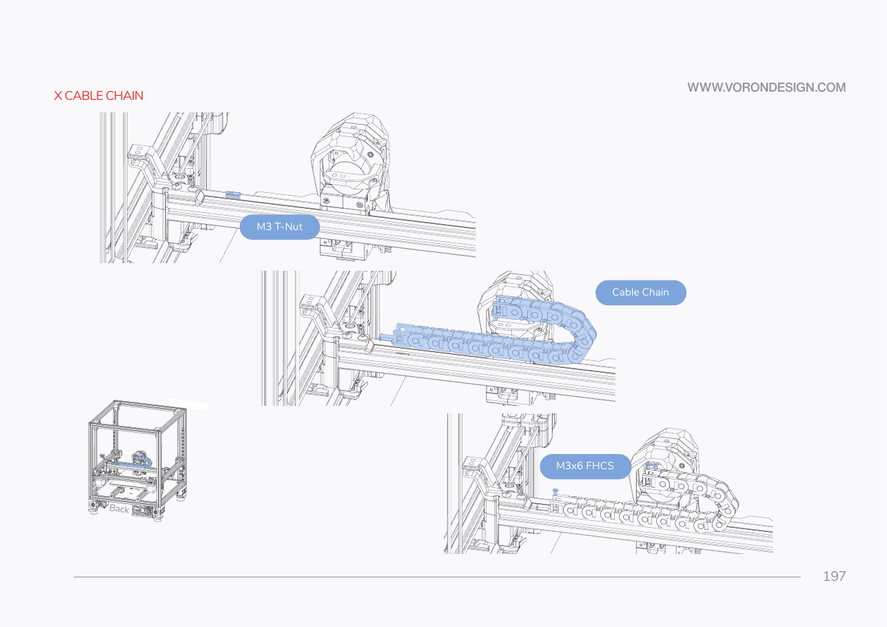

**What you're looking at:** A [drag chain](16-glossary.md#d) is a hinged plastic channel that lets a cable follow a moving part. The X chain runs along the top of the X extrusion, from a fixed end to the toolhead.

**Parts:**

- drag chain 10×10 R18 ×1
- M3 roll-in T-nut ×1
- M3×6 FHCS ×3 (verify on bench)
- reused: the CW2 chain anchor on the toolhead

**Do:**

1. Slide the T-nut into the X extrusion's top slot. Hold both chain ends, run the toolhead through full X travel, and unclip links to the shortest length that never pulls tight, plus one spare link, our margin (verify on bench).
2. Latches on the side you can reach, screw the fixed end to the T-nut with one M3×6 FHCS, the moving end to the CW2 Chain Anchor Tilted with two.

**Check:** Over full X travel, the chain rolls and never drags or pulls tight.

The kit ships **2-hole** chain ends: print the `*_2hole` variants, never `*_3hole`. [src](https://docs.ldomotors.com/en/voron/voron2/printed_part_guide_rev_d)

Source: [Voron manual p.197](https://github.com/VoronDesign/Voron-2/blob/de7e89d/Manual/Assembly_Manual_2.4r2.pdf#page=197) · [LDO printed-parts guide Rev D](https://docs.ldomotors.com/en/voron/voron2/printed_part_guide_rev_d) · [Video: Part 6 @0:34:57](https://www.youtube.com/watch?v=8pWoYkY1DiA&list=PL0fUJbigELQPqpeGOgHYisG4KaSXVtnNY&t=2097s)

---

### Step 10.60 — Fit the Y drag chain

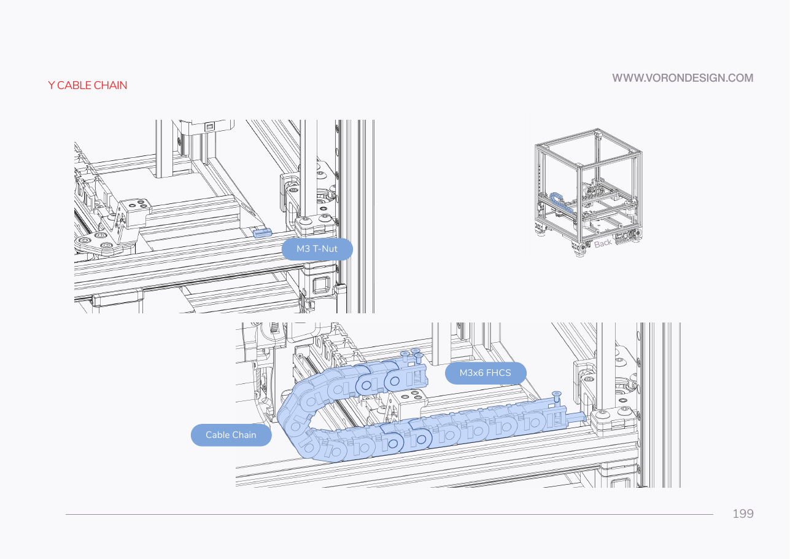{ crop="0.08 0.20 0.88 0.89" }
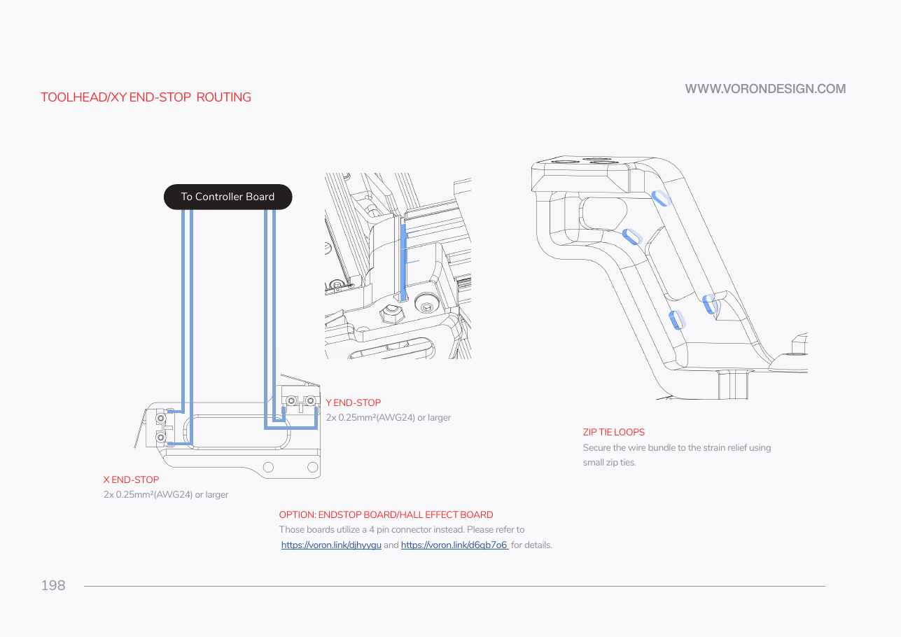{ crop="0.58 0.18 0.96 0.76" }

**What you're looking at:** The Y chain does the same job one level out: fixed to the **right** Y extrusion and moving with the right XY joint, so the umbilical and the endstop cable can travel front to back. Everything it serves is on the right.

**Parts:**

- drag chain 10×10 R18 ×1
- M3×6 FHCS ×3 (verify on bench)
- reused: the right Y backer, its rear pilot holes tapped M3
- consumable: small zip tie ×2

**Do:**

1. Latches on the side you can reach, screw the chain's fixed end into the **right** Y backer's tapped rear pilot holes with one M3×6 FHCS, no T-nut. Fix the moving end onto the right XY joint's cable bridge with two.
2. Hold the bundle to the strain relief with **small** zip ties.

**Check:** The chain bends freely as you run the gantry front to back over full Y travel, and the loop stays clear of the bed extrusions.

⚠ **Ti backers:** only the right Y backer has the chain's pilot holes, and it covers the slot a T-nut would need. LDO's set comes with them drilled and tapped M3 `(verify on bench)`, checked at 05.16. A pilot that will not take the screw: stop and ask Fabreeko or LDO. Never drill titanium on the machine. [src](https://github.com/tanaes/whopping_Voron_mods/tree/main/extrusion_backers)

Ignore p.198's separate X and Y endstop wiring: the kit uses one 4-pin XY endstop PCB, p.198's own "endstop board" option (LDO notes p.162, p.163). [src](https://docs.ldomotors.com/voron/voron2/build-faq)

LDO's cable-chain guide: fit each chain so its latches open where you can reach them without taking the chain off. [src](https://docs.ldomotors.com/en/guides/cable_chain_guide)

Source: [Voron manual p.199](https://github.com/VoronDesign/Voron-2/blob/de7e89d/Manual/Assembly_Manual_2.4r2.pdf#page=199) · [Voron manual p.198](https://github.com/VoronDesign/Voron-2/blob/de7e89d/Manual/Assembly_Manual_2.4r2.pdf#page=198) · [LDO Build Notes p.162–163](https://docs.ldomotors.com/voron/voron2/build-faq#build-notes) · [Video: Part 6 @0:39:55](https://www.youtube.com/watch?v=8pWoYkY1DiA&list=PL0fUJbigELQPqpeGOgHYisG4KaSXVtnNY&t=2395s)

---

### Step 10.61 — Secure the A and B motor cables

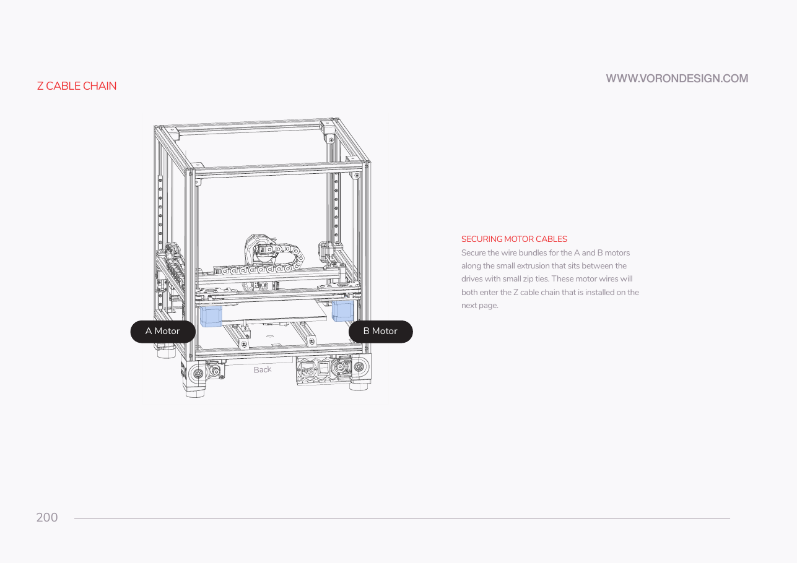{ crop="0.14 0.24 0.82 0.72" }

**What you're looking at:** The A and B motor leads run from the two rear drive units along the small extrusion between them, then join everything else in the Z chain. The ties keep the cables out of the belts and pulleys.

**Parts:**

- consumable: zip ties, 4 to 6

**Do:** Bundle the A and B motor cables along the small extrusion between the two drive units, with a tie every 60–80 mm. Both bundles feed into the Z chain next.

**Check:** No cable can reach a moving belt or pulley, and the ties are snug, not crushing.

Source: [Voron manual p.200](https://github.com/VoronDesign/Voron-2/blob/de7e89d/Manual/Assembly_Manual_2.4r2.pdf#page=200) · [Video: Part 6 @1:04:55](https://www.youtube.com/watch?v=8pWoYkY1DiA&list=PL0fUJbigELQPqpeGOgHYisG4KaSXVtnNY&t=3895s)

---

<a id="step-1062-fit-the-z-chain-guide-and-the-z-chain"></a>

### Step 10.62 — Fit the Z chain bottom anchor and the Z chain

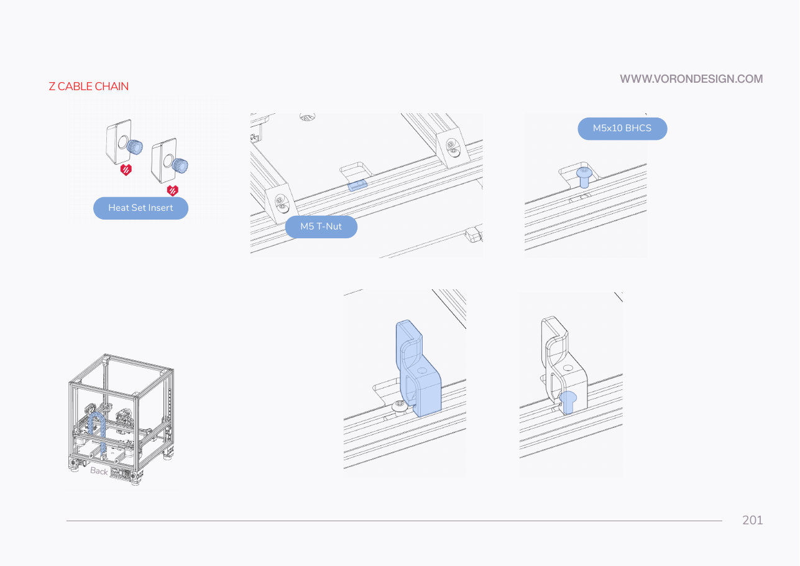{ crop="0.30 0.17 0.84 0.88" }
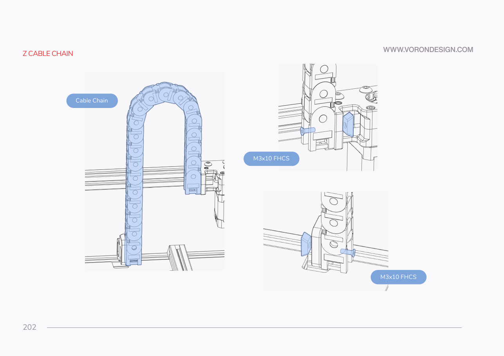{ crop="0.50 0.52 0.86 0.84" }

**What you're looking at:** The Z chain is the largest of the three, 10 × 15 mm links on a 28 mm bend radius, because it carries the whole gantry harness down to the deck. The deck-level mount p.201 draws is `z_chain_bottom_anchor`: it screws to the frame and holds the chain's lower end.

**Parts:**

- `z_chain_bottom_anchor` ×1
- M5 roll-in T-nut ×1
- M5×10 BHCS ×1
- drag chain 10×15 R28 ×1
- `[a]_z_chain_retainer_bracket` ×1
- M3×10 FHCS ×1

**Do:**

1. Screw the bottom anchor to the rear-bottom extrusion at deck level with the M5 T-nut and M5×10 BHCS, p.201.
2. Seat a retainer bracket in the anchor's pocket and fix the chain's lower end to it with one M3×10 FHCS, p.202, latches on the side you can reach.

**Check:** The anchor is square to the extrusion and the chain hangs in a clean vertical loop.

Source: [Voron manual p.201](https://github.com/VoronDesign/Voron-2/blob/de7e89d/Manual/Assembly_Manual_2.4r2.pdf#page=201) · [Voron manual p.202](https://github.com/VoronDesign/Voron-2/blob/de7e89d/Manual/Assembly_Manual_2.4r2.pdf#page=202) · [Video: Part 4 @1:43:44](https://www.youtube.com/watch?v=ViB5Ulc9zDI&list=PL0fUJbigELQPqpeGOgHYisG4KaSXVtnNY&t=6224s)

---

<a id="step-1063-fit-the-z-chain-bottom-anchor"></a>

### Step 10.63 — Fit the Z chain guide

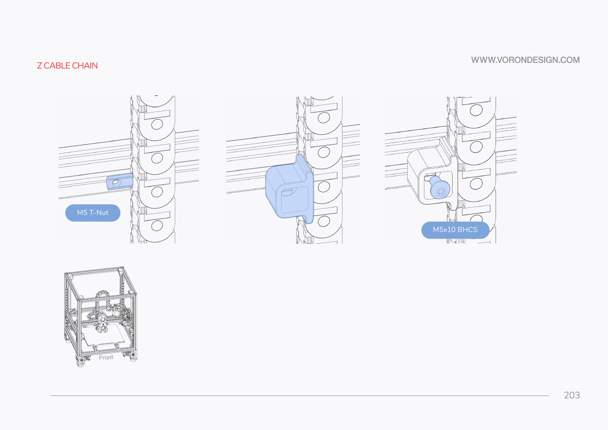{ crop="0.08 0.20 0.92 0.60" }

**What you're looking at:** `z_chain_guide` is a printed clip with an open channel the chain runs *through*, holding it partway along. p.203's small locator view puts it on the **gantry's rear beam**.

**Parts:**

- `z_chain_guide` ×1
- M5 roll-in T-nut ×1
- M5×10 BHCS ×1

**Do:**

1. **After 10.64**, try the guide's channel over the chain on the gantry's rear beam without screwing it, and find the spot along the beam where the chain runs straight at both Z extremes (verify on bench).
2. Put the M5 T-nut into the beam's slot there, the chain into the channel, and the M5×10 BHCS through.

**Check:** The chain slides through the guide without snagging through full Z travel, the loop stays open at the bottom, and nothing stretches at the top.

Source: [Voron manual p.203](https://github.com/VoronDesign/Voron-2/blob/de7e89d/Manual/Assembly_Manual_2.4r2.pdf#page=203)

---

### Step 10.64 — Fit the Z chain retainer bracket and set the wire path

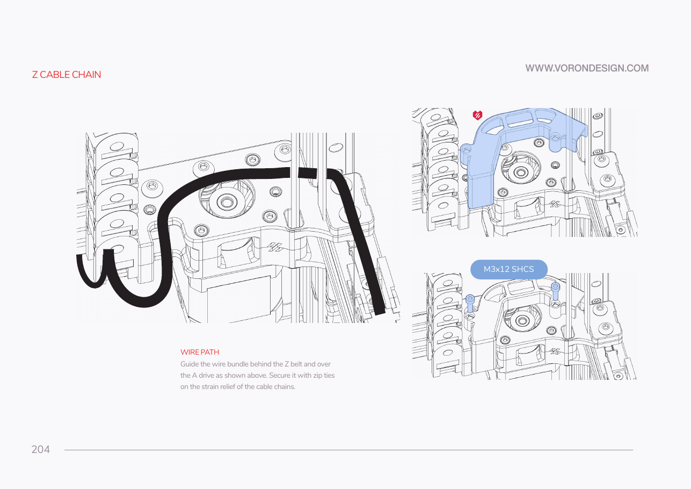

**What you're looking at:** The second blue retainer bracket sits in a pocket of the A drive and carries the chain's moving top end with the gantry. p.204 also sets the wire path, behind the Z belt and over the drive, under the blue `[a]_cable_cover` arch.

**Parts:**

- `[a]_z_chain_retainer_bracket` ×1
- M3×10 FHCS ×1

**Do:**

1. Seat the bracket in the A drive's pocket and fix the chain's upper end to it with one M3×10 FHCS.
2. Leave the `[a]_cable_cover` off until 10.66: the bundle runs under it, behind the Z belt and over the drive.

**Check:** The chain's top end never twists, and the empty chain clears the Z belt as you move the gantry through full Z travel.

Source: [Voron manual p.204](https://github.com/VoronDesign/Voron-2/blob/de7e89d/Manual/Assembly_Manual_2.4r2.pdf#page=204)

Pause: ~35 min since the last pause — X, Y and Z chains all mounted at both ends, A/B motor cables bundled, retainer bracket on the A drive. **Chains are empty and latched.** Do not part-fill a chain and walk away: the next segment fills all three in one go.

---

### Step 10.65 — Lay the harness into the chains

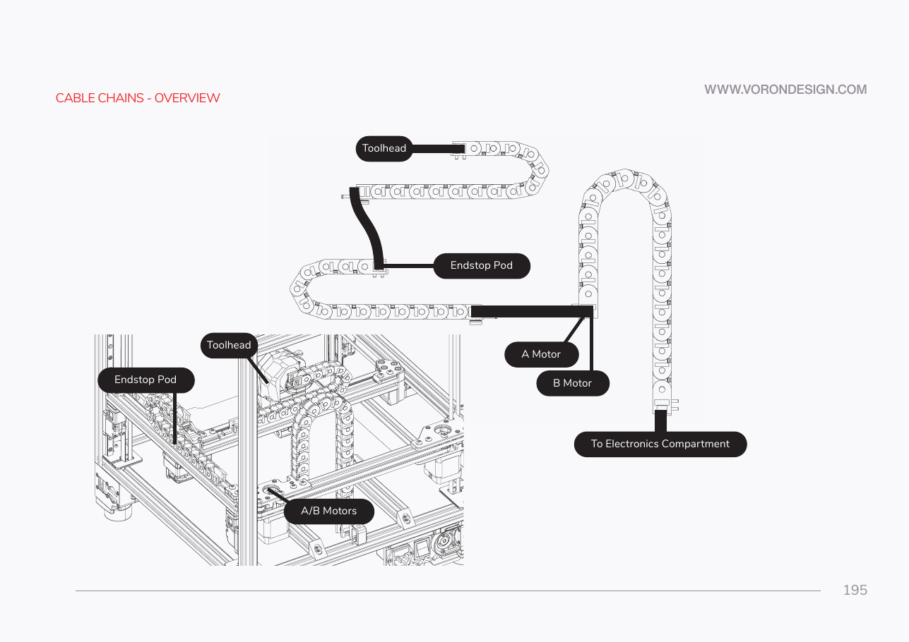{ crop="0.30 0.19 0.84 0.72" }
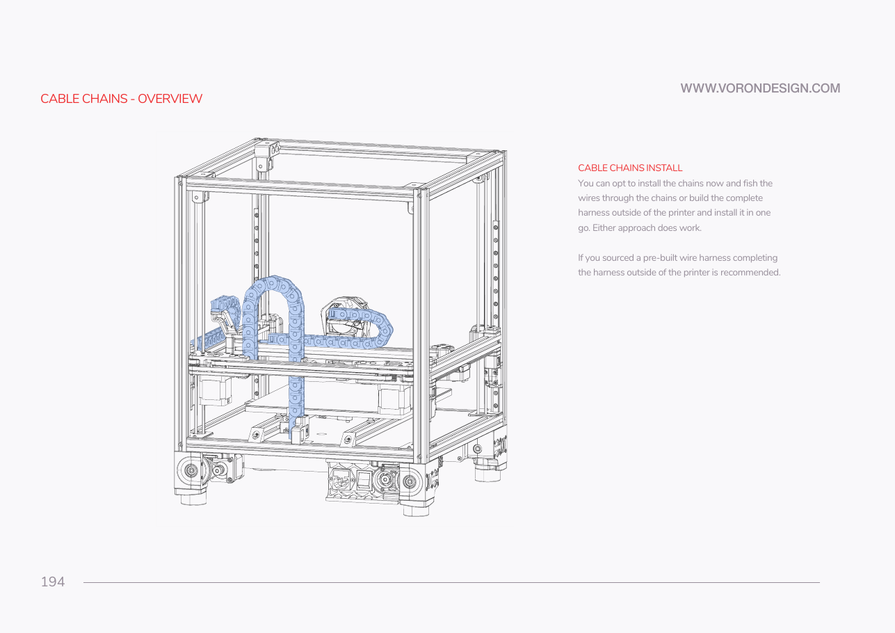

**What you're looking at:** Every drag-chain link has a hinged latch, marked with a small screwdriver icon on the side you may pry, so cables are laid in rather than threaded through.

**Parts:**

- reused: the umbilical
- reused: the XY endstop cable
- reused: the A and B motor bundles
- tool: 2.5 mm flat screwdriver

**Do:**

1. Pry each latch **only** on its screwdriver-icon side, lay the cables in, and press each latch shut. End links have no latch: unclip each from its neighbour, lay the cable through, and clip it back.
2. Fill in this order: the umbilical alone in X; the umbilical plus the XY endstop cable in Y; both plus the A and B motor bundles in Z.

**Check:** Every latch has clicked shut, and with the gantry mid-travel you can pinch each cable inside a link and slide it a few millimetres.

**Helper:** Holds each chain latch open with the flat screwdriver while the adult lays the cables in.

⚠ Pry a latch only in the small notch on its screwdriver-icon side. Prying the other side breaks the latch. [LDO cable-chain guide](https://docs.ldomotors.com/en/guides/cable_chain_guide)

⚠ Rev D+ / LDO: LDO note p.194–195: *"When running wires in the cable chain, it is important to keep the wires loose. Pulling the wires tight inside the cable chain will result to excessive wire fatigue and possible pre-mature wire breaks."* This is the most-repeated warning in the whole LDO documentation set. [src](https://docs.ldomotors.com/voron/voron2/build-faq)

The umbilical's nominal bend radius is **28 mm** and the X and Y chains are **R18**. LDO ships this combination and rates the cable for drag-chain use, but it is the cable most likely to fail first, which is exactly why 10.66 and 10.67 exist.

Source: [Voron manual p.195](https://github.com/VoronDesign/Voron-2/blob/de7e89d/Manual/Assembly_Manual_2.4r2.pdf#page=195) · [Voron manual p.194](https://github.com/VoronDesign/Voron-2/blob/de7e89d/Manual/Assembly_Manual_2.4r2.pdf#page=194) · [LDO cable-chain guide](https://docs.ldomotors.com/en/guides/cable_chain_guide) · [LDO Build Notes p.194–195](https://docs.ldomotors.com/voron/voron2/build-faq#build-notes) · [Video: More Extras! @2:18:20](https://www.youtube.com/watch?v=D_44fDp9xt8&list=PL0fUJbigELQPqpeGOgHYisG4KaSXVtnNY&t=8300s) (differs: no toolboard — loom to the mainboard; this kit runs a Nitehawk-SB V2 on one USB+24 V umbilical)

---

### Step 10.66 — Zip-tie both ends of every chain

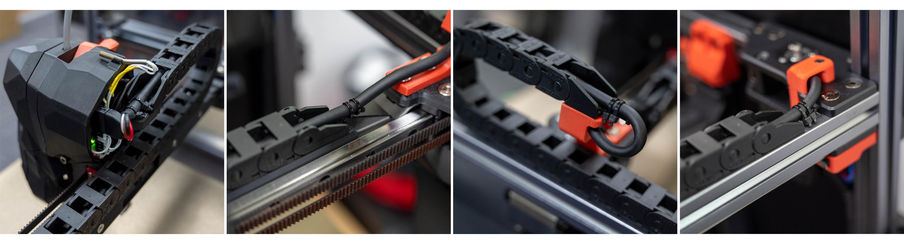


**What you're looking at:** Each end link of a chain has a small tab for a zip tie, a strain relief: pull on the umbilical and the load stops at the tie, not at the XT30 or Micro-Fit plug. p.204's blue arch then covers the Z bundle.

**Parts:**

- consumable: zip ties, 12
- `[a]_cable_cover` ×1
- M3×12 SHCS ×2

**Do:**

1. Tie all six chain end links at their tabs, two ties each. If a tab is in the way, cut it off and tie round the link.
2. Screw the `[a]_cable_cover` over the Z bundle with two M3×12 SHCS into the A drive's inserts.

**Check:** Six tie points carry two ties each, the tie takes the strain when you pull the umbilical at each end, and the cover pinches no cable.

Source: [Nitehawk-SB V2 doc § Working with cable chains](https://docs.ldomotors.com/en/Toolboard/nitehawk-sb-v2#working-with-cable-chains) · [Voron manual p.204](https://github.com/VoronDesign/Voron-2/blob/de7e89d/Manual/Assembly_Manual_2.4r2.pdf#page=204) · [Nitehawk-SB-V2 repo `cable_chain_ties.jpg`](https://github.com/MotorDynamicsLab/Nitehawk-SB-V2/blob/42ae497/Images/cable_chain_ties.jpg) · [Video: More Extras! @2:35:55](https://www.youtube.com/watch?v=D_44fDp9xt8&list=PL0fUJbigELQPqpeGOgHYisG4KaSXVtnNY&t=9355s) (differs: no toolboard — loom to the mainboard; this kit runs a Nitehawk-SB V2 on one USB+24 V umbilical)

Pause: ~20 min since the last pause — all three chains filled and every end zip-tied, every latch clicked shut, the cable cover over the Z bundle; the gantry moves through full X, Y and Z travel by hand. The umbilical, A/B, XY endstop, LED, nozzle-probe and camera leads hang through the deck into the bay, every one unplugged. Before you stop, with two people, lay the printer on its right side on a blanket, the underside of the deck facing you: it stays there for the rest of the chapter. Then the helper leaves the room; Sections 1, 2 and 2b are one adult alone. **Do not start Section 1 in a leftover ten minutes**: mains work is a fresh session with a clear head, through LDO's Checkpoint #1 to the SSR and bed leads after it.

---

<a id="section-1-mains-inlet-switch-psu-ssr-bed-heater"></a>

## Section 1 — Mains: inlet → switch → PSU, then the earth leads

### Step 10.1 — Empty the bay and set the end state

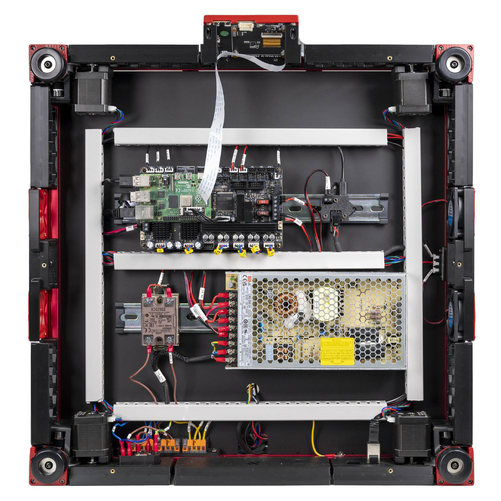

**What you're looking at:** This photo is the target: LDO's finished Rev D bay, seen from below. Ch 09 placed it all: two [DIN rails](16-glossary.md#d), the [wire ducts](16-glossary.md#w) that hide cable runs, the Leviathan with the Raspberry Pi on top, the PSU, the SSR, the USB-adapter PCB and the 3×5 WAGO mount.

**Parts:** none.

**Do:**

1. With the printer on its right side, bay toward you, press every lead hanging through the notch into the DC loop beside it. Tape their plugs there, clear of the WAGO blocks, PSU and SSR.
2. Confirm the rest of the bay holds only Ch 09's work, nothing wired.
3. Unplug the C13 power cord and put it in another room.

**Check:** Nothing is connected yet and no duct covers are on.

The parked leads stay there until each is plugged in, from Section 5 on. Tape the USB adapter's DC Ground Wire there too: its free ring, loose since 09.25, is bare metal and lands on the frame only at 10.58. **LDO layout:** the nozzle-probe lead hangs through the round hole instead; tape it to the nearest DC duct, clear of the WAGO blocks, PSU and SSR.

⚠ **Who is in the room, [00a.2](00a-mains-safety.md#step-00a2-write-the-who-is-in-the-room-rule-and-post-it-on-the-wall):** one adult at the machine from 10.1 to the end of Section 2b. She helped lay the printer down, is out of the room for Sections 1, 2 and 2b, and is back for 10.40. In Section 8, with the printer unplugged, she records the readings you call out; you hold the probes.

Source: [LDO Rev D photo VS9 finished bay](https://raw.githubusercontent.com/MotorDynamicsLab/LDOVoron2/8270e8c/Images/WiringGuide/RevD/VS9_Final.jpg) · [LDO wiring guide § Finish line](https://docs.ldomotors.com/en/voron/voron2/wiring_guide_rev_d#finish-line)

---

### Step 10.2 — Set the PSU input-voltage selector

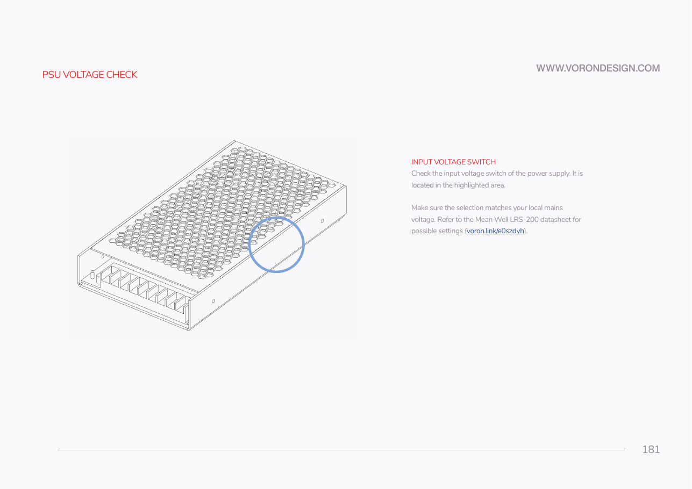{ crop="0.08 0.24 0.88 0.62" }
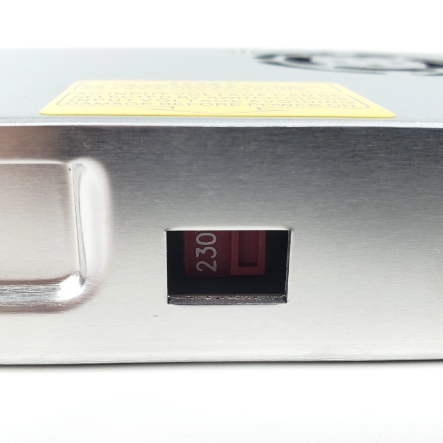

**What you're looking at:** The grey box is the [Meanwell LRS-200-24](16-glossary.md#m), the power supply (PSU) that makes 24 V for everything except the bed heater. The second photo shows the small red slide switch in its side, which sets it for 115 V or 230 V mains.

**Parts:**

- reused: the Meanwell PSU

**Do:**

1. Find the red slide switch in the cut-out on the PSU's long side.
2. With the flat screwdriver, slide it so the window shows **115** for a US 110/120 V supply, or **230** for a 230 V supply.

**Check:** The number in the window, read out loud, matches your wall socket.

⚠ Rev D+ / LDO: EU kits may ship the **Meanwell RSP-200-24** instead. LDO: it has power-factor correction and *"a universal AC input range, so no switching is needed."* Read the model on the PSU's label, not the missing switch: **RSP-200-24**, skip this step; **LRS-200-24** and you cannot find the switch, stop and ask LDO before going on. [src](https://docs.ldomotors.com/en/voron/voron2/wiring_guide_rev_d#preparing-the-power-supply-unit)

The yellow warning label on the PSU lid says the same thing: *"AC INPUT VOLTAGE CAN BE SELECTED BY SWITCH, CHECK INPUT VOLTAGE AVOIDING DAMAGE BEFORE POWER ON."*

Source: [Voron manual p.181](https://github.com/VoronDesign/Voron-2/blob/de7e89d/Manual/Assembly_Manual_2.4r2.pdf#page=181) · [LDO wiring guide § Preparing the power supply unit](https://docs.ldomotors.com/en/voron/voron2/wiring_guide_rev_d#preparing-the-power-supply-unit) · [LDO wiring photo psu_switch.jpg](https://raw.githubusercontent.com/MotorDynamicsLab/LDOVoron2/8270e8c/Images/WiringGuide/psu_switch.jpg)

---

### Step 10.3 — Confirm the Leviathan voltage-selection jumpers are off

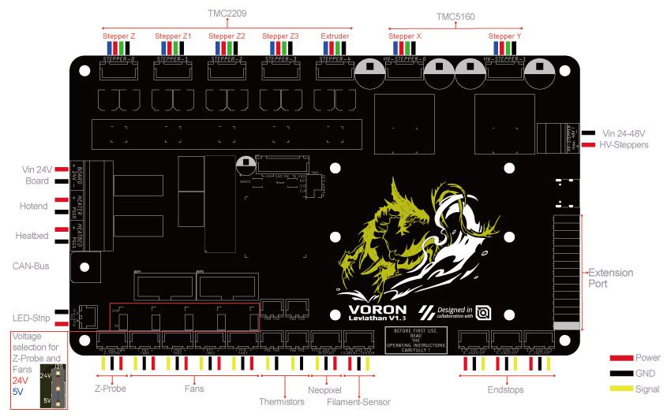

**What you're looking at:** The [Leviathan](16-glossary.md#l) is LDO's mainboard: it drives six motors, reads the bed thermistor and the endstops, and supplies the Raspberry Pi with 5 V. Above the probe port and each of the four fan ports sits a small 3-pin header. A jumper, the small plug that bridges two of its three pins, picks 24 V or 5 V for that port.

**Parts:**

- reused: the Leviathan mainboard

**Do:** Find the five 3-pin headers that LDO's map boxes in red as *Voltage selection for Z-Probe and Fans*, one above each of the **Z-PROBE, FAN0, FAN1, FAN2** and **FAN3** ports. All five must be bare.

**Check:** You have counted five headers, none with a jumper on it.

⚠ Rev D+ / LDO: this build uses an **active** toolboard, so the Leviathan's own probe port and Fan0/Fan1 stay unused and without jumpers. Only Ch 14 Part H's optional exhaust fan later takes FAN0 and a third jumper. A 24 V jumper on a port feeding a 5 V device destroys the device. [src](https://ldomotion.com/guides/voron-leviathan-v1-3) · Leviathan V1.3 manual p.7

Source: [LDO wiring guide § Preparing the mainboard](https://docs.ldomotors.com/en/voron/voron2/wiring_guide_rev_d#preparing-the-mainboard-ldo-voron-leviathan-board) · [LDO Leviathan V1.3 guide](https://ldomotion.com/guides/voron-leviathan-v1-3) (manual p.7) · [Leviathan repo `wiring_V1.3.jpg`](https://raw.githubusercontent.com/MotorDynamicsLab/Leviathan/878c3c4/Media/wiring_V1.3.jpg)

---

### Step 10.4 — Fit the AC inlet into the printed plug panel

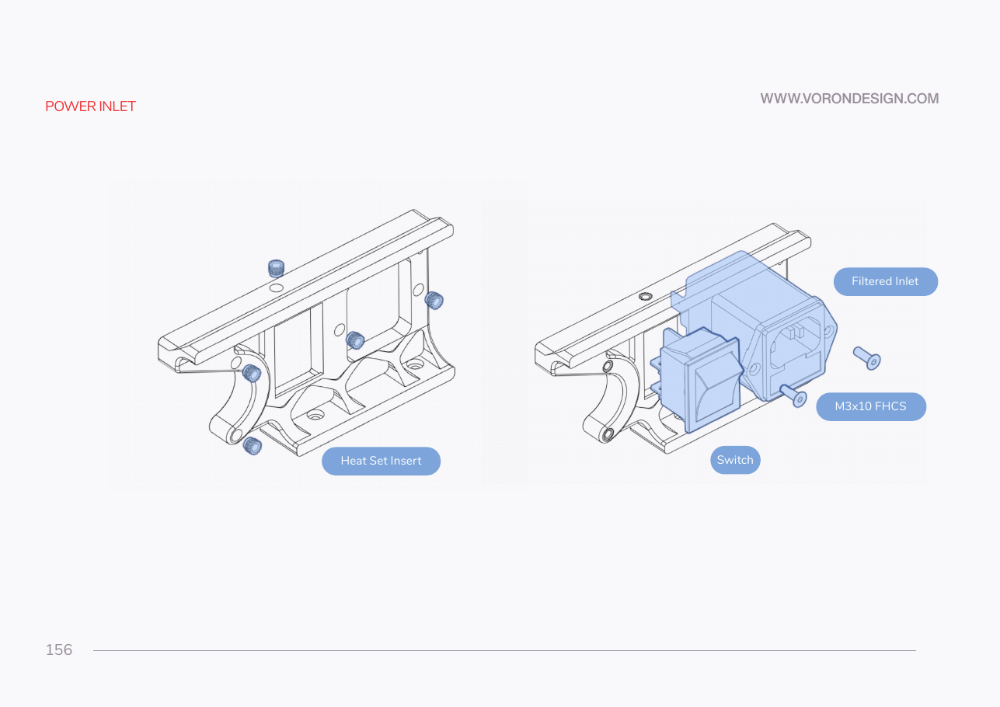{ crop="0.52 0.28 0.94 0.68" }

**What you're looking at:** `power_inlet_IECGS_1mm` is the printed panel that brings mains into the machine. The module in it combines three parts: the [C14 inlet](16-glossary.md#i) the cord plugs into, the on/off rocker switch, and the fuse drawer. The manual page is drawn for the stock separate inlet and does not match your frame.

**Parts:** none.

**Do:**

1. Nothing to build. On the panel on the rear extrusion, confirm the module's switch end is toward the panel's curved cut-out, the switch faces out, and the module's tabs are snapped fully in.
2. If not, go back to Ch 09 Steps 09.10–09.11.

**Check:** The inlet sits square with no rock, the fuse drawer opens freely, and the rocker clicks both ways.

Which way the earth pin points is the module's own layout, not something you set.

⚠ Rev D+ / LDO: LDO's note for p.156 says the panel is `power_inlet_IECGS_1mm` (a 1.0 mm AC inlet with built-in switch), never the manual's stock plug panel. [src](https://docs.ldomotors.com/voron/voron2/build-faq)

Source: [Voron manual p.156](https://github.com/VoronDesign/Voron-2/blob/de7e89d/Manual/Assembly_Manual_2.4r2.pdf#page=156) · [LDO Build Notes p.156](https://docs.ldomotors.com/voron/voron2/build-faq#build-notes) · [LDO wiring guide § Preparing the inlet](https://docs.ldomotors.com/en/voron/voron2/wiring_guide_rev_d#preparing-the-inlet) · [Video: Part 7 @0:15:11](https://www.youtube.com/watch?v=eHo0k2wQsJw&list=PL0fUJbigELQPqpeGOgHYisG4KaSXVtnNY&t=911s)

Pause: ~15 min since the last pause — printer on its right side, PSU switch set, Leviathan jumpers off, the Ch 09 inlet panel confirmed. **No mains wiring started.** Do not start the inlet-to-WAGO run until you can finish it: the next segment ends with the whole inlet→WAGO→PSU chain connected at both ends.

---

### Step 10.5 — Verify the pre-wired inlet before you trust it

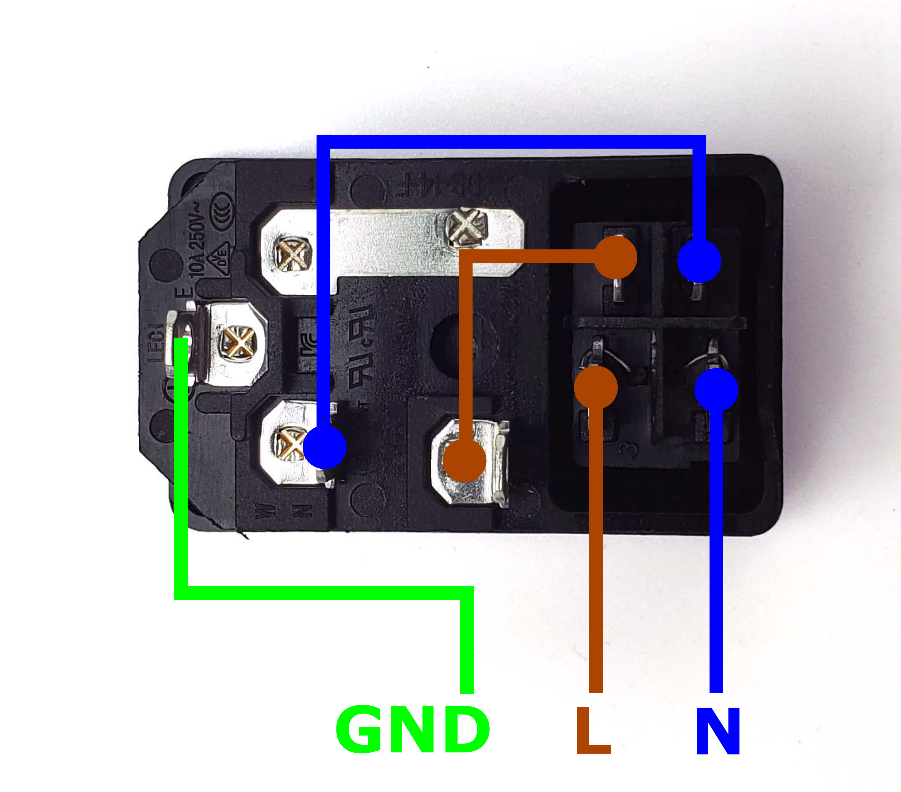

**What you're looking at:** LDO's map of the inlet module's spade tabs. The green/yellow wire is [protective earth](16-glossary.md#p) (PE), which bonds the metalwork so the machine stays safe to touch.

**Parts:**

- reused: the AC inlet module
- tool: multimeter

**Do:**

1. Compare your inlet with LDO's diagram: the **fuse sits in series with Live**, Live and Neutral pass through the rocker, and the **Earth spade is neither switched nor fused**.
2. Kit inlet cable still loose? Push it on as the diagram shows, each spade (flat push-on connector) fully home: green/yellow on E, brown and blue on the rocker's L and N outputs (verify on bench).
3. Unplugged, test each row with the meter on continuity (it beeps when the probes are connected).

**Check:** Every row of the table matches.

| C14 pin → wire | rocker | expect |
|---|---|---|
| **E** → green/yellow | either | **beeps** |
| **L** → brown | ON only | **beeps** |
| **N** → blue | ON only | **beeps** |
| **L** → brown, fuse pulled | ON | **open**; refit the fuse |

Any reading that does not match that pattern means the inlet is miswired: stop and fix it before anything else. [src](https://docs.ldomotors.com/en/voron/voron2/wiring_guide_rev_d#preparing-the-inlet)

Source: [LDO wiring guide § Preparing the inlet](https://docs.ldomotors.com/en/voron/voron2/wiring_guide_rev_d#preparing-the-inlet) · [LDO wiki inlet layout diagram](https://docs.ldomotors.com/v01_wire_guide/inlet_layout.png)

---

### Step 10.6 — Mount the plug panel to the rear frame

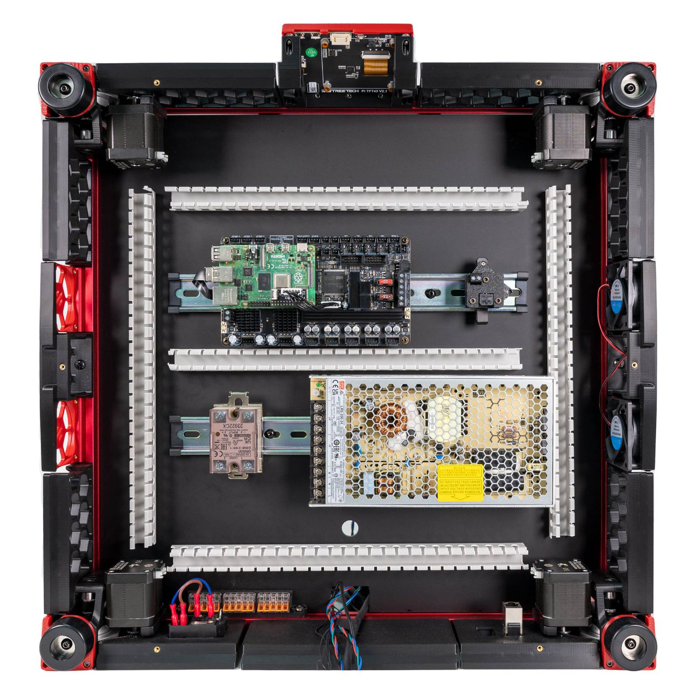

**What you're looking at:** The panel is already part of the machine's rear wall: Ch 09 hooked it over the rear extrusion and screwed it to two T-nuts, with the WAGO block beside it. In Ch 11 it becomes one of the three rear skirt segments.

**Parts:** none.

**Do:**

1. Nothing to build. Confirm the panel lies flat on the extrusion with no gap at its lip, and both M3×8 SHCS are snug.
2. Confirm it does not overhang where the rear skirt lands.

**Check:** The C14 socket faces out the back, the rocker can be reached with the printer upright, and the three wires reach the WAGO block with slack to spare `(verify on bench)`.

Source: [Voron manual p.156](https://github.com/VoronDesign/Voron-2/blob/de7e89d/Manual/Assembly_Manual_2.4r2.pdf#page=156) · [LDO wiring guide § General placement](https://docs.ldomotors.com/en/voron/voron2/wiring_guide_rev_d#general-placement) · [LDO Rev D photo S0 general placement](https://raw.githubusercontent.com/MotorDynamicsLab/LDOVoron2/8270e8c/Images/WiringGuide/RevD/S0General_Placement.jpg)

---

### Step 10.7 — Populate and label the WAGO bus

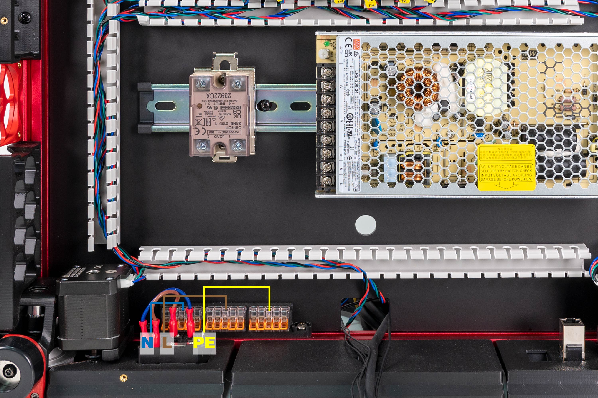

**What you're looking at:** [WAGO 221](16-glossary.md#w) blocks are lever-clamp connectors: lift a lever, push a wire in, close it. The three 5-way blocks are the machine's mains bus, one each for Neutral, Live and earth. They look identical, so "the blue **N** WAGO" means *the block labelled for that wire colour*, never the block's own colour.

**Parts:**

- reused: the three WAGO 221-415 blocks in their mount
- tool: label maker

**Do:** Label the three blocks left to right **N**, **L**, **PE**, with the label maker.

**Check:** The three 5-way blocks are labelled, all levers are up, and all fifteen ports are empty.

Source: [LDO Rev D photo S2 inlet/WAGO mapping](https://raw.githubusercontent.com/MotorDynamicsLab/LDOVoron2/8270e8c/Images/WiringGuide/RevD/S2_mapping.jpg) · [LDO wiring guide § Connecting inlet and WAGO](https://docs.ldomotors.com/en/voron/voron2/wiring_guide_rev_d#connecting-inlet-and-wago) · [Video: Part 7 @1:30:02](https://www.youtube.com/watch?v=eHo0k2wQsJw&list=PL0fUJbigELQPqpeGOgHYisG4KaSXVtnNY&t=5402s)

---

### Step 10.8 — Inlet → WAGO bus

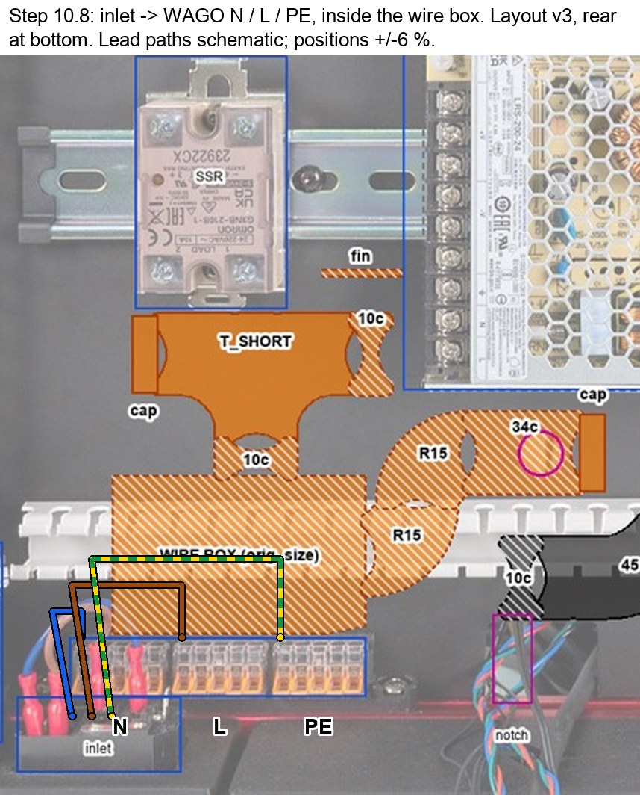
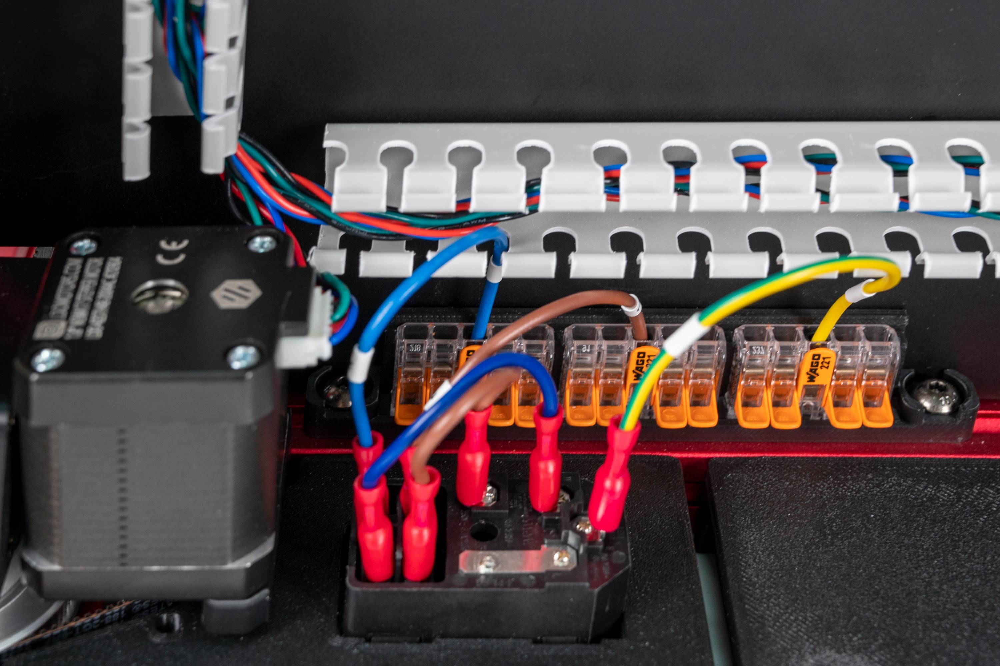

**What you're looking at:** The first mains run in the machine: the three wires leaving the inlet module go into their matching WAGO blocks. The drawing shows your route inside the printed wire box; LDO's photo shows its PVC [wire duct](16-glossary.md#w).

**Parts:**

- reused: the inlet module's three pre-wired cores
- reused: WAGO N, L and PE

**Do:**

1. Strip each core (the insulated wire) to **11 mm**. The strip-length gauge is moulded on the side of every WAGO 221.
2. Lift a lever, push the core in to the stop, and close the lever. Blue goes to **N**, brown to **L**, green/yellow to **PE**.
3. Route the run inside the wire box, not across open deck.

**Check:** Each core stays put when you tug it hard, and no copper shows outside any WAGO port.

⚠ **LDO layout:** route the run inside LDO's rear PVC duct instead, as the photo shows. [LDO § Connecting inlet and WAGO](https://docs.ldomotors.com/en/voron/voron2/wiring_guide_rev_d#connecting-inlet-and-wago)

Source: [LDO Rev D photo S2 inlet wired](https://raw.githubusercontent.com/MotorDynamicsLab/LDOVoron2/8270e8c/Images/WiringGuide/RevD/S2_inlet.jpg) · [LDO wiring guide § Connecting inlet and WAGO](https://docs.ldomotors.com/en/voron/voron2/wiring_guide_rev_d#connecting-inlet-and-wago) · `review/2026-09-23-bay-mods/layout-v3/layout-v3.md` § AC conduit, Enclosure

---

### Step 10.9 — WAGO bus → PSU

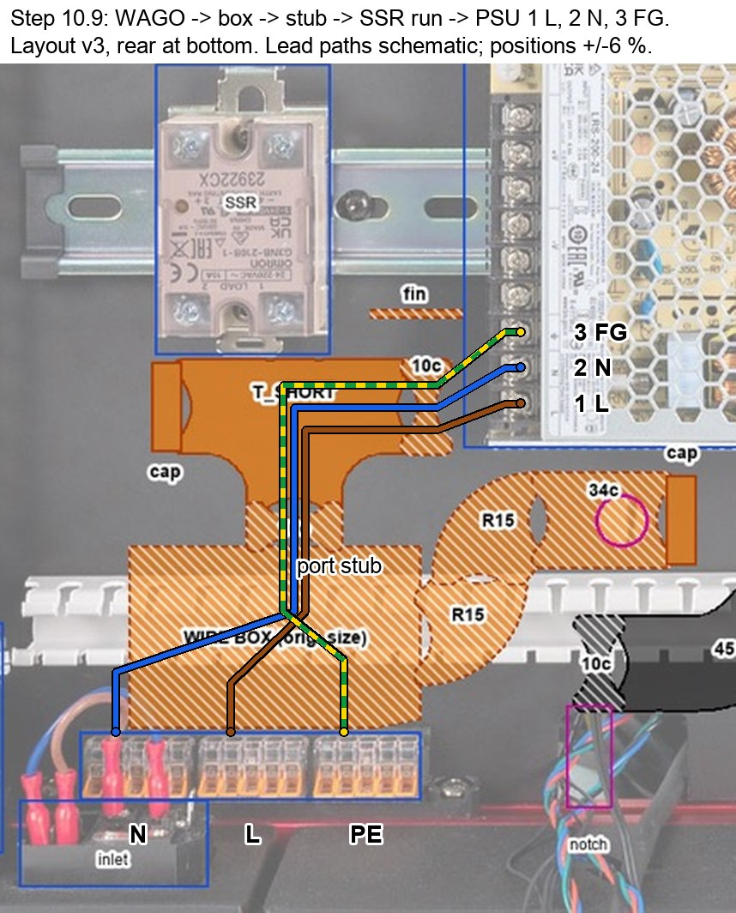
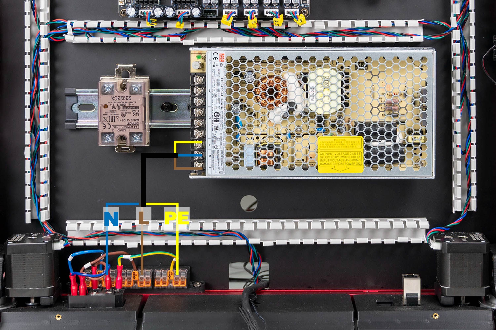

**What you're looking at:** The PSU's AC input is the three screws at one end of its terminal block: **1 AC/L, 2 AC/N, 3 FG** (frame ground, ⏚). The rest is the 24 V output, left empty until step 10.24.

**Parts:**

- PSU AC cable set, 3 cores ×1 — from the Cable Kit box
- tool: PH2 screwdriver

**Do:**

1. Feed the fork-lug ends (insulated U-shaped crimp tags) down the port stub, the short duct off the wire box, and the SSR run, the T-duct behind the SSR.
2. Brown on **1 L**, blue on **2 N**, green/yellow on **3 FG**, PH2 tight.
3. Strip the other ends to 11 mm and push each into its colour's WAGO: **N**, **L**, **PE**.

**Check:** Screw **1 L** is outermost, then **2 N**, then **3 FG** innermost beside −V, and all six ends pass a pull test.

⚠ **LDO layout:** the cable runs from the WAGO bus along LDO's rear PVC duct to the PSU screws, as the mapping photo shows. [LDO § Connecting WAGO and PSU](https://docs.ldomotors.com/en/voron/voron2/wiring_guide_rev_d#connecting-wago-and-psu)

Source: [LDO Rev D photo S3 WAGO/PSU mapping](https://raw.githubusercontent.com/MotorDynamicsLab/LDOVoron2/8270e8c/Images/WiringGuide/RevD/S3_mapping.jpg) · [LDO wiring guide § Connecting WAGO and PSU](https://docs.ldomotors.com/en/voron/voron2/wiring_guide_rev_d#connecting-wago-and-psu) · [Mean Well LRS-200 datasheet — terminal pin assignment](https://www.meanwell.com/webapp/product/search.aspx?prod=LRS-200) · `review/2026-09-23-bay-mods/layout-v3/layout-v3.md` § AC conduit, SSR run

Pause: ~30 min since the last pause — inlet checked, plug panel confirmed on the frame, WAGO bus labelled N/L/PE, and the inlet→WAGO→PSU run connected at both ends. Nothing plugged in, cord out of the room. Do not walk away with a stripped mains core outside a WAGO lever. The next segment fits the two earth leads and then runs LDO's Checkpoint #1 to its one power-on: start it only when you have an uninterrupted 40 minutes.

---

### Step 10.16 — Frame PE

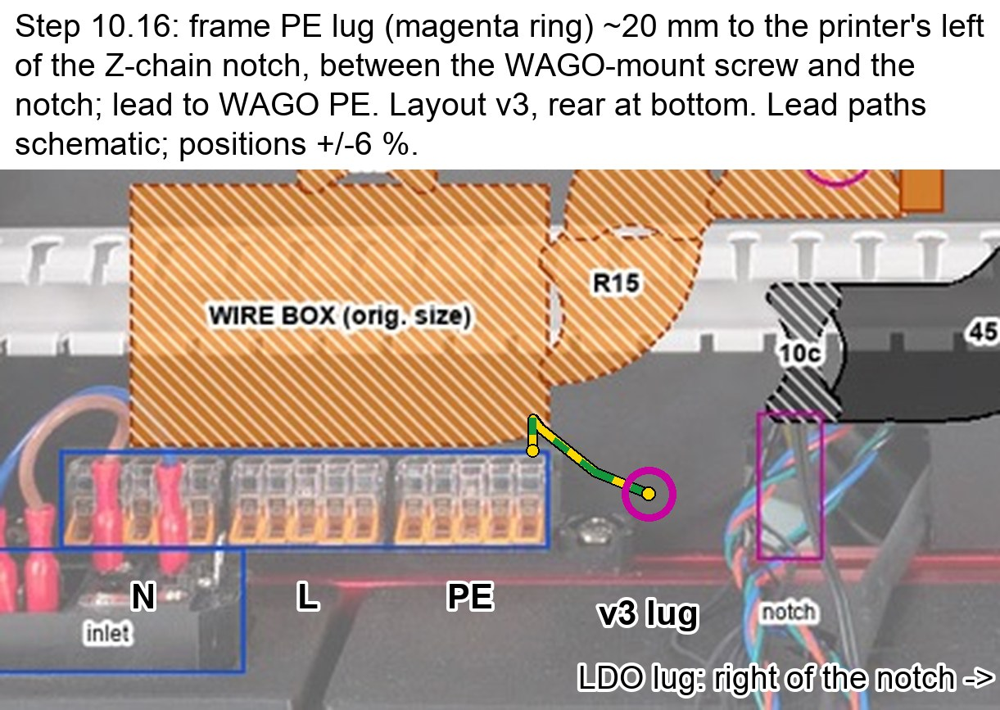
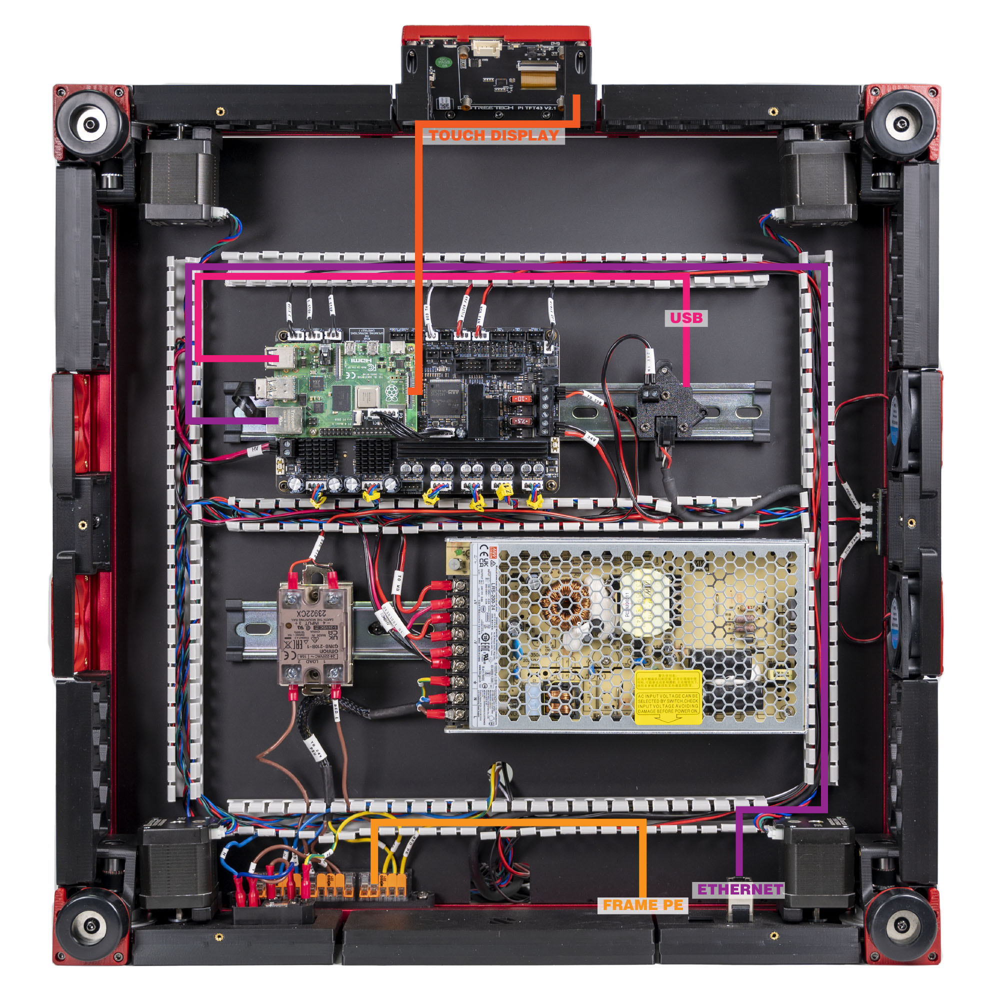

**What you're looking at:** *FRAME PE* is the single green/yellow lead that connects the whole aluminium frame to earth. [Anodising](16-glossary.md#a), the hard oxide layer on the extrusions, does not conduct, so the ring terminal must bite through to bare metal. The two locking washers do the biting.

**Parts:**

- *FRAME PE* cable ×1 — from the Cable Kit box
- M5 locking washer ×2
- M5×10 BHCS ×1 (verify on bench)
- M5 roll-in T-nut ×1 (verify on bench)

**Do:**

1. Scrape the rear extrusion to bare metal about 20 mm to the printer's left of the Z-chain notch `(verify on bench)`. Screw the ring terminal there, between both locking washers.
2. Lead the wire through the box's rear tines, its comb of teeth, to the **PE** WAGO.

**Check:** From the C14 earth pin, the lug's screw head reads **under 1 Ω** and a far frame corner **under 2–3 Ω**, probed on bare metal, never on anodising.

Those Ω limits are our own working figures, not LDO's or Voron's; LDO asks only for continuity.

LDO fits FRAME PE last. This build fits it, and the rail lead at 10.82, before the first power-on: neither adds a live part, and both keep the metalwork safe if that power-on finds a fault. That order is our choice, not LDO's.

⚠ **Layout v3:** the lug sits between the WAGO-mount screw and the notch, at the drawing's magenta ring, clear of the notch's DC bundle. "Left" is the printer's left, whichever way it lies. **LDO layout:** the rear extrusion right of the deck notch, as the photo shows. Same washers, same bare metal, same check. [LDO § Frame PE](https://docs.ldomotors.com/en/voron/voron2/wiring_guide_rev_d#connecting-the-ffc-cable-ethernet-cable-usb-cable-and-fame-pe)

Source: [LDO Rev D photo VS8 mapping](https://raw.githubusercontent.com/MotorDynamicsLab/LDOVoron2/8270e8c/Images/WiringGuide/RevD/VS8_mapping.jpg) · [LDO wiring guide § Connecting the FFC cable, Ethernet cable, USB cable and frame PE](https://docs.ldomotors.com/en/voron/voron2/wiring_guide_rev_d#connecting-the-ffc-cable-ethernet-cable-usb-cable-and-fame-pe) · `review/2026-09-23-bay-mods/layout-v2/layout-v2.md` bench check 12 · `layout-v3/layout-v3.json` components_moved · drawings: `layout-v3/work/leads_v3.py`

---

### Step 10.82 — Earth the SSR's DIN rail

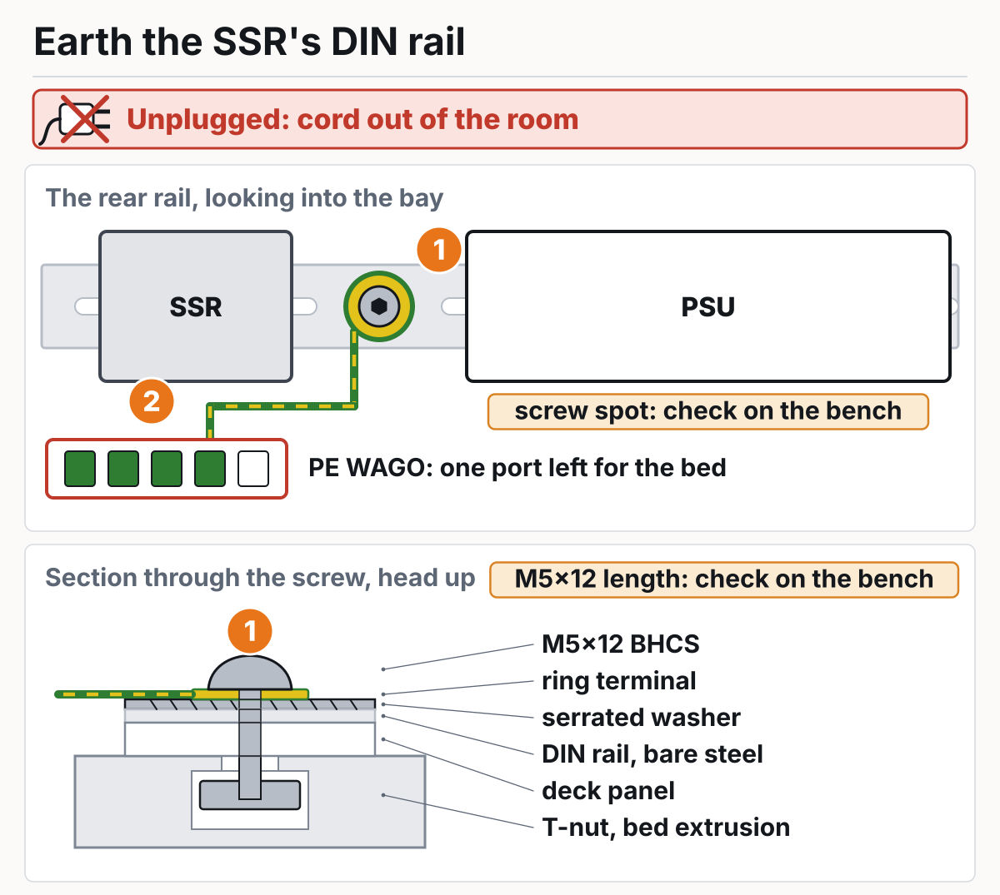
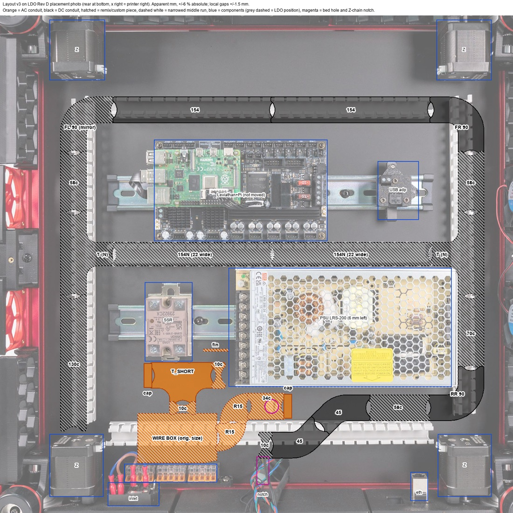

**What you're looking at:** The SSR says EARTH THE MOUNTING RAIL and LDO runs no wire to the rail, so this build adds one: a green/yellow lead from the PE WAGO to the rear rail's screw beside the SSR. It is not in the kit.

**Parts:**

- green/yellow earth lead with an M5 ring terminal crimped on one end ×1 — from an electrical supplier, not in the kit
- M5×12 BHCS ×1 — from a hardware shop, not in the kit
- M5 serrated lock washer ×1 — from a hardware shop, not in the kit
- reused: the rear DIN rail and its M5×10 BHCS between the SSR and the PSU
- tool: 3 mm hex key
- tool: multimeter

**Do:**

1. Take out the rail screw between the SSR and the PSU `(verify on bench)`. Refit it as M5×12, ring, then washer on bare rail. Tighten.
2. Lay the lead along the PSU leads into the wire box. Strip 11 mm and push it into a PE WAGO port, leaving one free for the bed.

**Check:** The ring will not turn by hand. From the C14 earth pin, the screw head reads under 1 Ω and bare rail beside the SSR beeps.

The ring and washer add about 2 mm, hence the longer screw. If it stops before the ring is tight, it has bottomed in the slot: refit with the M5×10 `(verify on bench)`.

Buy the lead at least 0.75 mm² (18 AWG) and no thinner than the kit's FRAME PE lead, with the ring already crimped, or crimp it yourself with a ratchet crimper. This lead is our addition; LDO's build has none. Omron's datasheet asks for it: a mounting rail needs *"an individual connection to the PE conductor."* **LDO layout:** run it along LDO's rear PVC duct to the same screw.

⚠ **No power-on with a silent rail.** If bare rail steel does not beep to the C14 earth pin, re-seat the ring on bare rail and the lead in its WAGO port, and measure again. Fitting this lead is mains work, for the person named at [00a.1](00a-mains-safety.md#step-00a1-decide-who-is-doing-the-mains-work).

Source: [LDO wiring photo SSR_Close_Up.jpg](https://raw.githubusercontent.com/MotorDynamicsLab/LDOVoron2/8270e8c/Images/WiringGuide/RevC/SSR_Close_Up.jpg), the EARTH THE MOUNTING RAIL marking · [LDO Rev D photo S0 general placement](https://raw.githubusercontent.com/MotorDynamicsLab/LDOVoron2/8270e8c/Images/WiringGuide/RevD/S0General_Placement.jpg), the rail screw between the SSR and the PSU · [Voron docs — Electrical Wiring](https://docs.vorondesign.com/build/electrical/), 18 AWG minimum · [Omron G3NB datasheet (J164-E1)](https://www.omron-ap.com/data_pdf/cat/g3nb-1_j164-e1_4_3_csm1013815.pdf), p.12, a mounting rail's own PE connection · [Ch 00a Step 00a.7](00a-mains-safety.md#step-00a7-the-ssr-is-marked-earth-the-mounting-rail-so-this-build-adds-a-lead)

---

<a id="section-2-checkpoint-1-exactly-as-ldo-writes-it"></a>

## Section 2 — Checkpoint #1, LDO's checks plus ours

LDO runs Checkpoint #1 with only the inlet, the WAGO bus and the PSU on the mains, and so does this chapter. These six steps are LDO's checks, quoted, and LDO's one power-on, with these of ours added: the Ω limits and the frame, rail and PSU-case rows (10.18), the PSU-screw pairs and the 100 kΩ figure (10.19), the switch test (10.20) and the hand-on-the-switch routine (10.23). The SSR and the bed are wired after it, dead, in Section 2b. One addition of ours came before it: the frame and rail earth leads, 10.16 and 10.82.

### Step 10.17 — De-energise and set up

(no image — see text)

**What you're looking at:** Nothing to look at on the machine: this step is about the meter and the absent cord. In continuity mode the meter beeps whenever something conducts between its two probes, and that beep is the tool for every measurement in this section.

**Parts:**

- tool: multimeter

**Do:**

1. Confirm the C13 power cord is **not** plugged into the inlet and is not in the room.
2. Set the meter to continuity, the beeper, and test it by touching the probes together.

**Check:** The meter beeps on a dead short, and no cord is anywhere near the machine.

⚠ **LDO:** *"Incorrect wiring of AC/mains can be dangerous — therefore, always double check your work, and then triple check it once more."* Do the six steps of this section in order, to the power-on at 10.23. Wire nothing more until it has passed.

⚠ **Who is in the room, [00a.2](00a-mains-safety.md#step-00a2-write-the-who-is-in-the-room-rule-and-post-it-on-the-wall):** one adult at the machine from here to the end of Section 2b. She is out of the room until 10.40, the first step of Section 5; at 10.23 nobody but the person with a hand on the switch is within reach of the machine.

Source: [LDO wiring guide § Checkpoint 1](https://docs.ldomotors.com/en/voron/voron2/wiring_guide_rev_d#checkpoint-1)

---

### Step 10.18 — Colour groups are shorted


**What you're looking at:** You are proving that each wire colour is one node, one connected path, from the inlet pin out to the PSU screws and, for earth, the frame and the SSR's rail. A core that never seated in its lever looks perfect from outside.

**Parts:**

- tool: multimeter

**Do:**

1. Take one colour at a time. Park one probe on the first point in its table and walk the other probe along every point after it.
2. Rocker **ON** for the L and N tables; either position for PE.
3. For a row with an Ω figure, first touch the probes together on Ω and subtract that reading.

**Check:** Every row in the three tables beeps.

**PE, green/yellow** (rocker on or off: the earth path is never switched). LDO asks only that each colour beeps; the Ω limits are our own working figures, not LDO's or Voron's.

| From the C14 **E** pin to … | Expected |
|---|---|
| every occupied port of the PE WAGO | beeps, < 1 Ω |
| PSU screw **3 FG (⏚)** | beeps, < 1 Ω |
| frame PE ring — probe its screw head | beeps, < 1 Ω |
| frame, far corner — a T-nut or bare cut end | beeps, < 2–3 Ω |
| PSU chassis — a bare case screw | beeps, a few Ω or less (the case is bonded to FG inside the supply) |
| DIN rail under the SSR — the rail lead's screw head, then bare steel beside the SSR | beeps, < 1 Ω. Silent: stop, no power-on, back to 10.82 |

**N, blue** (rocker **ON**)

| From the C14 **N** pin to … | Expected |
|---|---|
| every occupied port of the N WAGO | beeps |
| PSU screw **2 N** | beeps |

**L, brown** (rocker **ON**, fuse fitted)

| From the C14 **L** pin to … | Expected |
|---|---|
| the fuse, drawer **in** — it sits between the L pin and every row below, so those rows prove it in circuit | beeps |
| every occupied port of the L WAGO | beeps |
| PSU screw **1 L** | beeps |

To read the fuse alone: drawer out, probe cap to cap. It beeps; `OL` is a blown fuse. Refit the drawer before you walk the L list.

The SSR and bed rows come later, in their own steps, once those leads are on: 10.11, 10.14, 10.15 and 10.21.

A node that does not beep is a core that did not seat in its WAGO lever, or a screw terminal clamped on insulation. Strip it again and re-seat it, then repeat that colour's whole list.

Source: [LDO wiring guide § Checkpoint 1](https://docs.ldomotors.com/en/voron/voron2/wiring_guide_rev_d#checkpoint-1)

---

### Step 10.19 — L, N and PE are isolated from each other

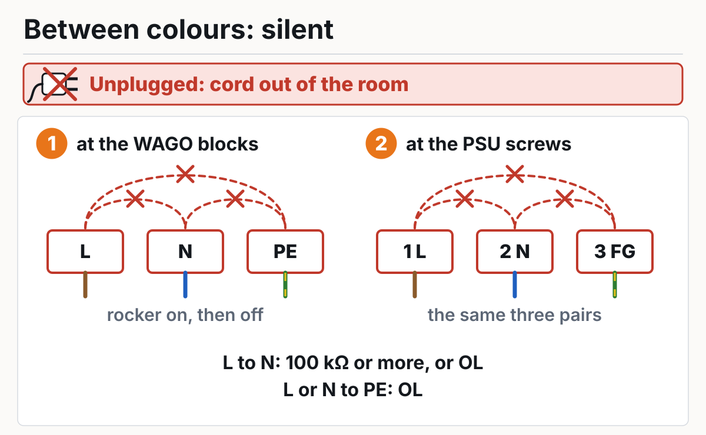

**What you're looking at:** The mirror image of the last check: the three buses must have no low-resistance path between them; only the PSU input sits across L and N. Live touching Neutral is a short circuit across the mains; Live touching earth is what makes the metalwork deadly.

**Parts:**

- tool: multimeter

**Do:**

1. Probe L→N, L→PE and N→PE at the WAGO blocks with the rocker **on**, then again with it **off**.
2. Probe the same three pairs at the PSU screws: **3 FG ↔ 1 L**, **3 FG ↔ 2 N**, **1 L ↔ 2 N**.

**Check:** None of the nine beeps. L↔N reads 100 kΩ or more, or `OL`, on the 2 MΩ range; L↔PE and N↔PE read `OL`.

⚠ **Why 100 kΩ:** the PSU input bridges L and N whatever the rocker does, reading hundreds of kΩ or more, often climbing as its capacitors charge `(verify on bench)`. A stray strand reads near 0 Ω. Write your L↔N number down for 10.21 and 10.78, which measure it again once the SSR and bed are on the bus.

⚠ **If L↔N beeps or reads under 100 kΩ:** something bridges the mains, at the WAGOs, the inlet or the PSU input. Do not power on. Fix it and repeat this whole step.

A short tick on 1 L ↔ 2 N as the PSU's input filter charges from the meter is normal; a steady beep is not.

Source: [LDO wiring guide § Checkpoint 1](https://docs.ldomotors.com/en/voron/voron2/wiring_guide_rev_d#checkpoint-1)

---

### Step 10.20 — The switch actually switches

(no image — see text)

**What you're looking at:** The rocker in the inlet module is the machine's only mains isolator, the one switch that cuts it off from the wall, so it has to break both Live and Neutral, not just one. This check watches the meter change as you flip it.

**Parts:**

- tool: multimeter

**Do:**

1. Put the meter across the C14 L pin and a port on the brown WAGO, and flip the rocker.
2. Repeat for N.

**Check:** The meter beeps with the rocker **on** and is silent with it **off**, for both. If either stays connected, go back to step 10.5.

Source: [LDO wiring guide § Checkpoint 1](https://docs.ldomotors.com/en/voron/voron2/wiring_guide_rev_d#checkpoint-1)

---

### Step 10.22 — Re-check the voltage selector


**What you're looking at:** The same red slide switch as step 10.2, read a second time now that the PSU is wired in place and half in shadow. It is the one setting that destroys the power supply the first time it is switched on.

**Parts:** none.

**Do:**

1. LDO: *"Check again that the power supply voltage input switch is set to the correct value: 115V vs 230V."*
2. Look at the window a second time, now that the PSU is wired and the light is worse.

**Check:** The number in the window matches your mains. If you have the EU RSP-200-24, there is no switch and nothing to check.

Source: [LDO wiring guide § Checkpoint 1](https://docs.ldomotors.com/en/voron/voron2/wiring_guide_rev_d#checkpoint-1) · [LDO wiring photo psu_switch.jpg](https://raw.githubusercontent.com/MotorDynamicsLab/LDOVoron2/8270e8c/Images/WiringGuide/psu_switch.jpg)

---

### Step 10.23 — First power-on, then off again

(no image — see text)

**What you're looking at:** The only moment in this chapter when mains is present, and only on the inlet, WAGO bus and PSU. The rocker lamp and the PSU's LED are the two signs it works; ten seconds of looking, listening and smelling is the whole test. Nothing is measured live.

**Parts:**

- C13 power cord ×1

**Do:**

1. Printer on its right side, rocker **OFF**, meter away. Plug the cord into the inlet, then into the wall.
2. Everyone back. Stand to the side with a hand on the rocker and switch **ON**. Look, listen and smell for **ten seconds**.
3. Rocker **OFF**. Unplug at the wall, then the inlet, and take the cord out of the room.

**Check:** All three observations in the table were right during the ten seconds.

| Observe | Expected |
|---|---|
| Inlet rocker | illuminates |
| PSU indicator LED | lights green, seen from beside the machine `(verify on bench)` |
| Noise / smell | none. Any buzz, click-cycling or smell → rocker OFF, then pull the plug at the wall |

Everything from here to the end of the chapter is done dead, with the machine unplugged.

⚠ **Who is in the room, [00a.2](00a-mains-safety.md#step-00a2-write-the-who-is-in-the-room-rule-and-post-it-on-the-wall):** one adult, standing to the side, hand on the switch. Nobody else within reach of the machine; she is out of the room.

⚠ Rev D+ / LDO: this is the only power-on in the chapter. The Leviathan, Pi and toolboard stay unpowered: the PSU's DC terminals are empty. Never meter a live block: the PSU's +V/−V screws share an uncovered block with live N and L. Free hand behind your back; both hands off the bay until the cord is out. [src](https://docs.ldomotors.com/en/voron/voron2/wiring_guide_rev_d#checkpoint-1)

Source: [LDO wiring guide § Checkpoint 1](https://docs.ldomotors.com/en/voron/voron2/wiring_guide_rev_d#checkpoint-1)

Pause: ~40 min since the last pause — both earth leads fitted, Checkpoint #1 passed end to end, and the machine was powered once and switched off. **Cord unplugged and back out of the room.** Everything from here is done dead. The SSR and bed are still unwired: Section 2b wires them next, with the printer still on its right side.

---

## Section 2b — SSR and bed leads, wired dead

LDO wires the SSR and the bed after Checkpoint #1, and so does this chapter: every step here is done dead, cord out of the room, the adult alone. The printer stays on its right side, bay toward you, as in Section 1. Each lead is proved in its own step's Check and 10.21 re-measures the whole bus with them on it; Section 8 measures the mains side once more before the next power-on, in Ch 12.

### Step 10.10 — Read the SSR terminal numbers before you wire it

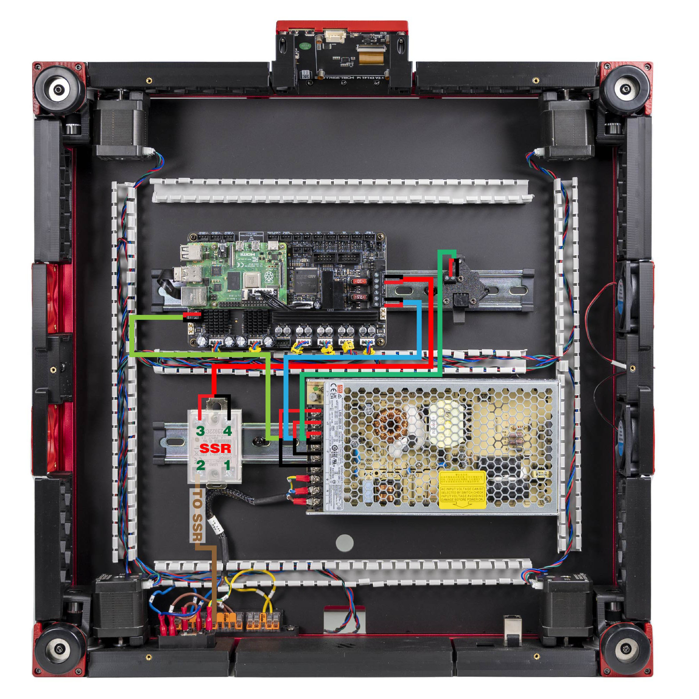
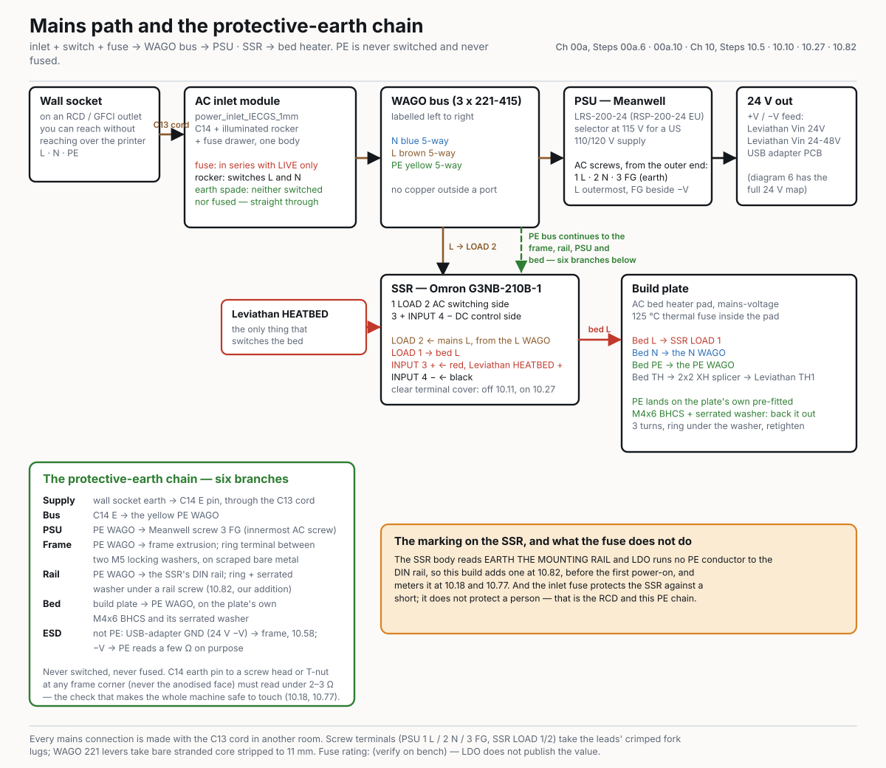

**What you're looking at:** The [SSR](16-glossary.md#s) is the black box on the DIN rail: a solid-state relay, an electronic switch that lets the mainboard turn a mains bed heater on and off with a small DC signal.

**Parts:**

- reused: the Omron SSR on its DIN bracket
- tool: multimeter

**Do:**

1. Before a hand goes in, meter PSU +V to −V on DC volts: **0 V**, still 0 V ten seconds later.
2. Read the SSR body: the pair printed **1 LOAD 2** is the AC switching side, and **3 + INPUT 4 −** is the DC control side.
3. Note which end the yellow indicator LED sits at, and match LDO's photo.

**Check:** The PSU held 0 V. You can point at terminals 1 to 4 without hesitating, with the LED on the photo's side.

⚠ Rev D+ / LDO: *"The SSR connection is **critical**, an incorrect connection can cause catastrophic damage."* Nothing else in this chapter carries that warning. [src](https://docs.ldomotors.com/en/voron/voron2/wiring_guide_rev_d#connecting-24v)

**How LDO tags its cables.** Every pre-made lead in the kit carries a tag, and the two kinds of tag say different things. A **TO …** tag names where the *far* end goes: **TO SSR** sits at the WAGO end of *SSR to Wago*; **TO MB**, **TO MB HV** and **TO TOOLHEAD** sit at the PSU ends of the board supply, the HV stepper supply and *24V power*. The other end of each of those carries the *name of the rail* it lands on, **24V**, **HV**, **24V IN**, **SSR SIG**, not a destination. Read a TO tag as "this cable is going to …" and a rail tag as "this is the … rail", then check the connector type and the red/black polarity at both ends. [src](https://docs.ldomotors.com/en/voron/voron2/wiring_guide_rev_d#connecting-24v)

The SSR body is also marked *EARTH THE MOUNTING RAIL*: that is Omron's instruction for this part, and LDO's photos show the same marking on the kit's G3NB. LDO's build runs no PE wire to the DIN rail; this build added one at 10.82, before the first power-on, and 10.18 metered it. Never power on with a rail that does not beep to the C14 earth pin.

Source: [LDO Rev D photo S4 24 V/SSR mapping](https://raw.githubusercontent.com/MotorDynamicsLab/LDOVoron2/8270e8c/Images/WiringGuide/RevD/S4_mapping.jpg) · [LDO wiring guide § Connecting 24V](https://docs.ldomotors.com/en/voron/voron2/wiring_guide_rev_d#connecting-24v) · [Video: Part 8 @1:29:57](https://www.youtube.com/watch?v=Q3Q1szaFfSE&list=PL0fUJbigELQPqpeGOgHYisG4KaSXVtnNY&t=5397s)

---

### Step 10.11 — Live from the WAGO bus → SSR LOAD 2

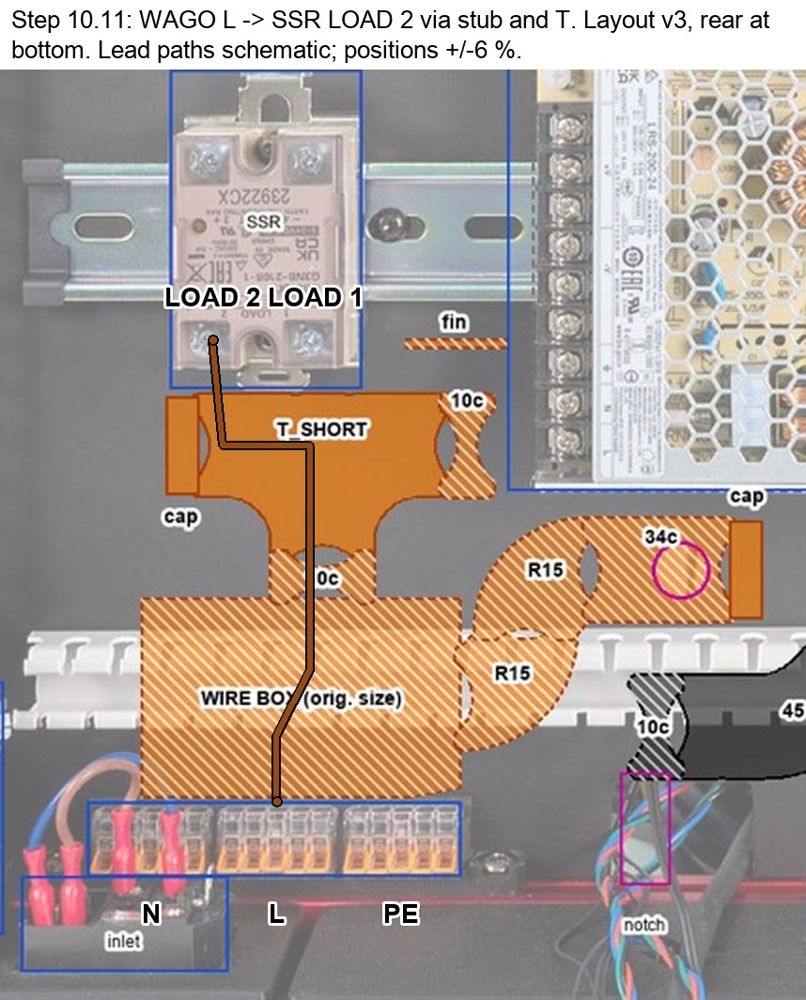


**What you're looking at:** The *SSR to Wago* cable is one of the kit's pre-made mains leads. One end is bare and stripped for a WAGO lever; the other carries a crimped, insulated fork lug that slides under a screw terminal, as LDO's photos show.

**Parts:**

- *SSR to Wago* cable ×1 — from the Cable Kit box

**Do:**

1. Strip the **TO SSR** end to 11 mm and push it into a spare port of the brown **L** WAGO.
2. Feed the cable down the port stub and the SSR run.
3. Take the SSR's clear terminal cover off `(verify on bench)` and keep it for 10.27. Put the fork-lug end under **LOAD 2**, PH2 tight.

**Check:** The meter beeps from the C14 L pin, rocker ON, through to SSR terminal 2, and terminal 1 is still empty.

⚠ **LDO layout:** the cable runs from the WAGO bus along LDO's rear PVC duct to the SSR, as the mapping photo shows. [LDO § Connecting 24V](https://docs.ldomotors.com/en/voron/voron2/wiring_guide_rev_d#connecting-24v)

Source: [LDO Rev D photo S4 24 V/SSR mapping](https://raw.githubusercontent.com/MotorDynamicsLab/LDOVoron2/8270e8c/Images/WiringGuide/RevD/S4_mapping.jpg) · [LDO wiring guide § Connecting 24V](https://docs.ldomotors.com/en/voron/voron2/wiring_guide_rev_d#connecting-24v) · [Video: Part 8 @1:24:57](https://www.youtube.com/watch?v=Q3Q1szaFfSE&list=PL0fUJbigELQPqpeGOgHYisG4KaSXVtnNY&t=5097s)

---

### Step 10.12 — Bed harness into the bed WAGO breakout

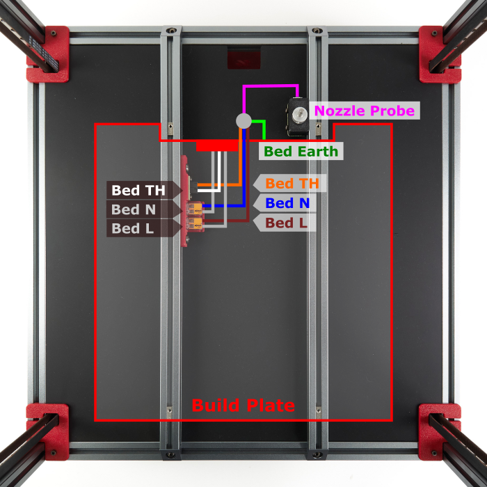

**What you're looking at:** Four things leave the build plate: the heater pad's two mains leads, its earth ring terminal and the bed thermistor (temperature sensor). The bed WAGO mount, above the deck on the left bed extrusion, joins the leads to the kit's extensions; the 2×2 splicer joins the thermistor.

**Parts:**

- reused: the plate's Bed L, Bed N and BED TH leads and its PE ring terminal
- Bed L extension lead ×1 — from the Cable Kit box
- Bed N extension lead ×1 — from the Cable Kit box
- reused: the bed WAGO mount with its two WAGO 221-412 and the 2×2 XH splicer

**Do:**

1. Push **Bed L** and its extension into the first WAGO, **N** and **Bed N** into the second, and **BED TH** into the 2×2 splicer.
2. Back the **M4×6 BHCS** out three turns, slide the PE ring under the serrated washer, and retighten.

**Check:** L, N and TH leave the mount, the PE ring under the plate's M4 screw will not turn by hand, and no lead is tight.

⚠ Never put L and N in one block: each 2-way WAGO is one node, everything in it connected, so a block is all Live or all Neutral. Do **not** take the **M4×6 BHCS** out; back it out three turns only. It is the screw [Step 03.6](03-build-plate.md#step-036-verify-the-pe-screw-and-identify-the-three-cables) left in place for this moment.

⚠ **Layout v3:** the round deck hole carries mains only, so the splicer's TH cable goes over the deck to the Z-chain notch at 10.44. **LDO layout:** it drops through the round hole with the bed leads. [LDO § Wiring the bed heater](https://docs.ldomotors.com/en/voron/voron2/wiring_guide_rev_d#wiring-the-bed-heater)

Source: [LDO wiring guide § Wiring the bed heater](https://docs.ldomotors.com/en/voron/voron2/wiring_guide_rev_d#wiring-the-bed-heater) · [LDO wiki build-plate mapping](https://docs.ldomotors.com/v2_wire_guide/build_plate_mapping.png) · `review/2026-09-23-bay-mods/layout-v2/layout-v2.md` § Component shifts, bench check 2 · [Video: Part 8 @0:54:59](https://www.youtube.com/watch?v=Q3Q1szaFfSE&list=PL0fUJbigELQPqpeGOgHYisG4KaSXVtnNY&t=3299s)

---

### Step 10.13 — Measure the bed heater before you connect it


**What you're looking at:** You measure the heater pad before it can ever be powered: a few tens of ohms across its two leads, nothing at all to the plate. The photo shows which lead is which.

**Parts:**

- tool: multimeter
- reused: the Bed L and Bed N extension leads, far ends still free

**Do:**

1. Set the meter to Ω, resistance. Measure **Bed L → Bed N** at the free ends of the two extensions.
2. Measure **Bed L → the aluminium plate** and **Bed N → the aluminium plate**, touching the M4×6 PE screw head.
3. Read the pad's label voltage, under the plate `(verify on bench)`. If it does not match your mains, stop: do not connect the pad.

**Check:** All three readings land in the table's bands, and the label voltage matches your mains.

| Measurement | Expected |
|---|---|
| Bed L → Bed N | a stable reading in the **tens of ohms**. Not 0 Ω. Not `OL`. |
| Bed L → plate / PE | `OL` on your meter's highest Ω range |
| Bed N → plate / PE | `OL` on your meter's highest Ω range |

A dead short means the pad is damaged and must not be connected. `OL` (over limit: no path at all) on L → N means an open pad or an open 125 °C thermal fuse. But first re-seat both leads in their WAGO levers and measure again, because an unseated core reads the same. Either way, do not go on until the number is right.

??? note "Why 'tens of ohms', and how to compute your own target"

    LDO does not publish the pad's wattage on the Rev D+ BOM, so derive the number
    yourself: **R = V² ÷ P**, using the mains voltage the pad is wound for and the
    wattage printed on the pad's own label. Worked examples — *not* your value:
    750 W at 120 V → 19.2 Ω; 750 W at 230 V → 70.5 Ω. Read your own label, do the
    division, and expect the meter to land within a few ohms of it.

Source: [LDO wiring guide § Wiring the bed heater](https://docs.ldomotors.com/en/voron/voron2/wiring_guide_rev_d#wiring-the-bed-heater) · [LDO Rev D+ 350 BOM](https://docs.ldomotors.com/en/voron/voron2/350_BOM/Rev_D+) · [LDO wiring guide image `bed_heater_wires_revd.jpg`](https://docs.ldomotors.com/en/voron/voron2/wiring_guide_rev_d#wiring-the-bed-heater)

---

### Step 10.14 — Bed Live → SSR LOAD 1


**What you're looking at:** Terminal 1 is the relay's output, switched to the heater only while the SSR is on. An off SSR is not an isolator, though: only unplugging makes the bed wiring safe to touch.

**Parts:**

- reused: the Bed L extension lead

**Do:**

1. Run the Bed L extension from the bed WAGO breakout down through the round deck hole into the 34 mm run, the short straight duct over that hole, round both curves, and through the wire box, port stub and SSR run.
2. Land it on **LOAD 1**, PH2 tight.

**Check:** On Ω, LOAD 1 reads under 1 Ω to the pad's Bed L lead at the bed WAGO and about your 10.13 figure to its N lead. Terminal 2 holds mains Live, and the lead lies slack.

⚠ **Layout v3:** this route is about 47 mm longer than LDO's; check the spare against LDO's route during this fit `(verify on bench)`. Never stretch a mains lead: if it is short, make a longer Bed L lead, same gauge and connector `(verify on bench)`. **LDO layout:** through the hole, then LDO's rear PVC duct, to LOAD 1. [LDO § Connecting build plate](https://docs.ldomotors.com/en/voron/voron2/wiring_guide_rev_d#connecting-build-plate)

Source: [LDO Rev D photo S5 build-plate mapping](https://raw.githubusercontent.com/MotorDynamicsLab/LDOVoron2/8270e8c/Images/WiringGuide/RevD/S5_mapping.jpg) · [LDO wiring guide § Connecting build plate](https://docs.ldomotors.com/en/voron/voron2/wiring_guide_rev_d#connecting-build-plate)

---

### Step 10.15 — Bed Neutral and bed PE → the WAGO bus


**What you're looking at:** Neutral and the plate's earth go straight to the bus; only Live passes through the relay. That earth keeps the plate safe to touch if the pad ever fails onto it.

**Parts:**

- reused: the Bed N extension lead
- reused: the bed PE lead

**Do:**

1. Lay both leads round the two curves into the wire box.
2. Push Bed N into a spare port of the blue **N** WAGO and Bed PE into the yellow **PE** WAGO's last free port, now full, 5 of 5.

**Check:** From the C14 earth pin, the plate's M4×6 screw head reads under 1 Ω, our own limit. Rocker ON, on Ω, the C14 N pin reads under 1 Ω to the pad's N lead at its bed-WAGO port and about your 10.13 figure to its L lead.

⚠ **LDO layout:** both leads run from the round hole along LDO's rear PVC duct to the WAGO bus, as the photo shows. [LDO § Connecting build plate](https://docs.ldomotors.com/en/voron/voron2/wiring_guide_rev_d#connecting-build-plate)

Source: [LDO Rev D photo S5 bed wired](https://raw.githubusercontent.com/MotorDynamicsLab/LDOVoron2/8270e8c/Images/WiringGuide/RevD/S5_bed.jpg) · [LDO wiring guide § Connecting build plate](https://docs.ldomotors.com/en/voron/voron2/wiring_guide_rev_d#connecting-build-plate) · [Video: Part 8 @0:59:54](https://www.youtube.com/watch?v=Q3Q1szaFfSE&list=PL0fUJbigELQPqpeGOgHYisG4KaSXVtnNY&t=3594s)

---

### Step 10.21 — The SSR is open when unpowered


**What you're looking at:** The SSR and the bed now sit on the mains bus. With nothing on terminals 3 and 4 the relay must be off, so its two mains terminals have no path between them, and the isolation you proved at 10.19 must still hold. The close-up is a Rev C bay: read only the SSR body.

**Parts:**

- tool: multimeter

**Do:**

1. Measure SSR **LOAD 1 → LOAD 2** with nothing powered.
2. At the WAGO blocks, rocker **ON**, measure L↔N, L↔PE and N↔PE again on the 2 MΩ range.

**Check:** LOAD 1 → LOAD 2 is silent and **INPUT 3/4 are still empty**. L↔N reads 100 kΩ or more, close to your 10.19 number, and L↔PE and N↔PE read `OL`.

⚠ **If L↔N now beeps or reads tens of ohms:** the SSR is shorted or a bed lead is crossed. Lift the brown lead off SSR **LOAD 2** and measure again. Silent now: the fault is on the SSR or bed side. Still beeping: back to 10.19. Fix it, refit the lead PH2 tight, and repeat this step.

L↔PE or N↔PE not `OL`: a bed lead sits in the wrong WAGO, or the pad leaks to the plate. Recheck 10.15, then the pad readings from 10.13.

This catches a hard short through the relay; LDO's checkpoint has no SSR row, so this step is ours. It cannot prove that the SSR switches correctly at mains voltage; the first real test of that is the bed heating, and stopping, under Klipper in Ch 13.

Source: [LDO wiring guide § Checkpoint 1](https://docs.ldomotors.com/en/voron/voron2/wiring_guide_rev_d#checkpoint-1) · [LDO wiring photo SSR_Close_Up.jpg](https://raw.githubusercontent.com/MotorDynamicsLab/LDOVoron2/8270e8c/Images/WiringGuide/RevC/SSR_Close_Up.jpg)

Pause: ~30 min since the last pause — SSR LOAD 1/2 and bed L, N and PE wired dead and pull-tested, each proved in its own Check, the SSR open and the bus still isolated. Cord out of the room, the DC leads still parked at the notch, nothing on the DC side connected. The printer stays on its right side, bay toward you, for Section 5 and the rest of the chapter; the helper can come back for 10.40.

---

## Section 5 — Leviathan connections

### Step 10.40 — Tag every stepper cable before you plug anything in


**What you're looking at:** Six identical 4-pin motor cables arrive at the board, and nothing on them says which corner each came from. LDO's mapping photo names every port on the Leviathan; the diagram shows both HV-STEPPER ports and STEPPER-0..3 by corner, and which ports stay empty.

**Parts:**

- consumable: cable tag ×7

**Do:** Copy the table below onto tags and fit one to each motor cable at the board end. Positions are given *"as if standing in front of an upright printer and looking towards it."*

| Stepper | Physical position | Controller port |
|---|---|---|
| **A** | rear **right** of gantry | `HV-STEPPER-1` |
| **B** | rear **left** of gantry | `HV-STEPPER-0` |
| **Z0** | front left | `STEPPER-0` |
| **Z1** | rear left | `STEPPER-1` |
| **Z2** | rear right | `STEPPER-2` |
| **Z3** | front right | `STEPPER-3` |
| *(not used)* | — | `STEPPER-4` |

**Check:** Seven tags are written, six cables are tagged, and you can trace each cable back to the motor it came from without guessing.

**Helper:** Writes the seven tags from the table and hands each one over for its cable.

```mascot
pose: cable
caption: Tag every cable before it goes in. An anonymous connector is a fault that gets to hide.
```

Source: [LDO Rev D photo S1 stepper mapping](https://raw.githubusercontent.com/MotorDynamicsLab/LDOVoron2/8270e8c/Images/WiringGuide/RevD/S1_mapping.jpg) · [LDO wiring guide § Connecting steppers](https://docs.ldomotors.com/en/voron/voron2/wiring_guide_rev_d#connecting-steppers) · [Video: Part 6 @0:25:08](https://www.youtube.com/watch?v=8pWoYkY1DiA&list=PL0fUJbigELQPqpeGOgHYisG4KaSXVtnNY&t=1508s)

---

### Step 10.41 — A motor → HV-STEPPER-1


**What you're looking at:** `HV-STEPPER-1` is one of the two high-voltage driver sockets on the Leviathan: a TMC5160, the strongest driver pair on the board, kept for the two CoreXY motors. The 4-pin plug carries the motor's two coils, two wires each.

**Parts:**

- reused: the A motor's lead

**Do:**

1. Plug the A motor, rear right, into the port printed `HV-STEPPER-1` on the board, as `S1_mapping.jpg` shows. LDO's board map in step 10.3 calls this port *Stepper Y*: that is Klipper's name for the A motor, not a Y-axis motor.
2. Route the lead from the notch along the DC loop's right run and middle run.

**Check:** The connector is fully in with its latch engaged, and the lead lies in the DC loop with slack and no pull on the header.

⚠ Never plug or unplug a stepper with power on, and never spin a connected motor **fast** by hand or shove the gantry. A fast move makes back-EMF, a voltage the driver has to absorb. The slow hand moves Ch 13 and Ch 06b ask for are fine, with those drivers disabled first. General driver practice, not an LDO instruction.

**Layout v3:** this route adds about 195 mm to A over LDO's route; [B11.9](print/B11-bay-ducting.md#step-b119-confirm-the-ab-motor-leads-after-checkpoint-06) confirmed the lead reaches with spare, or a longer replacement lead was made `(verify on bench)`. **LDO layout:** route the lead as `S1_mapping.jpg` shows. [LDO § Connecting steppers](https://docs.ldomotors.com/en/voron/voron2/wiring_guide_rev_d#connecting-steppers)

Source: [LDO Rev D photo S1 steppers wired](https://raw.githubusercontent.com/MotorDynamicsLab/LDOVoron2/8270e8c/Images/WiringGuide/RevD/S1_steppers.jpg) · [LDO wiring guide § Connecting steppers](https://docs.ldomotors.com/en/voron/voron2/wiring_guide_rev_d#connecting-steppers)

---

### Step 10.42 — B motor → HV-STEPPER-0


**What you're looking at:** `HV-STEPPER-0` is the other TMC5160 socket. A and B are the two rear-corner motors that between them make every X and Y move, so both belong on the high-current drivers; the five `STEPPER-n` sockets beside them are weaker TMC2209s.

**Parts:**

- reused: the B motor's lead

**Do:** Plug the B motor, rear left, into `HV-STEPPER-0`, the other 5160 port. Route the lead with A's: notch, right run, middle run.

**Check:** A and B are in the two 5160 ports and nowhere else, because LDO's config and port map drive the A and B motors from `HV-STEPPER-0` and `HV-STEPPER-1`.

**Layout v3:** this route adds about 129 mm to B over LDO's route; [B11.9](print/B11-bay-ducting.md#step-b119-confirm-the-ab-motor-leads-after-checkpoint-06) confirmed the lead reaches with spare, or a longer replacement lead was made `(verify on bench)`. **LDO layout:** follow `S1_mapping.jpg`, and the alternate below if B is short. [LDO § Connecting steppers](https://docs.ldomotors.com/en/voron/voron2/wiring_guide_rev_d#connecting-steppers)

**On LDO's layout, if your B motor cable is too short** to follow the mapping photo, LDO publishes an alternate route: [alternate B-motor mapping](assets/remote/10-wiring/ldo-b-motor-alternate-mapping.jpg) and [B-motor cable wiring](assets/remote/10-wiring/ldo-b-motor-cable-wiring.jpg). Take the alternate route rather than pulling the cable tight. [src](https://docs.ldomotors.com/en/voron/voron2/wiring_guide_rev_d#connecting-steppers)

Source: [LDO Rev D photo S1 stepper mapping](https://raw.githubusercontent.com/MotorDynamicsLab/LDOVoron2/8270e8c/Images/WiringGuide/RevD/S1_mapping.jpg) · [LDO wiring guide § Connecting steppers](https://docs.ldomotors.com/en/voron/voron2/wiring_guide_rev_d#connecting-steppers)

---

### Step 10.43 — Z0–Z3 → STEPPER-0 to STEPPER-3


**What you're looking at:** `STEPPER-0` to `STEPPER-3` are four of those TMC2209 sockets, one per Z motor, [Z0–Z3](16-glossary.md#z) being the four corners that lift the gantry independently. `STEPPER-4` would carry the extruder on a normal build; here the toolboard drives the extruder motor, so it stays empty.

**Parts:**

- reused: the four Z motor leads

**Do:** Working left to right along the 2209 header row as `S1_mapping.jpg` shows it, `STEPPER-3`, `STEPPER-2`, `STEPPER-1`, `STEPPER-0`, plug in Z3 front right, Z2 rear right, Z1 rear left, Z0 front left. Leave `STEPPER-4` empty; the extruder lives on the toolboard.

**Check:** Four connectors carry four tags, each tag's position matches the corner its cable physically runs to, and `STEPPER-4` is empty.

**Helper:** Reads each tag aloud and names the corner its cable runs to before it is plugged in.

**Checked later:** the definitive test is `STEPPER_BUZZ` per motor in Ch 13. If a corner buzzes that you did not name, swap the two cables; do not edit the config.

Source: [LDO Rev D photo S1 steppers wired](https://raw.githubusercontent.com/MotorDynamicsLab/LDOVoron2/8270e8c/Images/WiringGuide/RevD/S1_steppers.jpg) · [LDO wiring guide § Connecting steppers](https://docs.ldomotors.com/en/voron/voron2/wiring_guide_rev_d#connecting-steppers)

---

### Step 10.44 — Bed thermistor → TH1


**What you're looking at:** `TH1` is a two-pin thermistor input. A thermistor is a resistor whose value changes with temperature, so the port only measures resistance and there is no polarity, no right way round, to get wrong. The bed's sensor goes here; `TH0` beside it is the hotend input, unused on this build.

**Parts:**

- *Bed TH* cable ×1 — from the Cable Kit box

**Do:**

1. Lead the *Bed TH* cable from the splicer over the deck, down the Z-chain notch and round the DC loop.
2. Measure it, about 100 kΩ at 25 °C or 127 kΩ at 20 °C, then plug it into **TH1**. Polarity does not matter.

**Check:** It is in `TH1`, not TH0. TH0 is the hotend port and is unused on a Nitehawk build; the config reads the bed on `PA2` = TH1.

**Layout v3:** the notch route adds about 44 mm; check spare during this fit `(verify on bench)`. If it is short, make a longer Bed TH lead (2-pin JST-XH); a DC lead never enters the AC conduit. **LDO layout:** up the round hole, then LDO's rear, right and front PVC ducts to TH1, as the photo shows. [LDO § Connecting build plate](https://docs.ldomotors.com/en/voron/voron2/wiring_guide_rev_d#connecting-build-plate)

Source: [LDO Rev D photo S5 build-plate mapping](https://raw.githubusercontent.com/MotorDynamicsLab/LDOVoron2/8270e8c/Images/WiringGuide/RevD/S5_mapping.jpg) · [LDO wiring guide § Connecting build plate](https://docs.ldomotors.com/en/voron/voron2/wiring_guide_rev_d#connecting-build-plate) · [LDO Leviathan V1.3 guide](https://ldomotion.com/guides/voron-leviathan-v1-3) (manual p.9)

---

### Step 10.45 — XY endstops → X-ENDSTOP and Y-ENDSTOP


**What you're looking at:** The two 3-pin ends of the cable from step 10.31 finally reach the board. Each endstop port watches one switch open or close a circuit to ground, and that change is what tells Klipper, the printer's firmware, that the axis has reached its limit.

**Parts:**

- reused: the two 3-pin ends of the XY endstop cable

**Do:** Plug **XES / X Stop** into the port labelled `X-ENDSTOP`, and **YES / Y Stop** into `Y-ENDSTOP`. LDO's mapping photo labels the three endstop headers **Z STOP / Y STOP / X STOP** in that order along the board.

**Check:** Both plugs are fully seated, and each microswitch on the gantry PCB gives a distinct click when you press it with a fingertip.

**Helper:** Presses each microswitch on the gantry PCB and says when it clicks.

Source: [LDO Rev D photo S6 gantry-cable mapping](https://raw.githubusercontent.com/MotorDynamicsLab/LDOVoron2/8270e8c/Images/WiringGuide/RevD/S6_mapping.jpg) · [LDO wiring guide § Connecting the gantry cables](https://docs.ldomotors.com/en/voron/voron2/wiring_guide_rev_d#connecting-the-gantry-cables)

---

### Step 10.46 — Nozzle probe → Z-ENDSTOP


**What you're looking at:** `Z-ENDSTOP` and `Z-PROBE` are two different headers at opposite ends of the board's long row of small headers: `Z-PROBE` beside `FAN0`, `Z-ENDSTOP` last, after `Y-ENDSTOP`. The mechanical nozzle probe belongs on `Z-ENDSTOP`; `Z-PROBE` stays empty for the whole build, because the inductive probe is wired to the toolboard instead.

**Parts:**

- reused: the Z endstop cable

**Do:** Plug the nozzle-probe lead into the port labelled `Z-ENDSTOP`.

**Check:** It is in `Z-ENDSTOP`, not `Z-PROBE`. The Leviathan's `Z-PROBE` header stays **empty** for the whole build; the inductive probe is on the toolboard's `PROBE` port, read as `nhk:PC15`.

The stock config's comment says *"Connected to Z-PROBE"* above a `nhk:` pin. The comment is out of date; the pin is what counts. [src](https://github.com/MotorDynamicsLab/LDOVoron2/blob/main/Firmware/leviathan-printer-rev-d-sbv2.cfg)

Source: [LDO Rev D photo S6 endstops wired](https://raw.githubusercontent.com/MotorDynamicsLab/LDOVoron2/8270e8c/Images/WiringGuide/RevD/S6_Endstop.jpg) · [LDO wiring guide § Connecting the gantry cables](https://docs.ldomotors.com/en/voron/voron2/wiring_guide_rev_d#connecting-the-gantry-cables) · [`leviathan-printer-rev-d-sbv2.cfg`](https://github.com/MotorDynamicsLab/LDOVoron2/blob/667521d/Firmware/leviathan-printer-rev-d-sbv2.cfg)

Pause: ~30 min since the last pause — six steppers tagged and plugged into their mapped ports, `STEPPER-4` empty, bed thermistor on TH1, XY endstops and the nozzle probe on their headers. The chains are as 10.66 left them; do not open one.

---

### Step 10.47 — Electronics-bay fan pair → FAN2


**What you're looking at:** The two 6020 fans are 60 × 60 × 20 mm fans that cool the electronics bay. The 3×2 splicer PCB joins them into one lead, so a single Leviathan fan port drives both; its printed spacer keeps the bare board off the extrusion.

**Parts:**

- 3×2 XH splicer PCB ×1
- `2x3 Splitter Spacer` ×1
- M3×8 SHCS ×2
- M3 hammerhead T-nut ×2
- *PCB FAN* cable ×1 — from the Cable Kit box

**Do:**

1. Screw the splicer PCB to its printed spacer and mount the pair to a frame extrusion in the bay.
2. Run the *PCB FAN* cable from it to the Leviathan port `FAN2`, pin `PF7`. Leave the two fans boxed.

**Check:** The spacer is fitted, the same short-circuit rule as the LED junction, and two splicer ports are free for the fans.

The fans get inserts and their skirt support in Ch 11, and plug into this splicer as that support goes in.

| Item | Cable label | Controller position |
|---|---|---|
| PCB fan | `PCB FAN` | `FAN2` / `PF7` |
| LED strip | `LED STRIP` | `LED-Strip` / `PE6` |
| Filter fan | `FILTER FAN` | `FAN3` / `PF9` |

Source: [LDO Rev D photo S7 fan/LED mapping](https://raw.githubusercontent.com/MotorDynamicsLab/LDOVoron2/8270e8c/Images/WiringGuide/RevD/S7_mapping.jpg) · [LDO wiring guide § Connecting the fans and the LED strip](https://docs.ldomotors.com/en/voron/voron2/wiring_guide_rev_d#connecting-the-fans-and-the-led-strip)

---

### Step 10.48 — Filter fan → FAN3


**What you're looking at:** `FAN3` is the port kept for the Nevermore: the activated-carbon filter that cleans ASA fumes out of the chamber air. The filter itself is built in Ch 11, so only its cable is placed and parked now.

**Parts:**

- *FILTER FAN* cable ×1 — from the Cable Kit box

**Do:**

1. Plug the board end into `FAN3`, pin `PF9`.
2. Route the free end up through the Z-chain notch, not the round hole, then forward along the deck under the bed to the Nevermore position at the front end of the bed extrusions (Ch 11 Step 11.38). Coil 150 mm of slack there.

**Check:** The cable is at the board, and its free end is parked where Ch 11 will need it.

**Layout v3:** the notch route adds about 44 mm; check the lead has spare during this fit `(verify on bench)`. If it is short, make a longer replacement FILTER FAN lead, same connector `(verify on bench)`; the lead never enters the AC conduit. **LDO layout:** up through the round deck hole, as LDO's fan mapping shows. [LDO § Connecting the fans and the LED strip](https://docs.ldomotors.com/en/voron/voron2/wiring_guide_rev_d#connecting-the-fans-and-the-led-strip)

Source: [LDO Rev D photo S7 fans wired](https://raw.githubusercontent.com/MotorDynamicsLab/LDOVoron2/8270e8c/Images/WiringGuide/RevD/S7_fan.jpg) · [LDO wiring guide § Connecting the fans and the LED strip](https://docs.ldomotors.com/en/voron/voron2/wiring_guide_rev_d#connecting-the-fans-and-the-led-strip)

---

### Step 10.49 — LED strip → LED-Strip


**What you're looking at:** `LED-Strip` is a dimmable constant-current output that powers plain LEDs directly, up to 350 mA. The `Neopixel` header, round the corner on the board's bottom edge in LDO's map, instead sends a data signal to addressable LEDs, each set separately; the Stealthburner logo uses those, and it runs from the toolboard, not from here.

**Parts:**

- reused: the LED STRIP cable from the junction PCB

**Do:** Plug the lead from the ceiling junction PCB into the Leviathan port printed `LED-Strip`, pin `PE6`.

**Check:** It is in `LED-Strip`, not `Neopixel`: `LED-Strip` is a dimmable 350 mA constant-current output, and `Neopixel` is data. The Stealthburner LEDs are addressable and hang off the toolboard, not this port.

Source: [LDO Rev D photo S7 fan/LED mapping](https://raw.githubusercontent.com/MotorDynamicsLab/LDOVoron2/8270e8c/Images/WiringGuide/RevD/S7_mapping.jpg) · [LDO wiring guide § Connecting the fans and the LED strip](https://docs.ldomotors.com/en/voron/voron2/wiring_guide_rev_d#connecting-the-fans-and-the-led-strip) · [LDO Leviathan V1.3 guide](https://ldomotion.com/guides/voron-leviathan-v1-3) (manual p.5)

---

### Step 10.50 — DSI ribbon: Raspberry Pi ↔ touchscreen


**What you're looking at:** The FFC is the flat ribbon that carries the display signal, DSI, from the Raspberry Pi to the 4.3" touchscreen. It has no polarity key.

**Parts:**

- FFC ribbon cable ×1 (verify on bench) — from the display box
- staged: 4.3" capacitive DSI display ×1
- staged: `mount.stl` ×1
- staged: `[a]_faceplate` ×1
- staged: M3×8 SHCS ×2
- staged: M2.5×6 screw ×4 — from BTT screen packaging

**Do:**

1. Build the touchscreen module: [Ch 11 Steps 11.5–11.6](11-skirts-panels-door.md#step-115-heat-set-and-face-the-btt-tft43-mount).
2. Run the ribbon down to the Pi's **DISPLAY** socket: lift the latch, push the ribbon in with its metal contacts facing the Pi's USB and Ethernet ports and the blue tab toward the nearest board edge, and close the latch once.
3. Leave a spare loop of ribbon and tape the module to the front extrusion.

**Check:** Both latches are closed evenly and the ribbon is square, with no fold or crease and no bare contacts outside either connector. Match the photo (verify on bench).

⚠ Rev D+ / LDO: *"Incorrect orientation of the FFC cables can result in damage to your Raspberry Pi and/or touchscreen."* The metal contacts are the only clue. LDO's Pi photo is taken from the USB end, so its "contacts face forward" means toward the USB and Ethernet ports, not toward the front of the printer. [src](https://docs.ldomotors.com/en/guides/btt_43_rotate_guide)

If the mount is not printed yet, seat the **screen end only**, tape the Pi end's bare contacts, and connect it at 11.8 instead; the pause below and Checkpoint 10 then accept the Pi end taped.

Source: [LDO Rev D photo VS8 mapping](https://raw.githubusercontent.com/MotorDynamicsLab/LDOVoron2/8270e8c/Images/WiringGuide/RevD/VS8_mapping.jpg) · [LDO wiring guide § Setting up the touch screen](https://docs.ldomotors.com/en/voron/voron2/wiring_guide_rev_d#setting-up-the-touch-screen) · [LDO BTT 4.3" rotate guide](https://docs.ldomotors.com/en/guides/btt_43_rotate_guide)

---

### Step 10.51 — Ethernet: Raspberry Pi ↔ rear keystone


**What you're looking at:** A keystone insert is the snap-in module that turns an opening in a printed panel into a proper RJ45 network socket on the outside of the machine. This step runs the Pi's network cable to it, so no lead dangles out of the bay.

**Parts:**

- Ethernet patch cable ×1 — from the Cable Kit box
- Keystone CAT6 insert ×1

**Do:**

1. Plug one end into the Pi's RJ45 socket.
2. Run the cable round the DC loop to the rear-right corner, out through the rear-lower run's tines, and into the keystone insert. Leave the insert loose for Ch 11.

**Check:** Both plugs click, and the run neither crosses the PSU's AC terminals nor lies against the SSR.

**LDO layout:** run it through LDO's PVC ducts to the rear-right of the bay, as the photo shows. [LDO § Ethernet](https://docs.ldomotors.com/en/voron/voron2/wiring_guide_rev_d#connecting-the-ffc-cable-ethernet-cable-usb-cable-and-fame-pe)

Source: [LDO Rev D photo VS8 Ethernet/USB wired](https://raw.githubusercontent.com/MotorDynamicsLab/LDOVoron2/8270e8c/Images/WiringGuide/RevD/VS8_Misc.jpg) · [LDO wiring guide § Connecting the FFC cable, Ethernet cable, USB cable and frame PE](https://docs.ldomotors.com/en/voron/voron2/wiring_guide_rev_d#connecting-the-ffc-cable-ethernet-cable-usb-cable-and-fame-pe)

---

### Step 10.52 — USB: Raspberry Pi ↔ Leviathan


**What you're looking at:** This short cable is the whole link between the Raspberry Pi, the *host* that plans the motion, and the Leviathan, the MCU (microcontroller) that carries it out. The photo shows the finished set of Pi connections in LDO's bay.

**Parts:**

- USB-A to USB-C cable, short ×1 (verify on bench) — from the Cable Kit box

**Do:** Plug USB-A into a Pi port and USB-C into the Leviathan's USB port. Keep it short and lay it flat; this loop is only 60 mm, and a long cable will foul the DIN clips.

**Check:** Both ends are seated. The Leviathan has exactly one USB-C socket, so there is nothing to get wrong.

The Leviathan can also talk over UART on its dedicated 6-pin Raspberry Pi power/UART port, J9; Ch 12 decides. Wire USB now: the Rev D+ config addresses the mainboard as `/dev/serial/by-id/...`, which is USB. [src](https://ldomotion.com/guides/voron-leviathan-v1-3) · Leviathan V1.3 manual p.5

Source: [LDO Rev D photo VS8 Ethernet/USB wired](https://raw.githubusercontent.com/MotorDynamicsLab/LDOVoron2/8270e8c/Images/WiringGuide/RevD/VS8_Misc.jpg) · [LDO wiring guide § Connecting the FFC cable, Ethernet cable, USB cable and frame PE](https://docs.ldomotors.com/en/voron/voron2/wiring_guide_rev_d#connecting-the-ffc-cable-ethernet-cable-usb-cable-and-fame-pe) · [LDO Leviathan V1.3 guide](https://ldomotion.com/guides/voron-leviathan-v1-3) (manual p.5)

---

### Step 10.53 — USB: Raspberry Pi ↔ USB adapter PCB


**What you're looking at:** The second Pi USB lead is the data half of the toolhead link; the 24 V half goes on at Step 10.26. The adapter PCB merges the two into the single umbilical socket.

**Parts:**

- USB cable ×1 — from the Cable Kit box

**Do:** Plug one end into a second Pi USB port and the other into the USB adapter PCB on its DIN clip. This carries the toolboard's USB data; the 24 V it also needs arrives in step 10.26.

**Check:** Both ends are seated, and the USB adapter PCB now has USB in and its umbilical socket still empty.

Source: [LDO Rev D photo VS8 mapping](https://raw.githubusercontent.com/MotorDynamicsLab/LDOVoron2/8270e8c/Images/WiringGuide/RevD/VS8_mapping.jpg) · [LDO wiring guide § Connecting the FFC cable, Ethernet cable, USB cable and frame PE](https://docs.ldomotors.com/en/voron/voron2/wiring_guide_rev_d#connecting-the-ffc-cable-ethernet-cable-usb-cable-and-fame-pe)

Pause: ~40 min since the last pause — bay-fan splicer, filter fan and LED strip on their Leviathan ports, the touchscreen module built (Ch 11 Steps 11.5–11.6, done from 10.50) with its DSI ribbon latched at both ends and taped to the front extrusion (or, without the mount, the screen end only and the Pi end taped for 11.8), Ethernet and both USB links made. The umbilical lies in its chains, unplugged at the bay.

---

## Section 6 — 24 V distribution

### Step 10.24 — PSU → Leviathan board supply


**What you're looking at:** *24V PSU to MB* is the kit lead that feeds the Leviathan's own electronics, and `Vin 24V / Board` is the screw-terminal pair on the mainboard that takes it. The board has a second, separate supply input for the stepper drivers, wired next.

**Parts:**

- *24V PSU to MB* cable ×1 — from the Cable Kit box
- tool: multimeter
- consumable: cable tag

**Do:**

1. Before touching the DC screws, meter PSU +V to −V on DC volts: **0 V**, still 0 V ten seconds later.
2. Put the **TO MB** end on the PSU +V/−V and the **24V** end on the Leviathan's **Vin 24V / Board**: red to +, black to −.
3. Tag the cable at the board end, beside LDO's printed **24V** label.

**Check:** Polarity is read twice at both ends, and the cable is tagged at the board end.

Source: [LDO Rev D photo S4 24 V/SSR mapping](https://raw.githubusercontent.com/MotorDynamicsLab/LDOVoron2/8270e8c/Images/WiringGuide/RevD/S4_mapping.jpg) · [LDO wiring guide § Connecting 24V](https://docs.ldomotors.com/en/voron/voron2/wiring_guide_rev_d#connecting-24v) · [LDO Leviathan V1.3 guide](https://ldomotion.com/guides/voron-leviathan-v1-3) (manual p.8)

---

### Step 10.25 — PSU → Leviathan HV stepper supply


**What you're looking at:** `Vin 24-48V / HV-Steppers` is that second input. It feeds only the two [HV stepper](16-glossary.md#h) drivers, the TMC5160 chips that run the A and B motors. On this build both inputs come from the same 24 V PSU; the port simply also accepts up to 48 V.

**Parts:**

- *HV to MB HV* cable ×1 — from the Cable Kit box

**Do:** Put the **TO MB HV** end on the next free +V / −V screw pair of the PSU, not stacked on the board supply's screws, and the **HV** end on the Leviathan terminal printed **Vin 24-48V / HV-Steppers**.

**Check:** The polarity is right, and each fork lug sits alone and fully under its own screw, as LDO's photo shows, with nothing crossing between +V and −V.

Source: [LDO Rev D photo S4 mainboard/PSU wired](https://raw.githubusercontent.com/MotorDynamicsLab/LDOVoron2/8270e8c/Images/WiringGuide/RevD/S4_MB_PSU.jpg) · [LDO wiring guide § Connecting 24V](https://docs.ldomotors.com/en/voron/voron2/wiring_guide_rev_d#connecting-24v)

---

### Step 10.26 — PSU → USB adapter PCB (toolhead 24 V)


**What you're looking at:** The [USB adapter PCB](16-glossary.md#u) on its DIN clip is the bay end of the toolhead link: 24 V and USB arrive on one side as two separate cables and leave on the other as one umbilical. This step is the 24 V half.

**Parts:**

- *24V power* cable ×1 — from the Cable Kit box

**Do:** Put the **TO TOOLHEAD** end on the PSU's last free +V/−V screw pair and the **24V IN** end on the USB adapter PCB on its DIN clip. This is what powers the Nitehawk down the umbilical.

**Check:** The polarity at the USB adapter end matches the printing on the board, and the adapter PCB's cover is the **partial** cover; see step 10.57.

Source: [LDO Rev D photo S4 24 V/SSR mapping](https://raw.githubusercontent.com/MotorDynamicsLab/LDOVoron2/8270e8c/Images/WiringGuide/RevD/S4_mapping.jpg) · [LDO wiring guide § Connecting 24V](https://docs.ldomotors.com/en/voron/voron2/wiring_guide_rev_d#connecting-24v)

---

### Step 10.27 — Leviathan HEATBED → SSR INPUT


**What you're looking at:** `HEATBED` is the Leviathan's switched 24 V output for a DC bed. Here it never carries bed power: it only tells the relay when to conduct. This red/black pair has a right way round, and it is the whole control link between the firmware and a mains heater.

**Parts:**

- *SSR to MB* cable ×1 — from the Cable Kit box

**Do:**

1. Put the **SSR SIG** end on the SSR's **INPUT 3&4**: red to **INPUT 3**, black to **INPUT 4**.
2. Put the **To SSR** end on the Leviathan's **HEATBED** terminals.
3. That is the SSR's last lead: fit its clear terminal cover over all four terminals.

**Check:** Red is on 3, black on 4, and red on the Leviathan HEATBED **+**, traced with a finger from board to relay. The SSR's cover is on.

⚠ Rev D+ / LDO: *"The SSR connection is **critical**, an incorrect connection can cause catastrophic damage. Pay close attention to the numbers labelled on the SSR and position of the yellow LED light."* The control pair goes only on **3** and **4**, the INPUT side beside the yellow LED, never on 1/2. [src](https://docs.ldomotors.com/en/voron/voron2/wiring_guide_rev_d#connecting-24v)

Our own note, not LDO's: reversed 3/4 only stops the SSR firing. A *shorted* relay is worse, leaving the bed on with no control; 10.21 and 10.78 can catch a hard short but cannot prove the relay switches correctly.

Source: [LDO Rev D photo S4 24 V/SSR mapping](https://raw.githubusercontent.com/MotorDynamicsLab/LDOVoron2/8270e8c/Images/WiringGuide/RevD/S4_mapping.jpg) · [LDO wiring guide § Connecting 24V](https://docs.ldomotors.com/en/voron/voron2/wiring_guide_rev_d#connecting-24v) · [Omron G3NB datasheet (J164-E1)](https://www.omron-ap.com/data_pdf/cat/g3nb-1_j164-e1_4_3_csm1013815.pdf), p.10, the terminal cover

---

### Step 10.28 — Set the FAN2 and FAN3 jumpers to 24 V


**What you're looking at:** The five jumper headers from step 10.3, now being set. A jumper in the 24V position of a port's 3-pin header selects 24 V for that port. The diagram shows the end state: five headers, Fan2 and Fan3 fitted at 24 V, three left bare.

**Parts:**

- reused: two of the jumpers bagged in Ch 09

**Do:** Fit a jumper on **Fan2** and one on **Fan3**, both in the **24 V** position. Leave **Fan0**, **Fan1** and **Probe** bare.

**Check:** There are exactly two jumpers on the board, both on the 24 V pins, on Fan2 and Fan3. Count them.

⚠ Rev D+ / LDO: on a Nitehawk build the hotend, part fan and probe all live on the toolboard, so the Leviathan's probe and Fan0/Fan1 ports stay unused, and that is why they stay without jumpers. Only Ch 14 Part H's optional exhaust fan later takes FAN0. [src](https://ldomotion.com/guides/voron-leviathan-v1-3) · [BOM](https://docs.ldomotors.com/en/voron/voron2/350_BOM/Rev_D+)

Source: [LDO Leviathan V1.3 guide](https://ldomotion.com/guides/voron-leviathan-v1-3) (manual p.7) · [LDO Rev D+ 350 BOM](https://docs.ldomotors.com/en/voron/voron2/350_BOM/Rev_D+) · [Leviathan repo `wiring_V1.3.jpg`](https://raw.githubusercontent.com/MotorDynamicsLab/Leviathan/878c3c4/Media/wiring_V1.3.jpg)

---

### Step 10.29 — Meter the 24 V rail for shorts

(no image — see text)

**What you're looking at:** A resistance check across the 24 V rail you have just wired, with no power anywhere. A shorted rail reads like a piece of wire; a healthy one climbs as the boards' input capacitors charge from the meter's own small test current.

**Parts:**

- tool: multimeter

**Do:**

1. With the PSU unplugged, measure **+V → −V** at the PSU on the Ω range.
2. Repeat across the Leviathan's **Vin 24V**, its **Vin 24-48V** and the USB adapter's 24 V input.

**Check:** Each shows a finite resistance that **rises**, hundreds of ohms climbing into the kΩ, the same at all three inputs. Nothing reads **0 Ω** or beeps continuously.

Source: [LDO wiring guide § Connecting 24V](https://docs.ldomotors.com/en/voron/voron2/wiring_guide_rev_d#connecting-24v) · [survey §5.2 W8](../voron-build-instructions-survey.md)

Pause: ~25 min since the last pause — 24 V wiring complete: board supply, HV stepper supply, USB-adapter feed, HEATBED→SSR control pair, Fan2/Fan3 jumpers at 24 V, and every rail metered with no short. The umbilical is still unplugged at the bay.

---

## Section 7 — Toolhead umbilical and cable management

### Step 10.54 — Identify your umbilical and its two connectors


**What you're looking at:** The [umbilical](16-glossary.md#u) is the thick cable between the bay and the toolhead, carrying 24 V and USB together. The Amass `XT30(2+2)` at the toolboard end is a four-contact power-plus-signal plug; the Micro-Fit 3.0 at the bay end is the latching rectangular one.

**Parts:**

- reused: the toolhead umbilical cable

**Do:** Confirm the toolboard end is an Amass `XT30(2+2)-F`, the *partially overmolded* variant, and the bay end a **Micro-Fit 3.0**. The cable's nominal bend radius is **28 mm**, and its maximum operating temperature **105 °C**.

**Check:** Both connectors are undamaged, and the sheath has no nick along its whole length.

⚠ Rev D+ / LDO: **never plug or unplug the Micro-Fit end with the machine powered**. It can take out the Nitehawk or the Pi. [src](https://docs.ldomotors.com/en/Toolboard/nitehawk-sb-v2#cable-pinout-adapter-side)

Source: [Nitehawk-SB V2 doc § Umbilical cable](https://docs.ldomotors.com/en/Toolboard/nitehawk-sb-v2#umbilical-cable) · [Nitehawk-SB V2 doc § Cable pinout — adapter side](https://docs.ldomotors.com/en/Toolboard/nitehawk-sb-v2#cable-pinout-adapter-side) · [LDO board doc image `nk36_cable_comparison.jpg`](https://docs.ldomotors.com/en/Toolboard/nitehawk-sb-v2#umbilical-cable) · [Video: Part 8 @1:35:03](https://www.youtube.com/watch?v=Q3Q1szaFfSE&list=PL0fUJbigELQPqpeGOgHYisG4KaSXVtnNY&t=5703s) (differs: no toolboard — loom to the mainboard; this kit runs a Nitehawk-SB V2 on one USB+24 V umbilical)

---

### Step 10.55 — Connector types on the V2 toolboard


**What you're looking at:** The [Nitehawk-SB V2](16-glossary.md#n) is the toolboard: the small PCB on the toolhead that drives the hotend, fans, LEDs, probe and accelerometer, so only one cable crosses the moving gantry. V2 uses the finer [JST-PH2.0](16-glossary.md#j) housings where the Rev D guide still names the coarser XH2.5.

**Parts:** none.

**Do:** Before you touch anything on the toolhead, confirm what Ch 08 fitted:

| Port | Rev D wiring guide says | **Rev D+ / Nitehawk V2 actually is** |
|---|---|---|
| `PROBE` | not specified | **JST-PH2.0 3P**, 24 V only |
| `TH0` (hotend thermistor) | *"JST-XH2.5 two pin"* | **JST-PH2.0 2P**, 2.2 kΩ pull-up |
| `Endstop` (X/Y) | not specified — only *"the endstop port isn't used in a standard Rev D build"* | **JST-PH2.0 4P** — unused in a standard build |
| `HE0` (hotend heater) | screw terminal / E0508 ferrule | unchanged |

`TH0` is the one real conflict: JST-XH2.5 is the only connector the Rev D guide names for the toolhead, and for the SB fans it names JST-PH2.0.

**Check:** The probe, hotend-thermistor and endstop plugs are the small PH2.0 housings, the extruder motor stays XH2.5, and the umbilical stays XT30.

The Rev D wiring guide has not been updated for this: trust the V2 board doc. [src](https://docs.ldomotors.com/en/Toolboard/nitehawk-sb-v2#changes-from-the-nitehawk-sb-v1), survey §4.1 ③

Source: [Nitehawk-SB-V2 repo `nhsbv2_pcb_pinout.jpg`](https://github.com/MotorDynamicsLab/Nitehawk-SB-V2/blob/42ae497/Images/nhsbv2_pcb_pinout.jpg) · [Nitehawk-SB V2 doc § Connector variants — toolboard side](https://docs.ldomotors.com/en/Toolboard/nitehawk-sb-v2#connector-variants-toolboard-side) · [Nitehawk-SB V2 README § Change list from Nitehawk-SB V1](https://github.com/MotorDynamicsLab/Nitehawk-SB-V2/blob/42ae497/README.md#change-list-from-nitehawk-sb-v1) · [Video: More Extras! @2:00:45](https://www.youtube.com/watch?v=D_44fDp9xt8&list=PL0fUJbigELQPqpeGOgHYisG4KaSXVtnNY&t=7245s) (differs: no toolboard — loom to the mainboard; this kit runs a Nitehawk-SB V2 on one USB+24 V umbilical)

---

### Step 10.56 — The fan-adapter header is keyed and reversed


**What you're looking at:** The fan-adapter PCB is the small board inside the Stealthburner front that carries the part-cooling and hotend fans; it mates to the toolboard through a pin header, not a cable. The photo is the V2 header: 2×5 pins, keyed so it fits one way, and the opposite gender from V1.

**Parts:** none.

**Do:** Look at the seam where the Stealthburner front meets the toolboard. The two boards join there through a **2×5**, 10-pin header, **keyed** and with **reversed gender** on V2. V1 used 2×4, and every Rev D photo online shows that old arrangement.

**Check:** The Stealthburner front drops on and the header seats with **no gap**. If it does not, it is backwards; do not press harder.

A V1 fan adapter PCB physically cannot be reused on a V2 toolboard. [src](https://docs.ldomotors.com/en/Toolboard/nitehawk-sb-v2#pinout-fan-adapter-pcb), survey §4.1 ④

Source: [Nitehawk-SB-V2 repo `sbv2_fan_adapter_pcb_pinout.jpg`](https://github.com/MotorDynamicsLab/Nitehawk-SB-V2/blob/42ae497/Images/sbv2_fan_adapter_pcb_pinout.jpg) · [Nitehawk-SB V2 doc § Pinout — fan adapter PCB](https://docs.ldomotors.com/en/Toolboard/nitehawk-sb-v2#pinout-fan-adapter-pcb)

---

### Step 10.57 — The USB adapter cover is the partial cover


**What you're looking at:** The printed cover clips over the [USB adapter PCB](16-glossary.md#u) in the bay. The V2 version leaves one mounting hole open on purpose, so a grounding wire can be screwed to it; the V1 cover encloses that hole.

**Parts:**

- reused: the fitted `usb_adapter_mount_partial_cover`

**Do:** Confirm the cover on the USB adapter PCB is the V2 **partial** cover, which leaves one mounting point exposed on purpose. The printed-parts guide still points at the V1 `usb_adapter_mount.stl` / `cw2_captive_pcb_cover.stl`, and that cover encloses the point you need.

**Check:** One mounting hole on the USB adapter PCB is uncovered. A fully enclosed cover is the V1 part: reprint it from the V2 repo.

LDO: *"A newly designed cover exposes one of the mounting points to connect a grounding point."* [src](https://docs.ldomotors.com/en/Toolboard/nitehawk-sb-v2#printed-parts), survey §4.1 ⑤

Source: [Nitehawk-SB-V2 repo `usb_adapter_gnd.jpg`](https://github.com/MotorDynamicsLab/Nitehawk-SB-V2/blob/42ae497/Images/usb_adapter_gnd.jpg) · [Nitehawk-SB V2 doc § Printed parts](https://docs.ldomotors.com/en/Toolboard/nitehawk-sb-v2#printed-parts)

---

### Step 10.58 — Fit the ESD grounding path


**What you're looking at:** [ESD](16-glossary.md#e), electrostatic discharge, is static from filament and belts that kills toolboards. Two supplied cables drain it from the extruder motor through toolboard, umbilical and USB adapter to the earthed frame.

**Parts:**

- reused: the DC Ground Wire, ring already on the USB adapter
- M3×8 SHCS ×1 (verify on bench)
- M3 roll-in T-nut ×1 (verify on bench)
- tool: multimeter

**Do:**

1. Confirm the Extruder Motor Ground Wire lugs sit under both screws and the DC Ground Wire ring on the USB adapter.
2. Fix the DC Ground Wire's free end to a bottom frame extrusion `(verify on bench)`: anodising scraped off, ring on bare metal, an M3×8 SHCS into a roll-in T-nut.

**Check:** The motor-end lug is angled clear of the chain anchor, per LDO's routing photo. The motor body reads **< 2–3 Ω** to the toolboard ground lug, and the USB-adapter ground lug **< 2–3 Ω** to the C14 earth pin.

Those Ω limits are ours, not LDO's; LDO gives the path, not a number.

⚠ Rev D+ / LDO: **use the supplied grounding cable.** LDO: *"using larger O ring connectors may cause inadvertent shorting of the PCB boards."*

⚠ **DC Ground Wire or Extruder Motor Ground Wire missing from *Electronics 2*?** Both are Rev D+ BOM rows: report the shortage to Fabreeko and wait for the part. Do not improvise a ground. [src](https://docs.ldomotors.com/en/voron/voron2/350_BOM/Rev_D+) · [ESD hardening](https://docs.ldomotors.com/en/Toolboard/nitehawk-sb-v2#esd-hardening)

Detail photos: [toolboard ground routing](assets/remote/10-wiring/nitehawk-sb-v2-toolboard-ground-routing.jpg) · [USB-adapter ground point](assets/remote/10-wiring/nitehawk-sb-v2-usb-adapter-gnd.jpg)

Source: [Nitehawk-SB-V2 repo `grounding_scheme.jpg`](https://github.com/MotorDynamicsLab/Nitehawk-SB-V2/blob/42ae497/Images/grounding_scheme.jpg) · [Nitehawk-SB-V2 repo `toolboard_ground_routing.jpg`](https://github.com/MotorDynamicsLab/Nitehawk-SB-V2/blob/42ae497/Images/toolboard_ground_routing.jpg) · [Nitehawk-SB V2 doc § ESD hardening](https://docs.ldomotors.com/en/Toolboard/nitehawk-sb-v2#esd-hardening)

---

### Step 10.67 — Umbilical → USB adapter PCB


**What you're looking at:** The bay end of the umbilical finally lands on the adapter PCB that has been waiting since steps 10.26 and 10.53. The Micro-Fit's latch is the click you are listening for.

**Parts:**

- reused: the umbilical's Micro-Fit 3.0 end

**Do:**

1. With the machine unplugged and confirmed dead, push the Micro-Fit connector into the USB adapter PCB until the latch clicks.
2. Leave enough slack at the toolhead that the V2's **secondary USB port stays reachable without pulling the toolhead off**.

**Check:** The latch is engaged, the connector is square, no bend outside the chains is tighter than the cable's 28 mm nominal radius, and the ESD path reads **extruder motor body → C14 earth pin, < 2–3 Ω**, our own working limit, not LDO's.

LDO: the secondary port lets you *"connect a second USB device to your toolhead without running an additional umbilical cable"*, such as a future eddy-current probe; designing it out now costs you a re-route later. [src](https://docs.ldomotors.com/en/Toolboard/nitehawk-sb-v2#features), survey §4.1, sixth item

Source: [LDO Rev D photo S6 gantry-cable mapping](https://raw.githubusercontent.com/MotorDynamicsLab/LDOVoron2/8270e8c/Images/WiringGuide/RevD/S6_mapping.jpg) · [Nitehawk-SB V2 README § Features](https://github.com/MotorDynamicsLab/Nitehawk-SB-V2/blob/42ae497/README.md#features)

Pause: ~30 min since the last pause — the three Rev D+ toolhead deviations checked (PH2.0 housings, keyed 2×5 fan-adapter header, V2 partial cover), both ESD grounding cables confirmed and the bay cable fixed to the frame, umbilical Micro-Fit seated in the USB adapter, and the ESD path read end to end.

---

### Step 10.68 — Dress the below-deck runs into the ducts


**What you're looking at:** The two printed conduits are slotted [wire ducts](16-glossary.md#w) stuck to the deck: a cable presses in between the tines and a lid clips over later. They never meet: the AC conduit carries mains, the DC loop everything else.

**Parts:** none.

**Do:**

1. Push every mains lead into the AC conduit: inlet, WAGO bus, PSU AC, SSR load, bed L/N/PE and frame PE. Push every other run below the deck into the DC loop.
2. No DC lead enters the AC conduit, and no mains lead leaves it except at a terminal.

**Check:** No cable is loose on the deck, nothing rests on the PSU's AC terminals or the SSR, and the conduits are 12 mm or more apart `(verify on bench)`.

⚠ **LDO layout:** push every run into LDO's PVC ducts as the finished photo shows; LDO's rear duct carries the bed mains leads beside the stepper leads, and its guide gives no separation rule. [LDO § Finish line](https://docs.ldomotors.com/en/voron/voron2/wiring_guide_rev_d#finish-line)

Source: [LDO Rev D photo VS9 finished bay](https://raw.githubusercontent.com/MotorDynamicsLab/LDOVoron2/8270e8c/Images/WiringGuide/RevD/VS9_Final.jpg) · [LDO wiring guide § Finish line](https://docs.ldomotors.com/en/voron/voron2/wiring_guide_rev_d#finish-line) · `review/2026-09-23-bay-mods/layout-v3/layout-v3.md` § AC conduit, Separation

---

### Step 10.69 — Strain-relieve the deck opening

(no image — see text)

**What you're looking at:** Two deck openings carry the wiring from above the deck: the round hole takes mains only, the Z-chain notch everything DC. A tie below each opening puts the weight of the wires on the frame, not on a connector.

**Parts:**

- consumable: zip ties, 3 to 4

**Do:** Tie each bundle to the deck support or the frame just below its opening: bed L, N and PE at the hole; umbilical, XY endstop, A, B, LED, bed TH, nozzle probe, filter fan and any camera USB at the notch.

**Check:** The strain stops at its tie when you lift each bundle above the deck, and no connector below the deck moves.

⚠ **LDO layout:** the round hole carries bed L/N/PE/TH, the nozzle probe and the filter fan together; the notch carries the Z-chain bundle. Tie each just below its opening. [LDO § Below-deck wiring](https://docs.ldomotors.com/en/voron/voron2/wiring_guide_rev_d#below-deck-wiring)

Source: [LDO wiring guide § Below-deck wiring](https://docs.ldomotors.com/en/voron/voron2/wiring_guide_rev_d#below-deck-wiring)

---

### Step 10.70 — Tag every cable at the board end

(no image — see text)

**What you're looking at:** The same cable tags as step 10.40. Every cable should already carry one from the step that connected it; this walk finds the ones you missed. The tags are the only record of a Rev D+ bay that will ever exist.

**Parts:**

- consumable: cable tags, for whatever is missing

**Do:** Walk every cable that reaches the Leviathan, the PSU, the SSR, the USB adapter or the Pi, and read its tag aloud: what it is, and where its far end goes. Tag anything that has none.

**Check:** You could disconnect the whole board and put it back tomorrow from the tags alone.

**Helper:** Reads every tag aloud and says where its far end goes.

Source: [LDO wiring guide § Finish line](https://docs.ldomotors.com/en/voron/voron2/wiring_guide_rev_d#finish-line)

---

### Step 10.71 — Leave the duct covers off

(no image — see text)

**What you're looking at:** Duct covers are the snap-on lids for the conduits from step 10.68. The DC lids go on last: the bay has to stay reachable with a meter probe until Ch 13 has run every motor, heater and fan once.

**Parts:** none.

**Do:** Nothing to do. LDO's "Finish Line" covers the ducts; you do not. The DC lids stay off until Checkpoint 10 passes and Ch 13 has run everything once. The AC lids close at 10.80, after the strip fin.

**Check:** Every DC run is open, and every terminal can be reached with a meter probe.

**LDO layout:** every PVC lid stays off, and 10.80 does not apply. [LDO § Finish line](https://docs.ldomotors.com/en/voron/voron2/wiring_guide_rev_d#finish-line)

Survey §5.2 W8: closing the bay before the checkpoint costs an hour to re-open and tempts you to skip the meter entirely.

Source: [LDO wiring guide § Finish line](https://docs.ldomotors.com/en/voron/voron2/wiring_guide_rev_d#finish-line) · [survey §5.2 W8](../voron-build-instructions-survey.md)

---

### Step 10.72 — Walk the bay against LDO's finished photo


**What you're looking at:** LDO's finished Rev D bay again, the photo step 10.1 set as the target, beside the v3 overlay. Yours differs in two ways: the Rev D+ USB adapter with the umbilical, and the printed conduits with the routes they change.

**Parts:** none.

**Do:**

1. Compare your bay to the photo one cable at a time, in the order of the table.
2. Any difference from the photo is explained by a step in this chapter, or you fix it.

| # | walk this |
|---|---|
| 1 | inlet |
| 2 | WAGO bus |
| 3 | PSU |
| 4 | SSR LOAD and INPUT pairs |
| 5 | bed breakout |
| 6 | the three 24 V feeds |
| 7 | six steppers |
| 8 | TH1 |
| 9 | three endstop headers |
| 10 | FAN2 / FAN3 / LED-Strip |
| 11 | the Pi's three links |
| 12 | the umbilical |

**Check:** You can name every difference from the photo and point to a step for it, and `STEPPER-4`, `TH0`, `Z-PROBE`, `FAN0` and `FAN1` are still empty.

**Helper:** Reads each row of the walk table aloud and ticks it off when the adult points to it.

Source: [LDO Rev D photo VS9 finished bay](https://raw.githubusercontent.com/MotorDynamicsLab/LDOVoron2/8270e8c/Images/WiringGuide/RevD/VS9_Final.jpg) · [LDO wiring guide § Finish line](https://docs.ldomotors.com/en/voron/voron2/wiring_guide_rev_d#finish-line) · `review/2026-09-23-bay-mods/layout-v3/overlay-v3.jpg`

---

### Step 10.80 — Fit the strip fin and close the AC lids


**What you're looking at:** The strip fin, a 55 mm plate on a flat 22 by 12 mm foot, stands between the PSU's **3 FG** and **4 −V** screws: DC leads leave forward, mains rearward. The AC lids cover every mains lead; the terminal screws stay open.

**Parts:**

- `V2L_STRIP_FIN` ×1
- `CMD_V2_6B_WIRE_BOX_COVER` ×1
- `V3L_90DEG_R15_COVER` ×2
- `V3L_34mm_DUCT_COVER` ×1
- `CMD_V2_6B_T_SHORT_COVER` ×1
- `V3L_10mm_DUCT_COVER` ×2
- consumable: VHB pad

**Do:**

1. Cord out of the room. Find **3 FG**, the ⏚ beside **2 N**, and **4 −V** next to it.
2. Stick the foot down on the VHB pad `(verify on bench)`, foot forward, between **3 FG** and **4 −V**.
3. Snap every AC lid on.

**Check:** Screws 1–3 are on the fin's mains side and −V and +V on the other, with the fin at least 2 mm from both and no lower than the PSU top `(verify on bench)`.

⚠ **Layout v3:** if your PSU's screw labels run in another order, the fin moves: stop and re-check before sticking it. Never loosen or bend a terminal to make room, and no lead may be pinched under a lid. **LDO layout:** skip this step; LDO's build has no fin and its lids stay off. [LDO § Finish line](https://docs.ldomotors.com/en/voron/voron2/wiring_guide_rev_d#finish-line)

10.80 comes here, before the 10.73 sweep, on purpose. It was added to the chapter last, so it carries the last number.

Source: `review/2026-09-23-bay-mods/layout-v2/layout-v2.md` § How each requirement is met, bench checks 13–14 · `layout-v3/layout-v3.md` § AC conduit · `layout-v3/overlay-v3.jpg`, fin at the FG/−V gap · drawing: `layout-v3/work/leads_v3.py` · [MSS AC covers, Printables 505838](https://www.printables.com/model/505838) · [MSS duct remix, Printables 502306](https://www.printables.com/model/502306), after RyanDam's Cable Management Duct, GPL-3.0 · [Mean Well LRS-200 datasheet — terminal pin assignment](https://www.meanwell.com/webapp/product/search.aspx?prod=LRS-200)

Pause: ~30 min since the last pause — below-deck runs dressed, mains in the AC conduit and DC in the loop, both deck openings strain-relieved, every cable tagged, bay walked against LDO's photo and the overlay, strip fin fitted and **every AC lid on; DC lids still off**. Do not fit a DC lid or any skirt.

---

## Section 8 — Pre-power-on meter sweep

### Step 10.73 — Confirm dead


**What you're looking at:** A PSU holds charge in its large (bulk) capacitors after the cord comes out. Reading 0 V across its DC output, and watching it stay there for ten seconds, proves the 24 V side is safe to probe.

**Parts:**

- tool: multimeter

**Do:**

1. Take the cord out of the inlet and out of the room.
2. Set the meter to DC V across the PSU's +V and −V.

**Check:** The meter reads 0 V and stays at 0 V for ten seconds: the 24 V output is discharged. This does not measure the PSU's mains-side capacitors, so never open the PSU and probe only the points each step names.

⚠ **Unplugged, AC lids on:** every step in this section is measured with the cord out; nothing here powers anything on. Every probe point is outside the AC lids, so the sweep re-checks the closed mains side. A row fails: lids off, trace and fix, refit, repeat that step. **LDO layout:** every lid is still off.

Source: [LDO wiring guide § Checkpoint 1](https://docs.ldomotors.com/en/voron/voron2/wiring_guide_rev_d#checkpoint-1)

---

### Step 10.74 — 24 V rails


**What you're looking at:** The final 24 V table, now that the umbilical and toolboard are on the rail too. A healthy rail reads a resistance that rises; a shorted one behaves like a piece of wire. The last two rows check the rail against **earth**.

**Parts:**

- tool: multimeter on Ω

**Do:** Measure the rail once at the PSU, then each 24 V input + to −, then each side of the rail against the C14 earth pin. Last, on continuity, beep PSU +V to each input's + and PSU −V to each input's −.

**Check:** Every row of the table below reads as expected.

**Helper:** Records each reading the adult calls out in the table; the adult holds both probes.

| Node | Expected |
|---|---|
| PSU +V → −V | finite, rising as caps charge. **Never 0 Ω** |
| Leviathan `Vin 24V` + → − | the same reading — same node |
| Leviathan `Vin 24-48V` + → − | the same reading — same node |
| USB adapter 24 V in + → − | the same reading — same node, now with the umbilical and toolboard on it |
| PSU **+V** (or any Vin **+**) → **PE** | about your **+V → −V** reading: the ESD bond below puts −V on PE, so this reads through the same loads `(verify on bench)`. **Never 0 Ω** |
| PSU **−V** / any GND → **PE** | **a few Ω — expected.** This is the ESD bond from 10.58: USB-adapter GND to the frame, frame to PE. It reads `OL` only if that cable is missing or its washer sits on anodising |
| PSU **+V** → each input's **+**, PSU **−V** → each input's **−**, on continuity | **beeps.** This row, not the matching readings above, shows each feed is connected; silence means that feed is loose or reversed |

A continuous beep on a + → − row is a reversed lead or a stray strand: find it now. A beep on −V → PE is not a fault; a continuous `+V → PE` beep is.

Source: [LDO wiring guide § Connecting 24V](https://docs.ldomotors.com/en/voron/voron2/wiring_guide_rev_d#connecting-24v)

---

### Step 10.75 — 5 V rail


**What you're looking at:** There is no 5 V power supply in this kit: the Leviathan makes 5 V itself and sends it to the Pi through the 6-pin power/UART port and the HAT adapter. This check confirms that rail is not shorted.

**Parts:**

- tool: multimeter on Ω

**Do:** The HAT adapter covers GPIO pins 1 to 24, so leave it seated and probe the bare pads on its top: the pad over **pin 2**, 5 V, to the pad over **pin 6**, GND. They are the first and third pads of the row along the board edge, at the microSD end. [src](https://pinout.xyz/)

**Check:** The reading is finite and **not** 0 Ω, and there are exactly two jumpers on the board, Fan2 and Fan3, both on the 24 V pins.

**Helper:** Records the 5 V reading the adult calls out; the adult holds both probes.

⚠ Rev D+ / LDO: LDO notes p.152, p.172 and p.190 are all **SKIP**: the manual's 5 V PSU does not exist in this kit, and the Pi is never powered over its own USB-C. [src](https://docs.ldomotors.com/voron/voron2/build-faq)

The same rail is on the Leviathan's Pi power port J9: pins 1–2 are 5 V, pins 3 and 6 GND, pins 4 and 5 the UART. EXP1's 5 V is a separate regulator. [src](https://github.com/MotorDynamicsLab/Leviathan/blob/878c3c4/Schematic/Leviathan_V1.3.pdf)

Source: [LDO Build Notes p.152, p.172, p.190](https://docs.ldomotors.com/voron/voron2/build-faq#build-notes) · [LDO Leviathan V1.3 guide](https://ldomotion.com/guides/voron-leviathan-v1-3) (manual p.5) · [LDO photo `rpi4_installed_V1.3.jpg`](https://raw.githubusercontent.com/MotorDynamicsLab/Leviathan/878c3c4893ea353552c957f574509f9890e1e37a/Media/rpi4_installed_V1.3.jpg), the adapter over pins 1–24 · [Leviathan V1.3 schematic](https://github.com/MotorDynamicsLab/Leviathan/blob/878c3c4/Schematic/Leviathan_V1.3.pdf), J9 PWR/UART

---

### Step 10.76 — Thermistors at room temperature

(no image — see text)

**What you're looking at:** A thermistor's resistance falls as it gets hotter. All three of this machine's are the same ATC Semitec part, nominally 100 kΩ at 25 °C. Measuring them cold catches a crushed or broken lead before any heater runs.

**Parts:**

- tool: multimeter on Ω
- tool: room thermometer

**Do:**

1. Read your room temperature.
2. Leave the bed thermistor plugged in, and write its 10.44 reading in the table.
3. Skip the hotend and chamber thermistors: the toolhead was closed in Ch 08, and Ch 13 reads both.

**Check:** The bed reading is within ±15 % of the row for your room temperature in Klipper's own curve for that part, below.

**Helper:** Records the room temperature and copies the 10.44 bed reading into the table.

| Room temp | Expected resistance |
|---|---|
| 15 °C | ≈ 162 kΩ |
| 18 °C | ≈ 140 kΩ |
| 20 °C | ≈ 127 kΩ |
| 22 °C | ≈ 115 kΩ |
| 25 °C | ≈ 100 kΩ |
| 28 °C | ≈ 87 kΩ |
| 30 °C | ≈ 79 kΩ |

**0 Ω** means a crushed lead; **`OL`** means a broken one or an unseated crimp.

Derived from the `[thermistor ATC Semitec 104NT-4-R025H42G]` definition in [Klipper's `temperature_sensors.cfg`](https://github.com/Klipper3d/klipper/blob/master/klippy/extras/temperature_sensors.cfg) (100 kΩ at 25 °C), which is the curve the printer will actually use.

Source: [Klipper `temperature_sensors.cfg`](https://github.com/Klipper3d/klipper/blob/f0892d8/klippy/extras/temperature_sensors.cfg) · [LDO wiring guide § Connecting build plate](https://docs.ldomotors.com/en/voron/voron2/wiring_guide_rev_d#connecting-build-plate)

---

### Step 10.77 — Protective-earth bonding


**What you're looking at:** The last earth check. Every piece of metal a hand can reach must have a low-resistance path back to the inlet's earth pin, and nothing that carries current may have any path at all.

**Parts:**

- tool: multimeter on Ω

**Do:**

1. Touch the probes together and note that reading.
2. With one probe on the **C14 earth pin**, touch the other to each row below. On frame and plate, probe a **screw head, T-nut or bare cut end**, and for each lug also bare metal beside it, so you test the part, not only its screw.

**Check:** Every metal thing you can touch is bonded, and nothing that carries current is, except the 24 V negative, bonded on purpose.

**Helper:** Records each bonding reading the adult calls out; the adult holds both probes, cord out of the room.

| Point | Expected |
|---|---|
| PE WAGO, any port, if a test hole is reachable with the AC lids on `(verify on bench)` | < 1 Ω |
| PSU **3 FG (⏚)** terminal | < 1 Ω |
| Frame — the screw head of the PE lug fitted at 10.16, on the rear extrusion beside the Z-chain notch | < 1 Ω |
| Frame — a far corner, screw head or T-nut | < 2–3 Ω |
| DIN rail under the SSR — the screw head of the rail lead fitted at 10.82, then bare rail steel beside the SSR | < 1 Ω |
| Build plate — the M4×6 PE screw head | < 1 Ω |
| Extruder motor body (via the ESD ground and the umbilical, 10.67) | a few Ω or less |
| Bed heater L or N | `OL` |
| C14 **L** pin, then **N** pin, rocker **ON** | `OL`: no mains conductor touches earth anywhere on the bus |
| **+24 V** — PSU +V or any Vin + | about your 10.74 **+V → −V** reading, through the loads and the ESD bond `(verify on bench)`. **Never 0 Ω** |
| **−V / GND** — PSU −V or any Vin − | **a few Ω — expected**, the ESD bond from 10.58 |

Every Ω figure is above your shorted-probe reading, and every limit is our own working figure, not LDO's or Voron's: LDO asks only for continuity. A failed row here is a missing PE lead, anodising under a washer, or a probe on anodising. Fix it before Ch 11 closes the bay.

Source: [LDO wiring guide § Connecting the FFC cable, Ethernet cable, USB cable and frame PE](https://docs.ldomotors.com/en/voron/voron2/wiring_guide_rev_d#connecting-the-ffc-cable-ethernet-cable-usb-cable-and-fame-pe)

---

### Step 10.78 — SSR polarity and isolation, one last time

(no image — see text)

**What you're looking at:** The same four terminals as step 10.10, now with all four cables attached, plus one measurement the earlier check could not make: mains side to control side must be open, because the relay's isolation barrier is all that stands between mains and the mainboard.

**Parts:**

- tool: multimeter

**Do:** Read the SSR terminals with the harness attached: **1** = bed L, **2** = mains L from the brown WAGO, **3** = red from the Leviathan HEATBED, **4** = black. If the cover blocks a probe, take it off for the readings and refit it after `(verify on bench)`.

**Check:** All five rows of the table below read as expected, with the harness attached.

**Helper:** Records the five SSR readings the adult calls out; the adult holds both probes.

| Measurement | Expected |
|---|---|
| SSR 1 → SSR 2 | 100 kΩ or more, or `OL`, on the 2 MΩ range, close to your 10.19 L↔N number: the bed pad and the PSU input bridge the open relay. Near 0 Ω is a shorted SSR |
| SSR 3 → SSR 4 | the Leviathan's bed output impedance, a finite reading. Not 0 Ω |
| SSR 1 or 2 → SSR 3 or 4 | `OL` — mains and DC control are galvanically isolated |
| SSR 1 → SSR 2 wire colours | bed cable on 1, brown WAGO cable on 2 |
| SSR 3 wire colour | **red** |

If mains-to-control is not open, something joins mains to the 24 V side; do not power the machine. Lift the INPUT 3/4 pair and measure the SSR alone: if 1 or 2 → 3 or 4 is still not open, the SSR's isolation barrier is gone, so replace it. If it is open now, the path is in the wiring: find it.

These readings catch a hard short or a broken barrier. They cannot prove the SSR switches correctly at mains voltage; Ch 13's first bed heat does that.

Source: [LDO wiring guide § Connecting 24V](https://docs.ldomotors.com/en/voron/voron2/wiring_guide_rev_d#connecting-24v) · [LDO Rev D photo S4 24 V/SSR mapping](https://raw.githubusercontent.com/MotorDynamicsLab/LDOVoron2/8270e8c/Images/WiringGuide/RevD/S4_mapping.jpg)

---

### Step 10.79 — Connector audit

(no image — see text)

**What you're looking at:** A last pass over every socket on the Leviathan and the USB adapter, naming each one aloud as you press it in. A half-seated connector, and a header plugged one position along, are the two faults that pass every electrical test in this chapter.

**Parts:** none.

**Do:**

1. Walk the board and press every connector in: seven stepper ports, six used, `STEPPER-4` empty, `TH1`, `X-ENDSTOP`, `Y-ENDSTOP`, `Z-ENDSTOP`, `Z-PROBE` empty, `FAN2`, `FAN3`, `LED-Strip`, `Vin 24V`, `Vin 24-48V`, `HEATBED`, USB-C.
2. Then the USB adapter: 24 V in, USB in, umbilical, ground.

**Check:** Nothing rocks or is half-seated, no header pin is bent, and no connector is one position off on its header.

**Helper:** Reads the connector list aloud, one port at a time, and ticks each one pressed home.

Source: [LDO wiring guide § Finish line](https://docs.ldomotors.com/en/voron/voron2/wiring_guide_rev_d#finish-line)

Pause: ~20 min since the last pause — the dead meter sweep is complete and every reading is in range. The machine is unplugged, open and ready for Checkpoint 10. Do not plug the cord in again until Ch 12 Step 12.11, the next power-on, done with the same hand-on-the-switch routine as 10.23.

---

## Checkpoint 10

**Built:** a wired printer that passed LDO's Checkpoint #1

Do not start Ch 11 until every line is ticked.

- [ ] PSU voltage switch matches your mains, checked twice (10.2, 10.22)
- [ ] LDO's **Checkpoint #1** passed in full with only the inlet, WAGO bus and PSU on the mains: every node of each colour traced from the C14 pin to the PSU screws, and earth to the frame and the DIN rail; L, N and PE isolated from each other at the WAGOs and at the PSU screws; the switch switches; then one hand-on-the-switch power-on and off again (10.17–10.23)
- [ ] Bed heater reads tens of ohms L→N and `OL` to the plate (10.13)
- [ ] SSR and bed wired dead after Checkpoint #1: bed on **LOAD 1**, mains L on **LOAD 2**, red on **INPUT 3**, black on **INPUT 4**; the SSR open and L, N and PE still isolated with them on the bus; load and control sides isolated; the SSR's clear terminal cover back on (10.11, 10.14, 10.21, 10.27, 10.78)
- [ ] Protective earth reaches the frame, the SSR's DIN rail, the build plate and the extruder motor body from the C14 earth pin; the frame lug fitted at 10.16 was probed on bare metal, never anodising (10.16, 10.82, 10.58, 10.67, 10.77)
- [ ] No 24 V node and no 5 V node reads 0 Ω; **+24 V → PE** reads about the same as +V → −V, never 0 Ω, and **−V → PE** reads a few Ω through the ESD bond; exactly two jumpers on the Leviathan, Fan2 and Fan3, both at 24 V (10.28, 10.74, 10.75)
- [ ] Bed thermistor reads within ±15 % of the room-temperature table (10.44, 10.76)
- [ ] Six steppers on their mapped ports and tagged; `STEPPER-4` and `Z-PROBE` empty (10.40–10.43, 10.46)
- [ ] All three Rev D+ toolhead deviations checked: PH2.0 sensor connectors, the keyed 2×5 (10-pin) fan header seated with no gap, and the V2 partial cover with the DC Ground Wire fitted (10.55–10.58)
- [ ] Every cable in every chain slides by hand; all six chain ends zip-tied; the gantry moves through full X, Y and Z travel with no snag (10.65, 10.66)
- [ ] Strip fin between PSU **3 FG** and **4 −V**, AC lids **on**; DC lids **off**, skirts **off**, bottom panel **off** (10.71, 10.80). Touchscreen module built (Ch 11 Steps 11.5–11.6) with its DSI ribbon latched at both ends, once, and taped to the front extrusion for Ch 11 Step 11.7; if the mount was not printed, the screen end only, with the Pi end's contacts taped for 11.8 (10.50)
- [ ] Bay walked against LDO's finished photo with every difference explained (10.72). Cord out of the room; the next plug-in is Ch 12 Step 12.11, with the bay still open

## Common mistakes

- **Skipping the meter because "it looks right."** Every mains fault in this chapter is invisible and silent until the moment it is not. Checkpoint #1 takes about twenty minutes. Do it before the SSR and bed are wired, as LDO does, so a fault it finds cannot be in the relay or the bed; 10.21 then re-measures the bus with them on it.
- **SSR INPUT 3 and 4 swapped.** The bed never heats. Swapping LOAD 1 and 2 changes nothing electrically, but keep LDO's convention anyway so the photos stay comparable. The dangerous SSR fault is a *shorted* relay; 10.21 and 10.78 catch a hard short, and Ch 13's first bed heat proves the switching. LDO calls this connection *critical*, and it is the only one they do.
- **Reading the anodised frame with the meter.** The oxide layer does not conduct, so a perfectly bonded frame reads `OL` on its flat faces. Probe a screw head, a T-nut or a bare cut end (10.16, 10.77). Likewise, −V to PE reading a few ohms is the ESD bond doing its job, not a short (10.74).
- **Probe plugged into the Leviathan's `Z-PROBE` header.** On a Nitehawk build the probe lives on the toolboard's `PROBE` port. The stock config's comment says otherwise, and the comment is wrong.
- **Chamber thermistor on a Leviathan `TH` port.** The Rev D+ config reads it as `nhk:PB2`. Put it on the toolboard's `CT` port.
- **Cables pulled tight in the chains.** They survive assembly and fail three months later, mid-print, usually the umbilical at a connector. Keep them loose, and zip-tied at both ends of every chain.
- **Forcing a PH2.0 housing into the wrong V2 header, or pressing the 2×5 (10-pin) fan-adapter header in backwards.** Both are physically possible and both destroy something. The key is the check: if it needs force, it is wrong.
- **LED routing left until the panels are on.** The slot covers and the Z-belt cover choice both have to happen before Ch 11 closes the top (survey §5.2 W5).

## Next

**Ch 12 Part 2**, starting at [Step 12.11](12-software.md#step-1211-gate-power-the-bay-and-confirm-both-mcus-enumerate): the power-on gate, flashing both MCUs and `printer.cfg`, done with the bay you just wired **still open**. It carries the two remaining Rev D+ deviations, the `-sbv2` config file and the `stm32g0b1xx` USB ID. Then **Ch 11 Part A**, which closes the bay.

