# Chapter 11 — Skirts, panels, Clicky-Clack door, filtration

<!-- style: plain -->

This chapter closes the machine. First come the skirt ring with its front touchscreen module, the electronics-bay fans, the bottom panel, the Z belt covers, the Nevermore Micro V5 Duo filter and the spool holder. Then, **after Ch 13 has proved the machine moves and heats**, come the back, side and top panels and the Clicky-Clack door.

**What you're building in this chapter:** Five sub-assemblies enclose the open frame. The **skirt ring** is twelve printed segments around the base that close the electronics bay. It carries the blue belt guards over the four Z drive belts, the two 60 × 20 mm bay fans (both in the right-hand fan support, beside the PSU), the keystone panel with the network socket, the AC inlet segment from Ch 09 and, front centre, the **BTT TFT4.3 touchscreen module**. The **bottom panel** is a door: stuck with VHB to two rear hinges and four clips, it swings down, so the bay stays reachable through Ch 13. Four **Z belt covers** clip over the belts at the frame corners. The **Nevermore Micro V5 Duo** is a carbon filter that cleans the chamber air in a loop: a printed plenum, two 5015 blowers and a magnetic cartridge inside the chamber. Then the **panels**: back and top on 1 mm foam and 4 mm clips, sides on 3 mm foam and 6 mm clips. Last, the **Clicky-Clack door**: framed acrylic on lift-off hinges with a magnetic handle and latch. Everything from the back panel on waits until Ch 13 has run the machine with every face open.

```mascot
pose: helper
caption: Panels and a door, with four hands. Every printer looks finished the moment the door arrives.
```

**Time:** 4.0–6.0 h hands-on, first build (survey §5.1, P11). That splits into about **3.0–4.0 h for Part A** (before Ch 13) and **1.0–2.0 h for Part B** (after Ch 13). **Part C** fits the side spool holder and the camera in about 1 h 40 min hands-on; their parts print in the run, as batch B12.

**Sessions:** 17 × ~30 min (12 in Part A, 5 in Part B), or 20 with Part C. Every minute figure in this chapter is a first-build estimate, worked out from the Time split and the step count.

**Prerequisites:**

- **Ch 10 (Wiring)** is complete, including LDO's **Checkpoint #1** (the multimeter check, unplugged). This is a hard gate: once the skirts and bottom panel go on, the bay is closed, and opening it again costs an hour (survey §5.2 W8).
- **Ch 10** has also finished the LED routing and the extrusion covers. A skirt over an LED wire that is not yet routed has to come off again (survey §5.2 W5).
- **Ch 12 Part 2 is complete**, from [Step 12.11](12-software.md#step-1211-gate-power-the-bay-and-confirm-both-mcus-enumerate) to Checkpoint 12: the bay powered once, both MCUs flashed, `printer.cfg` in. It runs with the bay **open**, before this part closes it. The touchscreen module (11.5–11.6) was already built at Ch 10 Step 10.50, and its screen proved at 12.11.
- **Print batch B08**: skirts and front modules (5 plates, 26.5 h).
- **Print batch B09**: panels, filtration and spool (5 plates, 20.7 h).
- **Print batch B10**: the Clicky-Clack door (1 plate, 5.7 h), plus `Handle.stl` from **B02**.
- **Print batch B02**: the blue accent parts used here: belt guards, fan grills, fan grill retainers, keystone blank, TFT faceplate and the Clicky-Clack handle.
- **Print batch B07**: `handlebar_spacer_x4`, used at the top panel in step 11.60.
- **Print batch B11**: the DC loop lids for 11.52 (bin 11-lids-DC; P4 and P5 print after the kit-day bay measurements).
- **Print batch B12**: side spool holder and camera (3 plates, 14.4 h), for Part C only.
- **Part B also needs Ch 13 (Initial startup)**, and the Ch 06b gantry-squaring pass that runs inside it. Do not close the machine before both pass.
- **Part C also needs Part B**, B12's bins 11-side-spool and 11-camera, and, for the camera, the USB cable laid at [Ch 10 Step 10.81](10-wiring.md#step-1081-add-on-lay-the-cameras-usb-cable-before-the-slots-close). Step 11.68 checks that the printed frame suits this machine's panel stack; only a stack over 6.2 mm sends Step 11.69 back to the Core One+ for a frame reprint.

**Tools**

- Hex keys 2, 2.5, 3 and 4 mm.
- Nutopress Pro insert press with its M3 tip, for the skirts, fan grill retainers, Nevermore, Clicky-Clack latch and exhaust cover. Use the X-Tronic iron with the LDO brass tip only for a part that will not fit under the press. Whether each part reaches the tip is `(verify on bench)`.
- Soldering iron and solder for the Nevermore bridge PCB, and a multimeter for the short check.
- Small hammer, for the Clicky-Clack dowel pins and split bushings.
- Side cutters or flush cutters, for the 5015 fan housings and the rubber retainer strip.
- Sharp scissors or a craft knife, for the foam tape, the VHB and the gasket mitres.
- 150 mm steel rule and a machinist square, for the door frame corners.
- A flat reference surface (the stone counter), to check every skirt segment for rock.
- Part C only: digital caliper, a PTFE cutter or a sharp blade, and the laptop with Mainsail open.

**Consumables:** 1 mm foam tape, 3 mm foam tape, 3M VHB tape, super glue (for the magnets), IPA and a lint-free cloth, blue tape (to hold the door while you hang it), and threadlocker (optional, for the hammerhead quick-release trick).

**Read first**

- **Start only after Checkpoint #1 has passed and Ch 12 Part 2 is done.** The skirt ring and the bottom panel close the electronics bay, and Ch 12 Part 2 needs it open. Opening it again costs an hour, plus the risk of having skipped the safety check.
- **Only Part A happens now.** The back, side and top panels and the door go on in Part B, after Ch 13: the startup wizard's motor, endstop and probe checks and the Ch 06b gantry squaring all need the machine open on every face.
- **Three stock assemblies are replaced, and their manual pages skipped.** The Clicky-Clack replaces the stock front doors (the front skirts still go on), the BTT touchscreen replaces the mini12864 display, and the Nevermore replaces the stock exhaust filter. LDO's exhaust cover seals the back panel's cut-out instead: grill inside, cover outside, and the filament tube through the coupler in its centre. Decide that now, because a back panel sealed the wrong way comes off again and a part gets reprinted.
- **Caliper the deck panel before the ring goes on.** LDO's documents disagree about its thickness (the note under the tables below has both), and if Ch 02 fitted the wrong deck supports, you fix that now.
- **Check every skirt segment on the flat reference before you fit anything.** `rear_center_skirt_350` is 182 mm long and the part most likely to warp in the whole build, and a bowed skirt is the most visible fault on a finished Voron.

<!-- reference -->

**Printed parts** (chapter totals; batch ids from `docs/voron-print-plan.md`)

Parts arrive in the bins named below (see the bin map in print/README.md#bins); check the bin label's list before you start.

| Looks like | STL | Bin | Qty | Colour | Batch |
|---|---|---|---:|---|---|
| 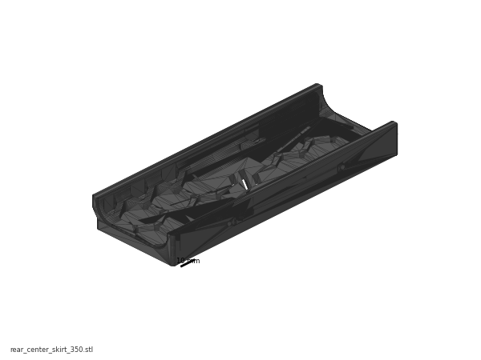{ width=96 } | `rear_center_skirt_350.stl` | 11-skirts | 1 | Black | B08 |
| 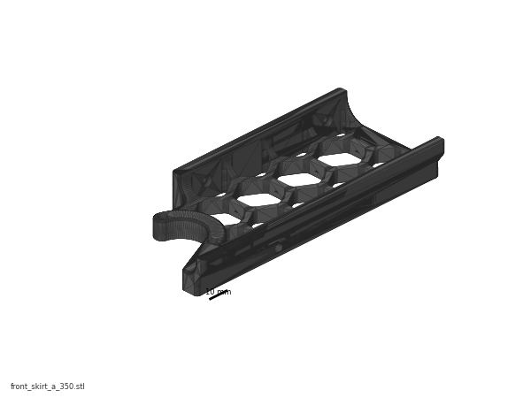{ width=96 } | `front_skirt_a_350.stl` | 11-skirts | 1 | Black | B08 |
| 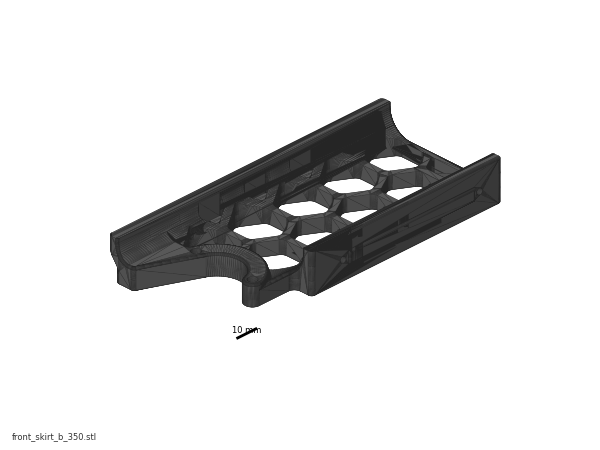{ width=96 } | `front_skirt_b_350.stl` | 11-skirts | 1 | Black | B08 |
| 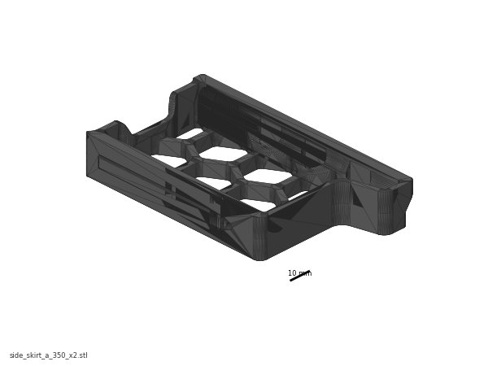{ width=96 } | `side_skirt_a_350_x2.stl` | 11-skirts | 2 | Black | B08 |
| 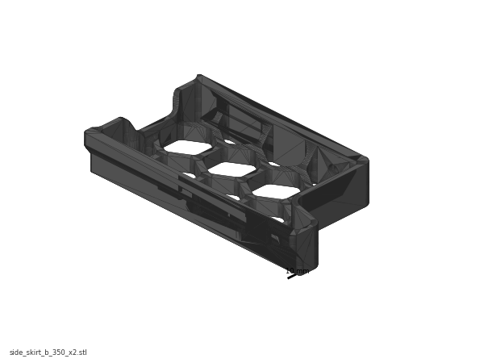{ width=96 } | `side_skirt_b_350_x2.stl` | 11-skirts | 2 | Black | B08 |
| 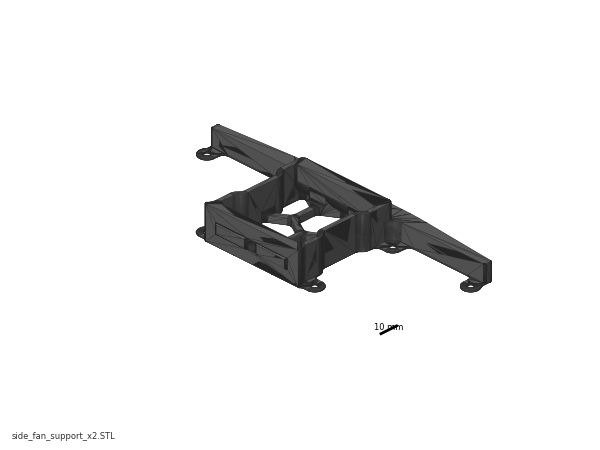{ width=96 } | `side_fan_support_x2.STL` | 11-skirts | 2 | Black | B08 |
| 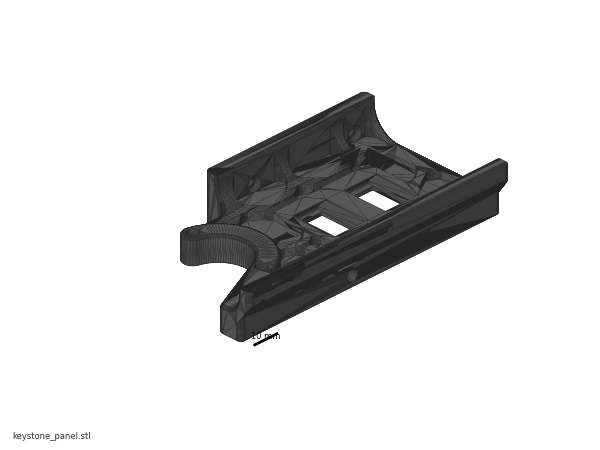{ width=96 } | `keystone_panel.stl` | 11-skirts | 1 | Black | B08 |
| 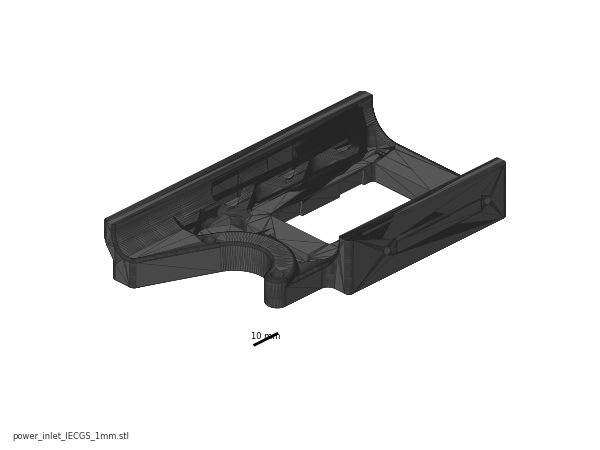{ width=96 } | `power_inlet_IECGS_1mm.stl` | 09-bay | 1 | Black | **B07-P1** *(fitted in Ch 09 Steps 09.10–09.12; listed here because it is a ring segment)* |
| 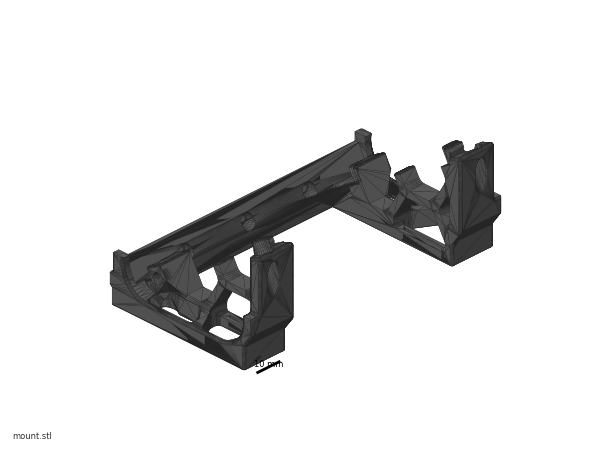{ width=96 } | `mount.stl` (BTT Pi TFT4.3 Mount) | 10-tft | 1 | Black | B08 |
| { width=96 } | `[a]_faceplate.stl` (BTT Pi TFT4.3 Mount) | 10-tft | 1 | Blue | B02 |
| { width=96 } | `[a]_belt_guard_a_x2.stl` | 11-fans | 2 | Blue | B02 |
| { width=96 } | `[a]_belt_guard_b_x2.stl` | 11-fans | 2 | Blue | B02 |
| { width=96 } | `[a]_fan_grill_a_x2.stl` | 11-fans | 2 | Blue | B02 |
| { width=96 } | `[a]_fan_grill_b_x2.stl` | 11-fans | 2 | Blue | B02 |
| { width=96 } | `[a]_fan_grill_retainer_x2.stl` | 11-fans | 2 | Blue | B02 |
| { width=96 } | `[a]_keystone_blank_insert.stl` | 11-skirts | 2 *(1 used, 1 spare)* | Blue | B02 |
| 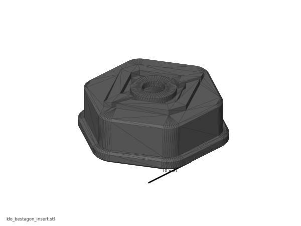{ width=96 } | `ldo_bestagon_insert.stl` | 11-skirts | 1 *(optional trim)* | Blue | B02 |
| 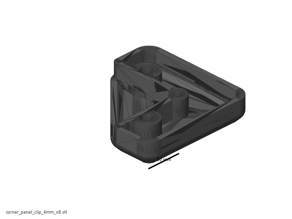{ width=96 } | `corner_panel_clip_4mm_x8.stl` | 11-clips-4mm | 8 | Black | B09 |
| 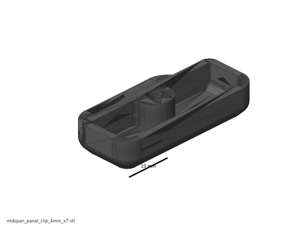{ width=96 } | `midspan_panel_clip_4mm_x7.stl` | 11-clips-4mm | 7 | Black | B09 |
| 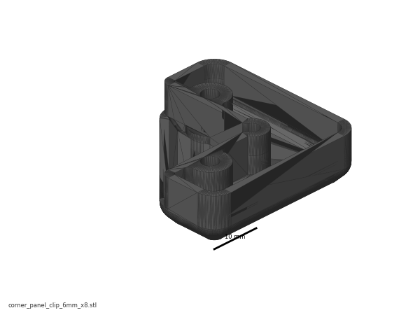{ width=96 } | `corner_panel_clip_6mm_x8.stl` | 11-clips-6mm | 8 | Black | B09 |
| 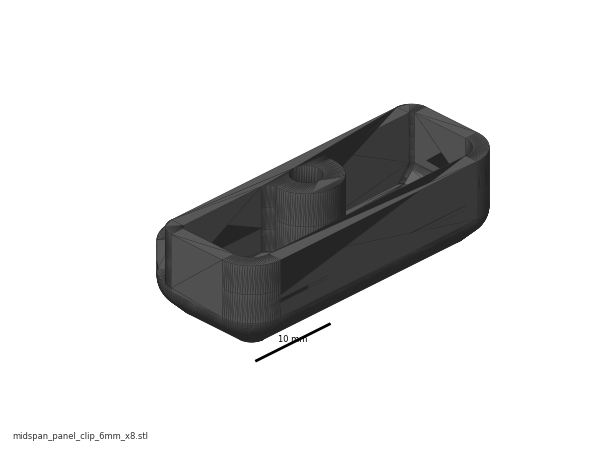{ width=96 } | `midspan_panel_clip_6mm_x8.stl` | 11-clips-6mm | 8 | Black | B09 |
| 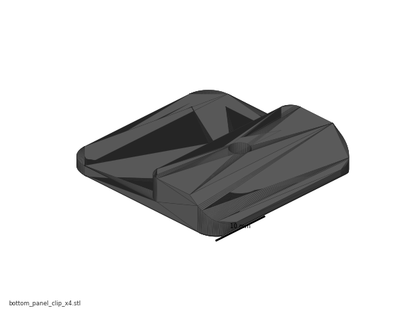{ width=96 } | `bottom_panel_clip_x4.stl` | 11-panels | 4 | Black | B09 |
| 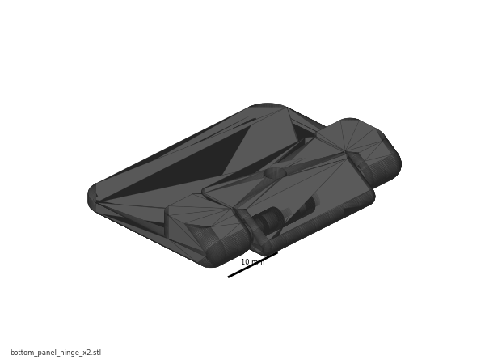{ width=96 } | `bottom_panel_hinge_x2.stl` | 11-panels | 2 | Black | B09 |
| 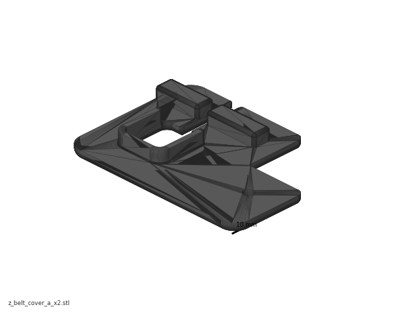{ width=96 } | `z_belt_cover_a_x2.stl` | 11-panels | 2 | Black | B09 |
| 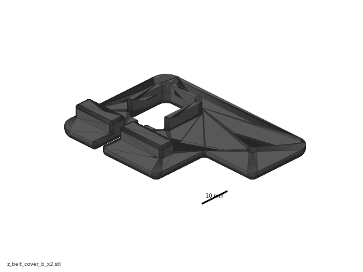{ width=96 } | `z_belt_cover_b_x2.stl` | 11-panels | 2 | Black | B09 |
|  | `z_belt_cover_a_led.stl` (LDO) | — | 0 | Black | not printed — Ch 10 Step 10.38 routes the LED lead through the extrusion slot, not the Z-motor opening; see 11.22 for the rejected alternative |
| 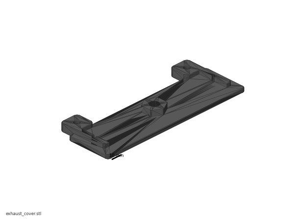{ width=96 } | `exhaust_cover.stl` (LDO) | 11-finish | 1 | Black | B09 |
| 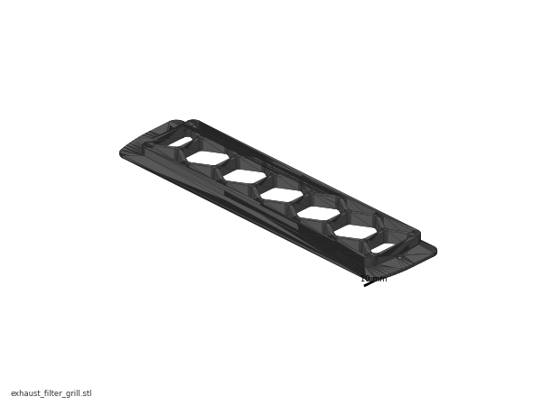{ width=96 } | `exhaust_filter_grill.stl` (Voron) | 11-finish | 1 | Black | B09 |
| 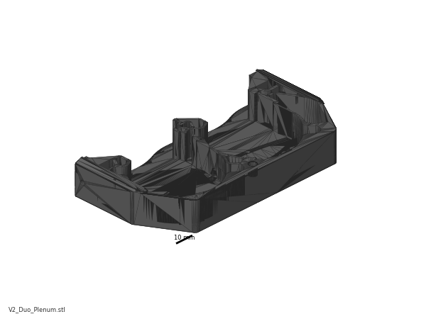{ width=96 } | `V2_Duo_Plenum.stl` | 11-nevermore | 1 | Black | B09 |
| 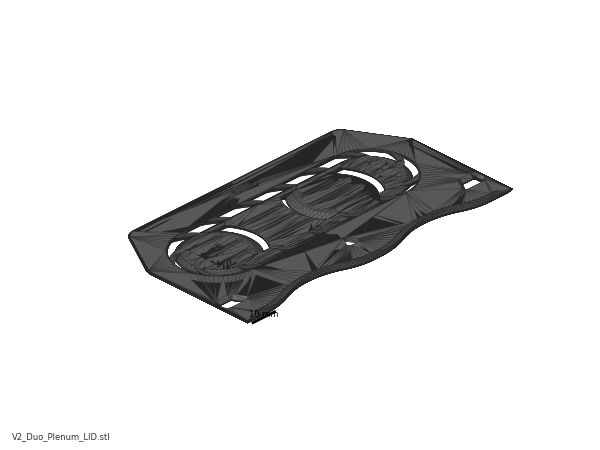{ width=96 } | `V2_Duo_Plenum_LID.stl` | 11-nevermore | 1 | Black | B09 |
| { width=96 } | `Regular_Cartridge(contributed_by_Bucknova).3mf` | 11-nevermore | 1 | Black | B09 |
| { width=96 } | `Regular_Cartridge_Lid(contributed_by_Bucknova).3mf` | 11-nevermore | 1 | Black | B09 |
| 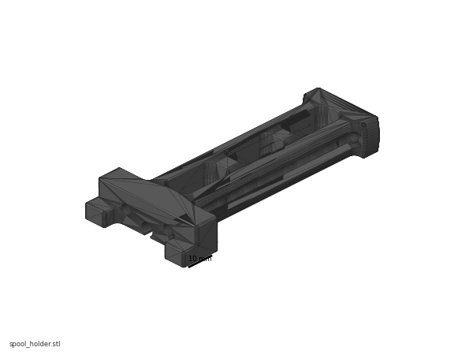{ width=96 } | `spool_holder.stl` | 11-spool | 1 | Black | B09 |
| 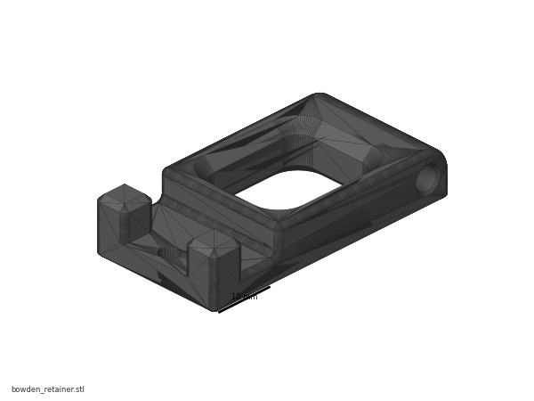{ width=96 } | `bowden_retainer.stl` | 11-spool | 1 | Black | B09 |
| 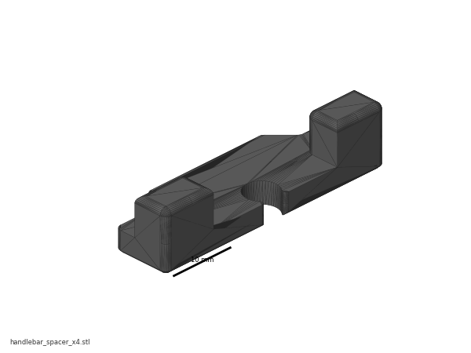{ width=96 } | `handlebar_spacer_x4.stl` (LDO) | 11-finish | 4 | Black | B07 |
| 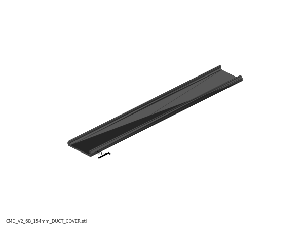{ width=96 } | DC loop lids, step 11.52: `CMD_V2_6B_154mm_DUCT_COVER.stl` ×2, `CMD_V2_6B_90DEG_COVER.stl` ×2, `V2L_90DEG_COVER_MIRROR.stl`, `V2L_58mm_DUCT_COVER.stl` ×3, `V2L_130mm_DUCT_COVER.stl`, `V2L_70mm_DUCT_COVER.stl`, `CMD_Remix-V3_DUCT-2B_45deg_LID.stl` ×2, `V3L_10mm_DUCT_COVER.stl`, `V3L_154N_DUCT_COVER.stl` ×2, `V3L_T_REG_N_COVER.stl` ×2 | 11-lids-DC | 17 | Black | B11 |
| 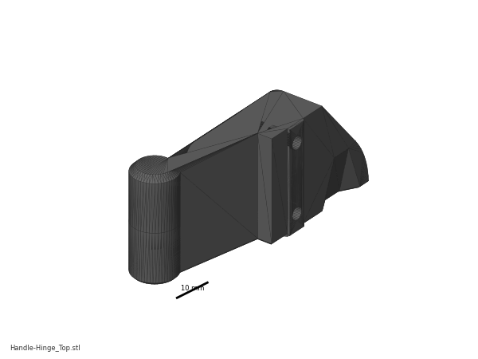{ width=96 } 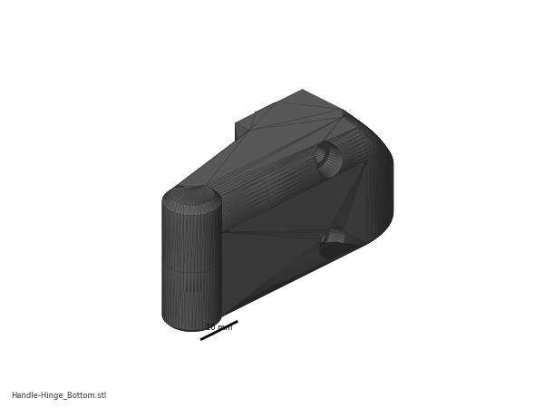{ width=96 } | `Handle-Hinge_Top.stl` / `Handle-Hinge_Bottom.stl` | 11-door | 1 each | Black | B10 |
| { width=96 } 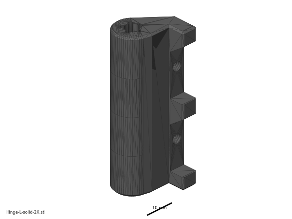{ width=96 } | `Hinge-L-sleeve-2X.stl` / `Hinge-L-solid-2X.stl` | 11-door | 2 each | Black | B10 |
| 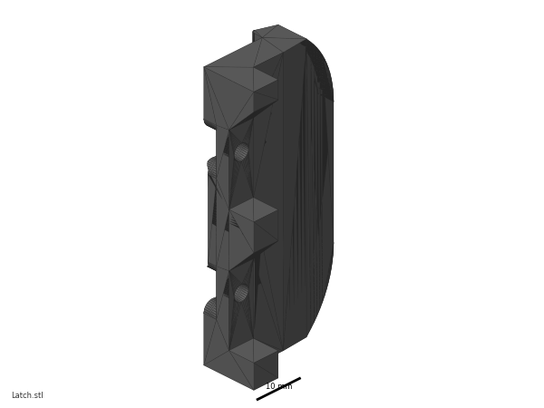{ width=96 } 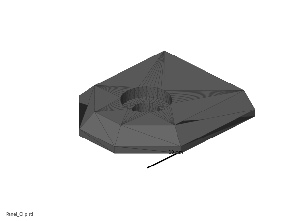{ width=96 } | `Latch.stl` / `Panel_Clip.stl` | 11-door | 1 each | Black | B10 |
| 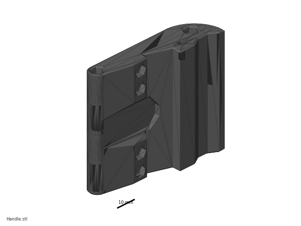{ width=96 } | `Handle.stl` (Clicky-Clack) | 11-door | 1 | Blue | B02 |
| 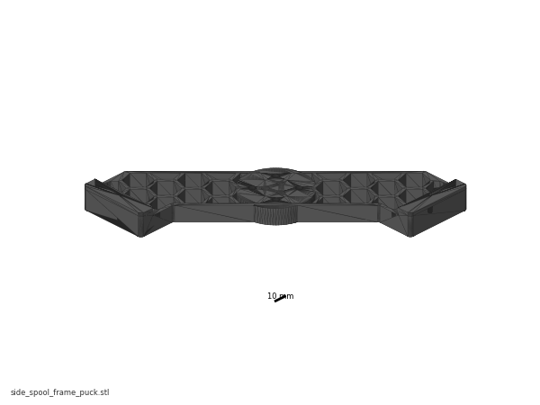{ width=96 } | `side_spool_frame_puck.stl` (Part C, remix of Printables 608769) | 11-side-spool | 1 | Black | B12-P1 *(reprinted at 11.69 only if the stack is over 6.2 mm)* |
| { width=96 } | `Bowden Tube Holder_Long.stl` (Part C, Printables 608769) | 11-side-spool | 1 | Black | B12-P2 |
| 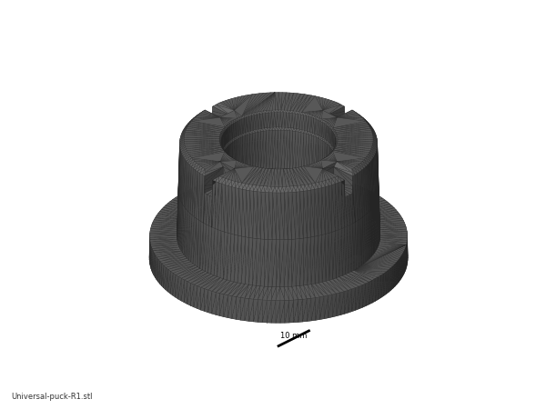{ width=96 } | `Universal-puck-R1.stl` (Part C, Printables 1605113) | 11-side-spool | 1 | Blue | B12-P3 |
| 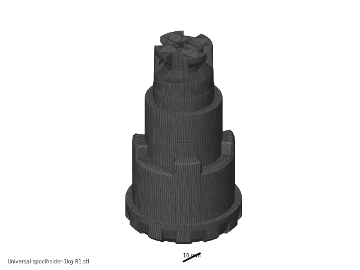{ width=96 } | `Universal-spoolholder-1kg-R1.stl` (Part C, Printables 1605113) | 11-side-spool | 1 | Blue | B12-P3 |
| 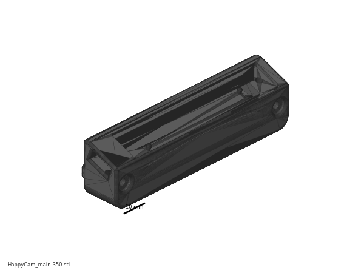{ width=96 } | `HappyCam_main-350.stl` (Part C, Printables 527904) | 11-camera | 1 | Black | B12-P2 |
| 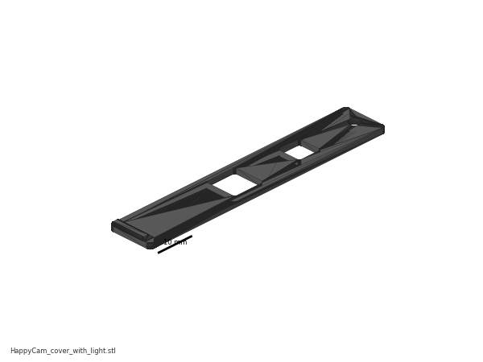{ width=96 } | `HappyCam_cover_with_light.stl` (Part C, Printables 527904) | 11-camera | 1 | Black | B12-P2 |

**Part C parts** come off batch [B12](print/B12-side-spool-and-camera.md), the last three plates of the ASA run, into bins 11-side-spool and 11-camera. Step 11.69 reprints the frame only if Step 11.68 measures a panel stack over 6.2 mm.

**Not printed, not installed** — the Clicky-Clack replaces the stock front doors and the BTT touchscreen replaces the mini12864, so none of these exist on this machine: `Panel_Mounting/Front_Doors/door_hinge_x6`, `handle_a_x2`, `handle_b_x2`, `latch_x2`; LDO's whole `LDO Door/` set; `mini12864_case_front`, `mini12864_case_rear`, `[a]_mini12864_case_hinge`, `[a]_mini12864_case_front_insert`, `[a]_btt_knob_light_shield`. The stock exhaust housing set, `exhaust_filter_housing`, `[a]_exhaust_filter_mount_x2`, `[a]_filter_access_cover` and `[a]_exhaust_fan_grill`, is printed in batch B13 but not fitted here: it waits in bin 14-exhaust for [Ch 14 Part H](14-calibration.md). Manual pages p.211, p.214–216, p.220–221, p.245–249 and p.250–253/256 are therefore dead pages for this build (print plan §7); p.250–253/256 come back in Ch 14 Part H.

**Hardware** (chapter totals)

| Fastener / part | Qty | Where |
|---|---:|---|
| M3×8 SHCS | 20 | skirt ring: belt guards 8, two each (p.217, p.222); front skirts 4 (p.219); rear run 4 (p.223–224); side skirts 4 (p.227, p.230) |
| M3×8 SHCS | 16 | bay-fan grills, four each: 8 into the fans (p.228), 8 into the grill retainers (p.225) |
| M3×8 SHCS | 5 | BTT TFT4.3 mount and faceplate ([mount README](https://github.com/MotorDynamicsLab/LDOVoronTrident/tree/master/STLs/BTT%20Pi%20TFT4.3%20Mount)) |
| M3×8 SHCS | 6 | bottom-panel clips and hinges, into the skirts' heat-set inserts, no T-nuts (p.233, CAD) |
| M3×8 SHCS | 1 | bowden retainer (p.257) |
| M3×8 SHCS | 11 | back-panel clips: two per corner clip, one per midspan (p.239) |
| M3×8 SHCS | 12 | top-panel clips: two per corner clip, one per midspan (p.243) |
| M3×12 SHCS | 24 | side-panel clips, 12 per side: two per corner clip, one per midspan (p.241) |
| M3×12 SHCS | 2 | exhaust grill to exhaust cover, into its two inserts (p.254, `exhaust_cover` STL) |
| M3×12 SHCS | 2 | Nevermore plenum to the bed extrusions |
| M3×6 BHCS | 4 | Z belt covers (p.234) |
| M3×20 SHCS | 8 | Part C: puck to frame 4, frame to the extrusions 2 (`slicer/addons/side-spool-608769/remix.scad`), HappyCam body 2 (14.96 mm of plastic under the head, read from the [Printables 488020](https://www.printables.com/model/488020) STL) |
| M3×8 SHCS | 2 | Part C: tube holder 1, HappyCam light cover 1 |
| M3 roll-in T-nut, 2020 | 4 | Part C: side spool frame 2, HappyCam body 2 |
| M3×6 BHCS | 2 | Nevermore plenum lid and cartridge lid (LDO's optional M3×4 BHCS is not a kit row) |
| M3 hammerhead T-nut, 2020 | 47 | panel clips: 11 back, 24 side, 12 top (p.239, p.241, p.243) |
| M3 hammerhead T-nut, 2020 | 4 | Z belt covers (p.234) |
| M3 hammerhead T-nut, 2020 | 1 | bowden retainer (p.257) |
| M3 hammerhead T-nut, 2020 | 1 | Part C tube holder: its two pegs leave 12 mm, too short for a roll-in |
| M3 roll-in T-nut, 2020 | 3 | BTT TFT4.3 mount |
| M3 roll-in T-nut, 2020 | 12 | skirt ring: 4 front (p.218), 4 rear (p.222), 2 per side (p.226, p.229) |
| M3 roll-in T-nut, 2020 | 2 | Nevermore plenum |
| M3 heat-set insert, brass M3×5×4 | 11 | skirt segments: three in each front skirt and the keystone panel, one in each fan support (p.212) |
| M3 heat-set insert, brass M3×5×4 | 16 | bay fans and grill retainers, four each (p.213) |
| M3 heat-set insert, brass M3×5×4 | 6 | Nevermore: 4 in the two fans' mounting holes, 1 plenum, 1 cartridge ([LDO guide](https://ldomotion.com/guides/nevermore-v5-duo---v24)) |
| M3 heat-set insert, brass M3×5×4 | 2 | exhaust cover, for the grill screws (`exhaust_cover` STL) |
| M5×10 BHCS | 2 | fan supports to the frame (p.227, p.230) |
| M5×10 BHCS | 2 | exhaust cover tabs to the top rear extrusion (p.255, `exhaust_cover` STL) |
| M5×16 BHCS | 1 | spool holder arm (p.259) |
| M5×14 BHCS | 4 | aluminium handlebars (LDO extra, not in the manual) |
| M5 roll-in T-nut, 2020 | 1 | spool holder (p.259) |
| M5 roll-in T-nut, 2020 | 2 | fan supports (p.226, p.229) |
| M5 roll-in T-nut, 2020 | 2 | exhaust cover tabs, top rear extrusion back slot (p.254) |
| M5 hammerhead T-nut, 2020 | 4 | aluminium handlebars |
| 60×60×20 fan | 2 | bay fans: inserts at 11.3, into the right-hand support at 11.11, plugged into the Ch 10 splicer at 11.16 |
| 4.3" capacitive DSI display | 1 | the BTT Pi TFT4.3, into its mount at 11.6 |
| 5015 fan, Nevermore | 2 | the kit's "Nevermore Micro V5 Parts" bag |
| Nevermore bridge PCB | 1 | the kit's "Nevermore Micro V5 Parts" bag |
| 4mm Bowden Coupler | 1 | exhaust cover centre hole, the PTFE's way through the back panel (11.54) |
| 6×3 mm neodymium magnet | 8 | Nevermore: 4 plenum, 4 cartridge (pockets counted in the STLs); the kit's other 8 were for the stock doors |
| Bottom panel, acrylic, black, 469×469×4 mm | 1 | 11.21 |
| Back panel, acrylic, black, 483×503×3 mm | 1 | 11.55 |
| Side panel, PC, clear, 483×503×3 mm | 2 | 11.57, 11.58 |
| Top panel, PC, clear, 483×483×3 mm | 1 | 11.59 |
| Aluminium handle | 2 | top panel (LDO) |
| Foam tape, 1 mm | back panel + top panel perimeters | supplied, 1 roll |
| Foam tape, 3 mm | both side panels + the Clicky-Clack door opening | supplied, 1 roll |
| 3M VHB tape | 6 pads | bottom-panel clips and hinges (p.232) |
| Extrusion slot cover, 6 mm | what Ch 10 left of the kit's 9 `(verify on bench)` | optional, empty slots only (11.66) |
| M2.5×6 screw — from BTT screen packaging | 4 | BTT screen into its mount |
| FFC ribbon — from BTT screen packaging | 1 | screen to the Pi's DSI port |
| M3×16 BHCS — from the Nevermore parts bag | 4 | Nevermore fans to the plenum; the kit's fastener box has no M3×16 BHCS *(verify on bench)* |
| M5×16 BHCS — from Clicky-Clack door kit | 4 | door frame blind joints |
| M5×45 dowel pin — from Clicky-Clack door kit | 4 | door hinges 2, handle 2 |
| M5×7×8 split bushing — from Clicky-Clack door kit | 6 | door hinges 4, handle hinges 2 |
| M3×20 SHCS — from Clicky-Clack door kit | 4 | handle hinges to the door frame, two each (11.64) |
| M3 roll-in T-nut — from Clicky-Clack door kit | 13 | door hinges 8, four on the printer and four on the door frame (11.62); handle hinges 4 (11.64); latch 1, beside the displaced midspan clip's hammerhead (11.63); the bag holds 14, so 1 is spare |
| M3×8 SHCS — from Clicky-Clack door kit | 12 | door hinges 8 (11.62), handle locating screws 2 (11.50), latch 2 (11.63): its two holes pass a 3 mm flange, so the displaced clip's M3×12 would bottom in the slot (`Latch` STL) |
| M3×8 BHCS — from Clicky-Clack door kit | 1 | `Panel_Clip` into the latch |
| M3 heat-set insert — from Clicky-Clack door kit | 1 | the latch |
| 6×3 mm magnet — from Clicky-Clack door kit | 12 | handle 6, latch 4, handle hinges 2 (pockets counted in the STLs) |
| Door frame extrusion, 2020 — from Clicky-Clack door kit | 4 | two 470 mm with tapped ends, two 530 mm with access holes |
| Panel retainer strip — from Clicky-Clack door kit | 1 | 2 m rubber strip, cut to length |
| Door panel, acrylic, 480×500×3 mm — from Clicky-Clack acrylic panel | 1 | the separate Fabreeko line item, not the kit's PC doors |
| OV5640 USB camera board — from the camera add-on order | 1 | Part C, into HappyCam at 11.74 |
| PTFE tube, 4 mm OD, 3 mm ID, 2 m — from the side spool add-on order | 1 | Part C, replaces the kit's reverse-bowden run at 11.72 |
| Spindle O-ring — from a USS Drybox box | 1 | Part C, on Prusa's spindle at 11.73 |

Every count above is off the page, STL or source named in its row; rows marked *(verify on bench)* are the ones no source settles. The kit ships 283 M3×8 SHCS, 135 M3 roll-in T-nuts and 75 M3 hammerhead T-nuts, so you are not going to run short; with Part C, the Ch 13 scrubber add-on and Ch 14 Part H fitted, about 3 roll-in and 2 hammerhead M3 T-nuts are left over. The Clicky-Clack kit supplies everything in its mod BOM plus its own bag of 14 M3 T-nuts; Fabreeko's listing leaves only the panel and the printed parts to source.

**The LDO panel stack for a 350** — read this table before you cut a single strip of foam tape. Thicknesses are from the [LDO 350 Rev D+ BOM](https://docs.ldomotors.com/en/voron/voron2/350_BOM/Rev_D+); the clip assignment is derived in 11.53/11.57/11.59.

| Panel | Material | Size (mm) | Thickness | Foam tape | Clips | Screw |
|---|---|---|---|---|---|---|
| Deck | Acrylic, black | 469 × 469 | **3 mm** (verify — see below) | — | `deck_support_*mm_x8`, fitted in **Ch 02** | — |
| Bottom | Acrylic, black | 469 × 469 | **4 mm** | none — VHB pads instead | `bottom_panel_clip_x4` ×4 + `bottom_panel_hinge_x2` ×2 | M3×8 SHCS ×6 |
| Back | Acrylic, black | 483 × 503 | **3 mm** | **1 mm** | 4 × `corner_panel_clip_4mm` + 3 × `midspan_panel_clip_4mm` | M3×8 SHCS ×11 |
| Side (×2) | PC, clear | 483 × 503 | **3 mm** | **3 mm** | 4 × `corner_panel_clip_6mm` + 4 × `midspan_panel_clip_6mm`, **each side** | M3×12 SHCS ×12 each |
| Top | PC, clear | 483 × 483 | **3 mm** | **1 mm** | 4 × `corner_panel_clip_4mm` + 4 × `midspan_panel_clip_4mm` | M3×8 SHCS ×12 |
| Front door (stock, ×2) | PC, clear | 241 × 503 | 3 mm | — | **NOT INSTALLED** | — |
| Front door (Clicky-Clack) | Acrylic, clear (Fabreeko) | 480 × 500 | **3 mm** | **3 mm** on the frame face it seals against | extrusion frame + rubber retainer strip | M5×16 BHCS ×4 (frame) |

Clip totals: 4 mm → 8 corner + 7 midspan = exactly `corner_panel_clip_4mm_x8` + `midspan_panel_clip_4mm_x7`. 6 mm → 8 corner + 8 midspan = exactly `corner_panel_clip_6mm_x8` + `midspan_panel_clip_6mm_x8`. Nothing short; the latch displaces one 6 mm midspan at 11.63, which becomes a spare. A corner clip takes **two** screws and two hammerhead nuts, a midspan one (p.239, p.241, p.243).

⚠ **Deck panel thickness — unresolved conflict.** LDO's Build Notes for p.29–30 say *"The LDO deck panel has a 4mm nominal thickness, use deck_support_4mm instead of its 3mm counterpart"*, but LDO's own 350 Rev D+ BOM lists the deck panel as **469×469×3 mm** (and the *bottom* panel as 4 mm). One of the two documents is wrong. **Caliper the deck panel; do not resolve this from documents** (print plan §6). This is a **Ch 02** decision — if you fitted `deck_support_4mm_x8` under a 3 mm panel, the deck rattles and the skirt ring will not sit flat, and you fix it now, before the ring goes on, not later. [src](https://docs.ldomotors.com/voron/voron2/build-faq) · [src](https://docs.ldomotors.com/en/voron/voron2/350_BOM/Rev_D+)

**Notes behind "Read first"**

- **Do not start until Checkpoint #1 has passed and Ch 12 Part 2 is done.** The skirt ring and bottom panel close the electronics bay, and Ch 12 Part 2 needs it open. Reopening it costs an hour plus the safety risk of having skipped the check (survey §5.2 W8).
- **Only Part A happens now.** The back, side and top panels and the door go on in **Part B, after Ch 13** — the startup wizard's motor, endstop and probe checks and the Ch 06b gantry-squaring pass all need the machine open on every face.
- **The Clicky-Clack replaces the entire stock front-door assembly**, not the front skirt. `front_skirt_a_350` + the TFT module + `front_skirt_b_350` still go on. Manual p.245–249 are dead pages.
- **The BTT 4.3" DSI touchscreen replaces the mini12864 module.** Manual p.211, p.214–216 and p.220–221 are dead pages; the mount STL lives in the **Trident** repo, not the Voron-2 repo. [src](https://docs.ldomotors.com/voron/voron2/build-faq)
- **Nevermore replaces the stock exhaust filter.** Manual p.250–253 and p.256 are skipped here (Ch 14 Part H brings them back); you print LDO's `exhaust_cover` and use it with the stock `exhaust_filter_grill` to seal the back panel's exhaust cut-out: grill inside, cover outside, and the filament PTFE crosses the panel through the coupler in the cover's centre. Decide this now — a back panel sealed the wrong way means the panel comes off and a part gets reprinted (survey §5.2 W11).
- **Lay every skirt segment on the flat reference and check for rock before you fit anything.** `rear_center_skirt_350` is 182 mm on its long axis and the worst warp candidate in the whole build. A bowed skirt is the most visible defect on a finished Voron (print plan §5.2, B08 checkpoint).

**Sources for this chapter:**

- [Voron 2.4r2 Assembly Manual](https://github.com/VoronDesign/Voron-2/blob/de7e89d/Manual/Assembly_Manual_2.4r2.pdf), pinned commit `de7e89d` — p.210–259 (the whole Skirts/Panels/Doors/Spool section; the dead pages listed below are shown but not followed)
- [LDO Build Notes (build FAQ)](https://docs.ldomotors.com/voron/voron2/build-faq#build-notes) — the notes for p.214–216 and p.220–221 (BTT screen on Rev C/D) and p.250–253 and p.256 (Nevermore); LDO has no note for p.211 or p.245–249, which are dead here because of this build's screen and door (fetched 2026-11-20)
- [LDO Rev D+ 350 BOM](https://docs.ldomotors.com/en/voron/voron2/350_BOM/Rev_D+) — panel sizes and thicknesses, bay fans; [LDO Rev D printed-parts guide](https://docs.ldomotors.com/en/voron/voron2/printed_part_guide_rev_d)
- [LDO wiring guide, Rev D](https://docs.ldomotors.com/en/voron/voron2/wiring_guide_rev_d) — bay fans, LED strip, touchscreen; [BTT 4.3" screen guide](https://docs.ldomotors.com/en/guides/btt_43_rotate_guide)
- [LDO BTT Pi TFT4.3 mount](https://github.com/MotorDynamicsLab/LDOVoronTrident/tree/5b0496a/STLs/BTT%20Pi%20TFT4.3%20Mount) at commit `5b0496a` — the mount lives in the **Trident** repo, not Voron-2
- [LDO Nevermore Micro V5 Duo guide](https://ldomotion.com/guides/nevermore-v5-duo---v24) (link-only, no stated licence) and the [Nevermore Micro repo](https://github.com/nevermore3d/Nevermore_Micro/tree/8740b34)
- [KB3D Clicky-Clack install guide](https://wiki.kb-3d.com/en/home/LDO/LDO_Clicky_Clacky_Door_Mod) (link-only) and the [mod README](https://github.com/tanaes/whopping_Voron_mods/tree/62268ed/clickyclacky_door) at commit `62268ed`
- STL folders: [Voron-2 `STLs/`](https://github.com/VoronDesign/Voron-2/tree/de7e89d/STLs) and [LDOVoron2 `STLs/`](https://github.com/MotorDynamicsLab/LDOVoron2/tree/8270e8c/STLs)
- All step images in this chapter are rendered pages of the official manual, already committed under `assets/manual-pages/` — nothing is hot-linked

**Video coverage (Steve Builds, pre-release LDO kit — differs from Rev D+):** [Part 1 @1:45:51](https://www.youtube.com/watch?v=feTxcc0LIWM&list=PL0fUJbigELQPqpeGOgHYisG4KaSXVtnNY&t=6351s) (+10m), [Part 5 @4:16:40](https://www.youtube.com/watch?v=hTKCBrk36R0&list=PL0fUJbigELQPqpeGOgHYisG4KaSXVtnNY&t=15400s) (+20m), [Part 9 @2:53:49](https://www.youtube.com/watch?v=dmNwxUm4oik&list=PL0fUJbigELQPqpeGOgHYisG4KaSXVtnNY&t=10429s) (+12m), [Part 9 @3:15:32](https://www.youtube.com/watch?v=dmNwxUm4oik&list=PL0fUJbigELQPqpeGOgHYisG4KaSXVtnNY&t=11732s) (+3m), [Part 9 @3:18:00](https://www.youtube.com/watch?v=dmNwxUm4oik&list=PL0fUJbigELQPqpeGOgHYisG4KaSXVtnNY&t=11880s) (+33m), [Part 9 @3:50:40](https://www.youtube.com/watch?v=dmNwxUm4oik&list=PL0fUJbigELQPqpeGOgHYisG4KaSXVtnNY&t=13840s) (+28m), [Part 9 @4:18:11](https://www.youtube.com/watch?v=dmNwxUm4oik&list=PL0fUJbigELQPqpeGOgHYisG4KaSXVtnNY&t=15491s) (+26m), [Extras! @0:08:09](https://www.youtube.com/watch?v=0aPi1rBwDC0&list=PL0fUJbigELQPqpeGOgHYisG4KaSXVtnNY&t=489s) (+5m), [Extras! @0:13:00](https://www.youtube.com/watch?v=0aPi1rBwDC0&list=PL0fUJbigELQPqpeGOgHYisG4KaSXVtnNY&t=780s) (+2m), [Extras! @2:04:44](https://www.youtube.com/watch?v=0aPi1rBwDC0&list=PL0fUJbigELQPqpeGOgHYisG4KaSXVtnNY&t=7484s) (+42m), [Extras! @3:02:15](https://www.youtube.com/watch?v=0aPi1rBwDC0&list=PL0fUJbigELQPqpeGOgHYisG4KaSXVtnNY&t=10935s) (+7m), [Extras! @3:08:25](https://www.youtube.com/watch?v=0aPi1rBwDC0&list=PL0fUJbigELQPqpeGOgHYisG4KaSXVtnNY&t=11305s) (+18m), [More Extras! @1:20:31](https://www.youtube.com/watch?v=D_44fDp9xt8&list=PL0fUJbigELQPqpeGOgHYisG4KaSXVtnNY&t=4831s) (+14m)

---

<a id="part-a-before-first-power-up"></a>

## Part A — before Ch 13, machine unplugged

Part A is done with the machine open and **unplugged**: Ch 12 Part 2 left it on, so 11.67 first proves it dead, and nothing here needs power until 13.3, when it first moves and heats. Stop at the marker before 11.52. Built off the machine: the touchscreen module (11.5–11.6) at Ch 10 Step 10.50; the Nevermore (11.26–11.37) any time after B09; the Clicky-Clack parts (11.44–11.50) any time after B10, for instance while Ch 12 flashes images.

### Step 11.67 — Shut down, unplug and prove it dead

(no image — see text)

**What you're looking at:** Checkpoint 12 left the machine on with the bay open. Part A reaches into the bay to plug in the bay fans, so it starts with the power proven off. The PSU's green LED sits beside its voltage-adjust pot, a small trim screw.

**Parts:**

- tool: multimeter

**Do:**

1. Shut the Pi down from Mainsail; wait for its green ACT LED to stop.
2. Switch the rocker off. Unplug the cord at the wall, then at the inlet, and take it out of the room.
3. Once the PSU LED is dark, meter DC volts from +V to −V.

**Check:** Rocker unlit, PSU LED dark, no cord at the inlet, and the meter reads 0 V and holds it ten seconds, as at [10.73](10-wiring.md#step-1073-confirm-dead).

⚠ **Who is in the room, [00a.2](00a-mains-safety.md#step-00a2-write-the-who-is-in-the-room-rule-and-post-it-on-the-wall):** one adult at the machine while the bay is open and live, until this Check passes. She stays out of the room until the meter holds 0 V and the cord is gone.

⚠ **It stays dead through Part A.** Nothing here needs power. If a step tempts you to check something live, stop: the next plug-in is Ch 13's hand-on-the-switch power-on at 13.3, set up dead at 13.2, eyes only into the bay. At every Pause, the cord stays out of the room. [src](https://docs.vorondesign.com/build/electrical/)

Source: [LDO wiring guide § Checkpoint 1](https://docs.ldomotors.com/en/voron/voron2/wiring_guide_rev_d#checkpoint-1) · [Voron docs — Electrical Wiring](https://docs.vorondesign.com/build/electrical/) · [Mean Well LRS-200 datasheet — LED beside +V ADJ.](https://www.meanwell.com/webapp/product/search.aspx?prod=LRS-200) · [Ch 00a Step 00a.11](00a-mains-safety.md#step-00a11-know-the-two-power-on-rituals-before-either-one-arrives)

---

### Step 11.1 — Dry-fit the whole skirt ring

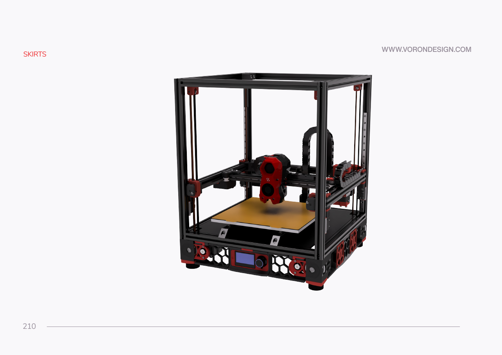

**What you're looking at:** The [skirt](16-glossary.md#s) is the band of printed segments around the base of the machine. It closes the electronics bay and carries the belt guards, fan grills, keystone panel, AC inlet and touchscreen. On a 350, twelve segments make the ring.

**Parts:**

- `front_skirt_a_350` ×1
- `front_skirt_b_350` ×1
- `rear_center_skirt_350` ×1
- `keystone_panel` ×1
- `side_skirt_a_350` ×2
- `side_skirt_b_350` ×2
- `side_fan_support` ×2
- reused: the BTT `mount`, taped to the front extrusion
- reused: `power_inlet_IECGS_1mm`, already on the frame

**Do:**

1. Lay every segment face-down on the flat reference: no corner should rock.
2. Lay the ring out in order. Front: front skirt, TFT module, front skirt. Rear: the rear center skirt between the inlet and the keystone panel. Each side: side skirt, fan support, side skirt. The inlet corner is rear-left.

**Check:** There are twelve segments, none of them rocks, and the ring closes with the front and rear runs equal and the two sides equal.

**Helper:** Holds each skirt segment in place while you check the joints line up.

Pages p.222–224 draw the machine upside down from behind, so the inlet panel on the picture's left is the printer's left too: rear-left, where Ch 09 fitted it.

Source: [Voron manual p.210](https://github.com/VoronDesign/Voron-2/blob/de7e89d/Manual/Assembly_Manual_2.4r2.pdf#page=210) · [LDO Rev D printed-parts guide](https://docs.ldomotors.com/en/voron/voron2/printed_part_guide_rev_d) · [Video: Part 5 @4:18:21](https://www.youtube.com/watch?v=hTKCBrk36R0&list=PL0fUJbigELQPqpeGOgHYisG4KaSXVtnNY&t=15501s)

---

### Step 11.2 — Heat-set the skirt segments

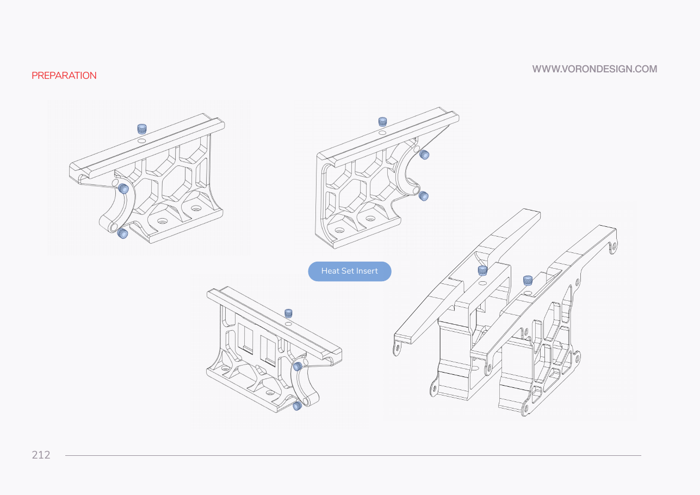

**What you're looking at:** [Heat-set inserts](16-glossary.md#h) are brass M3×5×4 sleeves that you melt into a printed boss so the plastic gets a real metal thread. Both front skirts and the keystone panel take three each; each fan support takes one.

**Parts:**

- M3×5×4 heat-set insert ×11

**Do:** Press an insert into every boss the page highlights: three in each front skirt and in the keystone panel, and one in each fan support's bottom rail, where a bottom-panel clip screws in; the page draws these parts upside down. Keep the part flat and the insert square, at the usual tip temperature.

**Check:** Every insert sits flush or just below the surface, none stands above it, and there is no bulge on the show face. An M3×8 SHCS turns in freely by hand.

While the press is hot, do the rest of the chapter's inserts: the fans and retainers ×16 at 11.3, the Nevermore ×6 at 11.28, the latch ×1 at 11.49 and the exhaust cover ×2 at 11.54. [src](https://docs.ldomotors.com/en/voron/voron2/printed_part_guide_rev_d)

Source: [Voron manual p.212](https://github.com/VoronDesign/Voron-2/blob/de7e89d/Manual/Assembly_Manual_2.4r2.pdf#page=212) · [LDO Rev D printed-parts guide](https://docs.ldomotors.com/en/voron/voron2/printed_part_guide_rev_d)

---

### Step 11.3 — Heat-set the bay fans and the fan grill retainers

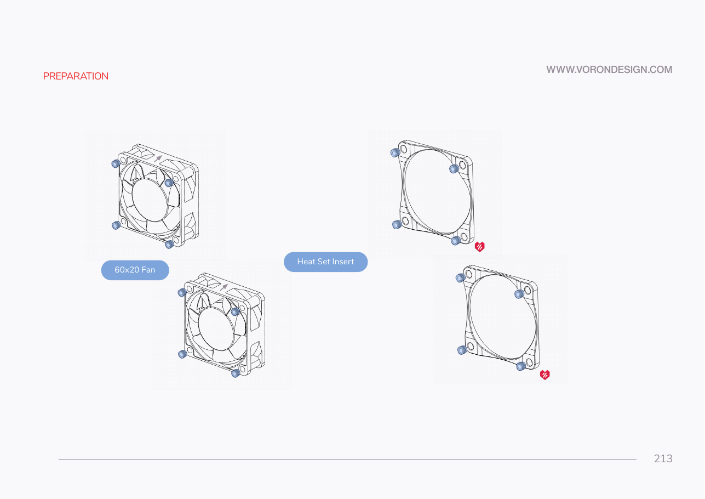{ crop="0.13 0.26 0.80 0.77" }

**What you're looking at:** The two 60 × 20 mm fans cool the electronics bay. Each fan takes four inserts in its corner holes, and so does each printed grill retainer, which stands in for a fan behind the grills of the empty fan support. The kit ships exactly **two** fans.

**Parts:**

- staged: 60×60×20 fan ×2
- `[a]_fan_grill_retainer` ×2
- M3×5×4 heat-set insert ×16

**Do:** Both fans will blow into the bay, so their inserts go on the intake face, against the grill. Read each fan's airflow arrow on its frame edge. Press four inserts into the corner holes on the face the arrow points away from, then four into each retainer's corner bosses.

**Check:** Sixteen inserts are flush and square, four per fan on its intake face and four per retainer, and no fan frame is cracked.

One of the kit's two 3×2 XH splicer PCBs joins the two fans into a single "PCB FAN" run; the other splicer is the LED junction. [src](https://docs.ldomotors.com/en/voron/voron2/350_BOM/Rev_D+) · [src](https://docs.ldomotors.com/en/voron/voron2/wiring_guide_rev_d)

Source: [Voron manual p.213](https://github.com/VoronDesign/Voron-2/blob/de7e89d/Manual/Assembly_Manual_2.4r2.pdf#page=213) · [LDO Rev D+ 350 BOM](https://docs.ldomotors.com/en/voron/voron2/350_BOM/Rev_D+) · [LDO wiring guide § Connecting the fans and the LED strip](https://docs.ldomotors.com/en/voron/voron2/wiring_guide_rev_d#connecting-the-fans-and-the-led-strip)

---

### Step 11.4 — Do not build the mini12864 module

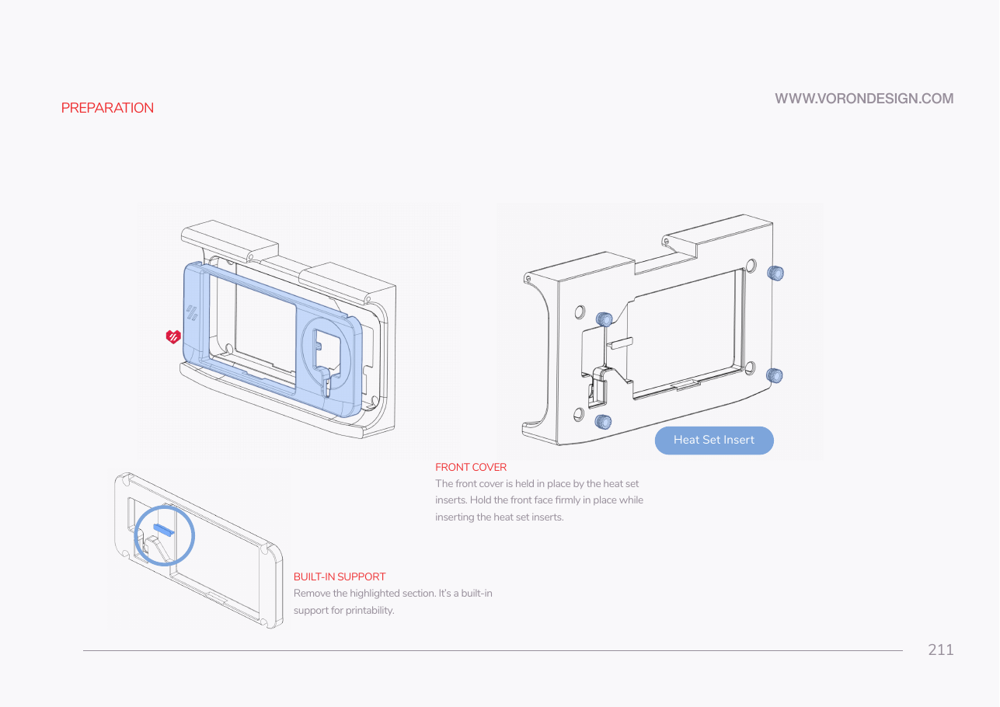
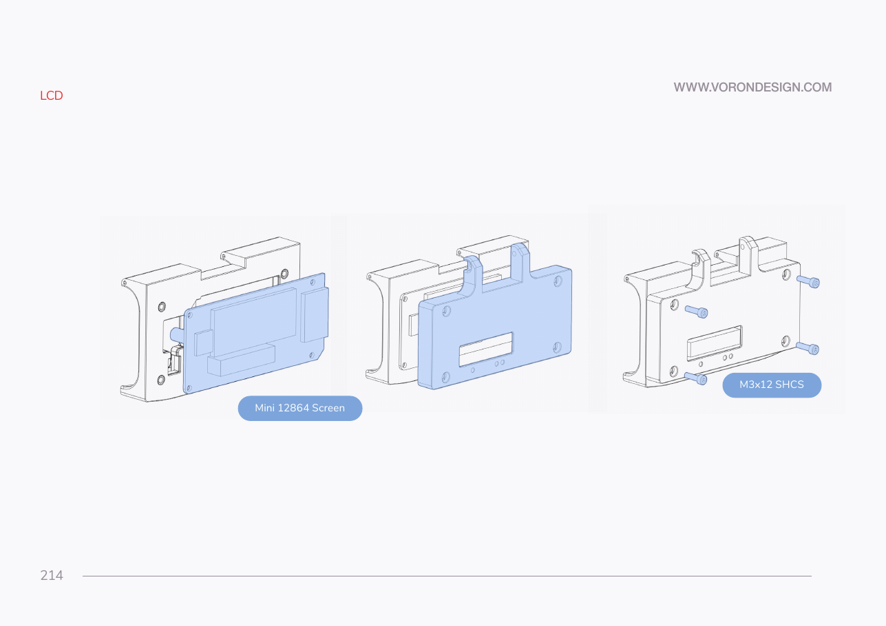
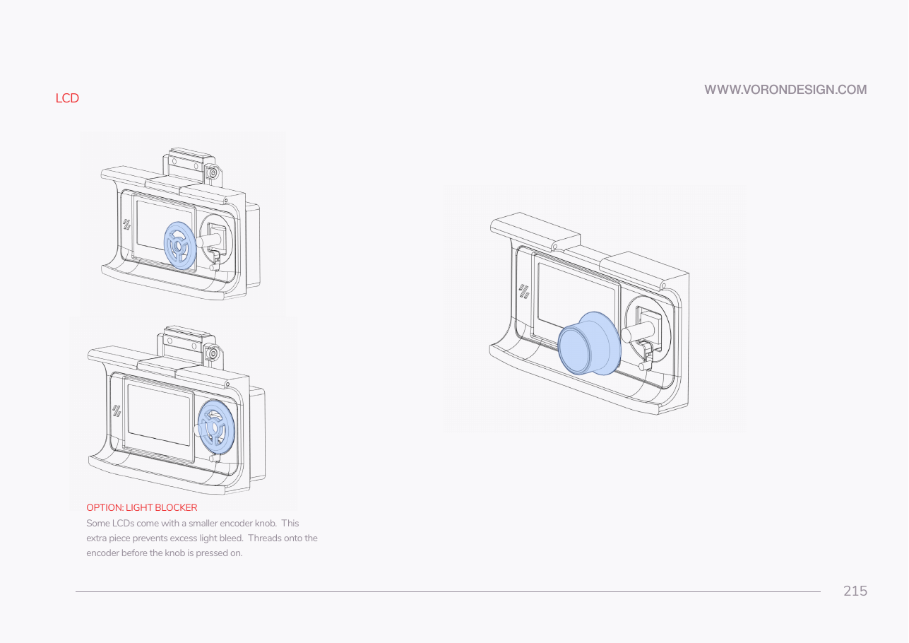
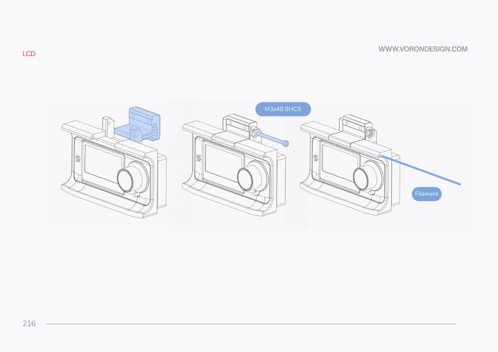

**What you're looking at:** These four manual pages build the mini12864, the small monochrome LCD with a click-wheel that a stock Voron uses as its display. This kit ships a 4.3" colour touchscreen instead, so all four pages, and every part on them, are skipped.

**Parts:** none.

**Do:**

1. Skip p.211, p.214, p.215 and p.216; they build a display module this kit does not have.
2. Confirm you never printed `mini12864_case_front`, `mini12864_case_rear`, `[a]_mini12864_case_hinge`, `[a]_mini12864_case_front_insert` or `[a]_btt_knob_light_shield`. The M3×12 SHCS, M3×40 SHCS and filament length these pages call for stay in their bags.

**Check:** Your bins hold no mini12864 parts, and the front-centre ring position is filled by the BTT mount from B08.

**Helper:** Looks through the skirt bins for any mini12864 part and reads out what is there.

LDO's note: *"For Rev C/D please use The BigTreeTech touchscreen, print the mount from here."* The mount STL is in the **LDOVoronTrident** repo, not in the Voron-2 tree. [src](https://docs.ldomotors.com/voron/voron2/build-faq) · [mount](https://github.com/MotorDynamicsLab/LDOVoronTrident/tree/master/STLs/BTT%20Pi%20TFT4.3%20Mount)

Source: [Voron manual p.211](https://github.com/VoronDesign/Voron-2/blob/de7e89d/Manual/Assembly_Manual_2.4r2.pdf#page=211) · [Voron manual p.214–216](https://github.com/VoronDesign/Voron-2/blob/de7e89d/Manual/Assembly_Manual_2.4r2.pdf#page=214) · [LDO Build Notes p.214–216](https://docs.ldomotors.com/voron/voron2/build-faq#build-notes) · [LDO BTT Pi TFT4.3 mount README](https://github.com/MotorDynamicsLab/LDOVoronTrident/tree/5b0496a/STLs/BTT%20Pi%20TFT4.3%20Mount)

Pause: ~25 min since the last pause — machine unplugged and proved dead at 11.67, every skirt segment dry-fitted and checked for rock, and inserts melted into the segments, both bay fans and the two grill retainers. The mini12864 parts are set aside unbuilt, and nothing is screwed to the frame yet.

---

### Step 11.5 — Heat-set and face the BTT TFT4.3 mount

(no image — see [mount README](https://github.com/MotorDynamicsLab/LDOVoronTrident/tree/master/STLs/BTT%20Pi%20TFT4.3%20Mount))

**What you're looking at:** `mount.stl` is the black printed carrier that holds the BTT Pi TFT4.3 touchscreen and fills the centre-front position in the ring. `[a]_faceplate.stl` is the blue frame (bezel) around the screen opening. You build this module at [Ch 10 Step 10.50](10-wiring.md#step-1050-dsi-ribbon-raspberry-pi-touchscreen), before the ribbon is latched.

**Parts:**

- `mount` ×1
- `[a]_faceplate` ×1
- M3×8 SHCS ×2

**Do:**

1. Check that the two inserts for the faceplate bosses, set in Ch 10, sit flush. If the mount came late, melt them in now.
2. Hold the blue faceplate to the mount and drive an M3×8 SHCS into each side, snug only.

**Check:** The faceplate sits flush all round with no gap at the top edge, and the screen opening is square to the mount's top rail.

You printed `mount.stl` (30 g, 44.8 mm tall), not `mount_thick.stl` (74 g, 67.8 mm). `mount_thick` exists only so a pointy tool can reach the screen's brightness buttons. If you find you want that, reprint: LDO links the folder, not a file. [src](https://github.com/MotorDynamicsLab/LDOVoronTrident/tree/master/STLs/BTT%20Pi%20TFT4.3%20Mount) · print plan §6

Source: [LDO BTT Pi TFT4.3 mount README](https://github.com/MotorDynamicsLab/LDOVoronTrident/tree/5b0496a/STLs/BTT%20Pi%20TFT4.3%20Mount)

---

### Step 11.6 — Fit the BTT Pi TFT4.3 screen into the mount

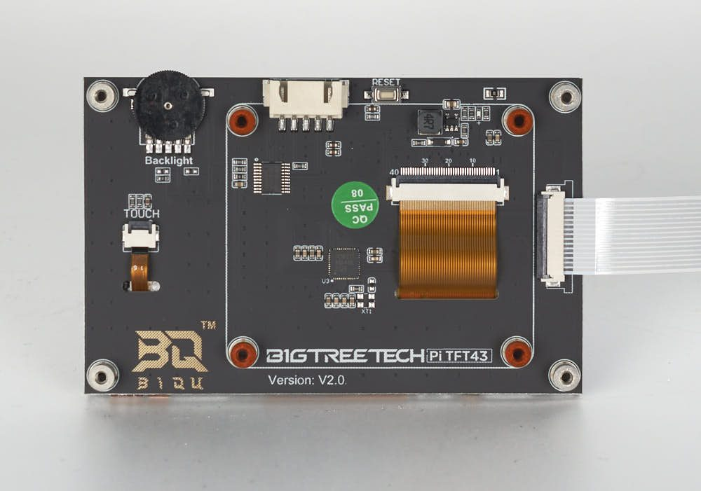

**What you're looking at:** The BTT Pi TFT43 is a 4.3" capacitive touchscreen. It reaches the Raspberry Pi over one flat ribbon cable, the FFC, which carries both power and video. On the back, the white edge socket takes the ribbon and the four corner holes the M2.5×6 screws.

**Parts:**

- 4.3" capacitive DSI display ×1
- FFC ribbon ×1 — from BTT screen packaging
- M2.5×6 screw ×4 — from BTT screen packaging
- reused: the faceplated `mount`

**Do:**

1. Peel the film off the back. Slide the ribbon in, **metal contacts up and blue tab toward the rear**, then close the latch, once.
2. Fit the screen landscape, its FFC socket at the short end where the ribbon leaves the mount without a sharp bend `(verify on bench)`. Drive the four M2.5×6 screws finger-tight.

**Check:** The latch is closed evenly, ribbon and screen sit square, and the FFC leaves the mount without a kink.

**Helper:** Holds the mount steady, face down, while you seat the screen and drive its four screws.

⚠ LDO: *"Incorrect orientation of the FFC cables can result in damage to your Raspberry Pi and/or touchscreen."* An FFC has no key to stop it going in the wrong way: the metal contacts are the only clue, and each end is latched exactly once in this build. [src](https://docs.ldomotors.com/en/guides/btt_43_rotate_guide)

Leave the front film on until the build is finished, and tape over the bare contacts on the ribbon's free end until Ch 10 Step 10.50 latches the Pi end.

Source: [LDO BTT 4.3" screen guide](https://docs.ldomotors.com/en/guides/btt_43_rotate_guide) · [LDO wiring photo PITFT43_FFC.jpg](https://raw.githubusercontent.com/MotorDynamicsLab/LDOVoron2/8270e8c/Images/WiringGuide/RevC/PITFT43_FFC.jpg)

---

### Step 11.7 — Fit the touchscreen module into the front skirt run

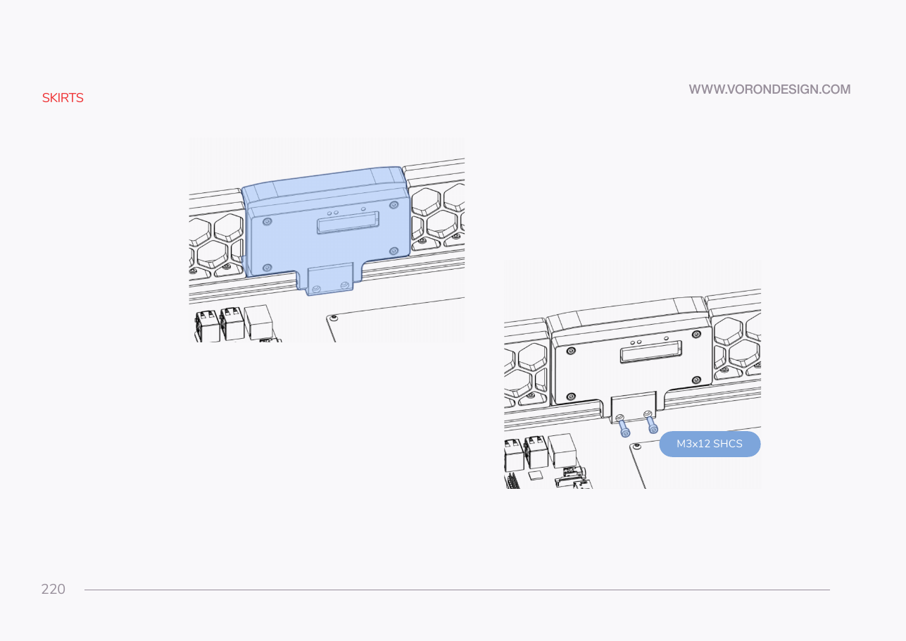

**What you're looking at:** The finished touchscreen module now becomes a skirt segment of its own, at the centre of the front run. It goes on first, and the front skirts close against it at 11.13. The BTT mount uses **M3×8 SHCS into M3 roll-in nuts**, not p.220's M3×12 SHCS into the mini12864 case.

**Parts:**

- reused: the touchscreen module, ribbon latched at both ends
- M3 roll-in T-nut ×3
- M3×8 SHCS ×3

**Do:**

1. Free the module from its tape without pulling the ribbon.
2. Roll three M3 T-nuts into the front extrusion.
3. Centre the module on the front extrusion, its top rail flat against the extrusion, and drive three M3×8 SHCS snug.

**Check:** The module sits centred on the front extrusion with its top rail flat against it, and the screen is level.

**Helper:** Holds the module level and centred on the front extrusion while you drive its three screws.

Across steps 11.5 and 11.7 the mount takes 5 M3×8 and 3 roll-in nuts. [src](https://github.com/MotorDynamicsLab/LDOVoronTrident/tree/master/STLs/BTT%20Pi%20TFT4.3%20Mount)

Source: [Voron manual p.220](https://github.com/VoronDesign/Voron-2/blob/de7e89d/Manual/Assembly_Manual_2.4r2.pdf#page=220) · [LDO BTT Pi TFT4.3 mount README](https://github.com/MotorDynamicsLab/LDOVoronTrident/tree/5b0496a/STLs/BTT%20Pi%20TFT4.3%20Mount)

---

### Step 11.8 — Route and connect the FFC ribbon to the Pi

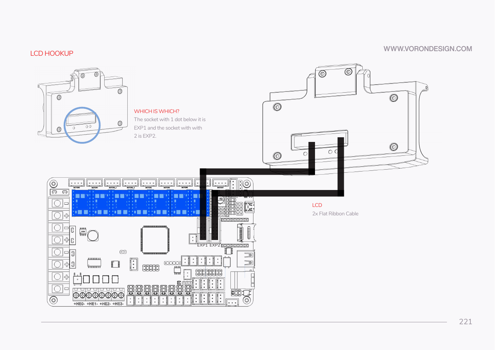
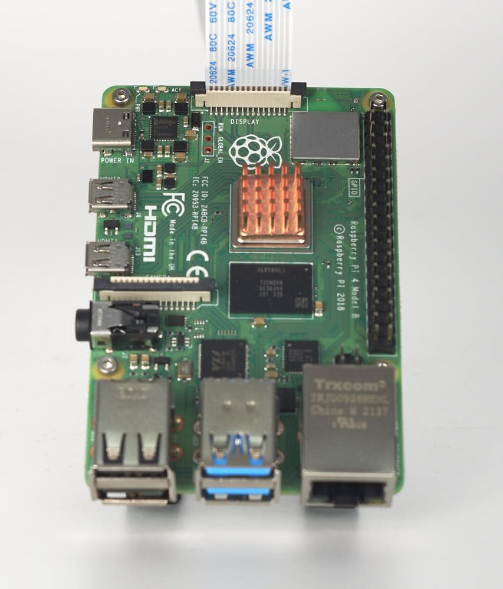

**What you're looking at:** The FFC is the only cable between screen and Pi. Nothing stops it going in backwards: the bare contacts are the only clue, and the wrong way round destroys either end. p.221 wires two ribbons to an EXP1/EXP2 header this machine lacks.

**Parts:**

- reused: the FFC ribbon, Pi end contacts forward and blue tab rearward

**Do:**

1. Ignore p.221; it wires EXP1/EXP2 ribbons.
2. Follow the ribbon from module to Pi: latches closed, a spare loop (a service loop) at each end, no tight bend, clear of the front skirts.
3. Never open a latch.

**Check:** Both latches are closed, the ribbon is square and goes in as deep as in LDO's photo, and nothing is pinched by a skirt or an extrusion edge.

This is the LDO wiring guide's *"Connecting the FFC Cable, Ethernet Cable, USB Cable and Frame PE"* step, done at 10.50. Turning the picture the right way up (screen rotation) is a **Ch 12** software step, not wiring: 12.10 writes it into `/boot/firmware/cmdline.txt` as `video=DSI-1:…rotate=` and 12.11 proves it. Do **not** use `display_lcd_rotate`, the legacy fake-KMS path, which is dead on MainsailOS 3.x. [src](https://docs.ldomotors.com/en/voron/voron2/wiring_guide_rev_d) · [src](https://docs.ldomotors.com/en/guides/btt_43_rotate_guide)

If [Ch 10 Step 10.50](10-wiring.md#step-1050-dsi-ribbon-raspberry-pi-touchscreen) had to leave the Pi end taped because the mount was not printed, connect it now exactly as 10.50 describes.

Source: [Voron manual p.221](https://github.com/VoronDesign/Voron-2/blob/de7e89d/Manual/Assembly_Manual_2.4r2.pdf#page=221) · [LDO wiring guide § Setting up the touch screen](https://docs.ldomotors.com/en/voron/voron2/wiring_guide_rev_d#setting-up-the-touch-screen) · [LDO BTT 4.3" screen guide](https://docs.ldomotors.com/en/guides/btt_43_rotate_guide) · [LDO wiring photo RPI_DSI_FFC.jpg](https://raw.githubusercontent.com/MotorDynamicsLab/LDOVoron2/8270e8c/Images/WiringGuide/RevC/RPI_DSI_FFC.jpg)

Pause: ~10 min since the last pause — the touchscreen module (built at 10.50) is screwed into the front of the ring, snug, and its FFC run is checked end to end and latched at both ends. Do not leave an FFC half-latched: the latch is what holds the contacts.

---

### Step 11.9 — Fit the belt guards to the skirt segments

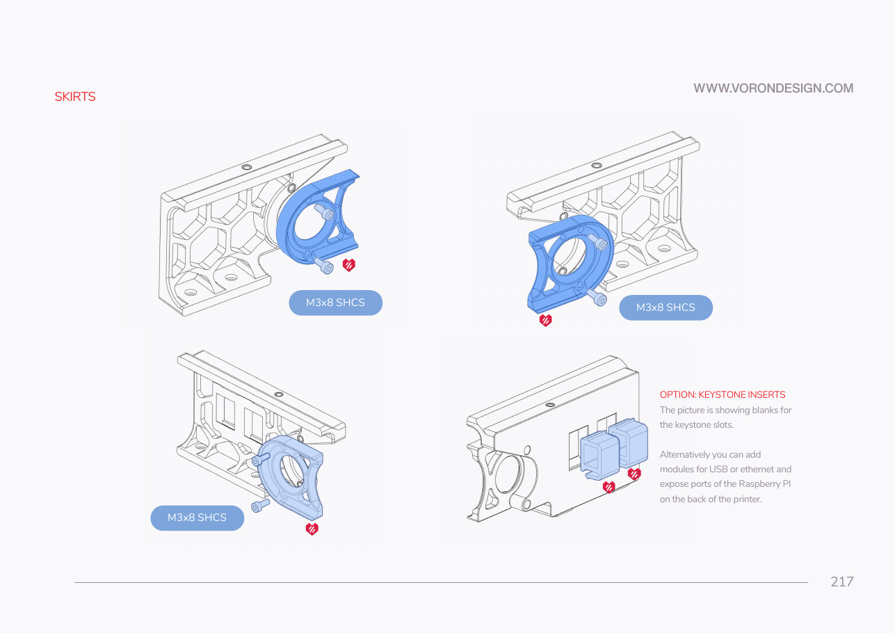{ crop="0.13 0.18 0.81 0.86" }
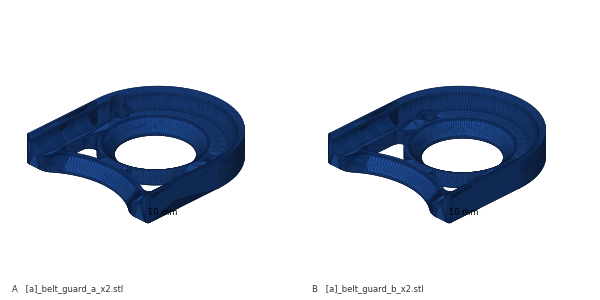

**What you're looking at:** A belt guard is the blue ring that closes the round cut-out in a skirt segment over a Z drive pulley, so nothing outside can reach a moving belt. Guards `a` and `b` are mirror images; the pair picture shows both.

**Parts:**

- `[a]_belt_guard_a` ×2
- `[a]_belt_guard_b` ×2
- M3×8 SHCS ×6

**Do:**

1. Fit guards to `front_skirt_a`, `front_skirt_b` and `keystone_panel`. The plug-panel corner gets its guard on the machine at 11.14.
2. Dry-fit each corner first: the boss drops in only one way round. Then drive two M3×8 SHCS into the inserts from 11.2.

**Check:** Three guards are fitted flush, each opening centred on its cut-out, and the fourth is set aside for 11.14 with its corner known.

**Helper:** Sorts the guards into an a pile and a b pile and hands over the one each corner needs.

Source: [Voron manual p.217](https://github.com/VoronDesign/Voron-2/blob/de7e89d/Manual/Assembly_Manual_2.4r2.pdf#page=217)

---

### Step 11.10 — Populate the keystone panel

{ crop="0.49 0.53 0.93 0.83" }

**What you're looking at:** The keystone panel is the rear skirt segment with two rectangular cut-outs for snap-in network sockets. The CAT6 keystone is the RJ45 socket that Ch 10's Ethernet cable plugs into from the inside; the blue blank fills the second slot.

**Parts:**

- `keystone_panel` ×1
- reused: the CAT6 keystone insert
- `[a]_keystone_blank_insert` ×1

**Do:** Snap the CAT6 keystone into whichever of the two slots suits your cable run to the Pi's Ethernet port, and the blue blank into the other. Both clip in from the inside face, with no screws.

**Check:** Both slots are filled, both inserts sit flush with the outside face and neither rattles, and the RJ45 opening faces out.

If you want more of the LDO logo on the machine, `ldo_bestagon_insert` snaps into any of the skirt hexagons; print extras. [src](https://github.com/MotorDynamicsLab/LDOVoron2/tree/main/STLs)

Source: [Voron manual p.217](https://github.com/VoronDesign/Voron-2/blob/de7e89d/Manual/Assembly_Manual_2.4r2.pdf#page=217) · [LDOVoron2 `STLs/`](https://github.com/MotorDynamicsLab/LDOVoron2/tree/8270e8c/STLs)

---

### Step 11.11 — Build the electronics-bay fan modules

{ crop="0.22 0.25 0.65 0.70" }
{ crop="0.34 0.18 0.87 0.73" }


**What you're looking at:** Each `side_fan_support` has **two** fan openings. Both fans go in the right-hand support, the PSU side seen from the front. On the left, the two grill retainers stand in for fans. Grills `a` and `b` are mirror images.

**Parts:**

- 60×60×20 fan ×2
- reused: the two grill retainers, inserts fitted
- `side_fan_support` ×2
- `[a]_fan_grill_a` ×2
- `[a]_fan_grill_b` ×2
- M3×8 SHCS ×16

**Do:**

1. Right support: put a grill outside each opening and a fan behind it, and drive four M3×8 SHCS through the grill into the fan's inserts.
2. Point both airflow arrows **into** the bay, and leave the leads uncut.
3. Left support: the same, with a retainer in place of each fan.

**Check:** Two fans spin freely in the right-hand support, arrows into the bay, and the left support has grills on retainers. Screws are snug, no fan frame crushed.

**Helper:** Reads each fan's airflow arrow aloud and checks both point into the bay.

The two 60×20 fans share one of the kit's two 3×2 splicers; the other is the LED junction. p.228 shows the fan support and p.225 the retainer support. LDO's Rev D bay photos S1, S4 and S6 put the fans beside the PSU. LDO gives no airflow direction. This build blows both into the bay, which is why 11.3 put the inserts on the intake face; turning a fan round now would leave its inserts on the wrong side. [src](https://docs.ldomotors.com/en/voron/voron2/350_BOM/Rev_D+) · [src](https://docs.ldomotors.com/en/voron/voron2/wiring_guide_rev_d#connecting-the-fans-and-the-led-strip)

`[a]_fan_grill_open_optional_x2` is an alternative grill with more open area and less filtering, if the bay runs warm. [src](https://github.com/VoronDesign/Voron-2/tree/Voron2.4/STLs/Skirts)

Source: [Voron manual p.225](https://github.com/VoronDesign/Voron-2/blob/de7e89d/Manual/Assembly_Manual_2.4r2.pdf#page=225) · [Voron manual p.228](https://github.com/VoronDesign/Voron-2/blob/de7e89d/Manual/Assembly_Manual_2.4r2.pdf#page=228) · [LDO Rev D+ 350 BOM](https://docs.ldomotors.com/en/voron/voron2/350_BOM/Rev_D+) · [Voron-2 `STLs/Skirts/`](https://github.com/VoronDesign/Voron-2/tree/de7e89d/STLs/Skirts)

---

### Step 11.12 — Pre-load the skirt T-nuts

{ crop="0.45 0.51 0.88 0.83" }
{ crop="0.44 0.53 0.90 0.79" }
{ crop="0.12 0.21 0.56 0.53" }
{ crop="0.09 0.18 0.48 0.53" }

**What you're looking at:** A [roll-in T-nut](16-glossary.md#r) drops into an extrusion slot and turns a quarter turn to lock, so it can go in after the frame is built. Once a skirt segment covers a slot, no nut can get in, so every skirt T-nut goes in now. LDO advises this because the extrusions and roll-in T-nuts fit tightly.

**Parts:**

- M3 roll-in T-nut ×12
- M5 roll-in T-nut ×2

**Do:**

1. Roll every T-nut into the frame extrusions **before** any segment goes up, each one loose at roughly its position.
2. M3: four front, four rear, two per side. M5: one per side, between that side's two M3.

**Check:** Every T-nut sits flat in its slot and slides with light finger pressure, with none jammed and none dropped inside a closed extrusion end.

**Helper:** Counts twelve M3 and two M5 T-nuts into a tray and hands them over one at a time.

LDO: *"Due to the tight tolerances of the extrusions and roll-in t-nuts it is advisable to either test fit before assembly to identify the sides of the extrusions that fits the best or to pre-load the t-nuts into the extrusions."* [src](https://docs.ldomotors.com/voron/voron2/build-faq)

Source: [Voron manual p.218](https://github.com/VoronDesign/Voron-2/blob/de7e89d/Manual/Assembly_Manual_2.4r2.pdf#page=218) · [Voron manual p.226](https://github.com/VoronDesign/Voron-2/blob/de7e89d/Manual/Assembly_Manual_2.4r2.pdf#page=226) · [Voron manual p.229](https://github.com/VoronDesign/Voron-2/blob/de7e89d/Manual/Assembly_Manual_2.4r2.pdf#page=229) · [LDO Build Notes p.218](https://docs.ldomotors.com/voron/voron2/build-faq#build-notes) · [Video: Part 5 @4:24:04](https://www.youtube.com/watch?v=hTKCBrk36R0&list=PL0fUJbigELQPqpeGOgHYisG4KaSXVtnNY&t=15844s)

Pause: ~15 min since the last pause — three belt guards are on their segments (the fourth waits for the plug panel at 11.14), the keystone panel is filled, the right-hand fan support is built with both fans and the left one with its two retainers, and every skirt T-nut is pre-loaded in the right slot. The ring is still off the machine.

---

### Step 11.13 — Mount the front skirt segments

{ crop="0.11 0.19 0.82 0.84" }

**What you're looking at:** The front run is the most looked-at part of a finished Voron: skirt, touchscreen module, skirt, reading as one band. Snugging the screws first and only then closing the joints is what makes the two seams disappear.

**Parts:**

- `front_skirt_a_350` ×1
- `front_skirt_b_350` ×1
- M3×8 SHCS ×4
- reused: the four front T-nuts

**Do:**

1. Hang each front skirt on its T-nuts, with the belt-guard opening over the front Z drive pulley, and drive two M3×8 SHCS up from underneath.
2. Snug them, back them off a quarter turn, push both skirts hard against the TFT module, then tighten.

**Check:** The front run reads as one continuous band, skirt, module, skirt, with equal tight joints and a flush top rail, and no daylight shows at the front Z drive openings.

**Helper:** Holds each front skirt against the touchscreen module while you drive its screws.

Source: [Voron manual p.219](https://github.com/VoronDesign/Voron-2/blob/de7e89d/Manual/Assembly_Manual_2.4r2.pdf#page=219)

---

### Step 11.14 — Mount the rear skirt run

{ crop="0.17 0.19 0.55 0.52" }
{ crop="0.08 0.18 0.86 0.78" }
{ crop="0.17 0.18 0.85 0.78" }

**What you're looking at:** The rear run has three segments. One, the `power_inlet_IECGS_1mm` panel carrying the AC inlet (the mains socket and switch), has been on the machine since Ch 09 and does not move. p.222 is not a segment: it shows the last belt guard going onto that panel.

**Parts:**

- reused: the fourth belt guard
- reused: the populated `keystone_panel`
- `rear_center_skirt_350` ×1
- reused: `power_inlet_IECGS_1mm`, already on the frame
- reused: the four rear T-nuts
- M3×8 SHCS ×6

**Do:**

1. Fit the belt guard onto the plug panel with two M3×8 SHCS into its inserts.
2. Put the `keystone_panel` into the **far** rear corner, then `rear_center_skirt_350` into the gap.
3. Feed the Ethernet cable through the keystone. Two M3×8 per segment: snug, close the joints, tighten.

**Check:** The rear run is continuous and flush with all four guards on, the AC switch moves freely, the RJ45 keystone is square, and nothing pinches the Ethernet or AC leads.

**Helper:** Holds the rear center skirt in its gap while you drive the screws.

The inlet segment is `power_inlet_IECGS_1mm`, the 1.0 mm AC inlet with the built-in switch. The 1.2 mm versions and `power_inlet_filtered` are wrong for this kit. Pages p.222–224 draw the machine upside down from behind, so the plug panel on the left of the picture is the printer's left too, where Ch 09 fitted it. [src](https://docs.ldomotors.com/voron/voron2/build-faq)

Source: [Voron manual p.222–224](https://github.com/VoronDesign/Voron-2/blob/de7e89d/Manual/Assembly_Manual_2.4r2.pdf#page=222) · [LDO Build Notes p.222–224](https://docs.ldomotors.com/voron/voron2/build-faq#build-notes) · [Video: Part 6 @1:39:57](https://www.youtube.com/watch?v=8pWoYkY1DiA&list=PL0fUJbigELQPqpeGOgHYisG4KaSXVtnNY&t=5997s)

---

### Step 11.15 — Mount the first side skirt run

{ crop="0.51 0.53 0.93 0.83" }
{ crop="0.08 0.16 0.48 0.45" }

**What you're looking at:** Each side run is three segments: a side skirt at each end and the fan support in the middle. Skirts `a` and `b` are mirror images, so the two sides take them opposite ways round. The skirts go on first and stay loose, so the fan support can drop into the gap.

**Parts:**

- `side_skirt_a_350` ×1
- `side_skirt_b_350` ×1
- M3×8 SHCS ×2
- reused: this side's two M3 T-nuts

**Do:**

1. Start on the **left-hand** side, seen from the front. Fit `side_skirt_b` at the front and `side_skirt_a` at the rear, leaving the gap for the fan support.
2. Drive the M3×8 SHCS into the pre-loaded T-nuts, snug, not tight. The M5 T-nut stays **empty** for 11.16.

**Check:** Both segments sit parallel to the extrusion, their top rails level with the front and rear runs, and the gap matches the fan module's width.

**Helper:** Holds each side skirt level against the extrusion while you start its screw.

Source: [Voron manual p.226](https://github.com/VoronDesign/Voron-2/blob/de7e89d/Manual/Assembly_Manual_2.4r2.pdf#page=226) · [Voron manual p.227](https://github.com/VoronDesign/Voron-2/blob/de7e89d/Manual/Assembly_Manual_2.4r2.pdf#page=227)

---

### Step 11.16 — Drop in the fan module and close the side run

{ crop="0.14 0.56 0.80 0.88" }

**What you're looking at:** The left-hand fan support from 11.11, with grills on its two retainers, is the middle segment of the side run. Its ends are trapped between the skirts rather than screwed, so pushing the two skirts against it closes both joints.

**Parts:**

- reused: the left-hand fan support with its retainers
- M5×10 BHCS ×1
- reused: this side's M5 T-nut

**Do:**

1. Slide the support in from outside, grills facing out.
2. Push the skirts against it to close both joints.
3. Drive the M5×10 BHCS up into the T-nut and tighten the run.

**Check:** The whole side reads as one band with flush joints, and nothing is trapped between the support and the extrusion.

**Helper:** Holds the fan support in the gap, grills out, while you drive the M5 screw.

Source: [Voron manual p.227](https://github.com/VoronDesign/Voron-2/blob/de7e89d/Manual/Assembly_Manual_2.4r2.pdf#page=227) · [Voron manual p.230](https://github.com/VoronDesign/Voron-2/blob/de7e89d/Manual/Assembly_Manual_2.4r2.pdf#page=230)

---

### Step 11.17 — Mount the second side skirt run

{ crop="0.09 0.18 0.77 0.82" }
{ crop="0.15 0.15 0.56 0.53" }
{ crop="0.57 0.17 0.93 0.84" }

**What you're looking at:** This is the same three-segment run on the **right-hand** side, the PSU side. Its middle segment is the fan support with both fans in it. When it closes, the skirt ring is continuous all the way round.

**Parts:**

- `side_skirt_a_350` ×1
- `side_skirt_b_350` ×1
- reused: the right-hand fan support with both fans
- M3×8 SHCS ×2
- M5×10 BHCS ×1
- reused: this side's three T-nuts

**Do:**

1. Repeat 11.15 and 11.16 on the right-hand side, mirrored: `side_skirt_a` at the front, `side_skirt_b` at the rear. p.229 shows the T-nuts, p.230 the screws.
2. Send the fan leads into the bay and plug both fans into the splicer.

**Check:** The ring is closed all the way round, every joint tight and every top rail flush, with two fans on the right and two retainers on the left. Both fans spin freely, plugged in, with no lead trapped.

**Helper:** Holds the right fan support in its gap while you close the run.

Source: [Voron manual p.229](https://github.com/VoronDesign/Voron-2/blob/de7e89d/Manual/Assembly_Manual_2.4r2.pdf#page=229) · [Voron manual p.230](https://github.com/VoronDesign/Voron-2/blob/de7e89d/Manual/Assembly_Manual_2.4r2.pdf#page=230)

Pause: ~20 min since the last pause — front, rear and both side skirt runs are mounted, both bay fans in the right-hand run and grills on retainers in the left. The ring is complete all the way round, and no run is half-fastened.

---

### Step 11.18 — Verify the bay-fan wiring


**What you're looking at:** The two manual pages describe a BTT Octopus controller this kit does not have. You check this kit's wiring instead: both fans on one 3×2 splicer PCB, that PCB on its printed spacer, and the run landing on the Leviathan's `FAN2` port.

**Parts:**

- reused: the 3×2 XH splicer PCB on its printed spacer

**Do:**

1. Ignore p.228 and p.231. Confirm the splicer sits on its **printed spacer** and its run lands on **FAN2 / PF7**.
2. Tuck the leads into the duct, clear of the fan blades.
3. Camera: put its tagged plug into a free Pi USB port.

**Check:** Both fans are on one splicer, the splicer sits on its spacer without touching aluminium, PCB FAN is plugged into FAN2/PF7, and no lead is within reach of a blade.

⚠ Fan map for this build: PCB fan → `FAN2/PF7`; LED strip → `LED-Strip/PE6`; filter fan → `FAN3/PF9`. LDO: *"Please remember to mount 3x2 splicing PCBs using the printed part to prevent a short with the extrusion."* [src](https://docs.ldomotors.com/en/voron/voron2/wiring_guide_rev_d)

Source: [Voron manual p.228](https://github.com/VoronDesign/Voron-2/blob/de7e89d/Manual/Assembly_Manual_2.4r2.pdf#page=228) · [Voron manual p.231](https://github.com/VoronDesign/Voron-2/blob/de7e89d/Manual/Assembly_Manual_2.4r2.pdf#page=231) · [LDO wiring guide § Connecting the fans and the LED strip](https://docs.ldomotors.com/en/voron/voron2/wiring_guide_rev_d#connecting-the-fans-and-the-led-strip)

---

### Step 11.19 — Fit the bestagon insert (optional)

(no image — see [LDO STLs README](https://github.com/MotorDynamicsLab/LDOVoron2/tree/main/STLs))

**What you're looking at:** The bestagon insert is a purely decorative blue plug that snaps into one of the six-sided openings in a skirt segment. Nothing depends on it.

**Parts:**

- `ldo_bestagon_insert` ×1

**Do:** Push the insert into one of the skirt hexagons from the outside until it snaps. Pick a hexagon on the front-left or front-right skirt, where it does not compete with the touchscreen.

**Check:** The insert is flush and held, and the hexagon is not stressed white at its corners.

**Helper:** Picks the hexagon and pushes the insert in until it clicks.

Source: [LDOVoron2 `STLs/`](https://github.com/MotorDynamicsLab/LDOVoron2/tree/8270e8c/STLs)

---

### Step 11.20 — VHB the bottom-panel clips and hinges

{ crop="0.29 0.18 0.57 0.48" }

**What you're looking at:** 3M VHB is a double-sided acrylic foam tape that does not come off again. 3M gives it about half its strength after 20 minutes and 90 % after a day. These six printed parts, four clips and two hinges, are what the bottom panel sticks to.

**Parts:**

- `bottom_panel_clip` ×4
- `bottom_panel_hinge` ×2
- consumable: 3M VHB tape, six pads
- consumable: IPA and a lint-free cloth

**Do:**

1. With the printer still unplugged, lay it on its side, as at 10.1.
2. Wipe all six pad faces with IPA and let it dry off.
3. Cut six VHB pads to match, and press one onto each part with the liners left on.

**Check:** Six parts carry six pads, each centred with no overhang onto a curved face and its liner still on.

**Helper:** Wipes all six pad faces with IPA and the cloth before the pads go on.

The strength figures are 3M's bond build-up note for VHB at room temperature. [src](https://mm.digikey.com/Volume0/opasdata/d220001/medias/docus/8651/3m-vhb-tape-595.pdf)

Source: [Voron manual p.232](https://github.com/VoronDesign/Voron-2/blob/de7e89d/Manual/Assembly_Manual_2.4r2.pdf#page=232)

---

### Step 11.21 — Fit the bottom panel

{ crop="0.40 0.52 0.83 0.84" }
{ crop="0.08 0.18 0.87 0.87" }

**What you're looking at:** The bottom panel is the bay's 4 mm acrylic floor and a **door**: it unclips at the front and swings down on two rear hinges, so the bay stays reachable through Ch 13.

**Parts:**

- bottom panel, acrylic, black, 469×469×4 mm ×1
- reused: the six taped clips and hinges
- M3×8 SHCS ×6

**Do:**

1. Peel the film off both faces and set the panel in the skirt ring, hinge edge at the rear.
2. Pull each liner, press each part onto the panel's edge, and screw it into its skirt insert with one M3×8 SHCS: hinges at the rear, clips front and sides.
3. Stand the machine upright. Wait a day before swinging the panel down to check the ducts are reachable.

**Check:** The panel sits square, every pad stuck down, and after a day it swings clear and clips shut.

**Helper:** Holds the panel square to the frame while you press it onto the pads.

Why a day: 3M's data sheet puts VHB at about 50 % of full strength after 20 minutes, 90 % after 24 hours and 100 % after 72 hours at room temperature, and slower in the cold. [src](https://mm.digikey.com/Volume0/opasdata/d220001/medias/docus/8651/3m-vhb-tape-595.pdf)

It is the **4 mm** acrylic, not the 3 mm deck panel. If you are holding a 469×469 panel and cannot tell which one it is, caliper it: 3 mm is the deck (fitted back in Ch 02), 4 mm is this one. [src](https://docs.ldomotors.com/en/voron/voron2/350_BOM/Rev_D+)

The panel goes in first and the taped parts go over its edge, as p.233 and the CAD have it: pads on the panel's outer face, clips outside it.

Source: [Voron manual p.232](https://github.com/VoronDesign/Voron-2/blob/de7e89d/Manual/Assembly_Manual_2.4r2.pdf#page=232) · [Voron manual p.233](https://github.com/VoronDesign/Voron-2/blob/de7e89d/Manual/Assembly_Manual_2.4r2.pdf#page=233) · [LDO Rev D+ 350 BOM](https://docs.ldomotors.com/en/voron/voron2/350_BOM/Rev_D+) · CAD: Voron 2.4r2 STEP @ de7e89d

Pause: ~20 min since the last pause — bay-fan wiring checked against Ch 10, bestagon insert decided, VHB pads pressed on, and the bottom panel fixed by its rear hinges and front clips, the machine upright. **Leave the VHB to cure undisturbed:** do not swing the door open for a day (3M: about 90 % strength after 24 hours). Do not press a pad on and walk away before the panel is on it.

---

### Step 11.22 — Choose the Z belt cover variant

{ crop="0.16 0.25 0.87 0.68" }


**What you're looking at:** A Z belt cover is a printed plate that clips over a Z belt at each of the four frame corners, so nothing can be drawn into the belt. LDO's alternative `_a_led` version adds a cable slot for LED wiring routed through a Z-motor opening.

**Parts:**

- `z_belt_cover_a` ×2
- `z_belt_cover_b` ×2

**Do:** Check how Ch 10 routed the chamber LED wiring. Ch 10 used the extrusion slot, so the stock covers apply. If any LED wire passes through a **Z-motor opening**, print LDO's `z_belt_cover_a_led` for that corner, a 7 g, 25-minute part.

**Check:** You can say, for each corner, which cover goes on and why, and no cable crosses a stock cover's sealing face.

LDO: *"PAGE 234 Use the alternate Z-belt cover if you routed the LED wires through the Z-motor opening."* [src](https://docs.ldomotors.com/voron/voron2/build-faq) · [part](https://github.com/MotorDynamicsLab/LDOVoron2/blob/main/STLs/z_belt_cover_a_led.stl)

Source: [Voron manual p.234](https://github.com/VoronDesign/Voron-2/blob/de7e89d/Manual/Assembly_Manual_2.4r2.pdf#page=234) · [LDO Build Notes p.234](https://docs.ldomotors.com/voron/voron2/build-faq#build-notes) · [LDOVoron2 `z_belt_cover_a_led.stl`](https://github.com/MotorDynamicsLab/LDOVoron2/blob/8270e8c/STLs/z_belt_cover_a_led.stl)

---

### Step 11.23 — Load each cover with a hammerhead nut

{ crop="0.16 0.25 0.87 0.68" }

**What you're looking at:** A [hammerhead T-nut](16-glossary.md#h) drops straight into an extrusion slot from the face, instead of rolling in from an end, then turns a quarter turn under load to lock. Starting the screw keeps the nut held in the cover's recess.

**Parts:**

- reused: the four Z belt covers
- M3 hammerhead T-nut ×4
- M3×6 BHCS ×4

**Do:** Drop an M3 hammerhead nut into the recess on the back of each cover, and start an M3×6 BHCS into it from the front, two or three turns only, so the nut stays held but can still turn.

**Check:** Each nut is held with its screw started and can still turn, and the head will still be reachable with a 2 mm hex key once the cover is on.

**Helper:** Counts four covers, four nuts and four screws onto the tray.

Source: [Voron manual p.234](https://github.com/VoronDesign/Voron-2/blob/de7e89d/Manual/Assembly_Manual_2.4r2.pdf#page=234)

---

### Step 11.24 — Fit the first Z belt cover

{ crop="0.06 0.19 0.89 0.66" }

**What you're looking at:** The cover goes on with the belt already threaded through its slot, which is why you pinch the belt flat first. The click you feel is the hammerhead nut turning and gripping inside the extrusion slot.

**Parts:**

- reused: one loaded Z belt cover

**Do:**

1. Pinch the Z belt flat and slide the cover in, the belt through its slot and the hammerhead nut into the extrusion slot.
2. Hold the cover square and tighten the M3×6 BHCS. If the nut spins, back the screw off and seat the nut squarely again.

**Check:** The cover lies flat against the extrusion, the Z belt runs through freely without rubbing, and the cover does not move when pushed.

**Helper:** Pinches the Z belt flat while you slide the cover in.

Source: [Voron manual p.235](https://github.com/VoronDesign/Voron-2/blob/de7e89d/Manual/Assembly_Manual_2.4r2.pdf#page=235)

---

### Step 11.25 — Fit the remaining three Z belt covers


**What you're looking at:** The other three corners are the same. The full-travel run afterwards is the real test: a cover that touches a belt makes noise now and cuts into the belt's edge over months.

**Parts:**

- reused: the three remaining loaded covers

**Do:** Repeat 11.24 at the other three Z belt corners. Then move the gantry up and down its full travel slowly by hand and watch each cover. p.237 is a page of Voron history, with nothing to build.

**Check:** Four covers are on and all four belts run clear, with no rubbing anywhere in the full Z travel.

**Helper:** Watches each cover and calls out any rub while you move the gantry.

Source: [Voron manual p.236](https://github.com/VoronDesign/Voron-2/blob/de7e89d/Manual/Assembly_Manual_2.4r2.pdf#page=236) · [Voron manual p.237](https://github.com/VoronDesign/Voron-2/blob/de7e89d/Manual/Assembly_Manual_2.4r2.pdf#page=237)

Pause: ~15 min since the last pause — all four Z belt covers are on, each with its hammerhead nut, and the gantry runs its full Z travel without touching one.

---

### Step 11.26 — Break out the Nevermore printed supports

(no image — see [LDO Nevermore V5 Duo guide](https://ldomotion.com/guides/nevermore-v5-duo---v24))

**What you're looking at:** The [Nevermore](16-glossary.md#n) is an activated-carbon filter inside the chamber that cleans the air in a loop, taking out ASA's fumes but not its ultrafine particles. Four printed parts make it: a plenum (an air box) with two blower fans, its lid, and a magnetic carbon cartridge with a lid. Build the **Regular** cartridge, not the XL, which wants a louder fan. [src](https://github.com/nevermore3d/Nevermore_Micro)

**Parts:**

- `V2_Duo_Plenum` ×1
- `V2_Duo_Plenum_LID` ×1
- `Regular_Cartridge` ×1
- `Regular_Cartridge_Lid` ×1

**Do:** The cartridge has a built-in printed support, a single-line wall below its insert boss. Push or crush it out; it breaks off cleanly. Do not cut it out with a knife.

**Check:** The support is out with no torn layers on the sealing faces, no loose strand is left in either part, and the lid slides freely.

Only the cartridge carries a support: LDO and the Nevermore README name no other. [src](https://github.com/nevermore3d/Nevermore_Micro/tree/8740b34#instructions-for-v5)

Source: [LDO Nevermore V5 Duo guide § Preparation](https://ldomotion.com/guides/nevermore-v5-duo---v24) · [Nevermore Micro repo](https://github.com/nevermore3d/Nevermore_Micro/tree/8740b34)

---

### Step 11.27 — Modify both 5015 fan enclosures

(no image — see [LDO Nevermore guide § Preparation](https://ldomotion.com/guides/nevermore-v5-duo---v24))

**What you're looking at:** A 5015 blower is a 50 × 15 mm squirrel-cage fan: it makes pressure rather than a free flow of air, which is what pushes chamber air through packed carbon. Both housings have to be opened and a section of plastic removed so they fit the plenum.

**Parts:**

- staged: Nevermore 5015 fan ×2
- tool: wire snips

**Do:**

1. Pry open the tabs holding each fan's housing together and separate it.
2. With wire snips, remove the section of plastic the guide highlights from each housing.
3. Use snips, not a blade.

**Check:** Both fans are changed the same way, the impellers still spin freely, no housing is cracked, and no plastic shavings are left inside the housing.

Source: [LDO Nevermore V5 Duo guide § Preparation](https://ldomotion.com/guides/nevermore-v5-duo---v24) · [Video: Extras! @2:30:00](https://www.youtube.com/watch?v=0aPi1rBwDC0&list=PL0fUJbigELQPqpeGOgHYisG4KaSXVtnNY&t=9000s)

---

### Step 11.28 — Heat-set the Nevermore parts

(no image — see [LDO Nevermore guide § Preparation](https://ldomotion.com/guides/nevermore-v5-duo---v24))

**What you're looking at:** Six inserts go into three places: four in the 5015 fans' own mounting holes, two per fan, one in the plenum for its lid screw and one in the cartridge for its lid screw. The fan inserts take the screws that come up through the plenum floor at 11.32.

**Parts:**

- M3×5×4 heat-set insert ×6
- reused: the two trimmed fans, the plenum and the cartridge

**Do:** Press two inserts into each **fan's mounting holes**, then one into the **plenum** and one into the **cartridge**: six in total. The fan housings are thin, so press slowly and stop flush.

**Check:** All six are flush and square, and an M3 screw starts freely in each.

Source: [LDO Nevermore V5 Duo guide § Preparation](https://ldomotion.com/guides/nevermore-v5-duo---v24) · [Video: Extras! @2:24:31](https://www.youtube.com/watch?v=0aPi1rBwDC0&list=PL0fUJbigELQPqpeGOgHYisG4KaSXVtnNY&t=8671s)

---

### Step 11.29 — Cut the connector off the long-wire fan

(no image — see [LDO Nevermore guide § Preparation](https://ldomotion.com/guides/nevermore-v5-duo---v24))

**What you're looking at:** The fan with the longer lead, LDO's fan A, has its plug cut off, so both fans can be soldered to the bridge PCB, a small board that joins the two fans onto one lead. That plug is not used again. The connector that mates with the `FILTER FAN` extension comes from the other fan, fan B, at 11.31.

**Parts:**

- staged: the long-lead Nevermore 5015 fan
- tool: side cutters

**Do:** Cut the JST connector off the fan with the longer lead, right at the plug. The cut-off plug is scrap.

**Check:** Fan A's lead ends in bare wire, still long enough to route through the plenum, and fan B still has its plug.

Source: [LDO Nevermore V5 Duo guide § Preparation](https://ldomotion.com/guides/nevermore-v5-duo---v24)

Pause: ~15 min since the last pause — Nevermore supports broken off, both 5015 housings trimmed, inserts melted in, and the long-wire fan's connector cut off. Nothing is glued and nothing is soldered to the bridge PCB yet.

---

### Step 11.30 — Fit the first fan into the plenum

(no image — see [LDO Nevermore guide § Install Fans](https://ldomotion.com/guides/nevermore-v5-duo---v24))

**What you're looking at:** The plenum's wire channel is a moulded groove that carries both fans' leads to one corner. Route the wire before you seat the fan; it is the only order that works, because once the fan is in, the channel is behind it.

**Parts:**

- Nevermore 5015 fan, cut lead ×1
- reused: the plenum
- tool: tweezers

**Do:** With tweezers, route the fan's wires from the **right** side of the plenum, right to left along the wire channel. Then seat the fan in the **right** side and pull the wire flat in the channel.

**Check:** The fan is fully seated with its impeller clear of the plenum wall, and the wire lies flat in the channel without crossing the fan opening.

Source: [LDO Nevermore V5 Duo guide § Install Fans](https://ldomotion.com/guides/nevermore-v5-duo---v24)

---

### Step 11.31 — Fit the second fan and trim the leads

(no image — see [LDO Nevermore guide § Install Fans](https://ldomotion.com/guides/nevermore-v5-duo---v24))

**What you're looking at:** The second fan mirrors the first. Cutting all four wire ends to the same 30–40 mm makes the soldering at 11.33 tidy and sets where the plenum can mount.

**Parts:**

- Nevermore 5015 fan ×1
- tool: side cutters

**Do:**

1. Route its wires from the **left** side of the plenum, right to left, and seat the fan in the left side.
2. Cut both fans' wires to equal length, roughly **30–40 mm** out from the housing.
3. **Keep the offcut from fan B with its plug on**: that is the pigtail LDO calls C, soldered to the bridge PCB at 11.33.

**Check:** Both fans are seated, all four wire ends are the same length at 30–40 mm, both impellers spin freely, and the plugged offcut is set aside.

Source: [LDO Nevermore V5 Duo guide § Install Fans](https://ldomotion.com/guides/nevermore-v5-duo---v24)

---

### Step 11.32 — Bolt the fans to the plenum

(no image — see [LDO Nevermore guide § Install Fans](https://ldomotion.com/guides/nevermore-v5-duo---v24))

**What you're looking at:** The four M3×16 BHCS pass through the plenum's counterbored floor holes, two per fan, into the inserts 11.28 put in the fans' mounting holes. Snug is enough, because a 5015 housing is thin plastic.

**Parts:**

- M3×16 BHCS ×4 — from the Nevermore parts bag
- reused: the two Nevermore fans

**Do:** Drive the four M3×16 BHCS through the plenum floor into the fan inserts. Snug only: a 5015 housing distorts and the impeller rubs if you crank them.

**Check:** Both fans are held with no rock, and you hear no rub when you spin each impeller by hand.

Source: [LDO Nevermore V5 Duo guide § Install Fans](https://ldomotion.com/guides/nevermore-v5-duo---v24)

---

### Step 11.33 — Solder the fans to the bridge PCB

(no image — see [LDO Nevermore guide § Install Fans](https://ldomotion.com/guides/nevermore-v5-duo---v24))

**What you're looking at:** The bridge PCB is a small board that joins both fans and the saved pigtail into one 24 V pair, red to the top pads and black to the bottom. A solder bridge here, a blob joining two pads, puts a dead short across the mainboard's 24 V fan output.

**Parts:**

- Nevermore bridge PCB ×1
- reused: the saved connector pigtail
- tool: soldering iron and solder
- tool: multimeter

**Do:**

1. Solder both fans' wires and the pigtail to the bridge PCB, **red to the top pads, black to the bottom**.
2. Arrange the wires as the guide's photo shows.
3. **Meter for a short between positive and negative.**

**Check:** Continuity reads open between + and −, all six joints are shiny and solid, and the PCB sits in its compartment without pressing on a wire.

⚠ A bad solder joint here shorts a 24 V rail. LDO: *"A bad solder will result in permanently damaging the controller board."* Do the meter check before anything gets plugged in. [src](https://ldomotion.com/guides/nevermore-v5-duo---v24)

Source: [LDO Nevermore V5 Duo guide § Install Fans](https://ldomotion.com/guides/nevermore-v5-duo---v24) · [Video: Extras! @2:36:20](https://www.youtube.com/watch?v=0aPi1rBwDC0&list=PL0fUJbigELQPqpeGOgHYisG4KaSXVtnNY&t=9380s)

Pause: ~20 min since the last pause — both fans seated in the plenum, leads trimmed to length and soldered to the bridge PCB, and the pair metered for a short. The plenum is open and unglued.

---

### Step 11.34 — Glue the plenum magnets

(no image — see [LDO Nevermore guide § Nevermore Assembly](https://ldomotion.com/guides/nevermore-v5-duo---v24))

**What you're looking at:** The plenum and cartridge hold together with magnets rather than screws, so the cartridge can be pulled off to renew the carbon. Every magnet in the plenum must go in with the same pole facing out, or half of them will push the cartridge away.

**Parts:**

- 6×3 mm neodymium magnet ×4
- consumable: super glue

**Do:** Put a drop of super glue in each of the plenum's four magnet pockets and press a magnet in, one at a time, **all with the same pole facing out**. Press each one fully in.

**Check:** All four plenum magnets are flush and the same way round: a spare magnet is pulled toward every one of them the same way.

**Helper:** Tests each magnet against a spare and hands them over all the same side up.

Source: [LDO Nevermore V5 Duo guide § Nevermore Assembly](https://ldomotion.com/guides/nevermore-v5-duo---v24) · [Video: Extras! @2:59:56](https://www.youtube.com/watch?v=0aPi1rBwDC0&list=PL0fUJbigELQPqpeGOgHYisG4KaSXVtnNY&t=10796s)

---

### Step 11.35 — Close the plenum lid

(no image — see [LDO Nevermore guide § Nevermore Assembly](https://ldomotion.com/guides/nevermore-v5-duo---v24))

**What you're looking at:** The lid slides into grooves in the plenum body and one screw holds it. It closes the fan compartment, so the blowers push air through the cartridge rather than straight back out.

**Parts:**

- `V2_Duo_Plenum_LID` ×1
- M3×6 BHCS ×1

**Do:** Slide the lid into the plenum body's grooves and fix it with the M3×6 BHCS into the plenum's insert. Add the optional M3×4 on the other side if you want it to look symmetric.

**Check:** The lid is fully in both grooves, the screw is snug, and no wire is pinched at the lid edge.

Source: [LDO Nevermore V5 Duo guide § Nevermore Assembly](https://ldomotion.com/guides/nevermore-v5-duo---v24)

---

### Step 11.36 — Glue the cartridge magnets to match

(no image — see [LDO Nevermore guide § Cartridge Assembly](https://ldomotion.com/guides/nevermore-v5-duo---v24))

**What you're looking at:** This is the matching half of 11.34, and the reason for the marker: once a magnet is glued in, you cannot see which way round it is. Stick each one to the finished plenum first, mark the face you can see, and glue it in that way round.

**Parts:**

- 6×3 mm neodymium magnet ×4
- consumable: super glue
- tool: a marker

**Do:** Stick each magnet to the assembled plenum, mark its exposed face, and keep that orientation. Then glue them into the cartridge pockets one at a time, **marked face down** in the pocket, so the face that touched the plenum faces out.

**Check:** The cartridge snaps onto the plenum and holds against a firm shake, and all four magnets are flush.

**Helper:** Marks the exposed face of each magnet while it sits on the plenum.

Source: [LDO Nevermore V5 Duo guide § Cartridge Assembly](https://ldomotion.com/guides/nevermore-v5-duo---v24)

---

### Step 11.37 — Fill and close the cartridge

(no image — see [LDO Nevermore guide § Cartridge Assembly](https://ldomotion.com/guides/nevermore-v5-duo---v24))

**What you're looking at:** The cartridge is the removable box for the activated carbon: 4 mm acid-free pellets, which are not in the kit. Filled or empty, it has to be closed and fitted, but only a filled one filters anything.

**Parts:**

- `Regular_Cartridge_Lid` ×1
- M3×6 BHCS ×1
- tool: a marker
- consumable: 4 mm acid-free activated carbon pellets, not supplied

**Do:**

1. If you have pellets, fill the cartridge with them. Otherwise leave it empty.
2. Slide the lid into its grooves and fix it with the M3×6 BHCS.
3. Write the fill state and the date on the lid.

**Check:** The lid is in both grooves, the screw is snug, no pellets are in the grooves, and the fill state is written on the lid.

**Helper:** Writes the fill state and the date on the cartridge lid.

⚠ **The carbon is not in the kit.** LDO: *"NOT INCLUDED WITH THE KIT"*, and acid-free pellets are recommended. The Nevermore project warns that carbon with acid left in it corrodes rails and switches: buy only checked acid-free carbon. An empty, closed cartridge filters nothing, but it lets the filter install and wire up until the carbon arrives. [src](https://ldomotion.com/guides/nevermore-v5-duo---v24)

Source: [LDO Nevermore V5 Duo guide § Cartridge Assembly](https://ldomotion.com/guides/nevermore-v5-duo---v24) · [Nevermore Micro README § Sourcing the proper acid-free carbon](https://github.com/nevermore3d/Nevermore_Micro#sourcing-the-proper-acid-free-carbon)

Pause: ~20 min since the last pause — plenum and cartridge magnets glued **in matching polarity**, both lids closed, and the cartridge's fill state written on its lid. Never stop between gluing the plenum magnets and the cartridge magnets: the second set has to be matched to the first while you still know which way round they went.

---

### Step 11.38 — Mount the plenum in the chamber


**What you're looking at:** The plenum fills the 130 mm gap between the two bed extrusions at their front end, just behind the corner brackets, below the bed and clear of the gantry. LDO's photo shows an older Nevermore base in that spot, not this plenum: use it for position only.

**Parts:**

- reused: the plenum assembly
- M3 roll-in T-nut ×2
- M3×12 SHCS ×2

**Do:** Roll one M3 T-nut into the **inside** face of each bed extrusion, *not* the top slot, and screw the plenum on with two M3×12 SHCS. The fan leads were cut to length for this position at 11.31.

**Check:** The plenum sits square between the extrusions at their front end, below the bed surface, both screws are snug, and the gantry can come down without touching it.

The Nevermore project says to PID-tune the bed again once a Nevermore sits under it. Here the bed's only tune, 13.29, comes after this step, so it already does. [src](https://github.com/nevermore3d/Nevermore_Micro/tree/8740b34#final-thoughts-on-usage)

The plenum is exactly 130 mm wide, with one screw hole straight through each end wall, so the screws can only go sideways into the inside faces. LDO: *"Insert one M3 T-Nut into the inside of each bed extrusions. ( Not into the top of the extrusions )"* [src](https://ldomotion.com/guides/nevermore-v5-duo---v24)

Source: [LDO Nevermore V5 Duo guide § Installation for Voron V2.4](https://ldomotion.com/guides/nevermore-v5-duo---v24) · [LDO wiring photo nevermore_base_placement.jpg](https://raw.githubusercontent.com/MotorDynamicsLab/LDOVoron2/8270e8c/Images/WiringGuide/nevermore_base_placement.jpg)

---

### Step 11.39 — Attach the cartridge

(no image — see [LDO Nevermore guide § Installation for Voron V2.4](https://ldomotion.com/guides/nevermore-v5-duo---v24))

**What you're looking at:** Only magnets hold the cartridge on. That is the point: carbon gets used up, and this joint is the one you open each time you renew it.

**Parts:**

- reused: the cartridge

**Do:** Slide the cartridge along until the magnets take hold, and let it pull itself into place.

**Check:** The cartridge sits square on the plenum with no gap at the joint; it comes off with a deliberate pull but not with an accidental knock.

Source: [LDO Nevermore V5 Duo guide § Installation for Voron V2.4](https://ldomotion.com/guides/nevermore-v5-duo---v24)

---

### Step 11.40 — Connect the filter fan

(no image — see [LDO wiring guide § Connecting the Fans and the LED Strip](https://docs.ldomotors.com/en/voron/voron2/wiring_guide_rev_d))

**What you're looking at:** The `FILTER FAN` extension is the kit lead already run to `FAN3` in Ch 10 Step 10.48, up through the rear deck notch and coiled there. The plenum sits at the front end of the bed extrusions, so the lead has to come forward to it.

**Parts:**

- reused: the kit's FILTER FAN extension lead

**Do:**

1. Run the FILTER FAN extension forward along the deck under the bed to the plenum.
2. Plug the Nevermore's pigtail into it. Its board end is tagged `FAN3 / PF9`; its 24 V jumper was checked at 10.75.
3. If it only reaches pulled tight, fit the longer replacement lead 10.48 describes `(verify on bench)`.

**Check:** The filter fan lead is plugged in with slack at the plenum, tagged FAN3/PF9, and out of reach of the bed and the gantry.

**Helper:** Finds the FILTER FAN tag on the coiled lead and reads it aloud.

The Nevermore guide was written for a BTT Octopus board and says *"Octopus Fan3 - Pinout PD13"*. This machine has a **Leviathan**, so use **FAN3 / PF9** from the Rev D wiring guide's fan table. [src](https://docs.ldomotors.com/en/voron/voron2/wiring_guide_rev_d)

Source: [LDO wiring guide § Connecting the fans and the LED strip](https://docs.ldomotors.com/en/voron/voron2/wiring_guide_rev_d#connecting-the-fans-and-the-led-strip) · [Video: Extras! @2:48:31](https://www.youtube.com/watch?v=0aPi1rBwDC0&list=PL0fUJbigELQPqpeGOgHYisG4KaSXVtnNY&t=10111s)

---

### Step 11.41 — Tag the plenum with its fan port

(no image — see [LDO Nevermore guide § Configuration printer.cfg](https://ldomotion.com/guides/nevermore-v5-duo---v24))

**What you're looking at:** Nothing to build: you label the plenum with its pin, to match against the config Ch 12 already wrote. LDO's published config section has the right shape but names the wrong board's pin.

**Parts:** none.

**Do:** Write the pin on a tag and tape it to the plenum. LDO's `[heater_fan exhaust_fan]` section has the right shape, but its `pin: PD13` is the Octopus pin and must become the Leviathan's **PF9**. Step 12.32 replaces it with `[fan_generic nevermore]` on the same pin.

**Check:** The tag on the plenum reads "FILTER FAN → FAN3 / PF9", and Checkpoint 12's `printer.cfg` has `[fan_generic nevermore]` on `PF9`.

**Helper:** Writes the tag and tapes it to the plenum.

Source: [LDO Nevermore V5 Duo guide § Configuration printer.cfg](https://ldomotion.com/guides/nevermore-v5-duo---v24) · [`leviathan-printer-rev-d-sbv2.cfg`](https://github.com/MotorDynamicsLab/LDOVoron2/blob/667521d/Firmware/leviathan-printer-rev-d-sbv2.cfg)

---

### Step 11.42 — Fit the bowden retainer

{ crop="0.10 0.19 0.88 0.73" }


**What you're looking at:** The bowden retainer sits on the top rear extrusion, hanging over the back. It holds the spool end of the reverse-bowden PTFE, which feeds filament to the Clockwork 2.5 extruder.

**Parts:**

- `bowden_retainer` ×1
- M3 hammerhead T-nut ×1
- M3×8 SHCS ×1
- consumable: PTFE tube, 4 mm OD, 3 mm ID, 1.2 m

**Do:**

1. Put the nut in its recess, start the M3×8, and slide the retainer onto the top rear extrusion as p.257 shows.
2. Cut two pieces about 86 mm long for the spool holder's grooves, which are 91 mm in the STL.
3. Feed the rest down through the retainer. Pull the clip off the CW2.5's collet, the push-in grip on top, push the tube in and refit the clip.

**Check:** The retainer is solid, the PTFE slides with light drag, the collet clip is on, and the tube bends gently.

The back panel is still off, so the tube drops straight in for Ch 13. At 11.55 it is re-routed in through the exhaust cover's coupler, the way p.258 loops it into the housing. Do not shorten it until then `(verify on bench)`.

Source: [Voron manual p.257](https://github.com/VoronDesign/Voron-2/blob/de7e89d/Manual/Assembly_Manual_2.4r2.pdf#page=257) · [Voron manual p.258](https://github.com/VoronDesign/Voron-2/blob/de7e89d/Manual/Assembly_Manual_2.4r2.pdf#page=258) · [Video: Part 9 @3:13:57](https://www.youtube.com/watch?v=dmNwxUm4oik&list=PL0fUJbigELQPqpeGOgHYisG4KaSXVtnNY&t=11637s)

---

### Step 11.43 — Fit the spool holder arm

{ crop="0.10 0.19 0.88 0.84" }

**What you're looking at:** The spool holder is the printed arm that carries a 1 kg filament spool on the back of the machine. The two PTFE pieces in its grooves are the smooth surface the spool turns on. It goes on now, not after the panels as on p.259, because Ch 13 prints from it.

**Parts:**

- `spool_holder` ×1
- consumable: PTFE tube, the two 86 mm lengths
- M5 roll-in T-nut ×1
- M5×16 BHCS ×1

**Do:**

1. Press the two 86 mm PTFE lengths into the grooves along the arm.
2. Roll the M5 T-nut into the rear vertical extrusion at spool height, hold the arm in place, and drive the M5×16 BHCS fully in.

**Check:** The arm is level and solid enough for a full 1 kg spool, both PTFE pieces are seated, and a spool spins with light finger pressure without binding.

Source: [Voron manual p.259](https://github.com/VoronDesign/Voron-2/blob/de7e89d/Manual/Assembly_Manual_2.4r2.pdf#page=259) · [Video: Part 9 @3:11:11](https://www.youtube.com/watch?v=dmNwxUm4oik&list=PL0fUJbigELQPqpeGOgHYisG4KaSXVtnNY&t=11471s)

Pause: ~15 min since the last pause — Nevermore mounted in the chamber, cartridge on, filter fan connected to the Ch 10 lead, and bowden retainer and spool holder arm fitted. Its config is `[fan_generic nevermore]` on PF9 (11.41), which Ch 12 Step 12.32 already wrote; check it against your Ch 12 notes or Checkpoint 12, not a live Mainsail, because the machine stays unplugged until 13.3.

---

### Step 11.44 — Assemble the Clicky-Clack door frame


**What you're looking at:** The [Clicky-Clack](16-glossary.md#c) is the magnetic-latch front door: a 2020 aluminium frame around one clear acrylic panel. The shorter extrusions have tapped (threaded) ends; the longer ones have access holes for the blind-joint screws. Your panel is Fabreeko's plain acrylic, not the KB3D guide's NanoNest stack, so skip its NanoNest taping. [src](https://www.fabreeko.com/products/acrylic-pannel-for-clicky-clacky-door)

**Parts:**

- door frame extrusion, 470 mm ×2 — from Clicky-Clack door kit
- door frame extrusion, 530 mm ×2 — from Clicky-Clack door kit
- M5×16 BHCS ×4 — from Clicky-Clack door kit
- door panel, acrylic, 480×500×3 mm ×1 — from Clicky-Clack acrylic panel
- tool: machinist square

**Do:**

1. Start an M5×16 BHCS halfway into each tapped end.
2. Fit both 530 mm pieces to one tapped piece through their access holes; square each corner.
3. With three sides built, slide the acrylic into the frame slot, then close the fourth.

**Check:** All four corners are square, the acrylic is fully in with no bow, the frame lies flat without twist, and the hinge side is written down.

**Helper:** Holds the machinist square in each corner while you tighten it.

The hinges go on the **left** seen from the front, the latch on the right. Only if B10 printed the `Hinge-L-*` parts mirrored, swap every left and right in 11.57, 11.58 and 11.62–11.64.

Source: [KB3D Clicky-Clack install guide § Frame Assembly](https://wiki.kb-3d.com/en/home/LDO/LDO_Clicky_Clacky_Door_Mod#frame-assembly) · [Clicky-Clack mod README](https://github.com/tanaes/whopping_Voron_mods/tree/62268ed/clickyclacky_door) · [Fabreeko acrylic panel](https://www.fabreeko.com/products/acrylic-pannel-for-clicky-clacky-door)

---

### Step 11.45 — Fit the rubber panel retainer strip

(no image — see [mod README](https://github.com/tanaes/whopping_Voron_mods/tree/main/clickyclacky_door))

**What you're looking at:** The rubber retainer strip is a shaped rubber profile that presses into the frame's groove beside the acrylic and takes up the spare gap. Without it, the panel rattles in its slot every time the door closes.

**Parts:**

- panel retainer strip, 2 m ×1 — from Clicky-Clack door kit
- tool: side cutters

**Do:** Cut the strip to length for each side, with **45° mitres** (angled ends that meet neatly) at the corners, then press it into the extrusion groove beside the acrylic.

**Check:** The strip is seated all the way round with the mitres closed, and the acrylic no longer moves in the frame when you tap it.

Source: [Clicky-Clack mod README](https://github.com/tanaes/whopping_Voron_mods/tree/62268ed/clickyclacky_door)

---

### Step 11.46 — Build the door hinges: dowel into the solid halves

(no image — see [mod README § Assembly](https://github.com/tanaes/whopping_Voron_mods/tree/main/clickyclacky_door))

**What you're looking at:** Each door hinge is two printed halves: a solid half carrying a steel dowel pin, and a sleeve half that drops onto it. Leaving 20 mm of pin sticking out is what lets the whole door lift straight off its hinges.

**Parts:**

- `Hinge-L-solid` ×2
- M5×45 dowel pin ×2 — from Clicky-Clack door kit
- tool: small hammer

**Do:** Tap an M5×45 dowel into each solid hinge half; it is meant to be a very tight fit. Stop when about **20 mm** sticks out, and do not drive it flush. An M3×20 screw's shoulder is a quick 20 mm gauge.

**Check:** Both pins stick out about 20 mm, both stand square to the hinge face, and neither part is split.

Source: [Clicky-Clack mod README § Assembly](https://github.com/tanaes/whopping_Voron_mods/tree/62268ed/clickyclacky_door)

---

### Step 11.47 — Bush the sleeve halves

(no image — see [mod README § Assembly](https://github.com/tanaes/whopping_Voron_mods/tree/main/clickyclacky_door))

**What you're looking at:** A split bushing is a rolled metal sleeve that becomes the real bearing surface between the pin and the printed part, so the hinge does not wear its way loose. Two go into each sleeve half, fully below the surface.

**Parts:**

- `Hinge-L-sleeve` ×2
- M5×7×8 split bushing ×4 — from Clicky-Clack door kit
- tool: small hammer

**Do:** Slide two bushings over one of the dowels, hold the empty sleeve part over them, and tap the sleeve down until the bushings sit fully inside with **nothing sticking out**. Repeat for the second sleeve.

**Check:** Both sleeves are bushed with nothing standing out, and a sleeve half drops onto a solid half's dowel and turns freely, with no play and no binding.

Source: [Clicky-Clack mod README § Assembly](https://github.com/tanaes/whopping_Voron_mods/tree/62268ed/clickyclacky_door)

Pause: ~20 min since the last pause — the door frame is squared with its blind joints tightened, the rubber retainer strip is in, and both hinges have their dowels and bushings. The acrylic is held in the frame and nothing is glued.

---

### Step 11.48 — Glue the handle, latch and handle-hinge magnets

(no image — see [KB3D guide § Hinge & Handle Assembly](https://wiki.kb-3d.com/en/home/LDO/LDO_Clicky_Clacky_Door_Mod))

**What you're looking at:** Twelve 6 × 3 mm magnets go in: six in the handle, four in the latch and one in each handle hinge. The handle pulls to the latch, and the hinges to the handle ends.

**Parts:**

- `Handle` ×1
- `Latch` ×1
- `Handle-Hinge_Top` ×1
- `Handle-Hinge_Bottom` ×1
- 6×3 mm magnet ×12 — from Clicky-Clack door kit
- consumable: super glue

**Do:**

1. Our own print check, not KB3D's: stand the handle on each end on a flat surface. It must not rock or lean.
2. Test each pair with a loose magnet first.
3. Glue each magnet fully into its pocket: four in the handle **attracting** four in the latch, one in each handle end attracting its handle hinge.

**Check:** Handle and latch pull together firmly and click, both handle hinges pull to the handle, and nothing stands out of a pocket.

**Helper:** Sorts the magnets into two polarity piles before you glue any of them in.

If the handle leans because its narrow end lifted on the bed, reprint the `Handle` with a 12 × 0.4 mm disc under that end, then trim the disc flush and clear it from the pin hole.

Put a magnet on the end of a steel tool and use that to press each one into its pocket. [src](https://github.com/tanaes/whopping_Voron_mods/tree/62268ed/clickyclacky_door)

Source: [KB3D Clicky-Clack install guide § Hinge & Handle Assembly](https://wiki.kb-3d.com/en/home/LDO/LDO_Clicky_Clacky_Door_Mod#hinge-handle-assembly)

---

### Step 11.49 — Fit the latch's heat-set and panel clip

(no image — see [KB3D guide § Hinge & Handle Assembly](https://wiki.kb-3d.com/en/home/LDO/LDO_Clicky_Clacky_Door_Mod))

**What you're looking at:** The `Panel_Clip` is both the door's catch and the middle side-panel clip on that side, so at 11.63 it takes the place of one of the eight clips fitted at 11.57. The insert gives the latch a metal thread.

**Parts:**

- reused: the latch
- M3×5×4 heat-set insert ×1 — from Clicky-Clack door kit
- `Panel_Clip` ×1
- M3×8 BHCS ×1 — from Clicky-Clack door kit

**Do:** Press one heat-set insert into the hole in the middle of the latch and let it cool. Then screw the `Panel_Clip` onto the latch with the M3×8 BHCS.

**Check:** The insert is square and flush, and the panel clip is solid on the latch with its panel groove clear.

Source: [KB3D Clicky-Clack install guide § Hinge & Handle Assembly](https://wiki.kb-3d.com/en/home/LDO/LDO_Clicky_Clacky_Door_Mod#hinge-handle-assembly)

---

### Step 11.50 — Finish the handle

(no image — see [mod README § Assembly](https://github.com/tanaes/whopping_Voron_mods/tree/main/clickyclacky_door))

**What you're looking at:** The handle hangs on two more M5×45 pins, deliberately looser than the door hinges so it can swing. The two M3×8 screws at its ends are stops, not fasteners: they limit how far the handle turns.

**Parts:**

- reused: the handle and both handle hinges
- M5×45 dowel pin ×2 — from Clicky-Clack door kit
- M5×7×8 split bushing ×2 — from Clicky-Clack door kit
- M3×8 SHCS ×2 — from Clicky-Clack door kit

**Do:**

1. Push the two M5×45 pins into the handle, **looser** than the door hinges.
2. Tap **one** bushing into each handle hinge.
3. Drive the two M3×8 locating screws into the handle ends, then slide the hinges on.

**Check:** The handle hinges slide on and stay put by magnet alone, the handle turns through its full swing and stops against the locating screws, and nothing binds.

Source: [Clicky-Clack mod README § Assembly](https://github.com/tanaes/whopping_Voron_mods/tree/62268ed/clickyclacky_door)

---

### Step 11.51 — Foam-tape the front opening


**What you're looking at:** The 3 mm foam goes on the **front face** of the front opening's extrusions, the face the closed door frame presses against, not the face toward the chamber. Butted corners keep the seal one thickness.

**Parts:**

- consumable: 3 mm foam tape

**Do:** Run 3 mm foam tape around the **front face** of the four front-opening extrusions, along their inner edge. Hold the door frame dry against it and tape the surface it lands on. Butt the corners; do not overlap them. KB3D's guide may mean the door frame's back face instead (verify on bench): either face seals, but tape only one of the two.

**Check:** The seal runs unbroken on all four sides of the opening, with no overlaps standing up and no gaps at the corners.

**Helper:** Peels the foam tape backing a hand's length ahead as you press it down.

Source: [KB3D Clicky-Clack install guide § Frame Assembly](https://wiki.kb-3d.com/en/home/LDO/LDO_Clicky_Clacky_Door_Mod#frame-assembly)

Pause: ~20 min since the last pause — **end of Part A.** Handle, latch and handle-hinge magnets glued and curing, the latch insert and panel clip fitted, and the front opening foam-taped. Do not fit the back, side or top panels: Ch 13 needs every face open. Go to Ch 13.

---

## ⛔ Stop here until Ch 13 is complete

**Everything above is done with the machine open. Do not fit the back, side or top panels or hang the door yet.**

Ch 12 Part 2 (12.11–12.20, 12.23, 12.37) is already done: the boards were flashed and configured with the bay open, before this part closed it. Go now to **Ch 13** (initial startup), which includes the Ch 06b gantry-squaring pass and a second QGL. All of it needs the machine reachable from every face: `STEPPER_BUZZ` for each motor, the XY endstop and homing checks, finding the bed and the 0,0 point, `PROBE_ACCURACY`, and dropping the Z joints and releasing the A/B tensioners for squaring.

Come back here at **11.52** once Checkpoint 13 is ticked. The rest of this chapter is about 1.0–2.0 h.

**Sections that wait for Ch 13:** 11.52–11.55 (back panel and exhaust), 11.56–11.58 (side panels), 11.59–11.60 (top panel and handlebars), 11.61 (stock doors skipped), 11.62–11.64 (Clicky-Clack door hung), 11.65 (threadlocker), 11.66 (final seal check), then Part C, the side spool holder and camera (11.68–11.76).

---

## Part B — after Ch 13

### Step 11.52 — Foam-tape the back panel


{ crop="0.15 0.17 0.36 0.86" }

**What you're looking at:** The back panel is 3 mm black acrylic. Its 1 mm foam is a noise damper between acrylic and aluminium, not a seal.

**Parts:**

- `CMD_V2_6B_154mm_DUCT_COVER` ×2
- `CMD_V2_6B_90DEG_COVER` ×2
- `V2L_90DEG_COVER_MIRROR` ×1
- `V2L_58mm_DUCT_COVER` ×3
- `V2L_130mm_DUCT_COVER` ×1
- `V2L_70mm_DUCT_COVER` ×1
- `CMD_Remix-V3_DUCT-2B_45deg_LID` ×2
- `V3L_10mm_DUCT_COVER` ×1
- `V3L_154N_DUCT_COVER` ×2
- `V3L_T_REG_N_COVER` ×2
- staged: back panel, acrylic, black, 483×503×3 mm ×1
- consumable: 1 mm foam tape

**Do:**

1. Shut the Pi down from Mainsail. Once its ACT LED stops, switch off and unplug at the wall, then the inlet. Take off the cartridge and spool, lay the machine on its side, open the bottom panel and meter +V to −V.
2. Fit the DC lids, shut the panel, stand the machine up, refit the cartridge and peel the films.
3. Run **1 mm** foam round the panel's inside edge, corners butted.

**Check:** The meter held 0 V for ten seconds, the DC lids sit with nothing pinched, and 1 mm tape lines all four edges.

The DC loop lids close over the bay's wire ducts. They were left off at [Step 10.71](10-wiring.md#step-1071-leave-the-duct-covers-off) for the meter. Ch 13 has now run every motor, heater and fan, so they close now, before any panel. If Ch 09 fitted B11's fallback middle run (stock T junctions, an 82 mm straight and LDO's PVC middle duct), fit the fallback's own lids from the same bin, `CMD_V2_6B_T_REG_COVER` ×2 and `CMD_V2_6B_82mm_DUCT_COVER`, in place of the two 154N and two T_REG_N lids, and snap the PVC duct's cover on. With the LDO layout, snap the PVC duct covers on.

Back and top panels get **1 mm** foam; side panels get **3 mm**. Mixing them up either lets the gantry rub a side panel or leaves the back panel standing out of its clips.

Source: [Voron manual p.238](https://github.com/VoronDesign/Voron-2/blob/de7e89d/Manual/Assembly_Manual_2.4r2.pdf#page=238) · [Voron manual p.239](https://github.com/VoronDesign/Voron-2/blob/de7e89d/Manual/Assembly_Manual_2.4r2.pdf#page=239) · [Ch 11 Step 11.67 — prove it dead](#step-1167-shut-down-unplug-and-prove-it-dead) · [Ch 00a Step 00a.11](00a-mains-safety.md#step-00a11-know-the-two-power-on-rituals-before-either-one-arrives)

---

### Step 11.53 — Fit the back-panel clips

{ crop="0.36 0.18 0.87 0.83" }


**What you're looking at:** A panel clip is a small printed part that screws to the frame and holds the panel edge in a groove. The `4mm` in its name is the thickness the groove is cut for: a 3 mm panel plus 1 mm of foam.

**Parts:**

- `corner_panel_clip_4mm` ×4
- `midspan_panel_clip_4mm` ×3
- M3×8 SHCS ×11
- M3 hammerhead T-nut ×11

**Do:**

1. Load each clip loosely, screws a few turns into their nuts: two M3×8 SHCS and nuts per corner clip, one per midspan clip.
2. Lay them out where p.240 places them: four corners, a midspan on each side edge and one on the bottom edge.
3. Keep them off the frame; they go on with the panel at 11.55.

**Check:** Seven clips are loaded, every nut held but free to turn, and laid out in their places.

**Helper:** Counts out eleven screws and eleven hammerhead nuts, two per corner clip and one per midspan.

The manual never says which clip goes on which panel; the print plan works it out: a 3 mm panel plus 1 mm foam = **4 mm**, so **7** back and **8** top clips match `_4mm_x7` and `_4mm_x8`, with **M3×8** here against **M3×12** on the sides. **Test-fit a 4 mm and a 6 mm clip before committing the 31.** [src](https://github.com/VoronDesign/Voron-2/tree/Voron2.4/STLs/Panel_Mounting)

A drop of threadlocker turns each hammerhead nut into a quarter-turn quick release, but only once the whole assembly is finished. [Voron manual p.239]

Source: [Voron manual p.239](https://github.com/VoronDesign/Voron-2/blob/de7e89d/Manual/Assembly_Manual_2.4r2.pdf#page=239) · [Voron manual p.240](https://github.com/VoronDesign/Voron-2/blob/de7e89d/Manual/Assembly_Manual_2.4r2.pdf#page=240) · [Voron-2 `STLs/Panel_Mounting/`](https://github.com/VoronDesign/Voron-2/tree/de7e89d/STLs/Panel_Mounting) · [Video: Part 9 @3:54:44](https://www.youtube.com/watch?v=dmNwxUm4oik&list=PL0fUJbigELQPqpeGOgHYisG4KaSXVtnNY&t=14084s)

---

### Step 11.54 — Fit the exhaust cover and grill


{ crop="0.14 0.19 0.49 0.52" }


**What you're looking at:** The grill goes inside, its honeycomb filling the notch. LDO's `exhaust_cover` closes it from outside and carries the PTFE coupler. LDO draws no fit, so a dry fit settles which way the cover faces.

**Parts:**

- `exhaust_cover` ×1
- `exhaust_filter_grill` ×1
- M3×12 SHCS ×2
- M3 heat-set insert ×2
- 4mm Bowden Coupler ×1
- tool: Nutopress Pro insert press, its M3 tip

**Do:**

1. Push a scrap of PTFE through the coupler. If a lip inside stops it, carefully drill it out, as p.251 says.
2. Press an insert into each small hole from the cover's flat face, the only face they open on.
3. Dry-fit grill, panel and cover so both M3×12 reach the inserts and both tabs lie on the top rear extrusion `(verify on bench)`. Then fit the coupler and screws.

**Check:** No light shows through the notch, both M3×12 grip, and a PTFE slides through the coupler.

LDO: *"PAGE 250-253 & 256 SKIP — Please follow our guide for Nevermore mod."* The cover replaces p.256's housing and p.255's mounts: two inserts for the grill screws, and two tabs screwed to the extrusion at 11.55. From the STL: the flat face takes the inserts and the M5 heads' counterbores, and the side ribs and centre boss stand off the other face. Which face meets the panel is not documented `(verify on bench)`. [src](https://docs.ldomotors.com/voron/voron2/build-faq) · [src](https://github.com/MotorDynamicsLab/LDOVoron2/tree/8270e8c/STLs)

Source: [Voron manual p.250–256](https://github.com/VoronDesign/Voron-2/blob/de7e89d/Manual/Assembly_Manual_2.4r2.pdf#page=250) · [LDO Build Notes p.250–253, p.256](https://docs.ldomotors.com/voron/voron2/build-faq#build-notes) · [LDOVoron2 `STLs/`](https://github.com/MotorDynamicsLab/LDOVoron2/tree/8270e8c/STLs) · [Video: Extras! @0:06:32](https://www.youtube.com/watch?v=0aPi1rBwDC0&list=PL0fUJbigELQPqpeGOgHYisG4KaSXVtnNY&t=392s)

---

### Step 11.55 — Hang the back panel


**What you're looking at:** Everything from 11.52 to 11.54 goes on as one assembly. The cover's two tabs screw into the back slot of the top rear extrusion, and the PTFE loops through the cover's coupler, as on p.258.

**Parts:**

- back panel, acrylic, black, 483×503×3 mm ×1
- M5 roll-in T-nut ×2
- M5×10 BHCS ×2
- reused: the back-panel clips, exhaust cover and grill
- reused: the reverse-bowden PTFE

**Do:**

1. Roll two M5 T-nuts into the back slot of the top rear extrusion, one per cover tab.
2. Hold the panel up and slip each loaded clip over its edge, nut into the slot. Tighten opposite corners first to keep the acrylic flat, then drive one M5×10 BHCS per tab.
3. Re-route the PTFE in through the cover's coupler.

**Check:** The panel is square and flat, the foam squeezed but not squashed, both tabs tight, and the PTFE slides through the coupler without a kink.

**Helper:** Holds the panel square in the clips while you tighten opposite corners.

Source: [Voron manual p.240](https://github.com/VoronDesign/Voron-2/blob/de7e89d/Manual/Assembly_Manual_2.4r2.pdf#page=240) · [Voron manual p.255](https://github.com/VoronDesign/Voron-2/blob/de7e89d/Manual/Assembly_Manual_2.4r2.pdf#page=255) · [Voron manual p.258](https://github.com/VoronDesign/Voron-2/blob/de7e89d/Manual/Assembly_Manual_2.4r2.pdf#page=258) · [LDOVoron2 `exhaust_cover.stl`](https://github.com/MotorDynamicsLab/LDOVoron2/tree/8270e8c/STLs)

Pause: ~25 min since the last pause — back panel foam-taped, its seven clips on, exhaust cover and grill sealed into the cut-out, panel hung and screwed down, cover tabs screwed on, and the PTFE through the cover's coupler. A panel is either fully clipped or off the machine: never leave one hanging on half its clips.

---

### Step 11.56 — Foam-tape the side panels

{ crop="0.12 0.18 0.32 0.86" }

**What you're looking at:** The side panels are clear polycarbonate (PC), tougher than acrylic, and they are the panels the gantry gets closest to. Their 3 mm foam is a working spacer that holds the panel far enough out for the gantry to clear it. In the manual's words, *"The 3mm foam tape is used on the side panels to prevent the gantry from rubbing on the panels."*

**Parts:**

- staged: side panel, PC, clear, 483×503×3 mm ×2
- consumable: 3 mm foam tape
- consumable: a lint-free cloth

**Do:** Peel the film from both faces of both panels. Run **3 mm** foam tape around the edge of each inner face, corners butted. Never substitute the 1 mm tape here.

**Check:** Both panels carry 3 mm tape on all four edges, with the corners butted.

**Helper:** Cleans both side panels with the cloth, then peels the tape backing ahead.

Source: [Voron manual p.241](https://github.com/VoronDesign/Voron-2/blob/de7e89d/Manual/Assembly_Manual_2.4r2.pdf#page=241) · [Video: Part 9 @3:17:55](https://www.youtube.com/watch?v=dmNwxUm4oik&list=PL0fUJbigELQPqpeGOgHYisG4KaSXVtnNY&t=11875s)

---

### Step 11.57 — Fit the first side panel

{ crop="0.36 0.19 0.84 0.89" }


**What you're looking at:** The `6mm` clips have the deeper groove, sized for a 3 mm panel plus 3 mm of foam, and take the longer M3×12, two per corner clip. One midspan spot on the front vertical edge of the right-hand panel stays reachable for the latch at 11.63.

**Parts:**

- side panel, PC, clear, 483×503×3 mm ×1
- `corner_panel_clip_6mm` ×4
- `midspan_panel_clip_6mm` ×4
- M3×12 SHCS ×12
- M3 hammerhead T-nut ×12

**Do:**

1. Work on the **right-hand** side, seen from the front. Load eight clips: two M3×12 SHCS per corner clip, one per midspan.
2. Fit the corners, then the midspans, as p.241 shows. Hold the panel up and tighten every clip, but leave the front-edge midspan only snug for 11.63.

**Check:** The panel is flat with equal margins, and nothing touches when you move the gantry slowly through its full XY travel by hand.

**Helper:** Holds the side panel against the clips while you tighten them.

Side panels take **M3×12 SHCS**, not M3×8. The 6 mm clip is thicker, and an M3×8 will not reach the hammerhead nut with any thread to spare.

Source: [Voron manual p.241](https://github.com/VoronDesign/Voron-2/blob/de7e89d/Manual/Assembly_Manual_2.4r2.pdf#page=241) · [Voron manual p.242](https://github.com/VoronDesign/Voron-2/blob/de7e89d/Manual/Assembly_Manual_2.4r2.pdf#page=242)

---

### Step 11.58 — Fit the second side panel


**What you're looking at:** The same eight clips and twelve screws go on the other side. When it is done, both batches of 6 mm clips are used up exactly, which is the arithmetic check that the clip choice was right.

**Parts:**

- side panel, PC, clear, 483×503×3 mm ×1
- `corner_panel_clip_6mm` ×4
- `midspan_panel_clip_6mm` ×4
- M3×12 SHCS ×12
- M3 hammerhead T-nut ×12

**Do:** Repeat 11.57 on the **left-hand** side, the hinge side. Tighten all eight clips fully here; nothing on this panel gets replaced.

**Check:** Both panels are on, the gantry clears both through full travel, and all the 6 mm clips are fitted: 8 corner and 8 midspan. One comes off at 11.63.

**Helper:** Holds the side panel against the clips while you tighten them.

Source: [Voron manual p.242](https://github.com/VoronDesign/Voron-2/blob/de7e89d/Manual/Assembly_Manual_2.4r2.pdf#page=242)

Pause: ~25 min since the last pause — both side panels foam-taped, clipped and screwed, all twenty-four M3×12 in. Both sides are fully on.

---

### Step 11.59 — Fit the top panel

{ crop="0.14 0.17 0.78 0.88" }


**What you're looking at:** The top panel is clear polycarbonate again, but back on 1 mm foam and 4 mm clips like the back panel, because the gantry never comes near it. Fitting it closes the machine on five faces, which is what lets the chamber hold heat.

**Parts:**

- top panel, PC, clear, 483×483×3 mm ×1
- consumable: 1 mm foam tape
- `corner_panel_clip_4mm` ×4
- `midspan_panel_clip_4mm` ×4
- M3×8 SHCS ×12
- M3 hammerhead T-nut ×12

**Do:**

1. Peel the film off both faces and run **1 mm** foam around the edge of the underside.
2. Load eight clips, two screws per corner clip. Fit four corners and four midspans as p.243 shows, drop the panel on and tighten.

**Check:** The panel is flat with even margins, the foam is squeezed evenly, and the machine is closed on five faces. All the 4 mm clips are used: 8 corner, 7 midspan.

**Helper:** Wipes the top panel clean and holds one edge while you seat it.

Source: [Voron manual p.243](https://github.com/VoronDesign/Voron-2/blob/de7e89d/Manual/Assembly_Manual_2.4r2.pdf#page=243) · [Voron manual p.244](https://github.com/VoronDesign/Voron-2/blob/de7e89d/Manual/Assembly_Manual_2.4r2.pdf#page=244)

---

### Step 11.60 — Fit the aluminium handlebars


**What you're looking at:** The two aluminium handlebars are an LDO kit extra with no page in the Voron manual. The printed `handlebar_spacer` under each foot makes up the top panel's thickness, so the load goes into the frame extrusion and not into the polycarbonate.

**Parts:**

- aluminium handle ×2 (LDO)
- `handlebar_spacer_x4` ×4 (batch B07)
- M5×14 BHCS ×4
- M5 hammerhead T-nut ×4

**Do:** Put a printed spacer under each handle foot, then screw each handle down with M5×14 BHCS into M5 hammerhead nuts in the top frame extrusions. Fit one handle per side, placed so a two-person lift is balanced.

**Check:** Both handles are solid, the spacers carry the load instead of the polycarbonate, and nothing flexes at the panel on a one-inch lift.

**Helper:** Holds each handle square on its spacers while you drive the screws.

LDO: *"This optional part offsets the top panel thickness and helps mount the included aluminium handle bar."* The 350 Rev D+ BOM ships two aluminium handles and four M5×14 BHCS. [src](https://github.com/MotorDynamicsLab/LDOVoron2/tree/main/STLs) · [src](https://docs.ldomotors.com/en/voron/voron2/350_BOM/Rev_D+)

Source: [LDOVoron2 `STLs/`](https://github.com/MotorDynamicsLab/LDOVoron2/tree/8270e8c/STLs) · [LDO Rev D+ 350 BOM](https://docs.ldomotors.com/en/voron/voron2/350_BOM/Rev_D+)

---

### Step 11.61 — Do not fit the stock doors


**What you're looking at:** These five pages show the stock Voron front: two narrow hinged doors, printed handles, and printed latch blocks with glued-in magnets that screw to the top and bottom front extrusions. The Clicky-Clack replaces all of it with one framed door, so nothing here is fitted and the two supplied door panels become spares.

**Parts:** none.

**Do:**

1. Skip all five DOORS pages, p.245 to p.249; the Clicky-Clack replaces them.
2. Confirm you never printed `door_hinge_x6`, `handle_a_x2`, `handle_b_x2`, `latch_x2` or LDO's `LDO Door/` set.
3. Bag the two stock door panels and the spare magnets.

**Check:** No stock door hardware is fitted, and the front opening is bare extrusion waiting for the door and its 3 mm foam seal from 11.51.

**Helper:** Bags the two stock door panels and the spare magnets and labels the bag.

Fitting the Clicky-Clack also means losing LDO's kit-number nameplate, which is on `LDO Door/handle_b_nameplate.stl`. Print it and glue it somewhere else if you want it (print plan §3, B10).

Source: [Voron manual p.245–249](https://github.com/VoronDesign/Voron-2/blob/de7e89d/Manual/Assembly_Manual_2.4r2.pdf#page=245) · [Clicky-Clack mod README](https://github.com/tanaes/whopping_Voron_mods/tree/62268ed/clickyclacky_door)

Pause: ~15 min since the last pause — top panel on its eight clips, handlebars screwed down through their spacers, and the stock front doors confirmed as not fitted. The machine is closed on five faces; the front is still open.

---

### Step 11.62 — Hang the door hinges


**What you're looking at:** These are lift-off hinges: pins up, so the door drops on and lifts straight off. The corner panel clips at each end of that vertical are square to the frame, so they set where the hinges go.

**Parts:**

- reused: the two door hinges
- M3×8 SHCS ×8 — from Clicky-Clack door kit
- M3 roll-in T-nut ×8 — from Clicky-Clack door kit
- consumable: blue tape

**Do:**

1. Tape the door in the opening. Roll four M3 T-nuts into the **left** front vertical, by the corner clips, and four into the door frame's hinge edge.
2. Screw each hinge on loosely, **pins up**, each printer half a small gap from its corner clip.
3. Slide the halves until the door hangs parallel with an even gap, then tighten all eight screws.

**Check:** All eight screws are tight, pins up, and the door lifts off, drops back on and hangs parallel.

**Helper:** Holds the taped door in the opening while you mark and hang the hinges.

Source: [KB3D Clicky-Clack install guide § Frame Assembly](https://wiki.kb-3d.com/en/home/LDO/LDO_Clicky_Clacky_Door_Mod#frame-assembly) · [Clicky-Clack `STLs/`](https://github.com/tanaes/whopping_Voron_mods/tree/62268ed/clickyclacky_door/STLs): each `Hinge-L` half has two Ø3.4 bores through a 3 mm flange, so M3×8

---

### Step 11.63 — Fit the latch

(no image — see [KB3D guide § Frame Assembly](https://wiki.kb-3d.com/en/home/LDO/LDO_Clicky_Clacky_Door_Mod))

**What you're looking at:** The latch is the frame-side half of the magnetic catch, already joined to the panel clip it replaces. Leaving it loose is deliberate: you centre and lock it at 11.64, once the handle hinges are on.

**Parts:**

- reused: the latch with its panel clip
- reused: the hammerhead nut of the midspan clip it displaces
- M3×8 SHCS ×2 — from Clicky-Clack door kit
- M3 roll-in T-nut ×1 — from Clicky-Clack door kit

**Do:**

1. Take the midspan clip off the front edge of the **right-hand** side panel, its hammerhead nut still on the screw. Bag the clip and its M3×12 as spares.
2. Start the two M3×8 through the latch, one into that hammerhead and one into the roll-in T-nut.
3. Fit the latch, both nuts in the slot, centred on that edge, **not fully tightened yet**.

**Check:** The latch is on and still adjustable, and its `Panel_Clip` holds the panel edge as the old clip did.

The latch's two holes pass through a 3 mm flange, so they take the door kit's spare M3×8 pair: the displaced clip's M3×12 would bottom in the slot before it clamped. [src](https://github.com/tanaes/whopping_Voron_mods/tree/62268ed/clickyclacky_door)

Source: [KB3D Clicky-Clack install guide § Frame Assembly](https://wiki.kb-3d.com/en/home/LDO/LDO_Clicky_Clacky_Door_Mod#frame-assembly)

---

### Step 11.64 — Fit the handle and align the door


**What you're looking at:** You lock the latch centred, then line the door up by sliding the handle over it. A paper shim between the handle and each handle hinge leaves the room it needs to swing without binding.

**Parts:**

- reused: the handle assembly
- M3×20 SHCS ×4 — from Clicky-Clack door kit
- M3 roll-in T-nut ×4 — from Clicky-Clack door kit
- consumable: a paper shim

**Do:**

1. Roll four M3 T-nuts into the door frame's **right-hand** vertical and attach both handle hinges to them loosely.
2. Centre the latch on the side panel edge and tighten its two screws.
3. With a shim at each handle end, slide the handle over the latch until they line up. Tighten the four handle-hinge screws and pull the shims.

**Check:** The door closes with a click, the latch **drawing it in** against the 3 mm foam, the handle swings freely, and all four sides seal.

**Helper:** Holds the paper shim between the magnets while you slide the handle into line.

If the latch will not catch cleanly, the problem is usually hinge alignment, not latch position: re-align at 11.62 rather than moving the latch. [src](https://wiki.kb-3d.com/en/home/LDO/LDO_Clicky_Clacky_Door_Mod) · [shim](https://github.com/tanaes/whopping_Voron_mods/tree/62268ed/clickyclacky_door)

Source: [KB3D Clicky-Clack install guide § Frame Assembly](https://wiki.kb-3d.com/en/home/LDO/LDO_Clicky_Clacky_Door_Mod#frame-assembly) · [Clicky-Clack `STLs/`](https://github.com/tanaes/whopping_Voron_mods/tree/62268ed/clickyclacky_door/STLs): each handle hinge has two Ø3.6 bores about 14 mm long, so M3×20 · [Video: Part 9 @4:36:44](https://www.youtube.com/watch?v=dmNwxUm4oik&list=PL0fUJbigELQPqpeGOgHYisG4KaSXVtnNY&t=16604s) (differs: stock hinged doors; this kit gets the Clicky-Clack door (batch B10))

Pause: ~25 min since the last pause — door hinges hung, latch fitted, handle on, and the door swings and closes on its magnets. Do not stop with the door hanging on one hinge; it will twist the frame and the acrylic.

---

### Step 11.65 — Thread-lock the hammerhead nuts

{ crop="0.59 0.19 0.87 0.83" }

**What you're looking at:** Threadlocker glues each clip screw to its hammerhead nut, so a quarter turn back turns the nut too and frees the clip. That makes every panel clip a quick release, and the nut comes away on its screw instead of vanishing inside the extrusion.

**Parts:**

- consumable: thread locker, optional

**Do:**

1. One clip at a time, so the rest hold the panel: loosen it and lift it off with its nuts.
2. Run each nut off, put a drop of threadlocker on the screw thread, and run the nut back on.
3. Refit the clip and tighten.

**Check:** Every clip holds its panel, and the next day a quarter turn back on each of a clip's screws frees that clip, each nut still on its screw.

Source: [Voron manual p.239](https://github.com/VoronDesign/Voron-2/blob/de7e89d/Manual/Assembly_Manual_2.4r2.pdf#page=239)

---

### Step 11.66 — Final seal and clearance check


**What you're looking at:** Nothing to fit. This step looks at the whole enclosure as one object: five panels, a door, a skirt ring and a screen, all of which have to seal without touching anything that moves. The chamber temperature that Ch 14's ASA work depends on is settled here.

**Parts:**

- consumable: 6 mm extrusion slot cover, optional

**Do:**

1. Peel off any film. Close the door and check every seam for daylight.
2. Push the gantry slowly through full XY and Z by hand; nothing should touch.
3. Confirm the touchscreen, AC switch, keystone and spool arm are clear.

**Check:** No daylight shows at any panel seam or around the door, nothing touches through full XY or Z travel, and the door latches with one push.

**Helper:** Runs a finger round every panel seam and calls out any gap found.

Optional 6 mm slot covers hide empty slots. For Part C, leave these open: the top front inner slot, the right side's outer slots and the top right's top slot.

Source: [Voron manual p.241](https://github.com/VoronDesign/Voron-2/blob/de7e89d/Manual/Assembly_Manual_2.4r2.pdf#page=241) · [Voron manual p.243](https://github.com/VoronDesign/Voron-2/blob/de7e89d/Manual/Assembly_Manual_2.4r2.pdf#page=243) · [KB3D Clicky-Clack install guide § Frame Assembly](https://wiki.kb-3d.com/en/home/LDO/LDO_Clicky_Clacky_Door_Mod#frame-assembly) · [survey §5.2 W11](../voron-build-instructions-survey.md)

Pause: ~15 min since the last pause — hammerhead nuts thread-locked, every seal and clearance checked, machine closed. Ready for Part C, then Checkpoint 11.

---

<a id="part-c-add-ons"></a>

## Part C — Side spool holder and camera

Both add-ons are part of this build; they come after Part B, from batch B12. The **side spool holder** is a diagonal frame on the right side's extrusions carrying Prusa's Universal Puck: a bare spool rides on Prusa's 1 kg spindle, or a Prusa USS Drybox hangs on the puck. The **camera** is a small OV5640 USB board in a HappyCam mount inside the top front extrusion.

### Step 11.68 — Confirm the panel stack and the camera board

(no image — see text)

**What you're looking at:** The B12 side spool frame stands on two feet, one on the top right extrusion and one on the front right vertical, printed 6.5 mm tall for a 3 mm panel on 3 mm foam. The camera board sits on three pegs in HappyCam's pocket. Measure both before you fit anything.

**Parts:**

- tool: digital caliper
- staged: OV5640 USB camera board ×1

**Do:**

1. Beside a right side-panel clip, caliper from the extrusion face up to the panel's outer face.
2. Caliper the camera board's length and the distance between its mounting-hole centres, and check that a hole sits over each HappyCam peg.

**Check:** Every calculator row below is answered and passing, or the fitting it belongs to is stopped or its frame reprinted.

```gate-calc
id: part-c-addons
title: Part C — do the printed frame and the camera mount fit this machine
inputs:
  - key: stack
    label: Right side panel, extrusion face to the panel's outer face, beside a clip (mm)
    max: 6.2
    high: The printed frame's 6.5 mm feet would leave its body on the panel. Reprint B12-P1 at the next step, regenerated with -D stack= this reading plus 0.3.
    why: The body must stand clear of the panel so the two screws pull the feet onto aluminium, not the frame onto the PC.
  - key: holes
    label: Camera board, mounting-hole centre to centre along the board (mm)
    nominal: 50
    tol: 0.5
    low: HappyCam's pegs are 50 mm apart. This board needs a different mount; stop the camera here.
    high: HappyCam's pegs are 50 mm apart. This board needs a different mount; stop the camera here.
    why: The board locates on 1.7 mm pegs 50.0 mm apart along it, read from the HappyCam STL.
  - key: pegs
    label: The board has a hole over each of HappyCam's three pegs, two of them 4 mm apart across one end and the third 50 mm along
    kind: yesno
    no: A peg with no hole holds the board off its seat. Stop the camera here.
    why: HappyCam's STL carries three 1.7 mm pegs, as its author's page says, not two.
  - key: length
    label: Camera board, overall length (mm)
    max: 75
    high: Longer than HappyCam's pocket. Stop the camera here.
    why: The pocket is about 75 mm long inside, read from the STL.
  - key: cable
    label: The cable laid at Step 10.81 plugs into this board's socket
    kind: yesno
    no: Get a cable with this board's connector, laid along the same route, before fitting the camera.
    why: The cable is in covered slots from the front centre to the Pi; swapping it later means lifting the covers.
pass: Both fit as printed. Skip the reprint at the next step and fit the B12 parts.
```

**Helper:** Reads each caliper value aloud and types it into the calculator.

The rows are independent: a failing camera row stops only the camera, and a high stack only reprints the frame at the next step.

Source: [Printables 608769 — side mounted spool, 350](https://www.printables.com/model/608769) · [Printables 488020 — HappyCam](https://www.printables.com/model/488020) · [LDO Rev D+ 350 BOM](https://docs.ldomotors.com/en/voron/voron2/350_BOM/Rev_D+) · `slicer/addons/side-spool-608769/README.md` · `slicer/addons/happycam-488020/README.md`

---

### Step 11.69 — Reprint the frame, only if the stack is thick

(no image — see text)

**What you're looking at:** B12-P1 printed the frame with 6.5 mm feet. A stack over 6.2 mm needs taller feet, so the frame is regenerated from its script and printed again on its own; the other five B12 parts fit any stack.

**Parts:**

- consumable: Galaxy Black ASA, about 105 g
- tool: the Core One+ with the satin sheet

**Do:**

1. Stack 6.2 mm or less: skip this step; the parts wait in bins 11-side-spool and 11-camera.
2. Over 6.2 mm: run `remix.scad` with `-D stack=` set to the reading plus 0.3.
3. Open `B12-P1.3mf`, use **Replace with STL** to swap in the new file, and print it alone.

**Check:** The step is skipped, or a new frame is off the bed with feet 0.3 mm taller than the stack reading.

⚠ ASA: set Chamber Filtration to Adv. Filtration before the reprint. Keep the frame centred as the project has it and never press Arrange: no layout of the 212 mm frame meets the 25 mm edge rule.

From `slicer/addons/side-spool-608769/`: `openscad -q --export-format binstl -o frame-stack.stl -D stack=… remix.scad`. Right-click the frame in PrusaSlicer for **Replace with STL**; its brim stays.

Source: [B12 — Side spool holder and camera](print/B12-side-spool-and-camera.md) · `slicer/addons/side-spool-608769/README.md` · `slicer/addons/side-spool-608769/remix.scad` · [Printables 608769 — side mounted spool, 350](https://www.printables.com/model/608769)

Pause: ~20 min since the last pause — stack and board measured; a frame reprint started only if the stack was thick. Leave a reprint on the sheet until it has cooled.

---

### Step 11.70 — Screw the puck to the frame

(no image — see text)

**What you're looking at:** The puck is Prusa's round socket that a USS Drybox hangs on and the spindle locks into. Four screws from the panel side hold it, so it goes on before the frame meets the machine.

**Parts:**

- side spool frame, puck boss ×1 — from bin 11-side-spool
- Prusa Universal Puck ×1 — from bin 11-side-spool
- M3×20 SHCS ×4
- tool: 2.5 mm hex key

**Do:**

1. Turn the puck so it sits the way the Core One+'s puck sits, seen from outside each machine.
2. From the back of the frame, drive four M3×20 into the puck's pilot holes (small starter holes), snug.

**Check:** The puck lies flat on the boss, every screw head is below the frame's back face, and an empty USS Drybox hangs upright on it.

**Helper:** Hangs the empty Drybox on the puck and says whether it sits upright.

The screws cut their own thread in the puck's 2.5 mm pilot holes. Drive them snug and stop: a stripped puck is a 2 h reprint. A Drybox that hangs crooked means the puck is a quarter turn off.

Source: [Printables 1605113 — Universal puck](https://www.printables.com/model/1605113) · [Prusa USS Drybox](https://help.prusa3d.com/article/prusa-uss-drybox_1014382) · `slicer/addons/side-spool-608769/remix.scad`

---

### Step 11.71 — Hang the frame on the right side


**What you're looking at:** The frame screws to the top right extrusion and the front right vertical, outside the panel's edge, the way a panel clip does. Its feet stand on the aluminium and its body clears the panel.

**Parts:**

- reused: the frame with its puck
- M3 roll-in T-nut ×2
- M3×20 SHCS ×2
- tool: 2.5 mm hex key

**Do:**

1. Roll a T-nut into the outer slot of the top right extrusion and one into the outer slot of the front right vertical.
2. Hold the frame up, puck facing out, slide each nut under its hole, and drive both M3×20 snug.

**Check:** Both feet stand on bare aluminium, not the panel edge, the body clears the panel all along, and the frame is solid when pulled.

**Helper:** Holds the frame against the extrusions while the adult starts both screws.

Dry-fit with the empty Drybox on the puck, then open and latch the door by its handle. In the model, the box sits 2 mm behind the front face, 1 mm under the top and 120 mm out from the side. The frame is drawn for the right side only.

Source: [Printables 608769 — side mounted spool, 350](https://www.printables.com/model/608769) · [Voron manual p.241](https://github.com/VoronDesign/Voron-2/blob/de7e89d/Manual/Assembly_Manual_2.4r2.pdf#page=241) · `slicer/addons/side-spool-608769/README.md`

---

### Step 11.72 — Fit the tube holder and run one new PTFE


**What you're looking at:** The holder locks into the top slot of the top right extrusion and carries the PTFE outside the side panel. One unbroken new tube replaces the kit's run.

**Parts:**

- tube holder ×1 — from bin 11-side-spool
- M3 hammerhead T-nut ×1
- M3×8 SHCS ×1
- PTFE tube, 4 mm OD, 3 mm ID, 2 m ×1 — from the side spool add-on order
- reused: the bowden retainer and the exhaust cover's coupler
- tool: PTFE cutter or a sharp blade

**Do:**

1. Screw the holder on with its pegs in that top slot, 22 cm behind the front: one hammerhead nut, one M3×8.
2. Take the clip off the CW2.5 collet and swap in the new tube: out through the exhaust cover's coupler, through the bowden retainer, forward to the holder and down to the spool.
3. Cut it square at the spool.

**Check:** One tube runs from the spool to the CW2.5 with the clip back on the collet and no kink or joint, sliding freely through the holder, retainer and coupler.

⚠ Cut with the toolhead at the front left and the gantry at its lowest, so the tube never pulls tight; leave 10 cm spare if Ch 14 Part H may follow.

The holder sits behind the Drybox and clear of the top-panel clips `(verify on bench)`. With the kit's tube back in, the stock rear spool arm works again.

Source: [Printables 608769 — side mounted spool, 350](https://www.printables.com/model/608769) · [Voron manual p.257](https://github.com/VoronDesign/Voron-2/blob/de7e89d/Manual/Assembly_Manual_2.4r2.pdf#page=257) · [Voron manual p.258](https://github.com/VoronDesign/Voron-2/blob/de7e89d/Manual/Assembly_Manual_2.4r2.pdf#page=258) · `slicer/addons/side-spool-608769/README.md`

---

### Step 11.73 — Load a bare spool or hang the Drybox

(no image — see text)

**What you're looking at:** One puck, two ways to use it. Prusa's spindle locks into the puck and a bare spool rides on it, or the USS Drybox hangs on the puck and the spindle holds the spool inside it.

**Parts:**

- Prusa 1 kg spindle ×1 — from bin 11-side-spool
- Spindle O-ring ×1 — from a USS Drybox box
- reused: the puck on its frame
- consumable: one spool of filament
- tool: an empty USS Drybox, optional

**Do:**

1. Roll the O-ring into the spindle's groove.
2. For a bare spool, put the spool on the spindle and the spindle into the puck. For the Drybox, assemble it on the puck following Prusa's Core One+ guide.
3. Feed the filament into the new tube.

**Check:** The spool turns freely by hand, and filament pushed into the tube reaches the CW2.5 gears.

**Helper:** Holds the spool while the adult locks the spindle and feeds the filament.

The Drybox suits Prusament and Buddy3D spools best; check Prusa's compatible-spool list before trusting another brand in it.

Source: [Prusa USS Drybox](https://help.prusa3d.com/article/prusa-uss-drybox_1014382) · [Printables 1605113 — Universal spoolholder](https://www.printables.com/model/1605113)

Pause: ~40 min since the last pause — puck screwed to the frame, frame on the right side, tube holder on, one new PTFE from the spool to the CW2.5, and a spool loaded. Nothing is half-fastened.

---

### Step 11.74 — Fit the camera into HappyCam and bolt it in

(no image — see text)

**What you're looking at:** HappyCam is a printed housing that holds the camera board on three pegs, aimed at the bed centre. It screws to the inner face of the top front extrusion, above the door, where the Step 10.81 cable end waits.

**Parts:**

- HappyCam body, 350 ×1 — from bin 11-camera
- HappyCam light cover ×1 — from bin 11-camera
- OV5640 USB camera board ×1 — from bin 11-camera, bought at Ch 00
- M3 roll-in T-nut ×2
- M3×20 SHCS ×2
- M3×8 SHCS ×1
- tool: 2.5 mm hex key

**Do:**

1. Seat the board on its pegs, plug in the cable end, and close the light cover with the M3×8.
2. Roll two T-nuts into the inner slot of the top front extrusion, and screw the body on, centred, with two M3×20.

**Check:** The body sits flat on the extrusion and centred, the lens looks down at the bed, and no cable loop hangs below the extrusion.

**Helper:** Holds the camera body on the extrusion while the adult drives both screws.

⚠ The cover's latch lip can press on the board's connector. If the cover will not close, shave the lip down a little rather than force it; builders report doing the same on the original door.

Source: [Printables 488020 — HappyCam](https://www.printables.com/model/488020) · [Printables 527904 — light cover remix](https://www.printables.com/model/527904) · `slicer/addons/happycam-488020/README.md`

---

### Step 11.75 — Prove the toolhead clears the camera at Z max

(no image — see text)

**What you're looking at:** The camera sticks about 19 mm into the chamber from the top front extrusion, inside the gantry's reach at the top of Z. Walk the toolhead past it slowly once, before any print can hit it at speed.

**Parts:** none.

**Do:**

1. With the door shut, power on as at 13.9; the helper joins at **Ready**. Run `G28`, `QUAD_GANTRY_LEVEL`, `G28 Z`, then raise Z to 5 mm under its `position_max`.
2. At 10 mm/s, jog Y to its minimum, then X across the full width; repeat at `position_max`.

**Check:** Nothing touches the camera or its cable anywhere along the front, the umbilical included.

**Helper:** Watches the gap between toolhead and camera and calls stop if it closes.

⚠ Do the first pass with `M112` typed and unsent in Mainsail, as in Ch 13. If anything touches, slide the camera body to another spot along the extrusion, or take the camera out and stop the add-on there; never lower `position_max` to make room.

Source: [Klipper G-Codes](https://www.klipper3d.org/G-Codes.html) · [Printables 488020 — comments](https://www.printables.com/model/488020)

---

### Step 11.76 — Add the camera to crowsnest and Mainsail

(no image — see text)

**What you're looking at:** Crowsnest is the webcam service that comes with MainsailOS. It turns the USB camera into a video stream at `/webcam/`, which Mainsail shows on its dashboard, the iPad included.

**Parts:** none.

**Do:**

1. Run `ls /dev/v4l/by-id/` on the Pi: it lists the camera, plugged in while the machine was dead at 11.18.
2. In Mainsail, open `crowsnest.conf` and replace its `[cam 1]` with the one below, keep `[crowsnest]`, and restart crowsnest.
3. In Mainsail's Webcams settings, add the URLs below as Adaptive MJPEG-Streamer.

```ini
[cam 1]
mode: ustreamer
port: 8080
device: /dev/v4l/by-id/<the id crowsnest.log lists>
resolution: 1280x720
max_fps: 15

# Mainsail, Add Webcam:
#   URL Stream:   /webcam/?action=stream
#   URL Snapshot: /webcam/?action=snapshot
```

**Check:** The whole bed shows sharp and live in Mainsail, on the laptop and on the iPad.

Plain MJPEG-Streamer does not play on iOS, hence Adaptive. If autofocus keeps hunting, `v4l2-ctl -d <device> --list-ctrls` names the board's focus controls; lock them with a `v4l2ctl:` line in the section `(verify on bench)`.

Source: [crowsnest § cam section](https://docs.mainsail.xyz/crowsnest/configuration/cam-section/) · [Mainsail § Webcams](https://docs.mainsail.xyz/settings/webcams/) · [MainsailOS § included software](https://docs.mainsail.xyz/mainsailos/)

Pause: ~40 min since the last pause — camera screwed in, the toolhead proven clear of it at Z max, and the stream live in Mainsail. Ready for Checkpoint 11.

---

## Checkpoint 11

**Built:** a sealed enclosure with skirts, panels, a carbon filter and a door

**Part A — before Ch 13**

- [ ] Checkpoint #1 passed and Ch 12 Part 2 (12.11–12.20, 12.23, 12.37, Checkpoint 12) done **before** any of this started. The deck panel is calipered and the Ch 02 deck supports match it.
- [ ] All twelve skirt segments checked for rock on the flat reference. The ring is closed with flush, tight joints all round, and no mini12864 parts are anywhere on the machine.
- [ ] The BTT TFT4.3 module is in the front-centre position. Its FFC is seated at both ends the right way round (contacts up at the screen, forward at the Pi), with a service loop.
- [ ] Two 60×20 bay fans, both in the **right-hand** fan support and both blowing the same way, joined by the 3×2 splicer PCB **on its printed spacer** and landing on FAN2/PF7. The left support's grills are on the two retainers.
- [ ] The bottom panel is stuck on six VHB pads to two rear hinges and four clips, and was opened and closed once after the VHB cured. Four Z belt covers are on, the right version at each corner, with the belts clear through full Z travel.
- [ ] The Nevermore is built and installed: 6 inserts, both 5015 fans modified and screwed down, the bridge PCB **meter-checked for shorts**, magnets matched in polarity, the plenum on the bed extrusions, the filter fan on **FAN3/PF9** with the 24 V jumper confirmed, and the cartridge closed with its fill state written on the lid.
- [ ] Spool holder and bowden retainer fitted; a full spool spins freely, with no kink in the PTFE.
- [ ] The Clicky-Clack door frame is square, the acrylic held in, the hinges and handle assembled and every magnet pair attracting. The hinge side is as printed at B10 (left, unless the `Hinge-L-*` parts were mirrored there), and 3 mm foam is on the front face of the front opening, or on the door frame's back face, never both.

**Part B — after Ch 13**

- [ ] **Ch 12 and Ch 13 complete**, including the Ch 06b gantry-squaring pass, before any panel went on.
- [ ] Clips test-fitted for thickness before all 31 were committed: 4 mm on back and top with M3×8, 6 mm on both sides with M3×12, two screws in every corner clip, none short, and the one 6 mm midspan clip displaced at 11.63 bagged as a spare. The foam tape is right for each panel: 1 mm on back and top, 3 mm on both sides.
- [ ] The gantry runs through full XY travel with the side panels on and touches nothing. The exhaust cover and grill seal the back panel, the cover tabs are screwed to the top rear extrusion, and the PTFE goes through the cover's coupler; no Voron filter housing is fitted. Both handlebars sit on their printed spacers.
- [ ] No stock door parts are fitted. The Clicky-Clack latches with a click and pulls the door onto the 3 mm foam, no daylight shows at any seam, and threadlocker is on the panel-clip hammerhead nuts.

**Part C — side spool holder and camera**

- [ ] Step 11.68's calculator passed; a stack over 6.2 mm got a frame reprinted from `remix.scad` at Step 11.69 before anything was fitted.
- [ ] The side spool frame is on the right side's extrusions, both feet on aluminium and the body clear of the panel. An empty USS Drybox hangs upright on the puck, and one PTFE runs from the spool to the CW2.5 with no kink or joint.
- [ ] HappyCam is centred inside the top front extrusion, nothing touches it along the front at Z max, and the stream is live in Mainsail on the iPad.

**Next:** [Ch 14 Step 14.25](14-calibration.md#step-1425-inspect-the-back-of-the-machine-before-anything-is-bought): Ch 14 opens with the exhaust go/no-go, then the hot soak and tuning.

## Common mistakes

- **Closing the machine too early.** Starting before Checkpoint #1 seals in an electronics bay nobody has checked. Fitting the back, side and top panels before Ch 13 means taking them off again for gantry squaring and the startup wizard's motor, endstop and probe checks: an hour, plus the foam tape you tear getting them off (survey §5.2 W8).
- **Mixing up the foam tape.** 1 mm on back and top, 3 mm on the sides. The 3 mm is not decoration: it is the spacer that keeps the gantry off the panel. A side panel taped with 1 mm gets scored.
- **Assuming the 4 mm and 6 mm clips are interchangeable.** They are not, and the screw length gives it away: M3×8 for the 4 mm clips, M3×12 for the 6 mm. Test-fit one of each before committing 31 clips.
- **Settling the deck panel thickness from the documents.** LDO's build note says 4 mm and LDO's own BOM says 3 mm. Caliper it. If Ch 02 got the wrong deck supports, fix that before the skirt ring goes on.
- **Trusting the Nevermore guide's board.** It was written for a BTT Octopus: `PD13`. This machine is a Leviathan: **FAN3 / PF9**, with the 24 V jumper confirmed. Do not skip the multimeter check on the bridge PCB either; a short across the 24 V fan rail takes the controller with it. The same kind of mistake: the 3×2 bay-fan splicer must sit on its printed spacer, not bare on the extrusion.
- **Forcing a Clicky-Clack latch that will not catch, or gluing the cartridge magnets without marking their polarity first.** The latch is almost never the problem: re-hang the door at the hinges. And backwards magnets mean digging super-glued neodymium magnets out of a printed part.

## Next

**Ch 13 — Initial startup**, on the machine Ch 12 already configured (`leviathan-printer-rev-d-sbv2.cfg`, with LDO's Nevermore `[heater_fan exhaust_fan]` replaced by `[fan_generic nevermore]` on the Leviathan's `PF9`); then back here for Part B. After Parts B and C: **Ch 14 — Calibration and tuning**.
