# Chapter 14 — Calibration and tuning

<!-- style: plain -->

This chapter takes a machine that homes, probes, levels, is squared cold and has printed its first cube (Ch 13), now closed in by Ch 11 Part B, and turns it into one that prints Voron-quality ASA. By the end the belts are at final tension, the gantry's Z joints are locked at working temperature, the extruder is refined, the input shaper is set, pressure advance and flow are tuned, and the cube has been measured with a caliper against the one the Prusa printed.

**What you're building in this chapter:** Nothing mechanical is added. You measure six calibration items and write each one down. **Belt tension** is set for the last time, since Ch 06b's squaring released it. The closed chamber gets its one **heat soak**, QGL is run until it settles, and the four **Z joint** screws get their only full tighten at working temperature: the last three steps of Voron's squaring. The **extruder** value from Ch 13 is checked again. **Input shaping** uses the toolboard's accelerometer to find the frequency this machine rings at, fits a filter that cancels it, and lowers the acceleration limit from its placeholder. **Pressure advance** covers the lag between extruder and nozzle at corners; the **extrusion multiplier** scales the total plastic. Both belong to the filament, not the machine. The **chamber** reading, how hot the closed box gets, sets the print profile and the soak time. Part H fits Voron's stock **exhaust housing** from B13 on the back panel, so PLA and PETG print under a 35–40 °C ceiling while ASA keeps a closed chamber. It goes on only if the machine passes a go/no-go look, done first so the fan and mat arrive while you calibrate.

```mascot
pose: pass
caption: Here the kit becomes a printer. I brought a caliper. Feelings are not evidence. My opinions nearly are.
```

**Time:** 3.0–4.5 h hands-on (survey §7.2 gives 2.5–4.0 h; this chapter's Pause lines add up to ~4 h), spread over ~9–11 h from start to finish. Most of that elapsed time is the chapter's one 1½–2 h closed-chamber soak, Steps 14.3 and 14.6, which also gives Steps 14.8 and 14.22 their readings, and about a dozen short test prints: the PA pattern twice, eight single extrusion-multiplier cubes (PrusaSlicer cannot vary the multiplier per object, so each cube is its own print with its own `PRINT_START`) and a squish check. The exhaust housing (Part H) adds ~3.5 h hands-on, a ~1 h chamber soak and a ~1 h PLA print. Its parts are already printed in B13, and its first two steps open the chapter, so the Step 00.8 delivery comes while Parts A–G run.

**Sessions:** 14 × ~30 min hands-on, 20 with Part H (one Pause per calibration item). Every minute figure is a first-build estimate taken from the Time range and the step count, and leaves out soaks and test prints.

**Prerequisites:**

- **Ch 13** (first power-up and initial startup) is done. Every wizard step passed, in this order: temperatures, heaters, fans, `STEPPER_BUZZ`, XY endstop, homing, bed locating, 0,0, Z endstop, probe, PID, QGL, Z-offset. Filament is loaded, `rotation_distance` was measured at Step 13.40, and the Voron printer profile was made at Step 13.41.
- **The Voron-printed `Voron_Design_Cube_v7`** from [Ch 13 Steps 13.41–13.42](13-initial-startup.md#step-1341-make-the-voron-printer-profile-and-slice-the-cube), kept. Ch 13 printed the cube and saved the first-layer squish; this chapter measures it, at Step 14.11.
- **Ch 06b** (squaring the gantry, cold) is done. It ran from the middle of Ch 13 at Step 13.34 and finished before Ch 13's Z=0 and mesh: the gantry is square, the four Z joint M5×40 screws were put back **lightly** (06b.13) and not yet tightened, and the A/B belts are at a provisional tension. **This chapter's belt-tension steps must come after 06b,** because the squaring procedure starts by fully releasing the A/B tension, so anything you set before it is gone (survey §4.4 #2, §5.2 W1). Voron's squaring steps 14–17 (closed-chamber soak, QGL 3–5×, tighten the Z joints hot, restart) are Steps 14.3 and 14.6 here, because they need the panels.
- **Ch 11 Part B** (panels and the Clicky-Clack door) is on. The chamber has to close: the soak at Steps 14.3 and 14.6, the readings Steps 14.8 and 14.22 take from it, and Checkpoint 14 all need a closed chamber. The same panels are all Step 14.25 needs.
- **Ch 12** (software) is done: `[bed_mesh]` added at Step 12.34 and `PRINT_START` replaced at Step 12.36 (survey §4.4 #15).
- **Batch B00**: the Prusa-printed `Voron_Design_Cube_v7` in Prusament ASA Galaxy Black, kept as the reference cube ([B00 step B00.6](print/B00-calibration-and-jigs.md)). You need it in hand at Step 14.11.
- **Printed parts: none** for Parts A–G; everything they print, they print on the Voron. **Print batch B13** for Part H: its five parts wait in bin 14-exhaust and are fitted only if Step 14.25 passes. Steps 14.25 and 14.26 open the chapter, ahead of Part A.
- **Part H only:** the Step 00.8 exhaust row (a 24 V 6020 fan, a 1 m JST-XH extension, carbon filter mat), bought when Step 14.25 passes, before Part A, so it arrives while Parts A–G run.
- A spool of Prusament ASA in the dryer, warm and loaded (survey §7.3).

**Tools**

- Digital caliper, 150 mm.
- Steel rule, 150 mm or longer, for the belt spans and the extruder tape mark.
- Masking tape and a fine marker for that mark (Ellis prefers tape to a marker line).
- A phone with a spectrum analyser app: **Sound Spectrum Analysis** (iOS), **Spectroid** (Android), or **Gates Carbon Drive** (both; use its "motorcycle" option). [src](https://docs.vorondesign.com/tuning/secondary_printer_tuning.html)
- Hex keys: 2.5 mm for the A/B front tensioners (M3×40) and the Z idler tensioners (M3×16), and a ball-end 4 mm for the four Z joint M5×40 screws at Step 14.6. You reach the rear pair at an angle from the door.
- The 150 mm machinist square from Ch 06b, for the hot square check at Step 14.6.
- A laptop or tablet on the Mainsail console, with `M112` typed and unsent in a second window for the shaper run at Step 14.13 (Ch 13 Tools).
- Part H only: string, scissors, a 3 mm hex key, the Nutopress Pro insert press with its M3 tip (the X-Tronic + LDO brass tip only if the housing will not fit under it), and the multimeter.

**Consumables:** Prusament ASA Galaxy Black (~150 g across all test prints), IPA for the flex plate. Part H: VHB tape and zip ties from the kit and ~50 g PLA; its ASA parts come from B13.

**Read first**

- **The order matters, and it is not obvious.** PID before QGL, because a machine whose temperatures wander will not level the same way twice. The extruder check before the first print. Input shaper and pressure advance only after a successful first print, and the shaper first, because pressure advance changes when input shaping is switched on.
- **`SAVE_CONFIG` restarts Klipper.** Each one loses the homing and lets go of all seven motors, as `M84` does, so the gantry can drop: raise it with `G0 Z30` and put a hand under it first, then home and level again with `G32` afterwards. The same danger is why Step 14.4 switches off only the X and Y motors, with `SET_STEPPER_ENABLE`, and leaves the Z motors holding. Saved values land in the block at the bottom of `printer.cfg` and override anything typed above.
- **Change one thing at a time and write it down** in the [tuning log](#tuning-log). If two things change between prints, you cannot tell which one made the difference.
- **Do not chase size errors with `rotation_distance`, XY compensation or the extrusion multiplier.** A cube a little off size is plastic shrinking and bulging, not a wrong axis. The multiplier is set by eye, on a top surface.
- **Running the shaper calibration too often can loosen parts.** After each run, check that everything on the printer is still tight.

<!-- reference -->

**Printed parts**

| STL | Qty | Colour |
|---|---|---|
| Exhaust housing, Part H only, B13-P1, bin 14-exhaust | 1 | Black |
| Exhaust fan grill, access cover and two filter mounts, Part H only, B13-P2, bin 14-exhaust | 1, 1, 2 | Blue |

**Hardware** (chapter totals)

| Fastener / part | Qty | Note |
|---|---|---|
| M3×8 SHCS | 4: 2 nameplate + 2 exhaust | the nameplate, Step 14.24; Part H's access cover, Step 14.28 |
| M3 roll-in T-nut | 2 | the nameplate, Step 14.24 |
| M3 heat-set insert, brass M3×5×4 | 8 | Part H only: the exhaust housing, Step 14.27 |
| M3×30 SHCS | 4 | Part H only: the exhaust fan and its grill, Step 14.28 |
| — turned, not added — | 0 | Outside Part H, nothing else is added or removed in this chapter. The only things you turn are the two A/B front tensioner screws, the four Z idler tensioner bolts at the top of each upright (never the Z belt clamps at the gantry corners, on the front idlers, A/B drives and Z joints), and the four Z joint M5×40 bolts, which get their first and only full tighten hot at Step 14.6. |

**Notes behind "Read first"**

- **Order is not intuitive and is enforced.** PID before QGL (a thermally unstable machine will not QGL repeatably); e-steps before the first print; **input shaper and pressure advance only *after* a successful first print** (survey §3.3). Pressure advance changes when input shaping is enabled, so shaper comes first of the two. [src](https://ellis3dp.com/Print-Tuning-Guide/articles/pressure_linear_advance/introduction.html)
- **`SAVE_CONFIG` restarts Klipper.** Every `SAVE_CONFIG` in this chapter loses your homing and releases all seven motors, as `M84` does: `G0 Z30` and a hand under the gantry first. Re-`G32` after each one. Saved values land in the auto-generated block at the *bottom* of `printer.cfg` and override anything you typed above.
- **Change one thing at a time and write it down.** The [tuning log](#tuning-log) at the end of this chapter is the deliverable. If two things change between prints you cannot attribute the result.
- **Do not chase dimensional error with `rotation_distance`, XY compensation or the extrusion multiplier.** Ellis: deviations are material shrinkage and bulging, not axis errors; his multiplier method is aesthetics-first, judged on a top surface, and Voron parts, drawn with ABS shrinkage in mind, need no compensation beyond a good multiplier tune. [src](https://ellis3dp.com/Print-Tuning-Guide/articles/extrusion_multiplier.html)
- **Shaper auto-calibration is destructive if abused.** Klipper: "It is not advisable to run the shaper auto-calibration very frequently… There is also an increased risk of some parts unscrewing or becoming loose. Always check that all parts of the printer are securely fixed in place after each auto-tuning." [src](https://www.klipper3d.org/Measuring_Resonances.html)

**Sources for this chapter:**

- [Voron docs — Secondary printer tuning](https://docs.vorondesign.com/tuning/secondary_printer_tuning.html) — belt frequencies and the mesh-variance check; [materials](https://docs.vorondesign.com/materials.html) for the chamber band; [initial-startup wizard](https://docs.vorondesign.com/build/startup/startup.html) for PID, QGL and e-steps
- [Klipper — Measuring Resonances](https://www.klipper3d.org/Measuring_Resonances.html), [Resonance Compensation](https://www.klipper3d.org/Resonance_Compensation.html), [Pressure Advance](https://www.klipper3d.org/Pressure_Advance.html), [Rotation Distance](https://www.klipper3d.org/Rotation_Distance.html), [Bed Mesh](https://www.klipper3d.org/Bed_Mesh.html), plus [Config Reference](https://www.klipper3d.org/Config_Reference.html) and [G-Codes](https://www.klipper3d.org/G-Codes.html)
- [`leviathan-printer-rev-d-sbv2.cfg`](https://github.com/MotorDynamicsLab/LDOVoron2/blob/667521d/Firmware/leviathan-printer-rev-d-sbv2.cfg) at commit `667521d` — the line ranges each tuning step reads or edits
- [Voron 2.4r2 Assembly Manual p.125](https://github.com/VoronDesign/Voron-2/blob/de7e89d/Manual/Assembly_Manual_2.4r2.pdf#page=125) — the belt step that gives no frequency, which is why step 14.4 exists
- [Ellis' Print Tuning Guide](https://ellis3dp.com/Print-Tuning-Guide/) and the [Pressure/Linear Advance tool](https://ellis3dp.com/Pressure_Linear_Advance_Tool/) — **linked only.** The guide publishes no licence, so nothing from it is copied, quoted at length or mirrored here; every reference is a link out
- Part H: [Voron-2 `STLs/Exhaust_Filter/`](https://github.com/VoronDesign/Voron-2/tree/a192410/STLs/Exhaust_Filter) and manual p.250–256 for the housing; [Voron docs — Chamber Temperature & Exhaust Fan](https://github.com/VoronDesign/Voron-Documentation/blob/b8c014f/community/howto/alchemyEngine/chamber_temperature_exhaust_fan.md) for the pattern; Klipper [`temperature_fan`](https://www.klipper3d.org/Config_Reference.html#temperature_fan) and [`temperature_combined`](https://www.klipper3d.org/Config_Reference.html#combined-temperature-sensor); the design record `review/2026-10-03-exhaust/DESIGN.md`
- [E3D Revo 60 W heatercore / 104NT thermistor](https://e3d-online.com/pages/revo-support-60w-104nt-heatercore) — the 270 °C `max_temp` question in step 14.2
- Step images mirrored into `assets/remote/14-calibration/` from [Voron-Documentation](https://github.com/VoronDesign/Voron-Documentation/tree/36b876b) and [Klipper](https://github.com/Klipper3d/klipper/tree/f0892d8/docs/img), both GPL-3.0 — see that folder's `SOURCES.txt`

**Video coverage (Steve Builds, pre-release LDO kit — differs from Rev D+):** [Extras! @1:15:59](https://www.youtube.com/watch?v=0aPi1rBwDC0&list=PL0fUJbigELQPqpeGOgHYisG4KaSXVtnNY&t=4559s) (+10m), [More Extras! @4:09:07](https://www.youtube.com/watch?v=D_44fDp9xt8&list=PL0fUJbigELQPqpeGOgHYisG4KaSXVtnNY&t=14947s) (+8m)

---

<a id="part-h-first-add-on-the-exhaust-gono-go-and-its-prints"></a>

## Part H, first — The exhaust go/no-go and its printed parts

This part fits the stock Voron exhaust housing over the back panel's exhaust notch, in place of the cover Ch 11 sealed it with, and lets the chamber thermistor drive its 60 mm fan through Klipper. PLA and PETG then print under a 35–40 °C ceiling; ASA keeps a closed, unvented chamber and the Nevermore. Its five printed parts are already made in batch [B13](print/B13-exhaust-housing.md) and wait in bin 14-exhaust. Nothing is cut, and nothing is bought or fitted until the first step has checked this machine; if it fails, the parts stay in the bin unused.

That check needs only the panels Ch 11 Part B fitted, so Steps 14.25 and 14.26 open the chapter: the Ch 00 order ships while Parts A–G run on the Voron, and the build picks up again at Step 14.27, after Part G. If Step 14.25 fails, go straight to [Part A](14-calibration.md#part-a-heaters).

The fan uses the Leviathan's FAN0 port and a third 24 V jumper. Ch 10's "exactly two jumpers" and "FAN0 empty" describe the machine before this add-on, and stay true for a build without it. Expect a ceiling, not air conditioning: Voron's own tuning notes say PLA may still want the door open.

### Step 14.25 — Inspect the back of the machine before anything is bought

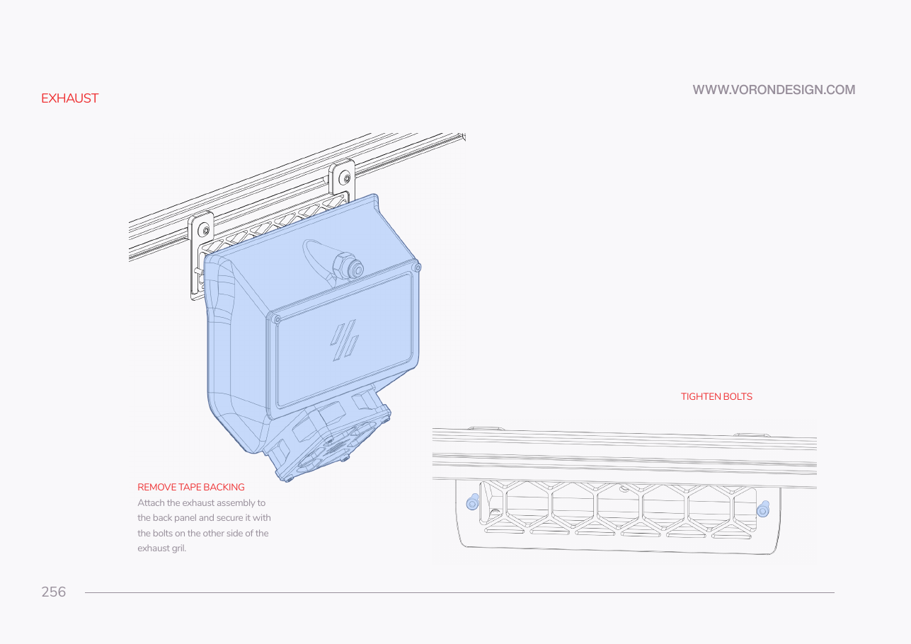{ crop="0.13 0.19 0.48 0.75" }
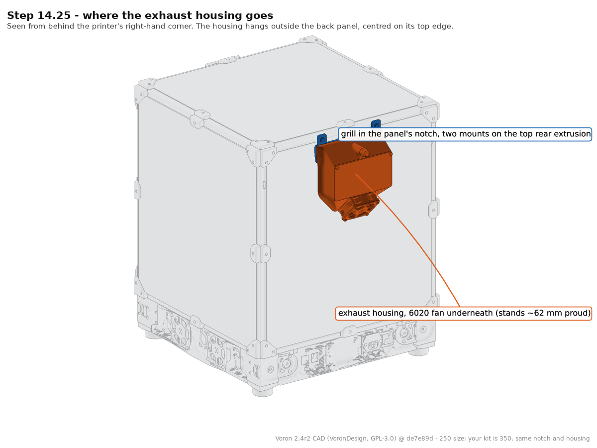
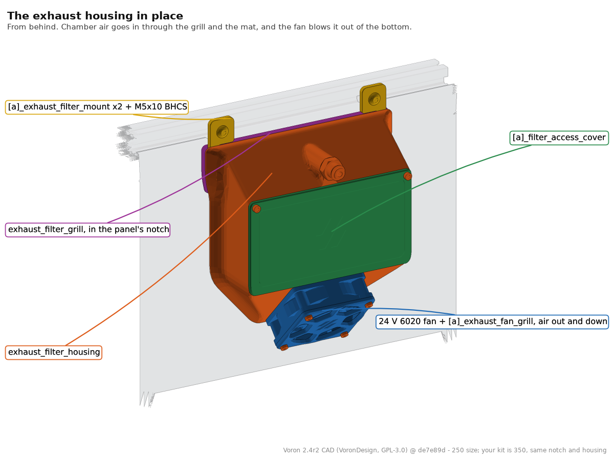
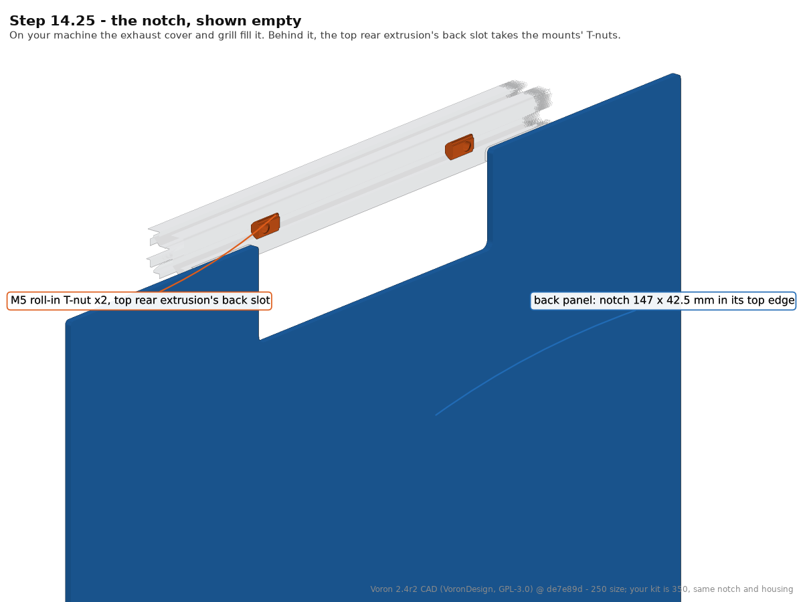
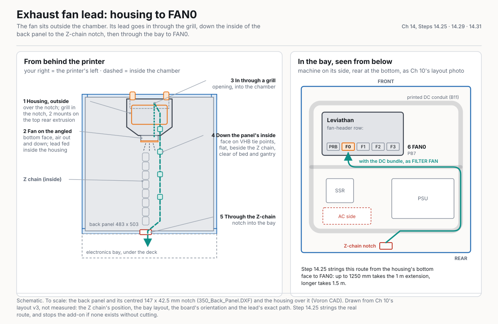

**What you're looking at:** Before anything is bought, check that the stock exhaust housing fits this machine. It hangs outside the back panel over the exhaust notch, grill in the notch and two mounts on the top rear extrusion. It sticks out about 62 mm, and its fan lead must reach the electronics bay.

**Parts:**

- tool: steel rule
- tool: a length of string

**Do:**

1. With the machine off, look at the back panel's top edge: do the exhaust cover and grill fill a notch there?
2. Measure the free depth behind the panel with the rule, and lay a string along a lead route to FAN0.
3. Note where the PTFE tube enters.

**Check:** Every row of the calculator below is answered and passing, and the string length is written down.

```gate-calc
id: exhaust-fit
title: Exhaust housing — does the stock housing fit this machine
inputs:
  - key: notch
    label: The exhaust cover and grill fill a notch about 147 × 42 mm in the back panel's top edge
    kind: yesno
    no: Without the stock notch the housing has nowhere to sit. Stop here; anything else means cutting the panel.
    why: The housing, its grill and both mounts are drawn for the stock 350 back panel's notch, so they fit without cutting anything.
  - key: depth
    label: Free depth behind the back panel at the notch, to the wall or the nearest object (mm)
    min: 100
    low: The housing stands about 62 mm proud and its fan blows out of the bottom. Move the machine forward, or stop here.
    why: A fan blowing at a wall a few millimetres away moves almost no air.
  - key: slot
    label: The exhaust cover's two tabs are bolted into the top rear extrusion's back slot, two M5×10 into roll-in T-nuts, as Ch 11 left them
    kind: yesno
    no: The mounts reuse those two T-nuts and screws. Without them the housing hangs on its tape alone; stop here.
    why: The mounts carry the housing's weight; the tape only seals it.
  - key: route
    label: A lead route from the notch, in through a grill opening and down the inside of the back panel to the Z-chain notch, clear of the bed and the gantry
    kind: yesno
    no: Nothing in this part cuts or drills a panel or a printed part to make a route. Stop here.
    why: The fan sits outside the chamber. Its lead crosses in through the grill and reaches the bay the way the filter-fan lead already does.
  - key: length
    label: The string, from the housing's bottom face along that route to the Leviathan's FAN0 (mm)
    max: 1250
    high: Longer than the fan's own lead plus a 1 m extension. Buy a 1.5 m extension instead.
    why: The extension in the Ch 00 buy row is sized for this number.
  - key: jumper
    label: The Ch 09 jumper bag still holds the three jumpers Ch 10 did not use
    kind: yesno
    no: FAN0 needs one voltage-selection jumper. Get a matching one before the wiring step.
    why: Ch 09 bagged five jumpers and Ch 10 fitted two.
pass: The stock housing fits. Order the Ch 00 exhaust row; the B13 parts in bin 14-exhaust go on in Part H.
```

**Helper:** Holds the string along the route and reads its length off the rule.

A failing row ends Part H here: nothing is bought, and the B13 parts stay in bin 14-exhaust unused. Cutting the back panel or printing a community remix is a different job, decided separately, and nothing below covers it.

Source: [Voron manual p.250–256](https://github.com/VoronDesign/Voron-2/blob/de7e89d/Manual/Assembly_Manual_2.4r2.pdf#page=250) · [Voron-2 `350_Back_Panel.DXF`](https://github.com/VoronDesign/Voron-2/blob/a192410/Drawing_DXFs/Panels/350_Back_Panel.DXF) · [LDO Build Notes p.250–253, p.256](https://docs.ldomotors.com/voron/voron2/build-faq#build-notes) · `review/2026-10-03-exhaust/DESIGN.md`

---

### Step 14.26 — Take the exhaust parts out of bin 14-exhaust

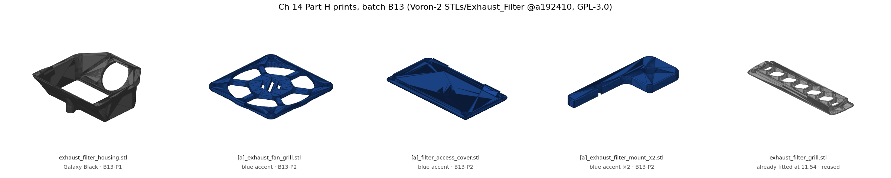

**What you're looking at:** Five stock Voron parts printed in batch B13: the housing in black, and the fan grill, the access cover and two mounts in the blue accent, as their `[a]_` prefix asks. They wait in bin 14-exhaust for the fan, lead and filter mat bought at Ch 00.

**Parts:**

- staged: `exhaust_filter_housing` ×1
- staged: `[a]_exhaust_fan_grill` ×1
- staged: `[a]_filter_access_cover` ×1
- staged: `[a]_exhaust_filter_mount_x2` ×2

**Do:**

1. Open bin 14-exhaust and lay out the five B13 parts.
2. Look each one over for brim left on, a lifted corner or a cracked mount.
3. Bag them again; the fan, lead and mat you bought join them when they arrive.

**Check:** Five flat, whole parts are in hand (one black housing, plus a blue fan grill, access cover and two mounts), and the Ch 00 exhaust row is ordered.

**Helper:** Counts the five parts against the bin label and reads each name aloud.

Source: [B13 — Exhaust housing](print/B13-exhaust-housing.md) · `slicer/addons/exhaust-voron2/README.md` · [Voron-2 `STLs/Exhaust_Filter/`](https://github.com/VoronDesign/Voron-2/tree/a192410/STLs/Exhaust_Filter)

Pause: ~30 min since the last pause — the back of the machine inspected and the calculator passed, the Step 00.8 row ordered, and the five B13 parts checked and back in bin 14-exhaust. Nothing on the Voron has changed. Carry on with Part A while the delivery comes; Part H picks up again at Step 14.27, after Part G.

---

## Part A — Heaters

### Step 14.1 — Pre-flight the config before you tune anything

(no image — see text)

**What you're looking at:** Before the machine generates any tuning numbers, read the four config sections they come from. The thermistor type (the hotend's temperature sensor), the pull-up resistor and the temperature limit all live in `[extruder]`, and a wrong value in any of them makes every PID number wrong too. On this kit the values come from `leviathan-printer-rev-d-**sbv2**.cfg`, not `leviathan-printer-rev-d.cfg`. [src](https://github.com/MotorDynamicsLab/LDOVoron2/blob/main/Firmware/leviathan-printer-rev-d-sbv2.cfg)

**Parts:** none.

**Do:** Open `printer.cfg` and confirm these four sections hold the values below before any of them generates a number.

| Section | Must hold |
|---|---|
| `[extruder]` | `sensor_type: ATC Semitec 104NT-4-R025H42G`, `pullup_resistor: 2200`, `max_temp: 270`, `gear_ratio: 50:10`, and **your** measured `rotation_distance` from Ch 13 Step 13.40. `22.6789511` is only the Clockwork 2 starting point; do not put it back |
| `[heater_bed]` | `max_power: 0.6` and `control: pid` |
| `[resonance_tester]` | `accel_chip: adxl345` and the live `probe_points: 175, 175, 20` |
| `[input_shaper]` | present, both `shaper_freq` lines still commented. Do not delete it |

**Check:** `STATUS` is clean, both MCUs are connected, and the chamber, hotend and bed all read within a couple of degrees of the room.

**Helper:** Reads each Must hold value aloud while the adult finds it in printer.cfg.

⚠ A hotend that reads 20 °C away from the bed while nothing is heating means a wrong `sensor_type`, and every PID number you generate will be wrong with it.

E3D's 60 W HeaterCore uses the Semitec 104NT-4-R025H42G and is rated to **300 °C**, so `max_temp: 270` is a deliberate limit below what the hardware can take.

⚠ If `[extruder] sensor_pin` reads `nhk:gpio29` instead of `nhk:PB12`, you are on the V1 config: go back to Ch 12 before doing anything that heats.

Source: [`leviathan-printer-rev-d-sbv2.cfg`](https://github.com/MotorDynamicsLab/LDOVoron2/blob/667521d/Firmware/leviathan-printer-rev-d-sbv2.cfg) · [Voron docs — Secondary printer tuning](https://docs.vorondesign.com/tuning/secondary_printer_tuning.html)

### Step 14.2 — Confirm the heaters are already PID-tuned

(no image — see text)

**What you're looking at:** PID constants are the three numbers that hold a heater steady at its target. Ch 13 measured them, and they belong to the temperature they were measured at.

**Parts:** none.

**Do:**

1. Do not repeat the tune here: both heaters were tuned and saved in Ch 13 at [Step 13.29](13-initial-startup.md#step-1329-pid-tune-the-bed-at-100-c).
2. Open `printer.cfg` and confirm both PID sections are in the automatically generated block at the bottom.
3. Re-run Ch 13's tune (bed 100 °C, hotend 245 °C, part fan 25 %) only if you have moved a target since, such as the bed to `TARGET=110` for ASA: PID is most accurate near its tuning temperature.

**Check:** Both sections hold *your* numbers, not the LDO config's generic starting values.

⚠ Do not re-run the hotend tune at the 260 °C print temperature. `PID_CALIBRATE` switches the heater off only at the target, and `[extruder] max_temp` is **270**, so a 60 W Revo HF can overshoot and shut Klipper down mid-tune *(verify on bench)*. To tune at the print temperature, raise `max_temp` to 290 first, under the core's rated 300 °C, then set it back.

For comparison, the generic values are `58.437 / 2.347 / 363.769` for the bed and `26.213 / 1.304 / 131.721` for the hotend. Do **not** add `pwm_cycle_time`; Klipper's 0.100 s default is correct here.

Source: [Voron startup wizard § PID tune bed & hotend](https://docs.vorondesign.com/build/startup/startup.html#pid-tune-bed--hotend) · [`leviathan-printer-rev-d-sbv2.cfg`](https://github.com/MotorDynamicsLab/LDOVoron2/blob/667521d/Firmware/leviathan-printer-rev-d-sbv2.cfg#L236-307) · [E3D Revo 60 W heatercore / 104NT thermistor](https://e3d-online.com/pages/revo-support-60w-104nt-heatercore)

Pause: ~15 min since the last pause — config checked against the `-sbv2` file and both PID sections confirmed. Nothing has heated and nothing mechanical has been touched: the heaters are read during the one closed soak, at Step 14.3, after the belts.

---

## Part B — Belts, final tension

These four steps finish Voron's gantry-squaring procedure, split off from Ch 06b because they need a closed chamber. Before you start: **Ch 06b cold squaring done** (Checkpoint 06b ticked, the Z joint M5×40 screws still at their light 06b.13 tightness, the A/B belts at the provisional tension 06b set) and **Ch 11 Part B panels and door on**.

Ch 14 owns the final belt tension: 14.4 sets A/B and 14.5 sets Z, both cold. 14.3 starts the chapter's **one** closed-chamber soak and reads the heaters on the way up. 14.6 finishes it: it settles QGL, locks the Z joints hot, and logs the two readings the soak also gives, the settled chamber for Step 14.8 and the bed-mesh Variance for Step 14.22. Voron's order is kept, tension first (its step 13), then the soak, QGL and the hot tighten (steps 14–17), because tightening the joints hot freezes the gantry's shape, and tensioning afterwards would move what was just frozen.

### Step 14.4 — Set A/B belt tension to 110 Hz over a 150 mm span

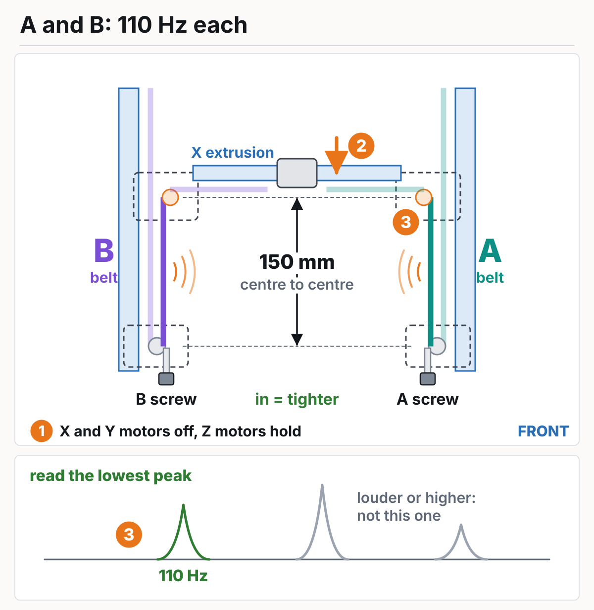
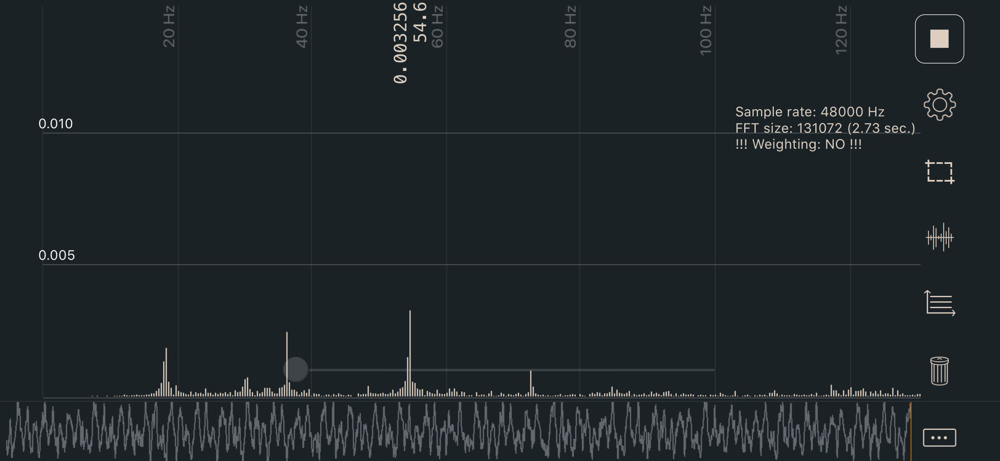

**What you're looking at:** A tight belt is like a guitar string: its lowest note, read on a phone spectrum analyser (pictured), measures its tension, but only over a known span, the length you pluck.

**Parts:**

- reused: the two M3×40 A/B front-idler tensioner screws
- tool: 2.5 mm hex key
- tool: steel rule
- tool: phone with a spectrum analyser app

**Do:**

1. Cold, panels on, door open: send `SET_IDLE_TIMEOUT TIMEOUT=99999` and `G28`, move the gantry to mid-height, then `SET_STEPPER_ENABLE STEPPER=stepper_x ENABLE=0` and the same with `STEPPER=stepper_y`.
2. Push the X extrusion forward to a measured **150 mm** span, XY joint to front idler centres.
3. Pluck A, read the **lowest** peak, not the loudest, and set **110 Hz**; then B, back and forth until both match.

**Check:** Both read about 110 Hz, within a few Hz of each other, after the X extrusion moves back a few centimetres and returns. Both go in the tuning log.

**Helper:** Holds the phone by the span and reads the lowest peak aloud after each pluck.

The two tensions affect each other. If one belt reads 110 and the other 95, the gantry is not square: go back to Ch 06b, and do not make up for it with tension.

⚠ Never send `M84` on this machine with the gantry in the air: it releases the Z motors too, and the gantry drops onto the bed. Disable only `stepper_x` and `stepper_y`, so the X carriage moves by hand while the four Z motors hold the gantry.

??? note "Why 110 Hz over a 150 mm span: the three sources disagree"

    | Source | A/B target | Z target |
    |---|---|---|
    | Official assembly manual p.125 | **no number** — "cut both belts to the same length" | no number |
    | [docs.vorondesign.com — Secondary Printer Tuning](https://docs.vorondesign.com/tuning/secondary_printer_tuning.html) | **110 Hz over a 150 mm span** (≈ 2 lb, "on the lower end of the range") | **140 Hz** over 150 mm |
    | voronldo.com belt tension guide | 80–100 Hz for a 350 | "same as X/Y, 110–130 Hz" |

    **Use 110 Hz / 150 mm.** It is the only sourced official figure, and the only one that
    names the span, which is what makes a frequency mean anything: the same belt over a
    200 mm span reads far lower. The Voron docs also explain *why* 110: it is roughly 2 lb
    of tension and deliberately at the low end, so you get a good starting point without
    stretching the belts. The survey rejects voronldo.com as unaffiliated, uncited and
    internally inconsistent (survey §4.3, §9 Rejected sources), so ignore its 80–100 Hz
    figure entirely.

Source: [Voron docs image `sound-spectrum-belt.jpg`](https://raw.githubusercontent.com/VoronDesign/Voron-Documentation/36b876b/tuning/images/sound-spectrum-belt.jpg) · [Voron docs — Secondary printer tuning § Belt tension](https://docs.vorondesign.com/tuning/secondary_printer_tuning.html) · [Voron manual p.125](https://github.com/VoronDesign/Voron-2/blob/de7e89d/Manual/Assembly_Manual_2.4r2.pdf#page=125) · [Klipper docs § SET_IDLE_TIMEOUT](https://www.klipper3d.org/G-Codes.html#set_idle_timeout) · [Ch 06b Steps 06b.1, 06b.5](06-z-axis-and-gantry-squaring.md#step-06b1-raise-the-stepper-idle-timeout)

Pause: ~20 min since the last pause — **A and B are both at final tension and equal.** The belts are one calibration item: never stop with one of the pair adjusted and the other not. Leave the gantry parked mid-travel with the Z motors holding and the idle timeout still raised; Step 14.6 sets it back to 1800 at the end, once the last hot check has passed.

### Step 14.5 — Set the four Z belts to 140 Hz over 150 mm

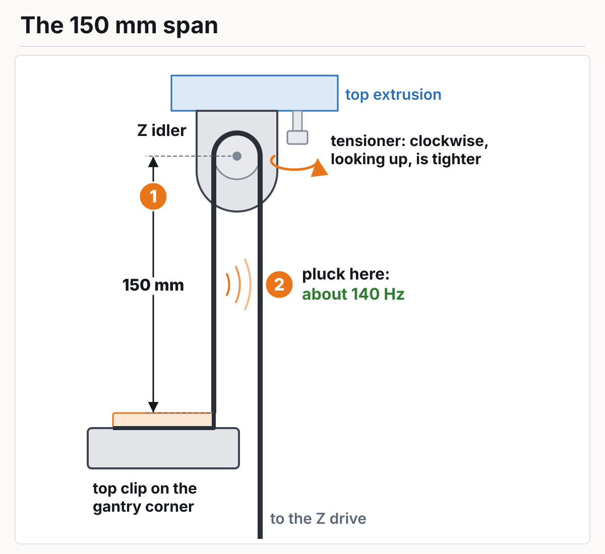

**What you're looking at:** The four Z belts lift the gantry and are set like A and B. One odd belt shows up as scatter in `PROBE_ACCURACY`, the probe's repeat test, not as anything you can see. The adjuster is the **Z idler tensioner screw**, an M3×16 at the top of each vertical.

**Parts:**

- reused: the four M3×16 Z idler tensioner bolts
- tool: 2.5 mm hex key
- tool: steel rule
- tool: phone with a spectrum analyser app

**Do:**

1. Set a **150 mm** span, from the top belt clip on the Z bearing block to that corner's Z idler pulley centre.
2. Pluck, read the lowest peak, and adjust to **about 140 Hz**.
3. Do all four, then jog the gantry down and back up and read them again.

**Check:** All four Z belts are within a few Hz of each other at about 140 Hz, with four numbers logged.

**Helper:** Holds the phone by each Z belt and reads the lowest peak aloud after each pluck.

```gate-calc
id: tune-belts
title: Belt tension — six belts, each over a measured 150 mm span
inputs:
  - key: a
    label: A belt (Hz)
    nominal: 110
    tol: 5
    hint: about 110 Hz over a measured 150 mm span
    low: Slack. Take up the A front idler tensioner screw a little at a time, re-pluck, then re-check B, because the two tensions pull against each other.
    high: Tight. Back the A tensioner off. 110 Hz is deliberately at the low end of the range, roughly 2 lb, so a high reading stretches the belt rather than helping it.
    why: A and B carry every X and Y move, and Ch 06b's squaring procedure began by fully releasing them, so whatever tension was set before this step is already gone.
  - key: b
    label: B belt (Hz)
    nominal: 110
    tol: 5
    hint: about 110 Hz, and within a few Hz of A
    low: Slack. Take up the B tensioner, then re-check A and go back and forth until the two read the same.
    high: Tight. Back the B tensioner off, then re-check A. One reading 110 and the other 95 is a squaring problem, so go back to Ch 06b rather than compensating with tension.
    why: A and B are one calibration item, and a pair that will not come out equal is the gantry saying it is not square, not a belt asking for more tension.
  - key: zfl
    label: Z belt, front left (Hz)
    nominal: 140
    tol: 5
    hint: about 140 Hz, top belt clip to that corner's Z idler centre
    low: Slack. Tighten at that upright's Z idler tensioner bolt only, never at the belt clamps on the gantry corner.
    high: Tight. Back that upright's Z idler tensioner bolt off, then jog the gantry down and back up and re-read all four.
    why: The four Z belts lift the gantry together, and one odd belt shows up as scatter in PROBE_ACCURACY rather than as anything you can see.
  - key: zfr
    label: Z belt, front right (Hz)
    nominal: 140
    tol: 5
    hint: about 140 Hz, and even with the other three
    low: Slack. Tighten at that upright's Z idler tensioner bolt, then re-read the other three; evening them up matters more than hitting 140 exactly.
    high: Tight. Back that bolt off, then re-read the other three; evening them up matters more than hitting 140 exactly.
    why: Voron's QGL troubleshooting points at uneven Z belts when PROBE_ACCURACY scatter is high, so evenness across the four is what this row is really reading.
  - key: zrl
    label: Z belt, rear left (Hz)
    nominal: 140
    tol: 5
    hint: about 140 Hz, reached from the rear of the machine
    low: Slack. Tighten at that upright's Z idler tensioner bolt, then re-check the front pair, which move with it.
    high: Tight. Back that bolt off, then re-check the front pair, which move with it.
    why: This is the final setting rather than the working value Ch 06b left, so whatever you leave here is what every QGL and every bed mesh from now on is built on.
  - key: zrr
    label: Z belt, rear right (Hz)
    nominal: 140
    tol: 5
    hint: about 140 Hz, reached from the rear of the machine
    low: Slack. Tighten at that upright's Z idler tensioner bolt only. A loosened belt clamp means re-threading the belt.
    high: Tight. Back that upright's Z idler tensioner bolt off. Never reach for the belt clamps on the gantry corner to let tension out.
    why: The adjuster is the idler tensioner bolt at the top of the upright, because the clamps on the gantry corner, on top of the front idler or A/B drive and under the Z joint, hold both belt ends and let the belt go if you loosen them.
  - key: span
    label: Every span measured at 150 mm with the rule, not eyeballed
    kind: yesno
    no: A frequency means nothing without its span, and the same belt over a 200 mm span reads far lower. Measure each span with the rule and read all six again.
    why: Eyeballing the span is the single most common way to finish this step with belts 30 % out and blame the printer for what follows.
  - key: recheck
    label: All six read again after moving the gantry and returning
    kind: yesno
    no: Move the X extrusion back a few centimetres and forward again, jog Z down and back up, then re-read all six. A tension read once can belong to where the gantry was parked.
    why: The soak that follows ends with the Z joints tightened hot, which freezes whatever geometry these six belts are holding, so a reading that does not survive a move is not the one to freeze.
pass: All six belts are at final tension over measured spans. Write the six numbers in the tuning log, then soak the closed chamber and lock the Z joints hot.
```

⚠ Turn only the Z idler tensioner screw. Never loosen the Z belt clamps on the gantry corners, on top of each front idler or A/B drive and under each Z joint: they hold both belt ends and let a belt go if loosened.

The tensioner head is under the blue slider: use the 2.5 mm key from below. Clockwise, as you look up at the head, is tighter, and the note rises. The screw's head sits in the sliding idler body and threads up into the fixed mount, so tightening it pulls the idler up, and loosening it lets the idler down. [src](https://github.com/VoronDesign/Voron-2/blob/de7e89d/Manual/Assembly_Manual_2.4r2.pdf#page=117)

Evenness across the four matters more than hitting 140 exactly: Voron's QGL troubleshooting text points at uneven Z belts when the `PROBE_ACCURACY` σ (the spread of its readings) is high. This is the final setting; [Ch 06b Step 06b.3](06-z-axis-and-gantry-squaring.md#step-06b3-set-the-z-belts-to-140-hz) was the working value (survey §4.3).

Source: [Voron docs — Secondary printer tuning § Belt tension](https://docs.vorondesign.com/tuning/secondary_printer_tuning.html) · [Ch 06b Step 06b.3](06-z-axis-and-gantry-squaring.md#step-06b3-set-the-z-belts-to-140-hz)

### Step 14.3 — Verify thermal stability, then re-QGL

(no image — see text)

**What you're looking at:** Thermal stability means the frame, not just the heaters. This step starts the chapter's one closed soak and reads the heaters as they warm up; `PROBE_ACCURACY` reads the frame once the soak is done, and the hot QGL follows it.

**Parts:**

- tool: 4 mm ball-end hex key

**Do:**

1. Send `SET_IDLE_TIMEOUT TIMEOUT=99999` and `G28`, then note the Z height at which a ball-end 4 mm key reaches all four Z joint screw heads.
2. Shut the panels and door, and heat the bed to 110 °C and the hotend to 150 °C: the soak starts now.
3. Watch the temperature graph for 10–20 minutes.

**Check:** Both heaters hold within ±0.5 °C of their targets with no slow swing up and down, and the chamber stays shut for the rest of the soak.

⚠ The LDO config's 1800 s idle timeout switches the heaters and the Z motors off 30 minutes after the last move, which is exactly what a static soak looks like.

At the end of the soak, a drifting `PROBE_ACCURACY` series, each probe lower than the last, means the frame is still expanding: wait longer. If σ stays high after that, suspect uneven Z belts.

110 °C is the ASA print temperature. Ch 13 tuned the bed PID at 100 °C, so a slow swing here is the cue to tune it again at 110.

Source: [Voron startup wizard § Probe accuracy check](https://docs.vorondesign.com/build/startup/startup.html#probe-accuracy-check) · [Voron startup wizard § QGL with heated bed and chamber](https://docs.vorondesign.com/build/startup/startup.html#qgl-with-heated-bed-and-chamber) · [Voron docs § V2 Gantry Squaring, step 14](https://docs.vorondesign.com/build/mechanical/v2_gantry_squaring.html) · [Klipper docs § SET_IDLE_TIMEOUT](https://www.klipper3d.org/G-Codes.html#set_idle_timeout)

### Step 14.6 — Closed-chamber soak, settle QGL, lock the Z joints hot, re-verify

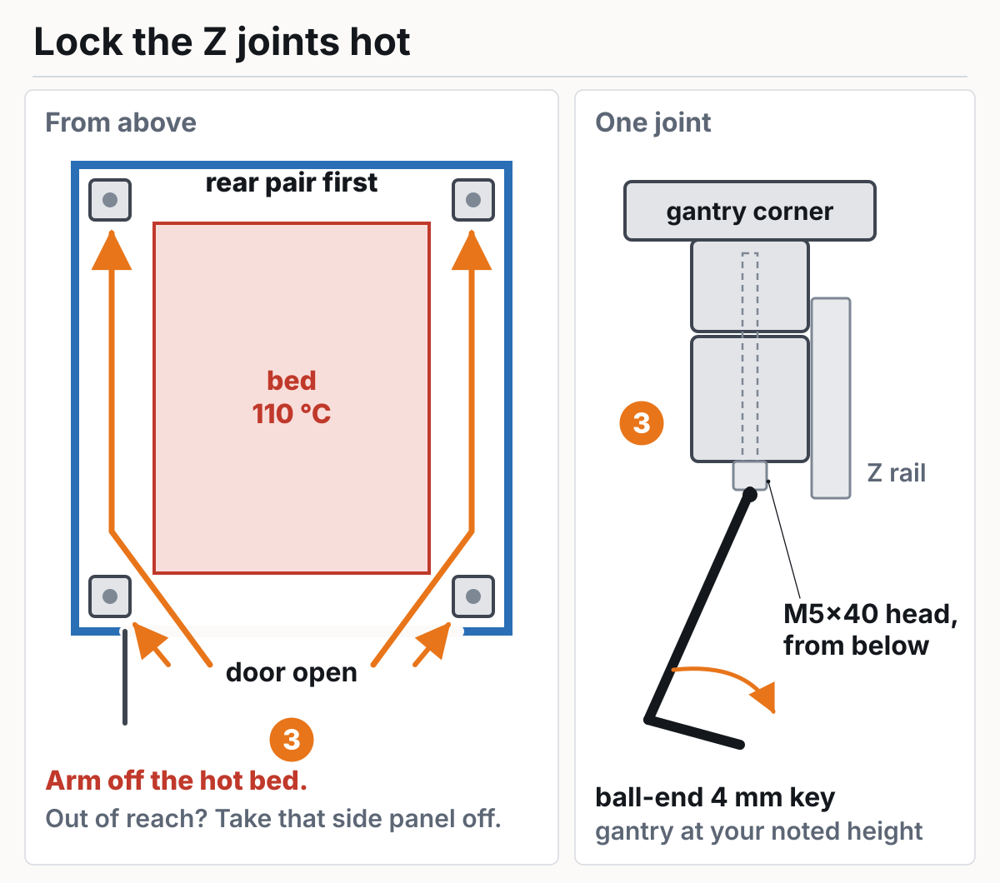

**What you're looking at:** Aluminium grows as it warms, so a gantry squared cold in Ch 06b is not square at chamber temperature. A long soak brings the frame to its working size, and then the four Z joint M5×40 screws get their first and only full tighten, hot.

**Parts:**

- reused: the four M5×40 Z joint SHCS
- tool: 4 mm ball-end hex key
- tool: 150 mm machinist square

**Do:**

1. Keep the soak from [14.3](#step-143-verify-thermal-stability-then-re-qgl) going for **at least 1½–2 hours**, door shut.
2. Log `chamber_temp` at 45 minutes and again when it levels off: that is the reading [14.8](#step-148-set-the-chamber-target-and-understand-the-soak) takes.
3. Then work through the table below while the machine is hot.

| Order | Hot, with the chamber closed | Accept |
|---|---|---|
| 1 | `PROBE_ACCURACY` at bed centre, then `QUAD_GANTRY_LEVEL` **three to five times** in a row | `PROBE_ACCURACY` σ < 0.003 mm with no trend; each QGL run converges and its correction shrinks run over run rather than bouncing around |
| 2 | Jog Z back to the height you noted, open the door, and repeat Ch 06b's machinist-square check at both front corners, gantry forward and back | No light under the square at either front corner, hot |
| 3 | **Fully tighten the four M5×40 Z joint bolts while the machine is still hot**, rear pair first, door open as briefly as you can | First and only full torque on these four bolts |
| 4 | Refit any side panel you took off, its M3×12 clip screws back in, door shut. Still hot: `G28`, one more `QUAD_GANTRY_LEVEL`, then `PROBE_ACCURACY`, then `BED_MESH_CALIBRATE` and open Mainsail's **Heightmap**. Only then heaters off and `SET_IDLE_TIMEOUT TIMEOUT=1800` | QGL converging in ≤3 retries within `retry_tolerance: 0.0075`, `PROBE_ACCURACY` σ < 0.003 mm with no trend, the mesh **Variance** and whether the map sits centred on Z0 in the log, for 14.22, idle timeout back at the config's 1800 |

**Check:** `chamber_temp` was level for at least 20 minutes before the QGL runs, and each run's correction got smaller rather than bouncing around.

⚠ Everything you reach past is hot: the bed at 110 °C, the nozzle at 150 °C, and the frame and printed parts warm from the soak. Keep your arm off the bed and clear of the toolhead, and keep your hands out of the chamber whenever QGL, homing, the probe or the mesh is moving the gantry.

⚠ Light under the square when hot, where there was none cold, means the squaring did not survive the heat or the belt change: leave the Z joints light, go back to Ch 06b Step 06b.14, then return. Do **not** tighten the Z joints cold: it throws away the point of the soak and shows up as an uneven first layer.

If the QGL runs need all 5 retries where Ch 13 settled in 2, or throw new tolerance errors, first suspect Z joints left too loose at 06b.13: snug them a little more, as Voron's squaring step 15 says. If the retries go on, re-check the six belts at 14.4/14.5 **before** the full tighten, which freezes whatever shape the belts are holding.

Source: [Voron docs § V2 Gantry Squaring, steps 14–17](https://docs.vorondesign.com/build/mechanical/v2_gantry_squaring.html) · [Voron startup wizard § Quad gantry level](https://docs.vorondesign.com/build/startup/startup.html#quad-gantry-level) · [Klipper docs § QUAD_GANTRY_LEVEL](https://www.klipper3d.org/G-Codes.html#quad_gantry_level) · [Klipper docs § SET_IDLE_TIMEOUT](https://www.klipper3d.org/G-Codes.html#set_idle_timeout) · [`leviathan-printer-rev-d-sbv2.cfg`](https://github.com/MotorDynamicsLab/LDOVoron2/blob/667521d/Firmware/leviathan-printer-rev-d-sbv2.cfg#L471-524) · [Ch 06b Part B](06-z-axis-and-gantry-squaring.md#part-b-chapter-06b-gantry-squaring) · [Video: Part 9 @2:49:16](https://www.youtube.com/watch?v=dmNwxUm4oik&list=PL0fUJbigELQPqpeGOgHYisG4KaSXVtnNY&t=10156s)

Pause: ~25 min since the last pause (plus the 1½–2 h soak) — all six belts at final tension and even, the heaters held steady on the way up, the machine soaked closed with its settled `chamber_temp` logged, QGL settled over 3–5 runs, the four Z joint screws locked hot, `PROBE_ACCURACY` checked hot again afterwards, the hot mesh Variance logged and the idle timeout set back to 1800. The whole belt-and-shape item is closed, and the heaters can go off. Steps 14.8 and 14.22 read this soak instead of heating again. The next item is the extruder.

---

## Part C — Extruder

### Step 14.7 — Rotation-distance check (100 mm extrusion)

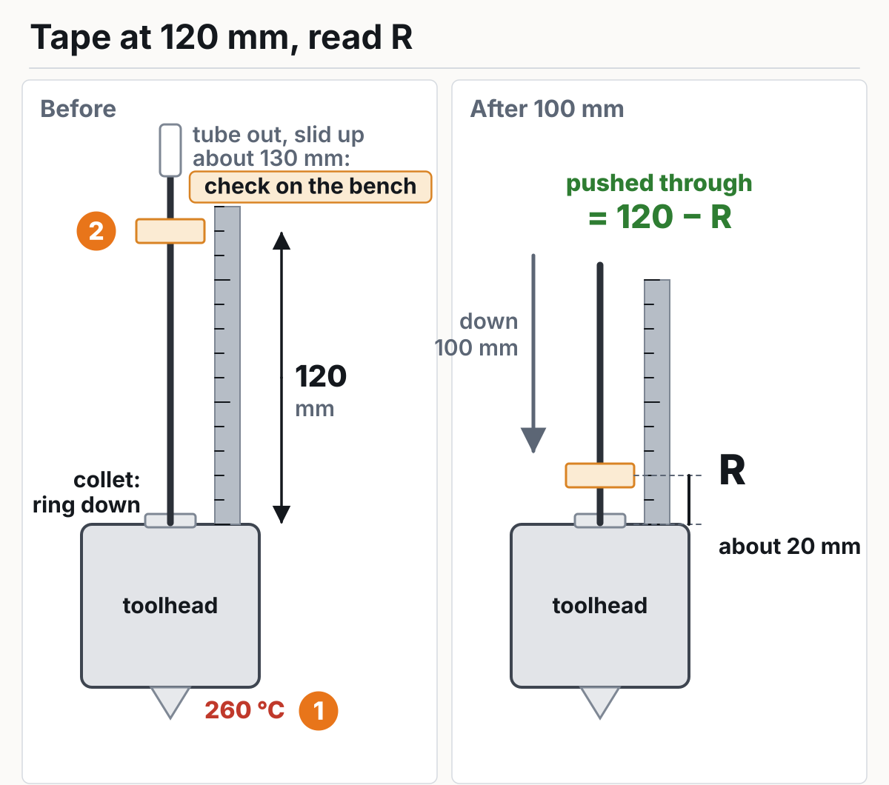

**What you're looking at:** `rotation_distance` is millimetres of filament per turn of the extruder motor. You read the **remainder**, not the amount pushed through. [Ch 13 Step 13.40](13-initial-startup.md#step-1340-set-the-extruder-rotation-distance-ch-14-procedure) owns this measurement; this is the refinement pass, now that the extruder has run a print.

**Parts:**

- consumable: masking tape
- tool: steel rule
- tool: digital caliper
- consumable: Prusament ASA, loaded

**Do:**

1. With filament loaded and the extruder engaged, heat the hotend to the ASA print temperature, 260 °C.
2. Repeat 13.40's measurement once, with the caliper instead of the rule on the remainder: pull the PTFE out of the collet, tape the filament **120 mm** above the collet, then send:

```
M83
G1 E100 F60
```

Measure from the collet to the tape: that reading is the **remaining** distance R. Refit the PTFE and its clip afterwards. `[extruder]` still carries the `max_extrude_only_distance: 150` from 13.40. If the result is more than 0.5 % out, apply 13.40's formula, `new = old × (120 − R) / 100`, using the value *currently* in the config. Test it live with `SET_EXTRUDER_ROTATION_DISTANCE EXTRUDER=extruder DISTANCE=<value>`, and when it lands, write the final number into `[extruder] rotation_distance` and send `RESTART`. Never put `22.6789511` back: it is the published starting point, not a calibration.

**Check:** R reads about 20 mm, so the amount pushed through is within **0.5 %** of target, 99.5 to 100.5 mm, and it is recorded in the tuning log.

Source: [Voron startup wizard § Extruder calibration (e-steps)](https://docs.vorondesign.com/build/startup/startup.html#extruder-calibration-e-steps) · [Ellis' Print Tuning Guide — extruder calibration](https://ellis3dp.com/Print-Tuning-Guide/articles/extruder_calibration.html) · [Klipper docs § Rotation distance](https://www.klipper3d.org/Rotation_Distance.html) · [Klipper docs § SET_EXTRUDER_ROTATION_DISTANCE](https://www.klipper3d.org/G-Codes.html#set_extruder_rotation_distance) · [Video: Part 9 @5:24:09](https://www.youtube.com/watch?v=dmNwxUm4oik&list=PL0fUJbigELQPqpeGOgHYisG4KaSXVtnNY&t=19449s)

Pause: ~20 min since the last pause — rotation distance measured, adjusted and written into `[extruder]`, and Klipper restarted on the new value. Unload or park the filament, and do not leave the hotend hot.

---

## Part D — Chamber and the first real print

### Step 14.8 — Set the chamber target and understand the soak

(no image — see text)

**What you're looking at:** This machine has no chamber heater: the bed warms the chamber, and the panels and door hold the heat in. The chamber sensor reads how hot the closed enclosure gets, settled by 45 minutes from cold, and Step 14.6's soak already logged it.

**Parts:** none.

**Do:**

1. Copy the settled `chamber_temp` and its minutes from [14.6](#step-146-closed-chamber-soak-settle-qgl-lock-the-z-joints-hot-re-verify)'s log into the Chamber soak row.
2. No log? Send `SET_IDLE_TIMEOUT TIMEOUT=7200`, heat the bed to 110 °C with the panels on and the door shut, wait **up to 45 minutes** and log the reading, then send `SET_IDLE_TIMEOUT TIMEOUT=1800`.

**Check:** With the bed at 110 °C and the panels and door closed, `chamber_temp` settled in the **50–60 °C accept band** by 45 minutes.

⚠ Re-soaking? The LDO config's 1800 s idle timeout turns the heaters **and the Z motors** off 30 minutes after the last move, and a static soak is exactly that. `RESTART`, `FIRMWARE_RESTART` and every `SAVE_CONFIG` set it back to 1800.

The chamber sensor is already wired to the Nitehawk on `nhk:PB2`, the toolboard's **CT** port; the config's `T1` comment is a label left over from the Leviathan. Mainsail calls it `chamber_temp`, and its `gcode_id` in `M105` output is `chamber_th`.

If the chamber stops climbing below 45 °C, first check the bed is still heating: targets that dropped to 0 by themselves mean the idle timeout fired. Then look for a missing panel, an open keystone blank or the exhaust left open. 55–60 °C is the ideal end of the band, what the printed parts were designed for, and a 350 with a 100–110 °C bed and closed panels gets there without help.

Source: [Voron docs — materials](https://docs.vorondesign.com/materials.html) · [`leviathan-printer-rev-d-sbv2.cfg`](https://github.com/MotorDynamicsLab/LDOVoron2/blob/667521d/Firmware/leviathan-printer-rev-d-sbv2.cfg#L441-454) · [`leviathan-printer-rev-d-sbv2.cfg`](https://github.com/MotorDynamicsLab/LDOVoron2/blob/667521d/Firmware/leviathan-printer-rev-d-sbv2.cfg#L455-456) · [Klipper docs § SET_IDLE_TIMEOUT](https://www.klipper3d.org/G-Codes.html#set_idle_timeout)

### Step 14.9 — Close Ch 12's `PRINT_START` TODO with the purge line

(no image — see text)

**What you're looking at:** A purge line is a short stripe of filament laid at the edge of the plate before the real print, to build up pressure in the nozzle and wipe off any drip. It goes into Ch 12's `PRINT_START` macro rather than the slicer, so every print gets it.

**Parts:** none.

**Do:** `PRINT_START` belongs to [Ch 12 Step 12.36](12-software.md); do not write a second one here. It ends with a `##  TODO Ch 14: purge / prime line goes here` marker. Now that the extruder is calibrated, replace that marker with:

```ini
    G90
    G1 X5 Y5 Z0.3 F6000                    ; <-- 350 only
    M83                                    ; relative extrusion for the purge
    G92 E0
    G1 X120 E20 F1200                      ; purge line
    G1 Z2 F600
```

`M83` and `G92 E0` are not optional. Klipper starts in **absolute** extrusion mode, where each E value is a position rather than an amount, and Ch 12's macro does not set `M83`/`G92 E0` until *after* this point, so a bare `G1 E20` here would extrude to an arbitrary absolute position instead of 20 mm.

**Check:** A hand-run `PRINT_START CHAMBER=0` lays a continuous purge line from X5 to X120 that sticks, and `grep -c '^\[gcode_macro PRINT_START\]' printer.cfg` returns **1**.

⚠ Run it from the console with the machine cold, and watch Ch 12's order: it homes, heats the bed, soaks for a set time, runs QGL hot, re-homes Z, meshes, parks at X5 Y5, heats the nozzle, then purges. Send `PRINT_END` afterwards, or the hand run leaves the heaters on.

⚠ **Keep `CHAMBER=0` until the previous step has told you what your chamber actually reaches.** `TEMPERATURE_WAIT` has **no timeout**: a `CHAMBER=50` the machine never reaches blocks the print forever, and the only way out is cancelling it. [src](https://www.klipper3d.org/G-Codes.html#temperature_wait)

The slicer side already exists: the `Voron 2.4 350` printer preset from Ch 13 calls `PRINT_START BED=[first_layer_bed_temperature] EXTRUDER=[first_layer_temperature] CHAMBER=0 FILAMENT={filament_type[initial_tool]}` and `PRINT_END`, and the purge line needs nothing from it, because it lives in the macro. Only `CHAMBER=` changes, once, and per filament, never as a number in the printer preset, where PLA and PETG would wait for it too: change `CHAMBER=0` to `CHAMBER={chamber_minimal_temperature[initial_tool]}`. Save the Prusament ASA filament preset as `Voron ASA` and set its Chamber temperature *Minimal* a few degrees **below** 14.8's settled value, never at or above it. Prusa's PLA and PETG presets carry Minimal 0: no wait.

Source: [`leviathan-printer-rev-d-sbv2.cfg`](https://github.com/MotorDynamicsLab/LDOVoron2/blob/667521d/Firmware/leviathan-printer-rev-d-sbv2.cfg#L621-628) · [Klipper docs § TEMPERATURE_WAIT](https://www.klipper3d.org/G-Codes.html#temperature_wait)

Pause: ~10 min since the last pause — the chamber's behaviour taken from the soak and written down, and `PRINT_START`'s Ch 12 TODO closed with the real purge line. `CHAMBER` is still set from a measured number, not a guess. The config restarts clean.

### Step 14.10 — Fetch the cube you already printed in Ch 13

(no image — see text)

**What you're looking at:** Two cubes from the same file in the same filament: one printed on the Prusa in batch B00, one on the Voron in Ch 13. Nothing is printed here; the pair goes on the bench so the next step can measure them.

**Parts:**

- reused: the Voron-printed cube
- reused: the Prusa-printed B00 reference cube

**Do:**

1. Put both cubes on the bench.
2. The cube is printed **once**, in Ch 13, and [Step 13.41](13-initial-startup.md#step-1341-make-the-voron-printer-profile-and-slice-the-cube) is the authority for it. Print it again only if you have changed a slicer setting since, and then re-run 13.41–13.42 as written.

**Check:** Two cubes are in front of you, both `Voron_Design_Cube_v7`, both in Prusament ASA Galaxy Black.

**Helper:** Fetches the Prusa B00 cube from its bin and sets both cubes side by side.

The purge line you just added to `PRINT_START` affects the *next* print; it does not make this cube invalid. 13.41 sliced it at 260 °C / 110 °C with XY size and shrinkage compensation both zero, the same overrides the Prusa profile used.

Source: [Voron-2 `STLs/Test_Prints/`](https://github.com/VoronDesign/Voron-2/tree/de7e89d/STLs/Test_Prints) · [Voron docs — first print](https://docs.vorondesign.com/build/slicer/first_print.html)

### Step 14.11 — Caliper the cube against the Prusa-printed one

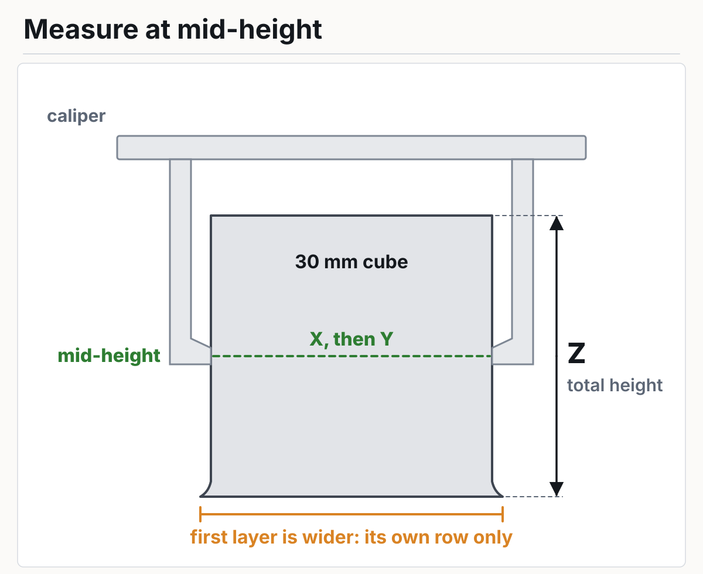

**What you're looking at:** A caliper on a 30 mm cube is the cheapest whole-machine test there is. Measure at mid-height, because the first layer is squashed and the top can bulge. The difference between the X and Y readings stands in for squareness.

**Parts:**

- reused: both cubes
- tool: digital caliper

**Do:** Measure both cubes at **mid-height**, not across the first layer, in X, Y and Z, and record them in the table below. Same STL, same filament, same nominal settings: the only difference is the machine.

| Measurement | Nominal | Prusa Core One+ (B00 reference) | Voron 2.4 350 (this print) | Accept | If out |
|---|---|---|---|---|---|
| X, mid-height | 30.00 mm | ______ | ______ | ±0.15 mm | see below |
| Y, mid-height | 30.00 mm | ______ | ______ | ±0.15 mm | see below |
| Z (total height) | 30.00 mm | ______ | ______ | ±0.10 mm | over → first layer under-squished; under → over-squished |
| X at first layer | — | ______ | ______ | within 0.15 mm of mid-height X | elephant-foot compensation wrong; adjust in 0.05 mm steps |
| X − Y (squareness proxy) | 0.00 mm | ______ | ______ | ≤0.10 mm | a persistent X−Y difference on the Voron is a gantry-square problem → Ch 06b |
| Corner snap test | — | pass/fail | pass/fail | must not delaminate along a layer line | chamber too cold or fan too high |

**Check:** Both cubes are inside tolerance, X and Y within ±0.15 mm and Z within ±0.10 mm of 30.00 mm, and within 0.15 mm of *each other*.

**Helper:** Writes each caliper reading into the comparison table as the adult calls it out.

Two honest expectations before you start chasing numbers:

- **A size error is not an axis error, and not a flow number.** Ellis: *"don't mess with your `steps_per_mm`/`rotation_distance`. Deviations are almost always from material shrinkage, bulging, layer inconsistencies, etc, NOT issues with your axes."* The extrusion multiplier is set by eye on a top surface at 14.19–14.20, never from these readings, and Voron parts need no compensation beyond that tune. If X or Y is outside ±0.15, confirm the slice had shrinkage and XY size compensation at 0, finish 14.19–14.20, then measure again. Never use negative XY compensation: it ruins every bearing fit in the machine. [src](https://ellis3dp.com/Print-Tuning-Guide/articles/extrusion_multiplier.html)
- **A Voron-to-Prusa difference of about 0.1 mm is the chamber, not calibration.** The Voron runs a hotter, more even chamber than the Core One+, so its parts shrink slightly differently. Both being *inside* tolerance matters more than the two matching each other.

Source: [Ellis' Print Tuning Guide — extrusion multiplier](https://ellis3dp.com/Print-Tuning-Guide/articles/extrusion_multiplier.html) · [Voron-2 `STLs/Test_Prints/`](https://github.com/VoronDesign/Voron-2/tree/de7e89d/STLs/Test_Prints)

Pause: ~15 min since the last pause — the Ch 13 cube is measured against the Prusa-printed reference and the numbers are in the tuning log. No config has changed; the multiplier is set later by eye, at 14.19–14.20, not from these numbers.

---

## Part E — Input shaper

Now, and not before: the machine has printed successfully, the belts are at final tension, and the frame has been hot.

### Step 14.12 — Bring up the on-board accelerometer

(no image — see text)

**What you're looking at:** The ADXL345 is an accelerometer, a chip that measures how hard it is being shaken in three directions. On this kit it is part of the Nitehawk-SB V2 toolboard itself, so there is no separate sensor board and no printed mount to fit: the V1 documentation's ADXL mount does not apply (survey §4.1).

**Parts:** none.

**Do:** Check both Python environments. `SHAPER_CALIBRATE` runs inside Klipper's own `klippy-env`, and the graph script at 14.14 runs on the Pi's system Python:

```
~/klippy-env/bin/python -c 'import numpy'
python3 -c 'import numpy, matplotlib'
```

On a MainsailOS image both print nothing and return: it installs numpy into `klippy-env`, and numpy and matplotlib for the whole system. `klippy-env` has no matplotlib, so never test for it there. If the first command errors, run `~/klippy-env/bin/pip install numpy`; if the second errors, run `sudo apt install python3-numpy python3-matplotlib libopenblas-dev`, which is what MainsailOS itself runs. Do **not** copy Klipper's `numpy<1.26` pin or its `libatlas-base-dev` on a Trixie image: the pinned numpy does not support Trixie's Python 3.13, and `libatlas-base-dev` was merged into `libopenblas-dev` and no longer exists. [src](https://www.klipper3d.org/Measuring_Resonances.html#software-installation) · [MainsailOS](https://github.com/mainsail-crew/MainsailOS/blob/develop/modules/generic/50-klipper)

Then confirm, without editing, that the **350 mm** probe point in `[resonance_tester]` below is live, and send `ACCELEROMETER_QUERY` and `MEASURE_AXES_NOISE`; nothing was edited, so no restart is needed. Ch 12 Step 12.27 uncommented that point and Checkpoint 12 required it; the stock config ships all three build sizes commented out.

```ini
[adxl345]
cs_pin: nhk:PB10
spi_software_sclk_pin: nhk:PA5
spi_software_mosi_pin: nhk:PA2
spi_software_miso_pin: nhk:PA6

[resonance_tester]
accel_chip: adxl345
accel_per_hz: 100
sweeping_accel: 400
sweeping_period: 0
probe_points:
    175, 175, 20
```

**Check:** `ACCELEROMETER_QUERY` returns three axis values, one of them about 9800 (gravity, in mm/s²), and `MEASURE_AXES_NOISE` returns figures **in the ~1–100 range**.

**Helper:** Reads the MEASURE_AXES_NOISE figures aloud and checks each one is under 100.

1000 or more from `MEASURE_AXES_NOISE` means a sensor, power or wiring problem, or a badly unbalanced fan. On `Invalid adxl345 id`, run it again: the sensor's connection often fails to start on the first try. The `[adxl345]` pins above are already correct in `leviathan-printer-rev-d-sbv2.cfg`; if yours read `nhk:gpio21/18/20/19`, you are on the V1 config.

Source: [Klipper docs § Installation instructions](https://www.klipper3d.org/Measuring_Resonances.html#installation-instructions) · [MainsailOS `modules/generic/50-klipper`](https://github.com/mainsail-crew/MainsailOS/blob/develop/modules/generic/50-klipper) · [Klipper docs § Checking the setup](https://www.klipper3d.org/Measuring_Resonances.html#checking-the-setup) · [`leviathan-printer-rev-d-sbv2.cfg`](https://github.com/MotorDynamicsLab/LDOVoron2/blob/667521d/Firmware/leviathan-printer-rev-d-sbv2.cfg#L411-440) · [Klipper docs § ACCELEROMETER_QUERY](https://www.klipper3d.org/G-Codes.html#accelerometer_query) · [Video: Extras! @0:42:02](https://www.youtube.com/watch?v=0aPi1rBwDC0&list=PL0fUJbigELQPqpeGOgHYisG4KaSXVtnNY&t=2522s)

Pause: ~15 min since the last pause — the accelerometer answers, the noise is in the 1–100 band, and the 350 mm `[resonance_tester]` probe point is confirmed live. Nothing has been shaped yet.

### Step 14.13 — Run `SHAPER_CALIBRATE`

(no image — see text)

**What you're looking at:** `SHAPER_CALIBRATE` shakes the toolhead through a sweep of frequencies while the accelerometer records, then fits a filter to what it measured. Both axes run in one pass, because the sensor rides on the toolhead rather than on a moving bed.

**Parts:** none.

**Do:**

1. Keep the fans still: let the hotend drop under 50 °C so its fan stops, then send `M107` and `SET_FAN_SPEED FAN=nevermore SPEED=0`.
2. Send `G28`, with nothing on the gantry, the panels on, and `M112` typed and unsent in a second console window: this is the fastest the machine has moved so far. Then send:

```
SHAPER_CALIBRATE
```

There is no re-mounting between the axes, because the accelerometer is on the toolhead: this is not a bed-slinger, where the bed carries one axis. It takes a few minutes and is loud. **Do not** `SAVE_CONFIG` yet.

**Check:** One output block per axis has appeared, each ending in a `Recommended shaper_type_x = …, shaper_freq_x = … Hz` line.

??? note "What the output block looks like"

    Klipper's own worked example, one block per axis. Each block gives the fitted
    frequency, the residual vibration %, the smoothing figure and a suggested
    `max_accel`, for each of the five shaper types:

    ```
    Fitted shaper 'mzv' frequency = 36.8 Hz (vibrations = 1.7%, smoothing ~= 0.150)
    To avoid too much smoothing with 'mzv', suggested max_accel <= 4000 mm/sec^2
    ...
    Recommended shaper_type_y = mzv, shaper_freq_y = 36.8 Hz
    ```

Source: [Klipper docs § Input shaper auto-calibration](https://www.klipper3d.org/Measuring_Resonances.html#input-shaper-auto-calibration) · [Klipper docs § Unreliable measurements of resonance frequencies](https://www.klipper3d.org/Measuring_Resonances.html#unreliable-measurements-of-resonance-frequencies) · [Klipper docs § SHAPER_CALIBRATE](https://www.klipper3d.org/G-Codes.html#shaper_calibrate) · [Video: Extras! @1:46:46](https://www.youtube.com/watch?v=0aPi1rBwDC0&list=PL0fUJbigELQPqpeGOgHYisG4KaSXVtnNY&t=6406s)

### Step 14.14 — Read the graphs

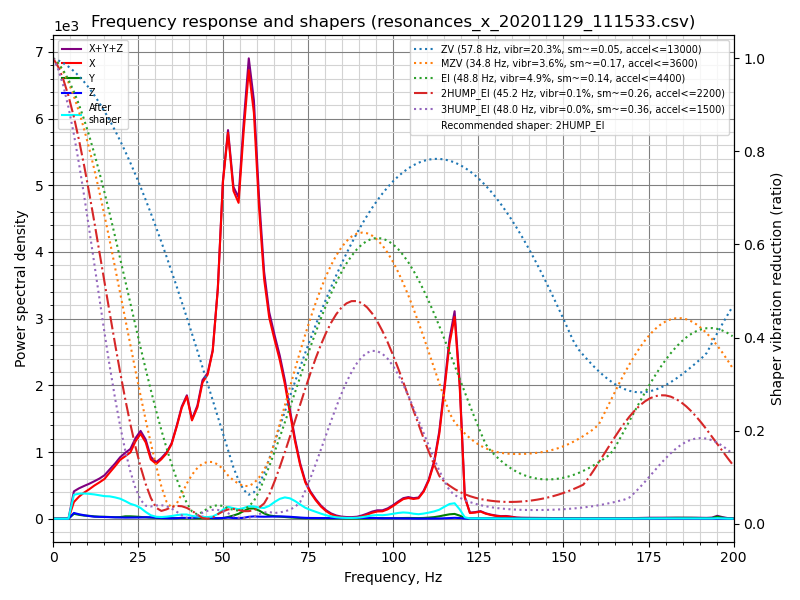

**What you're looking at:** The chart plots vibration against frequency. The tall peak is the machine's main resonance, the frequency it rings at, and the curves show how well each shaper type would damp it. A plot with no peak at all measured noise, not the machine.

**Parts:** none.

**Do:** Make the PNG graphs from the CSV data files the run left in `/tmp`. If you ran it more than once, delete the older CSVs first: the script averages every file it matches.

```
~/klipper/scripts/calibrate_shaper.py /tmp/calibration_data_x_*.csv -o /tmp/shaper_x.png
~/klipper/scripts/calibrate_shaper.py /tmp/calibration_data_y_*.csv -o /tmp/shaper_y.png
```

Read them in this order:

1. **Where is the tallest peak?** That is the main resonance, and it sets `shaper_freq`.
2. **How many big peaks are there, and how far apart?** One clean peak points to `mzv` or `zv` and a high `max_accel`. Two or more widely separated peaks push the script toward `2hump_ei`/`3hump_ei`, which cost acceleration. Widely separated peaks are usually a *mechanical* message: a loose backer, an under-tensioned belt, a rail screw in the end hole.
3. **`vibrations = X %`** is the ringing left after shaping. Lower is better; single digits is good.
4. **`smoothing ~= Y`** is how much the shaper blurs fine detail. More smoothing forces a lower `max_accel`. The two trade against each other, and the script's `max_accel` line is that trade written as a number.
5. **Is the plot noise with no peak?** Then you measured nothing: go back to `MEASURE_AXES_NOISE`.

**Check:** Both plots show a clear main peak, and neither axis peaks **below 25 Hz**.

**Helper:** Finds the tallest peak on each graph and reads its frequency aloud.

A peak below 25 Hz on either axis is a build fault, not a tuning result. Stop, and re-check the belt tension, the titanium backers, the XY joints and the frame screws before you shape over it.

??? note "What to expect on a 350, and where the 25 Hz floor comes from"

    No official per-model figure exists; what *is* sourced is the floor. Klipper:
    **"If the measured ringing frequency is very low (below approx 20-25 Hz), it might
    be a good idea to invest into stiffening the printer or decreasing the moving
    mass… before proceeding with further input shaping tuning."**

    In practice a well-built 350 with backers fitted lands both axes in roughly the
    **35–60 Hz** band, X usually the higher of the two, because the toolhead alone is
    lighter than the whole gantry that Y has to move. Treat that band as
    community-observed, not a spec.

Source: [Klipper `docs/img/calibrate-x.png`](https://raw.githubusercontent.com/Klipper3d/klipper/f0892d8/docs/img/calibrate-x.png) · [Klipper docs § Resonance compensation](https://www.klipper3d.org/Resonance_Compensation.html) · [Klipper docs § Max smoothing](https://www.klipper3d.org/Measuring_Resonances.html#max-smoothing)

### Step 14.15 — Save the shaper and set the real `max_accel`

(no image — see text)

**What you're looking at:** `SAVE_CONFIG` writes the shaper's four values into the automatic block at the bottom of the config. It deliberately does **not** touch `max_accel`, which the stock file leaves at a 10000 placeholder, so setting that by hand is the half of this step everyone forgets.

**Parts:** none.

**Do:**

1. If the recommendations look sensible, send `SAVE_CONFIG`. It writes `[input_shaper]` with `shaper_type_x/y` and `shaper_freq_x/y`, and never `max_accel`; Klipper says so plainly.
2. Set `max_accel` **at or below the lower of the two per-axis suggested values, with margin**: if the run suggested ≤4000 for X and ≤3500 for Y, use 3000–3500. Leave `square_corner_velocity` at **5.0**. The LDO config ships:

```ini
[printer]
max_velocity: 300
max_accel: 10000          # placeholder — must come down
max_z_velocity: 15
max_z_accel: 350
square_corner_velocity: 5.0
```

**Check:** `printer.cfg`'s bottom block holds `[input_shaper]` with four values, and `[printer] max_accel` is no longer 10000.

??? note "Why the suggested number is a ceiling, not a setting, and the walk round after the run"

    Klipper is blunt that the suggested figure "is by no means a recommendation to set
    this acceleration for printing"; it is only the limit at which that shaper stops
    smoothing badly, and your real limit is also set by motor torque. Leave
    `square_corner_velocity` at 5.0 because the calibration script assumed it: changing
    it makes the `max_accel` numbers invalid.

    Print the Voron cube again and compare its corners with the first one; that is your
    before and after. Then walk round the machine and check nothing has unscrewed itself,
    because Klipper warns that resonance testing loosens fasteners.

Source: [Klipper docs § Input shaper auto-calibration](https://www.klipper3d.org/Measuring_Resonances.html#input-shaper-auto-calibration) · [Klipper docs § input_shaper](https://www.klipper3d.org/Config_Reference.html#input_shaper) · [`leviathan-printer-rev-d-sbv2.cfg`](https://github.com/MotorDynamicsLab/LDOVoron2/blob/667521d/Firmware/leviathan-printer-rev-d-sbv2.cfg#L32-46) · [Video: Extras! @2:00:00](https://www.youtube.com/watch?v=0aPi1rBwDC0&list=PL0fUJbigELQPqpeGOgHYisG4KaSXVtnNY&t=7200s)

Pause: ~25 min since the last pause — `SHAPER_CALIBRATE` run, the graphs read, `[input_shaper]` saved and `max_accel` brought down from the 10000 placeholder. **Never stop between running the calibration and saving it**: the CSVs live in `/tmp`, and a reboot loses them.

### Step 14.16 — Z-axis shaping and Z limits (optional)

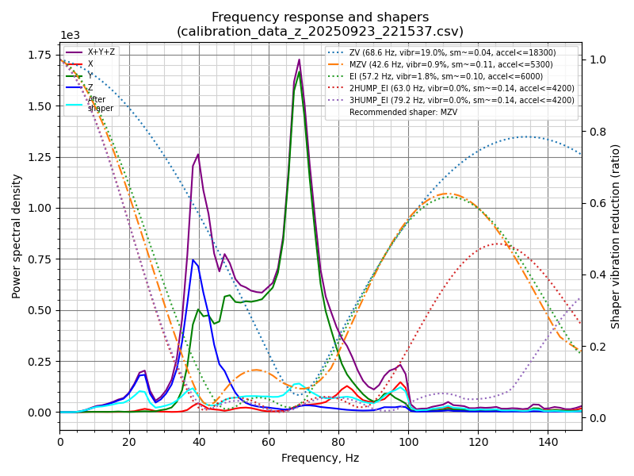

**What you're looking at:** On a 2.4 the gantry itself moves in Z, so the toolhead's accelerometer can measure Z too; the chart is Klipper's example of the result. The Z speed and acceleration limits are raised for the test only, and they exist because Z is belt-driven.

**Parts:** none.

**Do:** Do this only if you see Z-direction flaws in prints; skipping it breaks nothing downstream. It needs two temporary changes, because the stock Z limits are far below what the test needs:

```ini
[resonance_tester]
accel_chip_z: adxl345

[printer]
max_z_velocity: 20        # temporarily, up from 15
max_z_accel: 1550         # temporarily, up from 350
```

Send `RESTART` and run `SHAPER_CALIBRATE AXIS=Z`. If you like the result, `SAVE_CONFIG` (it writes `shaper_type_z` / `shaper_freq_z`). Then **put `max_z_velocity` and `max_z_accel` back to 15 and 350.**

**Check:** The two Z limits read 15 and 350 again once you are done.

Those are belt-and-driver limits for a four-motor belted Z, not resonance limits. Leaving them at 20/1550 is a way to skip Z steps, where the motors slip and lose their place.

Source: [Klipper docs § Measuring the resonances of Z axis](https://www.klipper3d.org/Measuring_Resonances.html#measuring-the-resonances-of-z-axis) · [Klipper `docs/img/calibrate-z.png`](https://raw.githubusercontent.com/Klipper3d/klipper/f0892d8/docs/img/calibrate-z.png) · [`leviathan-printer-rev-d-sbv2.cfg`](https://github.com/MotorDynamicsLab/LDOVoron2/blob/667521d/Firmware/leviathan-printer-rev-d-sbv2.cfg#L32-46)

Pause: ~10 min since the last pause — optional Z shaping either done or skipped, and `max_z_velocity` / `max_z_accel` back at **15 and 350**. Confirm those two numbers before you walk away; leaving them raised is how you skip Z steps on the next print.

---

## Part F — Pressure advance and flow

### Step 14.17 — Generate and print the Ellis PA pattern

(no image — the pattern and an annotated example are on [Ellis' Pattern Method page](https://ellis3dp.com/Print-Tuning-Guide/articles/pressure_linear_advance/pattern_method.html))

**What you're looking at:** Pressure advance makes up for molten plastic behaving like a spring in the nozzle: pressure lags behind the extruder, so corners get too little plastic going in and too much coming out. Ellis' pattern prints many corners across a sweep of values, so you can pick the right one by eye.

**Parts:**

- consumable: Prusament ASA, about 15 g

**Do:**

1. Open [ellis3dp.com/Pressure_Linear_Advance_Tool/](https://ellis3dp.com/Pressure_Linear_Advance_Tool/) with nozzle 0.4, layer 0.2 and the ASA temperatures 260/110.
2. **Turn on the acceleration-control option and set it to your external-perimeter acceleration**, not your new `max_accel`. At the machine maximum the pattern rings and the result is worthless.
3. Sweep **PA 0 to 0.10 in 0.005 steps** and print it.

**Check:** The pattern prints cleanly, with visible, distinct corner tests across the full sweep.

If both ends of your sweep look equally bad, widen the range and run it again rather than guessing.

Source: [Ellis' Print Tuning Guide — pressure advance, pattern method](https://ellis3dp.com/Print-Tuning-Guide/articles/pressure_linear_advance/pattern_method.html) · [Ellis' Pressure/Linear Advance tool](https://ellis3dp.com/Pressure_Linear_Advance_Tool/)

### Step 14.18 — Read the pattern and save the value

(no image — see text)

**What you're looking at:** You are looking for the one corner in the sweep that is sharp, with no gap and no bulge. The value belongs to the **filament**, not the machine, so it is saved in the filament profile rather than in `printer.cfg`.

**Parts:**

- tool: good light
- tool: loupe, optional

**Do:**

1. Find the **sharpest corner with the fewest flaws**: no gaps, no bulges, no dips.
2. Print the pattern again at 0.001–0.002 steps around that value to refine it.
3. Put the value in `Voron ASA`'s **filament** Start G-code, replacing Prusa's `M572`/`M142` lines, which Klipper does not know:

```
SET_PRESSURE_ADVANCE ADVANCE=<your value>
```

Or set `[extruder] pressure_advance:` instead, if you only ever print ASA on this machine.

**Check:** One corner is visibly the sharpest, and the value you saved is in the **0.01–0.08** band, most often 0.02–0.05.

**Helper:** Once the pattern has cooled off the plate, counts lines from its start to the sharpest corner with the loupe.

```gate-calc
id: tune-pa
title: Pressure advance — the value the pattern picked
inputs:
  - key: start
    label: Sweep starting value
    min: 0
    max: 0.1
    hint: the tool's starting value, 0 on the first pass
    low: Pressure advance does not go below 0. Set the tool's starting value to 0 and generate the pattern again.
    high: Above the 0 to 0.10 sweep this chapter prints. A direct drive Clockwork 2.5 with a Revo HF sits at the bottom of Klipper's typical band, so re-read the pattern before chasing a value up here.
    why: The starting value and the increment are what turn a line number into a number you can save, and they change between the first pass and the refinement run.
  - key: stepv
    label: Increment per line
    min: 0.001
    max: 0.005
    hint: 0.005 on the first pass, 0.001 to 0.002 to refine
    low: Finer than 0.001 and neighbouring lines are not tellable apart by eye. Regenerate at 0.001 or coarser.
    high: Coarser than the 0.005 the first pass uses, so the window can fall between two lines. Regenerate at 0.005 or finer.
    why: The refinement run re-prints around the winner at 0.001 to 0.002, so this number is not a constant and has to be read off the pattern you are actually holding.
  - key: line
    label: Lines above the starting value, counting the first line as 0
    min: 0
    max: 20
    hint: 0 to 20 across a 0 to 0.10 sweep at 0.005
    low: The count starts at 0 on the first line. If the sharpest corner is below the start, widen the range and re-run rather than guessing.
    high: Beyond the last line of a 0 to 0.10 sweep at 0.005. Widen the range and re-run rather than guessing.
    why: Counting the lines is the whole measurement, and a line miscounted by one is a pressure advance wrong by a full step of the sweep.
  - key: saved
    label: Value you are writing into the ASA filament profile
    min: 0.01
    max: 0.08
    hint: 0.01 to 0.08, most often 0.02 to 0.05, copied off the badge above
    low: Below the 0.01 to 0.08 band this step expects. Re-read the pattern, and if gapping and bulging show together stop tuning and check the Clockwork 2.5 for backlash.
    high: Above the 0.01 to 0.08 band this step expects. Re-read the pattern, and if gapping and bulging show together stop tuning and check the Clockwork 2.5 for backlash.
    why: This is the number that leaves the bench, and it belongs to the filament rather than the machine, so it goes in the ASA filament profile where every later ASA print picks it up.
  - key: corner
    label: One corner is visibly the sharpest, with no gap and no bulge
    kind: yesno
    no: If no value gives a clean corner, or gapping and bulging show at once, stop tuning. Ellis reads that as extruder trouble. Turn the extruder gear back by hand cold and feel for a dead zone.
    why: Pressure advance can only be read off a pattern that has a winner, and a pattern with no winner at any value is telling you about the extruder instead.
  - key: accel
    label: Pattern printed with the acceleration control option set to your external perimeter acceleration
    kind: yesno
    no: Left at the machine maximum the pattern rings and the result is worthless. Regenerate it with the acceleration control option set, and print it again.
    why: Ringing and pressure advance leave similar marks at a corner, so a pattern printed at full acceleration measures the frame instead of the nozzle.
derive:
  expr: start + stepv * line
  label: Pressure advance
  digits: 3
pass: The pattern picked cleanly. Save the badge value with SET_PRESSURE_ADVANCE in the ASA filament custom G-code, and write it in the tuning log.
```

There is rarely a perfect value. Ellis leans **higher**: if the sharpest corner has a tiny bit of gapping, still take it, because direct drive is that sensitive. If you cannot get a clean corner at *any* value, or you see gapping and bulging at the same time, stop tuning. Ellis: *"you likely have extruder issues."* Check the CW2.5 for backlash, play in its gears: with the toolhead cold, turn the extruder gear back the other way by hand and feel for a dead zone.

??? note "Where the 0.01–0.08 band comes from"

    The LDO config's own commented starting point is `#pressure_advance: 0.05`, and
    Klipper documents typical values as "between 0.050 and 1.000 (the high end usually
    only with bowden extruders)". For a direct-drive Clockwork 2.5 with a Revo HF and a
    0.4 nozzle in ASA, expect the bottom of that band. No vendor publishes a
    Revo-HF-specific number; treat 0.04 as the place to start looking and let the
    pattern decide. Most land between 0.02 and 0.05; the wider 0.01–0.08 gate only
    flags a reading worth a second look.

Source: [Ellis' Print Tuning Guide — saving the pressure-advance value](https://ellis3dp.com/Print-Tuning-Guide/articles/pressure_linear_advance/saving.html) · [Klipper docs § Pressure advance](https://www.klipper3d.org/Pressure_Advance.html) · [Klipper docs § SET_PRESSURE_ADVANCE](https://www.klipper3d.org/G-Codes.html#set_pressure_advance)

Pause: ~20 min since the last pause — the PA pattern printed and read, and the chosen value saved in the ASA **filament** profile. One calibration item closed; the extrusion multiplier is next.

### Step 14.19 — Extrusion multiplier / flow: the 2 % pass

(no image — see text)

**What you're looking at:** The extrusion multiplier is a straight percentage that scales how much plastic comes out. Judge it on the centre of a top surface: too little leaves gaps and valleys between the lines when held toward a light, too much leaves pellets, ridges and a rough raised surface. The edges always look over-extruded and prove nothing.

**Parts:**

- consumable: Prusament ASA, about 25 g

**Do:**

1. Slice Ellis' **30 × 30 × 3 mm** cube with the settings below, once per multiplier: **92, 94, 96, 98 %** in `Voron ASA`.
2. Print the four one at a time, back to back, with the chamber hot.

| Setting | Value |
|---|---|
| Top solid infill extrusion width | **0.4 mm**, typed in mm: PrusaSlicer reads a % as a share of layer height |
| Infill | 30 % or more |
| Bottom solid layers / minimum shell thickness | 2 / 0 |
| Top solid layers | 10 |
| Top solid infill speed | ~60 mm/s |
| Slow down if layer print time is below | 0 |

**Check:** Judged on the **centre** of each top surface, one cube has no gaps between the top lines and no ridging.

```gate-calc
id: tune-em
title: Extrusion multiplier — the 2 % pass
inputs:
  - key: pick
    label: Lowest flow % whose centre top surface is clean (%)
    min: 92
    max: 98
    hint: the lowest of 92, 94, 96, 98 with no gaps and no ridging
    low: Below the 92 to 98 window Prusament ASA should land in. Re-check the rotation distance and the pressure advance you just saved before trusting a number this low.
    high: Above the 92 to 98 window Prusament ASA should land in. Print the row again one or two steps higher and read it the same way before accepting it.
    why: This one number scales every wall and every top surface the machine will print, and it is read off the top surface by eye, never off the caliper, because a size error is shrinkage and bulging rather than flow.
  - key: clean
    label: One cube in the row has no gaps between the top lines and no ridging
    kind: yesno
    no: Nothing in the row is clean, so the error is upstream of flow. Re-check the extruder and the pressure advance before sweeping wider or finer.
    why: The point of a four cube sweep is that one of them is right, and when none is, a finer sweep will not find what a mis-set extruder or pressure advance is hiding.
  - key: centre
    label: Judged on the centre of each top surface, not near the edges
    kind: yesno
    no: The edges always look over-extruded and prove nothing. Read the centre of each top surface toward a light and pick again.
    why: A cube read at its edges always argues for less plastic, so reading it there moves the multiplier the wrong way and throws away the cube that was actually right.
  - key: slice
    label: Sliced at top solid infill width 0.4 mm typed in mm, infill 30 % or more, bottom layers 2 with minimum shell 0, top layers 10, top solid infill about 60 mm/s, layer-time slowdown 0
    kind: yesno
    no: Re-slice the row with those settings and print it again. A percentage width in PrusaSlicer is a share of layer height, so 100 % lays 0.2 mm lines that read as gaps at any flow.
    why: Those settings are what make the top surface a measurement of flow rather than a test of the infill holding it up.
pass: Take this multiplier into the 0.5 % refinement pass next, then write the final number into the ASA filament profile, not the print profile.
```

Most filaments land in that 92–98 % window, and Prusament ASA should. PrusaSlicer 2.9.7 has no per-object extrusion multiplier: it is a filament setting, and Add settings offers only print settings, which Ellis also notes. So each cube is its own print, with its own `PRINT_START`, about 10 minutes before the first line.

The cubes are in Ellis' [`test_prints`](https://github.com/AndrewEllis93/Print-Tuning-Guide/tree/main/test_prints) folder. Export each slice under its multiplier, `em-092.gcode` and so on, so the four files cannot be mixed up.

Source: [Ellis' Print Tuning Guide — extrusion multiplier](https://ellis3dp.com/Print-Tuning-Guide/articles/extrusion_multiplier.html) · [Ellis — a note about line width](https://ellis3dp.com/Print-Tuning-Guide/articles/a_note_about_line_width.html) · [Ellis' `test_prints/`](https://github.com/AndrewEllis93/Print-Tuning-Guide/tree/main/test_prints) · [PrusaSlicer 2.9.6 `PrintConfig.hpp` — `extrusion_multiplier` in `GCodeConfig`](https://github.com/prusa3d/PrusaSlicer/blob/version_2.9.6/src/libslic3r/PrintConfig.hpp#L848-L861)

### Step 14.20 — The 0.5 % refinement pass

(no image — see text)

**What you're looking at:** A second, finer pass around the winner, judged the same way by eye on the centre of each top surface. The multiplier is not a size setting: Ellis tunes it for the surface, and Voron parts need no other compensation.

**Parts:**

- consumable: Prusament ASA, about 25 g

**Do:**

1. Take the winner from 14.19 and print four more cubes, one per print, at ±0.5 % and ±1.0 % around it.
2. Pick the smoothest centre and leave that number in `Voron ASA`, the **filament** preset, not the print profile.

**Check:** The chosen cube has an evenly smooth top, with no gaps and no ridging.

Source: [Ellis' Print Tuning Guide — extrusion multiplier](https://ellis3dp.com/Print-Tuning-Guide/articles/extrusion_multiplier.html)

Pause: ~30 min since the last pause — both extrusion-multiplier passes done, eight single-cube prints, and the final number left in `Voron ASA`. It was chosen by the top surface, not by a caliper.

### Step 14.21 — Re-check first-layer squish, because the multiplier moved

(no image — see text)

**What you're looking at:** Changing the extrusion multiplier changes how much plastic the first layer puts down, so the squish set in Ch 13 is now slightly off. The procedure and the save command are the same as before. This loop back is expected, not a sign that something went wrong.

**Parts:** none.

**Do:**

1. Print one more cube, or any wide flat part, and repeat the live-Z procedure (nudging the nozzle height while the first layer prints) from [Ch 13 Step 13.42](13-initial-startup.md#step-1342-print-it-and-set-the-first-layer-squish).
2. Save with `Z_OFFSET_APPLY_ENDSTOP`, then `SAVE_CONFIG`.

**Check:** The bottom surface is smooth, with the lines still individually visible and no gaps.

```gate-calc
id: tune-squish
title: First layer, re-checked after the multiplier moved
inputs:
  - key: fl
    label: First layer vs mid height X difference (mm)
    max: 0.15
    hint: within 0.15 mm of mid height, the same figure Gate A used
    high: Bigger than the 0.15 mm the cube comparison allows. Elephant foot compensation is wrong, so adjust it in 0.05 mm steps and print the coupon again rather than moving the multiplier back.
    why: The same 0.15 mm rule Gate A used on the Prusa has to hold on the Voron too, and a fat first layer is a compensation setting rather than the flow number you just spent two passes finding.
  - key: smooth
    label: Bottom surface smooth, lines still individually visible, no gaps
    kind: yesno
    no: Repeat the live Z procedure from Ch 13 until the lines are individually visible with no gaps between them, then save it.
    why: Changing the extrusion multiplier changed how much plastic the first layer puts down, so the squish committed in Ch 13 is now slightly off by construction.
  - key: saved
    label: Saved with Z_OFFSET_APPLY_ENDSTOP and then SAVE_CONFIG
    kind: yesno
    no: A live Z nudge that is not applied and saved is gone at the next restart. Run both, then re-home, because SAVE_CONFIG restarts Klipper.
    why: This is the last change this chapter makes to the Z offset, and every print after it inherits whatever is in the auto generated block at the bottom of the config.
pass: The essentials loop is closed. Extruder, first layer, pressure advance, extrusion multiplier, first layer again.
```

This closes the essentials loop. Ellis' order is extruder, surface prep, first layer, pressure advance, extrusion multiplier, and the multiplier feeding back into the first layer is expected.

Source: [Ellis' Print Tuning Guide — first layer squish](https://ellis3dp.com/Print-Tuning-Guide/articles/first_layer_squish.html) · [Klipper docs § Z_OFFSET_APPLY_ENDSTOP](https://www.klipper3d.org/G-Codes.html#z_offset_apply_endstop)

Pause: ~10 min since the last pause — first-layer squish set again after the extrusion-multiplier change, and saved with `Z_OFFSET_APPLY_ENDSTOP` + `SAVE_CONFIG`. The essentials loop is closed.

---

## Part G — Ongoing

### Step 14.22 — Bed mesh variance, and a backup

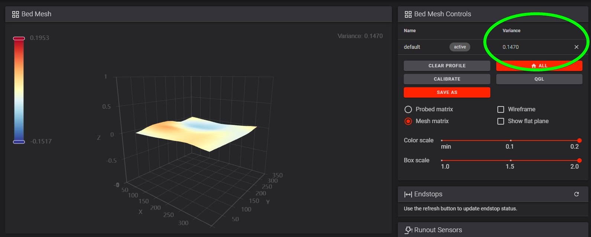

**What you're looking at:** The heightmap is the bed mesh drawn as a surface. The **Variance** figure is the real reading; the colours are stretched to fill the scale and make a 0.03 mm bed look alarming. `zero_reference_position` is what centres the mesh on Z0.

**Parts:** none.

**Do:**

1. Take the **Variance** from [14.6](#step-146-closed-chamber-soak-settle-qgl-lock-the-z-joints-hot-re-verify)'s hot mesh; mesh again only after a full soak.
2. Read the number, not the colours, and confirm `zero_reference_position: 175,175` is set.
3. Back up: run `cd ~/printer_data/config && git add -A && git commit -m "Ch 14 done: belts, shaper, max_accel, Z offset"`, and copy the directory off the Pi.

**Check:** The hot heightmap sat centred around Z0, its Variance is in the tuning log, and the config directory is copied off the Pi.

```gate-calc
id: tune-mesh
title: Bed mesh variance, and the backup
inputs:
  - key: variance
    label: Heightmap Variance (mm)
    max: 0.05
    hint: under 0.05 mm a mesh is optional, over it the mesh is not
    high: Not a fault, a decision. Over about 0.05 mm keep generating a mesh for every print, and read the number again after a full soak, because variance changes with chamber temperature as the gantry extrusions bend.
    why: The Variance figure is the real reading and the colours are stretched to fill the scale, so a 0.03 mm bed looks alarming on the heightmap and a sound one gets chased for nothing.
  - key: zref
    label: The config carries zero_reference_position 175,175
    kind: yesno
    no: A V2 on the stock Z endstop must have it, or the mesh floats away from Z0. Set it, restart, and mesh again.
    why: Without it the mesh is measured against nothing in particular, so a perfectly good bed map is applied at the wrong height on every print.
  - key: centred
    label: The heightmap sits centred around Z0
    kind: yesno
    no: A map that sits off Z0 is the zero reference position, not the bed. Fix that first, then mesh again.
    why: A map centred somewhere other than Z0 means the mesh and the Z offset disagree, and the first layer pays for it everywhere the two differ.
  - key: backup
    label: Config committed and the whole directory copied off the Pi
    kind: yesno
    no: Commit printer.cfg with its auto save block, moonraker.conf, config.leviathan and config.nitehawk, then copy the directory off the Pi.
    why: Everything this chapter measured lives in that directory, and an SD card failure without a copy means running the whole chapter again from cold.
pass: Mesh variance is in the tuning log and the config is off the Pi. Everything after this is print tuning, at Ellis' pace.
```

A V2 on the stock Z endstop **must** have `zero_reference_position: 175,175`, or the mesh floats away from Z0. Under about 0.05 mm total variance a mesh is optional, but keep making one for every print: the variance changes with chamber temperature as the gantry extrusions bend.

Copy `printer.cfg` with its auto-save block, `moonraker.conf`, `config.leviathan` and `config.nitehawk`. `git log` should show one commit per `SAVE_CONFIG` since the Ch 12 baseline.

Source: [Voron docs image `heightmap_variance.png`](https://raw.githubusercontent.com/VoronDesign/Voron-Documentation/36b876b/tuning/images/heightmap_variance.png) · [Voron docs — Secondary printer tuning § Bed mesh](https://docs.vorondesign.com/tuning/secondary_printer_tuning.html) · [Klipper docs § Bed Mesh](https://www.klipper3d.org/Bed_Mesh.html)

### Step 14.23 — Hand off to Ellis for everything after this

(no image — see text)

**What you're looking at:** Nothing to do on the machine. What is left after this chapter is print tuning, not machine tuning, and it has an accepted order: each of Ellis' sections assumes the ones above it are already done.

**Parts:** none.

**Do:** From here on, [**Ellis' Print Tuning Guide**](https://ellis3dp.com/Print-Tuning-Guide/) is the reference. Work through his **Tuning** section in his order; the numbering below is his, and each step assumes the ones above it:

| # | Section | Status after this chapter |
|---|---|---|
| 1 | [Extruder Calibration](https://ellis3dp.com/Print-Tuning-Guide/articles/extruder_calibration.html) | done — Ch 13 step 13.40, refined at step 14.7 |
| 2 | [Build Surface Preparation & Handling](https://ellis3dp.com/Print-Tuning-Guide/articles/build_surface_prep_handling.html) | read it — clean the plate before every print. The BOM does not name the kit flex plate's coating, and [Prusa's ASA advice](https://help.prusa3d.com/article/asa_1809) is glue on smooth or powder-coated PEI, none on satin *(verify on bench)* |
| 3 | [First Layer Squish](https://ellis3dp.com/Print-Tuning-Guide/articles/first_layer_squish.html) | done — Ch 13 step 13.42, then step 14.21 |
| 4 | [Pressure Advance / Linear Advance](https://ellis3dp.com/Print-Tuning-Guide/articles/index_pressure_advance.html) | done — steps 14.17, 14.18 |
| 5 | [Extrusion Multiplier](https://ellis3dp.com/Print-Tuning-Guide/articles/extrusion_multiplier.html) | done — steps 14.19, 14.20 |
| 6 | [PA / EM Oddities](https://ellis3dp.com/Print-Tuning-Guide/articles/pa_em_oddities.html) | read when a result won't converge |
| 7 | [Cooling and Layer Times](https://ellis3dp.com/Print-Tuning-Guide/articles/cooling_and_layer_times.html) | **next** — the ASA-specific one; minimum layer times matter more than fan % in a hot chamber |
| 8 | [Retraction](https://ellis3dp.com/Print-Tuning-Guide/articles/retraction.html) | **next** — CW2.5 is direct drive, expect a small value |
| 9 | [Infill/Perimeter Overlap](https://ellis3dp.com/Print-Tuning-Guide/articles/infill_perimeter_overlap.html) | later |
| 10 | [Stepover](https://ellis3dp.com/Print-Tuning-Guide/articles/stepover.html) | later |

**Check:** Cooling and layer times, and retraction, are on the list for the next session, with the tuning log ready to record them.

Beyond that, his **Advanced Tuning** section covers [Maximum Volumetric Flow Rate](https://ellis3dp.com/Print-Tuning-Guide/articles/determining_max_volumetric_flow_rate.html) (worth doing: the Revo HF's whole point is flow) and [Maximum Speeds and Accelerations](https://ellis3dp.com/Print-Tuning-Guide/articles/determining_max_speeds_accels.html), and his [Troubleshooting](https://ellis3dp.com/Print-Tuning-Guide/articles/index_troubleshooting.html) index is the fastest way to name a defect you are looking at.

Source: [Ellis' Print Tuning Guide](https://ellis3dp.com/Print-Tuning-Guide/) — link only, nothing from it is copied or mirrored

Pause: ~10 min since the last pause — the soak's mesh variance recorded, `printer.cfg` backed up off the Pi, and the tuning log filled in. Ready for Checkpoint 14; everything after this is Ellis, at your own pace.

### Step 14.24 — Claim the serial number and print the nameplate


**What you're looking at:** Voron serial numbers are issued by the community, not a company: moderators on the r/voroncorexy subreddit review a video of a finished machine and reply with yours. The nameplate carrying it is the first print made for the machine itself.

**Parts:**

- M3×8 SHCS ×2
- M3 roll-in T-nut ×2
- consumable: accent Prusament ASA, blue
- consumable: a sheet of paper
- tool: a pen
- tool: phone or camera

**Do:**

1. Film the printer printing, with the electronics bay closed and a handwritten sheet in shot showing your Reddit username and the date.
2. Post the video to r/voroncorexy as a serial request.
3. When the serial arrives, print the nameplate in accent ASA and screw it to the front top rail: `venv-cq/bin/python scripts/nameplate.py --serial V2.xxxx --names "Alex & Helper" --date 2026-12-20`

**Check:** A serial like `V2.1234` has arrived, and the plate is on the front top rail, clear of the closed door *(verify on bench)*.

**Helper:** Reads the serial back from the post and checks every character on the printed plate.

The request goes on the subreddit, and the machine has to be finished: cables tidied above the deck plate, electronics separated from the chamber, the bay covered. Your Reddit username and the date must be handwritten and in shot. A Discord username is optional now, and its old 4-digit tag is no longer required.

When your serial lands, the subreddit's nameplate bot posts a generic serial plate. This one is ours: front top rail, two M3 T-nuts, blue accent. [src](https://github.com/rdmullett/voron_serial_plate)

Pause: ~20 min since the last pause — the serial request is posted; the nameplate is generated, printed and fitted once the serial arrives, since the plate carries it. The plate mounts on the front top rail because the skirt ring covers the front bottom rail and the front verticals are only 20 mm wide; do not screw anything to the left vertical, which carries the door hinges.

Source: [Voron docs — About § Serial Numbers](https://docs.vorondesign.com/about.html#serial-numbers) · [TeamFDM FAQ — serial requirements](https://www.teamfdm.com/forums/topic/14-what-are-the-requirements-to-get-a-serial-for-my-printer/) · [Ch 11 Steps 11.12–11.13, 11.62](11-skirts-panels-door.md#step-1113-mount-the-front-skirt-segments) for what the skirt ring and the door hinges already occupy · `scripts/nameplate.py`

---

<a id="part-h-add-on-chamber-exhaust-fan"></a>

## Part H — Chamber exhaust fan

Steps 14.25 and 14.26 opened the chapter, so the five B13 parts are waiting in bin `14-exhaust` with the Step 00.8 fan, extension lead and mat. If Step 14.25 failed, skip this part and leave them in the bin. If any of them has not arrived yet, go to [Checkpoint 14](#checkpoint-14) and come back later; only its Part H row waits.

### Step 14.27 — Set the eight heat-set inserts in the housing

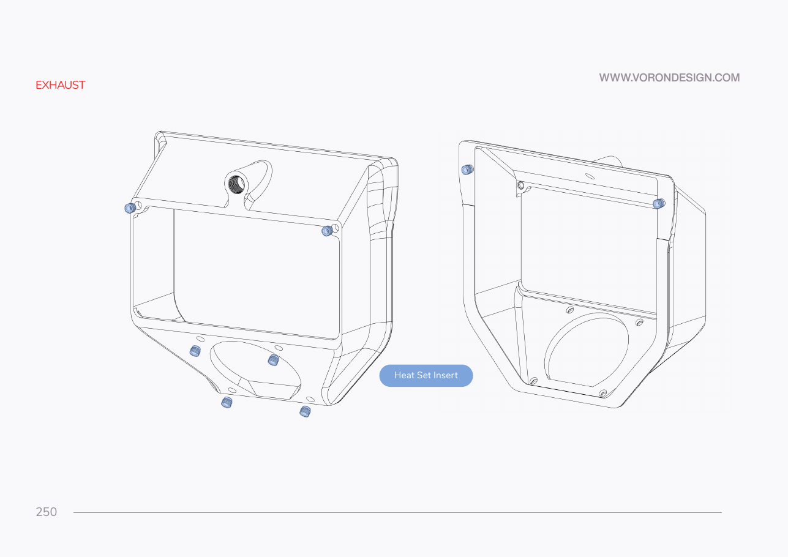{ crop="0.14 0.22 0.91 0.76" }
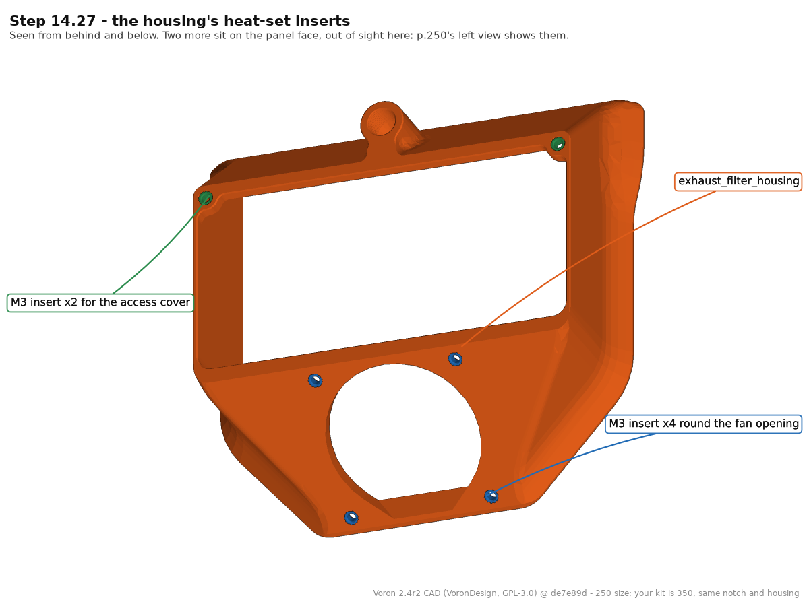

**What you're looking at:** The housing takes eight M3 heat-set inserts, brass threads you melt into the plastic: two on the panel face for the grill screws, two on the outer face for the access cover, and four round the fan opening for the fan and its grill.

**Parts:**

- M3×5×4 heat-set insert ×8
- tool: Nutopress Pro insert press, its M3 tip

**Do:** Press an insert into each of the eight holes p.250 highlights, with the part flat, the insert square and the same tip temperature as every insert before.

**Check:** Eight inserts are flush and square, with no plastic pushed up round any of them.

Source: [Voron manual p.250](https://github.com/VoronDesign/Voron-2/blob/de7e89d/Manual/Assembly_Manual_2.4r2.pdf#page=250)

---

### Step 14.28 — Build the fan and the filter into the housing

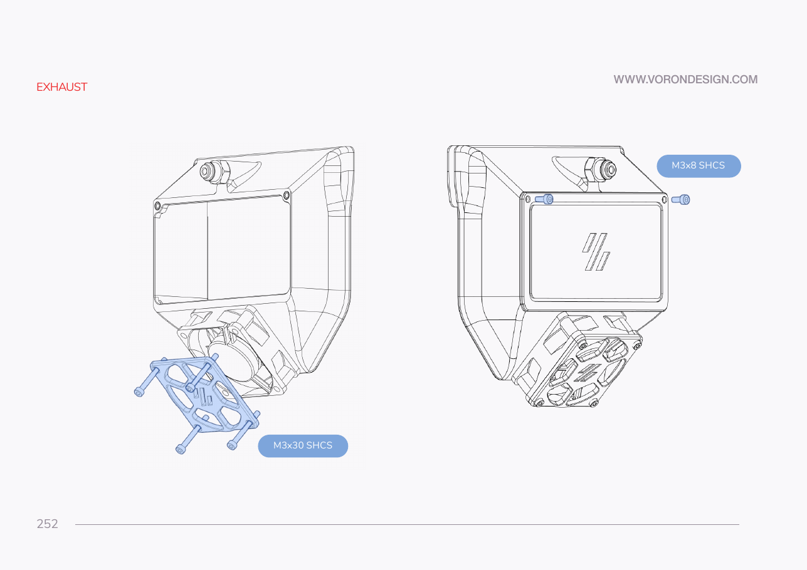{ crop="0.15 0.24 0.93 0.81" }
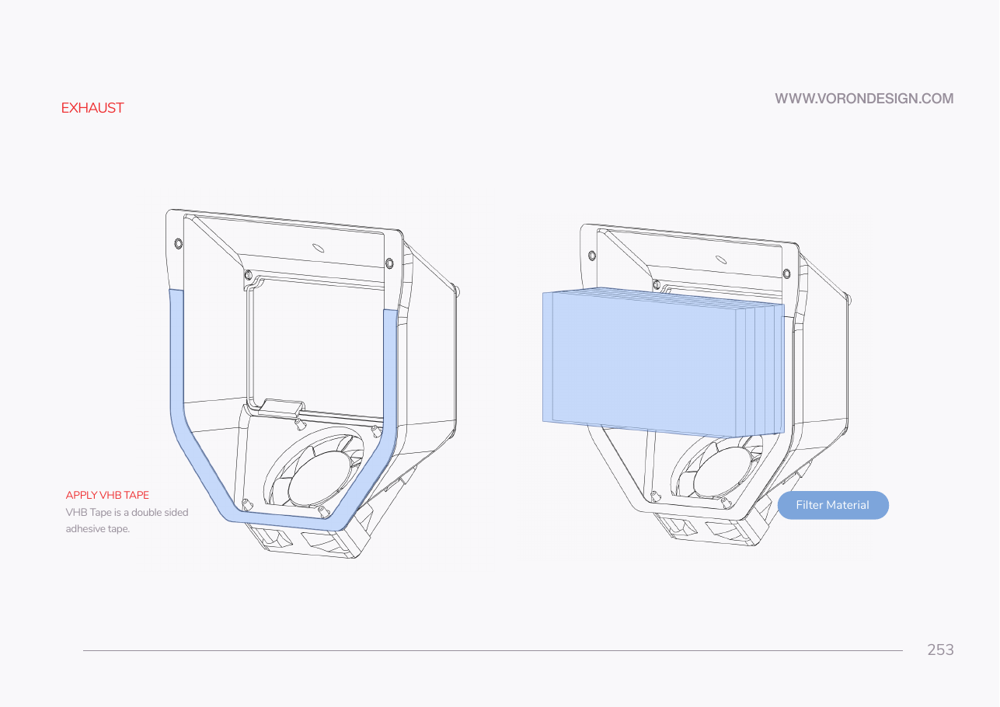{ crop="0.52 0.29 0.90 0.78" }
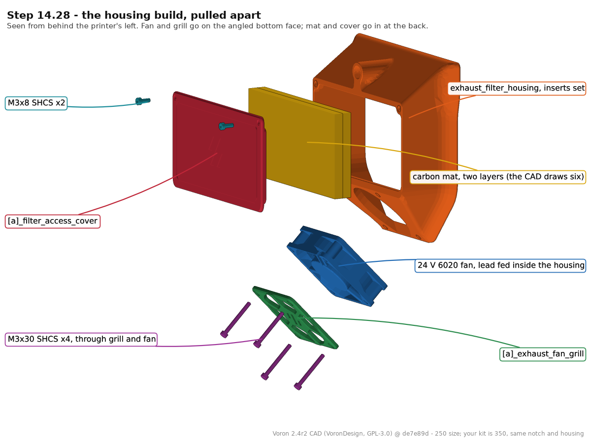

**What you're looking at:** The fan sits on the housing's angled bottom face. It pulls chamber air through the grill and the carbon mat and blows it out of the bottom. The access cover closes the filter bay, so the mat can be changed later.

**Parts:**

- exhaust housing ×1 — from bin 14-exhaust
- fan grill ×1 — from bin 14-exhaust
- access cover ×1 — from bin 14-exhaust
- 24 V exhaust fan ×1 — from bin 14-exhaust, bought at Ch 00
- carbon filter mat layer ×2 — from bin 14-exhaust, bought at Ch 00
- M3×30 SHCS ×4
- M3×8 SHCS ×2
- tool: scissors
- tool: 2.5 mm hex key

**Do:**

1. Screw the fan and grill on with four M3×30, arrow pointing out, and the fan lead fed inside the housing.
2. Cut two mat layers, not the full stack the Voron CAD draws, to fill the filter bay, and slide them in.
3. Close the access cover with two M3×8.

**Check:** The fan spins freely by hand, its arrow points out of the housing, and its plug reaches the panel face past the mat.

Two layers, because PLA and PETG need the airflow more than the filtering. The PLA test at the end of this part decides whether even those two stay.

Source: [Voron manual p.252](https://github.com/VoronDesign/Voron-2/blob/de7e89d/Manual/Assembly_Manual_2.4r2.pdf#page=252) · [Voron manual p.253](https://github.com/VoronDesign/Voron-2/blob/de7e89d/Manual/Assembly_Manual_2.4r2.pdf#page=253)

Pause: ~40 min since the last pause — eight inserts set, and the fan, its grill, the mat and the access cover on the housing. The Voron is untouched and still has its exhaust cover.

---

### Step 14.29 — Swap the exhaust cover for the housing

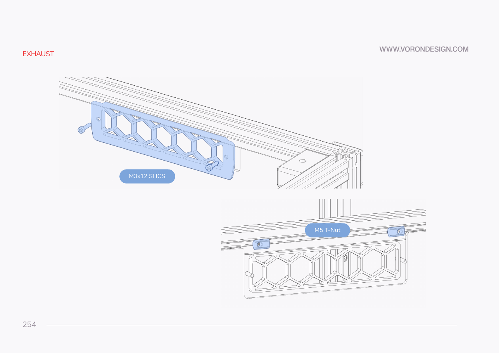{ crop="0.15 0.20 0.86 0.86" }
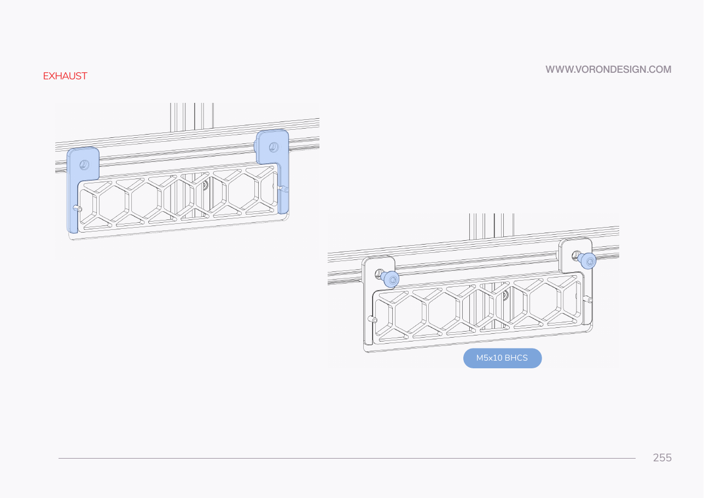{ crop="0.07 0.19 0.89 0.74" }
{ crop="0.06 0.28 0.47 0.80" }
{ crop="0.13 0.19 0.91 0.87" }
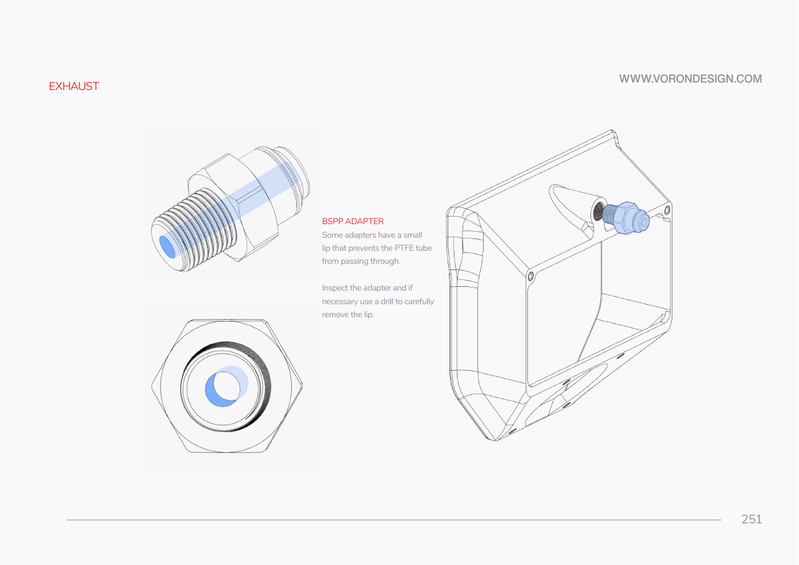{ crop="0.55 0.21 0.86 0.78" }
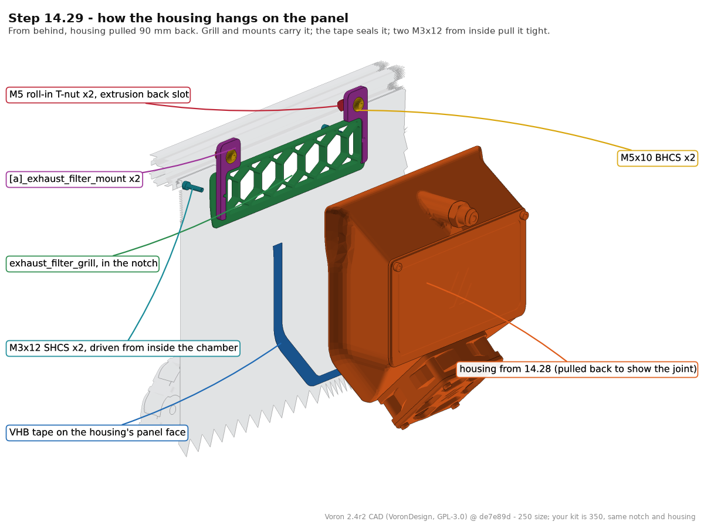


**What you're looking at:** The grill hangs in the notch on two mounts; the housing is taped on outside, and two grill screws pull it tight from inside.

**Parts:**

- reused: the exhaust grill and its two M3×12 SHCS
- reused: the cover tabs' two M5 T-nuts and M5×10 BHCS
- reused: the PTFE coupler and the reverse-bowden PTFE
- filter mount ×2 — from bin 14-exhaust
- consumable: VHB tape
- tool: 2.5 mm hex key
- tool: 3 mm hex key

**Do:**

1. Machine off: PTFE tube and coupler out of the cover; unscrew cover and grill, keeping all four screws.
2. Hang the grill on both mounts, same T-nuts, snug.
3. Pass the fan lead in through a grill opening. Screw the coupler into the housing's top boss and loop the PTFE from the bowden retainer into it, as p.258 draws `(verify on bench)`. Then tape the housing on and drive both M3×12 from inside.

**Check:** The housing sits square over the notch with no light round the tape, grill and mounts are tight, and full XY travel touches nothing.

**Helper:** Holds the housing square on the panel while the adult drives the two screws from inside.

Keep the exhaust cover: refitting it returns the machine to its Ch 11 state if the housing ever comes off.

Source: [Voron manual p.254](https://github.com/VoronDesign/Voron-2/blob/de7e89d/Manual/Assembly_Manual_2.4r2.pdf#page=254) · [Voron manual p.255](https://github.com/VoronDesign/Voron-2/blob/de7e89d/Manual/Assembly_Manual_2.4r2.pdf#page=255) · [Voron manual p.256](https://github.com/VoronDesign/Voron-2/blob/de7e89d/Manual/Assembly_Manual_2.4r2.pdf#page=256)

Pause: ~30 min since the last pause — the housing on the back panel, the exhaust cover kept as a spare, and the fan lead inside the chamber and unplugged. Leave the tape for an hour before anything leans on the housing.

---

### Step 14.30 — Shut down, unplug and prove it dead

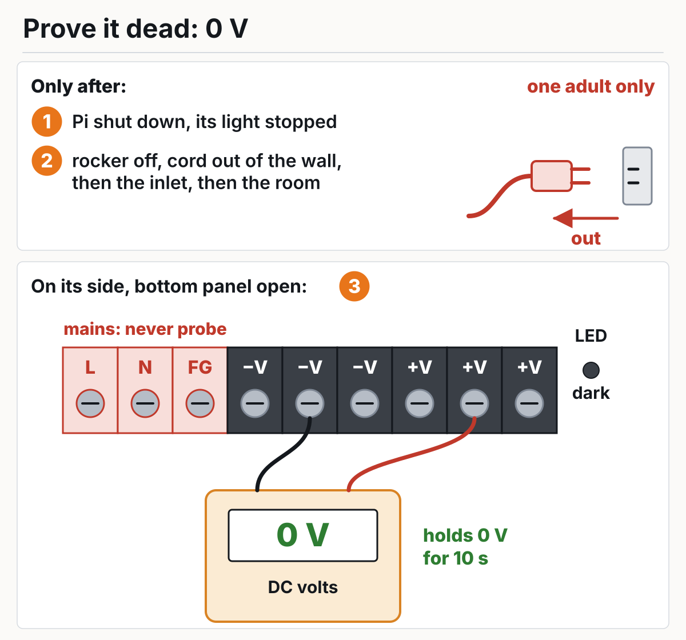

**What you're looking at:** The fan lead lands on the Leviathan board, under the deck and beside the power supply's mains terminals. The bay opens only on a dead machine, exactly as at [11.67](11-skirts-panels-door.md#step-1167-shut-down-unplug-and-prove-it-dead).

**Parts:**

- tool: multimeter

**Do:**

1. Shut the Pi down from Mainsail and wait for its ACT LED to stop.
2. Switch the rocker off, unplug the cord from the wall and then from the inlet, and take the cord out of the room.
3. Lay the machine on its side, open the bottom panel, and measure DC volts from +V to −V.

**Check:** The rocker is unlit, the PSU LED is dark and no cord is at the inlet, and the meter reads 0 V and holds it for ten seconds.

⚠ **Who is in the room, [00a.2](00a-mains-safety.md#step-00a2-write-the-who-is-in-the-room-rule-and-post-it-on-the-wall):** one adult at the machine until this Check passes. The helper stays out of the room until the meter holds 0 V and the cord is gone.

Source: [LDO wiring guide § Checkpoint 1](https://docs.ldomotors.com/en/voron/voron2/wiring_guide_rev_d#checkpoint-1) · [Voron docs — Electrical Wiring](https://docs.vorondesign.com/build/electrical/) · [Ch 11 Step 11.67](11-skirts-panels-door.md#step-1167-shut-down-unplug-and-prove-it-dead)

---

### Step 14.31 — Plug the lead into FAN0 and jumper it for 24 V

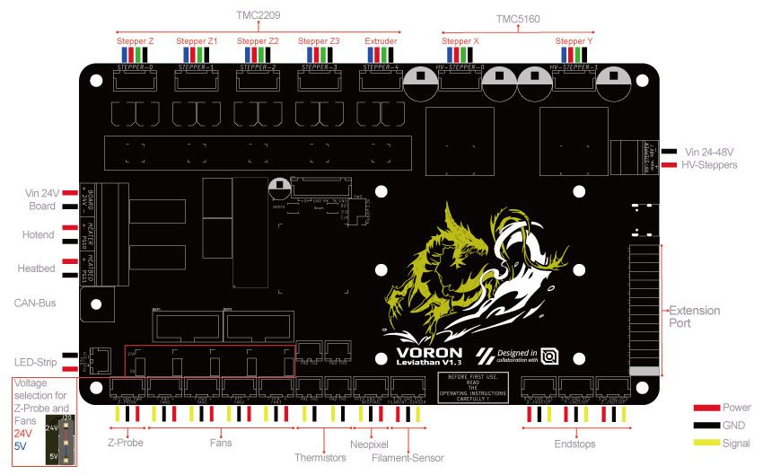
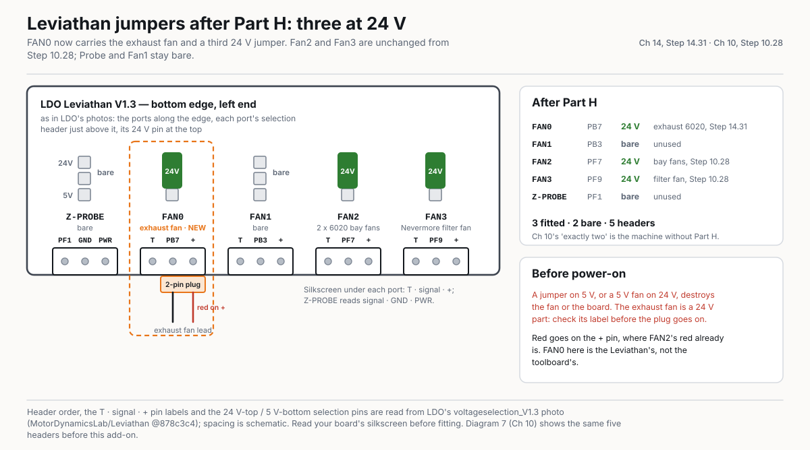


**What you're looking at:** FAN0 is the first of the Leviathan's four fan sockets, a 3-pin XH socket on pin `PB7`. The jumper block beside them sets each port's voltage, and this fan is a 24 V part.

**Parts:**

- JST-XH 2-pin extension lead, 1 m ×1 — from bin 14-exhaust, bought at Ch 00
- voltage-selection jumper ×1 — from the Ch 09 jumper bag
- consumable: zip ties
- consumable: VHB tape

**Do:**

1. Join the extension to the fan lead and run it down the inside of the back panel on VHB tie points, through the Z-chain notch.
2. Plug it into FAN0, with red on the same side as FAN2's red.
3. Put the jumper on Fan0's 24 V pins.

**Check:** There are exactly three jumpers, on Fan0, Fan2 and Fan3, all on the 24 V pins, with Fan1 and Probe bare, and the lead is clear of the bed and the gantry.

⚠ From here on this machine has three jumpers and a live FAN0, not the two jumpers Ch 10 checks for. A jumper on 5 V, or a 5 V fan on 24 V, destroys the fan or the board.

Source: [LDO Leviathan V1.3 guide](https://ldomotion.com/guides/voron-leviathan-v1-3) (manual p.7) · [Leviathan `voron2_leviathan.cfg` — FAN0 = PB7](https://github.com/MotorDynamicsLab/Leviathan/blob/878c3c4/Klipper_config/voron2_leviathan.cfg#L324-L327) · [Leviathan V1.3 schematic — FAN_0 is a JST XH 3-pin](https://github.com/MotorDynamicsLab/Leviathan/blob/878c3c4/KiCad/V1.3/Leviathan_V1.3.sch)

---

### Step 14.32 — Close the bay and power on, hand on the switch

(no image — see text)

**What you're looking at:** The first power-on after the bay was open repeats Ch 13's routine: a hand on the rocker switch and eyes on the board. A new lead and a third jumper are the only changes since the last good start.

**Parts:** none.

**Do:**

1. Close the bottom panel, stand the machine upright, and plug the cord back in.
2. Power on with a hand on the rocker, as at [13.3](13-initial-startup.md#step-133-power-on-again-hand-on-the-switch).

**Check:** Klipper shows Ready with both MCUs, there is no smell or smoke, and the exhaust fan is still, because nothing drives FAN0 yet.

Source: [Ch 00a Step 00a.11](00a-mains-safety.md#step-00a11-know-the-two-power-on-rituals-before-either-one-arrives) · [Ch 13 Step 13.3](13-initial-startup.md#step-133-power-on-again-hand-on-the-switch)

Pause: ~45 min since the last pause — FAN0 wired and jumpered for 24 V, the bay closed, and the machine on and Ready with the exhaust fan still. Klipper does not know about the fan yet.

---

### Step 14.33 — Add the exhaust fan to `printer.cfg`

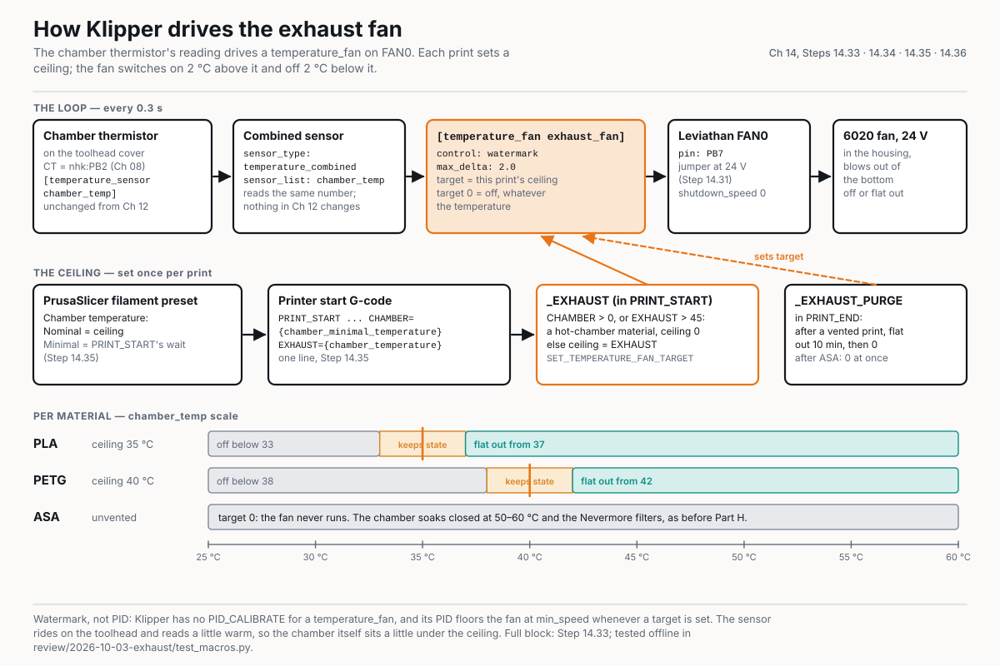

**What you're looking at:** A `[temperature_fan]` is a fan Klipper switches against a temperature target, used here as a ceiling. It reads the existing chamber sensor through a combined sensor, so nothing Ch 12 wrote changes. Two small macros set and clear the ceiling for each print.

**Parts:** none.

**Do:**

1. Paste the first block below under `[fan_generic nevermore]`.
2. Add the second block's line under `SET_GCODE_OFFSET Z=0` in `PRINT_START`, and the third under `TURN_OFF_HEATERS` in `PRINT_END`.
3. Click **SAVE & RESTART**.

```ini
#####################################################################
#   Chamber exhaust fan  — ADDED at Ch 14 Part H (add-on)
#   Stock Voron 2.4r2 exhaust housing with a 6020 24 V fan on the
#   Leviathan's FAN0. The chamber thermistor drives it through a
#   combined sensor, so [temperature_sensor chamber_temp], its gcode_id
#   and every macro that reads it stay exactly as Ch 12 wrote them.
#####################################################################

[temperature_fan exhaust_fan]
pin: PB7                       # Leviathan FAN0, not the toolboard's FAN0
max_power: 1.0
shutdown_speed: 0.0            # a fault leaves it off, as LDO's stock exhaust did
kick_start_time: 0.5
sensor_type: temperature_combined
sensor_list: temperature_sensor chamber_temp
combination_method: max
maximum_deviation: 999.9       # one sensor: nothing to compare
min_temp: 0                    # the same limits as chamber_temp
max_temp: 100
control: watermark
max_delta: 2.0                 # on at ceiling + 2, off at ceiling - 2
target_temp: 0                 # 0 = off until a print sets a ceiling
min_speed: 0.0
max_speed: 1.0

[gcode_macro _EXHAUST]
description: Set the exhaust ceiling for this print. PRINT_START calls it. FILTER=1 (a Nevermore material) is never vented.
variable_hot_above: 45         # a ceiling above this is a hot-chamber material: stay off
variable_purge_min: 10         # PRINT_END: minutes flat out after a vented print
gcode:
    
    
    
    
      
    
    UPDATE_DELAYED_GCODE ID=_EXHAUST_OFF DURATION=0
    SET_TEMPERATURE_FAN_TARGET TEMPERATURE_FAN=exhaust_fan TARGET={target}
    {action_respond_info("Exhaust: off" if target == 0 else "Exhaust: ceiling %.0f C" % target)}

[gcode_macro _EXHAUST_PURGE]
description: PRINT_END calls it. After a vented print, flat out for purge_min, then off.
gcode:
    
    
      SET_TEMPERATURE_FAN_TARGET TEMPERATURE_FAN=exhaust_fan TARGET=1   ; below any chamber: flat out
      UPDATE_DELAYED_GCODE ID=_EXHAUST_OFF DURATION={e.purge_min * 60}
    
      SET_TEMPERATURE_FAN_TARGET TEMPERATURE_FAN=exhaust_fan TARGET=0
    

[delayed_gcode _EXHAUST_OFF]
gcode:
    SET_TEMPERATURE_FAN_TARGET TEMPERATURE_FAN=exhaust_fan TARGET=0
```

```ini
    _EXHAUST CHAMBER={chamber} TARGET={params.EXHAUST|default(0)|float} FILTER={1 if filter else 0}
```

```ini
    _EXHAUST_PURGE
```

**Check:** Klipper restarts clean, and Mainsail lists `exhaust_fan` at target 0 beside `chamber_temp`, both reading the same temperature.

**Helper:** Reads the pin line back off the screen: PB7, not PF7.

Leave `[temperature_sensor chamber_temp]` exactly as it is. The combined sensor reads it, so its pin is declared once, and `PRINT_START`'s chamber wait and `M105`'s `chamber_th` keep working.

`SET_TEMPERATURE_FAN_TARGET TEMPERATURE_FAN=exhaust_fan MAX_SPEED=0.6` makes the fan quieter until the next restart.

Source: [Klipper docs § temperature_fan](https://www.klipper3d.org/Config_Reference.html#temperature_fan) · [Klipper docs § Combined temperature sensor](https://www.klipper3d.org/Config_Reference.html#combined-temperature-sensor) · [Klipper `temperature_fan.py`](https://github.com/Klipper3d/klipper/blob/f0892d8/klippy/extras/temperature_fan.py) · [Voron docs — Chamber Temperature & Exhaust Fan](https://github.com/VoronDesign/Voron-Documentation/blob/b8c014f/community/howto/alchemyEngine/chamber_temperature_exhaust_fan.md) · `review/2026-10-03-exhaust/test_macros.py`

---

### Step 14.34 — Test the fan by target, then on a hot chamber


**What you're looking at:** With a ceiling set, the fan starts 2 °C above it and stops 2 °C below, reading the toolhead's chamber sensor. The bed is the heat source, and the soak also proves the closed housing does not cost ASA its chamber band.

**Parts:** none.

**Do:**

1. Send the first three lines below: air blows out of the housing, then stops.
2. With the door shut, send `M140 S110` and log `chamber_temp` once it settles, up to 45 min.
3. Send the next two: the fan runs, then stops. Then send the last two.

```
SET_IDLE_TIMEOUT TIMEOUT=7200
SET_TEMPERATURE_FAN_TARGET TEMPERATURE_FAN=exhaust_fan TARGET=15
SET_TEMPERATURE_FAN_TARGET TEMPERATURE_FAN=exhaust_fan TARGET=0
TURN_OFF_HEATERS
SET_TEMPERATURE_FAN_TARGET TEMPERATURE_FAN=exhaust_fan TARGET=45
SET_TEMPERATURE_FAN_TARGET TEMPERATURE_FAN=exhaust_fan TARGET=0
SET_IDLE_TIMEOUT TIMEOUT=1800
```

**Check:** The settled chamber is still in the 50–60 °C band, and at ceiling 45, with the bed off, the fan runs and then stops near 43 °C.

```gate-calc
id: exhaust-test
title: Exhaust fan — switches at its ceiling, and ASA still soaks
inputs:
  - key: settled
    label: "Settled chamber_temp: bed 110 °C, door shut, ceiling 0 (°C)"
    min: 50
    low: The closed housing leaks heat. Check the tape round the panel and the access cover, then soak again.
    why: Step 14.8's 50–60 °C band is what ASA needs; a closed exhaust must not cost it.
  - key: stop
    label: "chamber_temp when the fan stopped at ceiling 45, bed off (°C)"
    nominal: 43
    tol: 1.5
    low: Stopped late. Read max_delta in the block; it should be 2.0.
    high: Stopped early. Read max_delta in the block; it should be 2.0.
    why: The fan stops at the ceiling minus max_delta, 2 °C, so each print holds a 4 °C band.
pass: The fan follows its ceiling, and the ASA soak is unchanged. Log both numbers.
```

⚠ The bed reaches 110 °C. Keep your hands off the plate until it reads under 40 °C again.

Source: [Klipper docs § SET_TEMPERATURE_FAN_TARGET](https://www.klipper3d.org/G-Codes.html#set_temperature_fan_target) · [Klipper `temperature_fan.py` § watermark](https://github.com/Klipper3d/klipper/blob/f0892d8/klippy/extras/temperature_fan.py#L117-L137) · [Ch 14 Step 14.8](#step-148-set-the-chamber-target-and-understand-the-soak)

Pause: ~35 min since the last pause — the exhaust in `printer.cfg`, the fan proved by target and on a hot chamber, heaters off, ceiling 0, and the idle timeout back at 1800.

---

### Step 14.35 — Give PrusaSlicer the exhaust ceiling

(no image — see text)

**What you're looking at:** Each filament preset already has two chamber fields, Nominal and Minimal, which Prusa's Core One uses the same way: a ceiling its fans hold, and a warmth it waits for. The new start line passes both, so each filament sets its own.

**Parts:**

- tool: the laptop with PrusaSlicer 2.9.7

**Do:**

1. In Expert mode, make the line below the `Voron 2.4 350` start G-code.
2. Save Prusament PLA and PETG as `Voron PLA` and `Voron PETG`, deleting `M572`/`M142`, with Chamber temperature Nominal / Minimal at PLA 35 / 0 and PETG 40 / 0.
3. `Voron ASA` keeps its 14.9 Minimal.

```
PRINT_START BED=[first_layer_bed_temperature] EXTRUDER=[first_layer_temperature] CHAMBER={chamber_minimal_temperature[initial_tool]} EXHAUST={chamber_temperature[initial_tool]} FILAMENT={filament_type[initial_tool]}
```

**Check:** A PLA slice's start line ends `CHAMBER=0 EXHAUST=35 FILAMENT=PLA`, an ASA slice carries your Minimal as `CHAMBER` and `FILAMENT=ASA`, and neither has `M141` or `M191`.

**Helper:** Reads each Nominal and Minimal value back from the preset while the adult types.

⚠ `EXHAUST=` is the only new field: `CHAMBER` has come from each filament's Minimal since 14.9. Keep PLA and PETG at Minimal 0, because anything higher makes a vented print wait forever for heat it never makes.

Prusa's own presets ship PLA 20, PETG 35 and ASA 55 / 40. Kept as they are, PLA just runs the fan more, and ASA stays unvented either way.

Source: [PrusaSlicer 2.9.6 `GCode.cpp` — chamber commands only with automatic temperature commands on](https://github.com/prusa3d/PrusaSlicer/blob/version_2.9.6/src/libslic3r/GCode.cpp#L1981-L2001) · [Ch 13 Step 13.41](13-initial-startup.md#step-1341-make-the-voron-printer-profile-and-slice-the-cube) · `review/2026-10-03-exhaust/DESIGN.md`

---

### Step 14.36 — Print PLA under a 35 °C ceiling, log it, shut down

(no image — see text)

**What you're looking at:** The proof is a real PLA print with the door shut: the chamber should sit near the ceiling while the fan switches on and off. Voron's own notes warn that PLA may still need the door open, and this print finds out.

**Parts:**

- consumable: PLA, about 50 g

**Do:**

1. Print an hour-long PLA part from the Voron PLA preset, with the door shut.
2. Every 15 min, log `chamber_temp` and whether the fan is running.
3. Commit the config, copy it off the Pi, and shut down as at [13.43](13-initial-startup.md#step-1343-shut-down-properly).

**Check:** From 20 min in, `chamber_temp` stays at or under 37 °C, and after the print the fan runs for about 10 min, then stops.

If the chamber passes 37 °C with the fan flat out, take one mat layer out and print again. Past that, print PLA with the door slightly open.

The sensor rides on the toolhead and reads warm, so the chamber itself runs a little under the ceiling. A thermometer hung in the middle of the chamber shows by how much.

Source: [Voron docs — filament tuning, PLA in an enclosure](https://github.com/VoronDesign/Voron-Documentation/blob/b8c014f/tuning/filament_tuning.md) · [Voron docs — Chamber Temperature & Exhaust Fan](https://github.com/VoronDesign/Voron-Documentation/blob/b8c014f/community/howto/alchemyEngine/chamber_temperature_exhaust_fan.md)

Pause: ~30 min since the last pause — PLA printed under the ceiling with the chamber logged, the purge run and stopped, the config committed and copied off the Pi, and the machine shut down properly.

---

## Tuning log

Fill this in as you go: one row per change, both of you initialling. It is the record that makes the next tuning session cheap, and the first thing you check when a print goes wrong three months from now.

| Date | What | Value set | How measured | Result / notes | By |
|---|---|---|---|---|---|
| | Bed PID @ 100 °C | Kp ___ Ki ___ Kd ___ | `PID_CALIBRATE` + `SAVE_CONFIG` | holds ±___ °C | |
| | Hotend PID @ 245 °C | Kp ___ Ki ___ Kd ___ | `PID_CALIBRATE`, fans 25 % | holds ±___ °C | |
| | A belt tension | ___ Hz | 150 mm span, ___ app | | |
| | B belt tension | ___ Hz | 150 mm span, ___ app | | |
| | Z belts (4) | ___ / ___ / ___ / ___ Hz | 150 mm, top belt clip to Z idler centre | | |
| | Z joints locked hot (14.6) | soak ___ min, chamber ___ °C | QGL ×___ runs, square OK | QGL after: ___ retries | |
| | `PROBE_ACCURACY` σ | ___ mm | hot, soaked ___ min | target < 0.003 | |
| | `rotation_distance` | 13.40: ______ → 14.7: ______ | 100 mm extrude, actual ___ mm | within 0.5 %? | |
| | Chamber soak | ___ °C in ___ min | `chamber_temp` during the 14.3 / 14.6 soak, panels + door on | | |
| | Cube X / Y / Z (Voron) | ___ / ___ / ___ mm | caliper, mid-height | vs Prusa: ___ / ___ / ___ | |
| | `shaper_type_x` / freq | ______ / ___ Hz | `SHAPER_CALIBRATE` | vibrations ___ %, smoothing ___ | |
| | `shaper_type_y` / freq | ______ / ___ Hz | `SHAPER_CALIBRATE` | vibrations ___ %, smoothing ___ | |
| | `max_accel` | ______ mm/s² | lower of the two suggestions, minus margin | | |
| | Pressure advance (ASA) | ______ | Ellis pattern, ___ to ___ step ___ | | |
| | Extrusion multiplier (ASA) | ___ % | Ellis 30×30×3 cubes, centre of the top surface by eye | top smooth, no gaps, no ridging? | |
| | Z offset (final) | `position_endstop` ______ | `Z_OFFSET_APPLY_ENDSTOP` | | |
| | Bed mesh variance | ___ mm | `BED_MESH_CALIBRATE`, end of the 14.6 soak | centred on Z0? | |
| | Part H: ASA soak with the housing (14.34) | ___ °C in ___ min | `chamber_temp`, bed 110, ceiling 0 | still 50–60 °C? | |
| | Part H: fan stop at ceiling 45 (14.34) | ___ °C | bed off, `chamber_temp` | 43 ±1.5? | |
| | Part H: PLA under a 35 ceiling (14.36) | ___ to ___ °C | every 15 min, door shut | fan on at ___ of ___ readings | |
| | | | | | |

---

## Checkpoint 14

**Built:** a tuned printer with every number in the tuning log

- [ ] Bed and hotend PID tuned in Ch 13 and saved with `SAVE_CONFIG`; both hold within ±0.5 °C of the target.
- [ ] A and B belts both at about 110 Hz over a measured 150 mm span, equal to each other after the gantry moves away and back.
- [ ] All four Z belts at about 140 Hz over a measured 150 mm span, even with each other, set at the Z idler tensioner screws with the belt clamps untouched.
- [ ] One closed-chamber soak of at least 1½–2 h, Steps 14.3 and 14.6, panels and door on, with the settled `chamber_temp` and the hot mesh Variance logged from it; QGL run 3–5× hot with shrinking corrections; the machinist square clean at both front corners, hot; the four Z joint M5×40 screws tightened **hot**; and the idle timeout set back with `SET_IDLE_TIMEOUT TIMEOUT=1800` after the last hot check.
- [ ] `QUAD_GANTRY_LEVEL` settles in 3 retries or fewer, hot, after the lock; `PROBE_ACCURACY` σ < 0.003 mm with no trend.
- [ ] `rotation_distance` checked against the Ch 13 value: 100 mm requested measures 99.5–100.5 mm, and `22.6789511` appears nowhere in `printer.cfg`.
- [ ] `PRINT_START` (Ch 12 Step 12.36, with Step 14.9's purge line) homes, heats the bed, soaks, runs QGL, re-homes Z, meshes, heats the nozzle and purges, tested on its own from the console with `CHAMBER=0`.
- [ ] The chamber reaches the 50–60 °C band with the panels and door closed.
- [ ] The Voron cube (printed in Ch 13) measured: X and Y within ±0.15 mm and Z within ±0.10 mm of 30.00 mm.
- [ ] Both cubes (Prusa and Voron) measured into the comparison table.
- [ ] `MEASURE_AXES_NOISE` in the 1–100 range; `[resonance_tester] probe_points: 175, 175, 20` confirmed live (Ch 12 Step 12.27).
- [ ] `[input_shaper]` saved for X and Y; neither axis below 25 Hz.
- [ ] `[printer] max_accel` lowered from the stock 10000 to at or below the calibration's suggestion, with margin.
- [ ] `max_z_velocity: 15` / `max_z_accel: 350` put back if Z shaping was tried.
- [ ] `Voron ASA` filament preset saved: `CHAMBER` from its Minimal, below the settled chamber (Step 14.9), with PLA and PETG still at Minimal 0.
- [ ] Pressure advance set per filament for ASA, and recorded.
- [ ] Extrusion multiplier set in `Voron ASA`, one cube per print, and recorded.
- [ ] First-layer squish checked again *after* the extrusion-multiplier change, and saved with `Z_OFFSET_APPLY_ENDSTOP`.
- [ ] Every fastener the shaper run could have loosened checked again.
- [ ] `~/printer_data/config` committed (one commit per `SAVE_CONFIG`) and copied off the Pi.
- [ ] Tuning log filled in, with initials.
- [ ] Serial request posted to r/voroncorexy (Step 14.24); the nameplate goes on the front top rail once the serial arrives.
- [ ] Part H, if fitted: Step 14.25's calculator passed before Part A; exactly three jumpers, Fan0, Fan2 and Fan3, all at 24 V; the ASA soak still settles at 50–60 °C with the housing closed; a PLA print held `chamber_temp` at or under 37 °C, then purged and stopped; config committed.

## Common mistakes

- **Tensioning belts before the Ch 06b squaring.** The squaring procedure starts by fully releasing the A/B tension, so anything set before it is thrown away and you do the work twice (survey §5.2 W1).
- **Reading a belt frequency without measuring the span.** 110 Hz only means something over 150 mm. Eyeballing the span is the most common way people end up with belts 30 % out and blame the printer.
- **Loosening a Z belt clamp to adjust Z tension.** The clamps on each gantry corner, on top of the front idler or A/B drive and under the Z joint, hold both belt ends; the adjuster is the idler tensioner screw at the top of each vertical. A released clamp means threading the belt again.
- **Tightening the Z joints cold, or skipping the closed-chamber soak.** The point of Step 14.6 is locking the gantry in at full heat expansion. A cold tighten looks the same on the bench and shows up later as an uneven first layer.
- **Running `SHAPER_CALIBRATE` before the first successful print, or before final belt tension.** Both change the resonances you just measured, so the result is out of date before you use it. The same goes for pressure advance, which also shifts when input shaping is switched on.
- **Sending `SAVE_CONFIG` after the shaper run and stopping there.** It writes `[input_shaper]` but deliberately does *not* touch `max_accel`. Leaving the stock `max_accel: 10000` means you shaped out the ringing and then printed at an acceleration that brings it back.
- **Fixing an oversize cube with negative XY size compensation or the extrusion multiplier.** Negative XY compensation makes every bearing bore and screw hole in the machine oversize, and a multiplier moved to hit a caliper number leaves the best top-surface value found at 14.19–14.20. Voron parts need no compensation beyond a good multiplier tune (Ellis).
- **PID-tuning the hotend at 260 °C with `max_temp: 270`.** The tune's relay test, which switches the heater fully on and off, overshoots the target and can reach the limit mid-run *(verify on bench)*. Tune at 245, or raise `max_temp` to 290 first.
- **Raising `[heater_bed] max_power` above 0.6 to warm up faster.** LDO set it to protect a 355 mm cast plate from warping. Wait the extra five minutes.
- **Skipping the heat soak because the bed says 110 °C.** The bed reaches temperature in minutes; the *frame* is there only when `PROBE_ACCURACY` stops trending. Probing a cold frame gives a mesh and a Z offset that are wrong for every print you then run.
- **Soaking on the stock idle timeout.** `[idle_timeout] timeout: 1800` (LDO config) runs `TURN_OFF_HEATERS` + `M84` 30 minutes after the last move. A static soak has no moves, so the heaters go off, the Z motors release and the chamber seems to stall. Send `SET_IDLE_TIMEOUT TIMEOUT=99999` when the one long soak starts at 14.3 and set it back to 1800 at the end of 14.6; use 7200 before any shorter soak, 14.8's re-soak or 14.34's.

## Next

The machine is tuned. Print something for the machine itself, such as a nozzle brush, a spool holder or the Clicky-Clack spares, then work through Ellis' sections 7 and 8 (cooling and layer times, retraction) as your first real tuning session on ASA.

