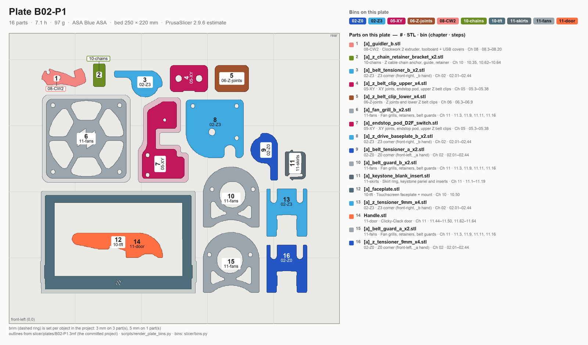
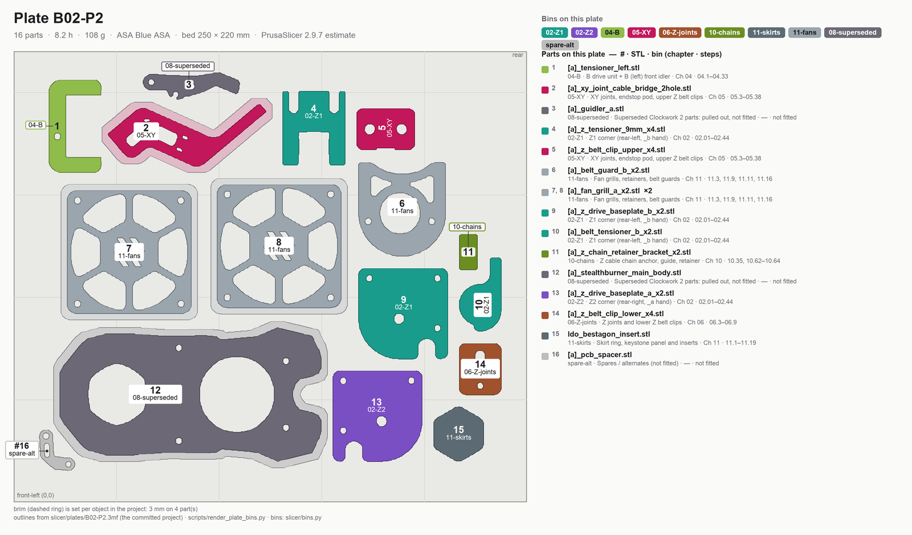
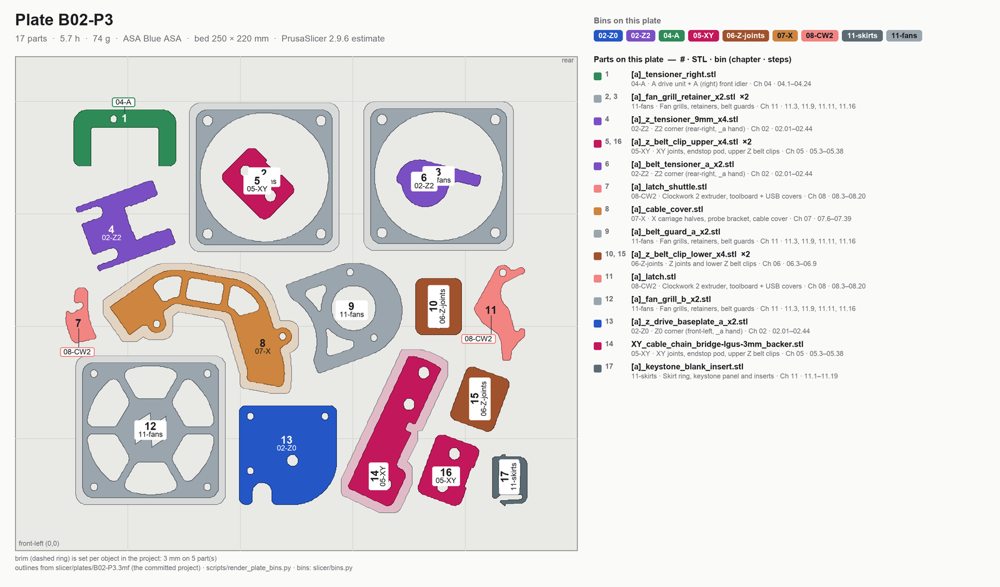
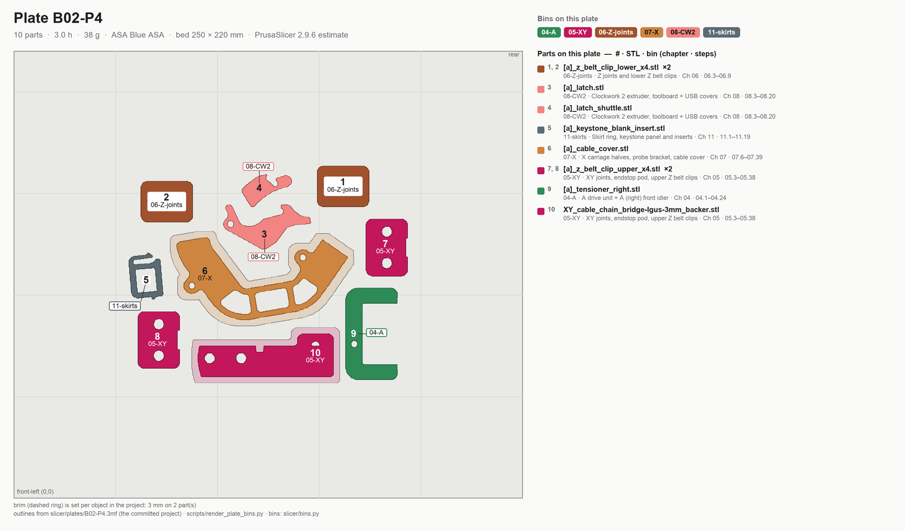
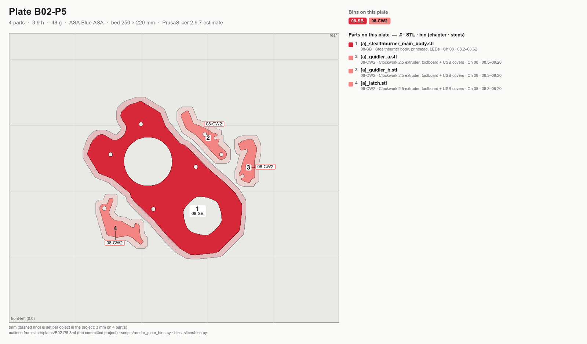

# Batch B02 — Accent parts (blue)

Every accent part in the whole build. B02-P1 to P4 print in one continuous session; B02-P5 is the
catch-up plate for the Clockwork 2.5 switch (2026-11-10) and takes one more blue load. The accent is **Prusament ASA Blue**, matching the blue LDO frame and the blue Clicky-Clack
door over the black body. **Colour changes: black → blue here and blue → black after, once more for B02-P5 if it prints later.**
Nothing here has a press fit, so it needs Gate A only. Like every batch, it prints in numeric order, overlapping the build.

```mascot
pose: print
caption: Every accent part in one session. One blue spool, and yes, it matches my scarf.
```

**Time:** 24.9 h (5 plates) — PrusaSlicer 2.9.7 estimates.

**Sessions:** 5 plate starts (~5 min hands-on each, 7.1 / 8.2 / 2.6 / 3.1 / 3.9 h unattended) + ~20 min inspect and bin.

**Prerequisites:** **Gate A passed** (Step B00.5 — the cube; a colour change doesn't skip the calibration
requirement). Gate B is not needed: no bearing seat, rail fit or insert boss on these plates is load-bearing
before assembly.

**Printed parts**


| STL | Repo path | Qty | Colour | g ea | Bin |
|---|---|---:|---|---:|---|
| `[a]_z_drive_baseplate_a_x2.stl` | Voron-2 `STLs/Z_Drive/` | 2 | Blue | 9.7 | 02-Z0, 02-Z2 (one each) |
| `[a]_z_drive_baseplate_b_x2.stl` | Voron-2 `STLs/Z_Drive/` | 2 | Blue | 9.7 | 02-Z1, 02-Z3 (one each) |
| `[a]_belt_tensioner_a_x2.stl` | Voron-2 `STLs/Z_Drive/` | 2 | Blue | 1.9 | 02-Z0, 02-Z2 (one each) |
| `[a]_belt_tensioner_b_x2.stl` | Voron-2 `STLs/Z_Drive/` | 2 | Blue | 1.9 | 02-Z1, 02-Z3 (one each) |
| `[a]_z_tensioner_9mm_x4.stl` | Voron-2 `STLs/Z_Idlers/` | 4 | Blue | 8.1 | 02-Z0–Z3, one each |
| `[a]_tensioner_left.stl` | Voron-2 `STLs/Gantry/Front_Idlers/` | 1 | Blue | 7.4 | 04-B |
| `[a]_tensioner_right.stl` | Voron-2 `STLs/Gantry/Front_Idlers/` | 1 | Blue | 7.4 | 04-A |
| `[a]_cable_cover.stl` | Voron-2 `STLs/Gantry/AB_Drive_Units/` | 1 | Blue | 8.0 | 07-X |
| `[a]_z_chain_retainer_bracket_x2.stl` | Voron-2 `STLs/Gantry/AB_Drive_Units/` | 2 | Blue | 0.6 | 10-chains |
| `[a]_endstop_pod_D2F_switch.stl` | Voron-2 `STLs/Gantry/X_Axis/XY_Joints/` | 1 | Blue | 8.1 | 05-XY |
| `[a]_xy_joint_cable_bridge_2hole.stl` | Voron-2 `STLs/Gantry/X_Axis/XY_Joints/` | 1 | Blue | 9.2 | 05-XY |
| `XY_cable_chain_bridge-Igus-3mm_backer.stl` | whopping_Voron_mods `extrusion_backers/STLs/` | 1 Note: alternate to the above — fit whichever clears the Ti backers, see §Read first | Blue | 9.1 | 05-XY |
| `[a]_z_belt_clip_lower_x4.stl` | Voron-2 `STLs/Gantry/` | 4 | Blue | 2.3 | 06-Z-joints |
| `[a]_z_belt_clip_upper_x4.stl` | Voron-2 `STLs/Gantry/` | 4 | Blue | 2.4 | 05-XY |
| `[a]_stealthburner_main_body.stl` | Stealthburner `STLs/Stealthburner/` | 2 *(r2 body off B02-P5 is fitted; the B02-P2 body is superseded)* | Blue | 46.5 | 08-SB, 08-superseded |
| `[a]_guidler_a.stl` | Stealthburner `STLs/Clockwork2.5/Direct_Drive/` | 2 *(2.5 part off B02-P5 is fitted; the B02-P2 copy is superseded)* | Blue | 3.7 | 08-CW2, 08-superseded |
| `[a]_guidler_b.stl` | Stealthburner `STLs/Clockwork2.5/Direct_Drive/` | 2 *(2.5 part off B02-P5 is fitted; the B02-P1 copy is superseded)* | Blue | 2.1 | 08-CW2, 08-superseded |
| `[a]_latch.stl` | Stealthburner `STLs/Clockwork2.5/Direct_Drive/` | 2 *(2.5 part off B02-P5 is fitted; the B02-P4 copy is superseded)* | Blue | 3.5 | 08-CW2, 08-superseded |
| `[a]_latch_shuttle.stl` | Stealthburner `STLs/Clockwork2/Direct_Drive/` at the Clockwork 2 pin *(same shape in 2.5, kept)* | 1 | Blue | 1.7 | 08-CW2 |
| `[a]_pcb_spacer.stl` | Stealthburner `STLs/Clockwork2/` | 1 *(spare — kit supplies one)* | Blue | 0.3 | spare-alt |
| `[a]_belt_guard_a_x2.stl` | Voron-2 `STLs/Skirts/` | 2 | Blue | 5.4 | 11-fans |
| `[a]_belt_guard_b_x2.stl` | Voron-2 `STLs/Skirts/` | 2 | Blue | 5.4 | 11-fans |
| `[a]_fan_grill_a_x2.stl` | Voron-2 `STLs/Skirts/` | 2 | Blue | 5.9 | 11-fans |
| `[a]_fan_grill_b_x2.stl` | Voron-2 `STLs/Skirts/` | 2 | Blue | 5.9 | 11-fans |
| `[a]_fan_grill_retainer_x2.stl` | Voron-2 `STLs/Skirts/` | 2 | Blue | 4.2 | 11-fans |
| `[a]_keystone_blank_insert.stl` | Voron-2 `STLs/Skirts/` | 2 *(1 used + 1 spare; LDO ships one CAT6 keystone)* | Blue | 2.5 | 11-skirts |
| `[a]_faceplate.stl` | LDOVoronTrident `STLs/BTT Pi TFT4.3 Mount/` | 1 | Blue | 6.6 | 10-tft |
| `ldo_bestagon_insert.stl` | LDOVoron2 `STLs/` | 1 | Blue | 3.0 | 11-skirts |
| `Handle.stl` | whopping_Voron_mods `clickyclacky_door/STLs/` | 1 | Blue | 33.7 | 11-door |

The g ea figures for the Stealthburner body, guidlers and latch are the Clockwork 2 copies'; the four
Clockwork 2.5 parts on B02-P5 weigh 48 g together, brims included.

⚠ **Cable-chain bridge, conditional:** one long titanium backer and the short X backer carry pilot holes for
the cable chain's end links, drilled and tapped M3 by LDO `(verify on bench)`, which may make the printed
bridge unnecessary. Print **both** `[a]_xy_joint_cable_bridge_2hole` and
`XY_cable_chain_bridge-Igus-3mm_backer` (18 g total) and fit whichever clears at assembly. "Igus" = the
2-hole chain pattern, which is what LDO ships.

**Hardware:** none.

**Read first**

- Checkpoint after B02: guidler and latch must move freely against the Clockwork 2.5 body once it exists (B06) —
  test-fit then, not now. Check the SB main body's built-in supports came out clean and the LED pockets are crisp.
- Most commonly reprinted here: `[a]_stealthburner_main_body` — the most-looked-at part in the build.
- `[a]_stealthburner_main_body` has **built-in supports** — snap them out, don't cut.
- `Handle.stl` is 60 mm tall on a 68×19 footprint — the project already carries its 5 mm brim. B02-P4 carries
  a 3 mm brim on every part 30 mm or longer (per [00-slicer-setup.md](00-slicer-setup.md#orientation-brim));
  B02-P1 to P3 are kept as they printed, with 3 mm on the parts 50 mm or longer only. Each Load step names its brims. You
  verify them in the preview; you do not add them.
- **Clockwork 2.5 switch (2026-11-10).** B02-P1, P2 and P4 printed the Clockwork 2 guidler halves, latch and
  the first Stealthburner body. Those four are superseded: Step B02.12 pulls them out, B02-P5 prints their
  replacements. The latch shuttle did not change shape and stays.
- `[a]_keystone_blank_insert` ×2 covers a panel with 2 slots against 1 LDO-supplied CAT6 keystone — 1 used, 1 spare.

## Step B02.1 — Filament prep

**Do:**

1. On the printer, Unload, then Load Filament → ASA, and mount the Prusament ASA Blue spool.
2. Purge fully: this is the build's one accent session.
3. Prepare the sheet per [00-slicer-setup § Print sheet](00-slicer-setup.md#print-sheet).
**Check:** Purge line is clean blue with no black streaking.

Source: [print plan §4.3 — spool changes](../../voron-print-plan.md#43-spool-changes) · [00-slicer-setup § Drying](00-slicer-setup.md#drying) · [Prusa KB — ASA](https://help.prusa3d.com/article/asa_1809)

## Step B02.2 — Load plate B02-P1



*Sorting diagram, drawn from the committed project: every part numbered and filled in the colour of its bin, bin id on the part; the legend reads # · STL · bin (chapter · steps). Sort at Step B02.9.*

**Do:**

1. Open `slicer/plates/B02-P1.3mf` with **File → Open Project**. Do not rebuild the plate.
2. Confirm: **15 files, 16 objects**, the **5 mm brim on `Handle` already in the project**, 3 mm on three more.
3. Never add a brim by hand.
**Parts:** `[a]_faceplate` · `Handle` · `[a]_fan_grill_b` · `[a]_z_drive_baseplate_b` · `[a]_belt_guard_a` · `[a]_belt_guard_b` · `[a]_endstop_pod_D2F_switch` · `[a]_z_tensioner_9mm` ×2 · `[a]_z_belt_clip_upper` · `[a]_z_belt_clip_lower` · `[a]_belt_tensioner_a` · `[a]_belt_tensioner_b` · `[a]_guidler_b` · `[a]_keystone_blank_insert` · `[a]_z_chain_retainer_bracket` — 7.1 h, 97 g (PrusaSlicer 2.9.7 estimate) · 5 mm brim on `Handle`, 3 mm on `[a]_faceplate`, `[a]_fan_grill_b` and `[a]_endstop_pod_D2F_switch`, already in the project.
**Check:** Filament box ends `- Voron blue)`; brim outlines on `Handle`, the faceplate, the grill and the endstop pod only.

**Helper:** Reads the sorting diagram legend aloud and counts the parts on it while you load.

Source: [print plan §3 — the batches](../../voron-print-plan.md#3-the-batches) · [00-slicer-setup § Committed projects](00-slicer-setup.md#committed-projects-open-the-plate-dont-rebuild-it) · [00-slicer-setup § Orientation & brim](00-slicer-setup.md#orientation-brim) · [Stealthburner manual — remove built-in supports](https://github.com/VoronDesign/Voron-Stealthburner/blob/1572a42e6df5d2f0ddf04a2145be4dc9c3693723/Manual/Assembly_Manual_SB.pdf)

## Step B02.3 — Print plate B02-P1

**Do:** Cover the printer: blanket on top, cover over the door, back clear. Print with standing overrides; the brims are already in the project.
**Check:** Before start, Settings → Chamber Filtration reads **Adv. Filtration**. First layer clean; `Handle` stands with no lean and its brim shows no lift.

Tip: Paused or stopped mid-plate? See [When the printer stops](README.md#when-the-printer-stops).

Pause: ~5 min since the last pause — plate started; nothing to do until it finishes.

Source: [00-slicer-setup § Overrides](00-slicer-setup.md#overrides) · [print plan §4.1 — how these numbers were produced](../../voron-print-plan.md#41-how-these-numbers-were-produced)

## Step B02.4 — Load plate B02-P2



*Sorting diagram, drawn from the committed project: every part numbered and filled in the colour of its bin, bin id on the part; the legend reads # · STL · bin (chapter · steps). Sort at Step B02.9.*

**Do:**

1. Open `slicer/plates/B02-P2.3mf` with **File → Open Project**. Do not rebuild the plate.
2. Confirm: **15 files, 16 objects**, 3 mm brims on four parts.
3. Leave the SB main body's built-in supports; never suppress them.
**Parts:** `[a]_stealthburner_main_body` · `[a]_fan_grill_a` ×2 · `[a]_z_drive_baseplate_a` · `[a]_z_drive_baseplate_b` · `[a]_belt_guard_b` · `[a]_xy_joint_cable_bridge_2hole` · `[a]_tensioner_left` · `[a]_z_tensioner_9mm` · `[a]_z_belt_clip_upper` · `[a]_z_belt_clip_lower` · `[a]_belt_tensioner_b` · `[a]_guidler_a` · `[a]_pcb_spacer` · `ldo_bestagon_insert` · `[a]_z_chain_retainer_bracket` — 8.2 h, 108 g (PrusaSlicer 2.9.7 estimate) · 3 mm brim on the SB main body, both `[a]_fan_grill_a` and the `[a]_xy_joint_cable_bridge_2hole`, already in the project.
**Check:** SB main body oriented as shipped with its supports visible in preview; brim outlines on the body, both grills and the cable bridge only.

**Helper:** Names the bin colour of each part on the sorting diagram while you open the project.

Source: [print plan §3 — the batches](../../voron-print-plan.md#3-the-batches) · [00-slicer-setup § Committed projects](00-slicer-setup.md#committed-projects-open-the-plate-dont-rebuild-it) · [00-slicer-setup § Orientation & brim](00-slicer-setup.md#orientation-brim)

## Step B02.5 — Print plate B02-P2

**Do:** Cover the printer: blanket on top, cover over the door, back clear. Print with standing overrides.
**Check:** First layer clean; the SB body prints without support failure.

Tip: Paused or stopped mid-plate? See [When the printer stops](README.md#when-the-printer-stops).

Pause: ~5 min since the last pause — plate started; nothing to do until it finishes.

Source: [00-slicer-setup § Overrides](00-slicer-setup.md#overrides) · [print plan §4.1 — how these numbers were produced](../../voron-print-plan.md#41-how-these-numbers-were-produced)

## Step B02.6 — Load plate B02-P3



*Sorting diagram, drawn from the committed project: every part numbered and filled in the colour of its bin, bin id on the part; the legend reads # · STL · bin (chapter · steps). Sort at Step B02.9.*

**Do:**

1. Open `slicer/plates/B02-P3.3mf` with **File → Open Project**. Do not rebuild the plate.
2. Confirm: **6 files, 7 objects**, 3 mm brims on three parts.
**Parts:** `[a]_fan_grill_retainer` ×2 · `[a]_fan_grill_b` · `[a]_z_drive_baseplate_a` · `[a]_belt_guard_a` · `[a]_z_tensioner_9mm` · `[a]_belt_tensioner_a` — 2.6 h, 36 g (PrusaSlicer 2.9.7 estimate) · 3 mm brim on both `[a]_fan_grill_retainer` and `[a]_fan_grill_b`, already in the project.
**Check:** Brim outlines on the three fan parts only.

**Helper:** Counts the parts on the sorting diagram and checks the total against the object count.

Source: [print plan §3 — the batches](../../voron-print-plan.md#3-the-batches) · [00-slicer-setup § Committed projects](00-slicer-setup.md#committed-projects-open-the-plate-dont-rebuild-it) · [00-slicer-setup § Orientation & brim](00-slicer-setup.md#orientation-brim) · [print plan §6 — conditional / verify items](../../voron-print-plan.md#6-conditional-verify-items)

## Step B02.7 — Print plate B02-P3

**Do:** Cover the printer: blanket on top, cover over the door, back clear. Print with standing overrides.
**Check:** No warp on the small parts or at the fan-grill corners.

Tip: Paused or stopped mid-plate? See [When the printer stops](README.md#when-the-printer-stops).

Pause: ~5 min since the last pause — plate started; nothing to do until it finishes.

Source: [00-slicer-setup § Overrides](00-slicer-setup.md#overrides) · [print plan §4.1 — how these numbers were produced](../../voron-print-plan.md#41-how-these-numbers-were-produced)

## Step B02.10 — Load plate B02-P4



*Sorting diagram, drawn from the committed project: every part numbered and filled in the colour of its bin, bin id on the part; the legend reads # · STL · bin (chapter · steps). Sort at Step B02.9.*

**Do:**

1. Open `slicer/plates/B02-P4.3mf` with **File → Open Project**. Do not rebuild the plate.
2. Confirm: **8 files, 10 objects**, 3 mm brims on two parts.
**Parts:** `[a]_cable_cover` · `XY_cable_chain_bridge-Igus-3mm_backer` · `[a]_tensioner_right` · `[a]_z_belt_clip_upper` ×2 · `[a]_z_belt_clip_lower` ×2 · `[a]_latch` · `[a]_latch_shuttle` · `[a]_keystone_blank_insert` — 3.1 h, 38 g (PrusaSlicer 2.9.7 estimate) · 3 mm brim on `[a]_cable_cover`, the backer bridge, `[a]_tensioner_right` and `[a]_latch`, already in the project.
**Check:** The cable-chain bridge lying flat, as the project carries it; brim outlines on those two, `[a]_tensioner_right` and `[a]_latch` only.

**Helper:** Counts the parts on the sorting diagram and checks the total against the object count.

Source: [print plan §3 — the batches](../../voron-print-plan.md#3-the-batches) · [00-slicer-setup § Committed projects](00-slicer-setup.md#committed-projects-open-the-plate-dont-rebuild-it) · [00-slicer-setup § Orientation & brim](00-slicer-setup.md#orientation-brim) · [print plan §6 — conditional / verify items](../../voron-print-plan.md#6-conditional-verify-items)

## Step B02.11 — Print plate B02-P4

**Do:** Cover the printer: blanket on top, cover over the door, back clear. Print with standing overrides.
**Check:** No warp on the small parts, and the latch and latch shuttle print crisp.

Tip: Paused or stopped mid-plate? See [When the printer stops](README.md#when-the-printer-stops).

Pause: ~5 min since the last pause — plate started; nothing to do until it finishes.

Source: [00-slicer-setup § Overrides](00-slicer-setup.md#overrides) · [print plan §4.1 — how these numbers were produced](../../voron-print-plan.md#41-how-these-numbers-were-produced)

## Step B02.8 — Inspect

**Do:**

1. Check the SB main body's built-in supports snapped out clean and the LED pockets are crisp. The guidler and latch fit test happens at B06.
2. Snap the brims off and check the `Handle` base for scarring.
**Check:** No support remnants inside the SB body's cable channels or LED pockets; `Handle` base clean.

Pause: ~10 min since the last pause — supports out, brims off, nothing pressed or glued. Leave the blue spool on if B02-P4 has not printed yet; otherwise unload it and re-seal it before walking away.

Source: [print plan §5.2 — checkpoint after each batch](../../voron-print-plan.md#52-checkpoint-after-each-batch) · [00-slicer-setup § Calibration sequence](00-slicer-setup.md#calibration-sequence-run-before-b00-and-again-after-any-toolchain-change) · [Stealthburner manual — remove built-in supports](https://github.com/VoronDesign/Voron-Stealthburner/blob/1572a42e6df5d2f0ddf04a2145be4dc9c3693723/Manual/Assembly_Manual_SB.pdf)

## Step B02.9 — Sort into bins

**Do:**

1. Sort each plate off its diagram: the number on a part is its legend number, the colour its bin.
2. Write bin id, plate id and date on the inside face of every `_a` / `_b` part.

**B02-P1**

| bin | parts off this plate |
|---|---|
| **02-Z0** — Z0 corner (front-left, `_a` hand) | `[a]_z_tensioner_9mm`, `[a]_belt_tensioner_a` |
| **02-Z3** — Z3 corner (front-right, `_b` hand) | `[a]_z_drive_baseplate_b`, `[a]_z_tensioner_9mm`, `[a]_belt_tensioner_b` |
| **05-XY** — XY joints, endstop pod, upper Z belt clips | `[a]_endstop_pod_D2F_switch`, `[a]_z_belt_clip_upper` |
| **06-Z-joints** — Z joints and lower Z belt clips | `[a]_z_belt_clip_lower` |
| **10-chains** — Z cable chain anchor, guide, retainer | `[a]_z_chain_retainer_bracket` |
| **10-tft** — Touchscreen faceplate + mount | `[a]_faceplate` |
| **11-skirts** — Skirt ring, keystone panel and inserts | `[a]_keystone_blank_insert` |
| **11-fans** — Fan grills, retainers, belt guards | `[a]_fan_grill_b`, `[a]_belt_guard_a`, `[a]_belt_guard_b` |
| **11-door** — Clicky-Clack door | `Handle` |
| **08-superseded** — Superseded Clockwork 2 parts: pulled out, not fitted | `[a]_guidler_b` |

**B02-P2**

| bin | parts off this plate |
|---|---|
| **02-Z1** — Z1 corner (rear-left, `_b` hand) | `[a]_z_drive_baseplate_b`, `[a]_z_tensioner_9mm`, `[a]_belt_tensioner_b` |
| **02-Z2** — Z2 corner (rear-right, `_a` hand) | `[a]_z_drive_baseplate_a` |
| **04-B** — B drive unit + B (left) front idler | `[a]_tensioner_left` |
| **05-XY** — XY joints, endstop pod, upper Z belt clips | `[a]_xy_joint_cable_bridge_2hole`, `[a]_z_belt_clip_upper` |
| **06-Z-joints** — Z joints and lower Z belt clips | `[a]_z_belt_clip_lower` |
| **10-chains** — Z cable chain anchor, guide, retainer | `[a]_z_chain_retainer_bracket` |
| **11-skirts** — Skirt ring, keystone panel and inserts | `ldo_bestagon_insert` |
| **11-fans** — Fan grills, retainers, belt guards | `[a]_fan_grill_a` ×2, `[a]_belt_guard_b` |
| **08-superseded** — Superseded Clockwork 2 parts: pulled out, not fitted | `[a]_stealthburner_main_body`, `[a]_guidler_a` |
| **spare-alt** — Spares / alternates (not fitted) | `[a]_pcb_spacer` |

**B02-P3**

| bin | parts off this plate |
|---|---|
| **02-Z0** — Z0 corner (front-left, `_a` hand) | `[a]_z_drive_baseplate_a` |
| **02-Z2** — Z2 corner (rear-right, `_a` hand) | `[a]_z_tensioner_9mm`, `[a]_belt_tensioner_a` |
| **11-fans** — Fan grills, retainers, belt guards | `[a]_fan_grill_retainer` ×2, `[a]_fan_grill_b`, `[a]_belt_guard_a` |

**B02-P4**

| bin | parts off this plate |
|---|---|
| **04-A** — A drive unit + A (right) front idler | `[a]_tensioner_right` |
| **05-XY** — XY joints, endstop pod, upper Z belt clips | `XY_cable_chain_bridge-Igus-3mm_backer`, `[a]_z_belt_clip_upper` ×2 |
| **06-Z-joints** — Z joints and lower Z belt clips | `[a]_z_belt_clip_lower` ×2 |
| **07-X** — X carriage halves, probe bracket, cable cover | `[a]_cable_cover` |
| **08-CW2** — Clockwork 2.5 extruder, toolboard + USB covers | `[a]_latch_shuttle` |
| **11-skirts** — Skirt ring, keystone panel and inserts | `[a]_keystone_blank_insert` |
| **08-superseded** — Superseded Clockwork 2 parts: pulled out, not fitted | `[a]_latch` |

**B02-P5**

| bin | parts off this plate |
|---|---|
| **08-SB** — Stealthburner body, printhead, LEDs | `[a]_stealthburner_main_body` |
| **08-CW2** — Clockwork 2.5 extruder, toolboard + USB covers | `[a]_guidler_a`, `[a]_guidler_b`, `[a]_latch` |

**Check:** Every accent part in its bin with the id written on it; 11-door holds only the `Handle` until B10.

**Helper:** Matches each part's number to the diagram legend and drops it in its bin.

Tip: Print the bin labels from the [bin-labels sheet](../../print/bin-labels.md). `_a` parts go to Z0 and Z2, `_b` to Z1 and Z3. The `[a]_z_chain_retainer_bracket` pair is fitted in Ch 10, not Ch 05.


Pause: ~15 min since the last pause — every printed plate sorted into its bins, ids written on every `_a` / `_b` part. Nothing is pressed or glued; the accent spool is off and re-sealed.

Source: [print plan §9 — batch summary](../../voron-print-plan.md#9-machine-readable-batch-summary) · [print plan §2 — which parts gate which step](../../voron-print-plan.md#2-which-parts-gate-the-frame-and-z-drive-steps) · [print/README § Bins](README.md#bins)

## Step B02.12 — Pull out the superseded Clockwork 2 parts

**Do:**

1. Before B02-P5 comes off the sheet, take the old `[a]_stealthburner_main_body` out of bag 08-SB.
2. Take the old `[a]_guidler_a`, `[a]_guidler_b` and `[a]_latch` out of bag 08-CW2.
3. Bag the four as **08-superseded**. Leave `[a]_latch_shuttle` in 08-CW2.
**Check:** 08-superseded holds four blue parts. 08-SB holds no blue body and 08-CW2 only the latch shuttle in blue.

**Helper:** Reads the four part names off the 08-superseded label and counts them into the bag.

Tip: Old and new parts look alike. Doing this before the new plate is sorted is what keeps them apart.

Source: [print/README § Bins](README.md#bins) · [Stealthburner r2 and Clockwork 2.5 release](https://github.com/VoronDesign/Voron-Stealthburner/pull/151) · [bin-labels sheet](../../print/bin-labels.md)

## Step B02.13 — Load plate B02-P5



*Sorting diagram, drawn from the committed project: every part numbered and filled in the colour of its bin, bin id on the part; the legend reads # · STL · bin (chapter · steps). Sort at Step B02.14.*

**Do:**

1. Load Prusament ASA Blue and purge until no black shows.
2. Open `slicer/plates/B02-P5.3mf` with **File → Open Project**. Do not rebuild it.
3. Confirm **4 files, 4 objects**, 3 mm brims on all four. Leave the body's built-in supports.
**Parts:** `[a]_stealthburner_main_body` · `[a]_guidler_a` · `[a]_guidler_b` · `[a]_latch` — 3.9 h, 48 g (PrusaSlicer 2.9.7 estimate) · 3 mm brim on all four parts, already in the project.
**Check:** Filament box ends `- Voron blue)`; the body in the bed centre with its supports visible in preview.

**Helper:** Counts the four parts on the sorting diagram and names each one's bin.

Source: [print plan §3 — the batches](../../voron-print-plan.md#3-the-batches) · [00-slicer-setup § Committed projects](00-slicer-setup.md#committed-projects-open-the-plate-dont-rebuild-it) · [Stealthburner manual p.53, remove built-in supports](https://github.com/VoronDesign/Voron-Stealthburner/blob/1572a42e6df5d2f0ddf04a2145be4dc9c3693723/Manual/Assembly_Manual_SB.pdf#page=53)

## Step B02.14 — Print plate B02-P5

**Do:**

1. Cover the printer: blanket on top, cover over the door, back clear. Print with standing overrides.
2. Snap out the body's supports, then sort by the B02-P5 table in Step B02.9.
3. Unload the blue spool and re-seal it.
**Check:** New body in 08-SB; new guidler halves and latch in 08-CW2 beside the latch shuttle.

Tip: Paused or stopped mid-plate? See [When the printer stops](README.md#when-the-printer-stops).

Pause: ~10 min since the last pause — catch-up plate printed and sorted, the four superseded parts in their own bag. Nothing is pressed or glued.

Source: [00-slicer-setup § Overrides](00-slicer-setup.md#overrides) · [print plan §4.1 — how these numbers were produced](../../voron-print-plan.md#41-how-these-numbers-were-produced)

---

## Checkpoint B02
- [ ] SB main body built-in supports removed clean; LED pockets crisp
- [ ] Cable-chain bridge fit decision made (stock 2-hole vs Ti-backer remix) once Ti backers are in hand
- [ ] Brims removed cleanly, no visible scarring on the `Handle` base
- [ ] Every accent part present and in their bins (B02.9), ids written on the `_a` / `_b` parts
- [ ] Superseded Clockwork 2 parts (first SB body, guidler a and b, latch) bagged as 08-superseded, out of 08-SB and 08-CW2 (B02.12)
- [ ] B02-P5 printed and sorted: r2 body in 08-SB, Clockwork 2.5 guidlers and latch in 08-CW2
- [ ] Blue spool re-sealed/dry-stored — no more blue prints in the build

## Common mistakes
- Suppressing the SB main body's built-in supports in slicer instead of leaving them as designed.
- Slicing the Ti-backer cable bridge standing up because it didn't auto-lay-flat.
- Setting a global brim to "make sure" `Handle` gets one — it already has one; the global setting brims every part on the plate.
- Mixing up which `a` / `b` part goes to which corner or side — letter every `_a` / `_b` part as it comes off the plate, before anything is bagged.
- Skipping the full purge on the blue colour change and getting black-streaked accent parts.

## Next
Assembly: accent half of *Z Drives and Idlers*, *A/B Drives and Idlers*, *Gantry*, *Stealthburner*, *Skirts*
and the Clicky-Clack door — as their black counterparts complete. Printing: back to Galaxy Black for [B03 — A/B drive units + front idlers](B03-ab-drive-units-and-front-idlers.md), and on through B10 in numeric order — the whole run follows that order, overlapping the build.
