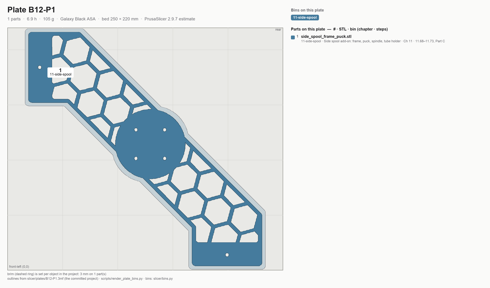
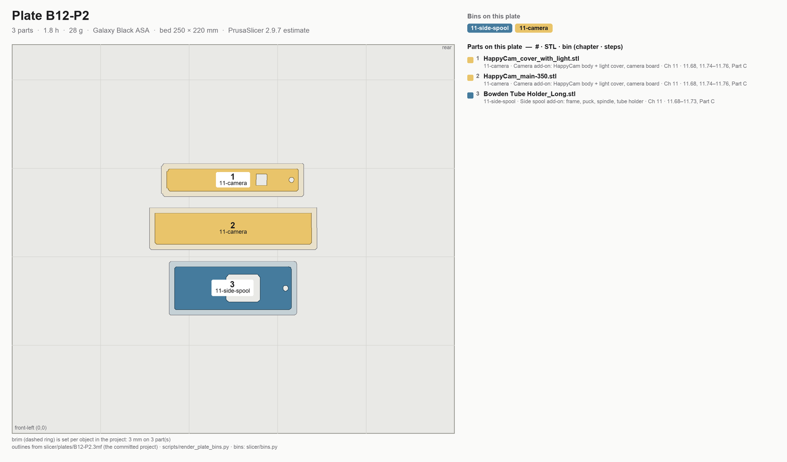
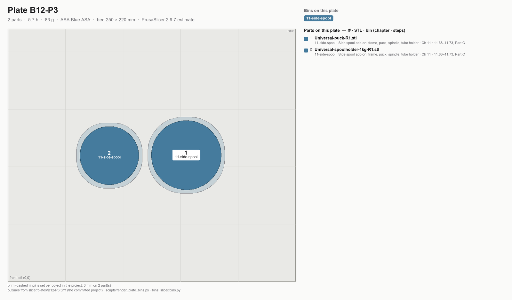

# Batch B12 — Side spool holder and camera

```mascot
pose: print
caption: A spool on the side and a camera on top. Three plates, then the exhaust housing.
```

**Time:** 14.4 h (3 plates) — PrusaSlicer 2.9.7 estimates.

**Sessions:** 3 plate starts (~5 min hands-on each, 6.9 / 1.8 / 5.7 h unattended) + ~15 min inspect and bin, plus
one spool swap to the blue accent for P3.

**Prerequisites:** **Gate A** (as for B08, on the current GT2 belts) and B10: B12 prints straight after it, and only
B13 follows. No bearing seat here, so Gate B is not needed. Nothing in the build needs these parts before
[Ch 11 Part C](../11-skirts-panels-door.md#part-c-add-ons), so a B11 plate still waiting may go first.

**What this batch is.** Ch 11 Part C's two fittings, part of this build since 2026-11-12 (Alex): until then they
were add-ons printed after Step 11.68. The **side spool holder** is Maltasrc's side-mount frame, remixed here for
Prusa's Universal Puck, with his tube holder and Prusa's puck and 1 kg spindle; the **camera mount** is
Zemistr's HappyCam remix, a 350 body with a light cover. Licences and credits:
`slicer/addons/side-spool-608769/README.md` and `slicer/addons/happycam-488020/README.md`.

**Printed parts**


| STL | Repo path | Qty | Colour | g ea | Bin |
|---|---|---:|---|---:|---|
| `side_spool_frame_puck.stl` | this repo, `slicer/addons/side-spool-608769/` (remix of Printables 608769) | 1 | Black | 105.3 | 11-side-spool |
| `Bowden Tube Holder_Long.stl` | Printables 608769 (Maltasrc) | 1 | Black | 7.9 | 11-side-spool |
| `HappyCam_main-350.stl` | Printables 527904 (Zemistr, remix of 488020) | 1 | Black | 18.6 | 11-camera |
| `HappyCam_cover_with_light.stl` | Printables 527904 (Zemistr) | 1 | Black | 1.5 | 11-camera |
| `Universal-puck-R1.stl` | Printables 1605113 (Prusa Research) | 1 | Blue | 31.7 | 11-side-spool |
| `Universal-spoolholder-1kg-R1.stl` | Printables 1605113 (Prusa Research) | 1 | Blue | 51.2 | 11-side-spool |

`g ea` for the five parts that share a plate is each part sliced alone with the plate's settings; the camera
body's figure includes its supports.

**Hardware:** none.

**Read first**

- **The frame's feet assume the panel stack.** They are 6.5 mm tall, for LDO's 3 mm side panel on 3 mm foam tape.
  [Step 11.68](../11-skirts-panels-door.md#step-1168-confirm-the-panel-stack-and-the-camera-board) calipers
  the real stack on the machine; over 6.2 mm, Step 11.69 regenerates the frame and reprints B12-P1 alone.
- **B12-P1 is the one plate exempt from the 25 mm edge rule.** The frame is 212 × 212 mm on the 250 × 220 bed, so
  no rotation keeps part and brim 25 mm from every edge; it sits centred, brim under 1 mm from the front and
  rear edges (`plates.EDGE_EXEMPT`; the audit lists it, the gap and brim rules still apply).
- **Supports on one part only.** B12-P2's HappyCam body lies on its top face with build-plate-only supports
  under the cable exit, set on that object in the project; the profile stays support-free for everything else.
- Brims already in the projects: 3 mm on every part. Verify the outline in the preview; never add one.
- The puck and spindle print in the blue accent: Prusa prints them in PETG or PC, and ASA at the Voron spec is
  stronger than that and keeps the machine in two colours.

## Step B12.1 — Filament prep

**Do:** Galaxy Black, spool #3 after B10. The ledger has 457 g on it here, 352 g after P1 and 324 g after P2. The
blue accent spool A1 comes back for P3. Sheet per [00-slicer-setup § Print sheet](00-slicer-setup.md#print-sheet).
**Check:** Clean purge; ≥135 g on spool #3 for P1 and P2.

Source: [print plan §4.3 — spool changes](../../voron-print-plan.md#43-spool-changes) · [00-slicer-setup § Drying](00-slicer-setup.md#drying) · [Prusa KB — ASA](https://help.prusa3d.com/article/asa_1809)

## Step B12.2 — Load plate B12-P1



*Sorting diagram, drawn from the committed project: every part numbered and filled in the colour of its bin, bin id on the part; the legend reads # · STL · bin (chapter · steps). Sort at Step B12.9.*

**Do:** Open `slicer/plates/B12-P1.3mf` with **File → Open Project**. The frame, its brim and the overrides are already
in it, centred; never Arrange.
**Parts:** `side_spool_frame_puck`, **3 mm brim** · 1 file, 1 object — 6.9 h, 105 g (PrusaSlicer 2.9.7 estimate).
**Check:** The frame lies front face down, centred, with a brim outline all round and no supports.

**Helper:** Reads the plate's hours and grams off the slicer and checks them against this step.

Source: [print plan §3 — the batches](../../voron-print-plan.md#3-the-batches) · [00-slicer-setup § Committed projects](00-slicer-setup.md#committed-projects-open-the-plate-dont-rebuild-it) · `slicer/addons/side-spool-608769/README.md` · [Printables 608769](https://www.printables.com/model/608769)

## Step B12.3 — Print plate B12-P1

**Do:** Cover the printer: blanket on top, cover over the door, back clear. Print with standing overrides.
**Check:** Settings → Chamber Filtration reads **Adv. Filtration**; the first layer lays down clean along the front and rear edges, where the brim runs close.

Tip: Paused or stopped mid-plate? See [When the printer stops](README.md#when-the-printer-stops).

Pause: ~5 min since the last pause — plate started; nothing to do until it finishes.

Source: [00-slicer-setup § Overrides](00-slicer-setup.md#overrides) · [print plan §4.1 — how these numbers were produced](../../voron-print-plan.md#41-how-these-numbers-were-produced)

## Step B12.4 — Load plate B12-P2



*Sorting diagram, drawn from the committed project: every part numbered and filled in the colour of its bin, bin id on the part; the legend reads # · STL · bin (chapter · steps). Sort at Step B12.9.*

**Do:** Open `slicer/plates/B12-P2.3mf` with **File → Open Project**. The arrangement, brims, the body's own
supports and the overrides are already in it.
**Parts:** `Bowden Tube Holder_Long`, **3 mm brim** · `HappyCam_main-350`, **3 mm brim**, build-plate supports · `HappyCam_cover_with_light`, **3 mm brim** · 3 files, 3 objects — 1.8 h, 28 g (PrusaSlicer 2.9.7 estimate).
**Check:** The preview shows supports under the camera body only, and a brim outline on all three parts.

**Helper:** Counts the parts on the sorting diagram and checks the total against the object count.

Source: [print plan §3 — the batches](../../voron-print-plan.md#3-the-batches) · [00-slicer-setup § Committed projects](00-slicer-setup.md#committed-projects-open-the-plate-dont-rebuild-it) · `slicer/addons/happycam-488020/README.md` · [Printables 527904](https://www.printables.com/model/527904)

## Step B12.5 — Print plate B12-P2

**Do:** Cover the printer: blanket on top, cover over the door, back clear. Print with standing overrides.
**Check:** The supports under the camera body build up cleanly; no lift on the 74 mm light cover.

Tip: Paused or stopped mid-plate? See [When the printer stops](README.md#when-the-printer-stops).

Pause: ~5 min since the last pause — plate started; nothing to do until it finishes.

Source: [00-slicer-setup § Overrides](00-slicer-setup.md#overrides) · [print plan §4.1 — how these numbers were produced](../../voron-print-plan.md#41-how-these-numbers-were-produced)

## Step B12.6 — Load plate B12-P3



*Sorting diagram, drawn from the committed project: every part numbered and filled in the colour of its bin, bin id on the part; the legend reads # · STL · bin (chapter · steps). Sort at Step B12.9.*

**Do:**

1. Unload the black, load the blue accent spool A1 and purge until the line runs clean blue.
2. Open `slicer/plates/B12-P3.3mf` with **File → Open Project**; it carries the accent profile.
**Parts:** `Universal-puck-R1`, **3 mm brim** · `Universal-spoolholder-1kg-R1`, **3 mm brim** · 2 files, 2 objects — 5.7 h, 83 g (PrusaSlicer 2.9.7 estimate).
**Check:** Clean blue purge with no black streaks; a brim outline on both parts and no supports.

**Helper:** Reads the spool label aloud before it goes on the printer.

Source: [print plan §3 — the batches](../../voron-print-plan.md#3-the-batches) · [print plan §4.3 — spool changes](../../voron-print-plan.md#43-spool-changes) · [Printables 1605113](https://www.printables.com/model/1605113)

## Step B12.7 — Print plate B12-P3

**Do:** Cover the printer: blanket on top, cover over the door, back clear. Print with standing overrides.
**Check:** Settings → Chamber Filtration reads **Adv. Filtration**; the 87 mm spindle stands steady through its full height.

Tip: Paused or stopped mid-plate? See [When the printer stops](README.md#when-the-printer-stops).

Pause: ~5 min since the last pause — plate started; nothing to do until it finishes.

Source: [00-slicer-setup § Overrides](00-slicer-setup.md#overrides) · [print plan §4.1 — how these numbers were produced](../../voron-print-plan.md#41-how-these-numbers-were-produced)

## Step B12.8 — Inspect

**Do:**

1. Snap the brims off; snap the camera body's supports out of its cable exit.
2. Lay the frame on the flat reference and look at both feet.
3. Check the body's three locating pegs are whole.
**Check:** Frame flat, no rock, both feet whole; the cable exit clear of support; three pegs standing.

Pause: ~10 min since the last pause — brims and supports off, parts checked; the fit waits for Ch 11 Part C.

Source: [print plan §5.2 — checkpoint after each batch](../../voron-print-plan.md#52-checkpoint-after-each-batch) · `slicer/addons/side-spool-608769/README.md` · `slicer/addons/happycam-488020/README.md`

## Step B12.9 — Sort into bins

**Do:** Sort off each plate diagram; the printed bin id names the bin. Mark plate id and date on a hidden face. Labels: [bin-labels sheet](../../print/bin-labels.md). The frame fits no mesh bag, so 11-side-spool is a box.

**B12-P1**

| bin | parts off this plate |
|---|---|
| **11-side-spool** — Side spool add-on: frame, puck, spindle, tube holder | `side_spool_frame_puck` |

**B12-P2**

| bin | parts off this plate |
|---|---|
| **11-side-spool** — Side spool add-on: frame, puck, spindle, tube holder | `Bowden Tube Holder_Long` |
| **11-camera** — Camera add-on: HappyCam body + light cover, camera board | `HappyCam_main-350`, `HappyCam_cover_with_light` |

**B12-P3**

| bin | parts off this plate |
|---|---|
| **11-side-spool** — Side spool add-on: frame, puck, spindle, tube holder | `Universal-puck-R1`, `Universal-spoolholder-1kg-R1` |

**Check:** Four parts in 11-side-spool and two in 11-camera, beside the bought camera board.

**Helper:** Reads each bin label aloud and checks the count against the diagram.


Pause: ~10 min since the last pause — B12 sorted into 11-side-spool and 11-camera. Only B13's 14-exhaust bin is still empty.

Source: [print plan §9 — batch summary](../../voron-print-plan.md#9-machine-readable-batch-summary) · [print/README § Bins](README.md#bins)

---

## Checkpoint B12
- [ ] Side spool frame flat on the reference, both feet whole, brim off clean
- [ ] Camera body's supports out of the cable exit; its three locating pegs whole
- [ ] Puck and spindle printed in the blue accent, brims off
- [ ] Six parts sorted: four in 11-side-spool, two in 11-camera

## Common mistakes
- Pressing **Arrange** on B12-P1: the GUI pushes the frame toward the 25 mm rule it cannot meet. Open the project as saved.
- Adding supports to the whole of B12-P2: only the camera body takes them, and they are already in the project.
- Reprinting the frame before Step 11.68 has measured: the 6.5 mm feet fit a stack up to 6.2 mm.

## Next
Assembly: Ch 11 Part C (Steps 11.68–11.76), after Part B, out of bins 11-side-spool and 11-camera. Printing:
[B13 — Exhaust housing](B13-exhaust-housing.md) is next, the last batch of the ASA run. [B11](B11-bay-ducting.md)'s P4, P5 and P7 (PETG V0) print once the
kit-day bay measurements are in, if they have not already.
