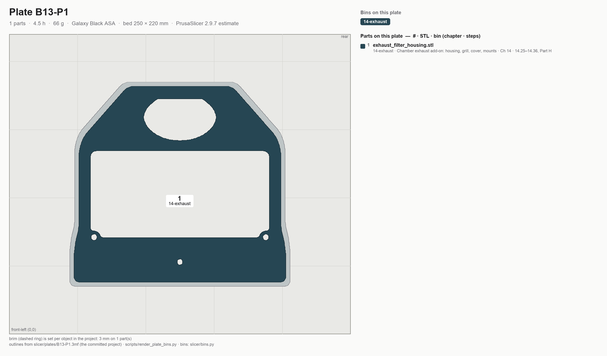
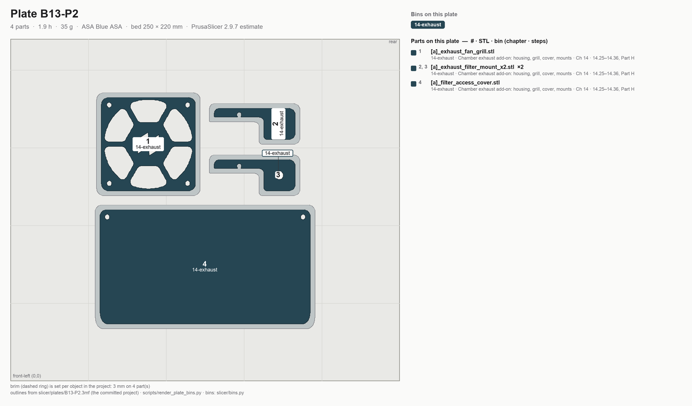

# Batch B13 — Exhaust housing

```mascot
pose: print
caption: The exhaust housing, printed now and fitted only if Step 14.25 says so. The run ends here.
```

**Time:** 6.4 h (2 plates) — PrusaSlicer 2.9.7 estimates.

**Sessions:** 2 plate starts (~5 min hands-on each, 4.5 / 1.9 h unattended) + ~10 min inspect and bin, plus
two spool swaps: back to black for P1 after B12-P3, then the blue accent again for P2.

**Prerequisites:** **Gate A** (as for B08, on the current GT2 belts) and B12: B13 prints straight after it and
closes the run. No bearing seat here, so Gate B is not needed. Nothing in the build needs these parts before
[Ch 14 Part H](../14-calibration.md#part-h-first-add-on-the-exhaust-gono-go-and-its-prints), so a B11 plate still
waiting may go first.

**What this batch is.** Ch 14 Part H's stock Voron 2.4r2 exhaust filter housing set, part of this build since
2026-11-12 (Alex): until then it was an add-on printed after Step 14.25. The files are the Voron Design team's,
unchanged (GPL-3.0); licence and credit: `slicer/addons/exhaust-voron2/README.md`. They are printed now and
fitted only if Step 14.25 finds the stock notch, the depth behind it and a lead route on the real machine; if
it does not, they stay in bin 14-exhaust unused. The fifth Voron file, `exhaust_filter_grill`, is not here: B09-P4
already printed it, and it is fitted at Ch 11 Step 11.54.

**Printed parts**


| STL | Repo path | Qty | Colour | g ea | Bin |
|---|---|---:|---|---:|---|
| `exhaust_filter_housing.stl` | Voron-2 `STLs/Exhaust_Filter/` | 1 | Black | 66.1 | 14-exhaust |
| `[a]_exhaust_fan_grill.stl` | Voron-2 `STLs/Exhaust_Filter/` | 1 | Blue | 5.8 | 14-exhaust |
| `[a]_filter_access_cover.stl` | Voron-2 `STLs/Exhaust_Filter/` | 1 | Blue | 25.4 | 14-exhaust |
| `[a]_exhaust_filter_mount_x2.stl` | Voron-2 `STLs/Exhaust_Filter/` | 2 | Blue | 2.1 | 14-exhaust |

`g ea` for the three parts that share B13-P2 is each part sliced alone with the plate's settings and its
3 mm brim.

**Hardware:** none. The housing's eight M3 inserts go in at Ch 14 Step 14.27.

**Read first**

- **Printed now, fitted later, and only on a pass.** Step 14.25 inspects the back of the machine before the fan,
  lead and mat are bought. A failing row there leaves these five parts in their bin.
- Brims already in the projects: 3 mm on every part, all 30 mm or longer. Verify the outline in the preview; never add one.
- As oriented, no supports: the Voron files are drawn to print support-free.
- The `[a]_` parts print in the blue accent, as the Voron prefix asks; the housing prints black.

## Step B13.1 — Filament prep

**Do:** Galaxy Black, spool #3 back on after B12-P3: the ledger has 324 g on it here and 258 g after P1. The blue
accent spool A1 comes back for P2. Sheet per [00-slicer-setup § Print sheet](00-slicer-setup.md#print-sheet).
**Check:** Clean black purge; ≥66 g on spool #3 for P1.

Source: [print plan §4.3 — spool changes](../../voron-print-plan.md#43-spool-changes) · [00-slicer-setup § Drying](00-slicer-setup.md#drying) · [Prusa KB — ASA](https://help.prusa3d.com/article/asa_1809)

## Step B13.2 — Load plate B13-P1



*Sorting diagram, drawn from the committed project: every part numbered and filled in the colour of its bin, bin id on the part; the legend reads # · STL · bin (chapter · steps). Sort at Step B13.7.*

**Do:** Open `slicer/plates/B13-P1.3mf` with **File → Open Project**. The housing, its brim and the overrides are
already in it; never Arrange.
**Parts:** `exhaust_filter_housing`, **3 mm brim** · 1 file, 1 object — 4.5 h, 66 g (PrusaSlicer 2.9.7 estimate).
**Check:** The housing lies as the Voron file has it, with a brim outline all round and no supports.

**Helper:** Reads the plate's hours and grams off the slicer and checks them against this step.

Source: [print plan §3 — the batches](../../voron-print-plan.md#3-the-batches) · [00-slicer-setup § Committed projects](00-slicer-setup.md#committed-projects-open-the-plate-dont-rebuild-it) · `slicer/addons/exhaust-voron2/README.md` · [Voron-2 `STLs/Exhaust_Filter/`](https://github.com/VoronDesign/Voron-2/tree/a192410/STLs/Exhaust_Filter)

## Step B13.3 — Print plate B13-P1

**Do:** Cover the printer: blanket on top, cover over the door, back clear. Print with standing overrides.
**Check:** Settings → Chamber Filtration reads **Adv. Filtration**; the first layer lays down clean under the whole housing.

Tip: Paused or stopped mid-plate? See [When the printer stops](README.md#when-the-printer-stops).

Pause: ~5 min since the last pause — plate started; nothing to do until it finishes.

Source: [00-slicer-setup § Overrides](00-slicer-setup.md#overrides) · [print plan §4.1 — how these numbers were produced](../../voron-print-plan.md#41-how-these-numbers-were-produced)

## Step B13.4 — Load plate B13-P2



*Sorting diagram, drawn from the committed project: every part numbered and filled in the colour of its bin, bin id on the part; the legend reads # · STL · bin (chapter · steps). Sort at Step B13.7.*

**Do:**

1. Unload the black, load the blue accent spool A1 and purge until the line runs clean blue.
2. Open `slicer/plates/B13-P2.3mf` with **File → Open Project**; it carries the accent profile.
**Parts:** `[a]_exhaust_fan_grill`, **3 mm brim** · `[a]_filter_access_cover`, **3 mm brim** · `[a]_exhaust_filter_mount_x2` ×2, **3 mm brim** · 3 files, 4 objects — 1.9 h, 35 g (PrusaSlicer 2.9.7 estimate).
**Check:** Clean blue purge with no black streaks; a brim outline on all four parts and no supports.

**Helper:** Reads the spool label aloud before it goes on the printer.

Source: [print plan §3 — the batches](../../voron-print-plan.md#3-the-batches) · [print plan §4.3 — spool changes](../../voron-print-plan.md#43-spool-changes) · `slicer/addons/exhaust-voron2/README.md`

## Step B13.5 — Print plate B13-P2

**Do:** Cover the printer: blanket on top, cover over the door, back clear. Print with standing overrides.
**Check:** Settings → Chamber Filtration reads **Adv. Filtration**; the access cover's first layer lays down flat to its corners.

Tip: Paused or stopped mid-plate? See [When the printer stops](README.md#when-the-printer-stops).

Pause: ~5 min since the last pause — plate started; nothing to do until it finishes.

Source: [00-slicer-setup § Overrides](00-slicer-setup.md#overrides) · [print plan §4.1 — how these numbers were produced](../../voron-print-plan.md#41-how-these-numbers-were-produced)

## Step B13.6 — Inspect

**Do:**

1. Snap the brims off all five parts.
2. Lay the housing and the access cover on the flat reference.
3. Look over the housing's eight insert bosses and both mounts.
**Check:** Housing and access cover flat, no rock; every boss open and round; both mounts whole.

Pause: ~10 min since the last pause — brims off, parts checked; the fit waits for Ch 14 Part H and its Step 14.25 inspection.

Source: [print plan §5.2 — checkpoint after each batch](../../voron-print-plan.md#52-checkpoint-after-each-batch) · `slicer/addons/exhaust-voron2/README.md`

## Step B13.7 — Sort into bins

**Do:** Sort off each plate diagram; the printed bin id names the bin. Mark plate id and date on a hidden face. Labels: [bin-labels sheet](../../print/bin-labels.md). Bin 14-exhaust is two B5 bags: the housing alone in bag 1.

**B13-P1**

| bin | parts off this plate |
|---|---|
| **14-exhaust** — Chamber exhaust add-on: housing, grill, cover, mounts | `exhaust_filter_housing` |

**B13-P2**

| bin | parts off this plate |
|---|---|
| **14-exhaust** — Chamber exhaust add-on: housing, grill, cover, mounts | `[a]_exhaust_fan_grill`, `[a]_filter_access_cover`, `[a]_exhaust_filter_mount` ×2 |

**Check:** The housing in bag 1 of 14-exhaust, the four blue parts in bag 2, with room left for the bought fan, lead and mat.

**Helper:** Reads each bin label aloud and checks the count against the diagram.


Pause: ~10 min since the last pause — the last plate of the run sorted into 14-exhaust. Every ASA bin is now full.

Source: [print plan §9 — batch summary](../../voron-print-plan.md#9-machine-readable-batch-summary) · [print/README § Bins](README.md#bins)

---

## Checkpoint B13
- [ ] Housing and access cover flat on the reference, brims off clean
- [ ] Housing's eight insert bosses open; both mounts whole
- [ ] Fan grill, access cover and both mounts printed in the blue accent
- [ ] Five parts sorted into 14-exhaust: the housing in bag 1, the four blue parts in bag 2

## Common mistakes
- Pressing **Arrange** on either plate: the GUI does not know the 25 mm edge rule. Open the projects as saved.
- Printing `exhaust_filter_grill` again: B09-P4 printed it, and Ch 11 fits it at Step 11.54; Part H reuses it in place.
- Printing P2 on the black spool: the `[a]_` prefix asks for the accent colour.

## Next
Assembly: Ch 14 Part H (Steps 14.25–14.36), out of bin 14-exhaust, and only if Step 14.25 passes. Printing: this is
the last plate of the ASA run. [B11](B11-bay-ducting.md)'s P4, P5 and P7 (PETG V0) print once the kit-day bay
measurements are in, if they have not already.
