# Plate plans

_Generated by `scripts/build_printables.py` — do not hand-edit._

All **33 plates** of the ASA run, **176.0 h**, **2017 g Galaxy Black + 445 g ASA Blue**, in print order (batches: B00 → B01 → B02 → B03 → B04 → B05 → B06 → B07 → B08 → B09 → B10 → B12 → B13), then B11, the bay ducting: **7 plates**, **25.1 h**, **349 g Jet Black PETG V0**, outside the run's totals. Every diagram is drawn from the committed PrusaSlicer project `slicer/plates/<id>.3mf` (`python3 slicer/build_plates.py --from-3mf`).

## Batch B00 — [Calibration & jigs](../manual/print/B00-calibration-and-jigs.md)

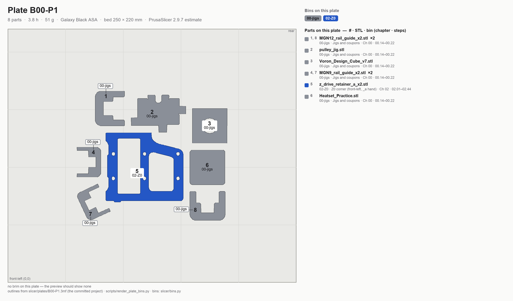

**B00-P1** · black · 8 parts · 3.8 h · 51 g · bins: 00-jigs, 02-Z0 · [Load step](../manual/print/B00-calibration-and-jigs.md#step-b002-load-plate-b00-p1)

## Batch B01 — [Z drive assemblies](../manual/print/B01-z-drive-assemblies.md)

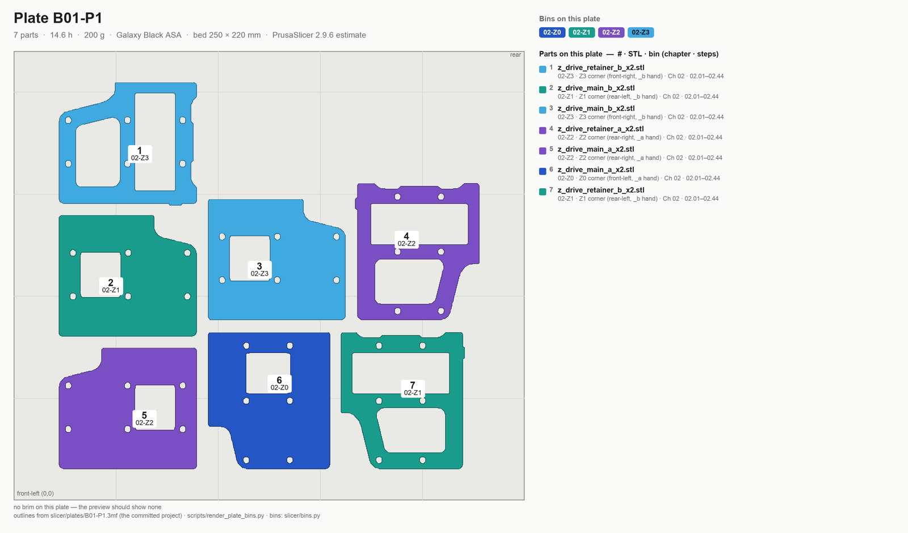

**B01-P1** · black · 7 parts · 14.6 h · 200 g · bins: 02-Z0, 02-Z1, 02-Z2, 02-Z3 · [Load step](../manual/print/B01-z-drive-assemblies.md#step-b012-load-plate-b01-p1)

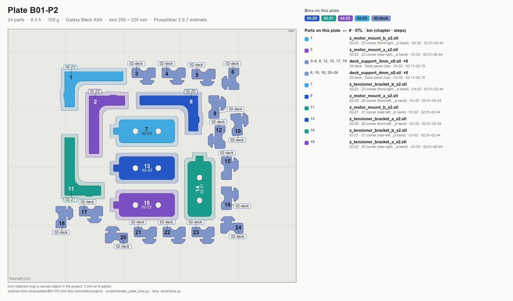

**B01-P2** · black · 24 parts · 8.3 h · 109 g · bins: 02-Z0, 02-Z1, 02-Z2, 02-Z3, 02-deck · [Load step](../manual/print/B01-z-drive-assemblies.md#step-b015-load-plate-b01-p2)

## Batch B02 — [Accent parts (blue)](../manual/print/B02-accent-parts-orange.md)

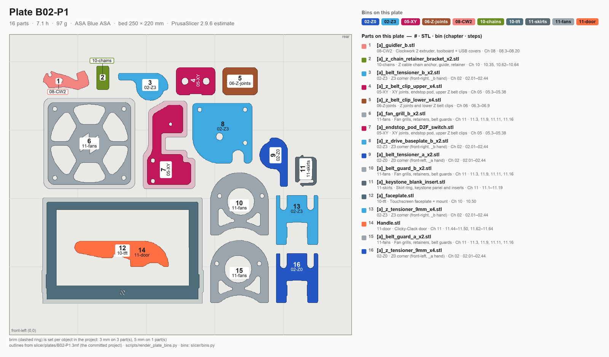

**B02-P1** · blue · 16 parts · 7.1 h · 97 g · bins: 02-Z0, 02-Z3, 05-XY, 06-Z-joints, 10-chains, 10-tft, 11-skirts, 11-fans, 11-door, 08-superseded · [Load step](../manual/print/B02-accent-parts-orange.md#step-b022-load-plate-b02-p1)

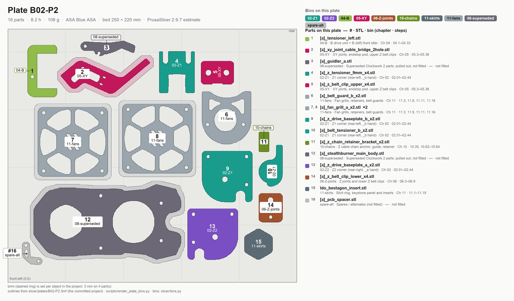

**B02-P2** · blue · 16 parts · 8.2 h · 108 g · bins: 02-Z1, 02-Z2, 04-B, 05-XY, 06-Z-joints, 10-chains, 11-skirts, 11-fans, 08-superseded, spare-alt · [Load step](../manual/print/B02-accent-parts-orange.md#step-b024-load-plate-b02-p2)

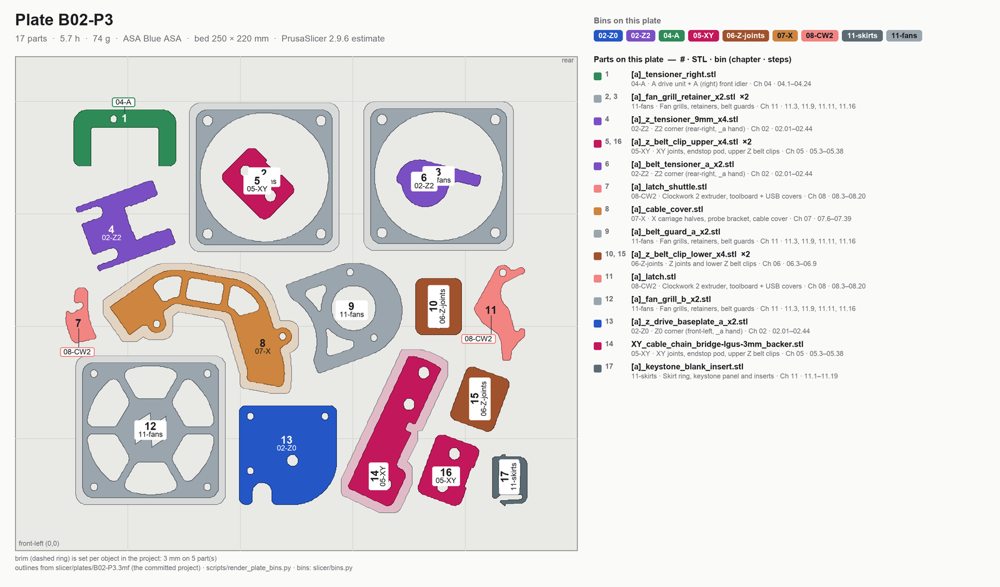

**B02-P3** · blue · 7 parts · 2.6 h · 36 g · bins: 02-Z0, 02-Z2, 11-fans · [Load step](../manual/print/B02-accent-parts-orange.md#step-b026-load-plate-b02-p3)

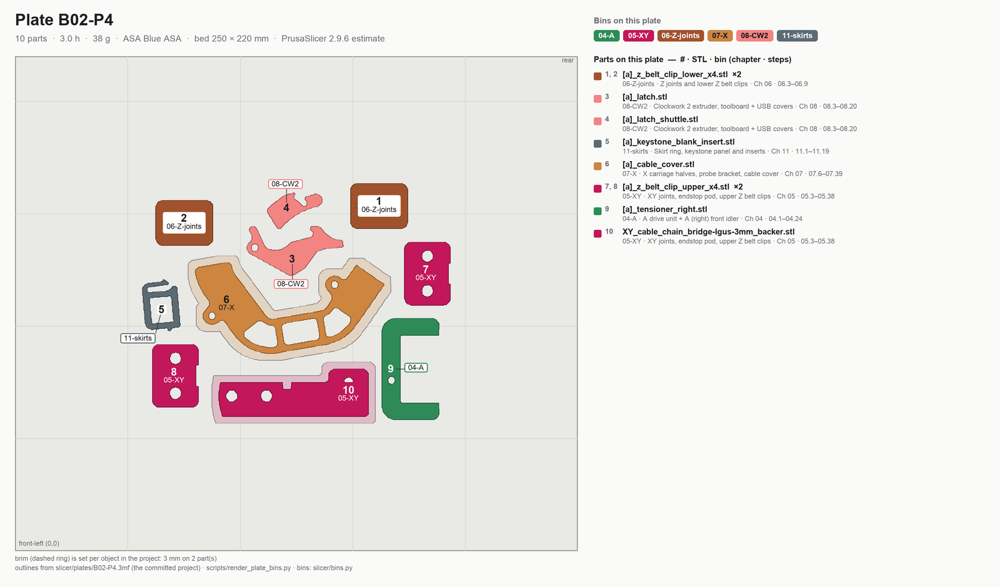

**B02-P4** · blue · 10 parts · 3.1 h · 38 g · bins: 04-A, 05-XY, 06-Z-joints, 07-X, 08-CW2, 11-skirts, 08-superseded · [Load step](../manual/print/B02-accent-parts-orange.md#step-b0210-load-plate-b02-p4)

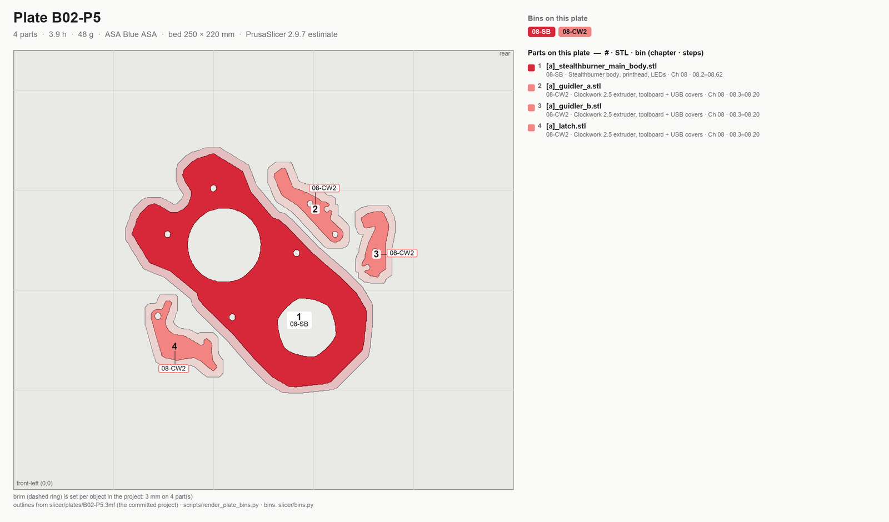

**B02-P5** · blue · 4 parts · 3.9 h · 48 g · bins: 08-SB, 08-CW2 · [Load step](../manual/print/B02-accent-parts-orange.md#step-b0213-load-plate-b02-p5)

## Batch B03 — [A/B drive units + front idlers](../manual/print/B03-ab-drive-units-and-front-idlers.md)

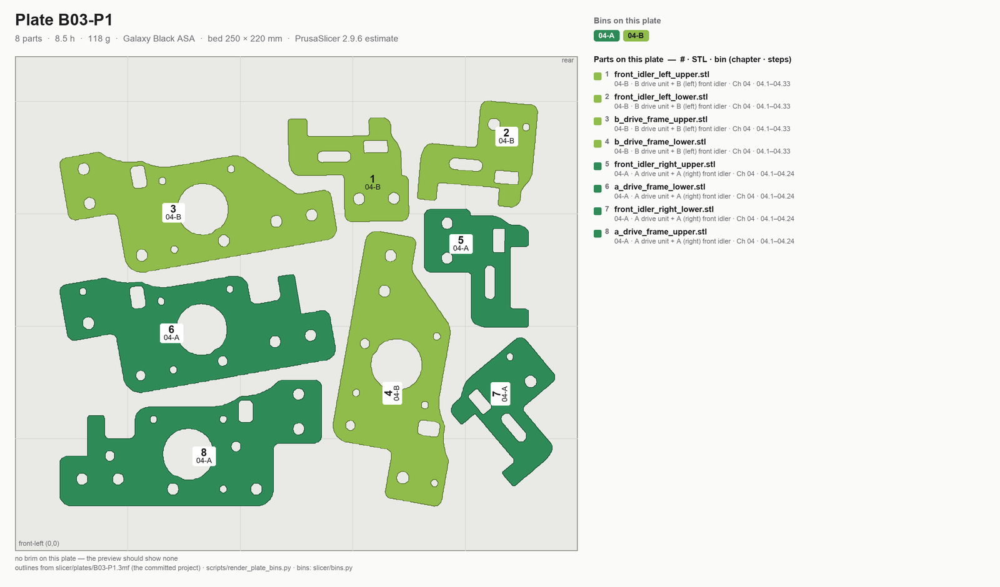

**B03-P1** · black · 4 parts · 4.4 h · 61 g · bins: 04-A · [Load step](../manual/print/B03-ab-drive-units-and-front-idlers.md#step-b032-load-plate-b03-p1-a-side)

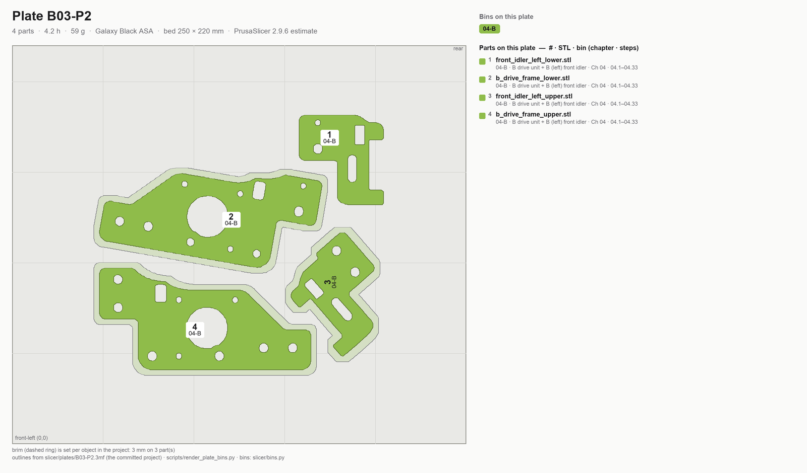

**B03-P2** · black · 4 parts · 4.2 h · 59 g · bins: 04-B · [Load step](../manual/print/B03-ab-drive-units-and-front-idlers.md#step-b036-load-plate-b03-p2-b-side)

## Batch B04 — [XY joints + X carriage](../manual/print/B04-xy-joints-and-x-carriage.md)

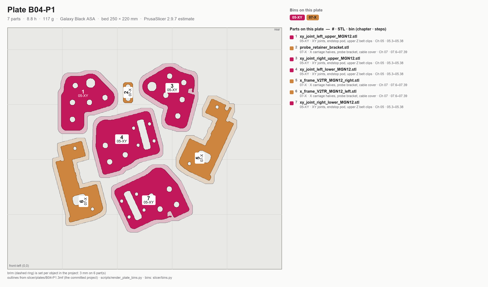

**B04-P1** · black · 7 parts · 8.8 h · 117 g · bins: 05-XY, 07-X · [Load step](../manual/print/B04-xy-joints-and-x-carriage.md#step-b042-load-plate-b04-p1)

## Batch B05 — [Z joints + Z chain](../manual/print/B05-z-joints-and-z-chain.md)

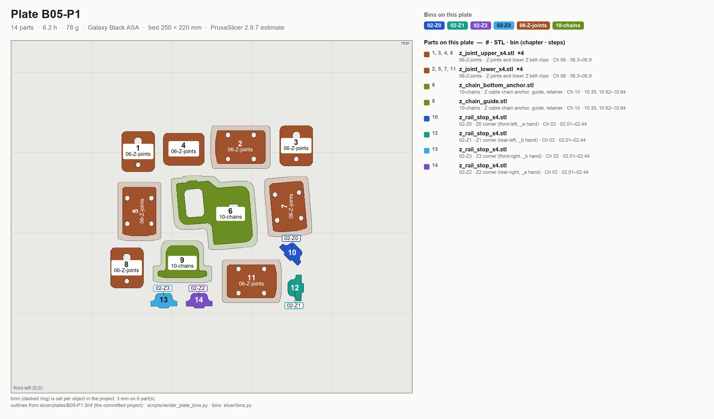

**B05-P1** · black · 14 parts · 6.2 h · 78 g · bins: 02-Z0, 02-Z1, 02-Z2, 02-Z3, 06-Z-joints, 10-chains · [Load step](../manual/print/B05-z-joints-and-z-chain.md#step-b052-load-plate-b05-p1)

## Batch B06 — [Toolhead: Stealthburner, Clockwork 2.5, Klicky](../manual/print/B06-toolhead-sb-cw2-klicky.md)

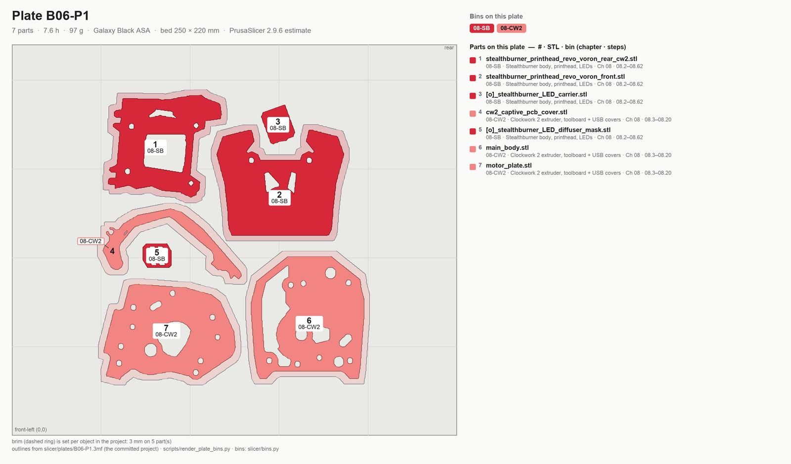

**B06-P1** · black · 7 parts · 7.6 h · 95 g · bins: 08-SB, 08-CW2 · [Load step](../manual/print/B06-toolhead-sb-cw2-klicky.md#step-b062-load-plate-b06-p1)

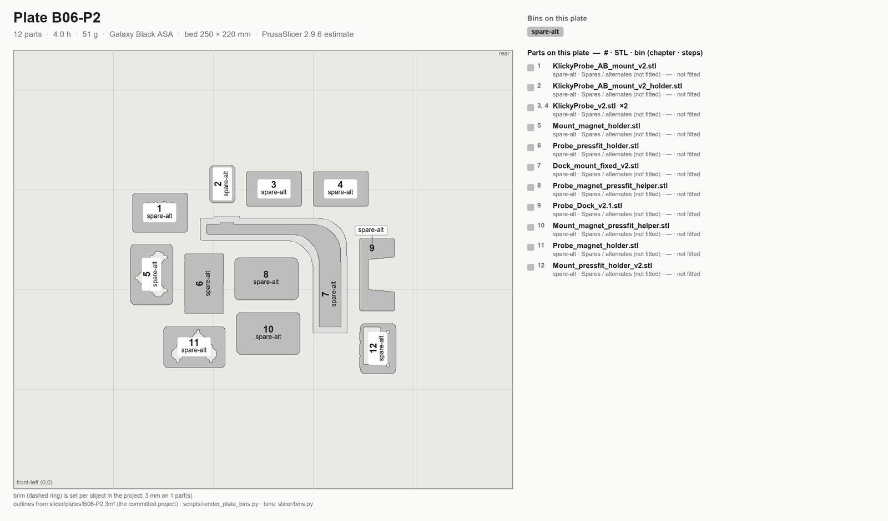

**B06-P2** · black · 12 parts · 4.1 h · 51 g · bins: spare-alt · [Load step](../manual/print/B06-toolhead-sb-cw2-klicky.md#step-b066-load-plate-b06-p2)

## Batch B07 — [Electronics bay + lighting](../manual/print/B07-electronics-bay-and-lighting.md)

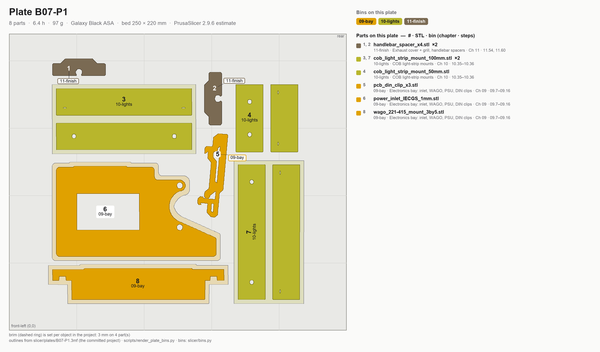

**B07-P1** · black · 7 parts · 5.7 h · 88 g · bins: 09-bay, 10-lights, 11-finish · [Load step](../manual/print/B07-electronics-bay-and-lighting.md#step-b072-load-plate-b07-p1)

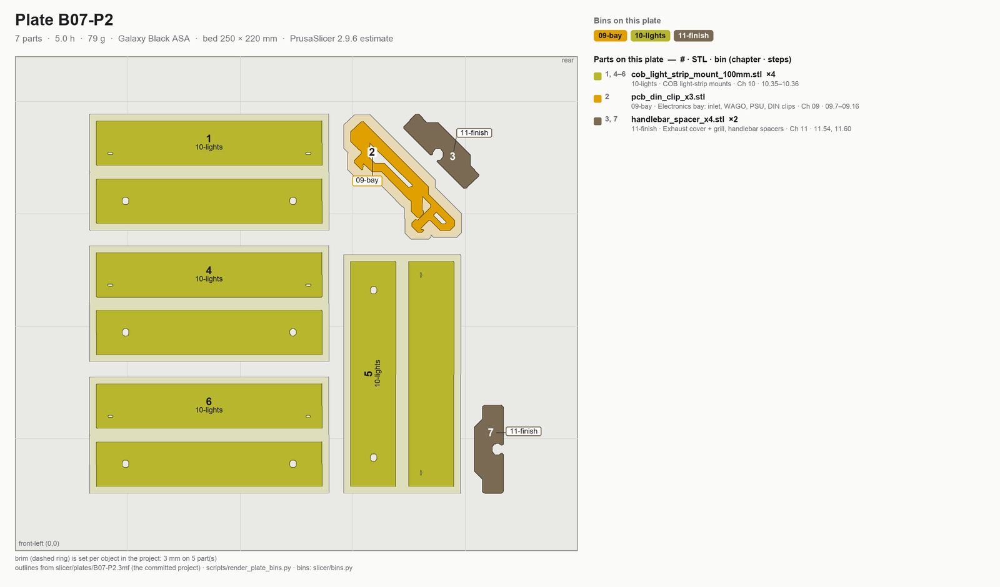

**B07-P2** · black · 7 parts · 5.1 h · 79 g · bins: 09-bay, 10-lights, 11-finish · [Load step](../manual/print/B07-electronics-bay-and-lighting.md#step-b074-load-plate-b07-p2)

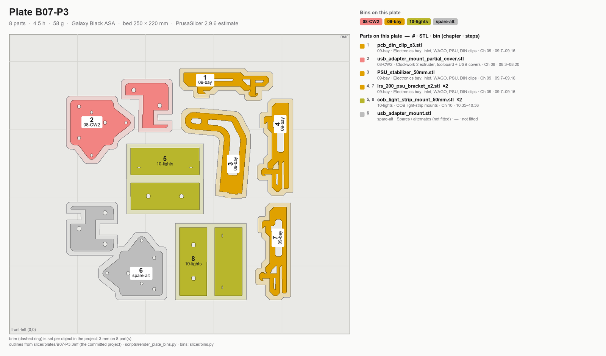

**B07-P3** · black · 8 parts · 4.5 h · 58 g · bins: 08-CW2, 09-bay, 10-lights, spare-alt · [Load step](../manual/print/B07-electronics-bay-and-lighting.md#step-b078-load-plate-b07-p3)

## Batch B08 — [Skirts and front modules](../manual/print/B08-skirts-and-front-modules.md)

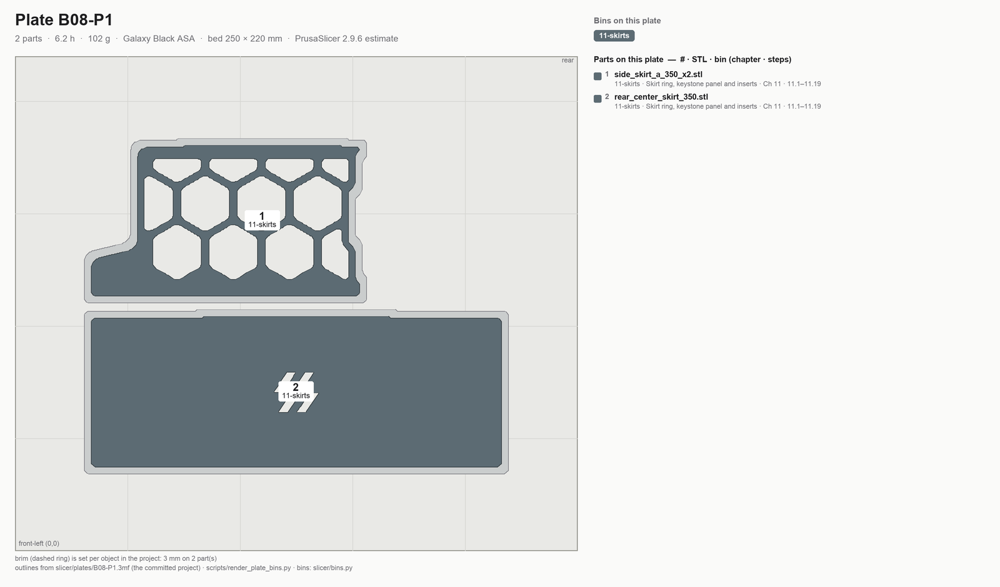

**B08-P1** · black · 2 parts · 6.2 h · 102 g · bins: 11-skirts · [Load step](../manual/print/B08-skirts-and-front-modules.md#step-b082-load-plate-b08-p1)

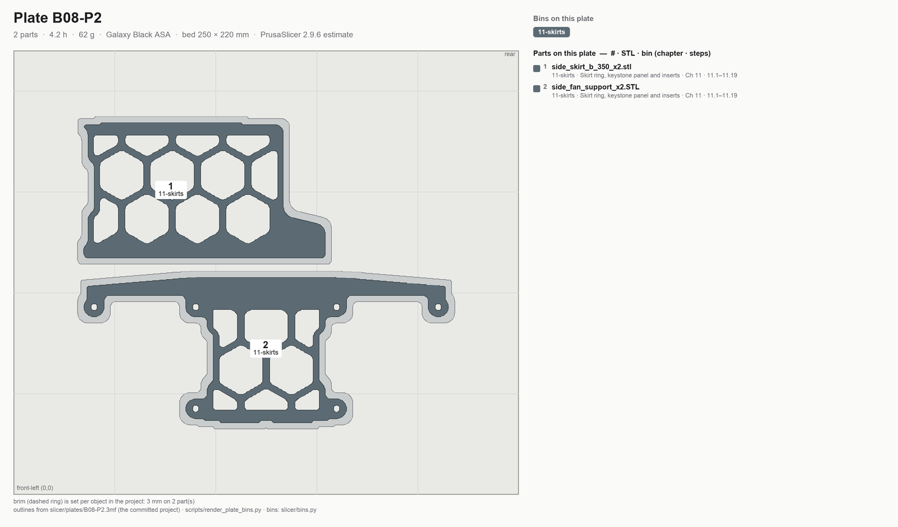

**B08-P2** · black · 2 parts · 4.2 h · 62 g · bins: 11-skirts · [Load step](../manual/print/B08-skirts-and-front-modules.md#step-b084-load-plate-b08-p2)

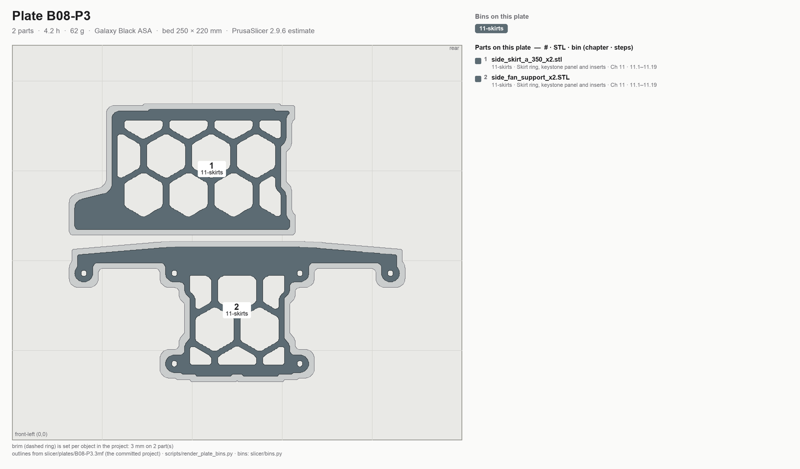

**B08-P3** · black · 2 parts · 4.2 h · 62 g · bins: 11-skirts · [Load step](../manual/print/B08-skirts-and-front-modules.md#step-b086-load-plate-b08-p3)

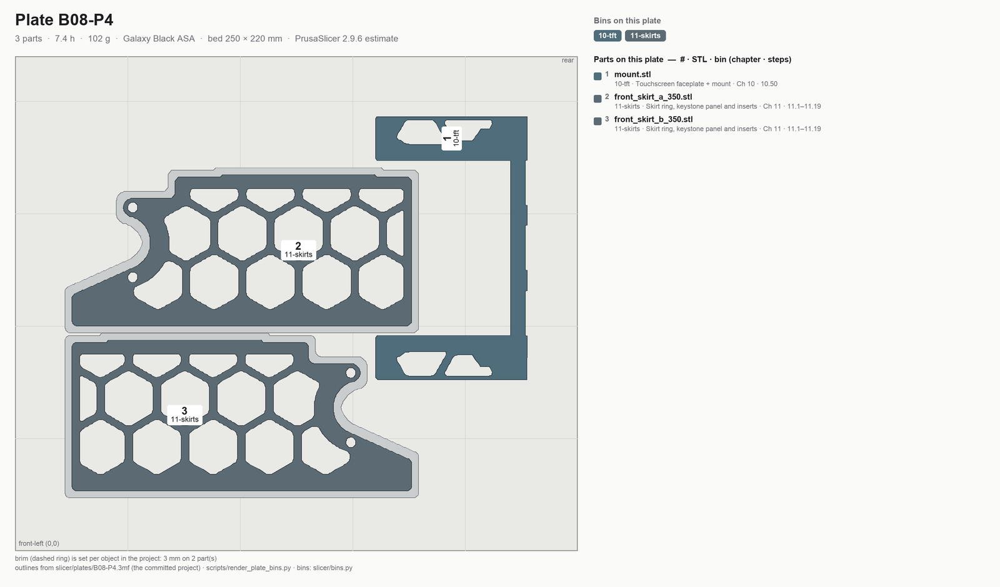

**B08-P4** · black · 2 parts · 5.2 h · 75 g · bins: 11-skirts · [Load step](../manual/print/B08-skirts-and-front-modules.md#step-b088-load-plate-b08-p4)

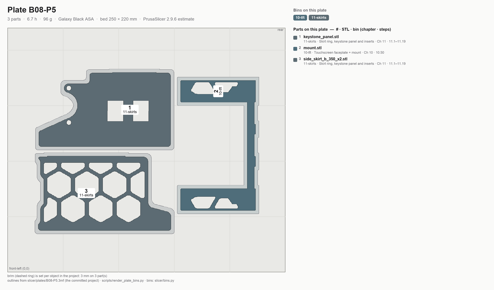

**B08-P5** · black · 3 parts · 6.7 h · 96 g · bins: 10-tft, 11-skirts · [Load step](../manual/print/B08-skirts-and-front-modules.md#step-b0812-load-plate-b08-p5)

## Batch B09 — [Panels, filtration, spool](../manual/print/B09-panels-filtration-spool.md)

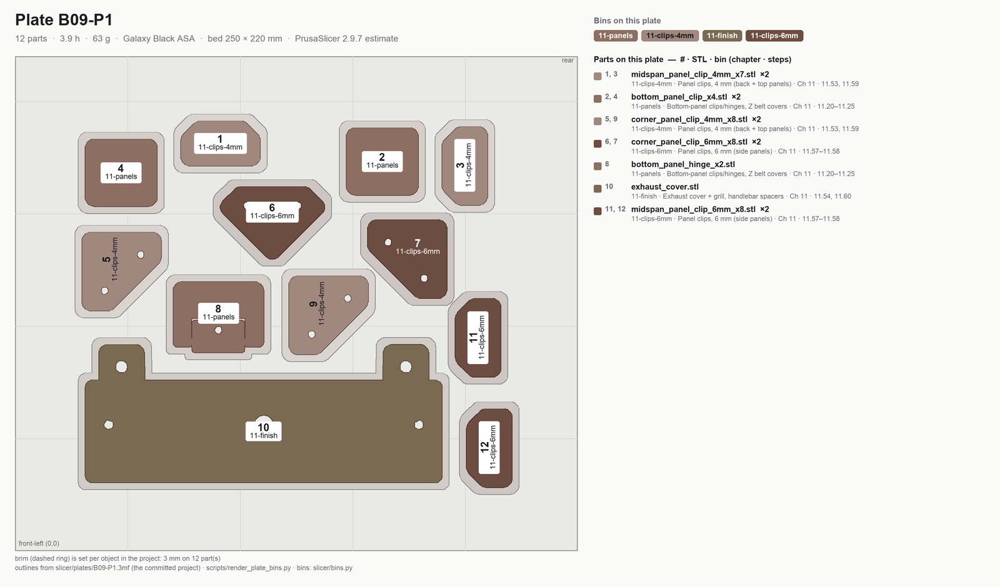

**B09-P1** · black · 12 parts · 3.9 h · 63 g · bins: 11-panels, 11-clips-4mm, 11-finish, 11-clips-6mm · [Load step](../manual/print/B09-panels-filtration-spool.md#step-b092-load-plate-b09-p1)

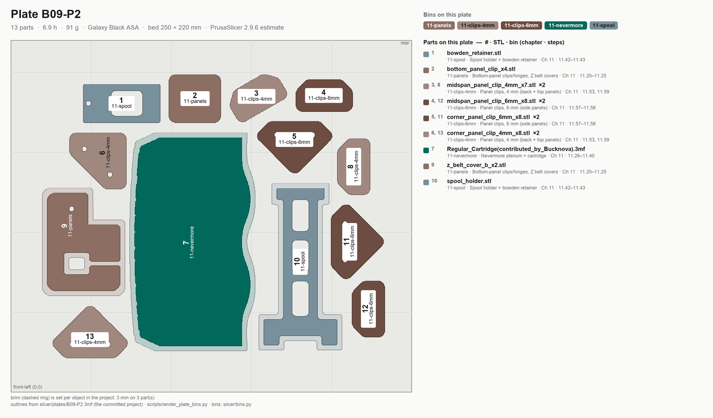

**B09-P2** · black · 10 parts · 5.1 h · 65 g · bins: 11-panels, 11-clips-4mm, 11-clips-6mm, 11-nevermore · [Load step](../manual/print/B09-panels-filtration-spool.md#step-b094-load-plate-b09-p2)

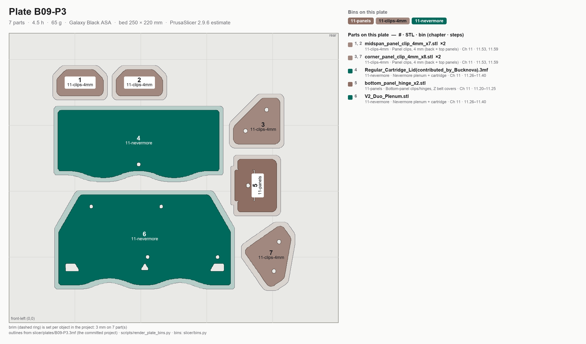

**B09-P3** · black · 7 parts · 4.5 h · 65 g · bins: 11-panels, 11-clips-4mm, 11-nevermore · [Load step](../manual/print/B09-panels-filtration-spool.md#step-b096-load-plate-b09-p3)

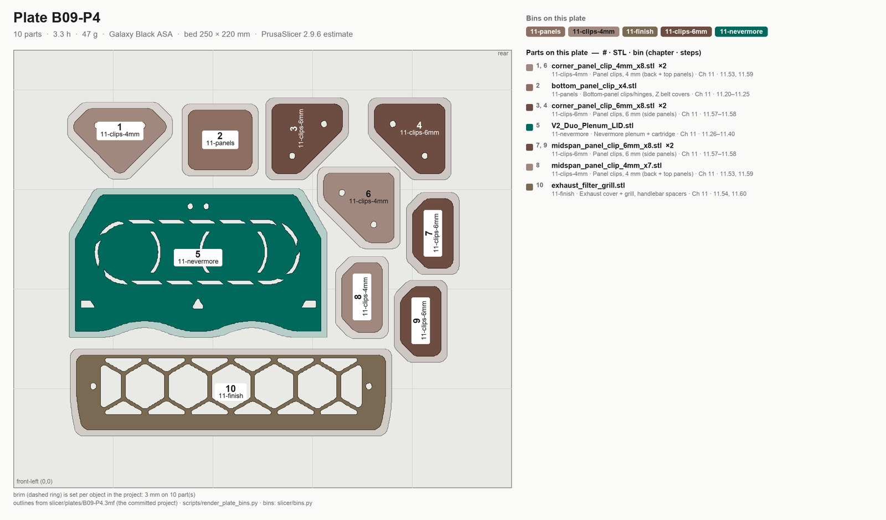

**B09-P4** · black · 10 parts · 3.3 h · 47 g · bins: 11-panels, 11-clips-4mm, 11-finish, 11-clips-6mm, 11-nevermore · [Load step](../manual/print/B09-panels-filtration-spool.md#step-b0914-load-plate-b09-p4)

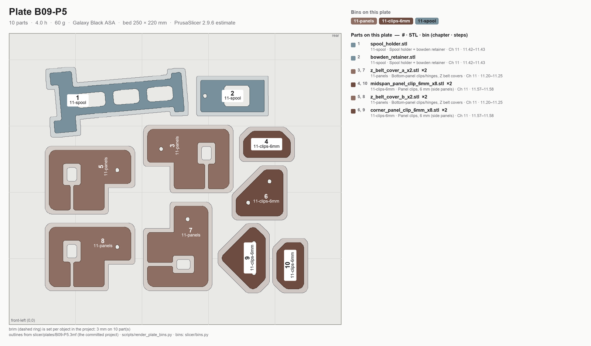

**B09-P5** · black · 10 parts · 4.0 h · 60 g · bins: 11-panels, 11-clips-6mm, 11-spool · [Load step](../manual/print/B09-panels-filtration-spool.md#step-b0916-load-plate-b09-p5)

## Batch B10 — [Clicky-Clack door](../manual/print/B10-clicky-clack-door.md)

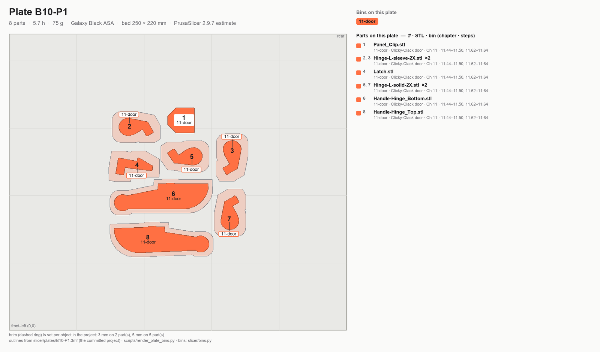

**B10-P1** · black · 8 parts · 5.7 h · 75 g · bins: 11-door · [Load step](../manual/print/B10-clicky-clack-door.md#step-b102-load-plate-b10-p1)

## Batch B12 — [Side spool holder and camera](../manual/print/B12-side-spool-and-camera.md)

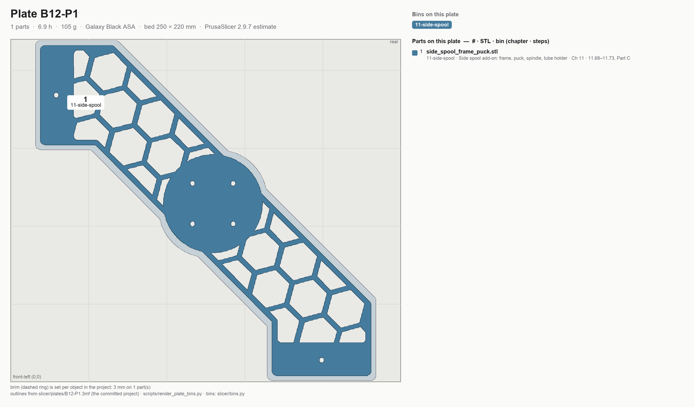

**B12-P1** · black · 1 parts · 6.9 h · 105 g · bins: 11-side-spool · [Load step](../manual/print/B12-side-spool-and-camera.md#step-b122-load-plate-b12-p1)

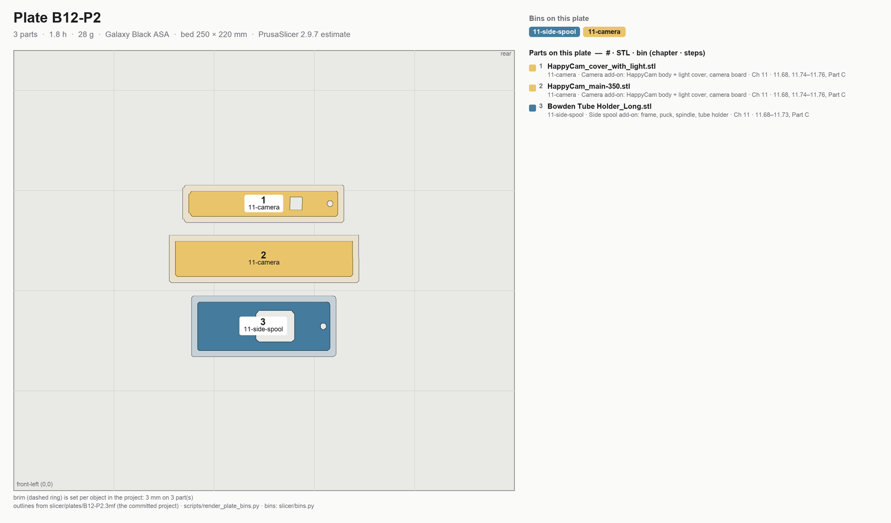

**B12-P2** · black · 3 parts · 1.8 h · 28 g · bins: 11-side-spool, 11-camera · [Load step](../manual/print/B12-side-spool-and-camera.md#step-b124-load-plate-b12-p2)

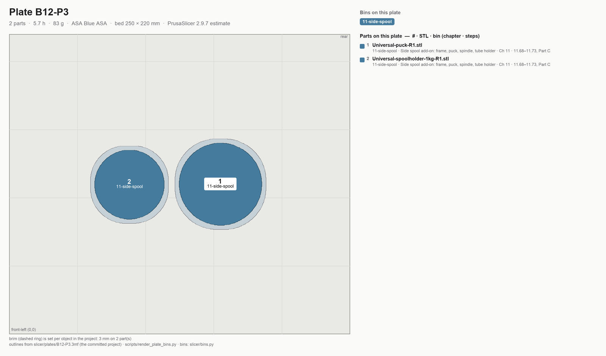

**B12-P3** · blue · 2 parts · 5.7 h · 83 g · bins: 11-side-spool · [Load step](../manual/print/B12-side-spool-and-camera.md#step-b126-load-plate-b12-p3)

## Batch B13 — [Exhaust housing](../manual/print/B13-exhaust-housing.md)

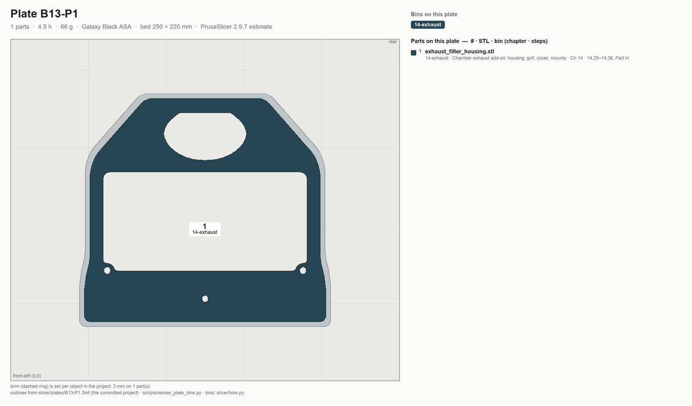

**B13-P1** · black · 1 parts · 4.5 h · 66 g · bins: 14-exhaust · [Load step](../manual/print/B13-exhaust-housing.md#step-b132-load-plate-b13-p1)

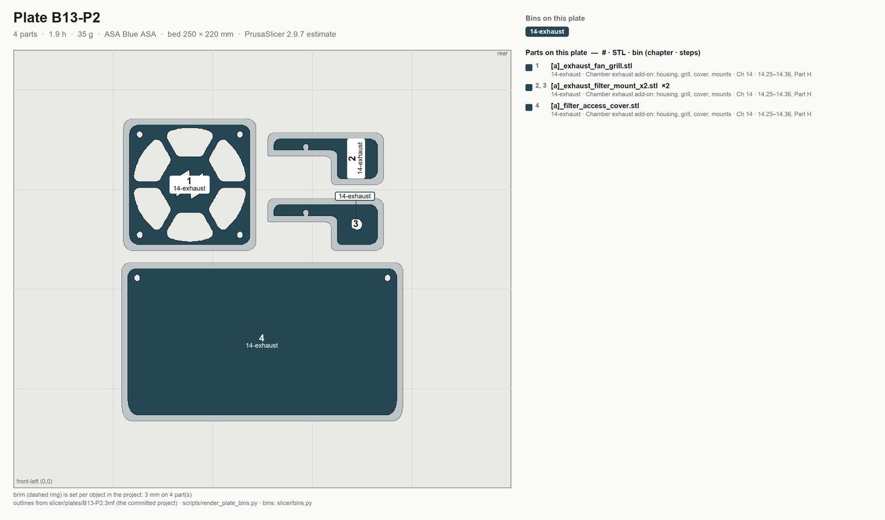

**B13-P2** · blue · 4 parts · 1.9 h · 35 g · bins: 14-exhaust · [Load step](../manual/print/B13-exhaust-housing.md#step-b134-load-plate-b13-p2)

## Batch B11 — [Bay ducting (PETG V0)](../manual/print/B11-bay-ducting.md)

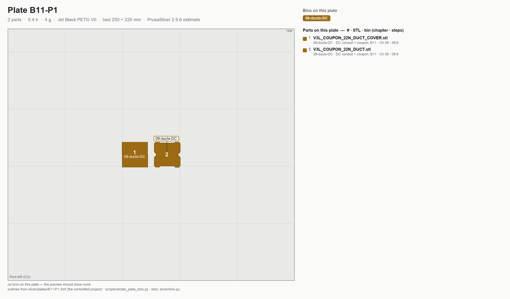

**B11-P1** · petg · 2 parts · 0.4 h · 4 g · bins: 09-ducts-DC · [Load step](../manual/print/B11-bay-ducting.md#step-b113-load-and-print-plate-b11-p1)

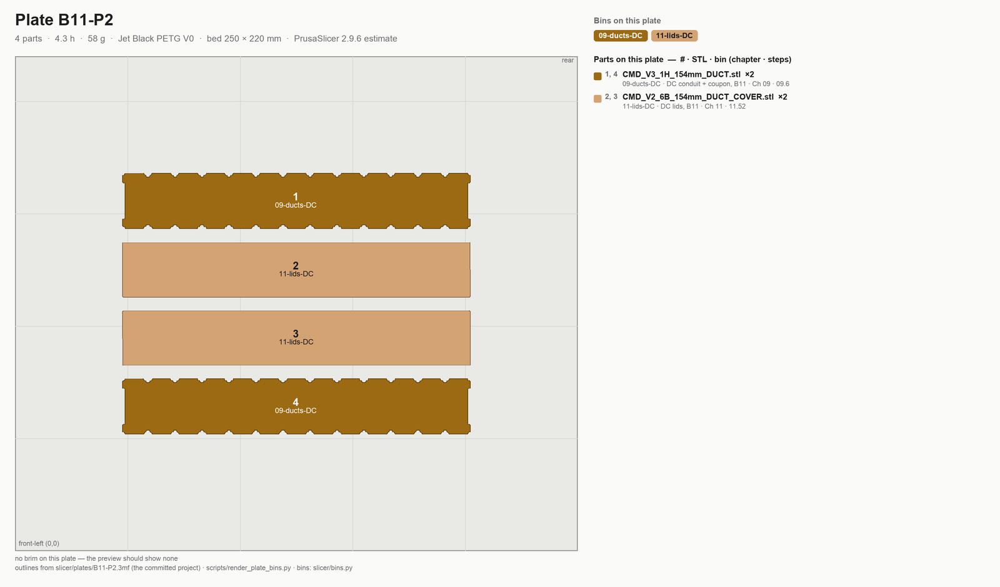

**B11-P2** · petg · 4 parts · 4.3 h · 58 g · bins: 09-ducts-DC, 11-lids-DC · [Load step](../manual/print/B11-bay-ducting.md#step-b115-load-and-print-plate-b11-p2)

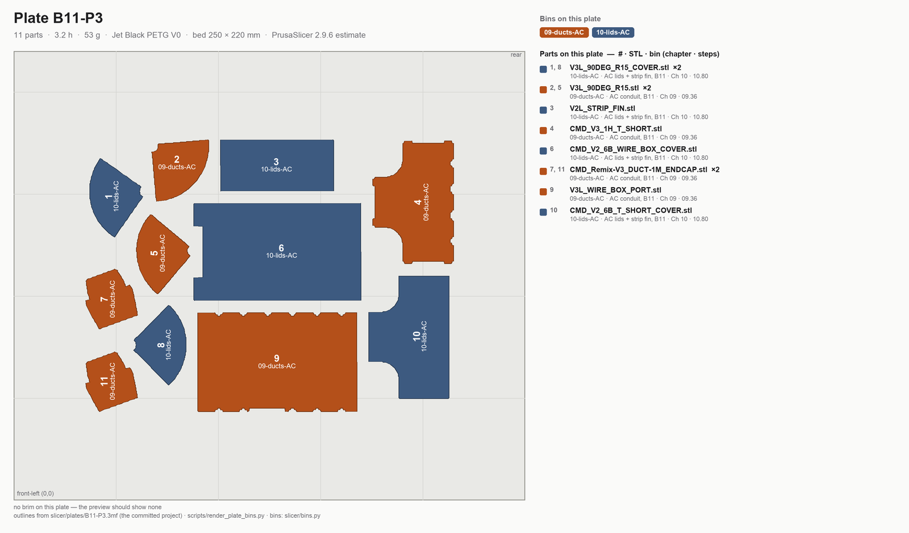

**B11-P3** · petg · 11 parts · 3.2 h · 53 g · bins: 09-ducts-AC, 10-lids-AC · [Load step](../manual/print/B11-bay-ducting.md#step-b116-load-and-print-plate-b11-p3)

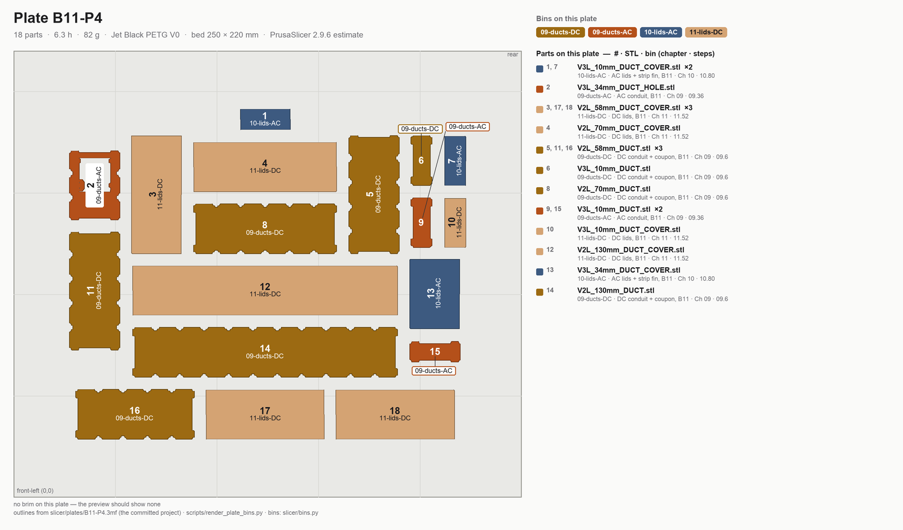

**B11-P4** · petg · 18 parts · 6.3 h · 82 g · bins: 09-ducts-DC, 09-ducts-AC, 10-lids-AC, 11-lids-DC · [Load step](../manual/print/B11-bay-ducting.md#step-b1112-load-and-print-plate-b11-p4)

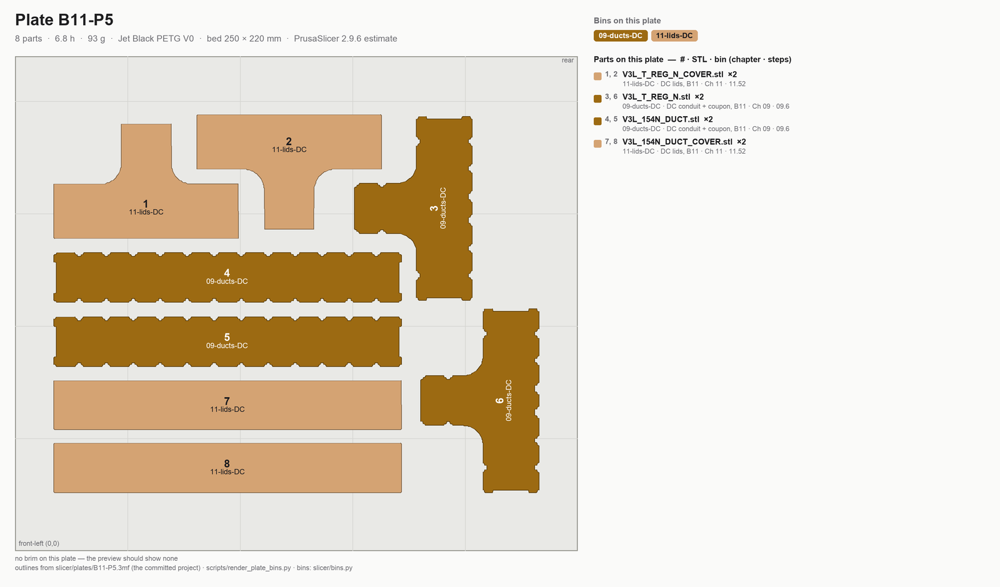

**B11-P5** · petg · 4 parts · 4.2 h · 56 g · bins: 09-ducts-DC, 11-lids-DC · [Load step](../manual/print/B11-bay-ducting.md#step-b1113-load-and-print-plate-b11-p5)

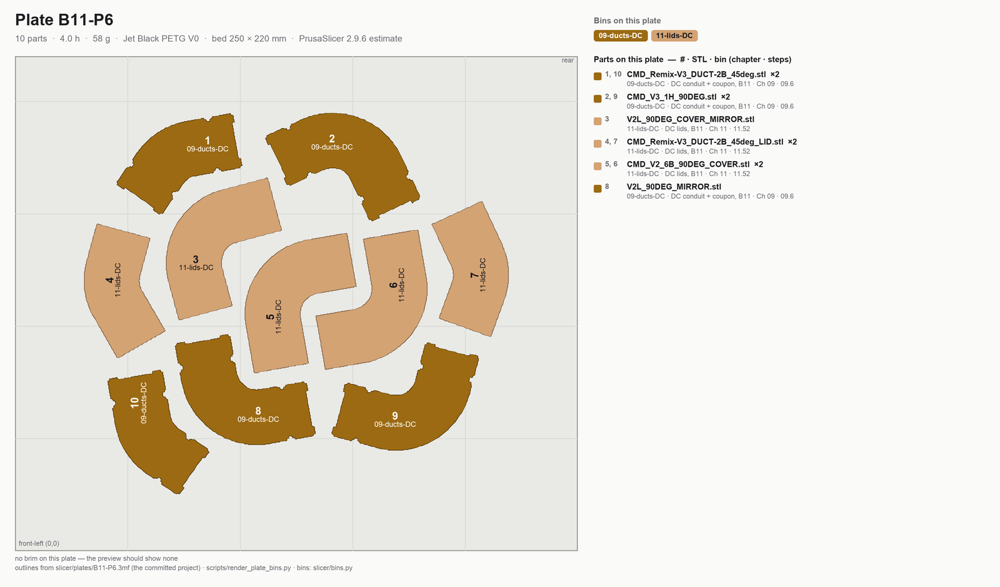

**B11-P6** · petg · 10 parts · 4.0 h · 58 g · bins: 09-ducts-DC, 11-lids-DC · [Load step](../manual/print/B11-bay-ducting.md#step-b1115-load-and-print-plate-b11-p6)

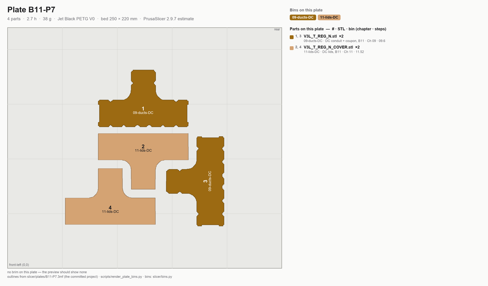

**B11-P7** · petg · 4 parts · 2.7 h · 38 g · bins: 09-ducts-DC, 11-lids-DC · [Load step](../manual/print/B11-bay-ducting.md#step-b1116-load-and-print-plate-b11-p7)

