# Plate sort sheets

_Generated by `scripts/build_printables.py` from the committed plate 3MFs — do not hand-edit._

The paper copy for the bench: one bed per plate with its parts numbered as on the [plate plans](plate-plans.md), and beside it which numbers go into which bin. Lift the parts off the bed bin by bin and tick each box. The back of the bed is at the top.

Print on US Letter at 100 %, two plates to a page, in print order (the ASA run, then B11). After a plate is re-arranged, reprint its page: the numbers follow the positions on the bed.

<section class="sort-plate" id="sort-B00-P1">
<b>B00-P1</b>Batch B00 · 8 parts · 3.8 h · 51 g · Galaxy Black ASA, satin sheetback of bed ↑

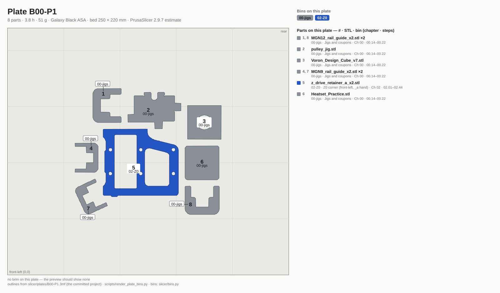

<b>00-jigs</b>Jigs and coupons☐
<ul><li><b>1, 8</b>MGN12_rail_guide ×2</li><li><b>2</b>pulley_jig</li><li><b>3</b>Voron_Design_Cube_v7</li><li><b>4, 7</b>MGN9_rail_guide ×2</li><li><b>6</b>Heatset_Practice</li></ul>

<b>02-Z0</b>Z0 corner (front-left, _a hand)☐
<ul><li><b>5</b>z_drive_retainer_a</li></ul>

</section><section class="sort-plate" id="sort-B01-P1">
<b>B01-P1</b>Batch B01 · 7 parts · 14.6 h · 200 g · Galaxy Black ASA, satin sheetback of bed ↑

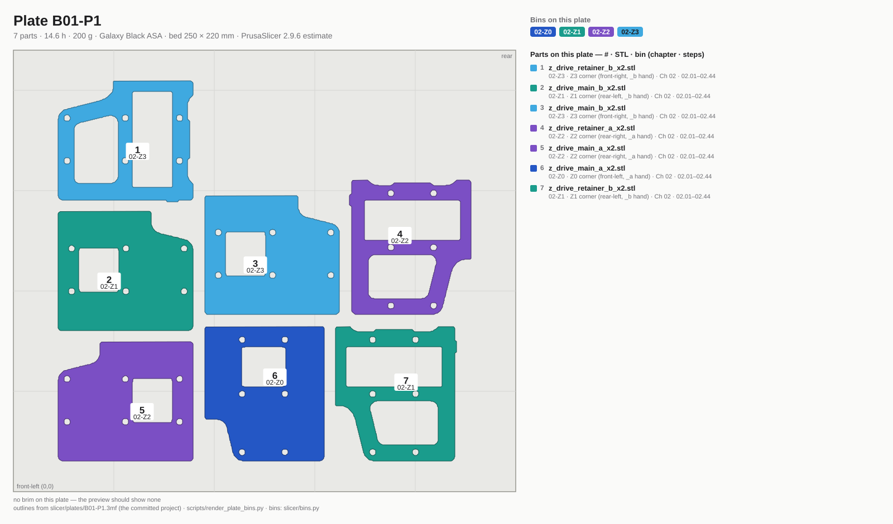

<b>02-Z3</b>Z3 corner (front-right, _b hand)☐
<ul><li><b>1</b>z_drive_retainer_b</li><li><b>3</b>z_drive_main_b</li></ul>

<b>02-Z1</b>Z1 corner (rear-left, _b hand)☐
<ul><li><b>2</b>z_drive_main_b</li><li><b>7</b>z_drive_retainer_b</li></ul>

<b>02-Z2</b>Z2 corner (rear-right, _a hand)☐
<ul><li><b>4</b>z_drive_retainer_a</li><li><b>5</b>z_drive_main_a</li></ul>

<b>02-Z0</b>Z0 corner (front-left, _a hand)☐
<ul><li><b>6</b>z_drive_main_a</li></ul>

</section>

<section class="sort-plate" id="sort-B01-P2">
<b>B01-P2</b>Batch B01 · 24 parts · 8.3 h · 109 g · Galaxy Black ASA, satin sheetback of bed ↑

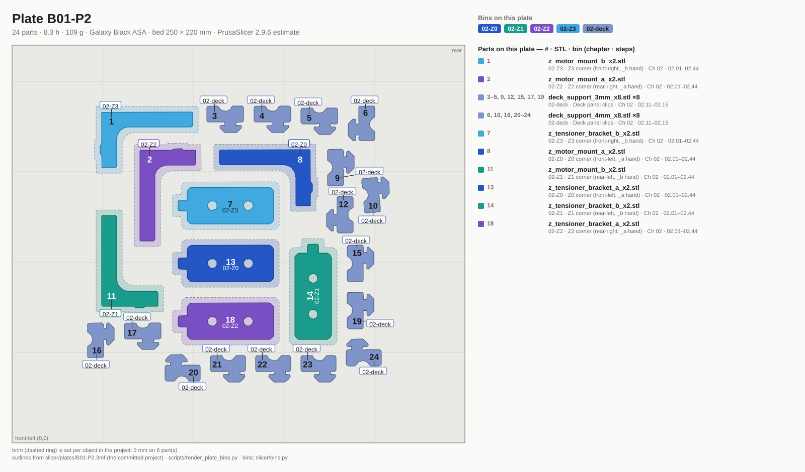

<b>02-Z3</b>Z3 corner (front-right, _b hand)☐
<ul><li><b>1</b>z_motor_mount_b</li><li><b>7</b>z_tensioner_bracket_b</li></ul>

<b>02-Z2</b>Z2 corner (rear-right, _a hand)☐
<ul><li><b>2</b>z_motor_mount_a</li><li><b>18</b>z_tensioner_bracket_a</li></ul>

<b>02-deck</b>Deck panel clips☐
<ul><li><b>3–5, 9, 12, 15, 17, 19</b>deck_support_3mm ×8</li><li><b>6, 10, 16, 20–24</b>deck_support_4mm ×8</li></ul>

<b>02-Z0</b>Z0 corner (front-left, _a hand)☐
<ul><li><b>8</b>z_motor_mount_a</li><li><b>13</b>z_tensioner_bracket_a</li></ul>

<b>02-Z1</b>Z1 corner (rear-left, _b hand)☐
<ul><li><b>11</b>z_motor_mount_b</li><li><b>14</b>z_tensioner_bracket_b</li></ul>

</section><section class="sort-plate sort-plate--dense" id="sort-B02-P1">
<b>B02-P1</b>Batch B02 · 16 parts · 7.1 h · 97 g · ASA Blue, satin sheetback of bed ↑

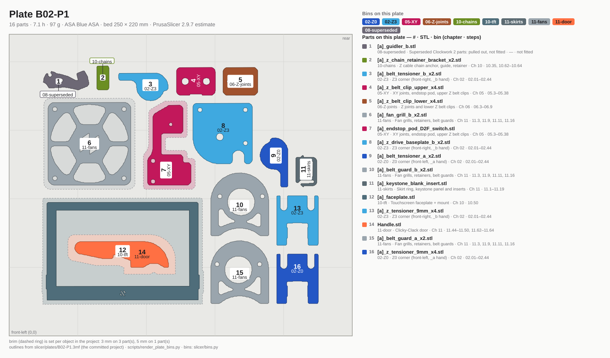

<b>08-superseded</b>Superseded Clockwork 2 parts: pulled out, not fitted☐
<ul><li><b>1</b>[a]_guidler_b</li></ul>

<b>10-chains</b>Z cable chain anchor, guide, retainer☐
<ul><li><b>2</b>[a]_z_chain_retainer_bracket</li></ul>

<b>02-Z3</b>Z3 corner (front-right, _b hand)☐
<ul><li><b>3</b>[a]_belt_tensioner_b</li><li><b>8</b>[a]_z_drive_baseplate_b</li><li><b>13</b>[a]_z_tensioner_9mm</li></ul>

<b>05-XY</b>XY joints, endstop pod, upper Z belt clips☐
<ul><li><b>4</b>[a]_z_belt_clip_upper</li><li><b>7</b>[a]_endstop_pod_D2F_switch</li></ul>

<b>06-Z-joints</b>Z joints and lower Z belt clips☐
<ul><li><b>5</b>[a]_z_belt_clip_lower</li></ul>

<b>11-fans</b>Fan grills, retainers, belt guards☐
<ul><li><b>6</b>[a]_fan_grill_b</li><li><b>10</b>[a]_belt_guard_b</li><li><b>15</b>[a]_belt_guard_a</li></ul>

<b>02-Z0</b>Z0 corner (front-left, _a hand)☐
<ul><li><b>9</b>[a]_belt_tensioner_a</li><li><b>16</b>[a]_z_tensioner_9mm</li></ul>

<b>11-skirts</b>Skirt ring, keystone panel and inserts☐
<ul><li><b>11</b>[a]_keystone_blank_insert</li></ul>

<b>10-tft</b>Touchscreen faceplate + mount☐
<ul><li><b>12</b>[a]_faceplate</li></ul>

<b>11-door</b>Clicky-Clack door☐
<ul><li><b>14</b>Handle</li></ul>

</section>

<section class="sort-plate sort-plate--dense" id="sort-B02-P2">
<b>B02-P2</b>Batch B02 · 16 parts · 8.2 h · 108 g · ASA Blue, satin sheetback of bed ↑

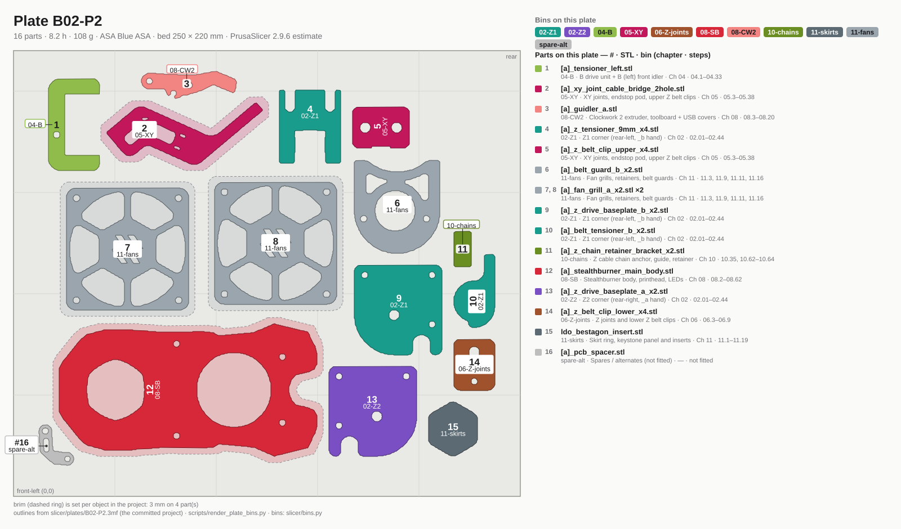

<b>04-B</b>B drive unit + B (left) front idler☐
<ul><li><b>1</b>[a]_tensioner_left</li></ul>

<b>05-XY</b>XY joints, endstop pod, upper Z belt clips☐
<ul><li><b>2</b>[a]_xy_joint_cable_bridge_2hole</li><li><b>5</b>[a]_z_belt_clip_upper</li></ul>

<b>08-superseded</b>Superseded Clockwork 2 parts: pulled out, not fitted☐
<ul><li><b>3</b>[a]_guidler_a</li><li><b>12</b>[a]_stealthburner_main_body</li></ul>

<b>02-Z1</b>Z1 corner (rear-left, _b hand)☐
<ul><li><b>4</b>[a]_z_tensioner_9mm</li><li><b>9</b>[a]_z_drive_baseplate_b</li><li><b>10</b>[a]_belt_tensioner_b</li></ul>

<b>11-fans</b>Fan grills, retainers, belt guards☐
<ul><li><b>6</b>[a]_belt_guard_b</li><li><b>7, 8</b>[a]_fan_grill_a ×2</li></ul>

<b>10-chains</b>Z cable chain anchor, guide, retainer☐
<ul><li><b>11</b>[a]_z_chain_retainer_bracket</li></ul>

<b>02-Z2</b>Z2 corner (rear-right, _a hand)☐
<ul><li><b>13</b>[a]_z_drive_baseplate_a</li></ul>

<b>06-Z-joints</b>Z joints and lower Z belt clips☐
<ul><li><b>14</b>[a]_z_belt_clip_lower</li></ul>

<b>11-skirts</b>Skirt ring, keystone panel and inserts☐
<ul><li><b>15</b>ldo_bestagon_insert</li></ul>

<b>spare-alt</b>Spares / alternates (not fitted)☐
<ul><li><b>16</b>[a]_pcb_spacer</li></ul>

</section><section class="sort-plate" id="sort-B02-P3">
<b>B02-P3</b>Batch B02 · 7 parts · 2.6 h · 36 g · ASA Blue, satin sheetback of bed ↑

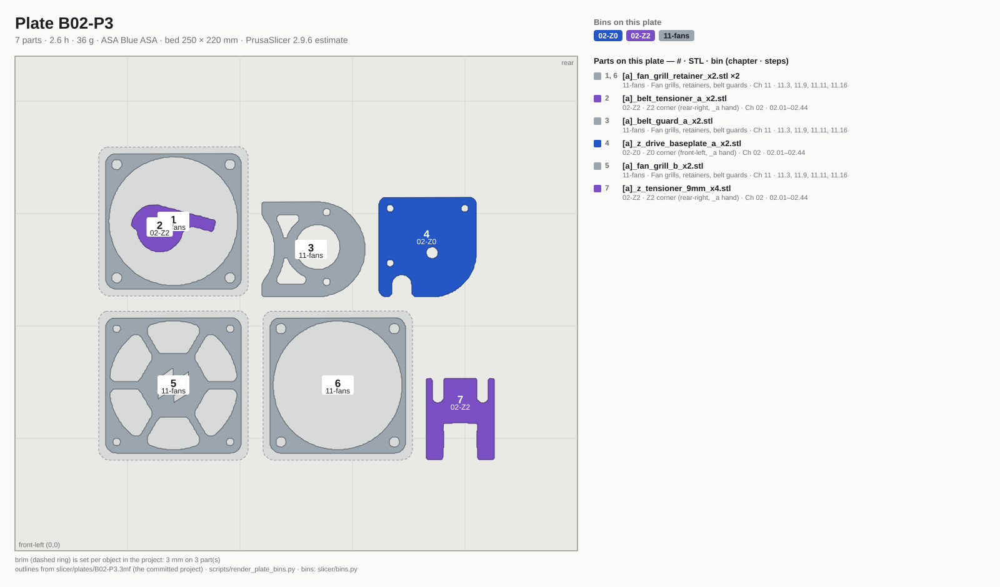

<b>11-fans</b>Fan grills, retainers, belt guards☐
<ul><li><b>1, 6</b>[a]_fan_grill_retainer ×2</li><li><b>3</b>[a]_belt_guard_a</li><li><b>5</b>[a]_fan_grill_b</li></ul>

<b>02-Z2</b>Z2 corner (rear-right, _a hand)☐
<ul><li><b>2</b>[a]_belt_tensioner_a</li><li><b>7</b>[a]_z_tensioner_9mm</li></ul>

<b>02-Z0</b>Z0 corner (front-left, _a hand)☐
<ul><li><b>4</b>[a]_z_drive_baseplate_a</li></ul>

</section>

<section class="sort-plate" id="sort-B02-P4">
<b>B02-P4</b>Batch B02 · 10 parts · 3.1 h · 38 g · ASA Blue, satin sheetback of bed ↑

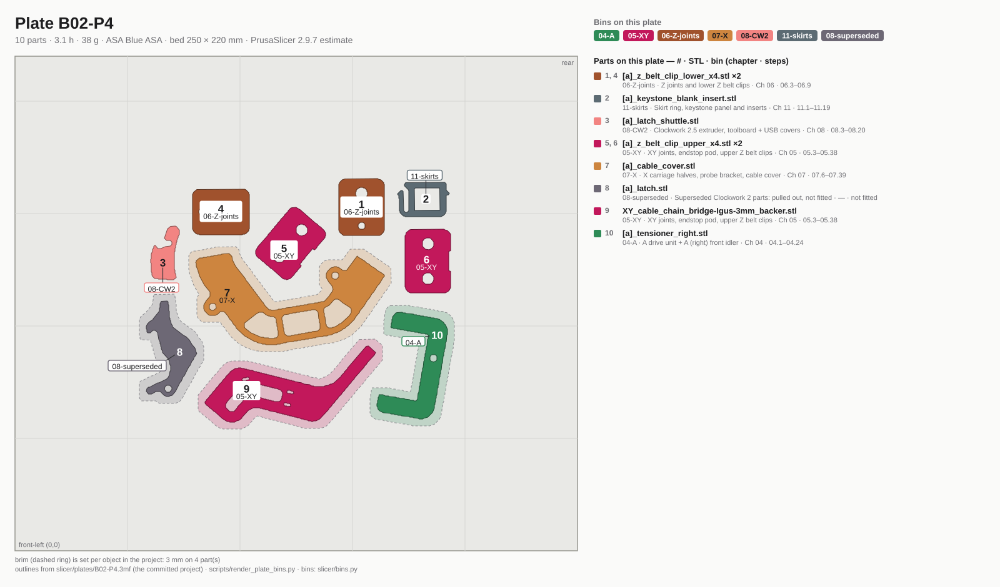

<b>06-Z-joints</b>Z joints and lower Z belt clips☐
<ul><li><b>1, 4</b>[a]_z_belt_clip_lower ×2</li></ul>

<b>11-skirts</b>Skirt ring, keystone panel and inserts☐
<ul><li><b>2</b>[a]_keystone_blank_insert</li></ul>

<b>08-CW2</b>Clockwork 2.5 extruder, toolboard + USB covers☐
<ul><li><b>3</b>[a]_latch_shuttle</li></ul>

<b>05-XY</b>XY joints, endstop pod, upper Z belt clips☐
<ul><li><b>5, 6</b>[a]_z_belt_clip_upper ×2</li><li><b>9</b>XY_cable_chain_bridge-Igus-3mm_backer</li></ul>

<b>07-X</b>X carriage halves, probe bracket, cable cover☐
<ul><li><b>7</b>[a]_cable_cover</li></ul>

<b>08-superseded</b>Superseded Clockwork 2 parts: pulled out, not fitted☐
<ul><li><b>8</b>[a]_latch</li></ul>

<b>04-A</b>A drive unit + A (right) front idler☐
<ul><li><b>10</b>[a]_tensioner_right</li></ul>

</section><section class="sort-plate" id="sort-B02-P5">
<b>B02-P5</b>Batch B02 · 4 parts · 3.9 h · 48 g · ASA Blue, satin sheetback of bed ↑

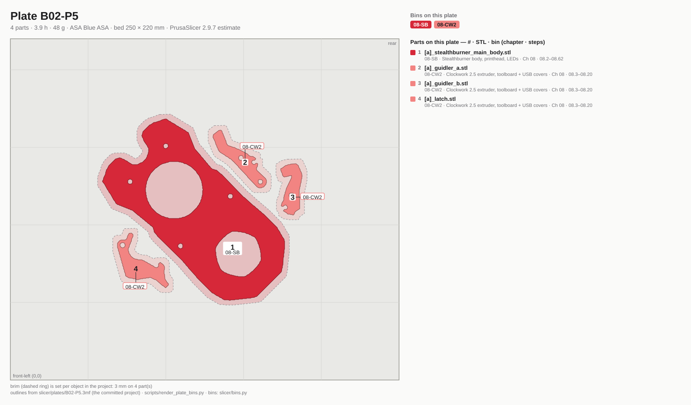

<b>08-SB</b>Stealthburner body, printhead, LEDs☐
<ul><li><b>1</b>[a]_stealthburner_main_body</li></ul>

<b>08-CW2</b>Clockwork 2.5 extruder, toolboard + USB covers☐
<ul><li><b>2</b>[a]_guidler_a</li><li><b>3</b>[a]_guidler_b</li><li><b>4</b>[a]_latch</li></ul>

</section>

<section class="sort-plate" id="sort-B03-P1">
<b>B03-P1</b>Batch B03 · 4 parts · 4.4 h · 61 g · Galaxy Black ASA, satin sheetback of bed ↑

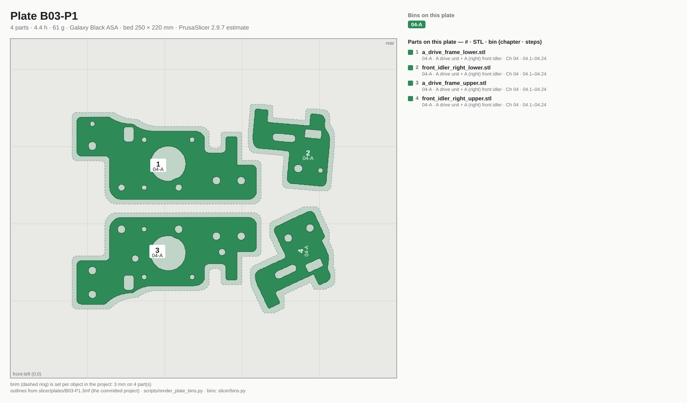

<b>04-A</b>A drive unit + A (right) front idler☐
<ul><li><b>1</b>a_drive_frame_lower</li><li><b>2</b>front_idler_right_lower</li><li><b>3</b>a_drive_frame_upper</li><li><b>4</b>front_idler_right_upper</li></ul>

</section><section class="sort-plate" id="sort-B03-P2">
<b>B03-P2</b>Batch B03 · 4 parts · 4.2 h · 59 g · Galaxy Black ASA, satin sheetback of bed ↑

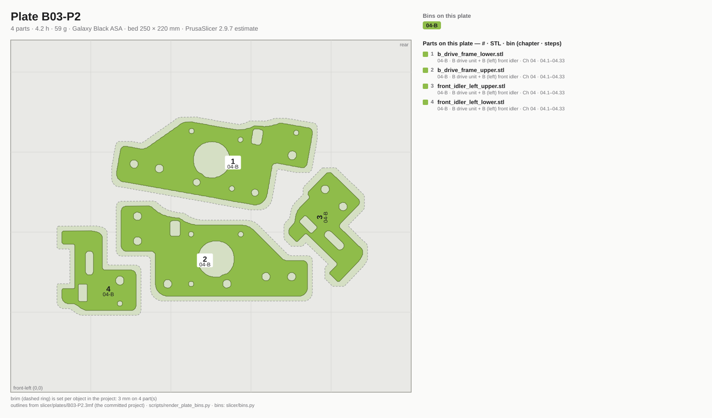

<b>04-B</b>B drive unit + B (left) front idler☐
<ul><li><b>1</b>b_drive_frame_lower</li><li><b>2</b>b_drive_frame_upper</li><li><b>3</b>front_idler_left_upper</li><li><b>4</b>front_idler_left_lower</li></ul>

</section>

<section class="sort-plate" id="sort-B04-P1">
<b>B04-P1</b>Batch B04 · 7 parts · 8.8 h · 117 g · Galaxy Black ASA, satin sheetback of bed ↑

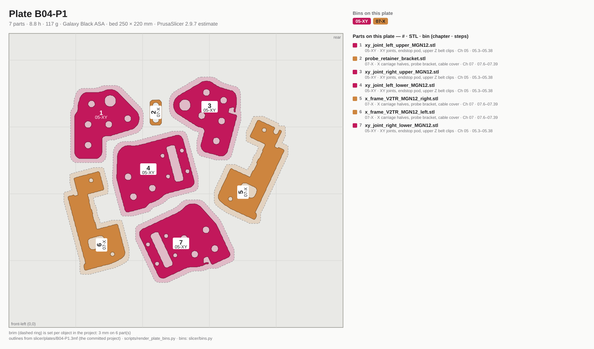

<b>05-XY</b>XY joints, endstop pod, upper Z belt clips☐
<ul><li><b>1</b>xy_joint_left_upper_MGN12</li><li><b>3</b>xy_joint_right_upper_MGN12</li><li><b>4</b>xy_joint_left_lower_MGN12</li><li><b>7</b>xy_joint_right_lower_MGN12</li></ul>

<b>07-X</b>X carriage halves, probe bracket, cable cover☐
<ul><li><b>2</b>probe_retainer_bracket</li><li><b>5</b>x_frame_V2TR_MGN12_right</li><li><b>6</b>x_frame_V2TR_MGN12_left</li></ul>

</section><section class="sort-plate" id="sort-B05-P1">
<b>B05-P1</b>Batch B05 · 14 parts · 6.2 h · 78 g · Galaxy Black ASA, satin sheetback of bed ↑

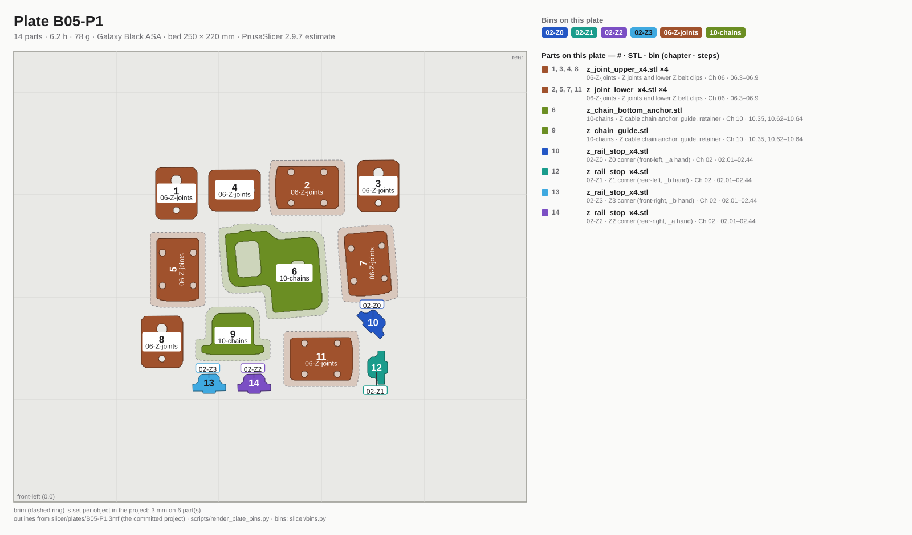

<b>06-Z-joints</b>Z joints and lower Z belt clips☐
<ul><li><b>1, 3, 4, 8</b>z_joint_upper ×4</li><li><b>2, 5, 7, 11</b>z_joint_lower ×4</li></ul>

<b>10-chains</b>Z cable chain anchor, guide, retainer☐
<ul><li><b>6</b>z_chain_bottom_anchor</li><li><b>9</b>z_chain_guide</li></ul>

<b>02-Z0</b>Z0 corner (front-left, _a hand)☐
<ul><li><b>10</b>z_rail_stop</li></ul>

<b>02-Z1</b>Z1 corner (rear-left, _b hand)☐
<ul><li><b>12</b>z_rail_stop</li></ul>

<b>02-Z3</b>Z3 corner (front-right, _b hand)☐
<ul><li><b>13</b>z_rail_stop</li></ul>

<b>02-Z2</b>Z2 corner (rear-right, _a hand)☐
<ul><li><b>14</b>z_rail_stop</li></ul>

</section>

<section class="sort-plate" id="sort-B06-P1">
<b>B06-P1</b>Batch B06 · 7 parts · 7.6 h · 95 g · Galaxy Black ASA, satin sheetback of bed ↑

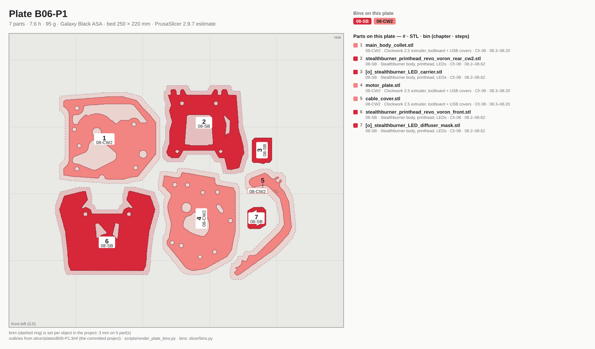

<b>08-CW2</b>Clockwork 2.5 extruder, toolboard + USB covers☐
<ul><li><b>1</b>main_body_collet</li><li><b>4</b>motor_plate</li><li><b>5</b>cable_cover</li></ul>

<b>08-SB</b>Stealthburner body, printhead, LEDs☐
<ul><li><b>2</b>stealthburner_printhead_revo_voron_rear_cw2</li><li><b>3</b>[o]_stealthburner_LED_carrier</li><li><b>6</b>stealthburner_printhead_revo_voron_front</li><li><b>7</b>[o]_stealthburner_LED_diffuser_mask</li></ul>

</section><section class="sort-plate" id="sort-B06-P2">
<b>B06-P2</b>Batch B06 · 12 parts · 4.1 h · 51 g · Galaxy Black ASA, satin sheetback of bed ↑

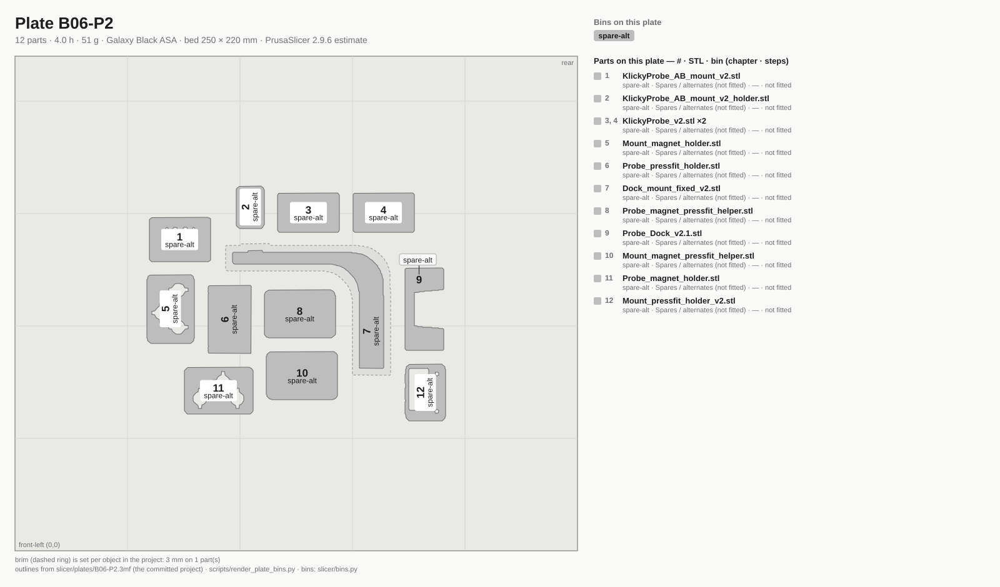

<b>spare-alt</b>Spares / alternates (not fitted)☐
<ul><li><b>1</b>Probe_magnet_holder</li><li><b>2</b>Mount_magnet_holder</li><li><b>3</b>Probe_pressfit_holder</li><li><b>4</b>KlickyProbe_AB_mount_v2_holder</li><li><b>5</b>Probe_magnet_pressfit_helper</li><li><b>6</b>Dock_mount_fixed_v2</li><li><b>7</b>Probe_Dock_v2.1</li><li><b>8</b>KlickyProbe_AB_mount_v2</li><li><b>9, 10</b>KlickyProbe_v2 ×2</li><li><b>11</b>Mount_magnet_pressfit_helper</li><li><b>12</b>Mount_pressfit_holder_v2</li></ul>

</section>

<section class="sort-plate" id="sort-B07-P1">
<b>B07-P1</b>Batch B07 · 7 parts · 5.7 h · 88 g · Galaxy Black ASA, satin sheetback of bed ↑

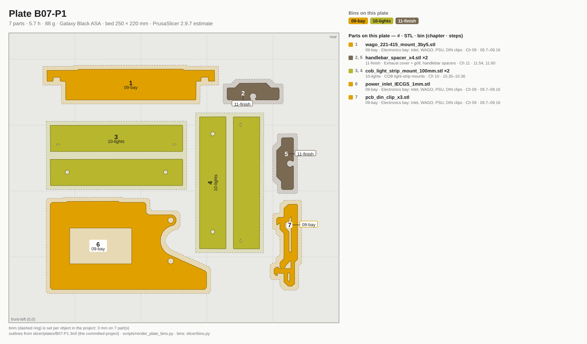

<b>09-bay</b>Electronics bay: inlet, WAGO, PSU, DIN clips☐
<ul><li><b>1</b>wago_221-415_mount_3by5</li><li><b>6</b>power_inlet_IECGS_1mm</li><li><b>7</b>pcb_din_clip</li></ul>

<b>11-finish</b>Exhaust cover + grill, handlebar spacers☐
<ul><li><b>2, 5</b>handlebar_spacer ×2</li></ul>

<b>10-lights</b>COB light-strip mounts☐
<ul><li><b>3, 4</b>cob_light_strip_mount_100mm ×2</li></ul>

</section><section class="sort-plate" id="sort-B07-P2">
<b>B07-P2</b>Batch B07 · 7 parts · 5.1 h · 79 g · Galaxy Black ASA, satin sheetback of bed ↑

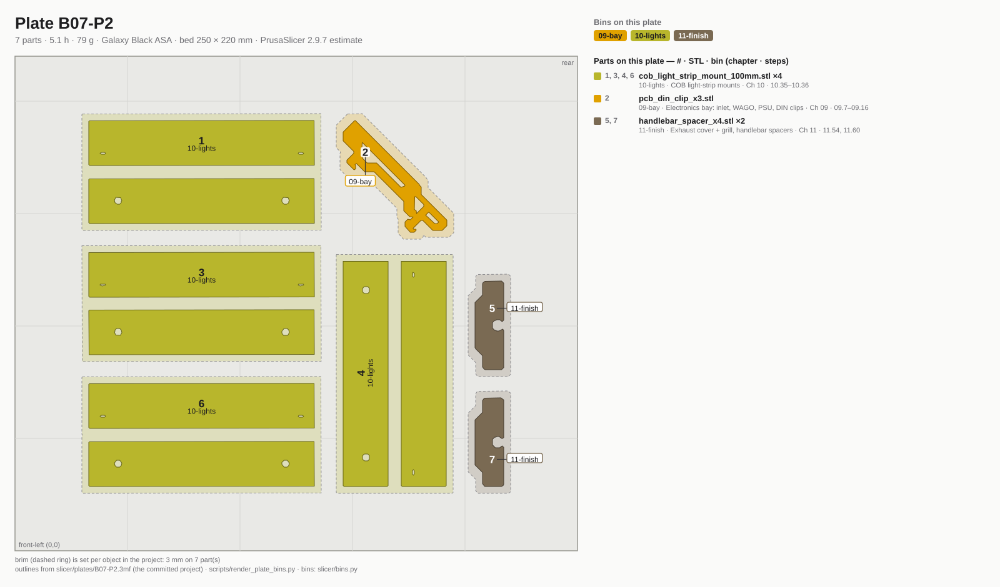

<b>10-lights</b>COB light-strip mounts☐
<ul><li><b>1, 3, 4, 6</b>cob_light_strip_mount_100mm ×4</li></ul>

<b>09-bay</b>Electronics bay: inlet, WAGO, PSU, DIN clips☐
<ul><li><b>2</b>pcb_din_clip</li></ul>

<b>11-finish</b>Exhaust cover + grill, handlebar spacers☐
<ul><li><b>5, 7</b>handlebar_spacer ×2</li></ul>

</section>

<section class="sort-plate" id="sort-B07-P3">
<b>B07-P3</b>Batch B07 · 8 parts · 4.5 h · 58 g · Galaxy Black ASA, satin sheetback of bed ↑

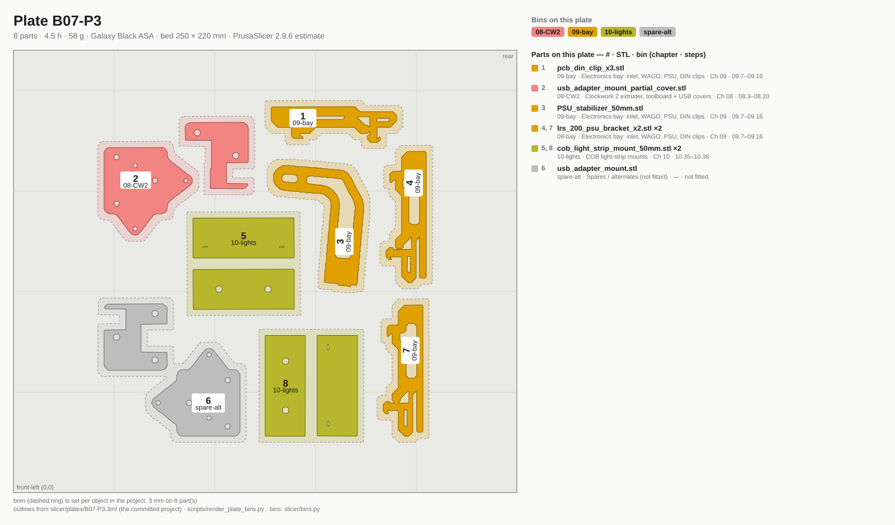

<b>09-bay</b>Electronics bay: inlet, WAGO, PSU, DIN clips☐
<ul><li><b>1</b>pcb_din_clip</li><li><b>3</b>PSU_stabilizer_50mm</li><li><b>4, 7</b>lrs_200_psu_bracket ×2</li></ul>

<b>08-CW2</b>Clockwork 2.5 extruder, toolboard + USB covers☐
<ul><li><b>2</b>usb_adapter_mount_partial_cover</li></ul>

<b>10-lights</b>COB light-strip mounts☐
<ul><li><b>5, 8</b>cob_light_strip_mount_50mm ×2</li></ul>

<b>spare-alt</b>Spares / alternates (not fitted)☐
<ul><li><b>6</b>usb_adapter_mount</li></ul>

</section><section class="sort-plate" id="sort-B08-P1">
<b>B08-P1</b>Batch B08 · 2 parts · 6.2 h · 102 g · Galaxy Black ASA, satin sheetback of bed ↑

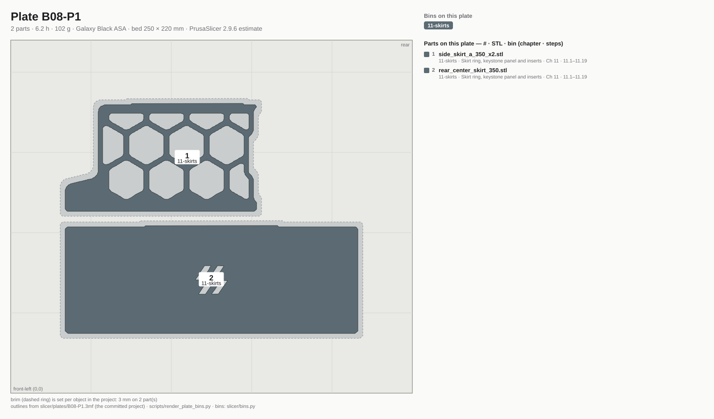

<b>11-skirts</b>Skirt ring, keystone panel and inserts☐
<ul><li><b>1</b>side_skirt_a_350</li><li><b>2</b>rear_center_skirt_350</li></ul>

</section>

<section class="sort-plate" id="sort-B08-P2">
<b>B08-P2</b>Batch B08 · 2 parts · 4.2 h · 62 g · Galaxy Black ASA, satin sheetback of bed ↑

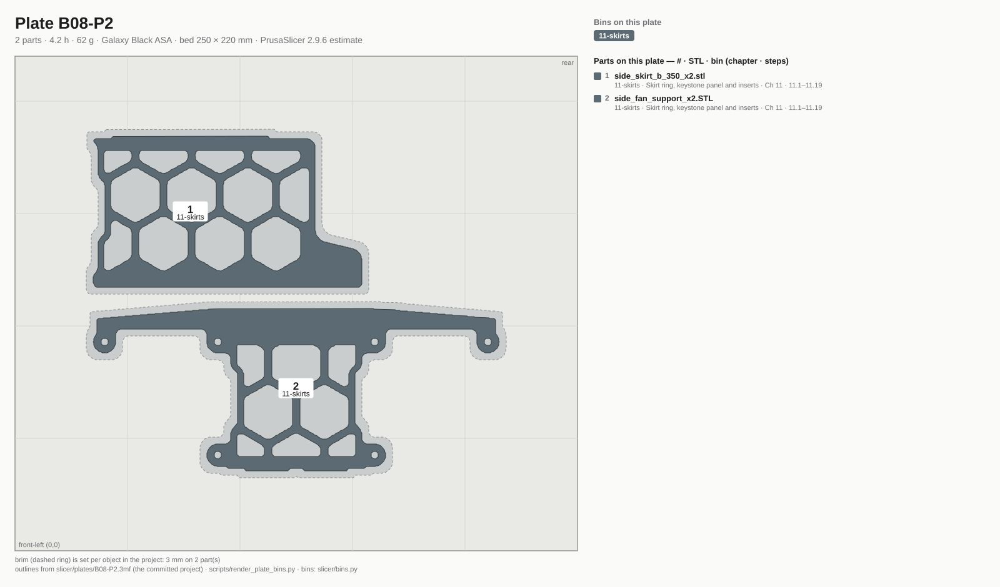

<b>11-skirts</b>Skirt ring, keystone panel and inserts☐
<ul><li><b>1</b>side_skirt_b_350</li><li><b>2</b>side_fan_support</li></ul>

</section><section class="sort-plate" id="sort-B08-P3">
<b>B08-P3</b>Batch B08 · 2 parts · 4.2 h · 62 g · Galaxy Black ASA, satin sheetback of bed ↑

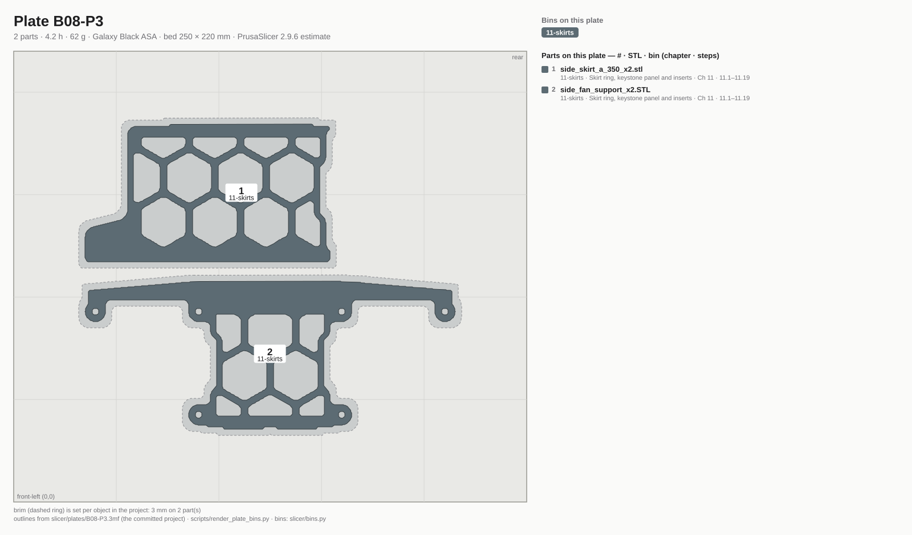

<b>11-skirts</b>Skirt ring, keystone panel and inserts☐
<ul><li><b>1</b>side_skirt_a_350</li><li><b>2</b>side_fan_support</li></ul>

</section>

<section class="sort-plate" id="sort-B08-P4">
<b>B08-P4</b>Batch B08 · 2 parts · 5.2 h · 75 g · Galaxy Black ASA, satin sheetback of bed ↑

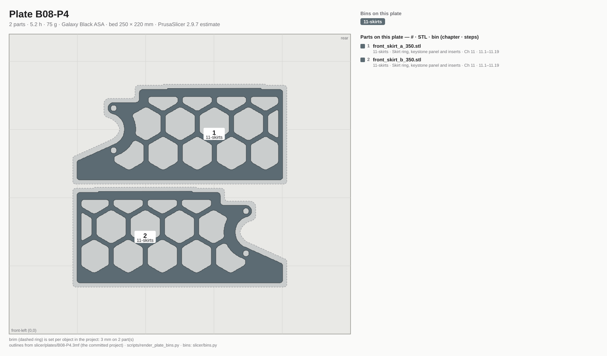

<b>11-skirts</b>Skirt ring, keystone panel and inserts☐
<ul><li><b>1</b>front_skirt_a_350</li><li><b>2</b>front_skirt_b_350</li></ul>

</section><section class="sort-plate" id="sort-B08-P5">
<b>B08-P5</b>Batch B08 · 3 parts · 6.7 h · 96 g · Galaxy Black ASA, satin sheetback of bed ↑

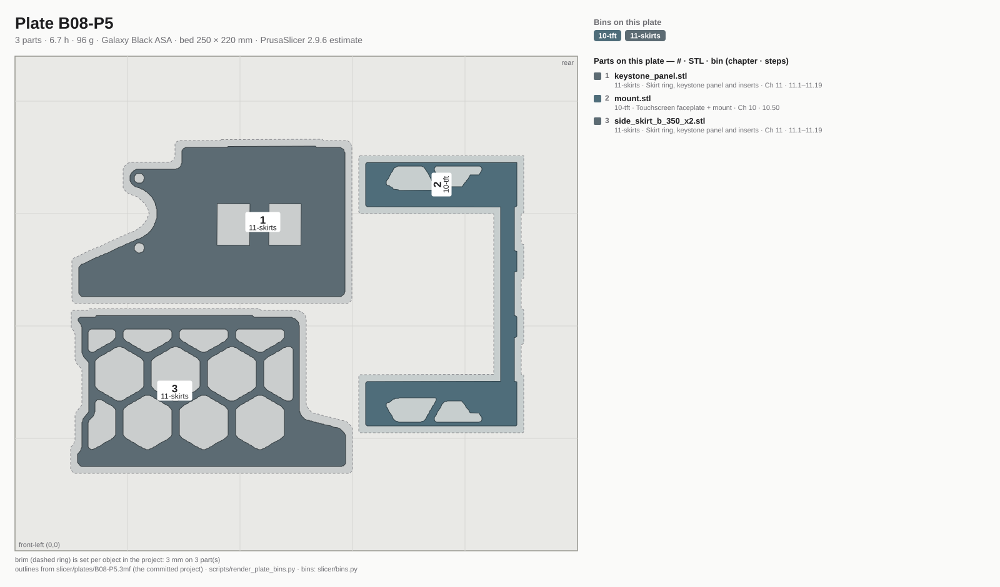

<b>11-skirts</b>Skirt ring, keystone panel and inserts☐
<ul><li><b>1</b>keystone_panel</li><li><b>3</b>side_skirt_b_350</li></ul>

<b>10-tft</b>Touchscreen faceplate + mount☐
<ul><li><b>2</b>mount</li></ul>

</section>

<section class="sort-plate" id="sort-B09-P1">
<b>B09-P1</b>Batch B09 · 12 parts · 3.9 h · 63 g · Galaxy Black ASA, satin sheetback of bed ↑

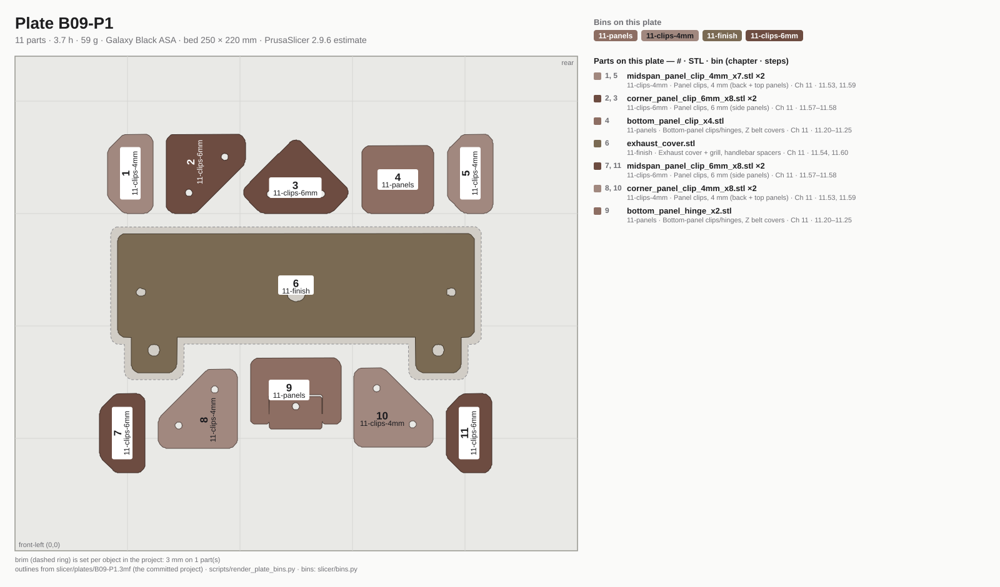

<b>11-clips-4mm</b>Panel clips, 4 mm (back + top panels)☐
<ul><li><b>1, 3</b>midspan_panel_clip_4mm ×2</li><li><b>5, 9</b>corner_panel_clip_4mm ×2</li></ul>

<b>11-panels</b>Bottom-panel clips/hinges, Z belt covers☐
<ul><li><b>2, 4</b>bottom_panel_clip ×2</li><li><b>8</b>bottom_panel_hinge</li></ul>

<b>11-clips-6mm</b>Panel clips, 6 mm (side panels)☐
<ul><li><b>6, 7</b>corner_panel_clip_6mm ×2</li><li><b>11, 12</b>midspan_panel_clip_6mm ×2</li></ul>

<b>11-finish</b>Exhaust cover + grill, handlebar spacers☐
<ul><li><b>10</b>exhaust_cover</li></ul>

</section><section class="sort-plate" id="sort-B09-P2">
<b>B09-P2</b>Batch B09 · 10 parts · 5.1 h · 65 g · Galaxy Black ASA, satin sheetback of bed ↑

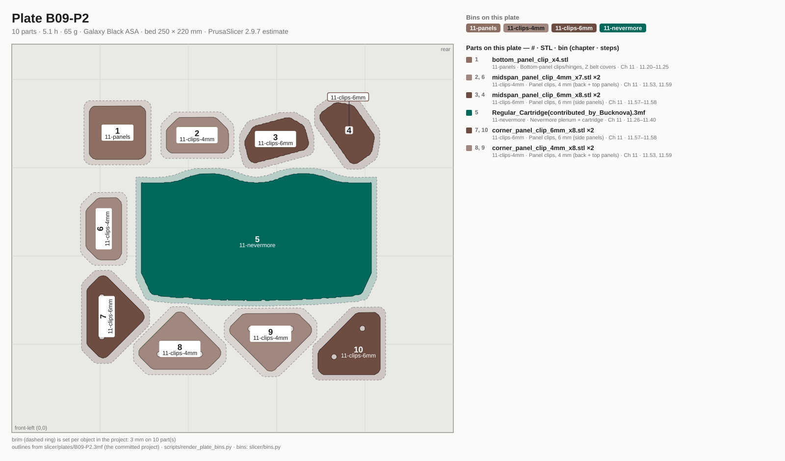

<b>11-panels</b>Bottom-panel clips/hinges, Z belt covers☐
<ul><li><b>1</b>bottom_panel_clip</li></ul>

<b>11-clips-4mm</b>Panel clips, 4 mm (back + top panels)☐
<ul><li><b>2, 6</b>midspan_panel_clip_4mm ×2</li><li><b>8, 9</b>corner_panel_clip_4mm ×2</li></ul>

<b>11-clips-6mm</b>Panel clips, 6 mm (side panels)☐
<ul><li><b>3, 4</b>midspan_panel_clip_6mm ×2</li><li><b>7, 10</b>corner_panel_clip_6mm ×2</li></ul>

<b>11-nevermore</b>Nevermore plenum + cartridge☐
<ul><li><b>5</b>Regular_Cartridge(contributed_by_Bucknova)</li></ul>

</section>

<section class="sort-plate" id="sort-B09-P3">
<b>B09-P3</b>Batch B09 · 7 parts · 4.5 h · 65 g · Galaxy Black ASA, satin sheetback of bed ↑

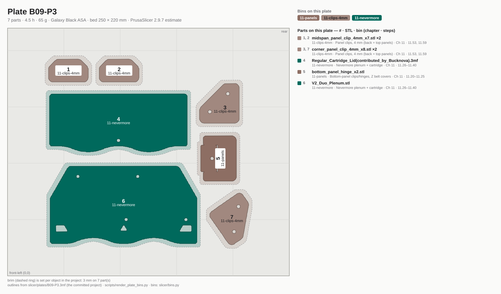

<b>11-clips-4mm</b>Panel clips, 4 mm (back + top panels)☐
<ul><li><b>1, 2</b>midspan_panel_clip_4mm ×2</li><li><b>3, 7</b>corner_panel_clip_4mm ×2</li></ul>

<b>11-nevermore</b>Nevermore plenum + cartridge☐
<ul><li><b>4</b>Regular_Cartridge_Lid(contributed_by_Bucknova)</li><li><b>6</b>V2_Duo_Plenum</li></ul>

<b>11-panels</b>Bottom-panel clips/hinges, Z belt covers☐
<ul><li><b>5</b>bottom_panel_hinge</li></ul>

</section><section class="sort-plate" id="sort-B09-P4">
<b>B09-P4</b>Batch B09 · 10 parts · 3.3 h · 47 g · Galaxy Black ASA, satin sheetback of bed ↑

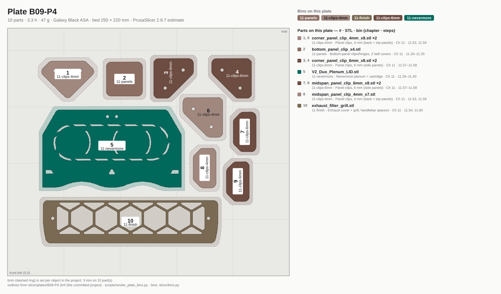

<b>11-clips-4mm</b>Panel clips, 4 mm (back + top panels)☐
<ul><li><b>1, 6</b>corner_panel_clip_4mm ×2</li><li><b>8</b>midspan_panel_clip_4mm</li></ul>

<b>11-panels</b>Bottom-panel clips/hinges, Z belt covers☐
<ul><li><b>2</b>bottom_panel_clip</li></ul>

<b>11-clips-6mm</b>Panel clips, 6 mm (side panels)☐
<ul><li><b>3, 4</b>corner_panel_clip_6mm ×2</li><li><b>7, 9</b>midspan_panel_clip_6mm ×2</li></ul>

<b>11-nevermore</b>Nevermore plenum + cartridge☐
<ul><li><b>5</b>V2_Duo_Plenum_LID</li></ul>

<b>11-finish</b>Exhaust cover + grill, handlebar spacers☐
<ul><li><b>10</b>exhaust_filter_grill</li></ul>

</section>

<section class="sort-plate" id="sort-B09-P5">
<b>B09-P5</b>Batch B09 · 10 parts · 4.0 h · 60 g · Galaxy Black ASA, satin sheetback of bed ↑

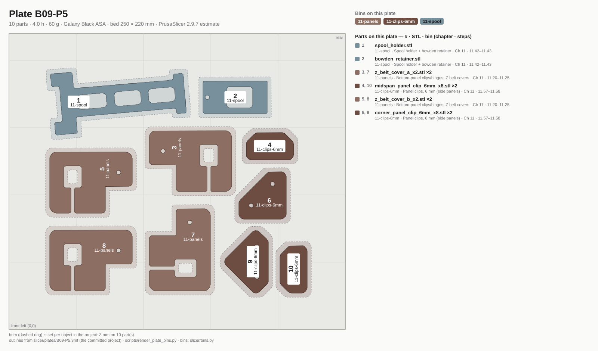

<b>11-spool</b>Spool holder + bowden retainer☐
<ul><li><b>1</b>spool_holder</li><li><b>2</b>bowden_retainer</li></ul>

<b>11-panels</b>Bottom-panel clips/hinges, Z belt covers☐
<ul><li><b>3, 7</b>z_belt_cover_a ×2</li><li><b>5, 8</b>z_belt_cover_b ×2</li></ul>

<b>11-clips-6mm</b>Panel clips, 6 mm (side panels)☐
<ul><li><b>4, 10</b>midspan_panel_clip_6mm ×2</li><li><b>6, 9</b>corner_panel_clip_6mm ×2</li></ul>

</section><section class="sort-plate" id="sort-B10-P1">
<b>B10-P1</b>Batch B10 · 8 parts · 5.7 h · 75 g · Galaxy Black ASA, satin sheetback of bed ↑

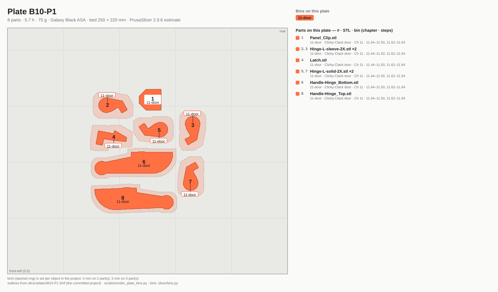

<b>11-door</b>Clicky-Clack door☐
<ul><li><b>1</b>Panel_Clip</li><li><b>2, 3</b>Hinge-L-sleeve-2X ×2</li><li><b>4</b>Latch</li><li><b>5, 7</b>Hinge-L-solid-2X ×2</li><li><b>6</b>Handle-Hinge_Bottom</li><li><b>8</b>Handle-Hinge_Top</li></ul>

</section>

<section class="sort-plate" id="sort-B12-P1">
<b>B12-P1</b>Batch B12 · 1 part · 6.9 h · 105 g · Galaxy Black ASA, satin sheetback of bed ↑

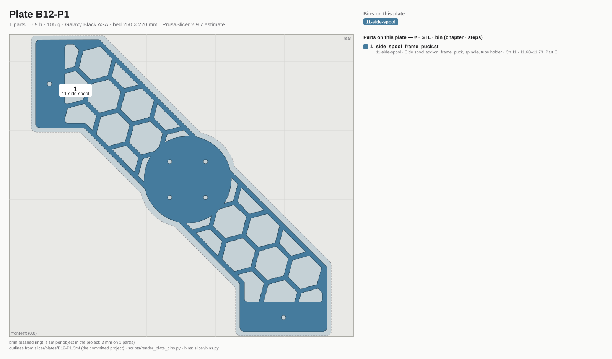

<b>11-side-spool</b>Side spool add-on: frame, puck, spindle, tube holder☐
<ul><li><b>1</b>side_spool_frame_puck</li></ul>

</section><section class="sort-plate" id="sort-B12-P2">
<b>B12-P2</b>Batch B12 · 3 parts · 1.8 h · 28 g · Galaxy Black ASA, satin sheetback of bed ↑

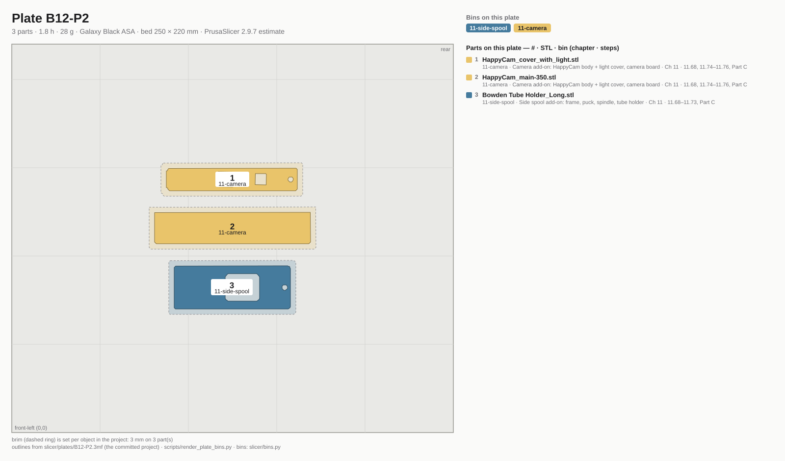

<b>11-camera</b>Camera add-on: HappyCam body + light cover, camera board☐
<ul><li><b>1</b>HappyCam_cover_with_light</li><li><b>2</b>HappyCam_main-350</li></ul>

<b>11-side-spool</b>Side spool add-on: frame, puck, spindle, tube holder☐
<ul><li><b>3</b>Bowden Tube Holder_Long</li></ul>

</section>

<section class="sort-plate" id="sort-B12-P3">
<b>B12-P3</b>Batch B12 · 2 parts · 5.7 h · 83 g · ASA Blue, satin sheetback of bed ↑

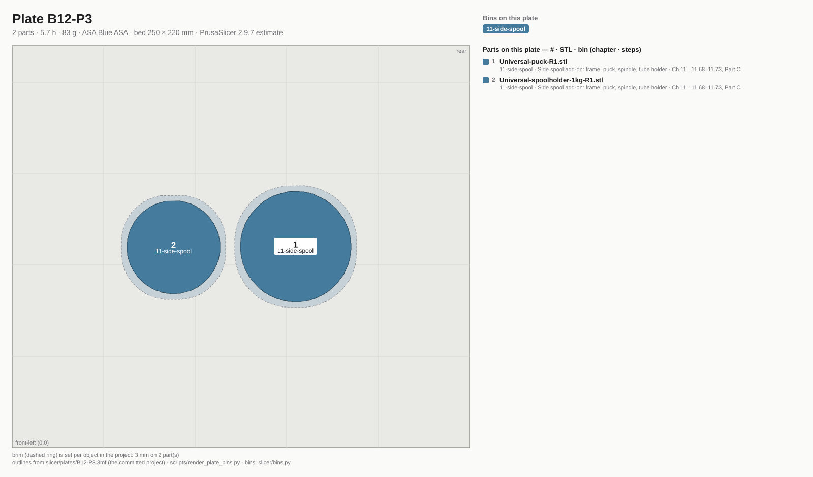

<b>11-side-spool</b>Side spool add-on: frame, puck, spindle, tube holder☐
<ul><li><b>1</b>Universal-puck-R1</li><li><b>2</b>Universal-spoolholder-1kg-R1</li></ul>

</section><section class="sort-plate" id="sort-B13-P1">
<b>B13-P1</b>Batch B13 · 1 part · 4.5 h · 66 g · Galaxy Black ASA, satin sheetback of bed ↑

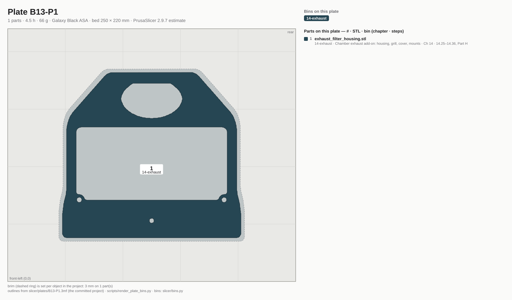

<b>14-exhaust</b>Chamber exhaust add-on: housing, grill, cover, mounts☐
<ul><li><b>1</b>exhaust_filter_housing</li></ul>

</section>

<section class="sort-plate" id="sort-B13-P2">
<b>B13-P2</b>Batch B13 · 4 parts · 1.9 h · 35 g · ASA Blue, satin sheetback of bed ↑

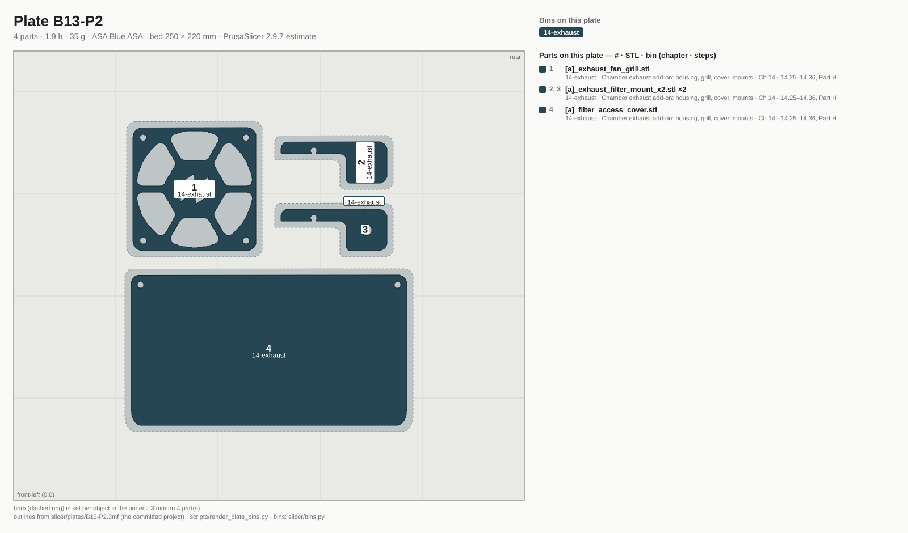

<b>14-exhaust</b>Chamber exhaust add-on: housing, grill, cover, mounts☐
<ul><li><b>1</b>[a]_exhaust_fan_grill</li><li><b>2, 3</b>[a]_exhaust_filter_mount ×2</li><li><b>4</b>[a]_filter_access_cover</li></ul>

</section><section class="sort-plate" id="sort-B11-P1">
<b>B11-P1</b>Batch B11 · 2 parts · 0.4 h · 4 g · Jet Black PETG V0, textured sheetback of bed ↑

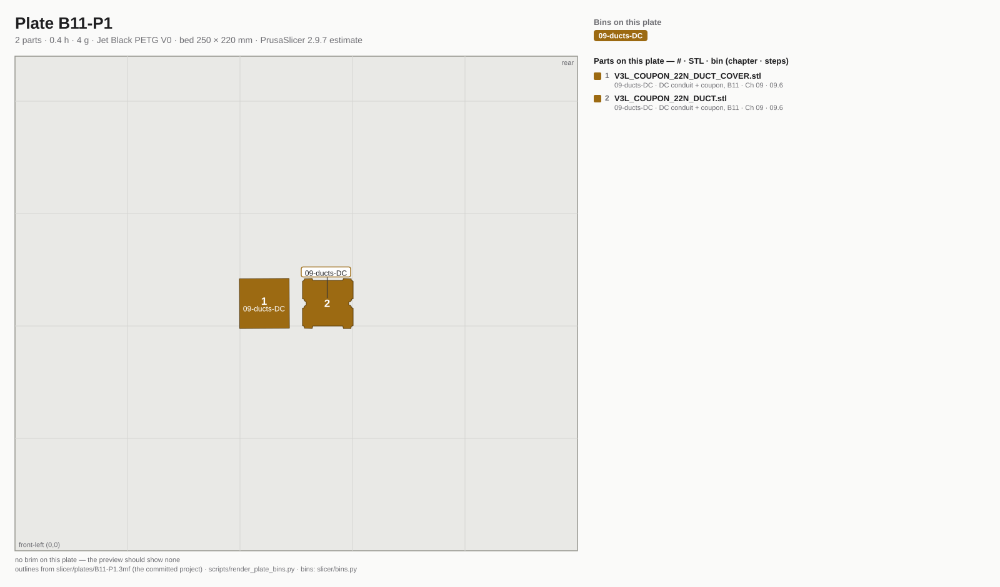

<b>09-ducts-DC</b>DC conduit + coupon, B11☐
<ul><li><b>1</b>V3L_COUPON_22N_DUCT_COVER</li><li><b>2</b>V3L_COUPON_22N_DUCT</li></ul>

</section>

<section class="sort-plate" id="sort-B11-P2">
<b>B11-P2</b>Batch B11 · 4 parts · 4.3 h · 58 g · Jet Black PETG V0, textured sheetback of bed ↑

<b>09-ducts-DC</b>DC conduit + coupon, B11☐
<ul><li><b>1, 4</b>CMD_V3_1H_154mm_DUCT ×2</li></ul>

<b>11-lids-DC</b>DC lids, B11☐
<ul><li><b>2, 3</b>CMD_V2_6B_154mm_DUCT_COVER ×2</li></ul>

</section><section class="sort-plate" id="sort-B11-P3">
<b>B11-P3</b>Batch B11 · 11 parts · 3.2 h · 53 g · Jet Black PETG V0, textured sheetback of bed ↑

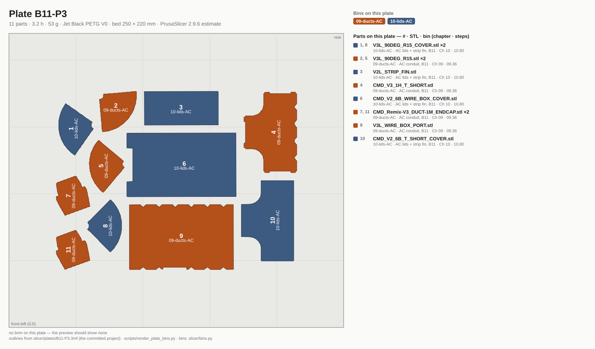

<b>10-lids-AC</b>AC lids + strip fin, B11☐
<ul><li><b>1, 8</b>V3L_90DEG_R15_COVER ×2</li><li><b>3</b>V2L_STRIP_FIN</li><li><b>6</b>CMD_V2_6B_WIRE_BOX_COVER</li><li><b>10</b>CMD_V2_6B_T_SHORT_COVER</li></ul>

<b>09-ducts-AC</b>AC conduit, B11☐
<ul><li><b>2, 5</b>V3L_90DEG_R15 ×2</li><li><b>4</b>CMD_V3_1H_T_SHORT</li><li><b>7, 11</b>CMD_Remix-V3_DUCT-1M_ENDCAP ×2</li><li><b>9</b>V3L_WIRE_BOX_PORT</li></ul>

</section>

<section class="sort-plate" id="sort-B11-P4">
<b>B11-P4</b>Batch B11 · 18 parts · 6.3 h · 82 g · Jet Black PETG V0, textured sheetback of bed ↑

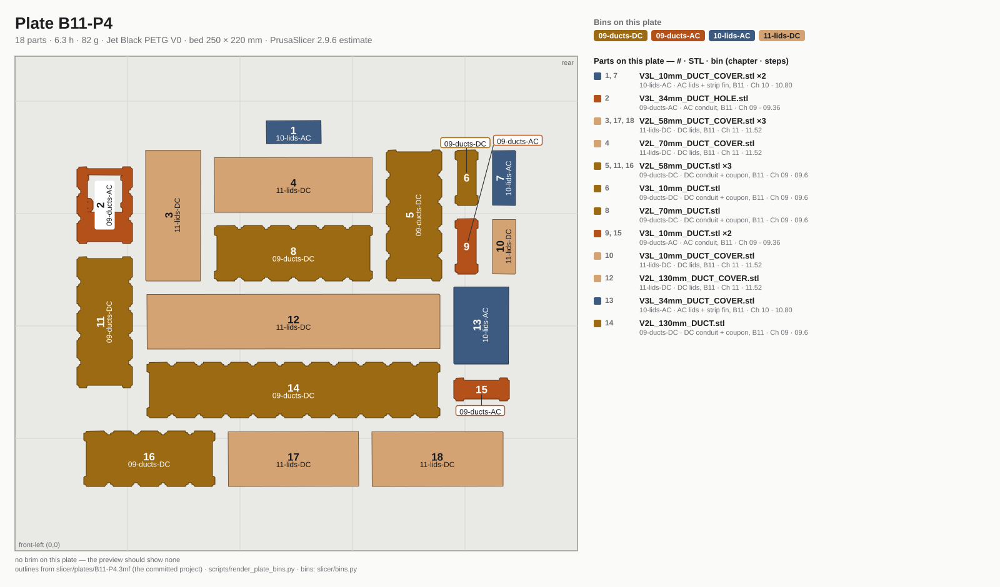

<b>10-lids-AC</b>AC lids + strip fin, B11☐
<ul><li><b>1, 7</b>V3L_10mm_DUCT_COVER ×2</li><li><b>13</b>V3L_34mm_DUCT_COVER</li></ul>

<b>09-ducts-AC</b>AC conduit, B11☐
<ul><li><b>2</b>V3L_34mm_DUCT_HOLE</li><li><b>9, 15</b>V3L_10mm_DUCT ×2</li></ul>

<b>11-lids-DC</b>DC lids, B11☐
<ul><li><b>3, 17, 18</b>V2L_58mm_DUCT_COVER ×3</li><li><b>4</b>V2L_70mm_DUCT_COVER</li><li><b>10</b>V3L_10mm_DUCT_COVER</li><li><b>12</b>V2L_130mm_DUCT_COVER</li></ul>

<b>09-ducts-DC</b>DC conduit + coupon, B11☐
<ul><li><b>5, 11, 16</b>V2L_58mm_DUCT ×3</li><li><b>6</b>V3L_10mm_DUCT</li><li><b>8</b>V2L_70mm_DUCT</li><li><b>14</b>V2L_130mm_DUCT</li></ul>

</section><section class="sort-plate" id="sort-B11-P5">
<b>B11-P5</b>Batch B11 · 4 parts · 4.2 h · 56 g · Jet Black PETG V0, textured sheetback of bed ↑

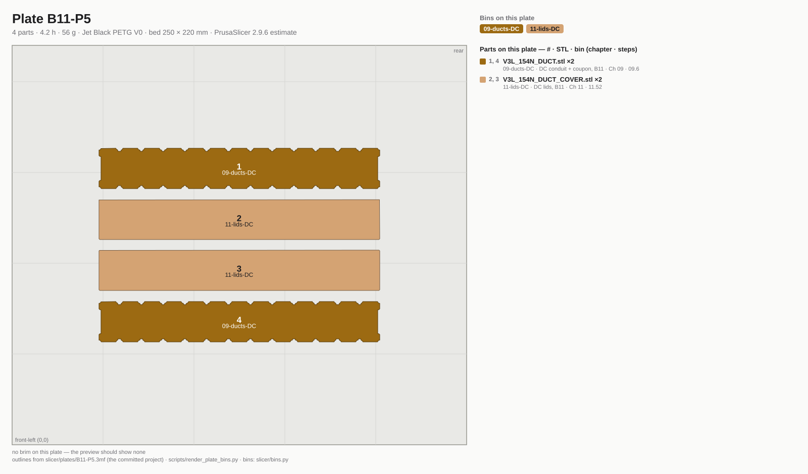

<b>09-ducts-DC</b>DC conduit + coupon, B11☐
<ul><li><b>1, 4</b>V3L_154N_DUCT ×2</li></ul>

<b>11-lids-DC</b>DC lids, B11☐
<ul><li><b>2, 3</b>V3L_154N_DUCT_COVER ×2</li></ul>

</section>

<section class="sort-plate" id="sort-B11-P6">
<b>B11-P6</b>Batch B11 · 10 parts · 4.0 h · 58 g · Jet Black PETG V0, textured sheetback of bed ↑

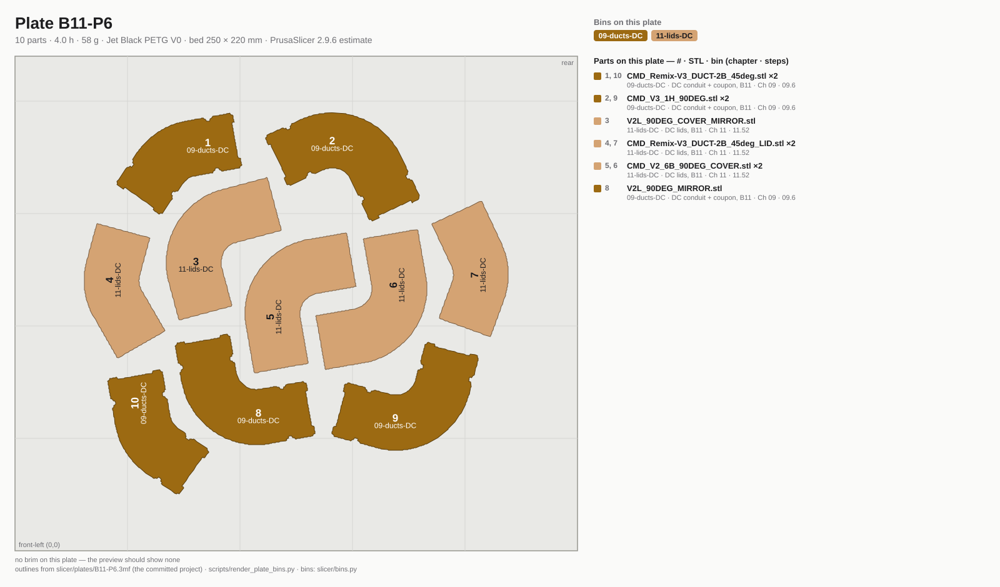

<b>09-ducts-DC</b>DC conduit + coupon, B11☐
<ul><li><b>1, 10</b>CMD_Remix-V3_DUCT-2B_45deg ×2</li><li><b>2, 9</b>CMD_V3_1H_90DEG ×2</li><li><b>8</b>V2L_90DEG_MIRROR</li></ul>

<b>11-lids-DC</b>DC lids, B11☐
<ul><li><b>3</b>V2L_90DEG_COVER_MIRROR</li><li><b>4, 7</b>CMD_Remix-V3_DUCT-2B_45deg_LID ×2</li><li><b>5, 6</b>CMD_V2_6B_90DEG_COVER ×2</li></ul>

</section><section class="sort-plate" id="sort-B11-P7">
<b>B11-P7</b>Batch B11 · 4 parts · 2.7 h · 38 g · Jet Black PETG V0, textured sheetback of bed ↑

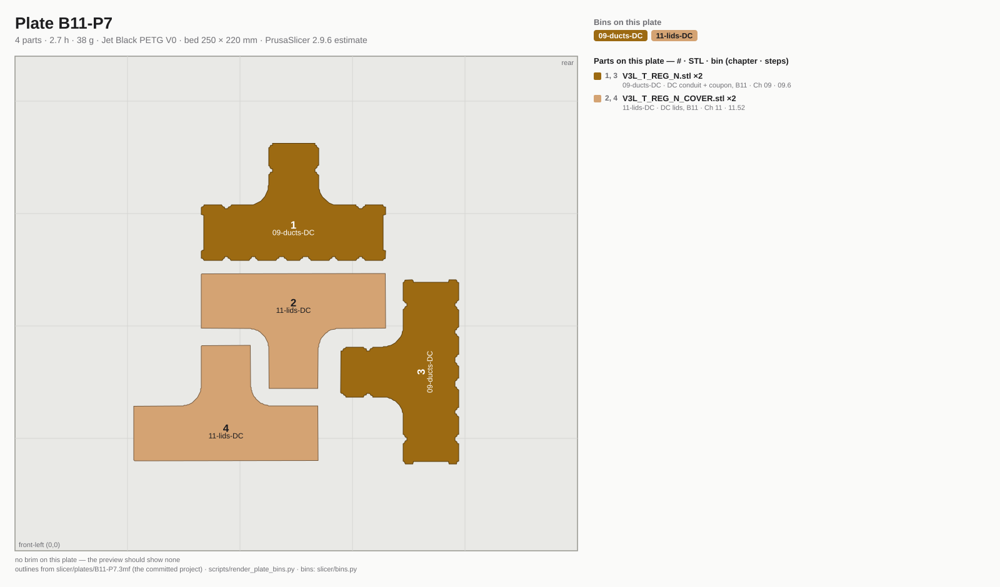

<b>09-ducts-DC</b>DC conduit + coupon, B11☐
<ul><li><b>1, 3</b>V3L_T_REG_N ×2</li></ul>

<b>11-lids-DC</b>DC lids, B11☐
<ul><li><b>2, 4</b>V3L_T_REG_N_COVER ×2</li></ul>

</section>

